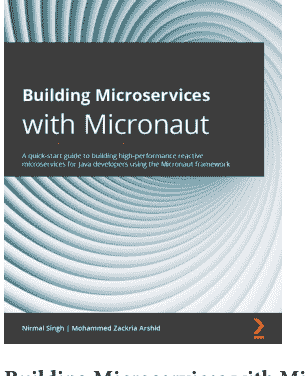
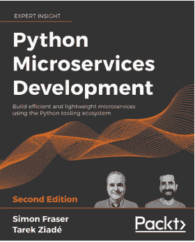

## 评估微服务架构

如今，许多组织正在将应用程序构建或重新平台化为微服务架构。在将任何应用程序拆分为微服务架构时，我们需要了解哪些因素在决策时至关重要，并分析该应用程序是否适合采用微服务架构。

在本章中，我们将总结一些重要因素，帮助你建立对微服务架构评估的认知和理解。无论你是构建新应用程序，还是将现有应用程序改造为微服务架构，这些因素都同样重要。你可以与客户展开讨论，参考这些因素来推动讨论并做出决策。

以下是我们将在本章中讨论的因素：

- 识别业务的核心优先事项
- 管理架构决策
- 团队结构
- 选择正确的方法论
- 拆分策略
- 评估**开发运维（DevOps）**能力
- 了解业务中哪些部分将变化得更快
- 基础设施就绪度
- 发布周期
- 服务间的通信协议
- 向客户端暴露服务
- 分布式事务处理
- 服务部署
- 托管平台的能力
- 部署策略
- 监控服务
- 为每个服务请求分配关联令牌
- 定义微服务骨架框架
- 测试与安全的左移方法

在本章中，我们将讨论分析微服务架构时需要考虑的一些关键方面。让我们开始吧！

## 识别业务的核心优先事项

要开始评估微服务架构，你需要了解业务的优先事项，以确保架构符合其目的。在评估微服务架构时，你应该与组织讨论以下几个方面：

- 可靠性
- 创新
- 效率

为了解这些领域的优先级，你可以询问团队，在0到10分的范围内，他们希望为这一领域赋予多大的重要性。此外，你还应记录与应用程序不同组件相关的预期**服务级别协议（SLA）**，以确保其满足组织的承诺。这些优先事项和承诺将作为锚点，指导我们的评估。

## 管理架构决策

当团队拥有自主权时，微服务架构才能蓬勃发展。这并不意味着团队可以为所欲为，而是赋予他们在正式商定原则的框架下自由做出决策的空间。这被称为共享治理，它体现了各团队之间在如何制定更广泛的微服务架构策略方面达成的共识。

评估这一因素时，以下几个方面至关重要：

- 你们是否已建立共享治理机制？
- 你们是否在维护架构日志，用于跟踪微服务的各项决策？
- 你们的架构日志是否记录了所有架构决策？
- 你们的团队是否能够轻松访问架构日志？
- 你们是否已建立评估工具、技术和框架的机制？

## 团队结构

拥有正确的团队结构对于微服务来说非常重要，可以避免团队间不必要的沟通。微服务架构提倡组建小而专注的跨职能团队来交付业务能力。这需要以团队重组为主导的思维转变。

评估这一因素时，以下几个方面至关重要：

- 团队是否按子域划分，且每个子域只由一个团队负责？
- 这些团队是否具备跨职能能力，即拥有足够的资源来构建和运维微服务？
- 你们的团队成员多久会花费时间处理与开发或运维相关的临时任务？

例如，在学生管理系统中，我们可以设置学生管理、课程管理、考勤管理、文档管理和员工管理等模块。我们可以从考勤管理开始对应用进行重新平台化，因为它对其他模块的依赖似乎较少，学生可以来此签到。在前端方面，当学生签到时，不再调用单体应用的模块，而是编写代码调用新的考勤管理服务。第二个可选对象可以是文档管理服务，学生可以使用它上传文档。为此，如果存在上传文档时需要更新学生主记录的场景，我们可能需要编写一个防腐层。你可以在*第4章：让棕地应用的重新平台化简单易行*中了解更多关于拆分策略的内容。

数据拆分和迁移在数据同步、对单体应用和微服务接口的双重写入、数据所有权、模式拆分、连接（join）、数据量以及数据完整性等方面可能具有挑战性。我们可以采用多种方法，例如在微服务之间保留共享数据库，根据业务能力或领域将数据库解耦为一组服务，或者将数据库隔离，使其完全独立于服务本身。每个服务独享数据库是最受青睐的选择。然而，在许多情况下这并不容易实现，在这种场景下，你可以实施数据库视图模式和数据库包装服务模式等模式。

此外，当今存在多种数据库技术，可以帮助你选择适合需求的技术。例如，在购物车服务中，DocumentDB 可能是存储购物车信息的正确数据库技术，因为你不需要关系型数据库，可以将购物车信息作为按用户**标识符（ID）**索引的文档来存储。

## 评估DevOps能力

在评估微服务架构时，评估DevOps能力非常重要。微服务旨在为组织带来快速的开发和变更采纳能力，而DevOps是实现这一目标应落实的核心实践之一。在评估微服务架构的DevOps能力时，应考虑以下几点：

- 组织是否理解DevOps的基本原理？
- 是否实施了DevOps实践？
  - 是否实施了敏捷实践？

- 服务是否采用受支持的微服务 chassis 模式构建？
- 有多少百分比的微服务映射到业务域？

## 基础设施就绪度

基础设施就绪度是在向微服务架构迁移时需要考虑的非常重要的因素。如果基础设施没有正确构建或没有使用合适的工具，将会影响应用程序的性能、可用性和可扩展性。可能会出现这样的场景：应用程序采用了所有推荐的技术和实践构建，但由于基础设施不正确，导致性能不佳。

评估微服务架构中的基础设施就绪度时必须考虑以下因素：

- 部署基础设施是否能确保服务的可扩展性？
- 部署基础设施是否支持通过脚本进行配置，并且可以使用 DevOps CI/CD 进行自动化？
- 部署基础设施是否提供适当的可用性 SLA？
- 是否已为整个基础设施制定了灾难恢复（DR）计划并安排演练？
- 数据是否已同步/异步复制到不同区域，以确保 DR 环境的数据可用性？
- 是否已制定适当的数据备份计划？
- 部署选项是否已记录？
- 部署基础设施是否监控并确保运行所需数量的服务？
- 部署基础设施是否支持服务的自愈？
- 您是否具备开放系统互连（OSI）第 7 层（L7）负载均衡能力？
- 您是否已部署 Web 应用防火墙（WAF）层？
- 您是否已实施限流策略？

## 发布周期

微服务架构支持快速开发，有助于缩短应用程序或服务的发布周期。评估此因素时，讨论以下方面很重要：

- 构建或发布应用程序的频率是多少？
- 您是否遵循任何发布应用程序版本的实践——即每月、每季度、半年或每年？
- 部署导致中断的频率如何？
- 从中断中恢复需要多长时间？
- 新的服务版本是否遵循语义化版本控制？
- 版本是否先发布到 staging 再发布到生产环境？
- **应用程序编程接口（APIs）** 是否遵循适当的版本指南？
- 什么会导致 API 版本变更？
- 您是否已实施版本控制？
- 您处理 **超文本传输协议（HTTP）** API 版本化的方式是什么？
  - **统一资源标识符（URI）** 路径版本化
  - 查询参数版本化
  - 内容类型版本化
  - 自定义头部版本化
- 您是否执行 **Google 远程过程调用（gRPC）** 版本化？
- 您是否已实施事件版本化？

## 服务间通信协议

微服务是独立的细粒度服务，它们跨进程边界、跨网络托管以解决不同的业务用例而相互通信。选择合适的通信协议是确保可靠通信的非常重要的因素。评估此因素时应考虑以下方面：

- 您是否遵循 API-first 方法？
- 您是否在同步通信协议上存在服务的深度链式调用？
- 系统中任何地方是否使用异步通信？
- 您使用哪种消息代理技术？
- 服务接收或处理的消息吞吐量是多少？
- 您是否具有客户端到微服务的直接通信？
- 您是否需要持久化消息？
- 您是否使用物化视图模式来解决微服务的频繁调用行为？
- 您是否已实施重试模式、断路器、指数退避和抖动？
- 您是否已定义领域事件以促进微服务之间的通信？

## 向客户端暴露服务

API 网关是开发微服务架构时的核心组件之一。由于多种因素，直接将微服务暴露给客户端并不是一种好的实践。您应评估以下内容：

- 服务是否直接被前端应用程序消费？
- 是否存在充当所有后端服务外观的网关？
- 网关是否提供配额限制、模拟响应和过滤 Internet 协议（IP）以及其他策略？
- 您是否使用多个 API 网关来满足不同客户端的需求？

然而，当您使用相同技术构建类似服务时，有时可以重用代码或框架以减少开发工作量。因此，在某些情况下，重用现有代码似乎是一种良好的实践。评估此因素时，这里有一些重要的方面需要考虑：

- 您是否维护服务模板或利用框架来启动新服务开发？
- 您是否拥有微服务的单一代码库？
- 您是否隔离了依赖项？
- 您是否将配置外部化？
- 敏感配置是否安全存储？
- 您是否对服务进行了容器化？
- 您是否在适当的地方使用了缓存？
- 您是否了解您的数据一致性要求？

## 主机平台的能力

构建微服务架构的主要好处之一是拥抱服务的易于扩展性。将单体应用程序容器化是一项具有挑战性的任务。然而，如果应用程序被分解为细粒度的服务，则可以轻松地将其容器化并根据需要进行扩展。讨论微服务架构的主机平台能力是一个重要因素。以下是您可以讨论以评估此因素的一些方面：

- 您使用哪种主机平台来部署服务？
- 主机平台是否可扩展？
- 主机平台是否支持自动扩展？
- 扩展主机平台需要多长时间？
- 供应商是否为主机平台提供了适当的 SLA？
- 主机平台是否有 DR 站点？

## 部署策略

部署策略是分发或升级程序在各种部署环境中的版本的方法。传统应用程序缺乏微服务解决方案的敏捷性和速度。开发人员可以快速进行更改，并且可以在测试最少的情况下发布新版本。评估部署策略时应考虑以下方面：

- 您是否已记录部署服务的部署策略？
- 您是否在使用过时的工具和技术来部署或托管服务？
- 部署服务时是否需要与其他团队协作？
- 您是否使用 IaC 设置基础设施？
- 您是否利用 DevOps 能力来自动化部署？
- 您是否在多个环境中传播相同的构建？

## 监控服务

监控是任何基于微服务的应用程序的重要因素。由于应用程序被拆分为一组独立运行的各种服务，排查错误变得十分困难。如果您遵循适当的语义日志记录来监控服务，您的团队可以轻松监控和调查错误并快速响应。评估此因素时应考虑以下方面：

- 部署应用程序后您是否有监控实践？
- 是否已建立适当的日志机制？
- 是否已建立分布式追踪基础设施？
- 是否有记录异常的实践？
- 是否为每个服务实现了定义的健康检查？
- 您是否遵循语义日志记录？
- 您是否已实施关键指标、阈值和指标？

## 为每个服务请求分配关联令牌

微服务架构本质上是分布式的，许多服务相互交互以完成一个业务用例。关联令牌是一个唯一字符串（最好是**全局唯一标识符，即 GUID**），为每个请求分配，用于故障排查。

例如，如果有一个涉及许多服务的长链操作，将关联令牌传递给相关服务，有助于在该事务期间任意服务发生故障时轻松排查问题。通常，每个服务都有自己的数据库，并将关联令牌也保存在数据库记录中。

以下两点值得提及：

- 设置一个关联 ID，将最终用户请求与对各个微服务的请求关联起来，这样我们就能快速定位最终用户请求所涉及的每个服务中的日志。
- 存储日志并使其可搜索的成本可能很高，为此，一些公司最终会选择抽样存储或在较短时间内存储日志——这两种方法各有利弊。如果采用抽样，需注意确保最终用户请求所涉及的所有微服务都保留同一最终用户请求的日志，否则我们将无法追踪失败的请求。

在讨论关联令牌时，应考虑以下几点：

- 关联令牌在什么时候分配？
- 由谁负责分配关联令牌？
- 是否将关联令牌保存到服务数据库中？
- 关联令牌的格式是什么？

## 定义微服务底盘框架

微服务底盘框架是一个基础性框架，用于处理日志记录、安全、异常处理、追踪与分发等横切关注点。在评估这一因素时，以下几点非常重要：

- 是否已建立微服务底盘框架？
- 服务是否安全，是否在每个服务内部处理安全约束？
- 是否为微服务使用了任何弹性模式？
- 是否已为服务实现幂等性？
- 是否在微服务实现中使用了协议转换？
- 是否在微服务内部进行消息转换？
- 是否实现了客户端或服务端发现模式？

## 测试与安全的左移方法

在微服务应用开发生命周期的早期，就应采用左移方法。在左移方法中，会更早地将不同活动（安全、测试）引入开发周期，以提高应用质量。

例如，如果正在构建一个新应用，应在设计阶段使用微软威胁建模等工具测试应用的安全性。在开发过程中，应使用**静态应用程序安全测试（SAST）**对代码进行安全扫描；此外，应用部署后，还应使用**动态应用程序安全测试（DAST）**工具进行测试。

在评估这一因素时，以下几点非常重要：

- 是否遵循编写单元测试的实践？
- 是否遵循在设计阶段评估架构的实践？
- 是否有衡量代码质量的工具？
- 是否有自动化工具来测试应用？
- 是否实现了**开发、安全与运维（DevSecOps）**？
- 是否使用了任何测试框架？
- 是否在前端使用了 WAF？
- 是否拥抱左移测试？
- 是否遵循编写单元测试的实践？
- 是否进行集成测试？
- 是否进行**端到端（E2E）**应用测试？
- 是否进行负载测试？
- 是否遵循自动化测试的实践？
- 是否遵循渗透测试的实践？
- 是否遵循混沌工程的实践？
- 测试是否自动化并定期或按需执行？
- 关键测试环境是否与生产环境保持 1:1 一致？

## 本章小结

在本章中，我们了解了评估微服务架构时需要考虑的各种重要因素。在构建或重新平台化应用时重视这些因素，有助于突出需要改进的领域。此外，你可以与团队讨论这些改进，以提升其架构的成熟度。

在本书中，我们学习了在创建微服务架构时应避免的各种反模式和架构陷阱。我们希望你现在能更好地理解这些陷阱，并在开发新应用或将现有应用重新平台化为微服务架构时加以考虑。

## 评估题

本章提供了本书各章末尾所有问题的答案。

### 第 1 章：为微服务探索做好准备

1. 微服务的设计原则包括单一职责、领域驱动设计、封装、接口隔离、自主性文化、所有权与治理、独立部署、自动化文化、为失败而设计以及可观测性。
2. 微服务架构的组成部分包括微服务、消息、持久化、状态管理、编排、服务发现和 API 网关。
3. 遵循微服务的设计原则并采用 Twelve-Factor App 方法论，将有助于构建高度可扩展、可维护且可移植的云原生微服务。

### 第 2 章：未能理解领域驱动设计的作用

1. 是
2. 知识消化、领域模型、使用统一语言，并将模型绑定到实现
3. 事务边界

### 第 3 章：微服务架构陷阱

1. 聚合器微服务模式可以帮助你构建负责编排不同微服务之间通信的微服务。它作为单一联系点，负责调用不同微服务并收集数据以执行业务任务。
2. 团队应在共享治理模型下，借助功能/特性矩阵评估不同工具、技术和框架，以处理不同方面的问题。
3. Dapr 是一个可移植的事件驱动运行时，有助于构建基于微服务的云和边缘应用的各个方面。它包括服务间调用、状态管理、资源绑定、发布/订阅、可观测性、密钥和 Actor 等构建块。

### 第 4 章：让遗留应用重新平台化不再简单

1. 从单体架构迁移到微服务架构的主要目标是增强可扩展性和生产力。应用被分解为一组更易于维护和变更的独立服务，拥抱敏捷性。
2. 将单体应用重新平台化为微服务架构时，需要考虑以下因素：
   - 对业务领域的了解
   - 对基础设施变更的认知
   - 选择正确的技术并拥抱学习曲线
   - 迁移到云端
   - 理解核心微服务与 API 微服务之间的区别
   - 避免啰嗦的服务
   - 确保开发、交付和运维就绪
3. 这些因素都很重要，因为所有因素都能为业务带来价值。如果应用具有可用性和可扩展性，它可以处理各种工作负载，确保对用户可用。另一方面，可靠性有助于交付高质量的产品。

## 第6章：通信陷阱与预防

1. 在同步通信中，客户端发送请求并等待服务的响应。同步通信可以是阻塞的或非阻塞的，但客户端只有在收到服务响应后才能继续后续处理。在异步通信中，客户端将消息发送到消息代理，消息代理充当客户端与服务之间的中间件。一旦消息发布到消息代理，客户端将继续处理而无需等待响应。服务可以向消息代理订阅特定消息，并在处理后将响应放回消息代理。客户端和服务彼此不感知，可以在没有任何依赖的情况下独立演进。

2. 客户端与微服务之间的直接通信会导致客户端与微服务之间产生紧密耦合，客户端需要了解不同微服务如何协同工作以实现业务用例，这导致客户端应用程序需要实现服务编排。此外，从客户端调用每个微服务会增加延迟，影响用户体验和移动性。

3. 当多个微服务在长链中反复相互调用时，某个微服务可能花费比预期更长的时间来响应，从而导致超时。这些超时将触发额外的重试请求，期望操作可能成功，而这些重试的洪流最终会使系统无法使用。这种情况称为重试风暴。

4. HTTP/REST API 版本控制有四种不同的方法，如下所述：
   a) URI 路径版本控制
   b) 查询参数版本控制
   c) 内容类型版本控制
   d) 自定义标头版本控制

5. 服务网格在微服务之上提供抽象层，为微服务提供流量管理、安全性、策略、身份和可观测性等能力。服务网格背后的理念是将这些关注点从微服务的实现中解耦，并在整个微服务架构中以一致的方式处理它们。

Packt.com

订阅我们的在线数字图书馆，即可完整访问超过 7,000 本图书和视频，以及行业领先的工具，帮助您规划个人发展并推进职业生涯。如需了解更多信息，请访问我们的网站。

## 为什么订阅？

- 通过来自 4,000 多名行业专业人士的实用电子书和视频，减少学习时间，增加编码时间
- 通过专为您设计的技能计划改善学习效果
- 每月免费获得一本电子书或视频
- 完全可搜索，便于快速访问重要信息
- 可复制粘贴、打印和收藏内容

您是否知道 Packt 提供每本已出版图书的电子书版本，并提供 PDF 和 ePub 文件？您可以在 packt.com 升级到电子书版本，作为印刷版图书客户，您有权享受电子书副本的折扣。如需更多详细信息，请通过 customercare@packtpub.com 与我们联系。

在 www.packt.com 上，您还可以阅读一系列免费技术文章，订阅多种免费通讯，并享受 Packt 图书和电子书的独家折扣和优惠。

## 您可能还喜欢的其他书籍

如果您喜欢这本书，您可能对 Packt 出版的以下其他书籍感兴趣：

## 使用 Micronaut 构建微服务

Nirmal Singh, Zack Dawood

ISBN: 9781800564237

- 了解为什么 Micronaut 最适合构建微服务
- 在 Micronaut 框架中构建 Web 端点和服务
- 使用 Micronaut 中的 Session、JWT 和 OAuth 保护微服务
- 掌握 Micronaut 中的事件驱动架构
- 发现如何使用内置工具和测试框架在各级别自动化测试
- 将微服务部署到容器和云平台
- 熟练掌握 Micronaut 中的分布式日志记录、追踪和监控
- 使用 Alexa 和 Micronaut 动手实践物联网

## Python 微服务开发 - 第二版

Simon Fraser, Tarek Ziadé

ISBN: 9781801076302

- 探索什么是微服务以及如何设计它们
- 按照现代最佳实践配置和打包代码
- 识别较大服务中可转变为微服务的组件
- 更有效地处理更多传入请求
- 使用代理或防火墙保护应用程序
- 使用 Kubernetes 和容器部署微服务
- 安全地更改微服务提供的 API 并保持正常运行
- 识别开始使用陌生云提供商时需要注意的因素
