# 1 安装

本章将指导您安装和配置 MCMS 2002 Service Pack 2 (SP2)，以及在单台开发工作站上安装 SQL Server 2005 和 Visual Studio 2005。此外，我们还将介绍 SP2 开发环境的更改以及在其中工作的一些提示。

本章假定您已熟悉安装 MCMS 2002 SP1a 所需的步骤，如 Packt Publishing 于 2005 年 1 月出版的上一本书《Building Websites with Microsoft Content Management Server》中的详细说明（ISBN 1-904811-16-7）。

设置 SP2 开发环境有两种方法：从现有的 SP1a 安装升级，或从头开始构建包含 SP2 的全新安装。本章将介绍这两种方法。

对于本书中的示例，我们将使用 Windows XP Professional SP2 作为开发工作站。但是，对于 Windows Server 2003 SP1 机器的显著差异，将会注明。所有示例均假定已登录用户是本地机器管理员。

### MCMS 2002 Service Pack 2 概述

与其他 Microsoft Service Pack 一样，SP2 的主要目的之一是为大量之前发布的热修复提供集成安装。SP2 将成为任何未来热修复发布的先决条件。

虽然许多客户将 SP2 视为常规 Service Pack，但它还为 Microsoft 的最新开发平台和工具提供支持，即 SQL Server 2005、.NET Framework 2.0 和 ASP.NET 2.0，以及 Visual Studio 2005：

- **SQL Server 2005**：MCMS 数据库可以由 SQL Server 2005 主机，提供在安全性、部署以及最重要的是性能方面的众多优势。
- .NET Framework 2.0 和 ASP.NET 2.0：MCMS 应用程序可以托管在 .NET Framework 2.0 运行时中，并利用 v2.0 语言功能以及安全性和性能改进。此外，还可以使用 ASP.NET 2.0 的许多新功能，例如母版页、主题、导航和 Membership Providers。这为改进和重构 MCMS 应用程序提供了众多机会，并且是本书的重点。
- Visual Studio 2005：MCMS 应用程序可以使用 Visual Studio 2005 进行开发。这里最大的优势之一是使用 VS.NET 中的新 HTML 编辑和设计器功能以及改进的开发人员生产力。

如果您愿意，可以继续使用 SQL Server 2000 用于 MCMS 应用程序。但是，我们建议升级到 SQL Server 2005，并在本书的示例中始终使用它。

Visual Studio 2005 有众多版本或库存单位（SKUs），所有这些都与 SP2 兼容。在本书的示例中，我们将使用 Visual Studio 2005 Professional Edition。

> 不幸的是，SP2 不是累积服务包，因此需要现有的 SP1a 安装。同样，SP2 没有集成发行版。SP2 发行版适用于 MCMS 的所有版本。

主要由于在 .NET 2.0、Visual Studio 2005 和 SQL Server 2005 发布到制造（RTM）后，SP2 的准备和发布速度极快，Microsoft 安装信息（KB906145）记录得并不特别完善，有点令人困惑。请放心，本章中的指导已针对所涵盖的两种安装场景进行了验证和测试。

## 获取 MCMS Service Pack 2

可以从以下位置下载 MCMS SP2：

- English: http://www.microsoft.com/downloads/details.aspx?FamilyId=3DE1E8F0-D660-4A2B-8B14-0FCE961E56FB&displaylang=en
- French: http://www.microsoft.com/downloads/details.aspx?FamilyId=3DE1E8F0-D660-4A2B-8B14-0FCE961E56FB&displaylang=fr
- German: http://www.microsoft.com/downloads/details.aspx?FamilyId=3DE1E8F0-D660-4A2B-8B14-0FCE961E56FB&displaylang=de
- Japanese: http://www.microsoft.com/downloads/details.aspx?FamilyId=3DE1E8F0-D660-4A2B-8B14-0FCE961E56FB&displaylang=ja

## 安装方法

本章涵盖了就地升级到 SP2 和全新安装。
您选择的方法取决于您的具体要求以及您当前是否
有任何 MCMS 安装。

如果您希望升级，请继续阅读下一节《Upgrading to Microsoft Content Management Server 2002 Service Pack 2》，然后跳到第 2 章《Getting Started with the Development Environment》。

如果您希望执行全新安装，请跳到本章约 18 到 20 页的《Fresh Installation of Microsoft Content Management Server 2002 Service Pack 2》部分。

## 升级到 Microsoft Content Management Server 2002 Service Pack 2

本节详细说明升级现有 MCMS
SP1a 安装所需的步骤，其中包括 Visual Studio.NET 2003 组件的开发人员工具。
升级的大致流程如下：

+   1. 安装 Visual Studio 2005。
+   2. 安装 MCMS 2002 Service Pack 2。
+   3. 配置开发环境。
+   4. （可选）为 SQL Server 2005 准备 MCMS 数据库。
+   5. （可选）升级 SQL Server。
+   6. （可选）安装 SQL Server 2005 Service Pack 1。

我们将在以本地机器管理员身份登录的情况下执行所有步骤。


## 安装 Visual Studio 2005

Visual Studio 2005 可以与 Visual Studio.NET 2003 并行安装。完成升级后，如果我们只想使用 SP2 和 ASP.NET 2.0 开发 MCMS 应用程序，可以移除 Visual Studio.NET 2003。

- 1. 插入 Visual Studio 2005 DVD，并在启动画面上点击 **安装 Visual Studio 2005**。
- 2. 在 **欢迎使用 Microsoft Visual Studio 2005 安装向导** 页面，点击 **下一步**。
- 3. 在 **开始页**，选中 **我接受许可协议条款** 复选框，输入您的 **产品密钥** 和 **姓名**，然后点击 **下一步**。
- 4. 在 **选项页**，选择 **自定义** 单选按钮，输入所需的 **产品安装路径**，然后点击 **下一步**。

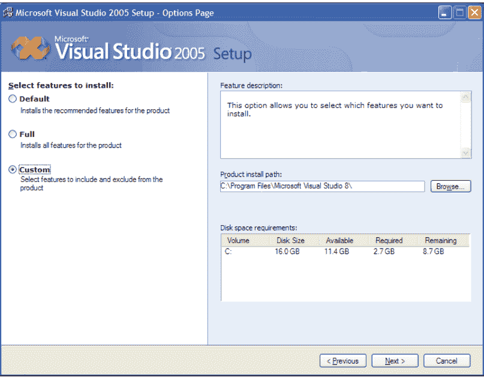

- 5. 在第二个选项页中，在“语言工具”部分选中 Visual C# 和 Visual Web Developer 复选框，并在“.NET Framework SDK”部分选中 Tools 复选框。点击 安装。

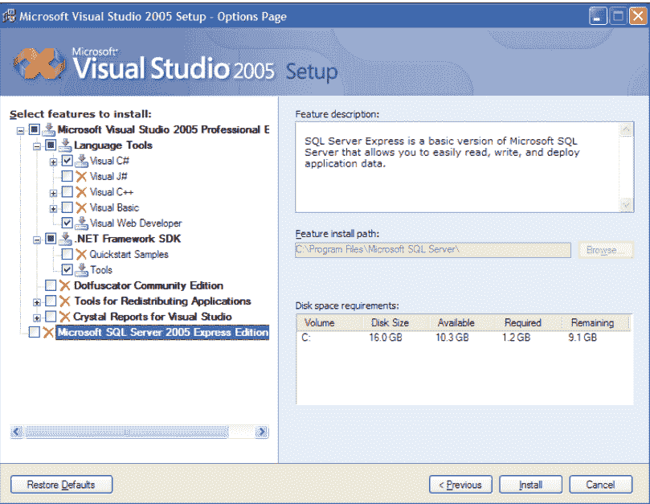

您可以随意安装可能想要使用的任何附加功能。以上选择足以跟随本书中的示例。

- 6. 等待（或休息一下喝杯咖啡）Visual Studio 2005 安装完成。当 **完成页** 出现时，点击 **完成**。

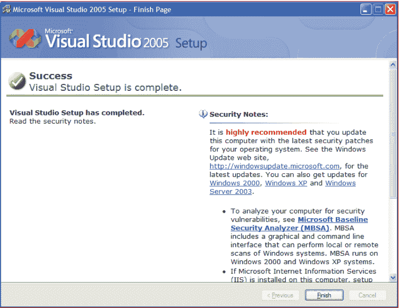

- 7. 在 **Visual Studio 2005 安装** 对话框中，如有需要，您可以选择安装产品文档（MSDN 库）。
- 8. 在 **Visual Studio 2005 安装** 对话框中，点击 **检查 Visual Studio 服务发布** 以安装可能可用的任何更新。
- 9. 点击 退出。

## 安装 MCMS 2002 Service Pack 2

接下来，我们将安装 MCMS Service Pack 2。

- 1. 从 **开始菜单**，点击 **运行...**
- 2. 在 **打开** 文本框中输入 **IISRESET /STOP** 并点击 **确定**。等待 IIS 服务停止。
- 3. 双击 SP2 安装包。
- 4. 在 **欢迎使用 Microsoft 内容管理服务器 2002 SP2 安装向导** 页面，点击 **下一步**。

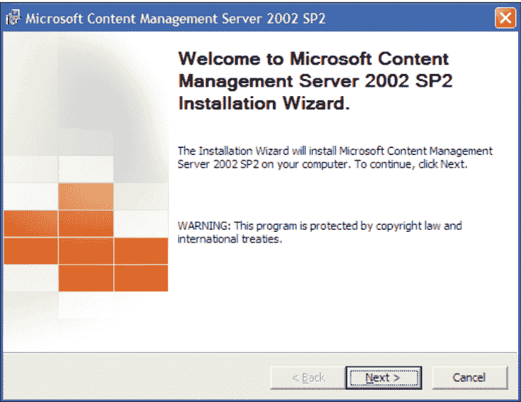

### 安装

- 5. 选择 **我接受此许可协议条款** 单选按钮，然后点击 **下一步**。

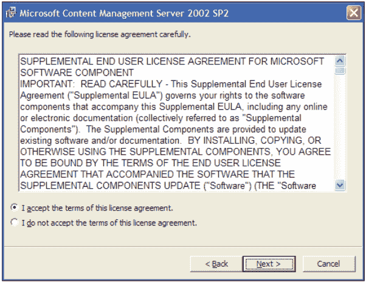

- 6. 在 **准备开始安装** 页面，点击 **下一步**。

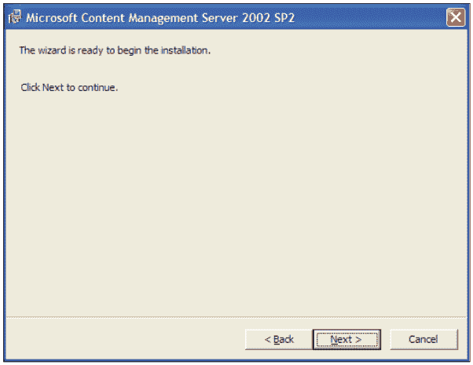

等待 Service Pack 2 安装完成。

- 7. 安装过程中可能会提示插入 MCMS 2002 SP1a CD-ROM。
- 8. 在 **安装向导已完成** 页面，点击 **完成**。
- 9. 如果提示，点击对话框上的 **是** 重新启动计算机，以完成安装。
- 10. 否则，从 **开始菜单** 点击 **运行...**
- 11. 在 **打开** 文本框中输入 **IISRESET /START** 并点击 **确定** 以重新启动 IIS 服务。

> 在安装 SP2 之前停止 IIS 可避免安装过程中替换锁定文件时出现潜在问题，并可防止需要重新启动。

## 配置开发环境

在继续之前，需要执行一些额外步骤来配置开发环境。我们将：

- 配置打开 **站点管理器** 的快捷方式以绕过 **连接到** 对话框。
- 在 Visual Studio 中安装 MCMS 网站和项目模板。

## 站点管理器快捷方式

在 SP2 安装期间，**站点管理器** 开始菜单快捷方式将被覆盖。要配置 **站点管理器** 以绕过 **连接到** 对话框，请执行以下步骤：

- 1. 选择 **开始 | 所有程序 | Microsoft Content Management Server**。
- 2. 右键点击 **站点管理器** 快捷方式并点击 **属性**。
- 3. 在 **目标** 文本框中，将 "C:\Program Files\Microsoft Content Management Server\Client\NRClient.exe" http://NR/System/ClientUI/login.asp 替换为 "C:\Program Files\Microsoft Content Management Server\Client\NRClient.exe" http://localhost/NR/System/ClientUI/login.asp。
- 4. 点击 **确定**。

## Visual Studio 模板

MCMS Service Pack 2 的安装会自动在 Visual Studio 2005 中注册 MCMS 开发工具，如 MCMS 模板资源管理器。然而，在使用 Visual Studio 创建 MCMS 应用程序之前，我们需要使网站和项目模板可用。

- 1. 选择 开始 | 所有程序 | Microsoft Visual Studio 2005 | Visual Studio 工具 | Visual Studio 2005 命令提示。
- 2. 执行以下命令，将 MCMS_INSTALL_PATH 替换为 MCMS 的安装位置（通常为 c:\Program Files\Microsoft Content Management Server），将 PATH_TO_MY_DOCUMENTS_FOLDER 替换为“我的文档”文件夹的位置：
  xcopy "MCMS_INSTALL_PATH\DevTools\NewProjectWizards80\Visual Web Developer" "PATH_TO_MY_DOCUMENTS_FOLDER\Visual Studio 2005\Templates\ProjectTemplates\Visual Web Developer" /E
  xcopy "MCMS_INSTALL_PATH\DevTools\NewItemWizards80\Visual Web Developer" "PATH_TO_MY_DOCUMENTS_FOLDER\Visual Studio 2005\Templates\ItemTemplates\Visual Web Developer" /E
- 3. 执行以下命令以将模板注册到 Visual Studio 2005：
  devenv /setup
- 4. 关闭命令提示符。

这样就完成了升级到 SP2 的步骤，我们的环境现已准备好进行开发！我们可以通过在 SCA 中查看版本号、通过站点管理器连接或使用 Web 作者来测试我们的安装。当然，任何现有的 MCMS Web 应用程序此时仍将由 .NET Framework v1.1 主机。


## 为 SQL Server 2005 准备 MCMS 数据库

在将 SQL Server 安装升级到 SQL Server 2005 之前，我们需要准备 MCMS 数据库，使其与 SQL Server 2005 兼容。

- 1. 从 Microsoft 请求以下 MCMS 热修复程序：http://support.microsoft.com/?kbid=913401。
- 2. 运行热修复程序可执行文件，将文件提取到本地文件夹，例如 c:\913401。
- 3. 将两个文件 (_dca.ini 和 _sp1aTop2upgrade.sql) 复制到 MCMS SQL 安装文件夹（通常为 c:\Program Files\Microsoft Content Management Server\Server\Setup Files\SQL Install）。覆盖现有文件。
- 4. 删除临时文件夹。

在此阶段，您也可以选择升级 SQL Server 或继续阅读第 2 章。

此外，使用 Internet Information Services 快捷方式配置 IIS 以使用 ASP.NET 2.0 是不必要的，因为 Visual Studio 2005 会自动在创建的每个 MCMS 网站应用程序上设置此选项。
但是，如果您在 Windows Server 2003 上安装，则必须配置虚拟网站根目录和 MCMS 虚拟目录以使用 ASP.NET 2.0，因为在同一个应用程序池中无法使用两个版本的 ASP.NET。

HtmlPlaceholderControl 的一部分 ActiveX 控件已随 SP2 更新。因此，首次切换到编辑模式时，您将被提示安装此控件。
如果您已使用 regsvr32 或组策略预先安装了控件，如 http://download.microsoft.com/download/4/2/5/4250f79a-c3a1-4003-9272-2404e92bb76a/MCMS+2002-+(complete)+FAQ.htm#51C0CE4B-FC57-45C4-BAAE-12C09421B57B 中所述，您也可能会被提示，并且需要更新控件的分发。

- 5. 选择 开始 | Microsoft Content Management Server | 数据配置应用程序。
- 6. 在启动画面上，点击 下一步。
- 7. 在“停止服务？”对话框中，点击 是。
- 8. 在“选择 MCMS 数据库”页面，点击 下一步。
- 9. 在“需要升级”对话框中，点击 是。
- 10. 在“升级数据库”页面，点击 下一步。
- 11. 在“添加管理员”对话框中，点击 否。
- 12. 在“数据库配置应用程序”页面，取消选中“立即启动 SCA”复选框，然后点击 完成。

## 升级 SQL Server 2005

在继续之前，请确保您拥有现有 SQL Server 服务帐户的详细信息，您将在升级过程中需要它。

- 1. 插入 SQL Server 2005 CD-ROM 或 DVD。
- 2. 在启动画面上，在“安装”部分点击“服务器组件、工具、联机丛书和示例”链接。
- 3. 在“最终用户许可协议”对话框中，选中“我接受许可条款和条件”复选框，然后点击 下一步。
- 4. 在“安装先决条件”对话框中，点击 安装 并等待先决条件安装完成。


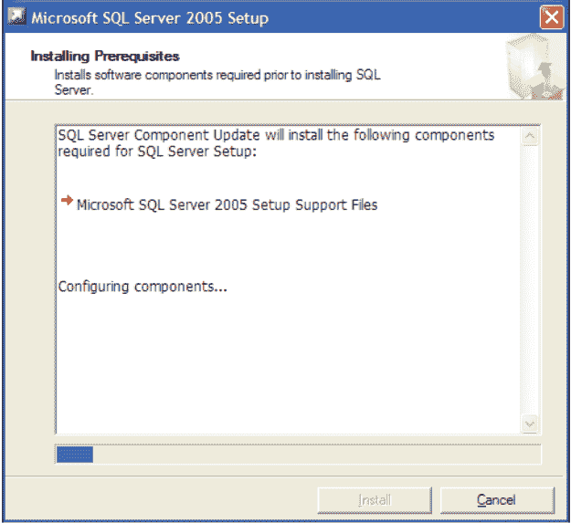

5. 完成后，单击 下一步，并等待系统配置检查完成。
6. 在“欢迎使用 Microsoft SQL Server 安装向导”页面上，单击 下一步。
7. 在“系统配置检查”页面上，所有操作都应报告状态为成功。

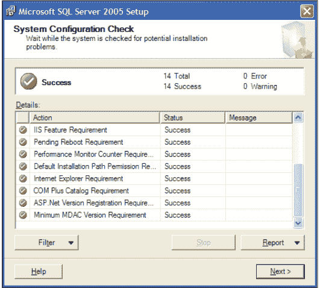

8. 单击 **下一步** 并等待安装程序准备安装。

9. 在 **注册信息** 页面上，个性化您的安装详细信息，输入产品密钥，然后单击 **下一步**。

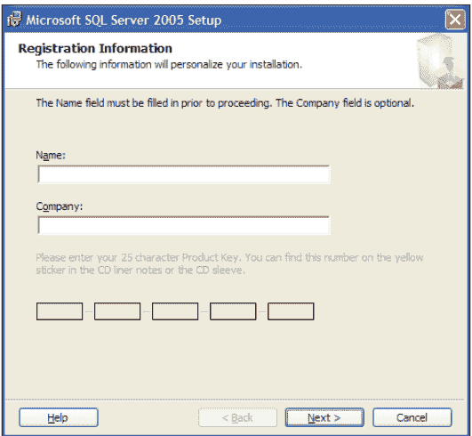

10. 在“要安装的组件”页面上，选择 SQL Server 数据库服务和工作站组件、Books Online 和开发工具复选框，然后单击 下一步。

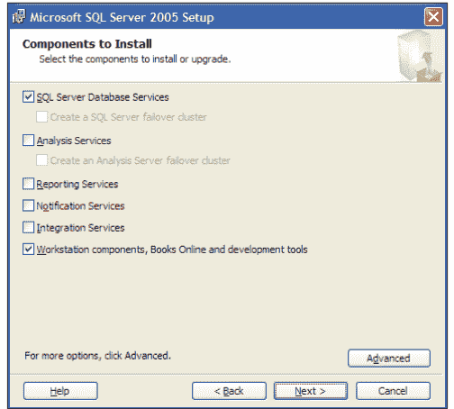

11. 在“实例名称”页面上，选择默认实例单选按钮，然后单击 下一步。

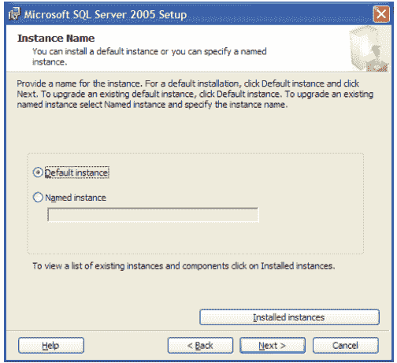

## Installation

12. 在“现有组件”页面上，选中 SQL Server 数据库服务 8.00.2039 复选框，然后单击 下一步。

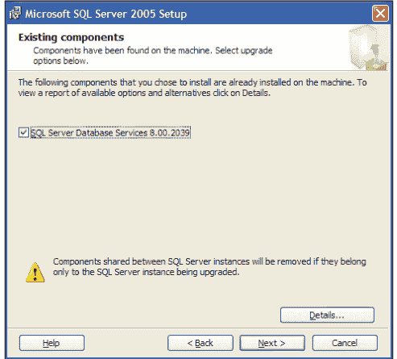

13. 在“升级登录信息”页面上，选择 Windows 身份验证模式单选按钮，然后单击 下一步。

等待升级分析完成。

14. 在“服务帐户”页面上，从服务组合框中选择 SQL Browser，输入您的 SQL Server 服务帐户详细信息，然后单击 下一步。

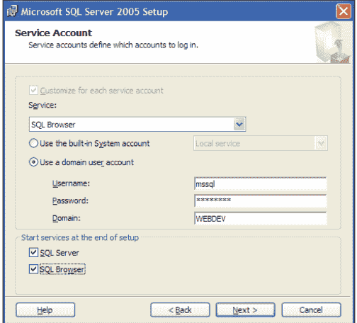

15. 在“错误和使用情况报告设置”页面上，选择是否要向 Microsoft 提交错误和使用情况报告，然后单击 下一步。

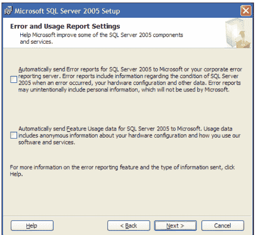

16. 在“准备安装”页面上，单击 安装。

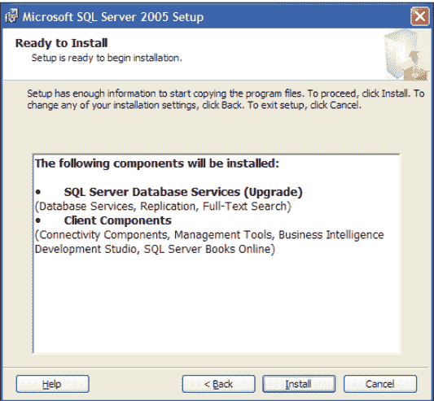

17. 等待 SQL Server 升级完成，然后单击 下一步。

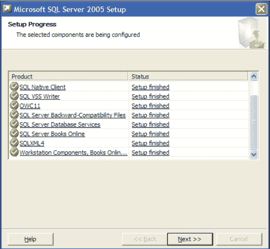

18. 在“完成 Microsoft SQL Server 2005 安装”页面上，单击 完成。

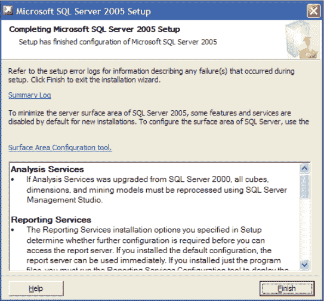

为避免在升级到 SQL Server 2005 后在 Web Author 中保存时出现可能的 ODBC 错误，请在 MCMS 服务器计算机上执行 **IISRESET**。请注意，对于生产系统，我们会在升级 SQL Server 实例之前停止 IIS。

## Installing SQL Server 2005 Service Pack 1

我们现在将安装 SQL Server 2005 的 Service Pack 1，可从 `http://www.microsoft.com/downloads/details.aspx?FamilyID=cb6c71ea-d649-47ff-9176-e7cac58fd4bc` 下载。

1. 双击安装程序文件，等待文件提取完成。
2. 在 **欢迎** 页面上，单击 **下一步**。
3. 在 **最终用户许可协议** 页面上，选中 **我接受许可条款和条件** 复选框，然后单击 **下一步**。
4. 在 **功能选择** 页面上，单击 **下一步**。
5. 在 **身份验证模式** 页面上，单击 **下一步**。
6. 在 **准备安装** 页面上，单击 **安装**，并等待 Service Pack 安装完成。在安装过程中，您可能会被提示有关 **待重启文件**。如果提示，请单击 **是**。
7. 当出现 **已锁定文件** 对话框时，单击 **继续**。
8. 在 **需要重新启动计算机** 对话框中，单击 **确定**。
9. 单击 **下一步**，在 **安装完成** 页面上，单击 **完成**。
10. 重新启动计算机。

## Modifying the CreateBackgroundProcessingJob Stored Procedure

在继续之前，您需要修改其中一个 MCMS 存储过程，以确保其与 SQL Server 2005 兼容。

1. 选择 **开始 | 所有程序 | Microsoft SQL Server 2005 | SQL Server Management Studio**。
2. 在 **连接到** 对话框中，单击 **连接**。
3. 在 **对象资源管理器** 中，展开 **数据库** 文件夹，右键单击 MCMS 数据库，然后单击 **新建查询**。
4. 打开 Internet Explorer 并导航到 `http://support.microsoft.com/default.aspx?id=906145#XSLTH3161121120121120120`。
5. 将灰色文本框中的 SQL 脚本复制并粘贴到 **SQL Server Management Studio** 中的 **查询窗口**。
6. 在 **SQL 编辑器** 工具栏上，单击 **执行** 按钮。
7. 关闭 **SQL Server Management Studio**。

这完成了升级 SQL Server 2005 的步骤。您现在可以继续进行第 2 章。

## Fresh Installation of Microsoft Content Management Server 2002 Service Pack 2

本节详细说明了使用 SQL Server 2005 执行 SP2 新安装所需的步骤。所有组件均安装在单台计算机上，并安装到其默认位置。以下安装顺序提供了所有必要的先决条件，并且从时间角度来看是最佳的安装顺序。我们从 Windows XP Professional SP2 的基本安装开始，并安装了所有 Windows 更新。安装的概要流程如下：

- 配置本地安全策略。
- 创建服务帐户。
- 安装 Internet Information Services。
- 配置 Internet Information Services。
- 安装 SQL Server 2005。
- 安装 SQL Server 2005 SP1。
- 配置 SQL Server 2005。
- 跳过 Visual Studio.NET 2003 的安装。
- 安装 MCMS 2002 先决条件。
- 安装 MCMS 2002 SP1a。
- 删除临时项目。
- 安装 Visual Studio 2005。
- 安装 MCMS 2002 SP2。
- 使用数据库配置应用程序配置 MCMS。
- 配置开发环境。

我们将在以本地计算机管理员身份登录的情况下执行所有步骤。

## Configuring Local Security Policy

为了验证服务帐户身份，我们需要修改 Windows XP 本地安全策略。请注意，如果您的计算机是域的成员，则本节不是必需的。

1. 选择 开始 | 控制面板。
2. 双击 管理工具，然后双击 本地安全策略。
   （如果看不到 管理工具，请单击 切换到经典视图 链接。）
3. 展开 本地策略 节点，然后单击 安全选项 节点。
4. 在策略窗格中，滚动查找 网络访问：本地帐户的共享和安全模型 项目，然后双击它。
5. 将组合框设置为 **经典 – 本地用户作为自己进行身份验证** 并单击 **确定**。

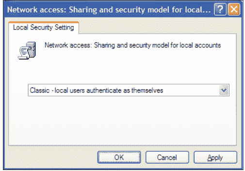

6. 关闭 **本地安全设置** 和 **管理工具**。

## Creating Service Accounts

我们将创建两个服务帐户，一个供 SQL Server 使用，一个用于 MCMS 系统帐户。

1. 从 **桌面** 右键单击 **我的电脑** 并选择 **管理**。
2. 在 **计算机管理** 中，展开 **本地用户和组** 节点。
3. 右键单击 **用户** 文件夹并单击 **新建用户...**
4. 在 **新建用户** 对话框中，在 **用户名称** 文本框中输入 **mssql**。
5. 提供 **全名** 和 **说明**。
6. 提供 **密码**。
7. 取消选中 **用户下次登录时必须更改密码** 复选框。
8. 选中 **用户不能更改密码** 和 **密码永不过期** 复选框，然后单击 **创建**。

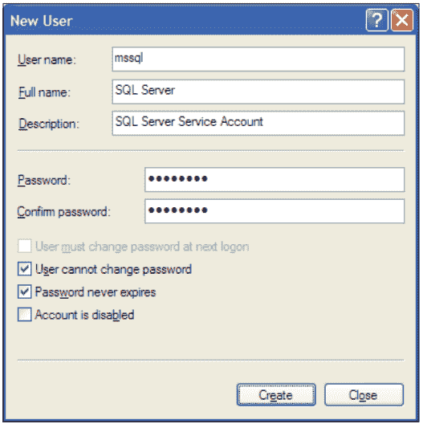

9. 在 **新建用户** 对话框中，在 **用户名称** 文本框中输入 **mcmssys**。
10. 提供 **全名** 和 **说明**。
11. 提供 **密码**。
12. 取消选中 **用户下次登录时必须更改密码** 复选框。
13. 选中 用户不能更改密码 和 密码永不过期 复选框，然后单击 Create。

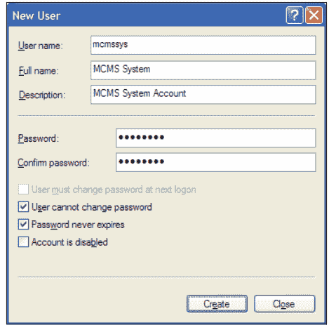

14. 关闭 新建用户 对话框并关闭 计算机管理。

## Installing Internet Information Services

以下步骤详细说明了 Internet Information Services (IIS) 最小必需组件的安装。在 Windows Server 2003 SP1 上安装时的任何差异都已注明。

1. 选择 开始 | 控制面板。
2. 双击 添加或删除程序。
3. 单击 添加/删除 Windows 组件。
4. 在 Windows 组件向导中，单击（注意：不是选中） Internet Information Services (IIS) 后跟 详细信息...
5. 在 Internet Information Services (IIS) 对话框中，单击（注意：不是选中） World Wide Web Service 后跟 详细信息...
6. 在 World Wide Web Service 对话框中，选中 World Wide Web Service 项目并单击 OK。


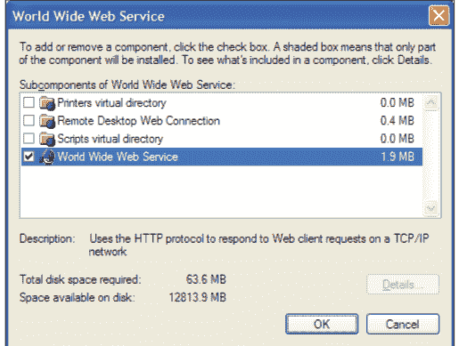

- 7. 确保已选中“通用文件”、“Internet Information Services 快捷方式”和“World Wide Web 服务”。单击“确定”。

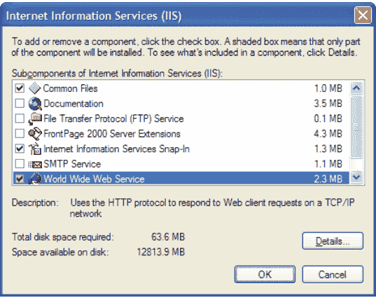

> 尽管产品文档中说明了该要求，并且在稍后安装 Visual Studio.NET 2003 期间，安装 FrontPage 2000 Server Extensions 并不必要。

- 8. 单击 **下一步** 并等待 IIS 安装完成；系统可能会提示您插入 Windows XP CD-ROM。
- 9. 当出现 **完成 Windows 组件向导** 页面时，单击 **完成**，并关闭 **添加或删除程序**。

> **在 Windows Server 2003 SP1 上安装时。**
> 使用“管理我的服务器”应用程序安装带有 ASP.NET（但不包括 FrontPage Server Extensions）的应用程序服务器角色。然后使用 **添加或删除程序... Windows 组件** 添加 Active Server Pages 和 Server Side Includes。无法使用 IIS 管理器启用这些功能；必须使用 **添加或删除程序**，否则 MCMS 安装程序将无法识别它们！
> 
> 此外，创建一个新的虚拟网站来托管服务器配置应用程序。该站点应配置为使用 Windows 身份验证，并拒绝除 localhost 之外的其他主机的访问。最好托管 SCA 的该站点也使用安全套接字层（SSL）。如果不可能，请将站点配置为使用 80 以外的端口。

## 配置 Internet Information Services

我们将首先配置 IIS 以使用 Windows 身份验证。书中稍后我们将探讨替代的身份验证方法。

- 1. 从 **开始菜单** 中，单击 **运行...**
- 2. 在 **打开** 文本框中，输入 **inetmgr** 并单击 **确定**。
- 3. 展开 **本地计算机** 节点和 **网站** 文件夹。
- 4. 右键单击 **默认网站** 并单击 **属性**。
- 5. 单击 **目录安全性** 选项卡，并在 **匿名访问和身份验证控制** 框架内单击 **编辑...**
- 6. 取消选中 **匿名访问** 复选框并选中 **集成 Windows 身份验证** 复选框，然后单击 **确定**。

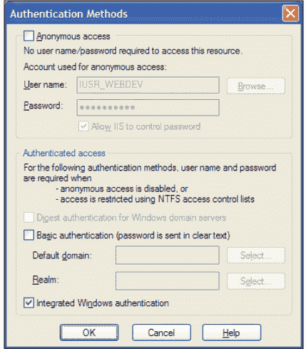

- 7. 单击 确定，并关闭 Internet Information Services。

## 安装 SQL Server 2005

以下步骤详细说明 SQL Server 2005 的安装：

- 1. 插入 SQL Server 2005 CD-ROM 或 DVD。
- 2. 在启动画面上，在 **安装** 部分中单击 **服务器组件、工具、联机丛书和示例** 链接。
- 3. 在 **最终用户许可协议** 对话框中，选中 **我接受许可条款和条件** 复选框并单击 **下一步**。
- 4. 在 **安装先决条件** 对话框中，单击 **安装** 并等待先决条件安装完成。

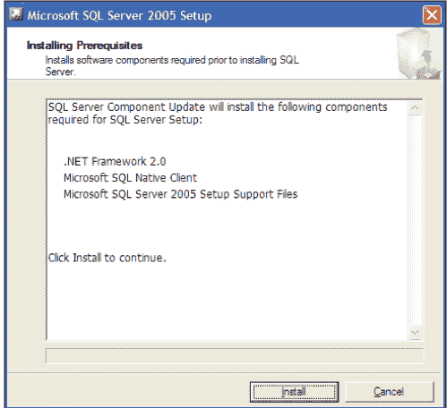

- 5. 完成后，单击 下一步，并等待系统配置检查完成。
- 6. 在“欢迎使用 Microsoft SQL Server 安装向导”页面上，单击 下一步。
- 7. 在系统配置检查页面上，所有操作的状态都应报告为成功。

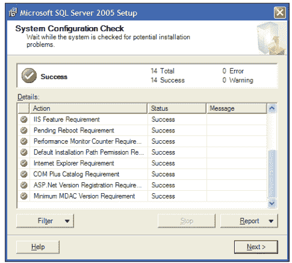

- 8. 单击 **下一步** 并等待安装程序准备安装。
- 9. 在 **注册信息** 页面上，个性化您的安装详细信息，输入您的 **产品密钥**，然后单击 **下一步**。

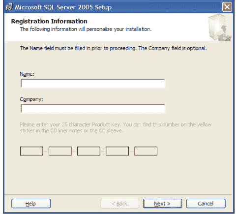

- 10. 在 **要安装的组件** 页面上，选择 SQL Server 数据库服务和工作站组件、联机丛书和开发工具复选框，然后单击 **下一步**。

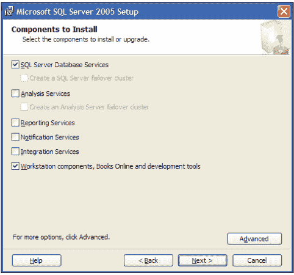

### 安装

- 11. 在实例名称页面上，选择默认实例单选按钮，然后单击 下一步。

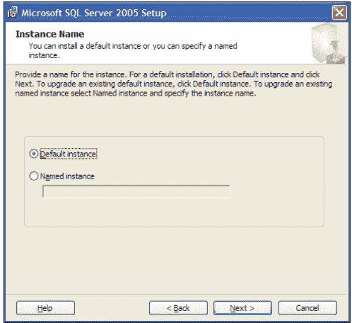

- 12. 在服务帐户页面上，选择使用域用户帐户单选按钮并输入 mssql 帐户的服务帐户详细信息。选中 SQL Server 代理 和 SQL Server 浏览器 复选框，然后单击 下一步。

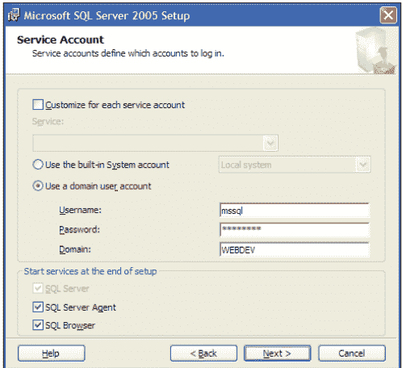

- 13. 在身份验证模式页面上，选择 Windows 身份验证模式单选按钮，然后单击 下一步。

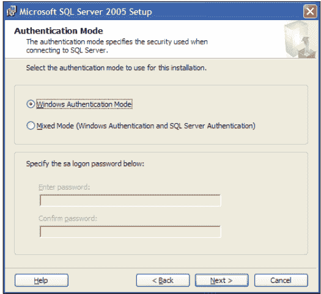

- 14. 在排序规则设置页面上，单击 下一步。

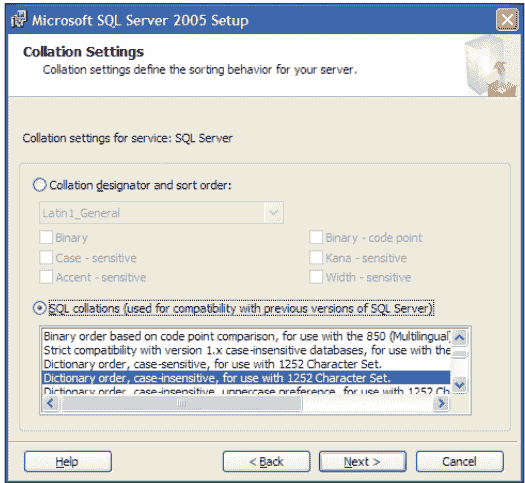

- 15. 在错误和使用情况报告设置页面上，选择是否要向 Microsoft 提交错误和用法报告，然后单击 下一步。

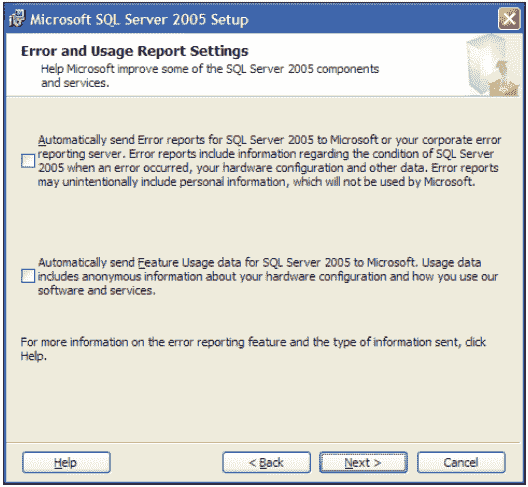

- 16. 在准备安装页面上，单击 安装。

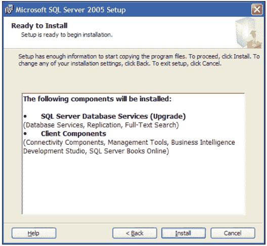

- 17. 等待 SQL Server 安装完成，然后单击 **下一步**。

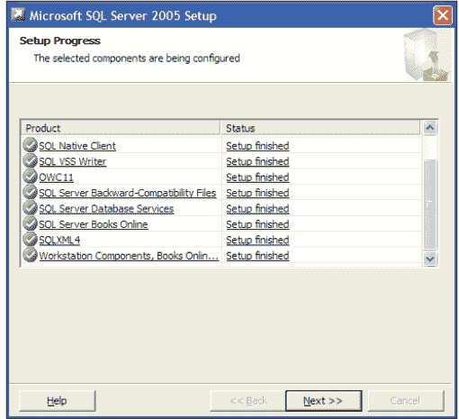

- 18. 在 **完成 Microsoft SQL Server 2005 安装** 页面上，单击 **完成**。

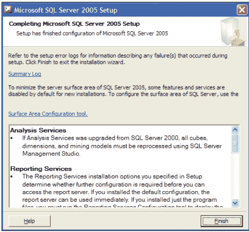

这完成了安装 SQL Server 2005 的步骤。

## 安装 SQL Server 2005 Service Pack 1

我们现在将安装 SQL Server 2005 的 Service Pack 1，可从 http://www.microsoft.com/downloads/details.aspx?FamilyID=cb6c71ea-d649-47ff-9176-e7cac58fd4bc 下载。

- 1. 双击安装程序文件并等待文件提取完成。
- 2. 在欢迎页面上，单击 下一步。
- 3. 在最终用户许可协议页面上，选中 我接受许可条款和条件 复选框，然后单击 下一步。
- 4. 在功能选择页面上，单击 下一步。
- 5. 在身份验证模式页面上，单击 下一步。
- 6. 在准备安装页面上，单击 安装，并等待 Service Pack 安装完成。安装过程中，您可能会收到有关待重启文件的提示。如果收到提示，请单击 是。
- 7. 当出现“找到锁定文件”对话框时，单击 继续。
- 8. 在“需要重新启动计算机”对话框中，单击 确定。
- 9. 单击 下一步，并在安装完成页面上单击 完成。
- 10. 重新启动计算机。

## 配置 SQL Server 2005

我们现在将配置 SQL Server 2005 的安装并为我们的 MCMS 应用程序创建数据库。

- 1. 选择 开始 | 程序 | Microsoft SQL Server 2005 | Microsoft SQL Management Studio。
- 2. 在“连接到服务器”对话框中，在服务器名称组合框中选择您的服务器，在身份验证组合框中选择 Windows 身份验证，然后单击 连接。

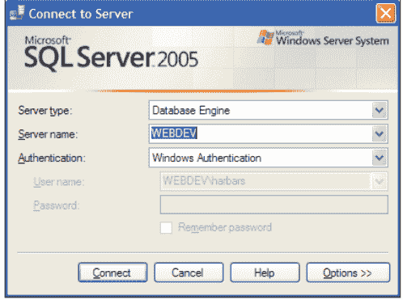

- 3. 在对象资源管理器中，右键单击数据库文件夹，然后单击 新建数据库...。
- 4. 在数据库名称文本框中，输入 TropicalGreen，单击 确定，并等待数据库创建完成。

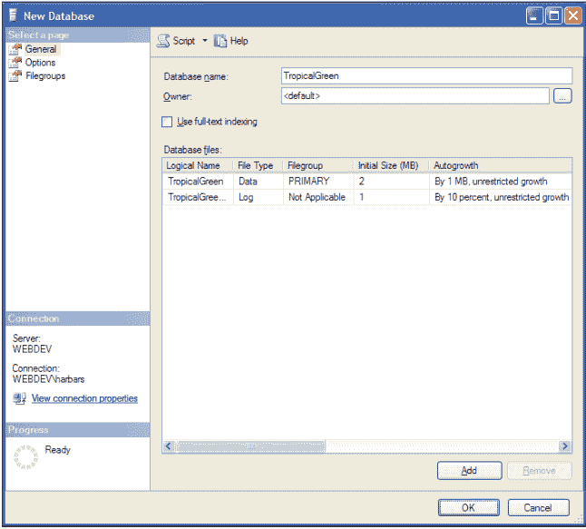

- 5. 在 **对象资源管理器** 中，展开 **安全性** 文件夹。
- 6. 右键单击 **登录名** 文件夹，然后单击 **新建登录名**...
- 7. 在 **登录名** 文本框中，输入 **MACHINENAME\\mcmssys**。
- 8. 在 **默认数据库** 组合框中，选择 **TropicalGreen**。

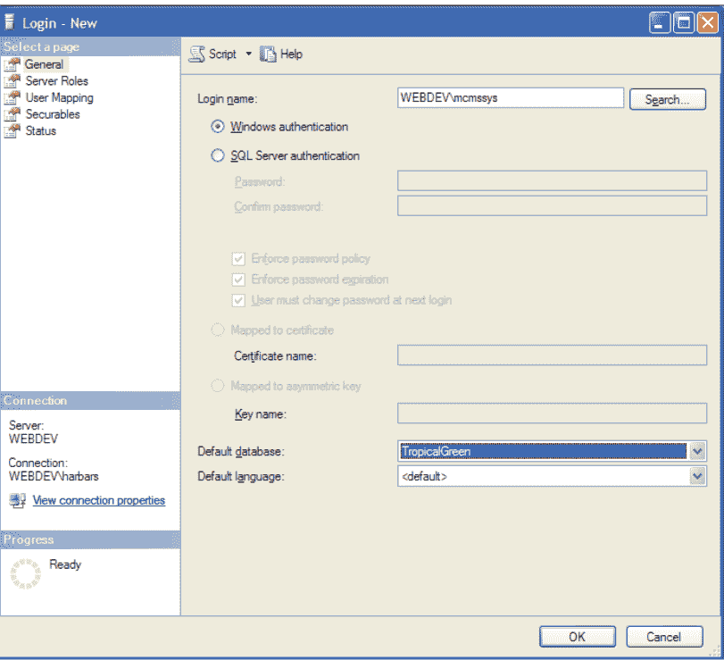

- 9. 单击 **选择页** 窗格中的 **用户映射** 项。
- 10. 在 **映射到此登录的用户** 网格中，为 **TropicalGreen** 数据库单击 **映射** 复选框。
- 11. 在 **数据库角色成员身份** 网格中，选中 **db_datareader**、**db_datawriter** 和 **db_ddladmin** 复选框。

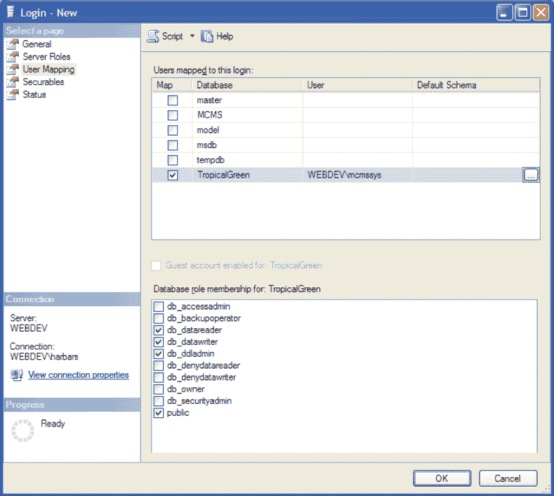

- 12. 单击 确定，并关闭 SQL Management Studio。

## 绕过 Visual Studio.NET 2003 的安装

MCMS SP1a 在安装 SP2 之前需要安装一个较早版本的 Visual Studio.NET 以启用开发人员工具组件。安装 Visual Studio.NET 2003 既耗时又不理想。可以使用以下过程绕过此要求，该过程会欺骗 SP1a 安装程序使其认为已安装 Visual Studio .NET 2003。

- 1. 向 Microsoft 请求以下 MCMS 热修复程序：
  `http://support.microsoft.com/?kbid=915190`
- 2. 运行热修复程序可执行文件以将文件提取到本地文件夹，例如 `c:\kb915190`。


- 3. 使用 Windows 资源管理器创建一个文件夹，例如 c:\VSTemp.
- 4. 选择 开始 | 运行...
- 5. 在“运行”对话框中，输入 cmd 并单击“确定”。
- 6. 执行以下命令：
  ```
  cd c:\kb915190
  cscript VS2003ByPass.vbs c:\VSTemp
  ```

## 安装 MCMS 2002 先决条件

在我们继续安装 MCMS 本身之前，需要安装两个先决条件。如果未满足这些先决条件，MCMS 的安装将被停止。

- J# 2.0 可再发行组件：
  MCMS Site Manager 的某些元素需要 J# 可再发行组件。
- MCMS 的 Internet Explorer Web 控件：
  MCMS Web Author 的部分内容使用了 Internet Explorer Web 控件（IEWC），其中存在一个特定的 MCMS 分发版本，无需编译。这些控件与标准 IEWC 不同，是作为 MCMS 安装的一部分受支持的。由于它们是 MCMS 的先决条件，因此可以在您的应用程序中使用 IEWC。但是，ASP.NET 2.0 提供了更丰富的导航控件，正如本书后面将看到的那样。

## J# 2.0 可再发行组件

我们需要安装 Visual J# 2.0 可再发行组件以启用 MCMS Site Manager 的安装。

- 1. 从以下位置下载并保存 J# 2.0 安装程序： http://www.microsoft.com/downloads/details.aspx?familyid=f72c74b3-ed0e-4af8-ae63-2f0e42501be1&displaylang=en
- 2. 双击安装程序。
- 3. 在“欢迎使用 Microsoft Visual J# 2.0 可再发行组件包安装”页面上，单击“下一步”。
- 4. 在“最终用户许可协议”页面上，选中“我接受许可协议条款”复选框并单击“安装”。
- 5. 等待 J# 2.0 安装完成，并在出现“安装完成”页面时单击“完成”。

## MCMS 的 Internet Explorer Web 控件

Internet Explorer Web 控件（IEWC）是 MCMS Web Author 所必需的。

- 1. 从以下位置下载并保存 IEWC 安装程序： http://www.microsoft.com/downloads/details.aspx?FamilyID=FAC6350C-8AD6-4BCA-8860-8A6AE3F64448&displaylang=en.
- 2. 双击安装程序。
- 3. 在“**欢迎使用 Microsoft Internet Explorer WebControls 安装向导**”页面上，单击“**下一步**”。
- 4. 在“**许可协议**”页面上，选择“**我同意**”单选按钮并单击“**下一步**”。
- 5. 在“**确认安装**”页面上，单击“**下一步**”。
- 6. 等待 Web 控件安装完成，并在出现“**安装完成**”页面时单击“**关闭**”。

## 安装 MCMS 2002 SP1a

- 1. 插入 MCMS 2002 SP1a CD-ROM，并在启动画面上单击“**安装组件**”。

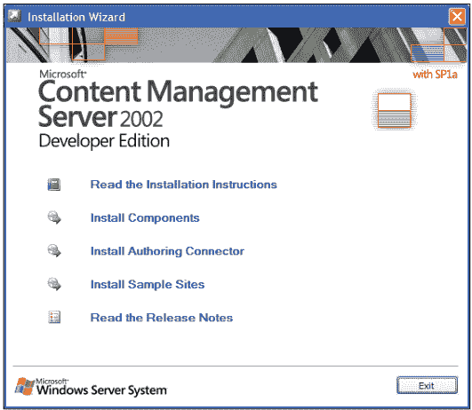

- 2. 在“**客户信息**”页面上，输入您的“**用户名**”和“**组织**”以及“**产品密钥**”，然后单击“**下一步**”。

### 安装

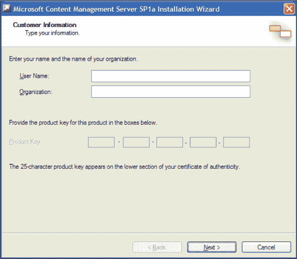

- 3. 在许可协议页面上，单击“接受”。

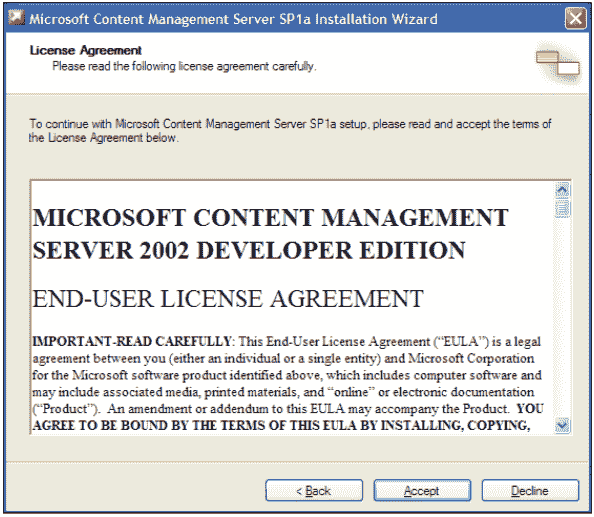

- 4. 在“安装选项”页面上，选择“自定义”单选按钮并单击“下一步”。

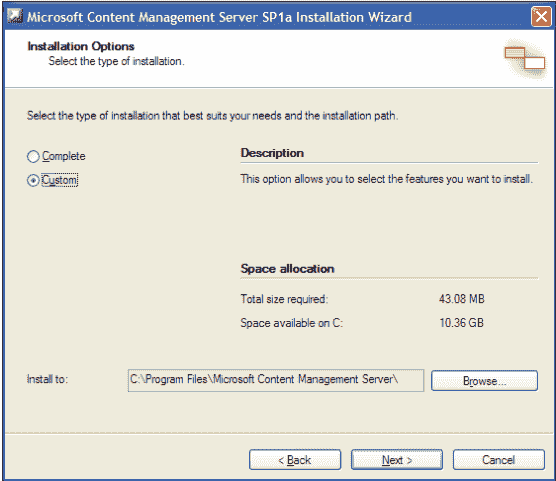

- 5. 在“自定义安装”页面上，取消选择“站点分发器”项，然后单击“下一步”。

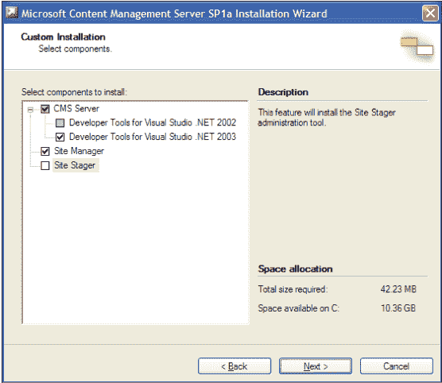

### 安装

- 6. 在“摘要”页面上，单击“安装”。

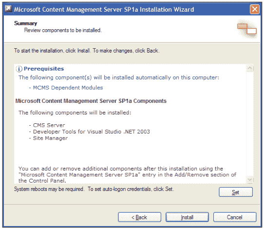

- 7. 等待 MCMS 2002 SP1a 安装完成。

- 8. 在“安装完成”页面上，取消选中“启动 MCMS 数据库配置应用程序”复选框，然后单击“完成”。

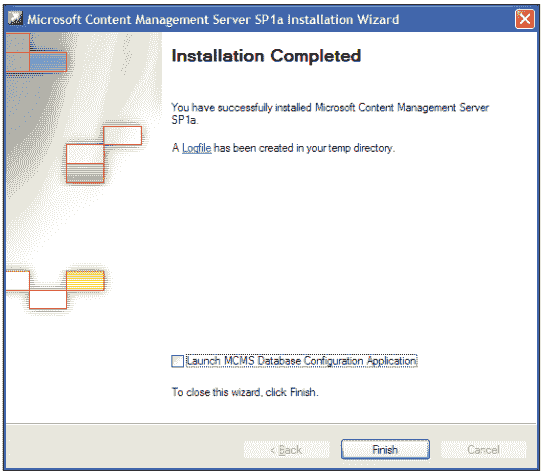

## 删除临时项目

现在 MCMS SP1a 已安装，我们可以清理之前创建的临时项目以欺骗安装程序。

- 1. 选择“**开始 | 运行...**”
- 2. 在“**运行**”对话框中，输入“**cmd**”并单击“**确定**”。
- 3. 执行以下命令：
  ```
  cd c:\kb915190
  cscript VS2003ByPass.vbs c:\VSTemp remove
  ```
- 4. 使用 Windows 资源管理器删除文件夹 `c:\VSTemp` 和 `c:\kb915190`。

## 安装 Visual Studio 2005

- 1. 插入 Visual Studio 2005 DVD，并在启动画面上单击“**安装 Visual Studio 2005**”。
- 2. 在“**欢迎使用 Microsoft Visual Studio 2005 安装向导**”页面上，单击“**下一步**”。
- 3. 在“**开始页**”上，选中“**我接受许可协议条款**”复选框，输入您的“**产品密钥**”和“**姓名**”，然后单击“**下一步**”。
- 4. 在“**选项页**”上，选择“**自定义**”单选按钮，输入所需的“**产品安装路径**”，然后单击“**下一步**”。

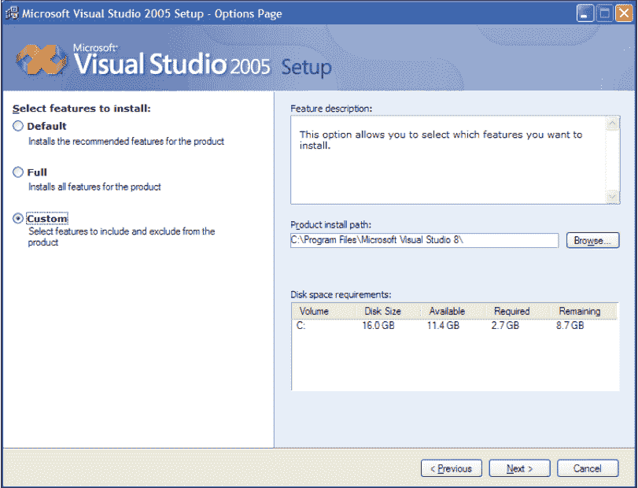

- 5. 在第二个选项页上，在“语言工具”部分中选择 Visual C# 和 Visual Web Developer 复选框，并在“.NET Framework SDK”部分中选择“工具”复选框。确保未选择其他所有选项，然后单击“安装”。

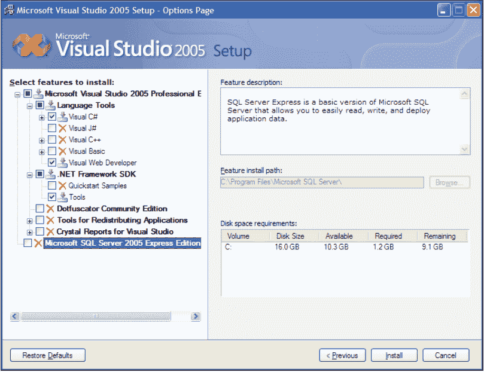

您可以随意安装您可能想要使用的任何其他功能。上述选择是遵循本书示例所需的所有内容。

- 6. 等待（或休息一下喝杯咖啡）Visual Studio 2005 安装完成。当出现“完成页”时，单击“完成”。

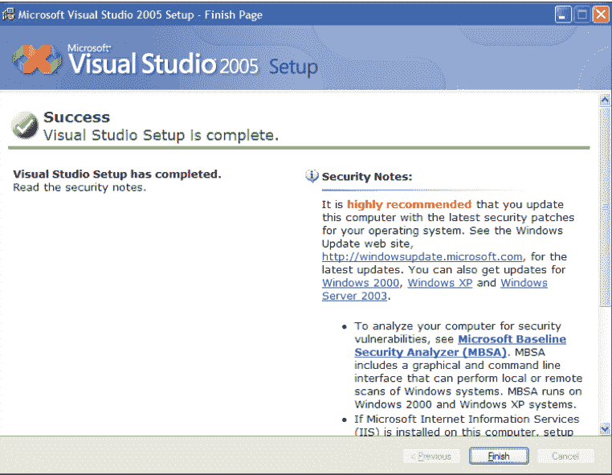

- 7. 从 Visual Studio 2005 设置对话框中，如果需要，可以安装产品文档（MSDN 库），否则单击“退出”。
- 8. 从 Visual Studio 2005 设置对话框中，单击“检查 Visual Studio 服务版本”以安装可能可用的任何更新。
- 9. 单击“退出”。

## 安装 MCMS SP2

- 1. 从“开始”菜单中，单击“运行...”
- 2. 在“打开”文本框中，输入 IISRESET /STOP 并单击“确定”。
- 3. 等待 IIS 服务停止。
- 4. 双击 SP2 安装包。
- 5. 在“欢迎使用 Microsoft Content Management Server 2002 SP2 安装向导”页面上，单击“下一步”。

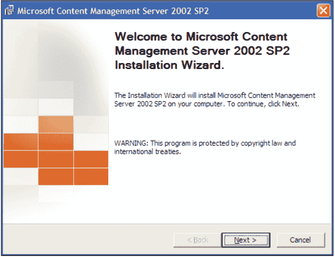

- 6. 选择“我接受此许可协议条款”单选按钮，然后单击“下一步”。


- 7. 在“向导已准备好开始安装”页面上，单击“下一步”。


- 8. 等待 Service Pack 2 安装完成。
- 9. 在“安装向导已完成”页面上，单击“完成”。
- 10. 如果提示，请在对话框中单击“是”重新启动计算机，以完成安装。
- 11. 否则，从“开始”菜单中单击“运行...”
- 12. 在“运行”文本框中，输入 IISRESET /START 并单击“确定”以重新启动 IIS 服务。

> 在安装 SP2 之前停止 IIS 可避免在安装过程中替换锁定文件时出现潜在问题，并可防止需要重新启动。

## 配置开发环境

继续之前，我们需要查看配置开发环境所需的一小部分额外步骤。

### Site Manager 快捷方式

在安装 SP2 期间，**Site Manager**“开始”菜单快捷方式将被覆盖。要配置 **Site Manager** 以绕过 **Connect To** 对话框，请按照以下步骤操作：

- 1. 选择“**开始**” | “**所有程序**” | “**Microsoft Content Management Server**”。
- 2. 右键单击“**Site Manager**”快捷方式并单击“**属性**”。
- 3. 在“**目标**”文本框中，将
  ```
  "C:\Program Files\Microsoft Content Management Server\Client\NRClient.exe" http:// //NR/System/ClientUI/login.asp
  ```
  用
  ```
  "C:\Program Files\Microsoft Content Management Server\Client\NRClient.exe" http://localhost/NR/System/ClientUI/login.asp.
  ```
- 4. 单击“**确定**”。

### Visual Studio 模板

安装 MCMS Service Pack 2 会自动在 Visual Studio 2005 中注册 MCMS 开发人员工具，例如 MCMS 模板资源管理器。但是，在使用 Visual Studio 创建 MCMS 应用程序之前，我们需要使网站和项目模板可用。

- 1. 选择“**开始**” | “**所有程序**” | “**Microsoft Visual Studio 2005**” | “**Visual Studio 工具**” | “**Visual Studio 2005 命令提示符**”。
- 2. 执行以下命令，将 `MCMS_INSTALL_PATH` 替换为 MCMS 的安装位置（通常为 `C:\Program Files\Microsoft Content Management Server`）并将 `PATH_TO_MY_DOCUMENTS_FOLDER` 替换为“我的文档”文件夹的位置：
  ```
  xcopy "MCMS_INSTALL_PATH\DevTools\NewProjectWizards80\Visual Web Developer" "PATH_TO_MY_DOCUMENTS_FOLDER\Visual Studio 2005\Templates\ProjectTemplates\Visual Web Developer" /E
  xcopy "MCMS_INSTALL_PATH\DevTools\NewItemWizards80\Visual Web Developer" "PATH_TO_MY_DOCUMENTS_FOLDER\Visual Studio 2005\Templates\ItemTemplates\Visual Web Developer" /E
  ```
- 3. 执行以下命令以将模板注册到 Visual Studio 2005：
  ```
  devenv /setup
  ```
- 4. 关闭命令提示符。


在此阶段无需按照 Microsoft 安装说明（KB 906145）中所述注册 ASP.NET。此注册已由 Visual Studio 2005 安装程序完成。

此外，无需使用 Internet Information Services 快照配置 IIS 以使用 ASP.NET 2.0，因为 Visual Studio 2005 会在创建的每个 MCMS 网站应用程序上自动设置此选项。

但是，如果您在 Windows Server 2003 SP1 上安装，则必须配置虚拟网站根目录和 MCMS 虚拟目录以使用 ASP.NET 2.0，因为在同一个应用程序池中无法使用两个版本的 ASP.NET。


支持开箱即用的占位符控件的 ActiveX 工具栏控件已随 SP2 更新。因此，首次切换到编辑模式时，您可能会被提示安装此控件。

您可以使用 regsvr32 或组策略预先安装控件，详细说明请参见 http://download.microsoft.com/download/4/2/5/4250f79a-c3a1-4003-9272-2404e92bb76a/MCMS+2002++(complete)+FAQ.htm#51C0CE4B-FC57-454C-BAAE-12C09421B57B。

## 运行数据库配置应用程序

在此阶段，我们准备配置 MCMS。

1. 选择 **Start | Programs | Microsoft Content Management Server | Database Configuration Application.**

2. 在启动画面上，单击 Next。


3. 在“选择 MCMS 内容服务器 ASP 兼容模式”页面上，选择 ASP.NET Mode 单选按钮并单击 Next。


4. 在 **Please select a virtual site for hosting the Microsoft Content Management Server** 页面上，选择 **Read/Write Site** 单选按钮，然后单击 **Next**。


5. 在 **SCA Web Entry Point** 页面上，单击 **Next**。


6. 当出现安全警告提示时，单击 **Yes**（因为在 Windows XP 上没有进一步保护 SCA 的方法）。


### 在 Windows Server 2003 SP1 上安装时

在 *Installing Internet Information Services* 部分中，选择之前创建的额外虚拟网站作为 SCA Web Entry Point。

7. 在 **MCMS System Account** 页面上，输入在前面 *Creating Service Accounts* 部分中创建的帐户详细信息，然后单击 **Next**。


8. 在 **Grant right?** 对话框中，单击 **Yes**。


9. 在 **Stop service?** 对话框中，单击 **Yes**。


10. 在 **Select MCMS Database** 屏幕上，单击 **Select Database** 按钮。


11. 在 SQL Server 登录对话框中，在服务器文本框中输入一个句点 (.)，然后单击 Options。在数据库组合框中选择 TropicalGreen 然后单击 OK。


> 一个句点 (.) 是本地计算机的 Netbios/RPC 别名。如果 SQL Server 客户端库能够确定 SQL Server 在本地计算机上，则当 SQL Server 与应用程序安装在同一台计算机上时，应用程序将使用共享内存而不是网络协议来访问 SQL Server。此配置也可以使用 SQL 客户端配置实用工具进行控制。

12. 在 Select MCMS Database 页面上，单击 Next。


13. 在 **Empty Database** 对话框中，单击 **Yes**。


14. 在 **Database Population** 页面上，单击 **Next**，并等待 MCMS Schema 安装完成。


15. 在 **Select Initial MCMS Administrator** 页面上，输入当前登录用户的帐户详细信息，然后单击 **Next**。


16. 等待更改提交完成，并在 **MCMS Site Stager Access Configuration** 页面上单击 **Next**。


17. 在 DCA 对话框中，单击 Finish 以启动服务器配置应用程序，并验证您的设置。


18. 关闭 SCA。

这完成了 MCMS 的配置。

## 移除 Visual Studio.NET 2003

如果您只打算使用 Visual Studio 2005 进行开发，现在可以移除 Visual Studio.NET 2003（如果之前安装过），因为它不再需要。

## MCMS SP2 安装的已知问题

与 MCMS SP2 安装相关的已知问题有几个，已发布了相应的热修复程序。

- DCA 在使用 SQL 身份验证选择数据库时会抱怨缺少权限。已发布此问题的热修复程序，可向 Microsoft 支持请求，编号为 KB 913400。

- **安装 MCMS 2002 Service Pack 2 后，VS.NET 2003 的开发人员工具会消失。** 已发布此问题的热修复程序，可向 Microsoft 支持请求，编号为 KB 914195。
- **VS.NET 2003 的开发人员工具在某些区域设置下无法工作。** 已发布此问题的热修复程序，可向 Microsoft 支持请求，编号为 KB 914195。

此外，如果您已全新安装 MCMS SP2 并希望将现有数据库迁移到新安装中，您需要获取 KB913401 热修复程序并按照本章开头关于升级到 MCMS 2002 Service Pack 2 的讨论中 *Prepare the MCMS Database for SQL Server 2005* 部分中详细说明的步骤进行操作。

## 安装提示

以下部分提供了在不同版本的 Windows 或跨不同机器安装时的两个提示。

## 在 Windows Server 2003 X64 版上安装 MCMS SP2

MCMS Service Pack 2 引入了对 Windows Server 2003 64 位版本的支持。但是 MCMS 要求 IIS 配置为以 32 位兼容模式运行。这意味着所有 IIS 应用程序（不仅仅是 MCMS 应用程序）都无法利用 X64 平台上的额外可寻址内存。为了在此平台上安装 MCMS SP2，需要执行以下额外步骤：

- 必须通过执行 `aspnet_regiis` 实用工具手动将 ASP.NET 2.0 注册到 IIS。
- 必须使用以下命令配置 IIS 以在 32 位兼容模式下运行，该命令从 `c:\Inetpub\adminscripts` 文件夹执行：
  `cscript adsutil.vbs set w3svc/AppPools/Enable32bitAppOnWin64 1`

## 安装所需的 SQL Server 2005 组件

当在与运行 MCMS SP2 的机器不同的机器上使用 SQL Server 时，MCMS 机器上需要 SQLDMO，即 SQL Server 客户端工具作为先决条件。这可以从您的 SQL Server 2005 发行版中安装：

- 在 **Components to Install** 对话框中单击 **Advanced** 按钮。
- 展开 **Client Components** 项。
- 选择 **Legacy Components** 项。


## 摘要

我们已完成升级到 SP2 或全新安装。此外，我们还介绍了避免 MCMS 安装常见问题的必要配置步骤，了解了如何避免安装 Visual Studio.NET 2003，以及一些额外的安装提示。现在我们准备探索 MCMS SP2 开发环境。
