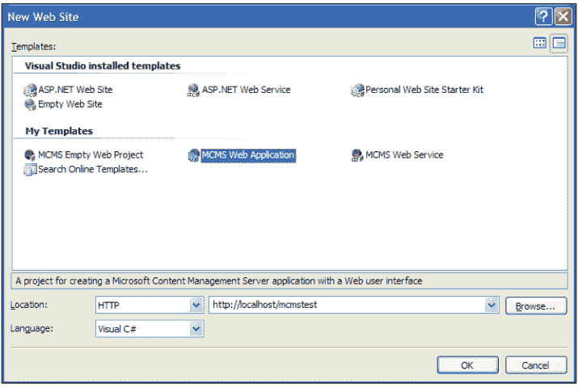

# 2 开始使用开发环境

在继续之前，我们将花一些时间熟悉适用于 Visual Studio 2005 的 MCMS Service Pack 2 开发环境，该环境与我们之前使用的 Visual Studio 版本略有不同。此外，我们将创建自定义 Visual Studio 2005 模板，以克服随 MCMS SP2 提供的模板中存在的一系列问题。

## Visual Web Developer 网站

使用 Visual Studio .NET 2003 和 Visual Studio 2005 开发 MCMS 应用程序之间的关键区别在于，ASP.NET 应用程序（因此 MCMS 应用程序）现在使用 Visual Studio 2005 的 Visual Web Developer 组件构建。Visual Web Developer 引入了一个新的“项目系统”，不再使用项目（`*.csproj`）文件，而是简单地通过 HTTP 或文件系统访问 Web 应用程序。

在 Visual Studio .NET 2003 中，MCMS 应用程序是通过选择 **MCMS Web Application** 项目类型创建的。此项目类型本质上是一个常规的 ASP.NET Web 应用程序项目，并带有 MCMS 所需的一些修改，例如额外的引用、Web 作者控制台以及对 `web.config` 的修改。在 Visual Studio 2005 中，开发 Web 应用程序已与开发其他项目类型分离。开发 Web 应用程序的功能已移至 Visual Web Developer 组件。

为了反映这一设计变更，您在 Visual Studio 2005 中不再使用 **New Project**，而是从 **File** 菜单中使用 **New Web Site** 来创建新网站。


Visual Studio 2005 附带了多个网站模板。安装 MCMS 的开发工具会将网站模板列表扩展为三个额外的模板：MCMS Empty Web Project、MCMS Web Application 和 MCMS Web Service。这些模板实际上是 Visual Studio 2005 附带的同名标准模板的修改版本。

## 创建 MCMS Web 应用程序

让我们使用 Visual Studio 2005 创建一个 MCMS Web 应用程序。

- 1. 打开 Visual Studio 2005。
- 2. 从“文件”菜单中选择“新建”，然后选择“网站...”。
- 3. 在“新建网站”对话框中，在“我的模板”部分选择 MCMS Web Application。

> 如果 MCMS Web Application 模板未出现在“我的模板”部分，则 MCMS Visual Studio 2005 模板未正确安装。请参阅第 1 章的 Visual Studio 模板部分以获取安装详细信息。

- 4. 在“位置”组合框中选择 HTTP，并在文本框中输入 `http://localhost/mcmstest`。

> MCMS 应用程序必须使用本地安装的 IIS 创建，不支持使用文件系统创建，后者使用内置的 Visual Web Developer Web 服务器。
>
> 请注意，“新建网站”向导不会阻止您使用文件系统和 Visual Web Developer Web 服务器配置无效的网站。

- 5. 在“**语言**”组合框中（如下图所示），选择 **Visual C#**，然后单击 **OK**。



> 如果愿意，您也可以选择 VB.NET。本书中的示例均使用 Visual C# 编写。

- 6. Visual Studio 2005 将创建您的项目并初始化 MCMS 模板资源管理器。完成后，您将看到一个带有基本基础文件的 MCMS 网站。


> Visual Studio 2005 中的 MCMS 模板资源管理器使用当前登录用户的凭据登录到 MCMS 存储库。如果此操作失败，请检查您的 MCMS 权限组配置。模板资源管理器不允许您指定替代凭据。

- 7. 单击 **解决方案资源管理器**底部的 **MCMS 模板资源管理器**选项卡，并注意 **模板库**可访问。


> 如果您看不到模板资源管理器，很可能是您在步骤 4 中未在 **位置**组合框中选择 **HTTP**。如果您使用的是美国英语以外的区域设置，也可能看不到模板资源管理器，在这种情况下，您需要按照第 1 章中所述安装热修复程序 914195。

- 8. 单击 **MCMS 模板资源管理器**底部的 **解决方案资源管理器**选项卡，然后单击 **刷新**按钮。请注意，与 ASP.NET 1.x 时代的 Web 应用程序不同，'CMS' 虚拟目录现在是网站的一部分。
- 9. 如果您检查网站的内容、其引用和 `web.config` 文件，您会看到必要的 MCMS 文件和配置更改已添加。

## 在 IIS 中检查网站配置设置

我们可以使用 Internet Information Services 管理单元验证 Visual Studio 2005 是否正确配置了 MCMS 应用程序。首先，让我们确保 `mcmstest` 网站确实在 ASP.NET 2.0 上运行。

- 1. 从 **开始菜单**单击 **运行**，在 **运行** 文本框中输入 `inetmgr`，然后单击 **确定**。
- 2. 在 **Internet Information Services** 中，展开树视图以显示 `mcmstest` 应用程序。
- 3. 右键单击 `mcmstest` 应用程序并单击 **属性**。
- 4. 单击 **ASP.NET** 选项卡并注意 ASP.NET 版本已正确配置为 **2.0.50727**。


> 在 Windows Server 2003 上进行开发时，虚拟网站根必须与所有 MCMS 应用程序在同一工作进程（即应用程序池）中运行，以便 MCMS ISAPI 过滤器按预期工作。此过滤器无法在工作进程边界之间路由请求。实际上，这意味着所有 MCMS 应用程序将共享相同的 ASP.NET 版本，因为 ASP.NET 不支持在同一工作进程内并排执行不同版本。在 Windows XP 上的 IIS 中不需要这样做，因为它不使用工作进程隔离模式。

接下来，我们将检查身份验证设置。现在，我们将配置网站以使用集成 Windows 身份验证。只有具有域或本地用户帐户的用户才能访问该站点。稍后在第 6 章中我们将展示诸如窗体身份验证等替代身份验证方法。

- 1. 单击 **目录安全性** 选项卡，然后单击 **编辑...** 按钮，并注意权限已正确继承自虚拟网站设置。在此示例中，我们将使用集成 Windows 身份验证。


> 请注意，我们在第 1 章中将虚拟网站配置为使用 Windows 身份验证。身份验证方法可以按每个应用程序进行配置。

- 2. 单击 **取消** 并关闭 **Internet Information Services**。

## 开发 MCMS Web 应用程序

我们现在准备开始开发基于 ASP.NET 2.0 的 MCMS 应用程序。MCMS Web 应用程序模板有一些怪癖，我们在开发过程中需要牢记。

- 1. 切回 Visual Studio 2005。
- 2. 在 **解决方案资源管理器** 中，右键单击网站 (**http://localhost/mcmstest**)，然后单击 **新建文件夹**。
- 3. 输入 **Templates** 作为文件夹名称。
- 4. 右键单击 **Templates** 文件夹并单击 **添加新项...**
- 5. 在 **添加新项** 对话框中，选择 **MCMS Template File** 项，并在 **名称** 文本框中输入 **Basic.aspx**。单击 **添加**。


- 6. 新的 `Basic.aspx` 模板文件已创建并在 **源视图** 中打开。
- 7. 检查 `Basic.aspx` 的内容。

## 更正 Basic.aspx

请注意，Basic.aspx 文件存在一些问题。某些元素由 IntelliSense “波浪线”突出显示，如果我们尝试构建网站，多个错误将阻止成功构建。让我们更正 Basic.aspx 模板文件。

- 1. 在第一行的 `Page` 指令的 `CodeFile` 属性中，将 `CodeFile="~/Basic.aspx.cs"` 替换为 `CodeFile="basic.aspx.cs"`
- 2. 从 **生成** 菜单中选择 **生成网站**。请注意，网站现在可以生成，但仍包含多个错误。
- 3. 更正 `DOCTYPE`。在第 19 行，将 `<!DOCTYPE html PUBLIC "-//W3C//DTD XHTML 1.0 Transitional//EN">` 替换为 `<!DOCTYPE html PUBLIC "-//W3C//DTD XHTML 1.0 Transitional//EN" "http://www.w3.org/TR/xhtml1/DTD/xhtml1-transitional.dtd">`。
- 4. 更正 `<html>` 元素。在第 20 行，将 `<html>` 替换为 `<html xmlns="http://www.w3.org/1999/xhtml">`。
- 5. 删除第 4 行至第 17 行的注释。
- 6. 删除第 10 行至第 13 行的 `<meta>` 标签。

> MCMS Web Application 新建项模板无法识别我们的新模板文件已在子目录中创建，因此 CodeFile 属性不正确。Web 根目录中的新模板不受影响。

> 内联 ASP 脚本块 (<% %>) 中的注释是不必要的。

```
<meta name="GENERATOR" content="Microsoft Visual Studio .NET 8.0">
<meta name="CODE_LANGUAGE" content="C#">
<meta name="vs_defaultClientScript" content="JavaScript">
<meta name="vs_targetSchema"
content="http://schemas.microsoft.com/intellisense/ie5">
```

> 这些 <meta> 标签是不必要的。

- 7. 更正 WebControls Register 指令。在第 2 行，替换：

```
<%@ Register TagPrefix="cms" Namespace="Microsoft.ContentManagement.WebControls" Assembly="Microsoft.ContentManagement.WebControls"%>
```

with

```
<%@ Register Assembly="Microsoft.ContentManagement.WebControls, Version=5.0.1200.0, Culture=neutral, PublicKeyToken=31bf3856ad364e35" Namespace="Microsoft.ContentManagement.WebControls" TagPrefix="cms"%>
```

> 原始 Register 指令未被 Visual Studio 2005 正确识别，并阻止 IntelliSense 包含 cms 标签前缀。

- 8. 从 生成 菜单中选择 生成网站。请注意，网站现在可以无错误地生成，并且 cms 标签前缀被理解。

- 9. 您的模板文件现在应如下所示：

```
<%@ Page language="c#" AutoEventWireup="false" CodeFile="Basic.aspx.cs" Inherits="Basic.Basic"%>
<%@ Register Assembly="Microsoft.ContentManagement.WebControls, Version=5.0.1200.0, Culture=neutral, PublicKeyToken=31bf3856ad364e35" Namespace="Microsoft.ContentManagement.WebControls" TagPrefix="cms"%>

<!DOCTYPE html PUBLIC "-//W3C//DTD XHTML 1.0 Transitional//EN" "http://www.w3.org/TR/xhtml1/DTD/xhtml1-transitional.dtd">
<html xmlns="http://www.w3.org/1999/xhtml">
```

```
<head>
    <title>Basic</title>
    <cms:RobotMetaTag runat="server"></cms:RobotMetaTag>
</head>
<body>
    <form id="Form1" method="post" runat="server">
    </form>
</body>
</html>
```

## 配置 'CMS' 虚拟目录

你可能在之前的示例中注意到，构建网站需要相当长的时间。这主要是因为 'CMS' 虚拟目录的内容包含在项目中。这些文件提供了（其中包括）Web Author 功能，并且是 MCMS 应用程序所必需的。然而，它们被包含在项目中会引起一些问题，因为文件本身不需要重新构建。此外，这些文件会产生大量警告，并且在某些情况下，当安装了额外的组件（如出色的 Telerik r.a.d. MCMS Controls Suite）时，会阻止成功构建。让我们配置 'CMS' 虚拟目录，使其在 Visual Studio 2005 构建网站时被忽略。

- 1. 打开 Windows 资源管理器。
- 2. 导航到 `C:\Program Files\Microsoft Content Management Server\Server\IIS_CMS`。
- 3. 按 *Ctrl+A* 选择全部四个文件夹，然后按 *Alt+Enter*。
- 4. 在 **属性** 对话框中，单击 **隐藏** 复选框。


- 5. 单击 **确定**，在 **确认属性更改** 对话框中，选择 **仅将更改应用于所选项目** 单选按钮，然后单击 **确定**。


- 6. 关闭 Windows 资源管理器。

Visual Studio 现在在构建网站时会忽略 'CMS' 虚拟目录的内容，但文件仍然可供我们的 MCMS 应用程序使用。如果将来向此文件夹安装其他第三方组件，请记住将 `IIS_CMS` 目录中所有文件夹的 **隐藏** 标志设置。

## 创建自定义 MCMS 应用程序模板

为了避免将来再次修正模板文件的麻烦，我们将基于已修正的模板创建一个新的项目模板。首先检查 **导出模板** 项目是否包含在 **文件** 菜单中。如果 **导出模板** 未出现在 **文件** 菜单中，这是 Visual Studio 2005 的常见问题，请执行以下步骤：

- 1. 从 **工具** 菜单中选择 **自定义**。在 **自定义** 对话框中，单击 **命令** 选项卡。
- 2. 选择 **文件类别** 并滚动 **命令** 列表框以找到 **导出模板...**
- 3. 将 **导出模板...** 项拖到 **文件** 菜单上。
- 4. 关闭 **自定义** 对话框。

现在我们可以继续创建自定义模板。

- 1. 从 **文件** 菜单中选择 **导出模板...**
- 2. 在 **选择模板类型** 页面中，选择 **项目模板** 单选按钮，然后单击 **下一步**。


- 3. 在 **选择要导出的项目** 页面中，选择 **Basic.aspx** 复选框，然后单击 **下一步**。
- 4. 在 **选择项目引用** 页面中，单击 **下一步**。


- 5. 在 **选择模板选项** 页面中，在 **模板名称** 文本框中输入 **MCMS SP2 模板文件**，并在 **模板说明** 文本框中输入说明（如果需要）。取消选择 **在输出文件文件夹上显示资源管理器窗口** 复选框，然后单击 **完成**。
- 6. 新的项目模板已创建。
- 7. 在 **模板** 文件夹中的 **解决方案资源管理器** 中，右键单击 `Basic.aspx` 文件并单击 **删除**，然后单击 **确定**。
- 8. 在 **模板** 文件夹中的 **解决方案资源管理器** 中，右键单击 `Basic.aspx.resx` 文件并单击 **删除**，然后单击 **确定**。
- 9. 右键单击 **模板** 文件夹并单击 **添加新项...**
- 10. 在 **添加新项** 对话框中，选择 **MCMS SP2 模板文件** 项，在 **名称** 文本框中输入 **Basic.aspx**，然后单击 **添加**。
- 11. 从 **生成** 菜单中选择 **生成网站**。请注意，网站构建成功。
- 12. 在 **解决方案资源管理器** 中，双击 `web.config` 文件。请注意，`<compilers>` 元素已被 IntelliSense 用警告突出显示。
- 13. 删除第 24 行至第 26 行，并保存 `web.config` 文件。


```
<compilers>
...
</compilers>
```

> 编译器元素不是必需的，并且在 ASP.NET 2.0 中不再是 compilers 配置节内的有效条目。

现在我们已修正了 MCMS SP2 应用程序的所有问题，让我们构建一个 Visual Studio 2005 项目模板。

- 1. 从 **文件** 菜单中选择 **导出模板...**
- 2. 在 **选择模板类型** 页面中，选择 **项目模板** 单选按钮，然后单击 **下一步**。
- 3. 在 **选择模板选项** 页面中，在 **模板名称** 文本框中输入 **MCMS SP2 Web 应用程序**，并在 **模板说明** 文本框中输入说明。取消选择 **自动将模板导入 Visual Studio** 复选框，然后单击 **完成**。


- 4. 切换到并关闭 Visual Studio 2005。
- 5. 在 Visual Studio 2005 打开的 Windows 资源管理器窗口中，右键单击 `MCMS SP2 Web Application.zip` 文件并单击 **全部提取...**
- 6. 在 **提取向导** 中，单击 **下一步**，然后再次单击 **下一步**。
- 7. 取消选择 **显示提取的文件** 复选框，然后单击 **完成**。
- 8. 删除 `MCMS SP2 Web Application.zip` 文件。
- 9. 双击 `MCMS SP2 Web Application` 文件夹。
- 10. 使用记事本打开 `vwd.WebInfo` 文件。
- 11. 将 `<UserProperties CmsEnabled="1" />` 替换为 `<UserProperties CmsEnabled="2" />`。
- 12. 保存并关闭 `vwd.WebInfo`。
- 13. 在记事本中打开 `MyTemplate.vstemplate` 文件。
- 14. 删除第 17 行：
    `<Folder Name="CMS" TargetFolderName="CMS" />`

> 此设置允许 Visual Studio 2005 在创建我们的应用程序时创建 'CMS' 虚拟目录。然后它将 CmsEnabled 属性设置为 1。如果该属性已设置为 CmsEnabled="2"，则可能不需要更改此属性。

> 导出模板向导会自动将 'CMS' 虚拟目录的内容作为模板的一部分包含在内；此步骤将这些文件从模板中移除。

- 15. 保存并关闭 `MyTemplate.vstemplate`。
- 16. 选择 `MCMS SP2 Web Application` 文件夹中的所有文件。
- 17. 右键单击所选内容并单击 **发送到**，然后单击 **压缩 (zipped) 文件夹**。
- 18. 将 ZIP 文件重命名为 `MCMS SP2 Web Application.zip`。
- 19. 右键单击 `MCMS SP2 Web Application.zip` 文件并单击 **剪切**。
- 20. 导航到 `My Documents\Visual Studio 2005\Templates\ProjectTemplates` 文件夹。
- 21. 从 **编辑** 菜单中选择 **粘贴**。
- 22. 删除 `My Documents\Visual Studio 2005\My Exported Templates\MCMS SP2 Web Application` 文件夹。
- 23. 打开 Visual Studio 2005 命令提示符。
- 24. 执行命令 `devenv /setup` 并关闭命令提示符。

我们已修正了随 SP2 发行的 MCMS 项目和项目模板，并准备好基于我们的自定义模板创建一个简单的测试 MCMS 应用程序。

- 1. 打开 Visual Studio 2005。
- 2. 从 **文件** 菜单中选择 **新建**，然后选择 **网站...**
- 3. 在 **新建网站** 对话框中，选择 **MCMS SP2 Web 应用程序** 项，在 **位置** 组合框中选择 **HTTP**，在文本框中输入 `http://localhost/mcmsssp2`，然后单击 **确定**。


- 4. 使用 **视图** | **其他窗口** | **MCMS 模板资源管理器** 打开 **MCMS 模板资源管理器**。
- 5. 右键单击 **模板** 文件夹并单击 **新建模板**。
- 6. 将模板命名为 **Basic**。
- 7. 在 **属性** 窗口中，单击 **TemplateFile** 属性右侧的省略号 (...) 按钮。如果看不到 **属性** 窗口，请右键单击模板并选择 **属性**。


8. 在 **选择文件** 对话框中，选择 **Templates** 文件夹内的 **Basic.aspx** 文件，然后单击 **选择**。


9. 单击 **PlaceholderDefinitions** 属性右侧的省略号 (...) 按钮。

10. 在 **占位符定义集合编辑器** 对话框中，单击 **添加**，然后单击 **确定**。


11. 单击 **Template Explorer** 顶部的 **保存** 图标，然后单击 **Solution Explorer** 选项卡。
12. 双击 **Templates** 文件夹内的 **Basic.aspx** 文件，然后单击代码编辑器底部的 **设计** 按钮。
13. 从 **Solution Explorer** 将 **Console** 文件夹内的 **DefaultConsole.ascx** 拖放到设计表面。
14. 从 **Content Management Server** 工具箱拖放一个 **HtmlPlaceholderControl** 到设计表面。
15. 在 **Properties** 窗口中单击 **PlaceholderToBind** 属性上的箭头，然后选择 **NewHtmlPlaceholderDefinition1**。


16. 在 **生成** 菜单中选择 **生成网站**。
17. 在 **工具** 菜单中选择 **Content Management Server**，然后选择 **Web Author**。Internet Explorer 将在 `http://localhost/channels` 打开。
18. 单击 **切换到编辑站点**。
19. 单击 **创建新页面**。
20. 在 **模板浏览器** 中，单击 **Templates**，然后单击 **Basic** 模板的选取图标。新的帖子在编辑模式下打开。
21. 在 HTML 占位符中输入一些文本，然后单击 **保存新页面**。

22. 在 **保存新页面** 对话框中，将 **Name** 输入为 **test**，然后单击 **确定**。
23. 单击 **批准**，然后单击 **切换到实时站点**。请注意，占位符中输入的文本已保存在新的帖子中。


我们现在已经测试了自定义 MCMS Web 应用程序项目模板。在继续之前，整理测试文件和项目是个好主意。我们可以删除测试帖子、其模板库项以及我们创建的两个 MCMS 应用程序：**mcmstest** 和 **mcmssp2**。

## 摘要

我们已回顾了新的 Visual Studio 2005 MCMS 开发环境的基础知识，配置了 'CMS' 虚拟目录，并为 MCMS 创建了自己的自定义 Visual Studio 2005 模板。我们现在准备使用 ASP.NET 2.0 深入 MCMS 开发！
