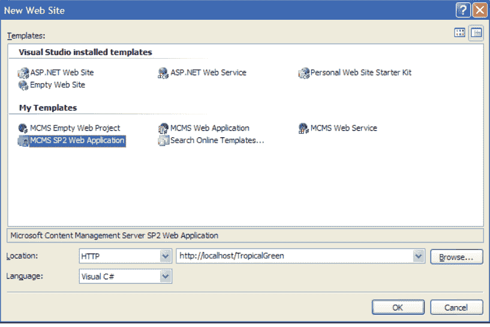
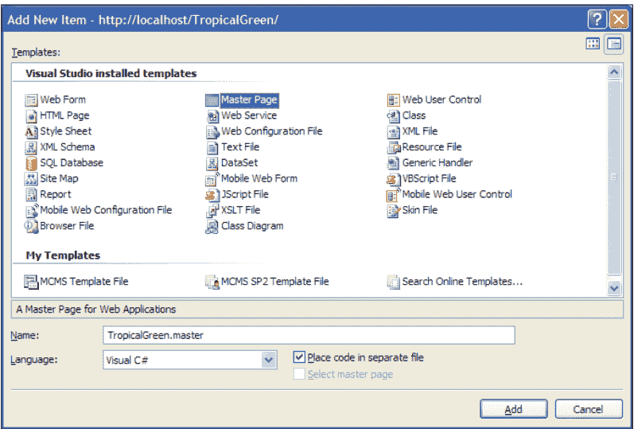
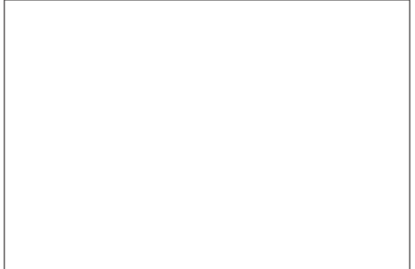
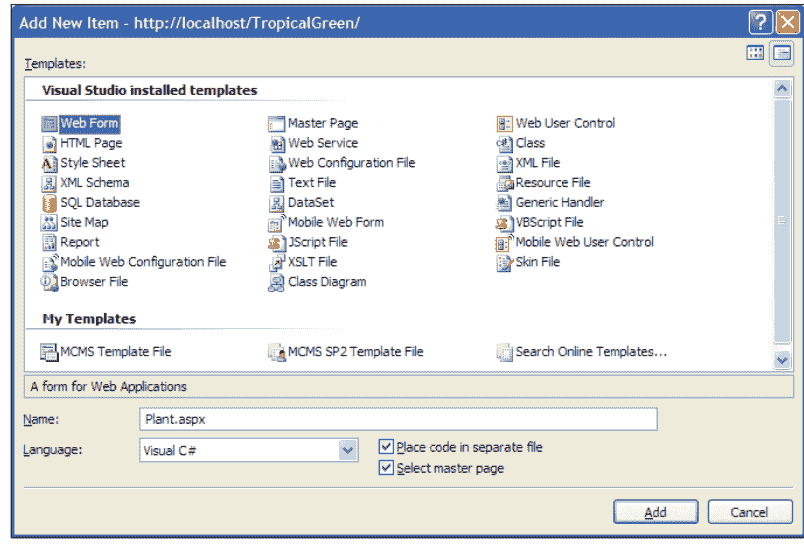
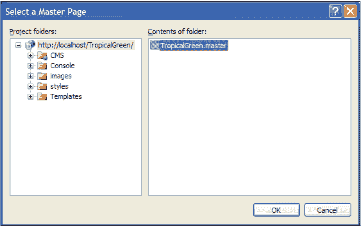
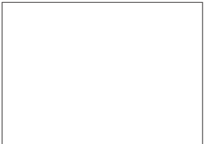
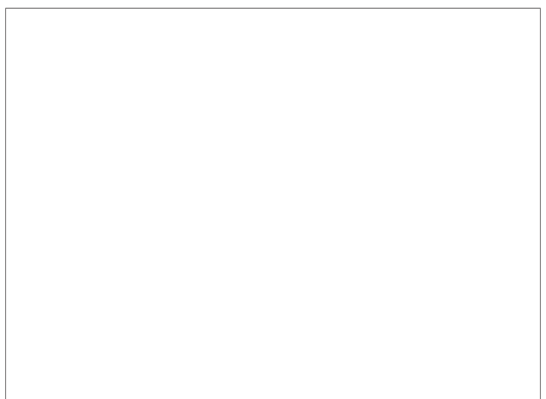

# 3 使用母版页

## 使用母版页

ASP.NET 2.0 引入的最佳功能之一是母版页，它允许开发人员在应用程序内的页面之间强制执行统一的布局和行为。虽然初看时许多母版页概念与 MCMS 模板相似，但在 MCMS 应用程序中使用母版页可以获得许多好处。

本章概述了使用母版页的好处，并为在 MCMS 应用程序中实现母版页提供了逐步指南，在那里它们成为母版模板！

### 母版页的概述和优势

一 **母版页** 包含通用标记和一个或多个 **内容占位符**。从此母版页可以创建新的 **内容页**，其中包含链接到母版页中内容占位符的 **内容控件**。这提供了一种理想的方式来将通用站点品牌、导航等与实际内容页面分离，并且可以显著减少重复和标记错误。

与以前相比，母版页使使用模板文件变得更加容易。您可以向母版页添加通用标记和共享控件，例如页眉、页脚和导航栏。一旦母版页构建完成，您就可以基于它创建 MCMS 模板文件。模板文件将立即采用母版模板中定义的风格。

您还可以通过引入内容占位符来标记母版页的某些区域为可自定义（请注意，这些是专门为母版页设计的控件，不应与 MCMS 占位符控件混淆）。内容占位符标记的空间提供了可以添加单个模板标记以及 MCMS 占位符控件的区域，如下图所示：


虽然乍一看，母版页和 MCMS 模板都提供了一种标准化站点外观和感觉的方式，但它们的相似之处仅此而已。不要误以为母版页完全取代了 MCMS 模板的作用。两者之间的一个关键区别是，母版页的使用仅限于站点开发人员，以确保创建的模板文件具有统一的外观和感觉。您不能创建母版页并期望作者使用它来创建帖子。

事实上，母版页与模板文件一起工作，并为 MCMS 开发人员提供许多好处。

- **避免 MCMS 模板文件中的重复：** 通常 MCMS 模板包含通用页面布局代码（通常是 HTML 表格）以及导航栏、页眉和页脚（通常是 Web 用户控件）。此代码必须在创建后复制并粘贴到每个新模板文件中，或抽象为用户控件。此外，对此通用代码布局的更改必须应用于所有模板文件。因此，例如，具有十个模板文件的 MCMS 应用程序将重复此标记十次。通过将此标记放在母版页中，可以消除这种重复。
- **将站点范围标记与模板标记分离：** MCMS 最大的缺点之一是模板开发任务无法轻松分离。常见要求是将定义站点品牌、布局以及开发导航等控件的任务（由网站管理员和程序员执行）与设计模板布局的任务（由业务用户执行）分离。虽然由于 MCMS 的固有架构，母版页和 Visual Studio 2005 并不能完全解决这个问题，但它们在此方面提供了实质性改进。
- **避免 MCMS 模板文件 Visual Studio 模板的问题：** MCMS 项目项模板存在一些问题，并且没有完全采用 Visual Studio 2005 项目系统。虽然任何 Web 表单都可以被 MCMS“启用”，但母版页提供了更无缝的开发体验，需要的手动调整更少。
- **Visual Studio 2005 设计器支持：** 在 Visual Studio .NET 中使用模板文件中的用户控件时常见问题是，模板设计视图不能为模板开发人员提供足够的体验。Visual Studio 2005 提供了改进的设计视图体验，包括渲染用户控件内容，这在处理母版页时尤其有价值。
- **母版页的经验：** 正如 MCMS 是学习 ASP.NET 的好方法一样，MCMS SP2 是学习 ASP.NET 2.0 的好方法！此外，母版页是微软未来 Web 内容管理产品的基础构建块。

> 母版页中的 MCMS 占位符控件可以工作，但不受官方支持。

正如本章将看到的，母版页提供了一种理想的方式来将通用站点品牌、导航等与实际内容页面分离，并且可以显著减少重复和标记错误。

### TropicalGreen 网站

Tropical Green 是本书示例网站所基于的虚构园艺协会。在 Packt Publishing 出版的书籍 *使用 Microsoft 内容管理服务器构建网站*（ISBN 1-904811-16-7）中，我们使用 ASP.NET 1.x 从头开始构建了 Tropical Green 网站。

在本书中，我们将尝试使用 MCMS SP2 和 ASP.NET 2.0 重建网站的部分内容。虽然代码将从头重写，但我们不会从空白数据库开始。相反，我们将走捷径并从 Packt Publishing 网站支持部分提供的 `TropicalGreen.sdo` 文件中导入 TropicalGreen 数据库对象（http://www.packtpub.com/support）。


## 导入 TropicalGreen 站点部署对象文件

开始之前，让我们使用站点部署管理器通过导入对象来填充数据库。

- 1. 从本书的配套网站下载 `TropicalGreen.sdo` 文件。
- 2. 打开 **站点管理器** 并使用 MCMS 管理员账户登录。
- 3. 从菜单中选择 **文件 | 包 | 导入...**。
- 4. 在站点部署导入对话框中，单击 **浏览...** 按钮。导航到之前下载的 `TropicalGreen_Final.sdo` 文件。
- 5. 在 **容器规则** 选项卡中，设置以下内容：
- 6. 在 **权限组** 选项卡中，设置以下内容：
- 7. 单击 **导入**。
- 8. 导入确认对话框出现。单击 **继续**。

| 属性 | 值 |
|---|---|
| 添加容器时 | 使用包容器权限 |
| 替换容器时 | 保留目标容器权限 |

| 属性 | 值 |
|---|---|
| 选择如何导入权限组 | 导入用户权限组 |

## 创建新的 MCMS Web 应用程序

开始之前，让我们使用上一章创建的项目模板创建一个新的 MCMS Web 应用程序。

- 1. 在 Visual Studio 中，从 **文件菜单** 中选择 **新建 | 网站**。
- 2. 在 **新建网站** 对话框中，在 **我的模板** 部分选择 **MCMS SP2 Web 应用程序** 图标。
- 3. 在 **位置** 列表框中选择 **HTTP**。
- 4. 在 **位置** 文本框中输入 **http://localhost/TropicalGreen**，然后单击 **确定**。



我们的 MCMS Web 应用程序已创建并在 Visual Studio 2005 中打开。

## 为 MCMS 创建主页面

我们现在将向 MCMS Web 应用程序添加一个母版页，并添加使其可与 MCMS 一起使用的必要元素。

- 1. 在 **解决方案资源管理器** 中，右键单击您的网站并单击 **添加新项...**
- 2. 在 **添加新项** 对话框中，在 **Visual Studio 已安装模板** 部分选择 **母版页** 模板。

### 使用母版页



- 3. 在名称文本框中输入 TropicalGreen.master，然后单击添加。
- 4. 母版页已创建并在 Visual Studio 源视图中打开。

> 为了在母版页中使用 MCMS 控件（如 RobotMetaTag 控件），需要一个 Register 指令。

- 5. 在母版页中直接在现有的 Page 指令下方输入以下内容：

```
<%@ Register Assembly="Microsoft.ContentManagement.WebControls, Version=5.0.1200.0, Culture=neutral, PublicKeyToken=31bf3856ad364e35" Namespace="Microsoft.ContentManagement.WebControls" TagPrefix="cms" %>
```

在母版页中添加此 Register 指令允许我们在母版页中使用 MCMS 控件，并避免我们必须将其添加到使用该母版页的模板中。

现在可以添加 MCMS 控件，并提供完整的 Visual Studio 2005 IntelliSense 支持！

- 6. 将光标放置在 `<head />` 元素内的 `<title />` 元素正下方。
- 7. 输入 `<cms:`，IntelliSense 将弹出。选择 **cms:RobotMetaTag** 并按 *空格*。




RobotMetaTag 控件负责发出 `robots` 元标记，搜索引擎使用这些标记来决定是否索引页面，以及是否应跟随当前页面上的链接。这些元标记的值由帖子的 `IsRobotIndexable` 和 `IsRobotFollowable` 属性控制。此外，该控件会在 HTML 内容中添加一个 base 标签，以确保在请求帖子时可以找到模板项目内部文件的相对引用。

- 8. 使用 IntelliSense 通过添加 `runat="server"` 属性来完成该标签。

母版页现在已准备好用于任何通用布局、品牌和导航元素。我们现在将使用基于 HTML 表格的简单布局重新创建我们的 TropicalGreen 设计。

- 1. 从本书的配套网站下载 `Logo.gif` 文件。
- 2. 在 **解决方案资源管理器** 中，右键单击您的网站并单击 **新建文件夹**，并将其命名为 `images`。
- 3. 将 `Logo.gif` 文件添加到 `images` 文件夹。
- 4. 我们将配置页面，使其顶部和左侧边缘没有边距。按如下方式修改 `<body />` 元素：
  `<body topmargin="0" leftmargin="0">`


> 此标记将产生验证错误。我们可以通过用全局 CSS 文件中的定义替换它来避免这种情况。主题和皮肤在第 5 章中介绍。

- 5. 按原样在 <form> 标签之间输入以下代码，替换现有内容。包含文本标记（例如 (Space for Console)）。标记为我们提供了视觉提示，告诉我们稍后放置控件的位置。页面在表格内格式化，顶部为徽标和水平菜单，右侧为垂直菜单。其余空间用于主体或内容。

```
<table width="100%" border="0" cellspacing="0" cellpadding="0" height="100%">
<tr>
    <td width="100%" colspan="2" valign="top" bgcolor="#FFD300">
        
    </td>
    <td rowspan="10" valign="top">
        (Space for Console)
    </td>
</tr>
<tr bgcolor="#66CC33">
    <td colspan="2">(Space for Top Menu)</td>
</tr>
<tr>
    <td valign="top">
        (Space for SiteMapPath Control)<br/>
        (Space for Main Body)
    </td>
    <td class="RightMenuBar" width="20%" valign="top" height="100%" align="middle" rowspan="2" bgcolor="#669900">
        (Space for Right Menu Bar)
    </td>
</tr>
</table>
```

- 6. 切换到设计视图。从工具箱的标准部分拖动 ContentPlaceholder 控件并将其放置在包含文字 (Space for Main Body) 的表格单元格中。删除文本标记。
- 7. 保存您的工作。

在此阶段，我们的简单母版页包含页面的骨架结构和布局。它可以进一步修改以包含所需的任何通用元素。例如，可以使用 Web 控件添加通用页脚。一般来说，一旦将 MCMS 应用程序的现有资源添加到网站中，就可以毫无问题地重复使用它们。但是，应仔细考虑存储此类元素的最佳位置；例如，简单地重用来自先前项目的用户控件可能不是最佳方法，因为其内容可以转移到母版页。


现在让我们将 MCMS Web 作者控制台添加到我们的母版页：

- 1. 在 **解决方案资源管理器** 中，展开 **Console** 文件夹。
- 2. 将 **DefaultConsole.ascx** 拖放到页面中 (**Space For Console**) 文本标记之后，然后删除文本标记。
- 3. 从 **生成** 菜单中选择 **生成网站。**

我们已完成 TropicalGreen 母版页！

## 基于母版页创建 MCMS 模板文件

现在是时候基于我们刚刚创建的主模板创建 MCMS 模板文件了。我们将创建一个植物模板，该模板将在 TropicalGreen 网站内用于创建有关植物的事实表帖子。

事实表是爱好者了解有关某些植物的更多信息的资源。俱乐部成员都是热衷的园丁。他们经常与 fellow 成员交换园艺技巧。年轻的园艺爱好者会查阅 Plant 事实表中发布的信息，以利用 fellow 园丁发布的丰富经验。

- 1. 在 **解决方案资源管理器** 中，右键单击 **Templates** 文件夹，然后单击 **添加新项...** 按钮。
- 2. 在 **Visual Studio 已安装模板** 部分中选择 **Web Form** 模板。
- 3. 在 **名称** 文本框中输入 **Plant.aspx**。
- 4. 选择 **选择母版页** 复选框并单击 **添加** 按钮。




5. 在 **选择主页面** 对话框中，选择之前创建的 **TropicalGreen.master** 页面，然后单击 **确定**。



6. 模板文件已创建并在 **源代码** 视图中打开。

7. 选择 **MCMS 模板资源管理器** 窗口。如果你在本章开始时导入了 `TropicalGreen.sdo` 文件，你应该能看到 TropicalGreen 的模板库结构，如下所示：



8. 导航到 **TropicalGreen | PlantCatalog** 模板库。右键单击 **Plant** 模板并选择 **属性**。确保模板配置如下：

- 名称为 **Description** 的 **HtmlPlaceholderDefinition**（在 **PlaceholderDefinitions** 属性字段中单击省略号以显示 **占位符定义集合编辑器**）。

- TemplateFile 属性值为 `/tropicalgreen/templates/plant.aspx.`

9. 切换到 **设计** 视图。从工具箱的 **标准** 部分拖动一个 **Literal** 控件并将其放置到 **内容** 控件中。将该控件的 **ID** 设置为 **litHeader**。

10. 从工具箱的 **内容管理服务器** 部分拖动一个 **HtmlPlaceholderControl**，并将其放置到 **Literal** 控件下方的 **内容** 控件中。

11. 单击 **HtmlPlaceholderControl**，并将其 **PlaceholderToBind** 属性设置为 **Description**。

12. 保存你的工作，并从 **生成** 菜单中选择 **生成网站**。


就这样！我们的基于主页面的 MCMS 模板现在可供内容贡献者在 MCMS 应用程序中使用。在此阶段，模板文件中可以添加任何所需的额外标记。模板现在可以用 MCMS Web Author 以通常的方式进行测试。


## 从模板文件修改主页面属性

你可能已经注意到主页面 <title /> 元素包含文本 Untitled Page。此类属性可以从模板文件中修改。让我们将 <title /> 元素和 litHeader 控件设置为 MCMS 发布显示名称：

- 1. 在 **解决方案资源管理器** 中，右键单击 Plant.aspx 文件，然后单击 **查看代码**。
  - 添加以下 using 语句：
  - 在模板文件的 Page_Load() 方法中输入以下代码：

```
using Microsoft.ContentManagement.Publishing;
```

```
string displayName = CmsHttpContext.Current.Posting.DisplayName;
Master.Page.Title = displayName;
litHeader.Text = displayName;
```

> 用于操作主页面属性的代码也可以放置在主页面中。

- 保存你的工作，并从 **生成** 菜单中选择 **生成网站**。

我们现在可以看到显示名称显示在 Internet Explorer 标题栏中以及 ASP.NET `Literal` 控件中。



## 摘要

我们已经介绍了 ASP.NET 2.0 主页面的基础知识，创建了第一个 MCMS 主模板，并看到了它们为 MCMS 开发人员提供的众多好处，包括大大增强的设计时体验和消除标记重复。通过使用主页面，你可以强制执行设计一致性，减少代码，并在开发 MCMS 应用程序时享受丰富的设计时体验。
