# 4 导航控件

开发网站导航通常会让开发人员陷入两难境地。Visual Studio 的早期版本没有提供任何即用的导航控件。开发人员必须在花费数小时从头构建控件或扩大项目预算购买成品软件之间做出选择。虽然互联网上可以下载免费控件，但它们并不总是可直接使用，开发人员仍需花费大量时间理解代码并对其进行定制以满足需求。

好消息是：ASP.NET 2.0 引入了一种全新的网站导航实现方式。ASP.NET 2.0 中包含三个强大的导航控件：

- The `SiteMapPath` control generates a series of links that connect to one another on a website, for example, **Home > Plant Catalog > Aloe Vera**. It is the "You Are Here" sign that tells visitors exactly where they are. It is also sometimes known as a breadcrumb trail, and like the trail of breadcrumbs left by the fictional characters Hansel and Gretel, it helps users find their way back from the main page.
- The `Menu` control can be configured to show static horizontal or vertical lists of items. It can even be dynamic, showing and hiding sub-items when the cursor hovers over an item.
- The `TreeView` control provides a hierarchical representation of the site. It contains a list of all items on the site nested in a tree. Users can click to expand leaf nodes to reveal sub-nodes.

上述所有列出的控件都可以通过站点地图驱动。你可以将站点地图视为构成网站结构的项目集合。通过以编程方式将频道和发布内容添加到站点地图，我们能够将这些控件平滑地集成到任何 MCMS 网站中，正如本章将看到的那样。

## TropicalGreen 的导航

在 Packt Publishing 出版的书籍 *Building Websites with Microsoft Content Management Server*（ISBN 1-904811-16-7）中，我们设计了 TropicalGreen 以显示：

- 一个水平菜单，包含以下项目：
  - Home
  - Help
  - Site map
- 一个垂直菜单，包含以下项目：
  - Columns
  - Gardens
  - Plant catalog
- 一个 SiteMapPath 控件（或面包屑导航）
- 用于站点地图的 TreeView 控件
- 摘要页面的列表

让我们尝试使用 ASP.NET 2.0 中可用的控件重新创建此导航结构。本章结束时，TropicalGreen 网站将包含以下屏幕截图中所示的每个元素：

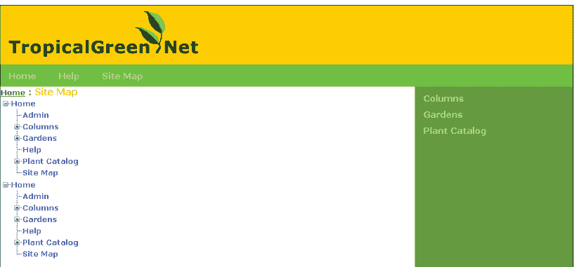

## 站点地图和站点地图提供程序

站点地图包含作为网站导航结构一部分的项目集合。这些项目通常以层次树状结构显示。在 MCMS 中，这通常是频道和发布内容的列表，有时也是库、资源和模板。最简单形式，站点地图可以是一个纯 XML 文件，存储节点列表，如下所示：

```
<?xml version="1.0" encoding="utf-8"?>
<siteMap xmlns="http://schemas.microsoft.com/AspNet/SiteMap-File-1.0">
    <siteMapNode url="http://tropicalgreen/" title="Home"/>
        <siteMapNode url="/PlantCatalog/" title="Plant Catalog">
        <siteMapNode url="/Gardens/" title="Gardens">
            <siteMapNode url="/Gardens/Members/" title="Members"/>
        </siteMapNode>
    . . . code continues . . .
    </siteMapNode>
</siteMapNode>
</siteMap>
```

在定义站点地图后，你可以将 SiteMapDataSource 添加到页面中，同时添加一个 Menu 控件，将站点地图数据源绑定到 Menu 控件，XML 文件的内容将被转换为菜单项。当然，XML 节点到菜单项的转换并非魔法。在幕后，SiteMapProvider（具体来说是 XmlSiteMapProvider）读取 XML 文件并以编程方式将每个节点加载到 SiteMapDataSource 中。

虽然我们可以使用 XML 文件保存节点列表，但它只是网站结构的静态快照。当添加或删除新频道或页面时，文件必须相应更新。在 XML 文件中硬编码节点和链接在结构相对固定的网站上可能效果良好。然而，对于许多 MCMS 网站，其中频道和页面经常添加和删除，或者不同用户可能被允许查看不同的页面集，更动态的方法会更受欢迎。

由于 XmlSiteMapProvider 是随 ASP.NET 2.0 提供的唯一提供程序，我们需要构建一个自定义站点地图提供程序来从 MCMS 仓库读取数据。

自定义站点地图提供程序将使用 MCMS 发布应用程序编程接口（PAPI）从 MCMS 仓库检索频道和发布内容以形成站点地图。这种方法的优点是安全性

修剪会自动由 PAPI 提供，因为只会检索当前用户有权查看的项目。

## 构建 MCMS 站点地图提供程序

要构建自定义的 SiteMapProvider，我们将创建一个继承自基类 SiteMapProvider 的类并实现基类继承的四个方法：

- The FindSiteMapNode() method returns a site map node based on a given URL or GUID.
- The GetChildNodes() method returns a collection of nodes of a specified parent node.
- The GetParentNode() method returns the parent node of a specified child.
- The GetRootNodeCore() method returns the first node in the hierarchy.

由于 TropicalGreen 站点的导航控件提供对频道项的链接，每个站点地图节点都映射到相应的频道项。尽管如此，您可以轻松修改方法以显示模板库项或资源库项。 现在，让我们继续构建 MCMSSiteMapProvider 类。

## MCMSSiteMapProvider 类

为了保持简单，我们可以利用 ASP.NET 中的另一个新功能：App_Code 文件夹。 App_Code 文件夹还允许我们在无需重建网站的情况下添加功能。

- 1. 首先，如果您尚未执行此操作，请将 App_Code ASP.NET 文件夹添加到 TropicalGreen 解决方案。右键单击项目并选择 添加 | ASP.NET 文件夹 | App_Code。
- 2. 在 App_Code 文件夹内创建一个名为 SiteMapProviders 的新子文件夹。
- 3. 右键单击新创建的 SiteMapProviders 文件夹并添加一个名为 MCMSSiteMapProvider.cs 的类文件。
- 4. 代码需要使用以下代码片段中突出显示的命名空间中的方法；因此将其添加到类文件中。 同时添加命名空间声明。

```
using System;
using System.Data;
using System.Configuration;
using System.Web;
using System.Web.Security;
```

```
using System.Web.UI;
using System.Web.UI.WebControls;
using System.Web.UI.WebControls.WebParts;
using System.Web.UI.HtmlControls;
using Microsoft.ContentManagement.Publishing;

namespace TropicalGreen
{
    public class MCMSSiteMapProvider
    {
        . . . code continues . . .
    }
}
```

5. 由于没有可直接使用的与 MCMS 对象配合的 SiteMapProviders，自定义提供程序将继承自基类 SiteMapProvider 类。

```
public class MCMSSiteMapProvider : SiteMapProvider
{
    . . . code continues . . .
}
```

6. 我们还将添加一个名为 rootPath 的私有变量来存储顶级频道的路径。 对于 TropicalGreen，路径为 /Channels/tropicalgreen/。 在类声明中添加突出显示的代码。

```
public class MCMSSiteMapProvider : SiteMapProvider
{
    protected string RootChannel = "/Channels/tropicalgreen/";

    . . . code continues . . .
}
```

另外，我们可以将频道路径存储在 web.config 文件的 <appSettings> 部分中。这样可以使代码更易于在其他解决方案中重用，因为我们不必在路径更改时每次都重新编译代码。

7. 最后，删除类构造函数（代码如下）。它不是必需的。

```
public MCMSSiteMapProvider()
{
    //
    // TODO: Add constructor logic here
    //
}
```

## 实现 GetRootNodeCore() 方法

GetRootNodeCore() 方法返回层次结构中的第一个节点。在 TropicalGreen 站点的情况下，第一个节点是第一级频道 TropicalGreen 的节点。我们已经将它的路径存储在类变量 rootChannel 中。我们使用 PAPI 中的 Searches.GetByPath() 方法返回 TropicalGreen 频道的实例。将 GetRootNodeCore() 方法添加到类中。

```
protected override SiteMapNode GetRootNodeCore()
{
    Channel root = CmsHttpContext.Current.Searches.GetByPath
        (RootChannel) as Channel;
    return GetSiteMapNodeFromChannelItem(root);
}
```

请注意，在代码中，我们使用名为 GetSiteMapNodeFromChannelItem() 的方法基于频道项创建站点地图节点。站点地图节点有四个基本属性：

- **键**：用于唯一标识节点的数值。我们将将其设置为频道项的 GUID。
- **网址**：指定节点的地址，对于我们的站点将是频道项的 URL。
- **标题**：指定用于显示节点的文本标签。我们检索频道项的显示名称并将其用于标题。
- **描述**：指定当鼠标放置在节点上时显示的工具提示内容。特别适用于为访问者提供有关链接后面页面的描述。

从频道项，我们将基于前面列表中讨论的属性创建一个站点地图节点。将 GetSiteMapNodeFromChannelItem() 方法附加到类文件。

```
protected SiteMapNode GetSiteMapNodeFromChannelItem(ChannelItem ci)
{
    SiteMapNode smn = null;
    if (ci != null)
    {
        smn = new SiteMapNode(this, ci.Guid);
        smn.Url = ci.Url;
        smn.Title = ci.DisplayName;
        smn.Description = ci.Description;
    }
```

```
return smn;
}
```

## 实现 FindSiteMapNode() 方法

FindSiteMapNode() 方法根据给定的 URL 或 GUID 返回站点地图节点。我们将创建该方法的两个重载版本。

第一个接受一个字符串，该字符串可以是 GUID 或 URL，并返回一个节点。为了检测我们正在处理 URL 还是 GUID，我们查看字符串的第一个字符。如果它以左大括号 ({) 开头，那么它一定是 GUID。

从 GUID，我们使用 Searches.GetByGuid() 方法获取相应的频道项。对于 URL，我们调用辅助函数 EnhancedGetByUrl()。它与 Searches.GetByUrl() 执行相同的任务，但包括我们稍后将看到的若干增强功能。

一旦我们获得了频道项，我们将使用 GetSiteMapNodeFromChannelItem() 方法构造一个站点地图节点对象。

```
public override SiteMapNode FindSiteMapNode(string urlOrGuid)
{
    ChannelItem ci = null;
    if (urlOrGuid.StartsWith("{"))
    {
        ci = CmsHttpContext.Current.Searches.GetByGuid(urlOrGuid)
            as ChannelItem;
    }
    else
    {
        ci = EnhancedGetByUrl(CmsHttpContext.Current, urlOrGuid);
    }

    return GetSiteMapNodeFromChannelItem(ci);
}
```

第二个方法接受当前的 HttpContext 并返回代表当前正在访问的频道项的节点。

```
public override SiteMapNode FindSiteMapNode(HttpContext context)
{
    ChannelItem ci = CmsHttpContext.Current.ChannelItem;
    return GetSiteMapNodeFromChannelItem(ci);
}
```

## 增强 Searches.GetByUrl() 方法

将频道名称映射到主机标头是 MCMS 企业版中一个有用的功能。它使多个网站能够托管在同一服务器上。启用后，根频道下方的顶级频道也将成为主机标头。例如，如果根频道下方的频道名为 `tropicalgreen`，则该频道的 URL 将变为 `http://tropicalgreen`，而不是 `http://localhost/tropicalgreen`。

问题是 `Searches.GetByUrl()` 方法在启用映射主机标头时不可靠。当 `Searches.GetByUrl()` 方法接收到例如顶级频道的 URL `http://tropicalgreen` 时，我们期望它返回 `tropicalgreen` 频道的实例。然而，它返回 null 对象。这是因为 `Searches.GetByUrl()` 方法存在一个问题，导致它期望输入 URL 为 `http://localhost/tropicalgreen`，无论是否启用了将频道名称映射到主机标头名称。

作为变通方法，我们将增强 `Searches.GetByUrl()` 方法。我们首先检查是否已启用映射主机标头功能。为此，我们查看根频道的 URL。如果根频道的 URL 为 `http://Channels/`（URL 包含根频道本身的名称），我们就知道频道已被映射到主机标头。

如果已打开将频道名称映射到主机标头功能，我们将把 URL 转换为路径并使用 `Searches.GetByPath()` 方法获取频道项的实例。例如，如果 URL 为 `http://tropicalgreen/plantcatalog`，例程将其转换为频道的路径 `/Channels/tropicalgreen/plantcatalog`，并基于路径获取频道项的实例。将以下代码添加到类中：

```
private bool MapChannelToHostHeaderEnabled(CmsContext ctx)
{
    return (ctx.RootChannel.UrlModePublished == "http://Channels/");
}

private ChannelItem EnhancedGetByUrl(CmsContext ctx, string Url)
{
    if (MapChannelToHostHeaderEnabled(ctx))
    {
        string Path = HttpUtility.UrlDecode(Url);
        Path = Path.Replace("http://", "/Channels/");
        if (!Path.StartsWith("/Channels/"))
        {
            Path = "/Channels/" + HttpContext.Current.Request.Url.Host
```


```
        Path = Path;
    }
    if (Path.EndsWith(".htm"))
    {
        Path = Path.Substring(0, Path.Length - 4);
    }
    if (Path.EndsWith("/"))
    {
        Path = Path.Substring(0, Path.Length - 1);
    }
    return (ChannelItem)(ctx.Searches.GetByPath(Path));
    }
    else
    {
        return ctx.Searches.GetByUrl(Url);
    }
}
```

## 实现 GetParentNode() 方法

GetParentNode() 返回指定节点的父节点。对于 MCMS，父节点始终是当前频道项的父频道。获取父节点本质上是一个两步过程（如果排除隐藏根频道的步骤的话）。

- 1. 获取频道项的实例。
- 2. 使用 ChannelItem.Parent 获取频道项的父频道。
- 3. 从站点地图中隐藏根频道 /Channels/。

我们首先检索存储在节点键中的 GUID。借助该 GUID，我们使用 Searches.GetByGuid() 方法检索对应的频道项。

```
public override SiteMapNode GetParentNode(SiteMapNode node)
{
    // Get the current channel item
    ChannelItem ci =
        CmsHttpContext.Current.Searches.GetByGuid(node.Key)
        as ChannelItem;
}
```

要获取父节点，我们只需检索 ChannelItem.Parent 属性返回的频道。当前频道项可能为空。例如，当页面状态为 New 时，它实际上还不存在，尽管我们有其 GUID，但无法获取其实例。在这种情况下，我们将父节点设置为当前频道。

```
public override SiteMapNode GetParentNode(SiteMapNode node)
{
    . . . code continues . . .

    // Variable for storing the parent channel item
    ChannelItem parent = null;

    if (ci != null)
    {
        if (ci.Path != RootChannel)
        {
            // Get the parent of the current channel item
            parent = ci.Parent;
        }
    }
    else
    {
        // We’ve got a null channel item, possibly because the
        // page’s status is New
        // Set the parent to be the current channel
        parent = CmsHttpContext.Current.Channel;
    }
}
```

一旦我们获得了父频道项的实例，我们就使用 GetSiteMapNodeFromChannelItem() 方法从频道项创建站点地图节点。

```
public override SiteMapNode GetParentNode(SiteMapNode node)
{
    . . . code continues . . .
    // Create a site map node based on the parent channel item
    // and return it
    return GetSiteMapNodeFromChannelItem(parent);
}
```

GetParentNode() 方法尚未完成。如果现在运行它，你会发现它返回根节点 /Channels/。因此，像 SiteMapPath 控件这样的控件会显示包含根频道 /Channels/ 的路径。

将根频道从站点地图中隐藏起来是个好主意，因为它不是站点层次结构中可见的一部分。根节点可能被包含在站点地图中的情况有几种：

- 访问的节点就是根频道 `/Channels/` 本身。
- 访问的节点是位于根频道中的页面或频道项。例如，它可以是主页 (`/Channels/Home.htm`) 或顶级频道之一 (`/Channels/tropicalgreen/`)。因此，其父节点是根频道。

在这两种情况下，我们需要将 GetParentNode() 的返回值设为 null，以便在站点地图中隐藏根频道。按如下所示添加高亮代码：

```
public override SiteMapNode GetParentNode(SiteMapNode node)
{
    . . . code continues . . .

    if (parent == null)
    {
        // The parent is null, possibly because we are somehow
        // accessing the root channel itself.
        return null;
    }
    else {
        // Check to see if the parent channel is "/Channels/"
        if(parent.Path == "/Channels/" && RootChannel != "/Channels/")
        {
            // We don’t want "Channels" to be part of the site map
            return null;
        }
        else
        {
            // Create a site map node based on the parent channel item
            // and return it
            return GetSiteMapNodeFromChannelItem(parent);
        }
    }
}
```

完整的方法如下所示：

```
public override SiteMapNode GetParentNode(SiteMapNode node)
{
    // Get the current channel item
    ChannelItem ci = CmsHttpContext.Current.Searches.GetByGuid
    (node.Key) as ChannelItem;

    // Variable for storing the parent channel item
    ChannelItem parent = null;

    if (ci != null)
    {
        if (ci.Path != RootChannel)
        {
            // Get the parent of the current channel item
            parent = ci.Parent;
        }
    }
    else
    {
        // We’ve got a null channel item, possibly because the
        // page’s status is New
        // Set the parent to be the current channel
        parent = CmsHttpContext.Current.Channel;
    }

    if (parent == null)
    {
        // The parent is null, possibly because we are somehow
        // accessing the root channel itself.
        return null;
    }
    else
    {
        // Check to see if the parent channel is "/Channels/"
        if (parent.Path == "/Channels/" && RootChannel != "/Channels/")
        {
            // We don’t want "Channels" to be part of the site map
            return null;
        }
        else
        {
            // Create a site map node based on the parent channel item
            // and return it
            return GetSiteMapNodeFromChannelItem(parent);
        }
    }
}
```

## 实现 GetChildNodes() 方法

GetChildNodes() 方法返回指定节点的所有子项（子频道和帖子）的列表。如前所述，我们使用存储在节点键中的 GUID 来检索频道。然后我们遍历子频道和帖子的集合，并将它们作为节点添加到站点地图中。

```
public override SiteMapNodeCollection GetChildNodes(SiteMapNode node)
{
    SiteMapNodeCollection smnc = new SiteMapNodeCollection();

    Channel currentChannel =
        CmsHttpContext.Current.Searches.GetByGuid(node.Key)
        as Channel;

    if (currentChannel != null)
    {
        ChannelCollection cc = currentChannel.Channels;
        cc.SortByDisplayName();

        foreach (Channel c in cc)
        {
            smnc.Add(GetSiteMapNodeFromChannelItem(c));
        }

        PostingCollection pc = currentChannel.Postings;
        pc.SortByDisplayName();

        foreach (Posting p in pc)
        {
            smnc.Add(GetSiteMapNodeFromChannelItem(p));
        }
    }

    return smnc;
}
```

请注意，在遍历子频道和帖子之前，我们按显示名称对每个集合进行了排序。你可以轻松地通过调用其他排序函数（如 SortByStartDate() 或 SortBySortOrdinal()）或实现自定义排序算法来更改排序顺序。

## 注册 SiteMapProvider

MCMSSiteMapProvider 已完成。在使用 SiteMapProvider 之前，我们需要在 web.config 文件中注册它。按如下所示在 <System.Web> 标签之间添加高亮代码：

```
<system.web>
. . . code continues . . .

<siteMap defaultProvider="MCMSSiteMapProvider" enabled="true">
    <providers>
        <add name="MCMSSiteMapProvider"
            type="TropicalGreen.MCMSSiteMapProvider"/>
    </providers>
</siteMap>
</system.web>
```

## SiteMapPath 控件

SiteMapPath 控件显示一系列超链接，可返回到主页。它有时被称为面包屑导航，因为它类似于虚构人物汉塞尔和格雷特留下的面包屑痕迹。它是“您在此处”标志，告诉网站访问者他们所在的位置。例如，在查看植物页面时，SiteMapPath 控件会显示 Home > Plant Catalog > Aloe Vera。

在页面上放置 SiteMapPath 控件可使访问者轻松返回到植物目录或任何其他父节点。正如我们将看到的，将其包含在 MCMS 站点中也相当简单。

在 ASP.NET 的早期版本（1.x）中，我们必须编写递归函数来获取通往根节点的父频道集合。有了我们之前创建的 SiteMapProvider 和 SiteMapPath 控件，我们可以在不编写任何代码的情况下实现相同的结果。让我们看看它是怎么做到的。

- 1. 首先，在 Visual Studio 中打开第 3 章（使用母版页）中创建的 TropicalGreen.master 母版页。


- 2. 切换到 **设计** 视图并从工具栏的 **导航** 部分拖动一个 **SiteMapPath** 控件，放置到写着 **SiteMapPath 控件的占位空间** 的文本标记上。然后删除该文本标记。
- 3. 保存文件。

我们已将 `SiteMapPath` 控件添加到站点。要查看其在站点上的显示效果，请导航到任意页面。请注意，该控件会显示通向站点根频道的全部链接。

首页 > 植物目录 > 芦荟

背后发生的情况是，`SiteMapProvider` 已向 `SiteMapPath` 控件提供了通向当前页面的父频道。在我们无需额外编程的情况下，这两个组件已协同工作生成了路径。

## 菜单控件

无处不在的菜单控件几乎无需介绍。菜单为用户提供可供选择的链接列表。它们传统上水平放置在页面顶部，或垂直放置在页面的左侧或右侧。如果你构建过网站，很可能尝试在站点某处放置菜单，要么使用即用型小部件，要么使用一组脚本从头构建。无论哪种方式，都需要编写相当多的代码才能使菜单正常工作。

使用 ASP.NET 2.0 的菜单控件创建菜单轻而易举。让我们为 TropicalGreen 站点添加几个菜单。我们将首先为站点横幅构建一个静态水平菜单。之后，我们将尝试做一些更复杂的事情，并构建一个动态垂直菜单，该菜单以弹出形式显示子菜单。

## 构建水平菜单

静态菜单易于构建。我们只需在母版页中硬编码链接即可完成任务。然而，当链接的 URL 发生变化或列表中添加新项目时，仍需要开发人员来执行此操作。此外，硬编码还意味着所有链接对站点的所有访客都可见。如果没有额外的编码，很难隐藏指向受限站点的链接。

因此，即使菜单是静态的，也最好让菜单项动态生成。在 ASP.NET 的早期版本（1.x）中，我们必须编写递归函数来生成每个菜单项。好消息是 `SiteMapProvider` 已为我们完成了大部分工作。剩下的工作就是使用 `SiteMapDataSource` 控件将其连接到菜单控件。

与 `SiteMapPath` 控件不同，菜单控件需要一个 `SiteMapDataSource` 控件来从 SiteMapProvider 绑定数据。让我们看看这是如何完成的。

- 1. 在 **设计** 视图中打开 `tropicalgreen.master`，从工具箱的 **数据** 部分拖动一个 **SiteMapDataSource** 控件并将其放置在 Web 表单底部。右键单击 **SiteMapDataSource** 控件并为其设置以下属性值：
- 2. 从工具箱的 **导航** 部分拖动一个 **Menu** 控件并将其放置在 `tropicalgreen.master` 文件中 **顶部菜单的占位空间** 文本标记旁边。会出现一个名为 **菜单任务** 的智能标记对话框。将 **选择数据源** 字段设置为 **SiteMapDataSourceTop**，将 **视图** 字段设置为 **静态**。
- 3. 删除文本标记。为菜单控件设置以下属性值：
- 4. 保存文件。

| 属性 | 值 |
|---|---|
| ID | SiteMapDataSourceTop |
| SiteMapProvider | MCMSSiteMapProvider |

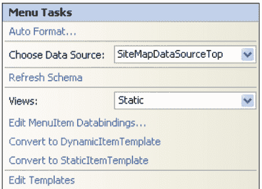

| 属性 | 值 |
|---|---|
| ID | TopMenu |
| Orientation | Horizontal |
| StaticDisplayLevels | 2 |

请注意，我们尚未编写任何一行代码！要查看水平菜单的实际效果，请查看任意植物页面。


菜单在首次加载时显示异常。所有菜单项，包括应隐藏的子菜单项都被显示。子菜单项只有在鼠标光标移过它们之后才会消失。我该怎么办？

菜单需要 XHTML 才能正确显示。在使用向导创建 MCMS Web 应用程序时，`web.config` 文件中添加了 `<xhtmlConformance>` 标签。`<xhtmlConformance>` 标签包含一个名为 `mode` 的属性，该属性指定应用程序的 XHTML 渲染模式。MCMS 网站的默认 `mode` 属性值为 `Legacy`，这意味着某些代码将被回退以符合 XHTML v1.1 渲染行为。将 `mode` 属性值更改为 `Strict` 或 `Transitional`，菜单控件才能正常工作。

水平菜单包含所有顶级频道项的列表。然而，虽然在某些网站上显示所有项目可能有效，但对 TropicalGreen 来说不行。我们要求水平菜单仅显示三个项目：

- **首页**
- **帮助**
- **站点地图**

## 使用自定义属性区分顶部和右侧菜单项

为了指定出现在顶部菜单中的项目，我们为每个顶级频道添加了自定义属性值。每个频道都有一个名为 `MenuLocation` 的自定义属性，其值可以是 `Top` 和 `Right` 中的一个。三个频道项 `TropicalGreen`、`Help` 和 `SiteMap` 已配置为 `MenuLocation` 为 `Top`，如 **站点管理器** 中所示。

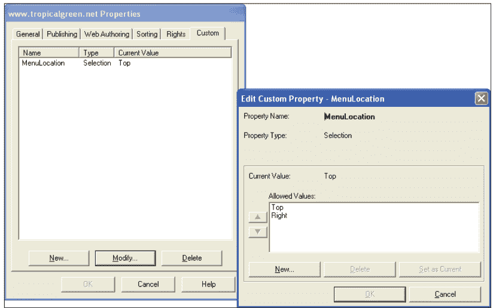

## MCMSSiteMapProviderTop 类

我们需要修改 `SiteMapProvider` 以查看存储在 `MenuLocation` 中的值。同时，它应继续为之前添加的 `SiteMapPath` 控件显示整个站点的导航结构。

幸运的是，ASP.NET 2.0 支持使用多个站点地图。我们可以保留第一个 `SiteMapProvider` 不变，并创建第二个派生自它的提供程序。让我们创建一个名为 `MCMSSiteMapProviderTop` 的第二个 `SiteMapProvider`，它仅包含 `MenuLocation` 自定义属性值为 Top 的频道。

- 1. 在 `\App_Code\SiteMapProviders` 文件夹中添加一个名为 `MCMSSiteMapProviderTop.cs` 的类文件。
- 2. 添加突出显示的命名空间以及命名空间声明。

```
using System;
using System.Data;
using System.Configuration;
using System.Web;
using System.Web.Security;
using System.Web.UI;
using System.Web.UI.WebControls;
using System.Web.UI.WebControls.WebParts;
using System.Web.UI.HtmlControls;
using Microsoft.ContentManagement.Publishing;

namespace TropicalGreen
{
    public class MCMSSiteMapProviderTop
    {
        . . . code continues . . .
    }
}
```

3. 我们不会从头重建 SiteMapProvider。由于我们之前创建的 MCMSSiteMapProvider 类中已编写了大部分代码，我们只需继承它即可。

```
public class MCMSSiteMapProviderTop : MCMSSiteMapProvider
{
    . . . code continues . . .
}
```

4. 我们需要修改 GetChildNodes() 方法，使其查看每个频道 MenuLocation 自定义属性中存储的值。只有属于顶部菜单的频道才会被添加到站点地图。

```
public override SiteMapNodeCollection GetChildNodes(SiteMapNode node)
{
    SiteMapNodeCollection smnc = new SiteMapNodeCollection();

    Channel currentChannel =
        CmsHttpContext.Current.Searches.GetByGuid(node.Key) as Channel;

    if (currentChannel != null)
    {
        ChannelCollection cc = currentChannel.Channels;
        cc.SortByDisplayName();

        foreach (Channel c in cc)
        {
            if (c.CustomProperties["MenuLocation"] != null)
            {
                if (c.CustomProperties["MenuLocation"].Value == "Top")
                {
                    smnc.Add(GetSiteMapNodeFromChannelItem(c));
                }
            }
        }
    }

    return smnc;
}
```

5. 类已完成。保存文件。

6. 与之前一样，在使用之前，我们需要在 web.config 文件中注册 MCMSSiteMapProviderTop。将突出显示的代码添加到 web.config 文件中。

```
<siteMap defaultProvider ="MCMSSiteMapProvider" enabled ="true">
  <providers>
    <add name="MCMSSiteMapProvider"
      type="TropicalGreen.MCMSSiteMapProvider"/>
    <add name="MCMSSiteMapProviderTop"
      type="TropicalGreen.MCMSSiteMapProviderTop"/>
  </providers>
</siteMap>
```

7. 要查看其实际效果，请将 SiteMapDataSourceTop 的 SiteMapProvider 属性设置为 MCMSSiteMapProviderTop。

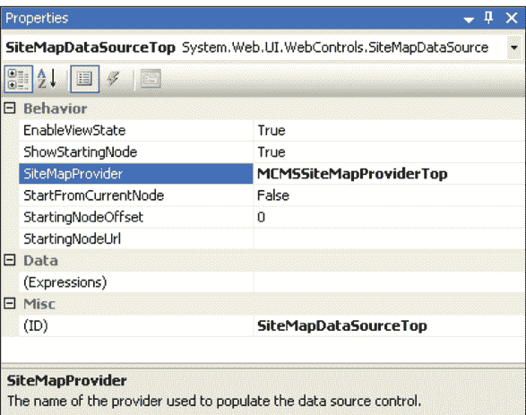


现在导航到任意一个植物页面。菜单仅显示我们指定为顶部的三个频道项。


## Building a Dynamic Multi-Level Vertical Menu

构建动态多级垂直菜单

我们已使用菜单控件构建了单级静态水平菜单。现在，让我们提高难度，使用相同的控件创建多级菜单。为了更有趣，我们还将菜单旋转九十度并创建垂直显示。

所有不属于顶部菜单的顶级频道项都将在垂直菜单中显示。当鼠标光标悬停在父菜单项上（例如 Gardens），会出现一个弹出窗口，显示子菜单项列表。完成后菜单将如下所示：

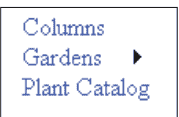

## The MCMSSiteMapProviderRight Class

MCMSSiteMapProviderRight 类

到目前为止，我们已创建了两个 SiteMapProvider 类——第一个列出所有频道项，第二个仅包含顶部菜单项。

现在，让我们创建一个第三个 SiteMapProvider 类，仅列出垂直右侧菜单的项。

- 1. Add a class file named `MCMSSiteMapProviderRight.cs` to the `App_Code` folder.
- 1. 在 `App_Code` 文件夹中添加一个名为 `MCMSSiteMapProviderRight.cs` 的类文件。
- 2. The class requires the use of the namespace highlighted in the following code snippet. Add also the namespace declaration.
- 2. 该类需要使用以下代码片段中突出显示的命名空间。还添加命名空间声明。

```csharp
using System;
using System.Data;
using System.Configuration;
using System.Web;
using System.Web.Security;
using System.Web.UI;
using System.Web.UI.WebControls;
using System.Web.UI.WebControls.WebParts;
using System.Web.UI.HtmlControls;
using Microsoft.ContentManagement.Publishing;

namespace TropicalGreen
{
    public class MCMSSiteMapProviderRight
    {
        . . . code continues . . .
    }
}
```

- 3. As before, we won’t be building the SiteMapProvider from scratch. Instead, we will inherit from the MCMSSiteMapProvider class that we created earlier.
- 3. 与之前一样，我们不会从头构建 SiteMapProvider。相反，我们将继承之前创建的 MCMSSiteMapProvider 类。

```csharp
public class MCMSSiteMapProviderRight : MCMSSiteMapProvider
{
    . . . code continues . . .
}
```

- 4. We will override the GetChildNodes() method of the base class and modify it to include only items that belong to the right menu. To do so, we read the value of the custom property MenuLocation. If it contains the value Right, the item is inserted into the site map. In addition, we will also add sub-menu items to the site map. Append the GetChildNodes() method to the code.
- 4. 我们将重写基类的 GetChildNodes() 方法，并修改它以仅包含属于右侧菜单的项。为此，我们读取自定义属性 MenuLocation 的值。如果它包含值 Right，则该项将被插入到站点地图中。此外，我们还将子菜单项添加到站点地图中。将 GetChildNodes() 方法附加到代码中。

```csharp
public override SiteMapNodeCollection GetChildNodes(SiteMapNode node)
{
    SiteMapNodeCollection smnc = new SiteMapNodeCollection();

    Channel currentChannel =
        CmsHttpContext.Current.Searches.GetByGuid(node.Key) as Channel;

    if (currentChannel != null)
    {
        ChannelCollection cc = currentChannel.Channels;
        cc.SortByDisplayName();

        foreach (Channel c in cc)
        {
            if (c.CustomProperties["MenuLocation"] != null)
            {
                // Add top-level menu items
                if (c.CustomProperties["MenuLocation"].Value == "Right")
                {
                    smnc.Add(GetSiteMapNodeFromChannelItem(c));
                }
            }
            else if(c.Parent.Path!=base.RootChannel)
            {
                // Add sub menu items
                smnc.Add(GetSiteMapNodeFromChannelItem(c));
            }
        }
    }
    return smnc;
}
```

- 5. The class is complete. Save the file.
- 5. 类已完成。保存文件。
- 6. Before the `MCMSSiteMapProviderRight` class can be used, we need to register it in the web.config file.
- 6. 在可以使用 `MCMSSiteMapProviderRight` 类之前，我们需要在 web.config 文件中注册它。

```xml
<siteMap defaultProvider ="MCMSSiteMapProvider" enabled ="true">
    <providers>
        <add name="MCMSSiteMapProvider"
            type="TropicalGreen.MCMSSiteMapProvider"/>
        <add name="MCMSSiteMapProviderTop"
            type="TropicalGreen.MCMSSiteMapProviderTop"/>
        <add name="MCMSSiteMapProviderRight"
            type="TropicalGreen.MCMSSiteMapProviderRight"/>
    </providers>
</siteMap>
```

The `SiteMapProviderRight` class has been built and registered. Let’s add a `SiteMapDataSource` and menu control to the `tropicalgreen.master` template.
`SiteMapProviderRight` 类已构建并注册。让我们向 `tropicalgreen.master` 模板添加一个 `SiteMapDataSource` 和菜单控件。

- 1. With `tropicalgreen.master` opened, drag a **SiteMapDataSource** control from the **Data** section of the toolbox and assign the following property values:
- 1. 打开 `tropicalgreen.master` 后，从工具箱的 **数据** 部分拖动 **站点地图数据源** 控件，并为其分配以下属性值：

| 属性 | 值 |
|---|---|
| ID | SiteMapDataSourceRight |
| SiteMapProvider | MCMSSiteMapProviderRight |
| ShowStartingNode | False |

- 2. Next, drag a menu control from the **Navigation** section of the toolbox and drop it next to the text marker **Space for Right Menu**.
- 2. 接下来，从工具箱的 **导航** 部分拖动一个菜单控件，并将其放置在文本标记 **右侧菜单位置** 旁边。

- 3. The **Menu Tasks** dialog appears. Set the **Choose Data Source** field to **SiteMapDataSourceRight** and the **Views** field to **Static**. Although the right menu is a dynamic menu, we still require the first level to be static, hence the choice of a static view.
- 3. 出现 **菜单任务** 对话框。将 **选择数据源** 字段设置为 **SiteMapDataSourceRight**，将 **视图** 字段设置为 **静态**。尽管右侧菜单是动态菜单，但我们仍要求第一级为静态，因此选择了静态视图。

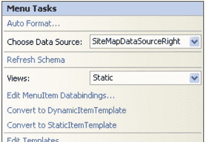

- 4. Delete the text marker **Space for Right Menu**.
- 4. 删除文本标记 **右侧菜单位置**。

- 5. Set the following property values for the menu control. Notice that we have set the `StaticDisplayLevels` property to 1. This means that only the first-level items will be shown as static text. Sub-menu items will be dynamic and revealed as popups.
- 5. 为菜单控件设置以下属性值。请注意，我们已将 `StaticDisplayLevels` 属性设置为 1。这意味着只有第一级项将以静态文本显示。子菜单项将是动态的，并在弹出窗口中显示。

| 属性 | 值 |
|---|---|
| ID | MenuRight |
| StaticDisplayLevels | 1 |

The right menu control is complete. To view it, navigate to any of the plant pages on the website. Place the mouse cursor over the **Gardens** menu item to reveal the sub-menu item **Members**.
右侧菜单控件已完成。要查看它，请导航到网站上的任意植物页面。将鼠标光标放在 **Gardens** 菜单项上以显示子菜单项 **Members**。

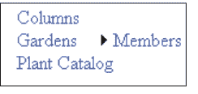

## The TreeView Control

TreeView 控件

The TreeView control provides a hierarchical view of all items on the site. It is often used in site maps or as an alternative to the menu control. TreeViews are popular because they are intuitive to use. Most users would instinctively know how to expand and collapse folders to get content.
TreeView 控件提供站点上所有项的层次视图。它通常用于站点地图或作为菜单控件的替代方案。TreeView 很受欢迎，因为它们使用直观。大多数用户会本能地知道如何展开和折叠文件夹以获取内容。

Let’s add a page that uses the TreeView control. We will use it to display a graphical view of the entire site map and link it to the Site Map link in the top horizontal menu item. Here’s how the completed tree will look when done. Don’t worry about the look and feel of the tree for now; we will spice it up with colors and images in the next chapter on themes.
让我们添加一个使用 TreeView 控件的页面。我们将使用它来显示整个站点地图的图形视图，并将其链接到顶部水平菜单项中的站点地图链接。完成后树将如下所示。暂时不用担心树的样式和外观；我们在下一章主题中会用颜色和图像对其进行美化。

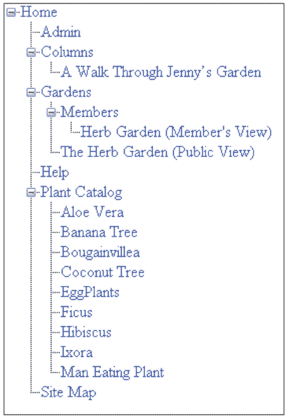

The first cut of our site map loads all nodes into the tree at once. In a later section, we will show how nodes may be populated on demand, when the parent node is expanded.
我们站点地图的第一个版本会一次性将所有节点加载到树中。在后面的部分，我们将展示如何在父节点展开时按需填充节点。

## The Site Map Page

站点地图页面

Let’s create a channel-rendering script for the `SiteMap` channel. Users can access the page by clicking on the **Site Map** link on the top horizontal menu bar.
让我们为 `SiteMap` 频道创建一个频道渲染脚本。用户可以通过单击顶部水平菜单栏上的 **站点地图** 链接访问该页面。

- 1. Add a web form to the **Templates** folder of the **TropicalGreen** project. Name the web form **SiteMap.aspx**. Choose to **Select a master page** and click **Add.**
- 1. 在 **TropicalGreen** 项目的 **模板** 文件夹中添加一个 Web 窗体。将 Web 窗体命名为 **SiteMap.aspx**。选择 **选择母版页** 并单击 **添加**。

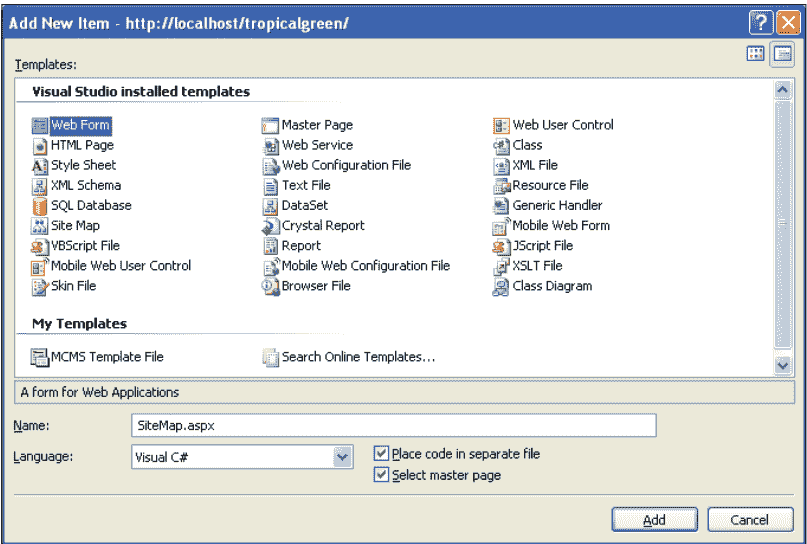

- 2. In the **Select a Master Page** dialog, choose the `Tropicalgreen.master` template in the **Templates** folder. Click **OK.**
- 2. 在 **选择母版页** 对话框中，选择 **模板** 文件夹中的 `Tropicalgreen.master` 模板。单击 **确定**。

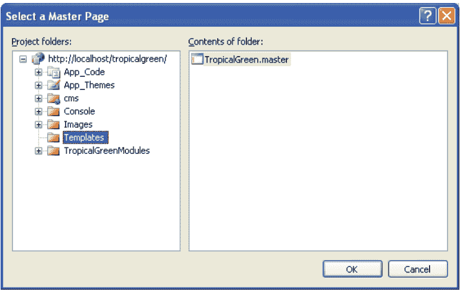

- 3. Open `Sitemap.aspx` in **Design** view. Drag a **SiteMapDataSource** control from the **Data** section of the toolbox and drop it into the content area. Assign the following property values to the `SiteMapDataSource` control:
- 3. 在 **设计** 视图中打开 `Sitemap.aspx`。从工具箱的 **数据** 部分拖动 **站点地图数据源** 控件并将其放置到内容区域。为 `SiteMapDataSource` 控件分配以下属性值：

| 属性 | 值 |
|---|---|
| ID | SiteMapDataSourceTree |
| SiteMapProvider | MCMSSiteMapProvider |

- 4. Drag a **TreeView** control from the **Navigation** section of the toolbox into the content area, above the **SiteMapDataSource** control.
- 4. 从工具箱的 **导航** 部分拖动 **TreeView** 控件到内容区域，放置在 **站点地图数据源** 控件上方。

## Navigation Controls

导航控件

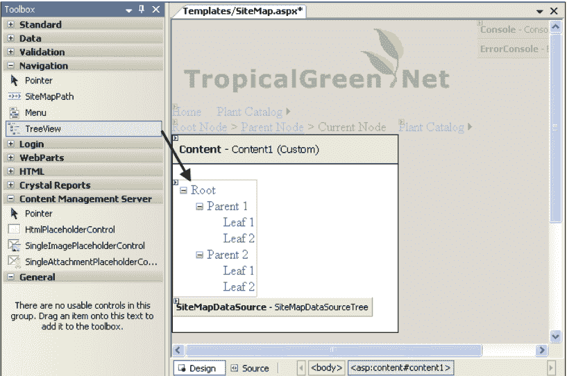

- 5. As soon as the TreeView control has been added to the form, the TreeView Tasks dialog appears. Set the Choose Data Source field to SiteMapDataSourceTree and select the Show Lines checkbox.
- 5. 一旦 TreeView 控件已添加到窗体中，TreeView 任务对话框就会出现。将选择数据源字段设置为 SiteMapDataSourceTree 并选中显示线条复选框。

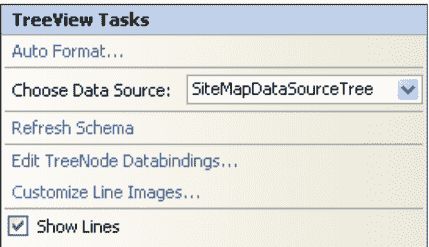

The page is complete. Save and build the website. Now, let’s check the properties of the SiteMap channel to ensure that it links to the SiteMap.aspx page. If you have downloaded the site deployment file from the book’s companion website, the SiteMap channel will already be configured to display the SiteMap.aspx page. Otherwise, take the following steps to set the properties of the SiteMap channel.
页面已完成。保存并构建网站。现在，让我们检查 SiteMap 频道的属性，以确保它链接到 SiteMap.aspx 页面。如果您已从本书的配套网站下载了站点部署文件，则 SiteMap 频道已配置为显示 SiteMap.aspx 页面。否则，请执行以下步骤设置 SiteMap 频道的属性。


- 1. 打开 **站点管理器** 并导航到 **站点地图** 频道。
- 2. 右键单击 **站点地图** 频道并选择 **属性**。
- 3. 在 **属性** 对话框中，单击 **发布** 选项卡。
- 4. 在对话框的 **频道呈现** 部分，单击 **选择**。
- 5. 在 **选择频道呈现** 对话框中，将 **脚本 URL** 字段设置为 `/tropicalgreen/templates/sitemap.aspx` 并单击 **确定**。

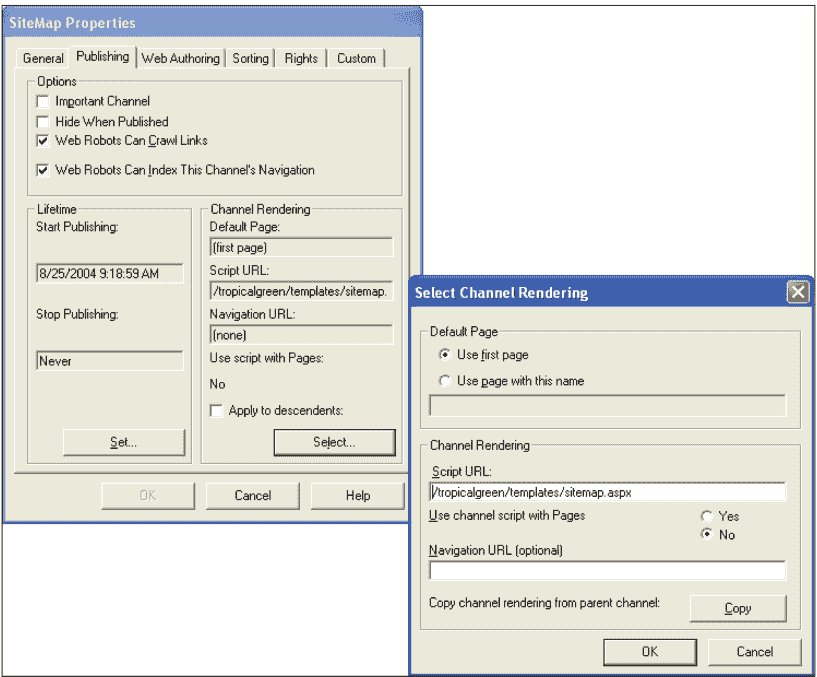

6. 关闭所有打开的对话框。

现在导航到网站上的任何页面并单击顶部菜单栏上的 **站点地图** 链接。整个树被加载并显示。展开或收缩任何节点以显示子项。


> 这里，我们只是将 TreeView 控件拖放到页面上，并将构建树的必要逻辑直接添加到页面本身。更好的设计是将 TreeView 控件添加到 Web 用户控件或服务器控件中。封装在 Web 用户控件或服务器控件中，站点地图可以在站点的多个位置重复使用。

## 按需填充节点

对于非常大的树，每次加载时填充整个 TreeView 控件可能并不实用。想象一个站点，其中树中有成千上万个节点；在所有节点加载完成之前可能需要相当长的时间。作为替代方案，我们可以配置树仅在展开父节点后才加载子节点。

好消息是，TreeView 控件的树视图节点已经具有一个内置属性名为 PopulateOnDemand，当设置为 true 时，将导致子节点仅在父节点首次展开时才被填充。让我们看看如何配置 TreeView 控件以按需填充节点。

- 1. 在设计视图中打开之前创建的 Plant.aspx 模板文件。
- 2. 从工具箱的数据部分拖动一个 SiteMapDataSource 控件并将其放置到内容区域。设置 ID 为 SiteMapDataSourceTree，SiteMapProvider 为 MCMSSiteMapProvider。
- 3. 从工具栏的导航部分拖动一个 TreeView 控件并将其放置在内容区域的任何位置。设置 DataSourceID 为 SiteMapDataSourceTree。
- 4. 切换到源视图。在 <asp:TreeView> 标签之间，添加以下突出显示的代码：

```
<asp:TreeView ID="TreeView1" runat="server"
    DataSourceID="SiteMapDataSourceTree"
    ShowLines="True">
    <DataBindings>
        <asp:TreeNodeBinding PopulateOnDemand="true"
            TextField="Title"
            NavigateUrlField="Url"
            ToolTipField="Description"/>
    </DataBindings>
</asp:TreeView>
```

<DataBindings> 标签使我们能够指定每个站点地图节点如何转换为树视图节点。在这里，我们已将每个树视图节点的 PopulateOnDemand 属性设置为 true。此外，我们已在树视图节点和站点地图节点之间映射了以下属性：

| TreeView 节点 | SiteMap 节点 |
|---|---|
| Text | Title |
| NavigateUrl | Url |
| Tooltip | Description |

- 5. 接下来，我们设置树的深度，使仅显示第一级节点。我们还将 TreeView 的 PopulateNodesFromClient 属性设置为 true，这样使用最新浏览器的访问者（比 Internet Explorer 5.5 或 Netscape 6.0 更新的浏览器）在检索子节点时不会使整个页面重新加载。相反，将生成一组 JavaScripts（也称为 AJAX 或异步 JavaScript 和 XML）。脚本将使用 Microsoft 的 XMLHTTP ActiveX 对象调用服务器端脚本，并在不刷新整个页面的情况下异步将子节点加载到树中。

```
<asp:TreeView ID="TreeView1" runat="server"
    DataSourceID="SiteMapDataSourceTree"
    ShowLines="True" PopulateNodesFromClient="True"
    ExpandDepth="1">
    . . . code continues . . .
</asp:TreeView>
```

我们已配置树以按需填充节点。查看任何植物页面。注意树现在仅显示根频道以及第一级项目。展开任何节点并注意每次这样做时，页面调用的脚本都是 TreeView_PopulateNode()。

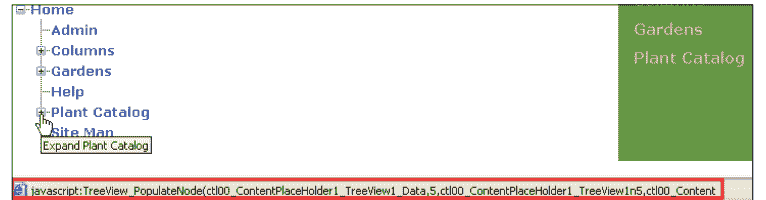

现在将鼠标光标放在 [-] 符号上。注意此时调用的脚本已更改为 TreeView_ToggleNode()。所调用函数名称的变化表明节点确实在首次展开时进行了往返以检索子节点。

## 导航控件

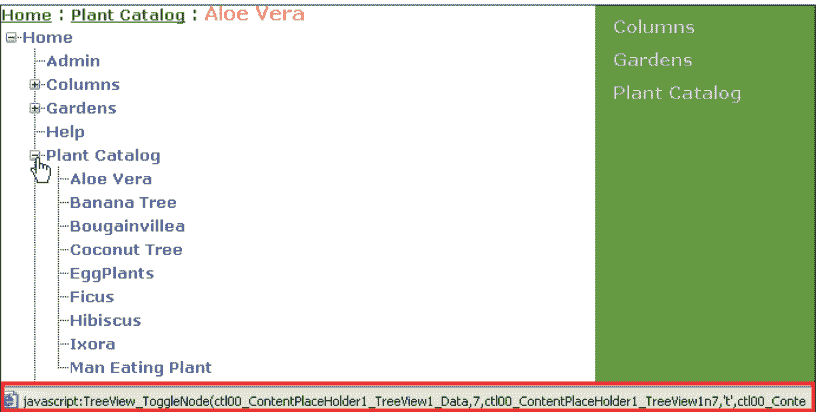

## 在编辑模式下展开节点时移除离开警告消息

当 TreeView 控件在编辑模式下的帖子中显示时存在一个问题。每次展开节点时，离开警告消息就会出现。

通过按 F5 刷新页面，使树折叠到其原始状态。现在切换到编辑站点并编辑帖子。展开树的任何节点。你是否收到一条警告消息，提示刷新页面将导致未保存的更改丢失？

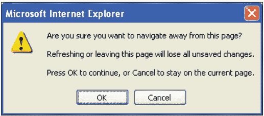

离开警告提示是在浏览器触发 OnBeforeUnload() 事件时设计出现的。通常，这发生在浏览器窗口关闭或页面导航到不同位置时。如果查看页面的 HTML 源代码（右键单击页面上的任何位置并选择 **查看源代码**），你会发现 `TreeView_PopulateNode()` 方法是由锚点的 `href` 属性触发的：

```
<a id="ctl00_ContentPlaceHolder1_TreeView1n2" href="javascript:
TreeView_PopulateNode(. . . code continues . . . )>
```

使用锚点的 `href` 属性可以完成工作，但它会导致页面卸载，从而提示离开警告消息出现。

与其使用锚点的 `href` 属性调用脚本，我们应该改用 `onclick()` 方法。`onclick()` 事件的行为类似于常规的 **提交** 按钮。当它触发时，页面的 URL 不会更改，因此不会触发页面的 `OnBeforeUnload()` 事件，警报也不会出现。

我们需要将锚点 `href` 属性的全部内容移出并嵌入到 `onclick()` 事件中，使生成的代码如下所示。脚本应返回 `false` 以取消可能发生的任何进一步操作，例如执行 `href` 属性。

```
<a id="ctl00_ContentPlaceHolder1_TreeView1n2"
onclick="TreeView_PopulateNode(. . . code continues . . . );
return false;">
```

修改锚标记生成的最佳方法是创建一个自定义 `TreeView` 控件并重写其 `Render()` 方法。

- 1. 向解决方案添加一个 C# 类库项目。将项目命名为 **TropicalGreenControlLib**。
- 2. 删除向导生成的 `Class1.cs` 文件。我们不需要它。
- 3. 向项目添加对 `System.Web` 库的引用。
- 4. 向项目添加一个名为 `MCMSTreeView.cs` 的类文件。
- 5. 代码需要使用以下代码段中突出显示的命名空间中的方法。将它们添加到命名空间声明之上。

```
. . . code continues . . .
using System.Web;
using System.Web.UI;
using System.Web.UI.WebControls;
using System.IO;
using System.Text.RegularExpressions;

namespace TropicalGreenControlLib
{
    . . . code continues . . .
}
```

- 6. 由于我们只是修改树视图的呈现方式，因此我们不会从头开始构建控件。相反，让自定义控件继承自 System.Web.UI.WebControls.TreeView 类。

```
public class MCMSTreeView : TreeView
{
}
```

- 7 To 修改基 TreeView 类生成的锚点，我们需要重写 Render() 方法。我们首先检索基 TreeView 控件生成的 HTML 输出。一旦获得原始内容，我们就会查找 href 属性的实例。使用正则表达式，我们获取之前存储在 href 属性中的值并将其移动到锚点的 onclick() 事件处理程序中。添加如下所示的代码：

```
protected override void Render(System.Web.UI.HtmlTextWriter
    output)
{
    // Get the output of the original TreeView Control
    TextWriter tempWriter = new StringWriter();
    base.Render(new System.Web.UI.HtmlTextWriter(tempWriter));
    string orightml = tempWriter.ToString();

    // Search for the javascript postback code in the href attribute
    // and if found add an onclick event handler to execute it in a
    // way that does not cause the MCMS authoring warning to show up
    Regex hrefRegex =
        new Regex("href=\"javascript:(?<PostBackScript>.*?)\"",
            RegexOptions.Singleline);
    string newhtml = hrefRegex.Replace(orightml,
        "href=\"javascript:${PostBackScript}\" " +
        "onclick=\"eval(this.href.substr(11)); " +
        "return false;\"" );
    output.Write(newhtml);
}
```

- 8. 控件已完成。保存并编译 TropicalGreenControlLib 项目。

要使用自定义控件，请右键单击工具箱内的任意位置并选择“选择项”。在“选择项”对话框中，选择 .NET Framework 组件选项卡。单击“浏览”按钮并选择 TropicalGreenControlLib 项目的 /debug/bin/ 文件夹中 found 的 TropicalGreenControlLib.dll 文件。


一旦控件已添加到工具箱中，就将其拖放到 Plant.aspx 模板文件的任何可编辑区域。像之前为 TreeView 控件所做的那样设置 MCMSTreeview 的属性。页面渲染后，节点会按预期展开和折叠，即使在编辑模式下也不会出现离开警告消息。

完成后，删除植物模板文件中的所有 TreeView 控件。

## 使 TreeView 控件的按需填充功能在通道渲染脚本中工作

正如我们所见，按需填充功能在嵌入模板文件时可以正常工作。然而，如果你尝试将其添加到通道渲染脚本中，你可能会发现当展开任何节点时 TreeView 控件似乎会冻结。作为示例，让我们修改之前创建的 SiteMap.aspx 页面的 TreeView 控件：

- 1. 在源视图中打开 SiteMap.aspx 文件。
- 2. 按如下所示修改 TreeView 控件的属性：
- 3. 保存页面。

```
<asp:TreeView ID="TreeView1" runat="server" DataSourceID=
"SiteMapDataSourceTree"
ShowLines="True" PopulateNodesFromClient="True" ExpandDepth="1">
<DataBindings>
<asp:TreeNodeBinding PopulateOnDemand="true"
TextField="Title"
NavigateUrlField="Url"
ToolTipField="Description"/>
</DataBindings>
</asp:TreeView>
```

完成后，导航到站点地图页面。尝试展开任意节点。注意没有任何反应！

要理解为什么会发生这种情况，让我们仔细看看按需填充功能的工作方式。当节点展开时，浏览器会静默执行一次回发。回发需要 <form> 标签的 action 属性中存储的信息。如果你查看页面的生成的 HTML，你会发现表单的 action 属性中存储的值类似于以下内容：

```
<form name="aspnetForm" method="post" action="sitemap.aspx?...code continues...">
```

action 属性中存储的值有趣之处在于它是一个相对 URL。在常规 Web 应用程序中，使用相对 URL 工作良好。然而，对于 MCMS 页面，URL 必须是绝对的。这是因为用于访问页面的 URL（例如 http://tropicalgreen/sitemap/）并不指向物理文件夹——它纯粹是虚拟的，并指向存储库中的一个通道。因此当它尝试访问诸如 sitemap.aspx 的相对 URL 时，它会在 http://tropicalgreen/sitemap/sitemap.aspx 处查找它。由于文件在该位置物理上不存在，代码就会失败。

要纠正此问题，我们需要改用绝对链接。要在表单的 action 属性中生成绝对链接，我们可以选择：

- 1. 生成一个 <base> 标签并在其中存储页面的绝对路径。有了 <base> 标签，所有相对链接都会通过在链接前加上标签中存储的值而转换为绝对链接。通常，<base> 标签由 RobotMetaTag 控件生成。然而，控件中的一个错误阻止它在通道渲染脚本中生成 <base> 标签。一个增强版的 RobotMetaTag 可在通道渲染脚本和模板文件上同时工作，可在此处找到：http://www.gotdotnet.com/Community/UserSamples/Details.aspx?SampleGuid=8600bae5-7aba-481b-93bb-d179927179d5。
- 2. 使用客户端 JavaScript 修改 <form> 标签的 action 属性。虽然生成 <base> 标签是一种可能的解决方案，但你可能不想启用它（我们在第 5 章讨论了一些 <base> 标签不能使用的可能原因）。要使此方法工作，我们需要修改树视图的渲染方式，为此我们必须创建一个自定义 TreeView 控件。由于我们之前已经创建了一个自定义 TreeView 控件，让我们探讨如何增强它以在通道渲染脚本中工作。


> TreeView 控件的按需填充功能之所以适用于植物模板文件，是因为我们已将 RobotMetaTag 控件的 RenderBaseHref 属性设置为 true。如果将其设置为 false，<base> 标签将不会生成，并且树视图将无法按需填充子节点。

我们需要将表单 action 属性中存储的相对链接转换为绝对链接。为此，我们将利用生成的页面中已有的一些功能。

如果你检查任何 MCMS 页面的 HTML 源代码，你会发现一个名为 __CMS_PostbackForm 的 JavaScript 变量，它存储了表单对象的实例。

```
var __CMS_PostbackForm = document.forms['aspnetForm'];
```

此外，还有一个名为 __CMS_CurrentUrl 的变量，它存储页面的绝对 URL。以下是站点地图页面的 __CMS_CurrentUrl 在你的页面上可能的样子。请注意，你站点上的 GUID 值可能不同。

```
var __CMS_CurrentUrl = "/tropicalgreen/templates/sitemap.aspx?
NRMODE=Published&
NRNODEGUID=%7b6bE3510D2-519A-4D4F-92A8-621B43F5894F%7d&
NRORIGINALURL=%2ftropicalgreen%2fSiteMap%2f&
NR_CACHEHINT=ModifyLoggedIn";
```

把这些片段组合起来，为了将 __CMS_CurrentUrl 中存储的值赋给表单、__CMS_PostbackForm 的 action 属性的值，我们需要在客户端以某种方式执行以下脚本：

```
<script type="text/javascript">
    if (typeof (__CMS_CurrentUrl) != "undefined")
    {
        __CMS_PostbackForm.action = __CMS_CurrentUrl;
    }
</script>
```

注册脚本的好地方是 TreeView 控件的 Render() 方法。打开 MCMS TreeView.cs 文件并将突出显示的代码添加到 Render() 方法中。

```
protected override void Render(System.Web.UI.HtmlTextWriter output)
{
    ... code continues ...
    // Register a client script that ensures that the action property
    // is correct when AJAX tries to do its postback.
    string script = "\n<script type=\"text/javascript\">\n" +
        " if (typeof (__CMS_CurrentUrl) != " +
        " \"undefined\")\n" +
        " {\n" +
        "   __CMS_PostbackForm.action = " +
        " __CMS_CurrentUrl;\n" +
        " }\n" +
        "</script>\n";
```

```
Page.ClientScript.RegisterStartupScript(this.GetType(),
    "AdjustActionForTreeView", script);
}
```

现在，用自定义的 MCMS TreeView 控件替换 SiteMap.aspx 上的 TreeView 控件。设置好按需填充节点后，树不再冻结，你应该能够展开和收缩节点以显示子节点。

## 在摘要页面中使用 TreeView 控件

摘要页面（也称为默认、封面或索引页面）提供给定部分内页面的列表。它们在访问者只知道页面的存在但不知道其确切位置时特别有用。例如，你可能知道植物目录中有一页描述芦荟，但你可能不知道其地址。如果植物目录页面提供了站点上所有植物页面的列表，你就可以轻松找到所需页面。

早期版本的摘要页面通常是手工编码的工作，当添加、删除或重命名新页面时必须频繁更新。多年来，随着活动脚本使开发人员能够即时动态组装摘要页面，这种做法逐渐被淘汰。这意味着页面显示的是列表的最新版本，为高效有效的链接管理提供了便利。

在基于 ASP.NET 1.x 构建的 MCMS 站点中，摘要页面通常通过遍历通道和帖子的集合来构建。然后将通道项的集合显示在类似表格的控件中，例如 DataGrid。虽然这种技术今天仍然有效，但 ASP.NET 2.0 引入了一种更快、更易于构建摘要页面的方法。

让我们看看一个替代方案，它涉及构建自定义站点地图提供程序和 TreeView 控件。以下是计划：

- 1. 我们首先创建一个自定义站点地图提供程序，将当前查看的通道设为根节点。然后将通道内的所有帖子添加为站点地图节点。
- 2. 接下来，我们将使用 TreeView 控件提供通道内所有页面的列表。虽然 TreeView 控件旨在显示项目的分层列表，但其多功能性也允许它同样好地显示简单的单级列表。


完成后，植物目录频道的摘要将如下所示：

- Aloe Vera
- Banana Tree
- Bougainvillea
- Coconut Tree
- EggPlants
- Ficus
- Hibiscus
- Ixora
- Man Eating Plant

## SiteMapProviderSummary 类

让我们开始创建自定义站点地图提供程序类，它将与之前创建的 `MCMS SiteMapProvider` 类相似，有几点不同：站点地图不再包含网站上所有频道的层级列表，而是从（并且仅包含）当前查看的频道开始。其次，只有当前频道内的页面才会被添加到站点地图中。

- 1. 在 **TropicalGreen** 项目的 `App_Code/SiteMapProviders` 文件夹中添加一个类文件。将文件命名为 **MCMS SiteMapProviderSummary.cs**。
- 2. 我们需要在以下代码中使用的命名空间中的方法。添加突出显示的命名空间以及命名空间声明。

```
using System;
using System.Data;
using System.Configuration;
using System.Web;
using System.Web.Security;
using System.Web.UI;
using System.Web.UI.WebControls;
using System.Web.UI.WebControls.WebParts;
using System.Web.UI.HtmlControls;
using Microsoft.ContentManagement.Publishing;

namespace TropicalGreen
{
    . . . code continues . . .
}
```

- 3. 与我们构建的其他自定义站点地图提供程序一样，我们不会从头编写它。我们将走捷径并继承之前创建的 MCMSSiteMapProvider 类。

```
public class MCMSSiteMapProviderSummary : MCMSSiteMapProvider
{
    . . . code continues . . .
}
```

- 4. 由于列表显示的是单个频道的内容，因此我们无需将其他所有频道添加到站点地图中。相反，我们将当前查看的频道设为根站点地图节点路径。为此，我们重写 GetRootNodeCore() 方法。

```
protected override SiteMapNode GetRootNodeCore()
{
    // Set the currently viewed channel to be the root node
    Channel root = CmsHttpContext.Current.Channel;
    return base.GetSiteMapNodeFromChannelItem(root);
}
```

- 5. 接下来，我们将重写 GetChildNodes() 方法。我们检索当前频道内的所有页面的集合，并按显示名称按字母顺序排序。然后我们将它们逐个添加到站点地图中。

```
public override SiteMapNodeCollection GetChildNodes(SiteMapNode node)
{
    // Create a new SiteMapNodeCollection
    SiteMapNodeCollection smnc = new SiteMapNodeCollection();

    // Get an instance of the currently viewed channel
    Channel channel =
        CmsHttpContext.Current.Searches.GetByGuid(node.Key) as Channel;

    if (channel != null)
    {
        // Get a collection of all postings within the channel
        PostingCollection pc = channel.Postings;

        // Sort the postings by Display Name (from A-Z)
        pc.SortByDisplayName();
```

```
// Add each posting to the site map
foreach (Posting p in pc)
{
    smnc.Add(GetSiteMapNodeFromChannelItem(p));
}
}
return smnc;
}
```

- 6. 类已完成。保存 MCMSSiteMapProviderSummary 类文件。
- 7. 与之前一样，在使用之前，我们需要在 web.config 文件中添加对自定义站点地图提供程序的引用。将突出显示的行添加到 web.config 文件的 <providers> 部分。

```
<providers>
    . . . code continues . . .
    <add name="MCMSSiteMapProviderSummary"
        type="TropicalGreen.MCMSSiteMapProviderSummary"/>
</providers>
```

## 配置 TreeView 控件以显示平面项目列表

现在我们已经创建了提供给定频道内所有页面列表的自定义站点地图提供程序，我们需要找到一个能够显示该列表的控件。开箱即用，我们可以选择使用 SiteMapPath、Menu 或 TreeView 控件。为本示例的目的，让我们选择 TreeView 控件。

使用 TreeView 控件来显示平面项目列表似乎违反直觉。毕竟，它被设计用来显示层级列表。尽管如此，我们将看到 TreeView 控件是一个非常多用途的控件，能够显示层级嵌套项目以及单维平面列表。

- 1. 首先，在 TropicalGreen 项目的 /Templates/ 文件夹中创建一个新的 Web 表单。将文件命名为 ChannelRenderingScript.aspx。选择要选择母版页。
- 2. 在“选择母版页”对话框中，选择位于 Templates 文件夹中的 tropicalgreen.master 文件。
- 3. 在设计视图中打开 ChannelRenderingScript.aspx，从工具箱的数据部分拖动 SiteMapDataSource 控件并将其放置在内容区域的任何位置。为控件赋予以下属性值：

| 属性 | 值 |
|---|---|
| ID | SiteMapDataSourceSummary |
| SiteMapProvider | MCMSSiteMapProviderSummary |
| ShowStartingNode | False |

我们已将 SiteMapDataSource 设置为链接到我们之前构建的站点地图提供程序：MCMSSiteMapProviderSummary。注意，由于我们不希望当前查看的频道作为列表的一部分显示，因此我们将 ShowStartingNode 属性设置为 false。

- 4. 接下来，从工具箱的导航部分拖动 TreeView 控件并将其放置在内容区域的任何位置。为其赋予以下属性值：

| 属性 | 值 |
|---|---|
| ID | TreeView1 |
| DataSourceID | SiteMapDataSourceSummary |
| MaxDataBindDepth | 1 |
| ShowExpandCollapse | False |

通过将 MaxDataBindDepth 属性设置为 1，我们确保 TreeView 控件永远不会显示超过一个层级的项目。这样列表始终是平面的。此外，我们将 ShowExpandCollapse 设置为 false 以防止展开的加号 [+] 和减号 [-] 符号出现。

- 5. 最后，为了在列表中的每个项目旁边显示一个项目符号，我们将手动定义每个节点的绑定。切换到源视图并在 <asp:TreeView> 标签之间添加突出显示的代码。

```
<asp:TreeView ID="TreeView1" runat="server" DataSourceID="SiteMapDataSourceSummary" MaxDataBindDepth="1" ShowExpandCollapse="False">
<DataBindings>
<asp:TreeNodeBinding TextField="Title" NavigateUrlField="Url" ToolTipField="Description" FormatString='<li>{0}</>' />
</DataBindings>
</asp:TreeView>
```

我们已将树视图节点绑定到站点地图节点的 Title、Url 和 Description 属性。此外，通过将 FormatString 设置为包含 <li> 标签，我们包含了要在每个项目旁边打印的项目符号。

- 6. 页面已完成。保存并编译网站。

接下来，让我们将 ChannelRenderingScript.aspx 文件分配为植物目录频道的频道渲染脚本。

- 1. 在站点管理器中，右键单击 PlantCatalog 频道。选择属性。
- 2. 在 PlantCatalog 属性对话框中，单击“发布”选项卡。
- 3. 在“频道渲染”部分，单击“选择”按钮。
- 4. 在“选择频道渲染”对话框中，在脚本 URL 字段中输入 /tropicalgreen/templates/ChannelRenderingScript.aspx。
- 5. 单击“确定”并关闭所有打开的对话框。

这样，我们就可以查看摘要页面了。导航到 http://tropicalgreen/plantcatalog 并查看频道内的所有植物页面列表。

频道渲染脚本 ChannelRenderingScript.aspx 可以应用于网站上的所有其他频道。请继续将其分配为 Columns 和 Gardens 频道的频道渲染脚本。

## 摘要

使用随 ASP.NET 2.0 提供的导航控件，构建站点导航从未如此简单。在本章中，我们首先构建了一个自定义 SiteMapProvider，它从 MCMS 仓库读取以填充站点地图。接下来，我们展示了 SiteMapPath 控件如何与自定义 SiteMapProvider 配合工作，以提供面包屑链接，显示用户在站点中的确切位置。我们看到 SiteMapPath 控件正常工作不需要额外的编程。随后，我们研究了 Menu 控件。我们构建了该控件的两个版本——一个放置在页面顶部的静态水平菜单，以及一个位于页面右侧的动态垂直菜单。最后，我们演示了 TreeView 控件如何与 SiteMapProvider 一起使用，以提供站点层级的全面视图。我们展示了如何配置它以按需填充节点，以及作为频道渲染脚本的一部分来显示特定频道内所有帖子的摘要列表。


