# 5 应用主题

大多数网站都是在考虑统一的外观和感觉的前提下设计的。毕竟，如果你访问一个网站，其页面之间差异明显，你可能会开始怀疑（可能在第二个页面之后）自己是否仍在浏览同一个网站。

在本章中，我们将了解如何通过使用主题高效地将统一的外观和感觉应用于 MCMS 网站。我们将创建皮肤和层叠样式表，并演示它们如何协同工作以定义网站的外观。最后，我们将讨论使主题在 MCMS 网站中正确工作所需的一项基本自定义。

### 主题与层叠样式表

在整个网站上保持一致的外观和感觉的挑战并非新鲜事。没过多久，开发人员就使用层叠样式表（CSS）来定义网站的外观。使用 CSS 是将设计元素与 HTML 分离的一步。图形设计师可以独立地处理 CSS 文件，提供诸如配色方案、字体类型、间距、边距和其他视觉效果等信息。如果需要更改其中任何属性，设计师所需要做的就是修改 CSS 文件，瞧，网站的外观和感觉就会立即焕然一新！

然而，尽管使用 CSS 有其优势，但对网站设计的修改仍然需要相当多的工作。只要想想最近一次在你负责的网站上引入了新的日历控件等复杂控件的情况。为了给控件赋予期望的外观和感觉，必须应用多种样式：标题一种，选中日期另一种，导航箭头还有几种。此外，网站上的每个日历控件都必须重复同样的任务。你可以将“已样式化”的日历封装在自定义控件中并在整个网站中重用，但这意味着要考虑到设计元素编写代码，这使得开发人员和设计人员之间的工作安排变得复杂。此外，CSS 在定义控件外观方面存在局限。例如，你无法用它来定义构成网格的列或树的节点。

CSS 的另一个局限性是不同浏览器对样式表的支持程度不一。当加入旧版浏览器或个人数字助理和手机等替代网络设备时，情况变得更加复杂。为了使网站在所有浏览器类型和版本中保持一致的外观，必须实施复杂的变通方法。

ASP.NET 2.0 通过引入主题的概念将 CSS 背后的思想更进一步。主题充当存储网站设计信息的中心位置。你可以在主题中存储 CSS 文件。ASP.NET 会自动为引用该主题的所有页面生成指向所有 CSS 文件的链接。

除了管理 CSS 文件外，主题还存储网站所需的一整套图像和其他设计文件。此外，你可以在单个网站中定义多个主题。如果切换网站的主题，网站将自动采用所选主题使用的图像和其他支持文件。这样，你就可以为各种设备或浏览器自定义网站的外观和感觉。

主题还可能包含皮肤。可以把皮肤想象成服务器控件的外层覆盖物——有点像枕套。当你把新的套子套在枕头上时，你改变了它的设计，但枕头本身基本保持不变。同样，皮肤可以应用于 ASP.NET 服务器控件。皮肤通过将整个控件的样式定义合并到单个文件中，而不是使用多个样式表，来解决复杂服务器控件的设计需求。有了皮肤，你就可以轻松地为日历和数据网格等复杂控件应用样式并设置其属性。你甚至可以在皮肤中定义诸如构成网格的列或树的节点等元素——这是 CSS 无法完成的任务。

主题的另一个优点是它们驻留在 Web 应用程序的目录中。你可以拥有多个 Web 应用程序，每个应用程序都有其独特的主题。这样，你就可以放心地将主题应用于帖子，而不必担心影响例如 MCMS 对话框等其他 Web 应用程序中页面的外观和感觉。

### 创建主题

让我们开始为 TropicalGreen 网站创建一个主题。我们将主题命名为 Sunny，并用它为我们的网站应用新的设计。在 ASP.NET 2.0 中，单个项目使用的主题存储在项目应用程序文件夹下方的特殊文件夹 App_Themes 中。你可以根据网站需要创建任意数量的主题（或子文件夹）。

- 1. 首先，让我们创建 `App_Themes` 文件夹。在 **Solution Explorer** 中，右键单击 **TropicalGreen** 项目并选择 **Add ASP.NET folder | Theme**。一个新的名为 `App_Themes` 的文件夹出现。
- 2. 在 `App_Themes` 文件夹内有一个名为 `Theme1` 的子文件夹。将文件夹重命名为 `Sunny`。

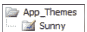

### 将主题应用于整个网站

我们已经创建了一个名为 Sunny 的主题。现在让我们将其应用于 TropicalGreen 网站。

在 web.config 文件中，查找 `<pages>` 标签并添加一个名为 theme 的属性，并将其值设置为 Sunny。

```
<pages validateRequest="false"
    theme="Sunny"/>
```

我们已将 Sunny 主题应用于 TropicalGreen 网站。然而，主题尚未定义任何样式或设计。在下一节中，我们将添加皮肤和样式表来定义网站的外观和感觉。

> 而不是将主题应用于整个网站，我们本可以在页面级别通过设置 @Page 指令的 theme 属性来定义它。如果我们需要更大的灵活性（例如，根据用户配置文件更改主题），我们可以使用代码应用主题。

### 服务器控件的皮肤

顾名思义，皮肤充当控件的外层覆盖物。大多数开箱即用的 ASP.NET 服务器控件都支持皮肤。然而，检查你计划使用的控件是否可以套用皮肤始终是个好主意。为此，请查找 SkinID 属性。如果控件具有 SkinID 属性，则可以为其应用皮肤。

皮肤有两种类型：

- **Default skins**，应用于 `SkinID` 中未定义对应皮肤的所有控件。例如，如果你为 `TextBox` 控件定义默认皮肤，则采用该主题的页面上的所有 `TextBox` 控件都将遵循默认皮肤中定义的样式。
- **Name-controlled skins**，仅针对共享相同 `SkinID` 的控件。例如，你可能为 `TextBox` 定义了一个皮肤。假设该皮肤的 `SkinID` 为 `MyTextBox`。只有 `SkinID` 与 `MyTextBox` 匹配的 `TextBox` 控件才会应用该皮肤。

### 创建默认皮肤

考虑在我们的 `TropicalGreen.master` 模板中之前创建的 `SiteMapPath` 控件的情况。我们希望控件使用冒号字符 (:) 作为节点分隔符。字体类型应为 Verdana。所有节点都将以粗体和绿色显示，当前节点除外，当前节点将为橙色。如果我们使用代码设置这些属性，其外观如下：

```
<asp:SiteMapPath ID="SiteMapPath1" runat="server" Font-Names="Verdana" PathSeparator=":">
    <PathSeparatorStyle Font-Bold="True" ForeColor="green"/>
    <CurrentNodeStyle ForeColor="orange"/>
    <NodeStyle Font-Bold="True" ForeColor="green"/>
    <RootNodeStyle Font-Bold="True" ForeColor="green"/>
</asp:SiteMapPath>
```

虽然通过代码轻松设置控件的属性，但我们也可以使用皮肤实现同样的效果。在此之前，从 `SiteMapPath` 控件中删除所有样式属性，使代码变为：

```
<asp:SiteMapPath ID="SiteMapPath1" runat="server">
</asp:SiteMapPath>
```

现在让我们为 `SiteMapPath` 控件构建一个皮肤。

- 1. 在 **Solution Explorer** 中，右键单击 **Sunny** 文件夹并选择 **Add New Item...**
- 2. 在 **Add New Item** 对话框中，选择创建新的 **Skin File** 并将其命名为 **Sunny.skin**。


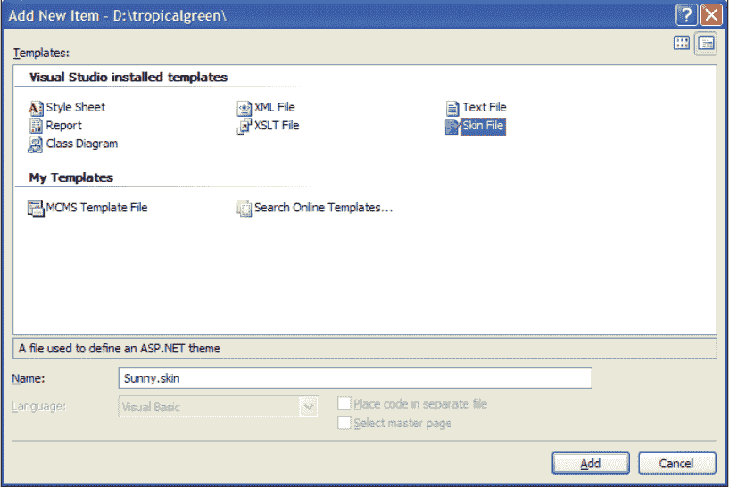

3. 皮肤文件包含示例代码，展示皮肤模板的外观。我们在示例中不需要该示例。请删除所有现有代码。

4. 现在让我们为 SiteMapPath 控件定义一个皮肤。为了产生戏剧性效果，以便稍后在屏幕截图中可以看到差异，我们将字体大小设置为超大。请在皮肤文件中输入以下代码：

```
<asp:SiteMapPath runat="server" Font-Names="Verdana" Font-Size="X-Large" PathSeparator=":">
    <PathSeparatorStyle Font-Bold="True" ForeColor="green"/>
    <CurrentNodeStyle ForeColor="orange"/>
    <NodeStyle Font-Bold="True" ForeColor="green"/>
    <RootNodeStyle Font-Bold="True" ForeColor="green"/>
</asp:SiteMapPath>
```

该代码与原始控件中的代码看起来并没有太大不同。不同之处在于，代码现在位于皮肤文件而不是嵌入在模板文件中，从而实现了设计与应用的清晰分离！

由于我们创建的皮肤是默认皮肤，因此无需做任何其他操作即可看到其效果。TropicalGreen 网站上的所有 SiteMapPath 控件将立即采用皮肤提供的样式。导航到网站上的任何页面。面包屑轨迹的节点现在以粗体绿色 Verdana 字体显示，当前节点除外，当前节点为橙色，字体大小为皮肤中定义的超大字体。

Home : Plant Catalog : Aloe Vera

## 创建名称受控皮肤

当页面上存在不应采用默认皮肤的控件时会怎样？例如，在前面皮肤化的 SiteMapPath 控件中，我们将默认皮肤设置为显示超大字体。如果我们不想更改默认皮肤，但又要应用不同的字体设置，则可以使用名称受控皮肤。

名称受控皮肤使用 SkinID 属性。工作原理如下。首先，我们设置皮肤文件中定义的控件的 SkinID。接下来，我们识别将在 Web 表单中采用该特定皮肤的控件，并将这些控件的 SkinID 设置为与皮肤的值匹配。这样，只有具有相同 SkinID 的控件才会采用皮肤的外观和感觉。

让我们尝试为站点地图控件提供一个字体大小为正常的皮肤。按如下方式在 Sunny.skin 文件中追加一个皮肤控件。请注意，我们已将字体大小设置为 Medium，并将 SkinID 设置为 Breadcrumb。

```
<asp:SiteMapPath runat="server" Font-Names="Verdana"
    PathSeparator=":"
    Font-Size="Medium" SkinID="Breadcrumb">
    <PathSeparatorStyle Font-Bold="True" ForeColor="green"/>
    <CurrentNodeStyle ForeColor="orange"/>
    <NodeStyle Font-Bold="True" ForeColor="green"/>
    <RootNodeStyle Font-Bold="True" ForeColor="green"/>
</asp:SiteMapPath>
```

为了使站点地图控件拾取名称受控皮肤，我们还需要将控件的 SkinID 分配为 Breadcrumb。在 tropicalgreen.master 文件中，按如下所示设置控件的 SkinID：

```
<asp:SiteMapPath ID="SiteMapPath1" runat="server" SkinID="Breadcrumb">
</asp:SiteMapPath>
```

保存文件。现在，导航到任何现有的植物发布内容。字体大小已恢复正常，表明控件现在采用名称受控皮肤而不是默认皮肤。

Home : Plant Catalog : Aloe Vera

## 完成皮肤

让我们通过为顶部水平菜单和右侧垂直菜单定义皮肤来完成皮肤文件。

首先，在打开 Tropicalgreen.master 的情况下，删除之前添加到顶部菜单的一些样式元素，使代码如下所示：

```
<asp:Menu ID="Menu1" runat="server" DataSourceID="SiteMapDataSourceTop"
SkinID="TopMenu">
</asp:Menu>
```

我们还将删除可能已添加到右侧菜单的任何样式元素。右侧菜单的代码应类似于以下内容：

```
<asp:Menu ID="Menu2" runat="server" DataSourceID=
"SiteMapDataSourceRight" SkinID="RightMenu">
</asp:Menu>
```

现在让我们使用皮肤将这些样式元素添加回来。将以下皮肤定义添加到 Sunny.skin 文件中。

```
<asp:Menu SkinID="TopMenu" runat="server" Orientation="Horizontal"
    MaximumDynamicDisplayLevels="1" StaticDisplayLevels="2"
    StaticMenuItemStyle-CssClass="TopMenu"
    StaticEnableDefaultPopOutImage="False">
</asp:Menu>

<asp:Menu SkinID="RightMenu" runat="server" Orientation="Vertical"
    MaximumDynamicDisplayLevels="1" StaticDisplayLevels="1"
    StaticMenuItemStyle-CssClass="RightMenu"
    StaticEnableDefaultPopOutImage="False">
</asp:Menu>
```

我们已为两个菜单添加了皮肤定义；现在将菜单的 SkinID 设置为与皮肤相匹配：

| 控制 ID | 将 SkinID 设置为 |
|------------|-------------------|
| MenuTop | TopMenu |
| MenuRight | RightMenu |

请注意，皮肤定义使用了级联样式表（请参阅 CssClass 属性）。我们尚未创建任何样式表；因此，如果您查看任何主题页面，在应用新皮肤后可能看不到太多差异。让我们看看皮肤和样式表在主题内是如何协同工作的。

## 使用样式表

我们已经看到如何使用皮肤为 ASP.NET 服务器控件应用特定样式。它们对于设置导航、表单和其他基于服务器的控件的样式非常有用。毫无疑问，它们是我们工具箱中非常巧妙实用的工具。

然而，在 MCMS 的世界中，确保网站在整个过程中保持一致的外观和感觉的一个重要方面是确保作者在占位符控件（如 HtmlPlaceholderControl）中输入的内容也遵循网站的样式指南。为了强制执行 HTML 内容的设计规则，皮肤对我们帮助不大。对于 HTML 控件和代码，我们仍然必须使用好旧的级联样式表。

以前，要将 CSS 文件应用于站点，我们会向所有需要它的模板文件和 Web 表单添加 <link> 标签：

```
<link type="text/css" href="UrlOfFile.css"/>
```

或者，我们也可以使用 <style> 标签直接在页面本身中嵌入样式：

```
<style>
H1{color:#993300;font-weight:bold;font-size:14pt}
</style>
```

这两种技术都有效，但仍然可能是一件混乱的事情，尤其是在处理多个样式表和 Web 表单时。

好消息是：主题也支持 CSS。现在，我们可以直接将 CSS 文件添加到主题中。在幕后，ASP.NET 将为我们生成 <link> 标签。

## 创建样式表

TropicalGreen 网站的主模板主要由表格组成。此外，作者输入的所有自定义内容都仅限于常规 HTML 文本。由于这些不是 ASP.NET 服务器控件，因此不支持皮肤。为了确保此类内容的外观和感觉与网站其余部分一致，我们需要应用样式表。

让我们尝试通过使用样式表为 TropicalGreen 网站的其余部分添加样式。

- 1. 要向主题添加样式表，请在 **Solution Explorer** 中右键单击 **Sunny** 主题文件夹并选择 **Add New Item...**
- 2. 在 **Add New Item** 对话框中，选择 **Style Sheet** 模板并将文件命名为 **Sunny.css**。
- 3. 我们在此示例中使用的样式表相对简单。我们将为 body、anchor 和几个标题级别指定样式，以及为横幅和菜单指定一些命名样式。输入以下代码：
- 4. 保存 Sunny.css。

```
Body {font-family:Verdana,Arial;font-size:11pt}
A{color:#0000FF;font-size:10pt;font-weight:bold}
H1{color:#993300;font-weight:bold;font-size:14pt}
H2{color:#FF6600;font-weight:bold;font-size:12pt}
.Banner{background-color:#ffcc00}
.TopMenu{background-color:#66cc33;font-weight:bold;color:#CCFF99;
        text-decoration:none;padding:5px;}
.RightMenu{background-color:#669900;color:#CCFF99;
        text-decoration: none; font-weight:bold;padding:5px;}
```

> 我们不会详细介绍 CSS 的语法。要了解 CSS 入门，请查看以下网站：
> http://www.w3c.rl.ac.uk/primers/css/cssprimer.htm.

> Visual Studio 还附带了 **Style Builder**，它提供了一个用于定义样式的图形界面。要启动 **Style Builder**，请切换到 **Design** 视图并从菜单中选择 **Format | Style**。

现在，查看 TropicalGreen 网站上的任何现有植物发布内容。样式已成功应用于发布内容。


## 为什么使用样式表的主题在 MCMS 站点上可能无法工作

查看帖子的 HTML 源代码（在页面任意位置右键单击并选择查看源代码），并仔细查看主题生成的 <link> 标签。它应该类似于以下内容：

```
<link href="../App_Themes/Sunny/Sunny.css"
    type="text/css" rel="stylesheet"/>
```

<link> 标签中存储的 URL 是相对于模板文件的路径。在此示例中，前面的点点斜杠 (../) 字符表示 App_Themes 文件夹存储在当前页面所在的同一父文件夹中。在常规 Web 应用程序中，使用相对路径引用样式表可以正常工作。毕竟，如果查看文件结构，确实可以在建议的路径下找到样式表。

然而，在查看帖子时，我们并不是直接访问模板文件。例如，要查看芦荟帖子，我们请求 URL http://tropicalgreen/PlantCatalog/AloeVera.htm。浏览器不知道 MCMS ISAPI 过滤器已重写 URL，尝试通过将相对路径转换为绝对路径 http://tropicalgreen/PlantCatalog/../App_Themes/Sunny/Sunny.css 来检索文件。

然而，此路径不会解析为 CSS 文件的实际位置，因为 AloeVera.htm 页面上一级的文件夹是 tropicalgreen。此外，由于 App_Themes 文件夹存储在 Templates 项目目录中（参见以下屏幕截图），在 tropicalgreen（或根网站）下查找它将导致 HTTP 404 错误。


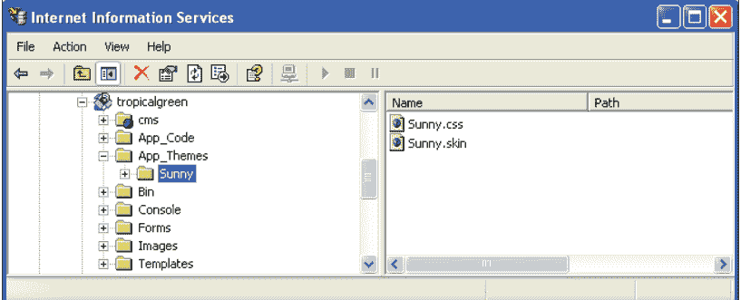

如果使用相对路径在访问样式表时会产生 HTTP 404 错误，那么样式是如何成功应用于帖子的呢？秘密在于 RobotMetaTag。在 MCMS 网站中，RobotMetaTag 具有 RenderBaseHref 属性，当设置为 true（其默认值）时，会在页面的 <head> 标签之间生成一个 <base> 标签。搜索帖子生成的 HTML 源代码，你会找到如下所示的 <base> 标签：

```
<base href="http://tropicalgreen/tropicalgreen/Templates/Plant.aspx">
```

在评估页面上的链接时，Web 浏览器会自动将所有相对链接与 <base> 标签的 href 属性中存储的值前缀（而不是页面请求的 URL），使得像 ../App_Themes/Sunny/Sunny.css 这样的相对路径变为 http://tropicalgreen/tropicalgreen/Templates/../App_Themes/Sunny/Sunny.css。

转换后的 URL 确实指向样式表，因此我们不会收到任何 HTTP 404 错误。

默认情况下，RobotMetaTag 控件的 RenderBaseHref 属性存储布尔值 true。因此通常会生成 <base> 标签，你无需担心样式表路径和其他相对链接无法访问的问题。然而，根据站点设置，可能存在生成 <base> 不希望的特殊情况。

考虑防火墙或代理将请求转发到内部 Web 服务器的主机场景。MCMS 生成的 <base> 标签的问题在于它包含完整的 URL，其中可能包含服务器名称，尤其是在关闭了“将频道映射到主机头”选项时。当内部服务器将页面返回给代理时，返回页面的 <base> 标签将包含内部服务器的名称，而不是浏览器中输入的站点域名。

要模拟此场景，请再次查看帖子，但这次使用类似 http://servername/tropicalgreen/plantcatalog/aloevera.htm 的 URL。注意，当你这样做时，服务器的名称会以如下方式存储在 <base> 标签中：

```
<base href="http://servername/tropicalgreen/tropicalgreen/Templates/Plant.aspx">
```

> 当然，通常的 URL 省略了服务器名称，只会是 http://tropicalgreen/plantcatalog/aloevera.htm。但由于我们正在测试服务器名称如何渗入 base URL，因此在此练习中我们特意添加了它。

除非用户的浏览器可以访问内部服务器，否则在尝试访问样式表等资源时很可能会收到 HTTP 404 错误。在这种情况下，必须禁用 RenderBaseHref 属性并找到替代解决方案。

## 在 RenderBaseHref 属性被禁用时应用主题

如果无法使用 <base> 标签，我们需要有另一种方法来确保 App_Themes 文件夹使用正确的 URL 被访问。由于 ASP.NET 没有配置其生成主题文件夹 URL 的方式，我们需要在 ASP.NET 生成它之后修改此 URL。

解决此问题的方法有很多。我们可以手动向每个应用了主题的模板文件添加代码。然而，这不仅繁琐，而且在多个地方重复代码也不是良好的编程实践。我们可以创建一个服务器端控件来封装代码并插入到需要它的每个模板文件中。同样，这要求控件的代码被复制到每个模板文件中——仍然有可能被遗忘，尤其是在创建新模板时。

解决方案是构建一个 HTTP 模块。这样，我们就可以保证所有页面都进行修正，而无需触及任何现有的模板文件。在页面发送到浏览器之前，HTTP 模块会将 <link> 标签中存储的所有相对路径转换为不包含服务器名称的绝对路径。模块将查找如下样式表的 <link> 标签：

```
<link href="../App_Themes/Sunny/Sunny.css" type="text/css" rel="stylesheet"/>
```

转换过程后，<link> 标签将被渲染为：

```
<link href="/tropicalgreen/App_Themes/Sunny/Sunny.css" type="text/css" rel="stylesheet"/>
```

## 创建 CorrectThemes HTTP 模块

让我们创建纠正 <link> 标签中存储的 URL 的 HTTP 模块。

- 1. 在解决方案中添加一个新的 Visual C# 类库项目。将项目命名为 **TropicalGreenHttpModules**。
- 2. 删除向导创建的 `Class1.cs` 文件。我们不需要它。
- 3. 添加项目所需的以下引用：
```
Microsoft.ContentManagement.Publishing.dll
```
（库文件位于 `<install directory>\Microsoft Content Management Server\Server\bin\` 目录中）。
以及来自 `System` 命名空间的以下引用：
```
System.Web
```
- 4. 向 **TropicalGreenHttpModules** 项目添加一个类文件。将新类文件命名为 **CorrectLinksInThemes.cs**。
- 5. 在命名空间声明上方添加以下 using 语句：
```
using System;
. . . code continues . . .

using System.Web;
using System.Web.UI;
using System.Web.UI.HtmlControls;
using Microsoft.ContentManagement.Publishing;

namespace TropicalGreenHttpModules
{
    . . . code continues . . .
}
```
- 6. 由于我们正在创建 HTTP 模块，类将实现 `IHttpModule` 接口。在以下代码中所示添加冒号后跟接口名称：
```
public class CorrectLinksInThemes : IHttpModule
{
}
```
- 7. IHttpModule 要求实现 Init() 和 Dispose() 方法。向 CorrectLinksInThemes 类文件添加以下代码：
```
public class CorrectLinksInThemes : IHttpModule
{
    public void Init(HttpApplication httpApp)
    {
    }

    public void Dispose()
    {
    }
}
```
- 8. 由于页面中存储的所有 <link> 标签在页面呈现之前都会被分析，我们将在页面对象的 OnPreRender() 事件处理程序中编写代码。代码遍历页面头中找到的每个控件。如果控件是 <link> 标签，它会检查链接是否相对，并在必要时将其转换为绝对链接。在 Dispose() 方法下方添加 OnPreRender() 事件处理程序。
```
public void OnPreRender(object sender, EventArgs eventArgs)
{
    Page currentPage = sender as Page;
    HtmlHead pageHeader = currentPage.Header as HtmlHead;
    if (pageHeader != null)
    {
        foreach (Control control in pageHeader.Controls)
        {
            HtmlLink link = control as HtmlLink;
            if (link != null &&
                VirtualPathUtility.IsAppRelative(link.Href))
            {
                link.Href = VirtualPathUtility.ToAbsolute
                    (link.Href);
            }
        }
    }
}
```
- 9. 我们需要将之前编写的 OnPreRender() 事件处理程序注册到页面的 PreRender() 事件。一个好的位置是在当前

HTTP 应用程序。OnPreRender() 事件处理程序仅在请求为 ChannelItem（例如频道渲染脚本或帖子）时才会被注册。我们将代码包裹在 try-catch 块中，因为如果在用户表单登录已过期时请求页面，可能会引发异常。在这种情况下，我们将忽略错误，因为页面不会被渲染。

```csharp
public void OnPreRequestHandlerExecute(object sender, EventArgs e)
{
    HttpContext ctx = ((HttpApplication)sender).Context;
    IHttpHandler handler = ctx.Handler;

    // Only execute for ASP.NET page and master page
    // http handler - not for custom
    // http handler or for the ASP.NET 2.0 handler to handle
    // embedded resource items.
    // Check handler to see if it starts with "ASP."
    if (handler.GetType().ToString().StartsWith("ASP."))
    {
        try
        {
            if (CmsHttpContext.Current.ChannelItem != null)
            {
                ((System.Web.UI.Page)handler).PreRender +=
                    new EventHandler( this.OnPreRender );
            }
        }
        catch
        {
            // An exception may be raised if the request is made
            // in the middle of
            // an expired forms authentication login
            // Just ignore this.
        }
    }
}
```

10. 最后，我们在 HTTP 模块的 Init() 事件中，将 OnPreRequestHandlerExecute() 事件处理程序注册到当前 HttpApplication 的 PreRequestHandlerExecute 事件。

```csharp
public void Init(HttpApplication httpApp)
{
    httpApp.PreRequestHandlerExecute += new
        EventHandler(this.OnPreRequestHandlerExecute);
}
```

HTTP 模块已完成。保存并构建项目。要将该模块添加到 **TropicalGreen** 项目中，请在 TropicalGreen 的 `web.config` 文件中，在 `<httpModules>` 标签之间插入以下代码。

```
<add type="TropicalGreenHttpModules.CorrectLinksInThemes,
    TropicalGreenHttpModules" name="CorrectLinksInThemes"/>
```

此外，将 **TropicalGreenHttpModules** 项目（或 `TropicalGreenHttpModules.dll` 库）作为引用添加到 **TropicalGreen** 项目中。

下次您查看同时应用了两种主题且 `RobotMetaTag` 的 `RenderBaseHref` 属性被禁用的帖子时，所有样式表都将被正确应用。查看 HTML 源代码，您会发现 HTTP 模块已将所有相对链接更正为绝对链接。

## 摘要

我们已经了解了如何使用主题高效地管理 MCMS 网站的外观和感觉。主题由皮肤、层叠样式表和其他支持文件组成。皮肤和层叠样式表共同有效地将设计元素与代码分离。

虽然主题在大多数 MCMS 网站上都能很好地工作，但在 `RobotMetaTag` 的 `RenderBaseHref` 属性被禁用时，一些站点可能需要一些自定义。这是因为样式表的链接被渲染为相对链接。作为变通方法，可以构建自定义 HTTP 模块来将页面上的相对链接更正为绝对链接。

# 6 身份验证控件和成员资格提供程序

## 身份验证控件和成员资格提供程序

Membership Provider 模型是 ASP.NET 2.0 引入的新关键概念之一，它使开发利用第三方或自定义成员资格存储的 Web 应用程序变得更加容易。此外，ASP.NET 2.0 随附了许多与角色成员资格相关的身份验证控件，极大地减少了在应用程序中实现 Forms Authentication 和相关功能所需的代码量。

MCMS 拥有自己的基于角色的授权和用户管理系统，无法扩展。然而，Membership Provider 模型和随附的控件可在 MCMS 应用程序中使用，以改进 Forms Authentication 的实现，并为“账户映射”场景提供更优雅的解决方案，在该场景中身份验证针对外部存储进行，并且账户映射到 Windows 账户以用于 MCMS 授权。

在本章中，我们首先将简要介绍 ASP.NET 2.0 身份验证控件，然后继续实现一个 MCMS Membership Provider，以支持在 MCMS 应用程序中使用身份验证控件。

### 身份验证控件

ASP.NET 2.0 随附了七个与身份验证相关的复合控件，例如 Login 控件（提供实现 Forms Authentication 的标准用户界面）和 PasswordRecovery 控件（允许检索用户的密码）。这些控件可以在 Visual Studio 2005 工具箱的 Login 选项卡中看到。

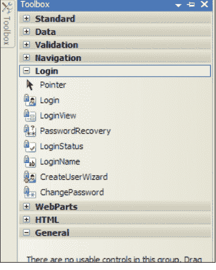

由于 MCMS 拥有自己的用户管理系统且不提供受支持的 API，因此只有其中三个控件可与 MCMS 应用程序一起使用：

- `Login`：提供 Forms Authentication 所需的用户界面。
- `LoginStatus`：根据用户当前登录状态提供 **Login** 或 **Logout** 超链接。
- `LoginName`：显示当前已登录用户的名称。

`LoginName` 控件可直接在 MCMS 应用程序中无修改使用，无论其身份验证模式如何，都可显示当前已登录用户的名称。然而，除非使用 Forms Authentication，否则 `LoginStatus` 控件没有实用目的，在这种情况下，可通过少量自定义代码使用它来启用用户登录和退出 MCMS 应用程序。

`Login` 控件可用作手工编写必要代码以实现 MCMS 应用程序基于表单的身份验证的替代方案。然而，由于 MCMS 身份验证和授权系统，我们必须实现一个 Membership Provider 在幕后执行验证用户凭据的工作。通过使用这种方法，还可以操作来自 MCMS 身份验证和授权系统的结果，例如向返回的用户票据添加额外详细信息。

### 实现 MCMS Membership Provider

为了支持 MCMS 应用程序，我们的 MCMS Membership Provider 必须实现 ValidateUser() 方法，该方法执行 MCMS Forms Authentication。这是当用户从 Login 控件提交其凭据时将被调用的方法。以下示例显示了此类实现：

```csharp
public override bool ValidateUser(string strUsername,
    string strPassword)
{
    bool ValidUser = false;
    CmsAuthenticationTicket Ticket =
        CmsFormsAuthentication.AuthenticateAsUser(strUsername,
            strPassword);

    if (Ticket != null)
    {
        ValidUser = true;
    }

    return ValidUser;
}
```

如果身份验证成功，此代码将生成 MCMS 身份验证票据。我们现在可以直接调用 CmsFormsAuthentication.SetAuthCookie 来设置 cookie，但提供程序不是设置 cookie 的正确位置。ValidateUser() 方法应仅验证提供的用户凭据是否有效。在提供程序中，我们也无法访问 Login 控件的属性，例如 RememberMeSet 复选框，该复选框使用户有机会决定 cookie 是否应持久化。

设置身份验证 cookie 的正确位置是 Login 控件的 LoggedIn 事件。问题是 Membership Provider 模型不允许我们将票据传回 Login 控件。为克服此限制，我们可以将 MCMS 票据添加到当前 HttpContext 的 Items 集合中：

```csharp
public override bool ValidateUser(string strUsername,
    string strPassword)
{
    bool ValidUser = false;
    CmsAuthenticationTicket Ticket =
        CmsFormsAuthentication.AuthenticateAsUser(strUsername,
            strPassword);

    if (Ticket != null)
    {
        HttpContext.Current.Items.Add("MCMSTicket", Ticket);
        ValidUser = true;
    }

    return ValidUser;
}
```

Items 集合是一个存储桶，可用于在单个请求内的不同代码部分之间传递各种对象——甚至在不同的 HttpModules 之间。HttpContext Items 集合的生命周期是一个请求。我们现在可以在 Login 控件中使用由 Membership Provider 创建的 MCMS 票据。

现在让我们为 MCMS 实现一个 Base Membership Provider 类。我们将通过创建新的 Class Library 项目而不是使用 App_Code 文件夹来实现。一旦完成，它可以在多个 MCMS 应用程序中重复使用。

通过实现基础 Membership Provider，我们可以将与 MCMS 身份验证和授权系统交互所需的代码与用于操作凭据格式或与外部身份验证系统交互的代码分离。

- 1. 在 Visual Studio 2005 中打开 TropicalGreen 网站。
- 2. 从文件菜单中选择添加，然后选择新建项目...
- 3. 在添加新项目对话框中，在 Visual Studio 已安装模板部分中选择 Class Library 图标。
- 4. 在名称文本框中输入 MCMSMembershipProviders，然后单击确定。
- 5. 删除 Class1.cs 文件。
- 6. 右键单击引用并单击添加引用...
- 7. 在添加引用对话框中，选择 System.Configuration 和 System.Web 组件，然后单击确定。
- 8. 右键单击引用并单击添加引用... 在添加引用对话框中，单击浏览选项卡。
- 9. 导航到 c:\Program Files\Microsoft Content Management Server\Server\bin 文件夹，选择 Microsoft.ContentManagement.Web.dll 文件，然后单击确定。
- 10. 右键单击 MCMSMembershipProviders 项目并单击添加，然后选择新建项...
- 11. 在添加新项对话框中，选择类图标并在名称文本框中输入 MCMSMembershipProviderBase。单击确定。添加以下 using 语句：


using System.Web;
using System.Web.Security;
using Microsoft.ContentManagement.Web.Security;

12. 修改命名空间声明为：

TropicalGreen.MCMSMembershipProviders

13. 修改类声明为：

public abstract class MCMSMembershipProviderBase :
    System.Web.Security.MembershipProvider

14. 在 MCMSMembershipProviderBase 类中实现以下方法。（为避免输入以下代码，您可以从 Packt 网站下载。）

public override bool ValidateUser(string strUsername,
    string strPassword)
{
    bool ValidUser = false;
    CmsAuthenticationTicket Ticket;
    Ticket = CmsFormsAuthentication.AuthenticateAsUser(strUsername, strPassword);
    if (Ticket != null)
    {
        // pass the CmsAuthenticationTicket to the Login Control
        HttpContext.Current.Items.Add("MCMS Ticket", Ticket);
        ValidUser = true;
    }
    return ValidUser;
}

public override bool EnablePasswordReset
{
    get { throw new Exception(
        "The method or operation is not implemented."); }
}
public override bool EnablePasswordRetrieval
{
    get { throw new Exception(
        "The method or operation is not implemented."); }
}
public override bool RequiresQuestionAndAnswer
{
    get { throw new Exception(
        "The method or operation is not implemented."); }
}
public override string ApplicationName
{
    get { throw new Exception(
        "The method or operation is not implemented."); }
    set { throw new Exception(
        "The method or operation is not implemented."); }
}
public override int MaxInvalidPasswordAttempts
{
    get { throw new Exception(
        "The method or operation is not implemented."); }
}
public override int PasswordAttemptWindow
{
    get { throw new Exception(
        "The method or operation is not implemented."); }
}

public override bool RequiresUniqueEmail
{
    get { throw new Exception(
        "The method or operation is not implemented."); }
}
public override MembershipPasswordFormat PasswordFormat
{
    get { throw new Exception(
        "The method or operation is not implemented."); }
}
public override int MinRequiredPasswordLength
{
    get { throw new Exception(
        "The method or operation is not implemented."); }
}
public override int MinRequiredNonAlphanumericCharacters
{
    get { throw new Exception(
        "The method or operation is not implemented."); }
}
public override string PasswordStrengthRegularExpression
{
    get { throw new Exception(
        "The method or operation is not implemented."); }
}
public override MembershipUser CreateUser(string username,
    string password, string email,
    string passwordQuestion, string passwordAnswer,
    bool isApproved, object providerUserKey,
    out MembershipCreateStatus status)
{
    throw new Exception(
        "The method or operation is not implemented.");
}
public override bool ChangePassword(string username,
    string oldPassword, string
    newPassword)
{
    throw new Exception(
        "The method or operation is not implemented.");
}
public override string GetPassword(string username, string answer)
{
    throw new Exception(
        "The method or operation is not implemented.");
}
public override string ResetPassword(string username, string answer)
{
    throw new Exception(
        "The method or operation is not implemented.");
}
public override void UpdateUser(MembershipUser user)
{
    throw new Exception(
        "The method or operation is not implemented.");
}
public override MembershipUserCollection GetAllUsers(int pageIndex,
    int pageSize, out int totalRecords)
{
    throw new Exception(
        "The method or operation is not implemented.");
}
public override bool ChangePasswordQuestionAndAnswer(string username,
    string password, string newPasswordQuestion,
    string newPasswordAnswer)
{
    throw new Exception(
        "The method or operation is not implemented.");
}
public override bool UnlockUser(string userName)
{
    throw new Exception(
        "The method or operation is not implemented.");
}
public override MembershipUser GetUser(object providerUserKey,
                                    bool userIsOnline)
{
    throw new Exception(
        "The method or operation is not implemented.");
}
public override MembershipUser GetUser(string username,
                                    bool userIsOnline)
{
    throw new Exception(
        "The method or operation is not implemented.");
}
public override string GetUserNameByEmail(string email)
{
    throw new Exception(
        "The method or operation is not implemented.");
}
public override bool DeleteUser(string username,
                                bool deleteAllRelatedData)
{
    throw new Exception(
        "The method or operation is not implemented.");
}
public override int GetNumberOfUsersOnline()
{
    throw new Exception(
        "The method or operation is not implemented.");
}
public override MembershipUserCollection FindUsersByName(
                                    string usernameToMatch,
                                    int pageIndex,
                                    int pageSize, out int totalRecords)
{
    throw new Exception(
        "The method or operation is not implemented.");
}
public override MembershipUserCollection FindUsersByEmail(
                                    string emailToMatch,
int pageIndex,
int pageSize,
out int totalRecords)
{
    throw new Exception(
        "The method or operation is not implemented.");
}

> 请注意，许多方法在被调用时只是抛出异常。这些方法与功能（例如“password reset”）相关，仅与支持此类功能的自定义身份验证方案相关。

15. 保存并构建 **MCMSMembershipProviders** 项目。

现在让我们基于抽象类实现一个简单的 MCMS 成员资格提供程序，用于 Windows 账户，它在调用基类中的 ValidateUser() 方法之前仅正确格式化用户名。

- 1. 右键单击 **MCMSMembershipProviders** 项目并点击 **添加**，然后点击 **新建项目...**。在 **添加新项目** 对话框中，选择 **类** 图标，并在 **名称** 文本框中输入 **MCMSWindowsMembershipProvider**。点击 **确定**。
- 2. 修改命名空间声明为：
  `TropicalGreen.MCMSMembershipProviders`
- 3. 修改类声明为：
  `public class McmsWindowsMembershipProvider : MCMSMembershipProviderBase`
- 4. 在 `McmsWindowsMembershipProvider` 类中实现以下内容：

public override bool ValidateUser
    (string strName, string strPassword)
{
    string strLogin = "WinNT:///" + strName.Replace("\\", "/");
    return base.ValidateUser(strLogin, strPassword);
}

> 为简洁起见，此示例代码不包含任何输入验证或异常处理，并假设 `strName` 的格式为 `MachineOrDomainName\username`。对于生产应用程序，我们将实现异常处理和输入验证。

5. 保存并构建 **MCMSMembershipProviders** 项目。

## 使用 MCMS 成员资格提供程序

现在我们已经创建了 MCMS 成员资格提供程序，需要将其注册到我们的 Tropical Green MCMS 应用程序中。

- 1. 右键单击 **TropicalGreen** 网站并点击 **添加引用...**
- 2. 在 **添加引用** 对话框中，点击 **项目** 选项卡。
- 3. 点击 **MCMSMembershipProviders** 并点击 **确定**。
- 4. 打开 `web.config` 文件。

5. 在现有的 `<authentication />` 标签正下方添加以下部分：

<membership defaultProvider="McmsWindowsMembershipProvider" userIsOnlineTimeWindow="30">
  <providers>
    <add name="McmsWindowsMembershipProvider"
         type="TropicalGreen.MCMSMembershipProviders.McmsWindowsMembershipProvider"
         applicationName="/" />
  </providers>
</membership>

> 请注意，`<add>` 元素的 `type` 属性需要在 一行中输入，且不能有空格或换行。上面的格式仅用于打印。


6. 修改身份验证部分以使用表单身份验证：

```
<authentication mode="Forms">
  <forms loginUrl="Login.aspx" />
</authentication>
```

## 使用登录控件创建登录页面

现在让我们继续实现一个登录页面，允许用户登录，该页面将使用新的 ASP.NET 2.0 登录控件。

- 1. 右键单击 **TropicalGreen** 网站，然后单击 **添加新项**。
- 2. 选择 **Web Form** 图标，在 **Name** 文本框中输入 **Login.aspx** 并单击 **添加**。确保未选中 **选择母版页** 复选框。


> 将 `Login` 控件添加到母版页是可行的。但是如果母版页包含与 PAPI 交互的代码（例如导航控件或发布属性），则您的 MCMS 安装需要启用访客访问。此类实现仅适用于使用表单身份验证的混合创作和只读托管场景。

- 3. 切换到 **设计** 视图。
- 4. 从工具箱 **Login** 选项卡拖动 **Login** 控件到设计表面。

## 身份验证控件和成员资格提供程序

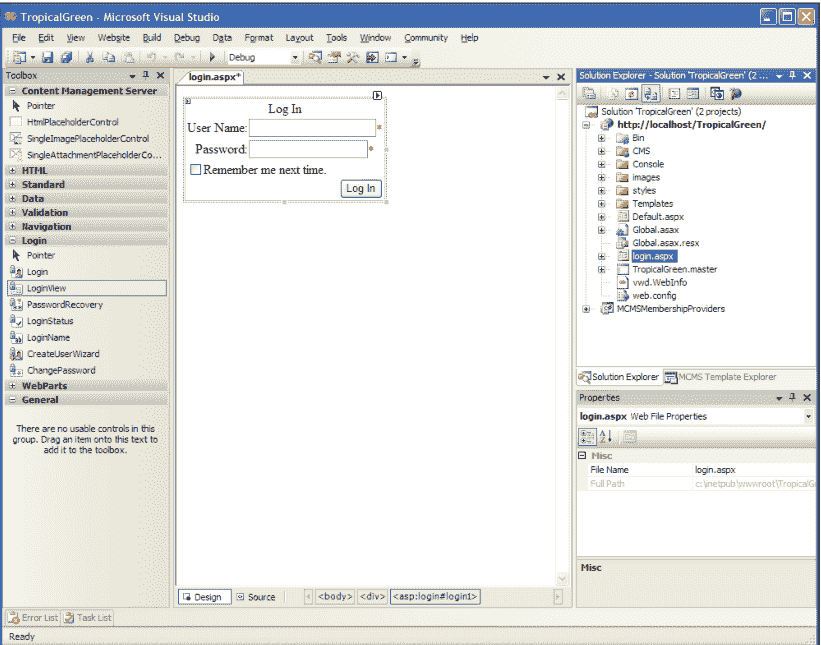

- 5. 如有需要，使用登录控件的自动格式任务选择格式方案。

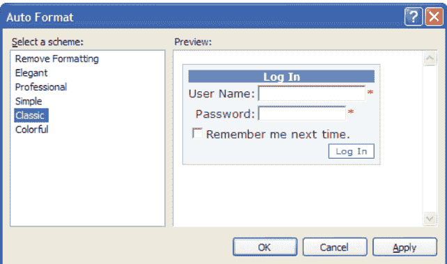

- 6. 单击登录控件（Login1），然后在属性窗口中单击事件图标（闪电符号）。

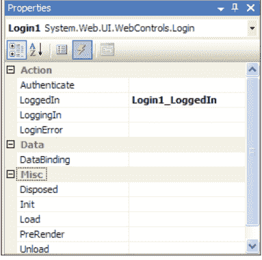

- 7. 双击 LoggedIn 事件以添加 Login1_LoggedIn 事件处理程序并在代码视图中跳转到它。
- 8. 添加以下 using 语句：

```
using Microsoft.ContentManagement.Web.Security;
```

- 9. 在 Page_Load 方法正下方实现以下内容：

```
protected void Login1_LoggedIn(object sender, EventArgs e)
{
    Login myLogin = sender as Login;

    if (HttpContext.Current.Items.Contains("MCMSTicket"))
    {
        CmsAuthenticationTicket Ticket =
            HttpContext.Current.Items["MCMSTicket"]
            as CmsAuthenticationTicket;
        CmsFormsAuthentication.SetAuthCookie(Ticket,
            false, Login1.RememberMeSet);
    }
}
```

- 10. 从“生成”菜单中选择“生成网站”。

现在我们已完成登录页面，可以继续在 Internet Explorer 中通过浏览 http://localhost/tropicalgreen 来测试功能。

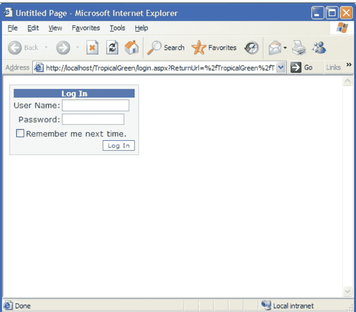

- 11. 输入用户名和密码并单击 **登录**。请记住以 **MachineOrDomainName\username** 的格式输入用户名。
- 12. 如果凭据正确，您将登录并被带到 Tropical Green 主页。否则，`Login` 控件中将显示一条消息。

## 使用 LoginStatus 和 LoginName 控件

现在我们有了登录页面，可以使用 `LoginStatus` 和 `LoginName` 控件为模板提供额外的成员资格相关功能。让我们继续将这些控件添加到我们的母版页。

- 1. 在 **设计** 视图中打开 `TropicalGreen.master`。
- 2. 从工具箱的 **Login** 选项卡拖动 **LoginStatus** 控件到右侧表格单元格中，位于现有菜单控件 (**MenuRight**) 之上。
- 3. 单击 `LoginStatus` 控件 (**LoginStatus1**) 和 **属性** 窗口中的事件图标。
- 4. 双击 **LoggedOut** 事件以添加 `Login1_LoggedOut` 事件处理程序并在 **代码** 视图中跳转到它。
- 5. 添加以下 using 语句：

```
using Microsoft.ContentManagement.Web.Security;
```

- 6. 在 `Page_Load` 方法正下方实现以下内容：

```
protected void LoginStatus1_LoggedOut(object sender, EventArgs e)
{
    CmsFormsAuthentication.SignOut();
}
```

- 7. 保存您的工作，然后从 **生成** 菜单中选择 **生成网站**。

我们现在可以通过登录我们的网站来测试 `LoginStatus` 控件：

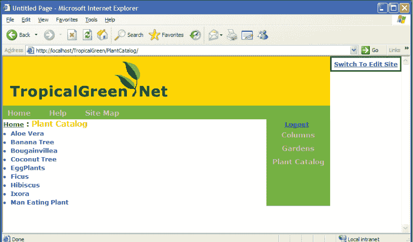

## 身份验证控件和成员资格提供程序

当我们单击注销链接时，我们将从 MCMS 注销并返回到登录页面。如果在我们的 MCMS 安装上启用了访客访问，则 LoginStatus 控件将显示登录链接。

现在让我们继续向母版页添加 LoginName 控件：

- 1. 在 Design 视图中打开 TropicalGreen.master。
- 2. 从 Login 选项卡的工具箱拖动 LoginName 控件到右侧表格单元格中，位于现有 LoginStatus 控件之上。
- 3. 切换到源视图。
- 4. 在 <asp:LoginName /> 元素之后添加一个不间断空格：
- 5. 保存您的工作，然后从生成菜单中选择生成网站。

```
<asp:LoginName ID="LoginName1" runat="server"/>
<br/>
```

现在当我们登录时，可以看到当前登录用户的名称：

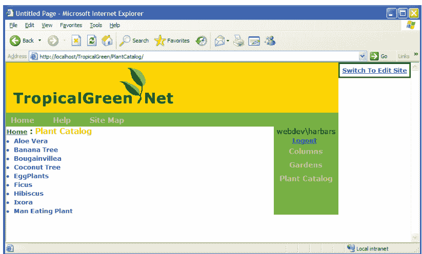

我们可以使用上一章中详细介绍的皮肤轻松增强 LoginStatus 和 LoginName 控件的外观和感觉。

## 支持自定义身份验证方案

到目前为止，我们已经了解了如何通过为 Windows 帐户创建 MCMS 成员资格提供程序并将其与表单身份验证一起使用来使用新的 ASP.NET 2.0 登录控件。也可以使用相同的方法为“帐户映射”场景提供更优雅的解决方案，在该场景中身份验证针对外部用户存储进行。

例如，假设我们需要使用 Active Directory 应用程序模式 (ADAM) 进行身份验证，我们可以通过重写 ValidateUser() 方法基于我们的 MCMSMembershipProviderBase 类实现 ADAM 成员资格提供程序：

```
using System.DirectoryServices;
... Code Continues ...
public override bool ValidateUser(string strName, string strPassword)
{
    // the LDAP server to connect to
    string strLdapServer = "LDAP://localhost:389/";
    // the DN of the OU containing the user
    string strLdapObj = "OU=MCMSUsers,O=TropicalGreen";
    // the DirectoryEntry property to validate
    string strDECheck = "MCMSUsers";
    // the DN of the user we are connecting as
    string strBindName = "CN=" + strName + "," + strLdapObj;
    // the Windows Username format for passing to ValidateUser
    string strWindowsUser = "WinNT://webdev/" + strName;

    try
    {
        // Connect to ADAM using LDAP AuthN...
        DirectoryEntry ent = new DirectoryEntry(strLdapServer +
            strLdapObj, strBindName,
            strPassword, AuthenticationTypes.None);

        // We must bind to perform authentication
        if ((string)ent.Properties["name"].Value == strDECheck)
        {
            // LDAP AuthN succeeded, so perform Windows
            // AuthN to setup a MCMS context...
            return base.ValidateUser(strWindowsUser, strPassword);
        }
        // LDAP AuthN failed, so return a false
        return false;
    }
    catch (Exception)
    {
        //LDAP AuthN failed, so return a false
        return false;
    }
}
```

Active Directory 应用程序模式 (ADAM) 是一个独立的 LDAP 3 目录服务。上面的示例假定 ADAM 安装在与 MCMS 相同的机器上，已配置为允许不安全操作，MCMS 用户存储在名为 MCMSUsers 的组织单位中，并且密码在 ADAM 和 Active Directory 或本地安全帐户 (SAM) 数据库中相同。

上面的示例可以扩展以创建 Windows 和 ADAM 用户帐户，并为最终用户提供附加功能，例如密码重置。但是，仍然没有受支持的机制来管理 MCMS 角色组成员资格。一个合适的折中方案是为每个 MCMS 角色组创建一个 Windows 组。然后使用站点管理器将 Windows 组添加到 MCMS 角色组，并且用户可以以编程方式添加到 Windows 组。

## 摘要

我们已经介绍了如何通过为 Windows 帐户创建 MCMS 成员资格提供程序并将其与表单身份验证一起使用来使用新的 ASP.NET 2.0 登录控件和成员资格提供程序模型。我们还了解了哪些控件对 MCMS 应用程序有用以及如何将它们与我们的 MCMS 应用程序集成。我们还看到了如何通过为外部身份验证系统开发成员资格提供程序来利用这些 ASP.NET 2.0 功能来增强“帐户映射”场景。


# 7 如何操作、技巧和窍门

## 如何操作、技巧和窍门

ASP.NET 2.0 引入了许多令人兴奋的新工具。在本章中，我们汇总了一些可用于增强您网站的技巧：

- **技巧 #1：如何执行跨页回发**：ASP.NET 2.0 引入了一种从页面到页面传递数据的新方法。过去所有表单都将数据回发给自身，现在您可以指定一个替代表单来接收数据。在本技巧中，我们将介绍如何实现跨页回发，以及使其在 MCMS 页面上成功实现所需的工作区。
- **技巧 #2：如何实现广告轮播器**：虽然广告轮播器在早期版本的 ASP 和 ASP.NET 中就已存在，但随 ASP.NET 2.0 提供的最新版本具有以编程方式访问数据源的能力。在本技巧中，我们将构建一个服务器控件，展示如何将广告轮播器控件直接与 MCMS 资源库集成。
- **技巧 #3：关于 Microsoft Office SharePoint Server 2007 的注意事项**：为即将发布的 Office SharePoint Portal Server 做准备，我们将介绍一些应考虑的事项，以便使代码迁移更轻松。

## 技巧 #1：如何执行跨页回发

早在 ASP.NET 1.x 中，Web 表单设计为仅向自身提交信息（或回发）。这样做提供了在页面本身内执行服务器端处理的便利。按钮点击、页面加载和表单提交等事件可以从页面的代码隐藏文件中处理。然而，由于表单只能回发到自身，跨页面共享数据变得棘手且混乱。

ASP.NET 2.0 为 Button、LinkButton 和 ImageButton 控件引入了 PostBackUrl 属性。有了 PostBackUrl 属性，开发人员现在可以将回发数据发送到站点内的任何 Web 表单。此功能在处理共享数据或相互交互的多个 Web 表单时特别有用。

在本技巧中，我们将介绍 PostBackUrl 功能以及使其在 MCMS 站点上正确工作所需的重要解决方法。以下是我们将构建的内容。我们将首先创建一个接受用户输入的页面。接下来，我们将添加一个按钮，其 PostBackUrl 属性设置为另一个页面。之后，我们将构建按钮 PostBackUrl 属性指定的页面，并对其进行编程以接受来自第一个页面的输入。最后，我们将介绍 PostBackUrl 属性在 MCMS 站点上正常工作所需的解决方法。

### 在页面之间传递数据

在页面之间传递数据的常见场景是在所有帖子上设置搜索输入字段，或有一个专门的搜索页面，其中包含用于输入关键字和其他条件的字段。输入的搜索条件可以提交到单独的页面，该页面执行搜索并显示结果。

或者您可能有一个无处不在的向导式对话框，类似于 Amazon 或 eBay 等流行在线商店中的对话框。向导将任务（例如结账购物车中的商品）分解为一系列单独的步骤。购物车中的商品列表、用户名、收货地址和其他详细信息会在页面之间传递，直到交易最终完成。

解决此问题的一种方法是將向导的所有部分放在单个 Web 表单中。这些部分通常由面板或表格管理。随着用户完成任务，他或她只能看到页面的一个部分。与当前步骤无关的部分会被隐藏。在这种方式下，用户永远不会离开页面。然而，这种方法的最大缺点是，随着部分数量和复杂性的增加，页面变得越来越难以维护。

或者，您可以调用 Server.Transfer()，它接受一个输入参数，指示在从一个页面定向到另一个页面时是否应保留状态和输入字段的值。例如，在 Page1.aspx 中，我们可以按如下方式调用 Page2.aspx：

```
Server.Transfer("Page2.aspx", true);
```

通过将第二个布尔参数设置为 true，所有表单值的状态将被传递到 Page2.aspx。从 Page2.aspx，我们可以使用 Request.Form 集合检索输入字段值：

```
string myText = Request.Form["MyText"];
```

然而，`Server.Transfer()` 有几个缺点。首先，地址栏上的 URL 从页面到页面保持不变，这可能不是理想的。更重要的是，`Server.Transfer()` 不能与 MCMS 页面结合使用，因为它会绕过 ISAPI 过滤器。

另一种解决方案是使用查询字符串传递整个信息块。然而，查询字符串也有一些限制。不仅长的查询字符串会创建不友好的 URL，值还会暴露在浏览器的地址栏中，给用户机会更改其值，导致应用程序行为异常。此外，如果长度超过查询字符串的最大允许长度，数据可能会在传输过程中丢失。

您甚至可以将数据存储在会话变量或数据库表中。虽然这些方法有效，但实现成本高昂，并可能导致性能问题。例如，会话对象通常存储在服务器的内存中。维护数千名同时用户的会话状态可能会占用大量内存——如果管理不当可能会导致网站崩溃。

鉴于如此多的陷阱和注意事项，那么我们应如何从一个页面向另一个页面传递数据呢？按钮控件中的新 `PostBackUrl` 属性提供了一个有吸引力的替代方案。无需在部分或查询字符串、会话对象或数据库表等中间存储位置管理页面的状态，我们可以直接将数据发布到另一个表单。让我们看看它是如何实现的。

### “订购植物”向导

为了演示 `PostBackUrl` 属性的工作方式，我们将创建一个向导，引导访问者完成从 TropicalGreen 社会社订购植物的过程。为了保持简单，我们将只有两个屏幕。

在第一个屏幕中，访问者将输入姓名和地址。他们还将从下拉列表中选择一种植物。

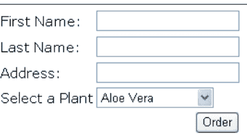

第二个屏幕将打印访问者在第一个屏幕中输入的值，并提供一个按钮来确认订单。

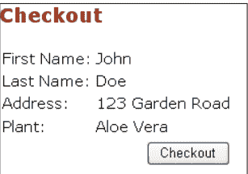

### 订购页面

让我们开始创建订单页面。

- 1. 首先，在 TropicalGreen 解决方案中添加一个名为 Forms 的文件夹。
- 2. 在 Forms 文件夹中添加一个 Web 表单。将表单命名为 Order.aspx 并应用之前创建的 tropicalgreen.master 主页。
- 3. 切换到源视图。在 <asp:Content> 标签之间添加以下代码。该表格保存了稍后将添加的控件的布局。

```
<h1>Order a Plant</h1>
<table>
    <tr>
        <td>
            First Name:
        </td>
        <td>(TextBox for the First Name)</td>
    </tr>
    <tr>
        <td>
            Last Name:
        </td>
        <td>(TextBox for the Last Name)</td>
    </tr>
    <tr>
        <td>
            Shipping Address:
        </td>
        <td>(TextBox for the Shipping Address)</td>
    </tr>
    <tr>
<td>Select a Plant</td>
<td>(Dropdown list for the selection of plants)</td>
</tr>
<tr>
<td colspan="2" align="right">
(Button to Check Out)
</td>
</tr>
</table>
```

4. 我们将为客户提供输入其名字、姓氏和收货地址的字段，以及他或她想要订购的植物。切换回设计视图。从工具箱的标准部分拖动三个 TextBoxes、一个 DropdownList 和一个 Button 控件，并将其放置如下图所示：

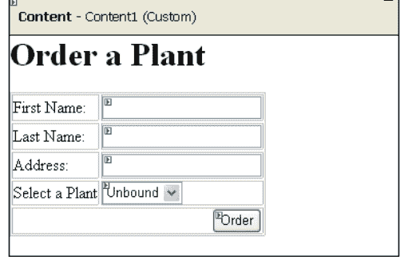

为控件设置以下属性值：

| 控件 | 属性 | 属性值 |
|---|---|---|
| TextBox | ID | txtFirstName |
| TextBox | ID | txtLastName |
| TextBox | ID | txtAddress |
| DropDownList | ID | ddlPlant |
| Button | ID | btnOrder |
|  | Text | Order |
|  | PostBackUrl | /tropicalgreen/forms/checkout.aspx |


请注意，我们已将按钮的 PostBackUrl 属性设置为指向名为 checkout.aspx 的页面（我们将在下一节中构建该页面）。而不是让结果回发到当前页面，数据将被发送到 checkout.aspx。

- 5. 在表单上任意位置双击以打开代码隐藏文件。在页面顶部添加高亮的命名空间。

```
using System;
... code continues ...
using Microsoft.ContentManagement.Publishing;

public partial class Forms_Order : System.Web.UI.Page
{
    ... code continues ...
}
```

- 6. 在 Page_Load() 事件处理程序中，我们将使用目录中所有可用的植物列表填充下拉列表。按如下所示添加代码：

```
protected void Page_Load(object sender, EventArgs e)
{
    // Get the current context
    CmsHttpContext cmsContext = CmsHttpContext.Current;

    // Get an instance of the plant catalog
    Channel plantCatalog = cmsContext.Searches.GetByPath(
        "/Channels/tropicalgreen/PlantCatalog") as Channel;

    if (plantCatalog != null)
    {
        // Get a collection of all postings in the plant catalog
        // channel
        PostingCollection plants = plantCatalog.Postings;

        // Sort the postings by display name
        plants.SortByDisplayName();

        // Populate the dropdown with a list of plants from the
        // catalog
        foreach (Posting plant in plants)
        {
            ListItem li =
                new ListItem(plant.DisplayName, plant.DisplayName);
            ddlPlant.Items.Add(li);
        }
    }
}
```

- 7. 为了在结账过程中更轻松地检索字段值，我们将创建属性来返回在 `txtFirstName`、`txtLastName` 和 `txtAddress` 文本框中输入的文本。我们还将添加一个属性来返回从下拉列表中选择的植物名称。将以下代码直接附加在 `Page_Load()` 事件处理程序下方。

```csharp
// First Name
public string FirstName
{
    get
    {
        return txtFirstName.Text.Trim();
    }
}

// Last Name
public string LastName
{
    get
    {
        return txtLastName.Text.Trim();
    }
}

// Address
public string Address
{
    get
    {
        return txtAddress.Text.Trim();
    }
}

// Plant
public string Plant
{
    get
    {
        return ddlPlant.SelectedItem.Value.Trim();
    }
}
```

## 结账屏幕

结账页面将接收在订购屏幕中输入的值并在屏幕上显示它们。当用户对信息感到满意时，他或她点击 **结账** 按钮，然后会出现一条消息，告知他或她订单已成功下达。

- 1. 在 `Forms` 文件夹中添加一个 Web 表单。将表单命名为 `checkout.aspx` 并将 `tropicalgreen.master` 设置为主页。
- 2. 在 **源代码** 视图中，在 `<asp:Content>` 标签之间添加以下代码：

```
<h1>Checkout</h1>
<table>
    <tr>
        <td>First Name:</td>
        <td>(Space for First Name Label)</td>
    </tr>
    <tr>
        <td>Last Name:</td>
        <td>(Space for Last Name Label)</td>
    </tr>
    <tr>
        <td>Address:</td>
        <td>(Space for Address Label)</td>
    </tr>
    <tr>
        <td>Plant:</td>
        <td>(Space for Plant Label)</td>
    </tr>
    <tr>
        <td colspan="2" align="right">
            (Space for Confirm Button)
        </td>
    </tr>
</table>
(Space for Message Label)
```

- 3. 切换到设计视图。将五个标签控件和一个按钮控件拖放到表单上，按以下屏幕截图所示进行排列：

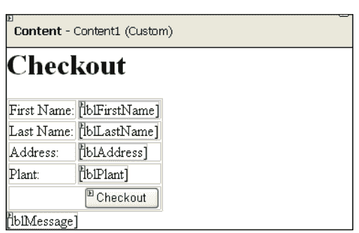

为控件分配以下属性值：

| 控制 | 属性 | 属性值 |
|---|---|---|
| Label | ID | lblFirstName |
| Label | ID | lblLastName |
| Label | ID | lblAddress |
| Label | ID | lblPlant |
| Button | ID | btnCheckOut |
|  | Text | Checkout |
| Label | ID | lblMessage |

- 4. 之前，在构建订单表单时，我们创建了一些属性来返回用户输入的值。为了让结账页面更轻松地检索这些值，我们将首先使用 PreviousPageType 指令强类型化订单页面。切换到源代码视图，并在 <%@Page%> 指令下方添加以下代码行。

```
<%@ PreviousPageType VirtualPath="~/Forms/Order.aspx"%>
```

- 5. 切换到设计视图并在表单上任意位置双击，以在代码隐藏文件中打开其 Page_Load() 事件处理程序。在这里，我们将检索从订购页面发布的数据并将其分配给标签。为此，我们将检索之前创建的 FirstName、LastName、Address 和 Plant 属性中存储的值。

```csharp
protected void Page_Load(object sender, EventArgs e)
{
    if (!Page.IsPostBack)
    {
        // Get the first name
        lblFirstName.Text = PreviousPage.FirstName;

        // Get the last name
        lblLastName.Text = PreviousPage.LastName;

        // Get the address
        lblAddress.Text = PreviousPage.Address;

        // Get the plant
        lblPlant.Text = PreviousPage.Plant;
    }
}
```

- 6. 切回 **设计** 视图并双击 `btnConfirm` 按钮以打开 `btnConfirm_Click()` 事件处理程序。在这里，我们只需通知用户订单已成功下达。当然，在实际网站中，您可能不止于在屏幕上打印一条消息。

```csharp
protected void btnConfirm_Click(object sender, EventArgs e)
{
    lblMessage.Text = "Plant has been successfully ordered.";
}
```

- 7. 页面已完成。保存并构建网站。

## 添加“订购植物”菜单项

现在我们已经创建了订购和订单确认屏幕，让我们为我们的“Order a Plant”向导在右侧菜单中添加一个新项目，以便网站访问者可以访问它。请记住，菜单由站点的频道结构驱动。因此，要添加菜单项，我们只需插入一个新频道并将其脚本 URL 设置为指向订单页面。

- 1. 打开 **站点管理器** 并使用具有管理员权限的帐户登录。
- 2. 在 **tropicalgreen** 频道下直接创建一个频道。为新频道提供以下属性值：

| 属性 | 属性值 |
|---|---|
| Name | OrderPlant |
| DisplayName | Order Plants |
| Script URL | /tropicalgreen/forms/order.aspx |

- 3. 创建频道后，创建一个名为 **MenuLocation** 的选择类型自定义属性并为其分配以下选项：

- Top
- Right (make it the default value)

“Order a Plant”菜单项现在应出现在左侧菜单上。

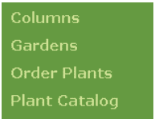

## 为什么跨页回发在 MCMS 站点上不起作用

导航到网站内的任何页面并点击 **Order a Plant**。在订购页面中，输入您的名字、姓氏和地址，选择一种植物，然后点击 **Order** 按钮。

页面将刷新。页面似乎正在回发到自身，即使我们已将按钮的 `PostBackUrl` 属性设置为不同的页面！

为了了解为什么跨页回发在 MCMS 页面上不起作用，让我们看一下生成的页面的客户端脚本。观察为 `btnOrder` 按钮生成的代码（在页面上任意位置右键单击并选择 **查看源代码**），其类似于以下代码：

```
<input type="submit"
name="ctl00$ContentPlaceHolder1$btnOrder"
value="Order"
onclick="javascript:
```

```
WebForm_DoPostBackWithOptions(new
WebForm_PostBackOptions(&quot;ctl00$ContentPlaceHolder1$btnOrder&quot;, &quot;&quot;, false, &quot;&quot;, &quot;/tropicalgreen/Forms/CheckOut.aspx&quot;, false, false))" id="ctl00_ContentPlaceHolder1_btnOrder"/>
```

请注意，onclick() 事件处理程序调用了一个 JavaScript 方法 WebForm_DoPostBackWithOptions()。每当按钮的 UrlPostBack 属性被设置时，ASP.NET 都会生成此方法。以下代码显示了幕后发生情况的片段。请注意，在提交表单之前，表单元素的 action 属性被设置为按钮的 PostBackUrl 属性中存储的值的值。基本上，这就是跨回发功能的工作方式。

```
function WebForm_DoPostBackWithOptions(options)
{
    . . . code continues . . .

    if ((typeof(options.actionUrl) != "undefined") &&
        (options.actionUrl != null) &&
        (options.actionUrl.length > 0))
    {
        theForm.action = options.actionUrl;
    }
    . . . code continues . . .
}
```

向下滚动到页面底部。注意，在 </form> 标签关闭之前，MCMS 已生成自己的客户端脚本集。特别是，请查看名为 __cmsRestFormAction() 的方法（如下所示）。当布尔变量 __CMS_PostbackFormBeenReset 设置为 false 时，__cmsRestFormAction() 方法将表单元素的 action 属性设置为当前页面的 URL，从而覆盖 WebForm_DoPostBackWithOptions() 方法所做的任何工作。因此，当点击按钮时，信息不会发布到结账页面，订单页面继续回发到自身。

```
var __CMS_PostbackFormBeenReset = false;
function __cmsRestFormAction()
{
    if ( !__CMS_PostbackFormBeenReset )
    {
        // set form postback Url to be current translated CMS Url
        __CMS_PostbackForm.action = __CMS_CurrentUrl;
    }
}
```


为了解决此问题，我们需要修改 MCMS 添加的客户端脚本的行为，在执行跨页回发时将 __CMS_PostbackFormBeenReset 设置为 true。以下是可能的做法。

- 首先，我们将确定是否需要跨页回发。为此，我们查找名为 WebForm_DoPostBackWithOptions() 的方法。WebForm_DoPostBackWithOptions() 方法是对旧版 ASP.NET 1.x __doPostBack() 方法的增强，并在页面上至少有一个按钮执行跨页回发时由 ASP.NET 注入。
- 接下来，我们复制原始的 WebForm_DoPostBackWithOptions() 方法，并将其存储在名为 __CrossPostBack_Backup_WebForm_DoPostBackWithOptions 的变量中。
- 随后，我们将 WebForm_DoPostBackWithOptions() 分配一个新的方法，名为 __CrossPostBack_Redirect_WebForm_DoPostBackWithOptions()。
- __CrossPostBack_Redirect_WebForm_DoPostBackWithOptions() 方法 simply 设置 __CMS_PostbackFormBeenReset 为 true 并调用原始的 WebForm_DoPostBackWithOptions() 方法，该方法已备份在 __CrossPostBack_Backup_WebForm_DoPostBackWithOptions 变量中。

现在不必担心输入代码。我们将在下一节中使用服务器端代码将代码注入到所有页面。

```
if ( typeof WebForm_DoPostBackWithOptions != "undefined" )
{
    __CrossPostBack_Backup_WebForm_DoPostBackWithOptions =
        WebForm_DoPostBackWithOptions;

    WebForm_DoPostBackWithOptions =
        __CrossPostBack_Redirect_WebForm_DoPostBackWithOptions;
}

function __CrossPostBack_Redirect_WebForm_DoPostBackWithOptions(options)
{
    __CMS_PostbackFormBeenReset = true;
    __CrossPostBack_Backup_WebForm_DoPostBackWithOptions(options);
}
```

## CorrectCrossPostBack HTTP 模块

由于对客户端脚本的修改可能会影响解决方案中的所有模板文件，实现此更改的一个好方法就是编写一个 HTTP 模块。HTTP 模块会拦截所有页面请求，并且可以编程为自动将修改后的脚本注入到需要它们的模板文件中。

要创建 HTTP 模块，首先检查解决方案中是否存在 TropicalGreenHttpModules 类库。如果不存在，请将其添加为新的 Visual C# 类库。

接下来，在 TropicalGreenHttpModules 类库中添加一个名为 CorrectCrossPostBack.cs 的类。在类声明上方，添加此处突出显示的命名空间：

```
. . . code continues . . .

using System.Web;
using Microsoft.ContentManagement.Publishing;

namespace TropicalGreenHttpModules
{
    . . . code continues . . .
}
```

由于我们正在构建一个 HTTP 模块，让该类实现 IHttpModule 接口。

```
class CorrectCrossPostBack : IHttpModule
{
}
```

IHttpModule 接口要求类实现 Init() 和 Dispose() 方法。我们在 Dispose() 方法中无需执行任何操作。

在 Init() 方法中，我们将为 HTTP 模块的 PreRequestHandlerExecute 事件注册一个新的事件处理程序，名为 OnPreRequestHandlerExecute()。将这两个方法追加到类文件中。

```
public void Dispose()
{
    // Nothing to do.
}

public void Init(HttpApplication httpApp)
{
```

```
httpApp.PreRequestHandlerExecute += new EventHandler
    (this.OnPreRequestHandlerExecute);
}
```

接下来，我们将添加 OnPreRequestHandlerExecute() 事件处理程序，该处理程序检查当前请求是否为 ASP（或 ASP.NET）页面。为此，它检查处理程序的类型是否以 ASP 开头。HTTP 模块将忽略所有其他请求，例如 ASP.NET 2.0 资源处理程序或其他自定义处理程序的请求。

在 OnPreRequestHandlerExecute() 事件处理程序内部，我们将进行另一项检查，以查看请求是否为 MCMS 频道项。如果是，我们将注册另一个事件处理程序 OnInit()。

```
public void OnPreRequestHandlerExecute(object sender, EventArgs e)
{
    HttpContext ctx = ((HttpApplication)sender).Context;
    IHttpHandler handler = ctx.Handler;

    // Only execute for ASP.NET handler
    // not for custom http handlers or for the ASP.NET 2.0 resource
    // handlers.
    if (handler.GetType().ToString().StartsWith("ASP."))
    {
        try
        {
            if (CmsHttpContext.Current.ChannelItem != null)
            {
                ((System.Web.UI.Page)handler).Init += new
                    EventHandler(this.OnInit);
            }
        }
        catch
        {
            // This will happen if the request is in the middle of an
            // expired forms authentication login we just ignore this.
        }
    }
}
```

最后，我们将注入纠正跨页回发问题的客户端脚本。我们将构建脚本，并在 OnInit() 方法中使用 Page.ClientScript.RegisterStartupScript() 方法。

```
string Override_WebForm_DoPostBackWithOptions =
    "    if ( typeof WebForm_DoPostBackWithOptions != \"undefined\" ) \\n" +
```

```
"  {\n" +
"    __CrossPostBack_Backup_WebForm_DoPostBackWithOptions = " + 
"        WebForm_DoPostBackWithOptions;\n" + 
"    WebForm_DoPostBackWithOptions = " + 
"        __CrossPostBack_Redirect_WebForm_DoPostBackWithOptions;\n" + 
"  }\n" + 
"  function __CrossPostBack_Redirect_WebForm_DoPostBackWithOption\ns(options)" + 
"  {\n" + 
"    __CMS_PostbackFormBeenReset = true;\n" + 
"    __CrossPostBack_Backup_WebForm_DoPostBackWithOptions\n    (options);\n" + 
"  }\n";
```

```csharp
public void OnInit(object sender, EventArgs eventArgs)
{
    System.Web.UI.Page currentPage = sender as System.Web.UI.Page;
    currentPage.ClientScript.RegisterStartupScript(this.GetType(),
        "Override_WebForm_DoPostBackWithOptions",
        Override_WebForm_DoPostBackWithOptions, true);
}
```

该类已完成。保存并构建项目。

要使用 HTTP 模块，请在 web.config 项目的 <HttpModules> 部分添加以下条目。

```xml
<add type="TropicalGreenHttpModules.CorrectCrossPostBack,
    TropicalGreenHttpModules"
    name="CorrectCrossPostBack"/>
```

现在，让我们看看 HTTP 模块是否确实纠正了问题。尝试从订购页面订购一株植物。当单击 Order 按钮时，注意信息已正确发布到确认页面。

## 提示 #2：如何实现广告轮播

如今广告无处不在。在大多数商业互联网网站上，您会发现某种形式的广告，要么是沿着页面高度或宽度运行的横幅，要么是每次页面加载时吸引注意力的弹出窗口。

热门网站可能有多家广告商要求在线投放广告。当竞争激烈时，必须制定一个流程来确定谁的广告先出现、广告应如何排序以及何时发布或下线。

好消息是：ASP.NET 2.0 附带了 Ad Rotator 控件。在本提示中，我们将了解 Ad Rotator 如何与 MCMS 资源库项目集成。使用 MCMS 内置的资源管理器，用户可以添加新图像或替换现有图像，而不必担心超链接损坏。当图像从库中删除时，它会立即下线。

虽然 Ad Rotator 并不是一个新控件，自 ASP.NET 1.x 时代（甚至更早）就已存在，但旧版本的控件要求开发人员在物理 XML 文件中定义广告列表。控件的增强版本允许以编程方式填充广告及其属性，使其非常适合与 MCMS 集成。

## MCMSAdRotator

让我们构建一个自定义 Ad Rotator 服务器控件。完成后，该控件的行为与开箱即用的 Ad Rotator 控件完全相同，但会与选定的资源库集成。它将从库中随机选择一个资源并显示图像。刷新页面时，广告会发生变化！

- 1. 首先，确保 TropicalGreen 解决方案包含一个名为 `TropicalGreenControlLib` 的 Visual C# 类库项目。否则，请创建它。
- 2. 项目应添加以下引用：
  - `System.Web`
  - `Microsoft.ContentManagement.Publishing`
- 3. 向 **TropicalGreenControlLib** 项目添加一个类文件。将类命名为 **MCMSAdRotator.cs**。
- 4. 在命名空间声明上方添加突出显示的命名空间。

```csharp
using System;
using System.Collections.Generic;
using System.Text;

using System.ComponentModel;
using System.Web.UI;
using System.Web.UI.WebControls;
using Microsoft.ContentManagement.Publishing;

namespace TropicalGreenControlLib
{
    . . . code continues . . .
}
```


5. 接下来，我们将从 AdRotator 类继承。这将使我们的控件立即具备开箱即用的 Ad Rotator 控件的所有功能。我们将添加一些组件设计值，以便开发人员从工具箱拖放时，控件能获得正确的标签名称。

```
[ToolboxData("<{0}:MCMSAdRotator runat=server></{0}:MCMSAdRotator>")] public class MCMSAdRotator : AdRotator
{
}
```

6. 我们将提供一个名为 AdsGalleryPath 的属性，其中包含包含图像的资源库的路径。将以下代码按所示插入类声明中。

```
public class MCMSAdRotator : AdRotator
{
    // Property to get and set the path of the
    // resource gallery that contains the Ads
    private string adsGalleryPath;

    [Bindable(true)]
    [Category("Behavior")]
    [DefaultValue("")]
    [Localizable(true)]
    public string AdsGalleryPath
    {
        get { return adsGalleryPath; }
        set { adsGalleryPath = value; }
    }
}
```

7. 要显示的广告将从资源库中随机选取。Randomizer() 方法将从 1 到库中项目数量之间随机选取一个数字。在此，我们将使用 Random.Next() 方法生成随机数。我们可以采用更复杂的随机数生成方法，但目前这样就足够了。将以下代码添加到 AdsGalleryPath 属性下方。

```
private int Randomiser(int max)
{
    // Generate a random number
    int index = 0;
    Random rand = new Random();
    index = rand.Next(0, max);

    return index;
}
```

8. 在 Ad Rotator 控件加载但页面加载之前，将调用控件的 AdCreated() 事件。在这里，我们首先获取包含广告的资源库的实例以及构成我们广告的资源集合。我们只检索图像——其他文件格式如 Office 文档将被忽略。之后，我们将调用 Randomiser() 方法来选择要显示的广告。一旦选择了广告，我们将设置控件的属性以显示资源，将其链接到资源描述中指定的 URL，并将图像的工具提示或替代文本设置为资源的显示名称。将 OnAdCreated() 事件处理程序附加到代码中。

```
protected override void OnAdCreated(AdCreatedEventArgs e)
{
    // Get an instance of the resource gallery that contains the Ads
    CmsHttpContext cmsContext = CmsHttpContext.Current;
    ResourceGallery rg =
        (ResourceGallery)cmsContext.Searches.GetByPath(adsGalleryPath);

    if (rg != null)
    {
        // Get only files that are images
        ResourceCollection ads = rg.Resources;
        ads.FilterByMimeType("image", true);

        // Randomly pick one of the Ads
        int resourceIndex = Randomiser(ads.Count);
        Resource r = ads[resourceIndex];

        // Display the image
        e.ImageUrl = r.Url;
        e.NavigateUrl = r.Description;
        e.AlternateText = r.DisplayName;
    }
}
```

9. 控件已完成。保存文件并编译项目。

要查看控件的实际效果，首先通过在工具箱中右键单击并选择“选择项”将其添加到工具箱中。在“选择工具箱项”对话框中，单击“浏览”并选择 TropicalGreenControlLib.dll 文件，通常位于项目的 \bin\debug\ 文件夹中。将控件添加到工具箱后，将控件拖放到 Web 表单或模板文件中的任意位置。将 AdsGalleryPath 属性设置为包含现有资源库项的路径，例如 /Resources/TropicalGreen/PlantCatalog。下次查看页面时，您将看到轮播广告。

## 提示 #3：有关 Microsoft Office SharePoint Server 2007 的注意事项

Web Content Management（WCM）功能目前在 MCMS 中，将成为即将推出的 Microsoft Office SharePoint Server 2007（MOSS 2007）的一部分。MOSS 2007 还将提供更丰富的功能：

- SharePoint 和 MCMS 将作为单一产品发布，从此两者之间不再混淆。除了 WCM 功能外，您还将获得完整的 SharePoint 功能套件，例如：
  - 文档管理
  - 企业搜索
  - 调查和讨论板
  - 列表和提醒
  - 对门户和 Web 部件的内置支持
- 此外，MOSS 2007 还包含多个令人兴奋的新功能：
  - Wiki 和博客。
  - 增强的 Web 作者体验，无需 ActiveX 组件和 Site Manager 的客户端安装。包括节省时间的强大工具，如回收站和一键回滚到以前版本。
  - Site Manager 中的所有功能现在都是 Publishing API 的一部分。例如，您可以以编程方式管理角色、组和用户，以及当前 PAPI 版本中无法完成的任务。
  - 基于 Windows Workflow Foundation 的可扩展工作流。
  - 极强的可扩展性。能够在一个容器中处理数百万个项目。

MOSS 2007 将附带更多新功能和增强功能。如需完整列表，请查看可在 2007 Microsoft Office 系统预览网站下载的 Microsoft Office SharePoint Server 2007 指南（http://www.microsoft.com/office/preview/servers/sharepointserver/highlights.mspx）。

对于我们这些已有 MCMS 安装并计划迁移到 MOSS 2007 的人来说，需要注意的关键点是，Office SharePoint Server 2007 下的 WCM 应用程序将使用与当前 MCMS 版本完全不同的 API 集合。进行大规模代码改造的部分原因是将 MCMS 基础架构与 Windows SharePoint Services（版本 3.0）集成。

虽然 Publishing API 的全面改造可能意味着我们为网站编写的大部分自定义代码都必须重新编码，但好消息是：大多数当前属性和方法的功能将有一对一的映射。详细信息可在文章 Mapping MCMS 2002 APIs to SharePoint 2007（http://msdn.microsoft.com/office/server/moss/2007/migration/default.aspx?pull=/library/en-us/dnmscms02/html/CMSISVersionAPIDiffs.asp）中找到。

此外，Microsoft 将提供迁移实用工具以简化过渡。CMS Assessment Tool 会扫描站点并生成各种报告，例如 PAPI 使用情况汇总报告、PAPI 类使用报告等，帮助您评估使站点为 MOSS 2007 做好准备所需的重编码工作量。CMS Assessment 工具可在 Microsoft 网站下载：http://www.microsoft.com/downloads/details.aspx?FamilyId=360D0E83-FA70-4C24-BCD6-426CAFBCC627&displaylang=en。

出于各种原因，您可能不希望立即迁移到 Microsoft Office SharePoint Server 2007，而选择继续使用 MCMS 2002 构建站点。如果这是您的意图，您可以今天采取措施以便将来更轻松地迁移。您可以：

- 将使用 PAPI 的代码隔离到模块中。
- 在可能的情况下使用 Provider Model 设计模式。

## 将使用 PAPI 的代码隔离到模块中

更改底层 MCMS PAPI 的举措，如果您计划将来升级到 MOSS 2007，将对现有 Web 应用程序产生巨大影响。除非您使用的是没有任何形式定制的开箱即用解决方案，否则很可能您已使用 PAPI 来根据网站需求定制解决方案。

您使用 PAPI 所做的所有定制都必须重写。虽然重写代码不可避免，但您可以规划代码结构，使重新编码过程尽可能轻松。好主意是编写模块化代码并尽可能隔离使用 PAPI 的代码。这样，当升级网站时，需要重写的代码将更容易定位。

例如，一个相当常见的场景是自定义控件，列出站点上最近七天内修改过的所有页面。以前，列表可以编程为在 DataGrid 中显示。列表是从 PAPI 使用 `Searches.NewPostings()` 方法检索的。此外，当页面加载时，列表会直接绑定到 DataGrid，使用 `DataGrid.DataBind()` 方法。以下是代码可能的样子示例：

```
protected System.Web.UI.WebControls.DataGrid DataGrid1;
private void Page_Load(object sender, System.EventArgs e)
{
    // Get the current CMS Http context
    CmsHttpContext cmsContext = CmsHttpContext.Current;

    // Get a list of all postings that have been modified in the last
    // 7 days
    PostingCollection newPostings = cmsContext.Searches.NewPostings(7);

    // Bind the result to the DataGrid
    DataGrid1.DataSource = newPostings;
    DataGrid1.DataBind();
}
```

为了模块化代码并将与 MCMS PAPI 交互的部分与使用 PAPI 的部分隔离开来，可以创建一个数据抽象层。数据抽象层可以是一个单独的类文件。在开始模块化代码之前，让我们先识别出使用 MCMS PAPI 的部分。如下所示，使用 PAPI 的代码行是获取当前 CmsHttpContext 以及最近七天内修改的帖子列表的部分：

```
protected System.Web.UI.WebControls.DataGrid DataGrid1;
private void Page_Load(object sender, System.EventArgs e)
{
    // Get the current CMS Http context
    CmsHttpContext cmsContext = CmsHttpContext.Current;

    // Get a list of all postings that have been modified in the last
    // 7 days
    PostingCollection newPostings = cmsContext.Searches.NewPostings(7);

    // Bind the result to the DataGrid
    DataGrid1.DataSource = newPostings;
    DataGrid1.DataBind();
}
```

为了隔离代码，我们将提取所有突出显示的代码部分并将其添加到数据抽象层中。在此示例中，数据抽象层只是一个名为 DataAbstractionExample 的单独类文件。这里有两个方法：GetCurrentCMSContext() 获取当前 CmsHttpContext，而 GetListOfPostings() 返回最近七天内修改的所有帖子的列表。

```
public class DataAbstractionExample
{
    private static CmsHttpContext GetCurrentCMSContext()
    {
        return CmsHttpContext.Current;
    }
    public static PostingCollection GetListOfPostings()
    {
        // Get the current CMS Http Context
        CmsHttpContext cmsContext = GetCurrentCMSContext();
        // Get a list of all postings that have been modified in the
        // last 7 days
        PostingCollection newPostings =
            cmsContext.Searches.NewPostings(7);
        return newPostings;
    }
```
```

接下来，我们修改原始代码，使其改为调用数据抽象层中的 GetListOfPostings()。请注意，我们已从 Page_Load() 事件处理程序中移除了所有使用 MCMS PAPI 的代码。

```
    protected System.Web.UI.WebControls.DataGrid DataGrid1;
    private void Page_Load(object sender, System.EventArgs e)
    {
        // Bind the result to the DataGrid
        DataGrid1.DataSource = DataAbstractionExample.GetListOfPostings(7);
        DataGrid1.DataBind();
    }
```
```

乍一看，提取所有与 PAPI 接口的代码似乎不会对网站的行为产生任何影响。事实上，我们所做的只是向应用程序添加了更多代码行，使其变得稍微复杂一些。

尽管如此，将代码分离成模块化层会使迁移过程变得更容易，如果你以后选择进行迁移的话。与其在网站的分散区域进行代码修改，你可以将精力集中在数据抽象层上。在此示例中，我们只需要修改 DataAbstractionExample 类即可，而原始 Web 表单（以及所有使用 GetListOfPostings() 方法的其他 Web 表单）保持不变。

此外，根据你网站的设置，可能可以让 MCMS 和 MOSS 2007 并行运行并分阶段升级网站。这样，你可以计划分段重写数据抽象层。分阶段方法的优势在于，你可以在整个网站升级完成之前就享受到 MOSS 2007 的新功能。

## 使用提供程序模型设计模式

在本書中，我們討論了在構建站點導航控件（第 4 章）或執行窗體身份驗證（第 6 章）時如何使用提供程序模型。

使用提供程序模型扩展了将使用 PAPI 的代码与代码其他部分隔离开来的思想。正如我们在前几章中所看到的，提供程序模型允许我们将“业务逻辑”，它查询 MCMS 仓库，与“表示逻辑”，负责向浏览器返回 HTML 分离。例如，在构建站点导航时，我们使用了标准的 `SiteMapPath` 和 `TreeView` 控件作为表示逻辑。然后我们通过构建 `MCMSsiteMapProvider` 类来实现业务逻辑，该类使用 PAPI 查询仓库以获取导航项列表。

当升级网站时，只需替换提供程序模型即可，要么使用原生的 MOSS 2007 功能，要么使用与 MOSS 通信的替代提供程序。例如，要升级 TropicalGreen 站点的导航控件，我们只需重写 `MCMSsiteMapProvider.cs` 类文件即可。表示层中的 `SiteMapPath` 或 `TreeView` 控件可以无需进一步修改即可重复使用。

> 有关如何规划 MOSS 2007 未来发布的更多详细信息，请参阅以下白皮书：
> http://msdn.microsoft.com/library/en-us/dnmscms02/html/CMSDesigningCMS2002Sol.asp

## 摘要

在本章中，我们讨论了一些有助于使用 MCMS 开发网站的技巧。首先我们看到了如何使用 `PostBackUrl` 属性在页面之间传递数据。随后，我们设计了一种变通方法，使其在 MCMS 网站上正常工作。

接下来，我们讨论了随 ASP.NET 2.0 提供的巧妙的 Ad Rotator 控件。虽然 Ad Rotator 控件已经存在一段时间了，但这个最新版本允许我们将控件的内容直接绑定到非静态 XML 文件。我们现在能够将控件直接与 MCMS 资源库项目集成，为我们的工具箱提供了一个灵活且有用的补充。

最后，我们讨论了一些未来计划的考虑因素，以便于将现有应用程序迁移到下一个版本的 MOSS 2007。
