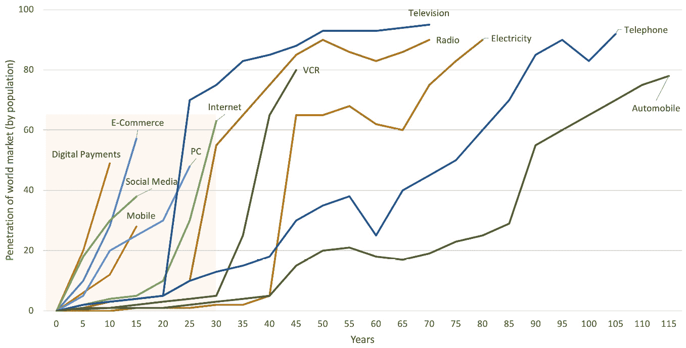
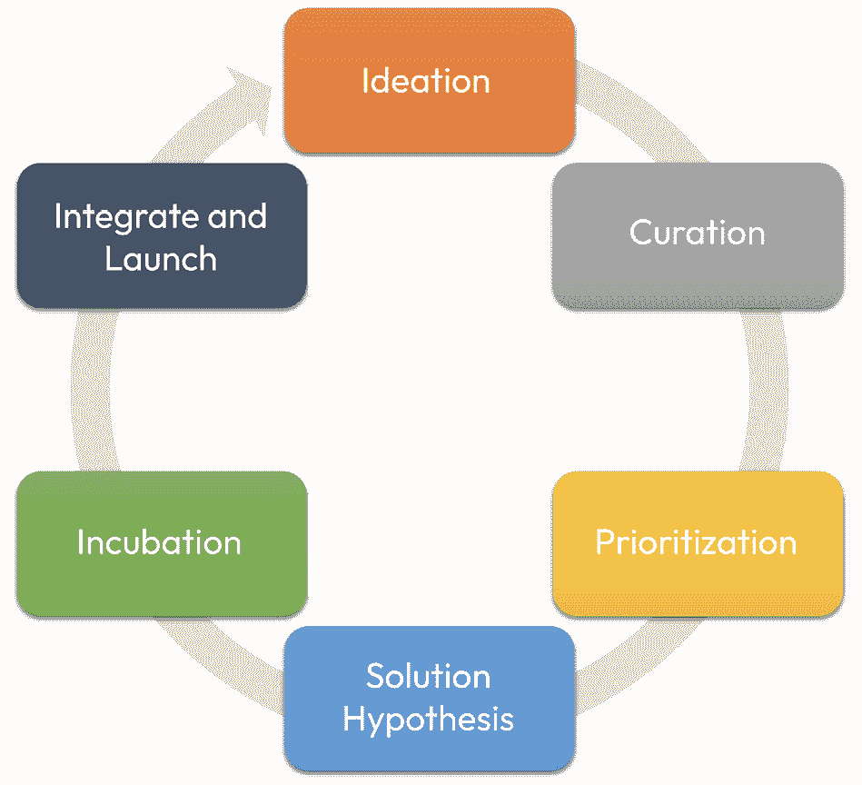
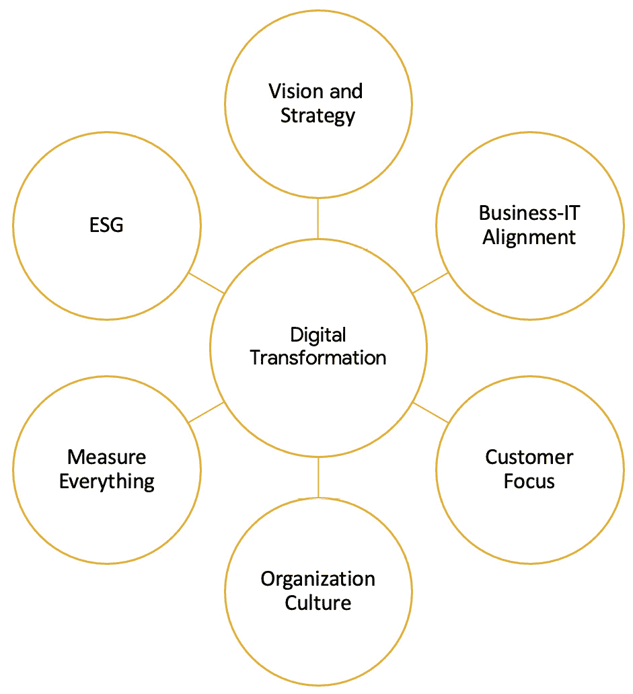

## 1 领导力、意志和思维方式

在关于云计算的书籍中，你可能会觉得出现一整章专门讨论领导力、意志和思维方式有些不寻常。随着技术持续指数级演进，企业往往陷入两难境地；有些因害怕失败而落后于创新曲线，而另一些则开始追逐每一个新趋势。这直接反映了缺乏愿景和领导力。在我们深入云计算世界之前，本章的目的是认识到领导力、意志和思维方式对于成功数字化转型的重要作用。

在当今的数字世界中，组织应对市场需求的业务敏捷性与其数字成熟度和能力成正比。在现代企业架构的表述中，IT 已从传统的成本中心演变为业务创新的核心支柱。在每一次成功的数字化转型核心，领导力、意志和思维方式都是不可或缺的。强大的有远见的领导者设定愿景和战略方向，塑造创新型组织文化，并倡导企业数字化转型，以挖掘组织在增长和竞争力方面的全部潜力。

数字化转型已成为快速演进的技术环境中推动创新的关键因素。它不仅仅是一个选项或趋势；对于企业生存、蓬勃发展并保持竞争力而言，它已成为必需。数字化转型涉及将数字技术整合到组织的各个方面，从根本上改变其运营方式和为客户创造价值的方式。然而，成功的数字化转型需要的不仅仅是采用新技术。所有成功组织共有的一个属性是它们创新并为消费者创造价值的能力。为什么有些组织比其他组织更成功，创新几乎总是自然发生且不需要外部动机？答案在于强大的领导力、意志和思维方式，能够指导、激励并培养可持续的创新文化。创新型领导者通过制定清晰的愿景、营造实验环境、倡导以客户为中心以及赋能团队协作，在企业中释放数字化转型。在本章中，我们将探讨领导力、意志和思维方式在设定企业数字化转型步伐和基调方面的关键作用。我们还将深入探讨以下内容：

* 创新对于现代企业而言不仅仅是一个选择，而是要在竞争环境中保持可持续发展和繁荣
* 各行业数字化趋势的指数级演进
* 通过创新连续体建立创新流程
* 两个企业的故事——柯达和富士胶片，以及领导力、意志和思维方式如何塑造了它们的命运
* 企业领导者如何引领战略性和可持续的数字化转型？

让我们通过以下案例研究来理解为什么创新不是选择而是必需。

### Blockbuster 案例研究

1985 年秋季，David Cook 创立了 Blockbuster，它后来不仅成为视频/DVD 电影租赁的场所，也成为当地电影爱好者聚会社交的社交空间。在接下来的几年里，在其成功的推动下，Blockbuster 将业务扩展到国际市场，成为家喻户晓的名字。不久之后，Viacom 收购了 Blockbuster 并于 1999 年将其上市。在其巅峰时期，Blockbuster 在全球拥有超过 9000 家门店，收入达 5.9 百万美元的美元 [*1*]。在势头和消费者需求的推动下，Blockbuster 巩固了其地位和商业模式，并利用其几乎垄断的市场优势惩罚忠实消费者逾期归还；这一点可以从 2000 年约 16% 的 Blockbuster 收入来自滞纳金这一事实得到证明。进入世纪之交，随着技术的指数级增长，客户偏好和需求正在迅速演变。消费者不再走进实体店租赁 DVD，而是更喜欢在网上浏览 DVD 并以可接受的订阅费送货上门，且免除 Blockbuster 以此闻名的滞纳金。利用数字化颠覆和不断变化的客户需求，Netflix 和 RedBox 等多家新玩家进入视频租赁领域，提供 DVD 邮寄和在线流媒体等新渠道。尽管消费者需求发生变化、数字化颠覆以及竞争加剧，Blockbuster 几乎没有改变其战略，拒绝适应不断变化的市场趋势。具有讽刺意味的是，在 2000 年，Blockbuster 拒绝了以 5000 万美元收购 Netflix 的提议，这随后导致 Blockbuster 在十年内申请破产 [*2*]。

导致 Blockbuster 衰落的主要因素如下：

* **未能拥抱数字化颠覆**：Blockbuster 对现有商业模式感到满意，未能认识到行业趋势以及客户需求和偏好的转变，导致其忽视在线租赁和流媒体服务的潜力，而这些服务最终颠覆了传统的实体视频租赁模式。该公司在适应在线订阅和流媒体等新兴趋势方面反应太慢，而 Netflix 等竞争对手已利用数字技术为消费者提供便利和可及性，造成 Blockbuster 市场份额受损。
* **未能创造客户价值**：Blockbuster 将重点放在营业收入而非创造消费者价值上。该公司在通过向忠实客户收取滞纳金来最大化利润和收入的同时，未能为消费者创造价值。它也未能评估采用现代数字趋势所能产生的显著消费者价值。Netflix 等竞争对手提供了更大的便利性、更广泛的内容库、个性化推荐以及与消费者产生共鸣的订阅模式。Blockbuster 难以与竞争对手提供的产品和价值主张相匹配。
* **战略决策不佳**：Blockbuster 做出了一系列加剧其衰落的战略失误。例如，该公司在 Netflix 初期错过了收购机会，低估了新兴商业模式的潜力。Blockbuster 还推出了 DVD 亭和在线流媒体等后期进入举措，但这些努力未能收复失地。

自造纸术、青霉素和电力以来，世界经历了多次彻底改变世界的科技创新。然而，过去一个世纪的发明，如飞机（1903 年）、电视（1927 年）、录像机（1965 年）、个人电脑（1971 年）、手机（1973 年）、互联网（1983 年）、万维网（1989 年）、便携式 GPS（1990 年）、Google 搜索（1997 年）、Facebook（2004 年）、YouTube（2005 年）、iPhone（2007 年）和 Android（2008 年），已将技术进步民主化，惠及大众。

另一种从根本上改变企业创新方式的技术进步是人工智能（AI）。1950 年，艾伦·图灵在其开创性论文题为 *计算机器与智能* 中以一个发人深省的问题开篇，“*机器能思考吗？*” [*3*]。此后，人工智能经历了快速演进，已成熟为一种颠覆性技术，对几乎每个行业都产生了深远影响。人工智能正在推动各种创新应用，包括自动驾驶汽车、机器人手术、欺诈检测，以及能够创作新艺术的生成式人工智能，仅举几例。

如果我们将这些颠覆性技术与其渗透市场所需的时间进行对照，近期出现的技术进步，如个人电脑、互联网、移动设备、社交媒体和数字支付，相较于前几代的创新，仅需约四分之一的时间就能渗透市场 [*4*]。事实上，现代技术颠覆只是在呈指数级增长，迫使各行业的企业跟上步伐或落后 [*5*]。值得注意的是，数字时代的现代技术创新（图表下方突出显示的区域）已呈指数级渗透全球市场：

图 1.1 – 技术创新及其渗透世界市场所需的时间

让我们比较两种革命性的技术进步——汽车和手机。汽车的发明颠覆了我们的出行方式，而手机的发明不仅改变了人们的沟通方式，也改变了现代企业的运营方式。自 19 世纪末发明以来，汽车行业花了六十多年才渗透市场并站稳脚跟，而手机的出现仅用了十年。现代技术以惊人的速度演进，企业保持相关性至关重要。

对于移动设备制造商而言，跟上每个十年之交快速的技术进步和通信技术指数级颠覆并不容易：模拟蜂窝（1G）、数字蜂窝（2G）、移动宽带（3G）、原生 IP 网络（4G）和新空口（5G）；曾经占据显著市场份额的传统厂商，如诺基亚和摩托罗拉，被三星和苹果等新进入者取代 [*6*]。

# 创新不是可选项

许多历史悠久的企业发现难以实现有机增长，而年轻公司则表现优于老牌企业。为了说明这一点，随着数字化颠覆速度的加快，标普 500 公司平均存续期一直在下降 [*7*]。20 世纪 70 年代末，标普 500 公司的平均年龄为 35 年，预计到 2027 年这一数字将进一步降至仅 12 年。

在数字化颠覆中经受住考验的组织，都采用了不断演进的战略，以帮助它们在更不稳定或不确定的市场环境中保持韧性。对新进入者或初创公司来说，提出一个颠覆整个行业的想法并不需要太多努力。让我们看看几家偏离传统方法并彻底革新各自行业的公司：

*   **Airbnb** 成立于 2008 年，是最大的住宿平台之一，颠覆了酒店业。传统酒店公司拥有、维护和运营物业，而 Airbnb 通过作为短租民宿和度假体验的在线市场，革新了旅游业。
*   **Uber** 成立于 2009 年，是最大的共享出行公司，颠覆了汽车租赁和租赁行业。传统汽车租赁公司将汽车租赁给客户，而 Uber 仅通过移动应用程序提供拼车服务，改变了这一动态。
*   **Netflix** 成立于 1997 年，最初是 DVD 租赁业务，如今已成为最大的流媒体平台，改变了消费者租赁和观看电影及电视节目的方式。虽然 Netflix 也制作自己的电影和电视节目，但它主要租赁可在其平台上流媒体播放的电影和电视节目。
*   **Amazon** 成立于 1994 年，最初是图书在线市场，通过作为连接买家和卖家的市场平台，成为最大的在线零售商，革新了零售业，而传统零售商必须拥有和运营实体砖石店并管理库存。此后，亚马逊转型为集团公司并扩展到多个行业。
*   **Spotify** 成立于 2006 年，是最大的音乐流媒体服务，但并不拥有任何音乐。相反，它从唱片公司获得音乐许可，并允许订阅用户付费流媒体播放。
*   **Robinhood** 成立于 2013 年，通过提供股票、交易所交易基金和加密货币的免佣金交易，颠覆了金融服务行业，这在以前是不可想象的。Robinhood 通过简单的移动应用程序实现了交易的民主化。
*   **Teladoc** 成立于 2002 年，是最大的远程医疗公司之一，通过利用移动技术在医疗机构之外随时虚拟连接患者和医生，颠覆了医疗保健行业。与传统医疗保健提供者不同，Teladoc 不雇佣医生，也不拥有医疗设施。
*   **Pillpack** 成立于 2013 年，颠覆了传统上由在实体空间运营的零售商主导的制药行业，为患者配药。Pillpack 构想并实施了整合多种药片处方并送货上门的理念。
*   **Chime** 成立于 2012 年，是一家挑战者银行，完全通过在线和移动方式提供银行服务，通过提供免手续费银行、提前发薪、无手续费且无需信用检查的信用卡，颠覆了银行业，迫使传统参与者做出回应。
*   **Rent the Runway** 成立于 2009 年，是一家服装租赁公司，通过其在线平台允许客户租赁、订阅或购买设计师服装，颠覆了设计师服装行业。这种商业模式解决了消费者 overspending 以及拥有不常使用的服装如活动服装、婚纱和滑雪服等的主要顾虑。

所有这些公司的一个共同点是，商业颠覆几乎总是由现代数字技术引领。让我们探讨企业如何创新并迈向数字前沿。

# 创新连续体

与认为创新发生在孤立的真空环境中的信念相反，创新实际上是一个系统性和持续性的过程。创新不仅需要产生新想法，还需要实施和持续采用这些想法。这通常涉及克服重大的障碍和挑战，例如抵制变革、监管障碍或技术限制。它还要求系统性地识别和解决客户需求、了解市场趋势并利用可用资源和专业知识。

领导者必须努力营造创新文化并建立系统化的方法来推动创新。创新连续体对于企业在当今竞争激烈的环境中蓬勃发展和成长至关重要。创新过程是一系列战略步骤，企业可通过创意方法在既定时间范围内实现其愿景、目标和[content]
领导者必须努力营造创新文化并建立系统化的方法来推动创新。创新连续体对于企业在当今竞争激烈的环境中蓬勃发展和成长至关重要。创新过程是一系列战略步骤，企业可通过创意方法在既定时间范围内实现其愿景、目标和[content]
领导者必须努力营造创新文化并建立系统化的方法来推动创新。创新连续体对于企业在当今竞争激烈的环境中蓬勃发展和成长至关重要。创新过程是一系列战略步骤，企业可通过创意方法在既定时间范围内实现其愿景、目标和[content]
领导者必须努力营造创新文化并建立系统化的方法来推动创新。创新连续体对于企业在当今竞争激烈的环境中蓬勃发展和成长至关重要。创新过程是一系列战略步骤，企业可通过创意方法在既定时间范围内实现其愿景、目标和[content]
领导者必须努力营造创新文化并建立系统化的方法来推动创新。创新连续体对于企业在当今竞争激烈的环境中蓬勃发展和成长至关重要。创新过程是一系列战略步骤，企业可通过创意方法在既定时间范围内实现其愿景、目标和[content]
领导者必须努力营造创新文化并建立系统化的方法来推动创新。创新连续体对于企业在当今竞争激烈的环境中蓬勃发展和成长至关重要。创新过程是一系列战略步骤，企业可通过创意方法在既定时间范围内实现其愿景、目标和[content]
领导者必须努力营造创新文化并建立系统化的方法来推动创新。创新连续体对于企业在当今竞争激烈的环境中蓬勃发展和成长至关重要。创新过程是一系列战略步骤，企业可通过创意方法在既定时间范围内实现其愿景、目标和[content]
领导者必须努力营造创新文化并建立系统化的方法。创新连续体对企业在当今竞争环境中蓬勃发展至关重要。创新过程是一系列战略步骤，企业可通过创意方法在既定时间内实现愿景、目标和[content]
领导者必须努力营造创新文化并建立系统化的方法来推动创新。创新连续体对于企业在当今竞争激烈的环境中蓬勃发展和成长至关重要。创新过程是一系列战略步骤，企业可通过创意方法在既定时间范围内实现其愿景、目标及[content]
领导者必须努力营造创新文化并建立系统化的方法来推动创新。创新连续体对于企业在当今竞争激烈的环境中蓬勃发展和成长至关重要。创新过程是一系列战略步骤，企业可通过创意方法在既定时间范围内实现其愿景、目标和[content]
领导者必须努力营造创新文化并建立系统化的方法来推动创新。创新连续体对于企业在当今竞争激烈的环境中蓬勃发展和成长至关重要。创新过程是一套战略步骤，使组织能在规定时间内通过创意方式实现愿景、目标和[content]
领导者必须努力营造创新文化并建立系统化的方法来推动创新。创新连续体对于企业在当今竞争激烈的环境中蓬勃发展和成长至关重要。创新过程是一系列战略步骤，企业可通过创意方法在既定时间范围内实现其愿景、目标与[content]
领导者必须努力营造创新文化并建立系统化的方法来推动创新。创新连续体对于企业在当今竞争激烈的环境中蓬勃发展和成长至关重要。创新过程是一系列战略步骤，企业可通过创意方法在既定时间范围内实现其愿景、目标和[content]
领导者必须致力于建立创新文化和系统化创新方法。在当今竞争环境中，创新连续体对企业持续发展至关重要。创新过程是一系列战略步骤，组织可借此在既定时间内以创意方式实现愿景、目标和[content]
领导者必须致力于建立创新文化和系统化创新方法。在当今竞争环境中，创新连续体对企业持续发展至关重要。创新过程是一系列战略步骤，组织可借此在既定时间内以创意方式实现愿景、目标和[content]
领导者必须致力于建立创新文化和系统化创新方法。在当今竞争环境中，创新连续体对企业持续发展至关重要。创新过程是一系列战略步骤，组织可借此在既定时间内以创意方式实现愿景、目标及[content]
领导者必须致力于建立创新文化和系统化创新方法。在当今竞争环境中，创新连续体对企业持续发展至关重要。创新过程是一系列战略步骤，组织可借此在既定时间内以创意方式实现其愿景目标 [*8*]。[content]
领导者必须致力于建立创新文化和系统化创新方法。在当今竞争环境中，创新连续体对企业持续发展至关重要。创新过程是一系列战略步骤，组织可借此在既定时间内以创意方式实现其愿景目标 [*8*]。下图说明了创新连续体的阶段：

图 1.2 – 创新连续体

让我们逐一查看前述图中显示的各阶段：

1. **构思**：这是创新过程的初始阶段，新想法通过头脑风暴、市场调研、客户反馈等来源获取和产生。目标是识别潜在创新领域并产生可进一步探索的多种想法。

2. **筛选**：确定有前景的想法后，下一步是围绕其进行筛选和概念开发以便测试和验证。这可能涉及：
    * 内部或外部利益相关者调查以识别不同形式的痛点
    * 探索并识别内部和商业上可用的解决方案
    * 识别所考虑产品的利益相关者
    * 构建 MVP（最小可行产品）原型或概念验证
    * 从财务、技术、法律和安全等多个维度评估想法的可行性及其可衡量潜在影响
通过筛选的想法进入优先级排序阶段，未通过的则被搁置。

3. **优先级排序**：这是重要步骤，筛选后的想法会根据客户或市场需求、技术、竞争情报以及对核心业务能力适用性与探索性考量等因素进行排序。企业可利用的流行方法有麦肯锡的三层视野模型、项目组合、战略控制图和消费者决策旅程 [*9*]。这些方法适用于影响决策的不同优先级因素。

4. **解决方案假设**：此阶段对概念进行测试和评估以确定其可行性、可用性和市场潜力。这可能涉及评估产品可行性、业务价值、机会成本、客户或利益相关者价值以及投资回报率。

5. **孵化与开发**：概念被认为可行后，下一步是逐步开发和实施技术。这可能涉及进一步完善 MVP、设计产品、构建软件、获得赞助、领导监督和资金支持，以及开发支持创新的基础设施。

6. **整合、推出和扩展**：技术开发完成后，下一步是整合、推出并扩展以触达更广泛受众。这可能涉及营销推广、建立合作伙伴关系、增量发布或扩展产品功能以满足市场不断变化的需求。

每个企业都是独特的，企业领导者可选择最符合其愿景和目标的创新战略。然而，营造创新文化并建立推动其发展的流程至关重要。许多现代企业已创建并资助研发部门和创新实验室，主要专注于行业研究、技术研究和可行性评估。领导层支持对于确保创新中心不孤立运作并嵌入组织结构至关重要。让我们探讨两个企业的故事，以及领导力在引领数字化颠覆和持续创新必要性中发挥的关键作用。

# 领导力、意志与心态的两个故事

1880 年，乔治·伊士曼与亨利·A·斯特朗合作创立伊士曼干版公司，目的在于销售用于相机的干版。十年内，公司推出新型胶卷工艺，申请多项专利，并通过将摄影胶片产品民主化给几乎每个人而彻底改变摄影行业。到 1888 年，公司推出附带 100 次曝光胶卷的便携式盒式相机，1892 年，后来成为家喻户晓名称的柯达公司，当时名为伊士曼柯达公司诞生。

20 世纪大部分时间里，柯达主导摄影行业，成为全球领先的摄影胶片和相机制造商之一。早期柯达迅速扩张，通过创新、收购和独家合同的结合将竞争对手拒之门外。公司成功度过大萧条、第一次世界大战和第二次世界大战，并扩展到为电影行业生产相机和胶片、为侦察卫星和 NASA 太空任务生产相机。从 1930 年代到 1970 年代，柯达称霸市场，在摄影胶片和相机业务中享有垄断地位。公司商业模式保持不变，研发仅专注于摄影胶片和相机，因为公司享有令人羡慕的市场份额。

1934 年，在地球另一端 6,000 英里之外，从日出之国成立了一家摄影和影像公司，目标是生产摄影胶片。该公司进入美国已被柯达主导的市场。然而富士胶片在日本的相机胶片市场享有至高地位。在柯达仍称霸市场、主要专注于摄影胶片和相机的同一时期，富士胶片开始多元化，生产用于摄影、电影和 X 光的胶片，并在第二次世界大战后进一步多元化进入医疗技术领域，如 X 光诊断、电子成像和磁性材料。

20 世纪 80 年代，富士胶片以更低价格的胶片和摄影用品进入美国市场，威胁到柯达的市场地位。很快，富士胶片在美国开设制造工厂，通过激进营销和降价等策略取得长足进展，从柯达手中夺取大量市场份额。这引发价格战，侵蚀柯达利润，降低股东价值。富士胶片赢得 1984 年洛杉矶奥运会官方胶片投标进一步加剧了这一局面，使公司在世界市场上站稳脚跟。这一时期也见证了富士胶片在其他市场持续创新。例如，**计算机放射成像**（**CR**）的发明彻底改变了医疗设备行业，解决了传统放射成像通常归因于技术人员和患者辐射暴露增加方面的重大挑战。

进入 21 世纪之初，新千年见证了数字技术的指数级增长。对数码相机的需求导致摄影胶片迅速衰落，要求改变战略以满足新的市场需求。2000 年代初期，富士胶片也面临来自现代数码摄影公司的日益增长的竞争。

## 富士胶片与柯达：数字时代的分歧之路

针对这一挑战，富士胶片专注于业务转型并踏上了数字化转型之旅。公司在数字成像和医疗保健等新技术上进行了大量投资，并开始多元化其产品组合。在小森秀隆（2003–2021）的领导下，富士胶片进行了大胆的结构改革，并战略性地收购了化工、医疗保健和电子领域的公司，以多元化并补充富士胶片的商业模式。他在监督富士胶片度过照相胶片行业衰退并将其转型为医疗保健、医疗和办公设备制造商的过程中发挥了关键作用。在小森的领导下，公司考察了其化学技术专长可以适应的领域，并开始收购能够补充其业务的公司。他们进入了数字 X 光和内窥镜领域，获得了 TAC 薄膜 70% 的世界市场份额，TAC 薄膜是所有 LCD 屏幕的关键部件。公司追求的另一个领域是化妆品，并于 2007 年推出了一条抗衰老护肤产品线，这有助于富士胶片化妆品在全球扩张。由于这些努力，富士胶片得以成功过渡到数字时代，并保持其作为领先的全球企业集团的地位。

柯达对 21 世纪数字挑战的回应则大不相同。在安东尼奥·M·佩雷斯掌舵下，柯达于 2005 年开始将原本内部进行的研发和制造业务外包，并剥离其数码相机制造和运营业务。到 2007 年，柯达屈服于竞争压力，完全退出胶片相机市场，并开始大力投资于潜在的高利润打印机墨水业务。这与曾是柯达商业战略基石的剃须刀与刀片商业模式背道而驰。然而，由于惠普等主导厂商的压力，柯达最终退出喷墨市场。柯达于 2010 年被剔除出标准普尔 500 指数，并随着利润下降，最终在 2012 年申请破产。自破产以来，柯达一直在尝试多元化进入其他市场，如制药材料和数字印刷产品及服务，但成果参差不齐。

为了了解柯达对即将到来的数字颠覆的否认程度有多深，柯达在 1980 年代对技术进步以及数字摄影取代胶片技术的潜力进行了广泛研究。研究结果显示，数字技术正准备颠覆柯达赖以生存的胶片业务。好消息是，这一变化将是渐进的，给了柯达适应和转型的机会。尽管研究结果如此，柯达几乎没有为此做准备。为了说明这一点，在乔治·伊士曼的领导下，柯达直面技术颠覆：首先，当他们放弃利润丰厚的干版业务转向胶卷技术时，其次，当他们在黑白胶片技术占据主导地位的情况下仍采用彩色摄影胶片时 [*10*]。

从某种角度来看，柯达的失败可归因于其未能把握数字颠覆机遇、过度依赖品牌营销、依赖收购进入新领域，以及更重要的是，在世纪之交最需要的时候，数十年来未能拥抱创新连续体。相反，富士胶片抓住了数字革命的机遇，继续领先市场创新，并在其化学专长具有互补性的其他市场多元化，引领了数字化转型 [*11*]。

### 富士胶片成功数字化转型的关键因素

富士胶片成功数字化转型的关键因素如下：

* **创新连续体**：富士胶片拥有悠久的研发历史，并持续在新技术上进行大量投资。这种对创新的坚定不移的关注使富士胶片能够领先竞争对手，在新领域获得市场份额，并开发满足客户需求的新产品和服务。
* **远见领导力**：富士胶片由一支强大且富有远见的领导团队领导，能够引导公司完成数字化转型过程。
* **员工参与**：富士胶片成功地让员工参与到数字化转型过程中。这是通过多项举措实现的，例如员工培训和发展计划以及员工反馈机制。
* **客户导向**：富士胶片对客户坚定不移的关注是其在数字化转型过程中取得成功的关键因素。公司能够了解客户需求并开发满足这些需求的产品和服务。
* **财务资源**：富士胶片利用其财务资源投资于数字化转型过程。这使公司能够投资新技术、聘请顶尖人才并开发新产品和服务。
* **对可持续发展的承诺**：富士胶片拥有悠久的环境管理历史，并持续投资于可持续技术和实践。对可持续发展的承诺帮助富士胶片减少了环境影响并改善了其经营业绩。

在下一节中，我们将探讨企业如何引领数字化转型。

# 引领企业的数字化转型

领导力是任何组织成功数字化转型的基石和不可或缺的元素。无论目标是进行渐进式数字化、进入新市场还是推出新产品，领导层的参与都是至关重要的。引领数字化转型涉及创建愿景，说明如何利用技术推动创新、提高效率并提升客户体验。优秀的领导者赋予团队突破障碍的能力，描绘大局，并使团队在组织增长、价值创造和竞争力方面保持战略一致。将现代技术作为业务增长工具，继续成为每个企业商业战略的基础。然而，现代技术的演进是指数级的，企业需要保持灵活和敏捷，以便适应并执行成功的数字化转型。

云技术已成为企业数字化转型中 **数字** 的同义词。根据 KPMG 技术调查，80% 的组织表示其基于云的转型已取得成功 [*12*]。然而，只有三分之一的组织从其云投资中实现了实质性的 **投资回报** (**ROI**)。云被定位为推动企业 IT 成本节约的驱动力，但三分之二的组织仍无法实现实质性 ROI，这令人费解。

图 1.3 – 企业数字化转型支柱

让我们探讨引领和执行企业成功数字化转型的核心支柱和关键要素：

## 愿景与战略

一个明确定义的战略和愿景是数字化转型的基础指导原则。它们提供目标感，确保一致性，促进利益相关者参与，使组织具备适应性，并促进进展的衡量。通过建立强大的战略和愿景，组织可以用清晰、专注和目标驱动的方式推进数字化转型工作，从而提高实现预期成果的可能性。缺乏战略和愿景是数字化转型举措失败的最常见原因之一。正如任何大型变革性举措一样，需要众人齐心才能迈向北极星。领导力、意志和心态对任何数字化转型举措的成功至关重要。负责数字化转型的领导者必须建立清晰的愿景，制定战略路线图，在业务利益相关者之间建立合作伙伴关系，更重要的是，确保愿景在组织内部得到清晰传达。如果没有对组织希望通过数字化转型实现什么以及如何实现有清晰的理解，团队最终会围绕孤立的目标开展工作，而不是朝着更大的目标努力，导致数字化转型支离破碎。

数字化转型中缺乏战略和愿景，可能是企业寻求利用技术推动有机增长、提高效率并保持竞争力的巨大挑战。数字化转型不仅仅是实施现代技术；它还要求领导者对如何将这些技术整合到企业中以实现特定业务目标有清晰的战略和愿景。企业在踏上数字化转型之旅时可能缺乏清晰战略和愿景的原因有很多，包括缺乏时间和资源来制定全面计划、高层领导对组织战略缺乏共识，以及缺乏进行数字化转型的意愿。无论如何，缺乏战略和愿景会对组织的数字化转型工作造成毁灭性影响，导致时间、金钱和资源浪费，使整个转型努力脱轨。

定义数字化转型战略和愿景的一些关键要素如下：

### 目标清晰度
愿景和战略的清晰度为成功的数字化转型提供了明确的方向和目的。它们定义了数字化转型之旅的目标、目标和预期成果。明确定义的战略和愿景有助于使利益相关者和员工围绕转型为何必要以及旨在实现什么达成共同理解。

### 努力的一致性
拥有清晰的数字战略可确保与数字化转型相关的所有举措和活动与组织的整体战略目标保持一致。它们指导决策、资源分配和优先级设定，使协调一致的方法成为可能。这种一致性最大化了数字举措的影响，避免了碎片化或冲突的努力。

### 未来导向
定义数字战略使企业能够关注组织的未来状态及其在数字环境中的理想定位，同时考虑新兴技术、市场趋势和客户期望，以推动创新并为长期成功做好准备。通过展望未来，组织可以主动塑造其数字化转型工作，保持领先于竞争对手。

### 利益相关者参与
数字领导者必须在整个组织中参与利益相关者，以创建对数字化转型之旅的共同理解。这有助于提供一个引人入胜的叙事，激励和激发员工、客户、合作伙伴和投资者。战略和愿景的清晰沟通培养信任，鼓励参与，并从利益相关者那里获得支持和承诺。

### 专注与优先排序
数字化转型通常涉及众多机遇和挑战。拥有清晰的战略和愿景使组织能够根据其与整体目标的一致性来优先考虑举措和投资。更重要的是，它有助于过滤干扰，避免 *闪光对象* 综合征，并确保资源集中于最具影响力的数字举措。

### 管理变革阻力
数字化转型通常需要在流程、技术和组织文化方面进行重大变革。明确定义的数字战略为变革管理提供了框架，指导组织度过转型期。它有助于传达变革的理由，管理阻力，并在员工中创造紧迫感和目标感。

### 适应性与敏捷性
数字战略框架必须努力在提供战略路线图的同时允许灵活性和适应性，通过设定总体目标，同时在过程中为实验、学习和调整留下空间。这种敏捷性使组织能够应对市场动态、新兴技术和客户需求，确保数字化转型保持相关性和有效性。

### 衡量的基础
正如俗话所说，“*如果无法衡量它*”，你就无法改进它；明确定义的数字战略为衡量数字化转型的进展和成功提供了基础。建立 **关键绩效指标** (**KPI**) 和里程碑有助于跟踪数字举措的有效性和影响以及数据驱动的决策，同时促进问责制和透明度并展示价值。与战略和愿景相比的定期评估使组织能够纠正方向，庆祝成功，并确定需要改进的领域。

## Business–IT alignment
组织数字化转型的成功取决于领导者有效整合其业务战略和目标与其 IT 能力和资源的能力。业务与 IT 之间缺乏一致性是许多组织的常见问题，可能导致孤岛思维、重复劳动、错失机会、流程低效、抵制变革以及组织业务敏捷性下降。数字化转型需要在业务目标和 IT 能力之间实现清晰的一致性。当业务和 IT 战略保持一致时，它可确保技术投资和举措直接有助于实现组织的目标，并有助于优先考虑对业务成果影响最大的 IT 举措，从而改善整体战略决策。

企业领导者必须促进以下关键要素以确保业务-IT 一致性：

### Collaboration and communication
IT 和业务之间进行沟通和协作以实现更大的企业愿景至关重要。业务-IT 一致性促进业务与 IT 利益相关者之间的有效协作和沟通。它打破了信息孤岛，鼓励跨职能团队合作，使目标、需求和挑战的共同理解成为可能。这种协作增强了整体项目交付，并培养了创新和持续改进的文化。

## 业务–IT 对齐

### 无缝集成
数字化转型通常涉及在整个组织中实施新技术、系统和流程。业务–IT 对齐确保这些数字解决方案能够顺利集成到现有的业务基础设施中，更重要的是，它能够促进业务利益相关者和 IT 团队之间的高效协作，最小化干扰并最大化技术实施的效益。

### 业务敏捷性
业务与 IT 之间的对齐使组织能够更具敏捷性，并对不断变化的市场条件和客户需求做出响应。当 IT 团队了解业务优先事项并能快速调整技术解决方案以支持不断变化的需求时，组织可以抓住新机遇并更有效地应对挑战。

### 客户体验
客户中心性是任何数字化转型的基本方面。业务–IT 对齐帮助组织更好地理解客户期望，并促进开发和实施能够提升整体客户体验的数字解决方案。通过将 IT 能力与业务目标保持一致，组织可以利用技术为客户提供个性化、无缝且增值体验。

### 资源配置效率
业务–IT 对齐确保技术投资与业务优先事项和目标保持一致。它有助于优化资源配置，确保 IT 投资集中于对业务绩效影响最大的举措。这可防止在与组织战略目标不一致的技术项目上进行不必要的支出。例如，它可防止 IT 团队开发与业务需求不一致的解决方案，或业务团队投资于与公司战略目标不一致的点状解决方案或技术。

### 有效的变革管理
数字化转型通常需要在业务流程、角色和工作流程方面进行重大变革。业务–IT 对齐通过确保业务利益相关者参与并参与数字化转型之旅来促进有效的变革管理。当业务和 IT 团队共同工作时，它促进了对转型目标的共同理解，并有助于应对变革阻力。

### 创新与竞争优势
业务–IT 对齐营造了有利于创新蓬勃发展的协作环境。它鼓励探索和采用能够为组织带来竞争优势的新兴技术。通过使业务和 IT 战略保持一致，组织可以识别创新机会并利用技术推动差异化并创造新的商业模式。

### 可扩展性与未来就绪
数字化转型是一个持续的旅程，组织需要为未来技术变化和进步做好准备。业务–IT 对齐确保技术决策以可扩展性和未来就绪为考量。它使组织能够适应和演进其技术基础设施以满足未来需求并抓住新兴机会。

### 利益相关者满意度
当业务和 IT 团队协同工作时，会提高利益相关者满意度。客户、员工和其他利益相关者受益于无缝的数字体验、高效的流程和创新的解决方案。业务–IT 对齐有助于满足并超越期望，从而带来更高的满意度和忠诚度。

### 抓住机遇
业务与 IT 之间缺乏对齐可能导致错失机会。例如，如果业务团队不了解最新的技术进步，就可能错失利用这些技术改进运营或获得竞争优势的机会，而 IT 团队也可能忽视能够提供显著业务优势的机会。

### 风险缓解与安全
数字化转型带来新的风险和挑战，例如网络安全威胁和数据隐私问题。业务–IT 对齐确保安全和风险管理从一开始就融入数字化转型举措中。通过将业务需求与 IT 安全措施保持一致，组织可以主动缓解风险并保护有价值的资产。

总体而言，业务–IT 对齐对于数字化转型至关重要，因为它使组织能够有效利用技术实现其战略目标。它促进协作、敏捷性、客户中心性、资源配置效率和创新，最终带来业务绩效的提升和数字时代的竞争优势。这可能涉及建立跨职能团队、制定共同目标和指标，以及投资培训和发展以改善业务与 IT 之间的理解。

## 以客户为中心
数字化转型是一个持续的旅程，为企业创新并为客户创造新价值提供了机会。对客户需求的适应性和响应能力对于保持相关性和领先于竞争至关重要。然而，如果没有客户关注，企业可能会优先考虑内部效率或以技术为驱动的举措，而这些举措并非针对客户驱动的创新。这会限制识别和把握真正解决客户痛点并提供有意义价值的颠覆性或变革性解决方案的机会。缺乏客户关注的数字化转型可能带来多方面的负面后果，包括未满足客户期望、丧失竞争优势、客户体验脱节以及负面品牌形象。以下是企业必须关注的一些关键领域，以确保组织的数字化举措以客户为中心：

### 满足客户需求
数字化转型由不断变化的客户期望和行为驱动。如今的客户期望在多个渠道获得无缝且个性化的体验，更快的响应时间，以及轻松获取信息和服务。通过将客户置于数字化转型工作的中心，企业可以更好地满足这些期望并提升客户满意度。

### 客户体验
数字化转型提供了优化和改善客户体验的机会。通过利用数字技术，公司可以简化流程、自动化任务并提供自助服务选项，从而实现与客户更快、更高效的互动。以客户为中心的方法确保数字化举措以终端用户为出发点设计，从而带来更直观、更愉悦的客户体验。

### 客户忠诚度与留存
以客户为中心的数字化转型战略有助于建立客户忠诚度并鼓励重复业务。通过了解客户需求、偏好和痛点，企业可以量身定制数字产品和体验为客户创造价值。这带来更高的客户满意度、忠诚度和倡导，最终推动客户留存率提升。

### 竞争优势
在当今的数字环境中，客户体验已成为竞争对手之间的关键差异化因素。通过在数字化转型工作中优先考虑客户关注，企业可以获得竞争优势。通过提供卓越的数字体验，公司可以吸引新客户、留住现有客户，并在市场中实现差异化。

## 以客户为中心的数字化转型益处

### 推动创新与敏捷性
以客户为中心的数字化转型方法鼓励创新和敏捷性。通过积极寻求客户反馈并利用数据和洞察，企业可以识别新的机会，开发创新产品和服务，并快速适应不断变化的客户需求和市场动态。

### 新的收入来源
以客户为中心的数字化转型战略可以帮助企业识别新的收入来源。通过了解客户需求和偏好，企业可以发现开发和提供满足这些需求的额外产品、服务或体验的机会。这为收入增长和进入新市场开辟了途径。

### 缓解业务中断的威胁
通过优先考虑客户关注，企业可以降低因颠覆性竞争对手而流失客户的风险。了解客户偏好并预测其未来需求使公司能够主动创新并调整其数字战略。通过拥抱数字化转型并提供以客户为中心的体验，企业可以防范中断并保持竞争优势。

### 员工参与度
客户关注不仅限于外部互动；它还包括在内部培育以客户为中心的文化。当员工理解客户满意度的重要性并感到有能力为改善客户体验做出贡献时，他们会变得更有参与感和动力。参与度高的员工更有可能提供卓越的客户服务并为数字化转型计划的成功做出贡献。

坚定不移的客户关注是以客户为中心的数字化转型的关键要素，因为它有助于企业将其工作与客户期望保持一致，提升消费者体验，推动忠诚度，获得竞争优势，促进创新并做出数据驱动的决策。通过将客户置于数字化转型计划的核心，企业可以在数字时代创造可持续的业务成功。

## 组织文化
正如亨利·福特所说：“没有执行的愿景只是幻觉。”企业数字化转型是一段旅程，富有远见的领导者需要建立正确的组织、正确的文化和正确的心态才能做好。领导力在推动和维持创新文化方面发挥着至关重要的作用。领导者需要通过行动展示他们对创新的承诺，并应积极支持和参与创新计划，分配资源，并为试验和承担风险提供安全的环境。领导层的支持为整个组织定下基调，并传达了创新重要性的有力信息。

创建创新文化需要一个支持性的环境，鼓励和培养创造性思维、试验和持续改进。虽然具体结构可能因组织规模、行业和目标而异，但在为创新文化建设组织时，以下是一些需要考虑的关键要素：

### 培养学习心态
培养员工被鼓励持续学习、探索并寻求新想法或机会的心态，对组织成长至关重要。领导者必须确保员工能够获得内部和外部的学习与发展机会，以帮助员工发展创新所需的技能和知识，建立无责文化，并鼓励员工承担经过计算的风险。

### 跨职能协作
打破信息孤岛并促进跨职能协作对于成功的数字化转型至关重要，因为它促进了最佳实践和从早期计划中吸取的经验教训的交叉传播，而无需重新发明轮子，同时也防止资源浪费。鼓励来自不同部门和背景的员工协作、分享想法并共同开展创新项目，建立无缝沟通和知识共享机制，例如创新研讨会、展示日、头脑风暴会议和数字协作工具，将确保组织保持敏捷。

### 授权并让员工参与
赋予员工自主权去探索新想法、做出决策并尝试不同方法，可以加速企业内部的创新。让员工参与决策过程、征求意见并创建分享想法和建议的渠道，从而认可和奖励员工的创新贡献，将强化组织对创新的重视。

### 资源与支持
分配财务和非财务资源来支持创新计划。这包括提供专用时间、预算以及创新所需的工具和技术的使用权限。创建支持创新的基础设施，例如创新实验室、原型制作设施或协作空间，让员工可以在其中协作、试验和测试新想法。

### 鼓励外部参与
与外部合作伙伴建立联系，例如技术领导者、初创企业、大学或行业专家，将有助于拓宽团队的视野并了解市场趋势。外部参与例如在创新项目上合作、参与行业活动以及进行知识交流，促进新鲜视角、获取新想法和技术以及知识交叉传播的机会。

### 反馈循环
实施反馈循环和收集并采纳员工想法和建议的机制，可以营造一种员工感到舒适地分享想法和反馈并为创新过程做出贡献的文化。领导者必须努力定期评估和回应员工反馈，以表明他们的意见受到重视并被认真对待。

### 持续改进
建设创新文化应被视为组织内部的持续过程，其中方法、战略和计划会不断评估和完善。征求员工和利益相关者的反馈有助于识别改进领域，并鼓励持续改进和适应性思维，以期打造繁荣的创新文化。

## 衡量一切
衡量数字化转型的进展和影响对于评估计划的有效性并确保其与更大的组织目标保持一致至关重要。无法衡量数字化转型计划的影响和进展可能会带来多方面的负面影响，包括对有效性的可见性不足、无法识别瓶颈、问责制淡化以及错失机会和经验教训。虽然数字化转型可能复杂且多面，但以下是衡量数字化转型常用的一些方法：

### 数字化成熟度评估
通常，数字化转型战略的第一步是对企业在多个维度上的当前状态进行评估，包括组织成熟度、数字采用率、客户指标和 IT 成熟度。定期进行评估有助于企业领导者评估组织的当前数字能力，将其与行业基准和竞争格局进行比较，并提供逐步改进的机会。我们将在第 8 章中更详细地讨论成熟度评估。

## 数字化采用率
尽管我们已探讨了业务与 IT 对齐的重要性，同样关键的是衡量用户对数字技术的采用和使用的程度。衡量采用率可确保 IT 组织不会追逐下一个新奇事物，或花费时间在可能导致技术债务的创新上。这可以包括跟踪指标，如数字平台上的活跃用户数量、接受数字技能培训的员工百分比，以及数字工具和系统的利用率。

## 客户体验指标
每项数字化转型工作都必须将用户置于核心位置。例如，目标与关键成果（OKRs）必须根据可定性和定量衡量的关键用户旅程（CUJ）成果来定义。评估数字化转型对客户体验的影响可很好地洞察该举措的有效性。这可以包括监控指标，如客户满意度评分、净推荐值（NPS）、客户反馈和评价、客户保留率以及客户终身价值。

## 员工参与与赋能
要使数字化转型举措取得成功，领导者必须确保团队参与其中并致力于目标，因为员工参与至关重要。衡量员工参与程度及其拥抱数字化转型的能力，可为领导层提供关于技能差距和团队动机的洞察。这可通过调查、反馈会议以及指标来评估，如员工满意度评分、员工保留率、员工对思想领导力的贡献，以及参与数字技能提升计划的情况。

## 创新与敏捷性指标
评估组织在数字环境中创新和适应变化的能力，是组织业务敏捷性的重要绩效指标。这可能涉及指标，如推出的新数字举措或项目数量，将新数字产品或服务推向市场所需的时间，数字创新举措的成功率，以及响应市场趋势和客户需求的敏捷程度。

## 财务绩效
监控财务指标以衡量举措的影响，可作为持续并开启数字化转型持续之旅的有力工具。这也有助于利益相关者清楚了解预算如何支出并产生价值。这可以包括指标，如收入增长、盈利能力、数字举措的投资回报率（ROI），以及流程优化或自动化带来的总拥有成本（TCO）节约。成熟的组织通常会为每个数字化转型举措关联财务价值指标。

## 环境、社会和治理（ESG）
ESG 考量在数字化转型的背景下日益变得至关重要。企业领导者在塑造和指导数字化转型工作方面发挥着至关重要的作用，以确保数字化转型以负责任、包容和可持续的方式推进，考虑到环境影响、社会影响、道德治理、利益相关者期望、风险管理和长期价值创造。通过将 ESG 原则整合到数字化转型战略中，组织可以推动积极变革、降低风险并增强其对社会和环境的整体影响。让我们探讨企业在负责任的数字创新方面的一些考量。然而，我们将在 第 11 章 中更详细地探讨 ESG 如何影响企业创新。

### 环境可持续性
数字化转型可能产生积极和消极的环境影响。积极方面，它为组织提供了利用现代数字技术优化资源消耗、减少能源使用并促进可持续实践的机会。然而，数字化转型也带来挑战，如电子废弃物增加、能源消耗（数据中心）以及碳排放。将 ESG 原则纳入数字化转型的核心可确保举措优先考虑环境可持续性，通过最大程度减少负面影响并最大化积极贡献。

### 社会影响与包容性
数字化转型通过促进包容性、可及性和平等，有潜力推动积极的社会影响。ESG 考量确保数字化转型举措解决社会挑战并促进社会福祉。例如，组织可以利用技术增强弱势社区获取教育、医疗保健和金融服务的可及性。ESG 还鼓励道德考量，如数据隐私、安全，以及负责任地使用新兴技术（如人工智能）以避免偏见和歧视。

### 道德治理与问责
ESG 原则强调道德治理和问责在数字化转型中的重要性。组织需要建立健全的治理框架，以确保技术负责任地使用、保护利益相关者的数据隐私并降低与新兴技术相关的风险。ESG 提供了一个视角来评估组织在数字化转型努力中的治理实践、透明度和问责制。

### 长期价值创造
数字化转型不仅仅关乎短期收益；它应专注于为所有利益相关者创造长期价值。ESG 考量提供了一个框架来评估数字化转型在财务指标之外的更广泛影响。通过将环境和社会方面与治理一起考虑，组织可以将数字化转型举措与可持续商业实践保持一致，并产生超越即时财务回报的长期价值。

### 利益相关者期望与声誉
利益相关者，包括客户、员工、投资者和监管机构，越来越期望组织展示对 ESG 原则的承诺。在数字化转型中未能解决 ESG 考量可能导致声誉受损、影响消费者品牌并招致监管审查。将 ESG 原则作为数字化转型工作的一部分有助于在利益相关者之间建立信任和忠诚度，增强组织的声誉和长期可持续性。

### 投资者与财务考量
ESG 已引起投资者和金融机构的高度关注，许多投资者现在优先考虑 ESG 表现强劲的公司，并将其视为投资决策的关键因素。将 ESG 原则纳入数字化转型可以增强组织对投资者的吸引力，吸引可持续投资并改善融资渠道。

### 合规监管
ESG 考量正日益嵌入监管框架中。世界各地的政府和监管机构正在实施更严格的关于环境影响、数据隐私、网络安全以及技术道德使用的法规。通过将 ESG 原则整合到数字化转型中，组织可以确保符合现有和即将出台的法规，降低法律和声誉风险。

### 声誉与品牌资产
优先在数字化转型中重视 ESG 的组织可以提升其声誉并建立强大的品牌资产。它们被视为负责任的企业公民，致力于环境保护、社会影响和道德实践。这种积极的声誉可以增强客户忠诚度，吸引新客户，并在竞争激烈的市场中使组织与竞争对手区别开来。

## 摘要
本章中，我们探讨了拥有强有力的愿景如何成为企业成功数字化转型的基础要素。
正如 Blockbuster 案例研究所示，在组织内部培育创新并通过技术实现业务敏捷性，对于在竞争激烈的数字环境中蓬勃发展并实现可持续发展至关重要。组织还必须定义并实施包容性的数字化转型流程和创新连续体，以确保持续改进。
我们还讨论了企业引领数字化转型的各个方面，例如制定战略和愿景，确保业务–IT 一致性，不动摇的客户中心性，培养创新文化，衡量一切，并关注可持续性。我们还探讨了两家商业模式非常相似的企业 Kodak 和 Fujifilm 的领导力、意志和思维方式，以及富士胶片如何发展成为一家跨国集团，即使在近九十年后仍保持强劲。
在下一章中，我们将探讨各种云范式，以及企业如何利用云技术作为引领和推动数字化转型的工具。

## 延伸阅读
本章使用的参考文献以及一些额外资源如下列出：
1. [`www.forbes.com/sites/gregsatell/2014/09/05/a-look-back-at-why-blockbuster-really-failed-and-why-it-didnt-have-to/?sh=3ccdbf711d64`](https://www.forbes.com/sites/gregsatell/2014/09/05/a-look-back-at-why-blockbuster-really-failed-and-why-it-didnt-have-to/?sh=3ccdbf711d64)
2. [`en.wikipedia.org/wiki/Blockbuster\_(retailer)`](https://en.wikipedia.org/wiki/Blockbuster_\(retailer\))
3. [`redirect.cs.umbc.edu/courses/471/papers/turing.pdf`](https://redirect.cs.umbc.edu/courses/471/papers/turing.pdf)
4. Lead and Disrupt，如何解决创新者的困境 - Charles A. O’Reily III 和 Michael L. Tushman 著
5. *代表性数据收集自 **以下来源***:
    * [`www.insiderintelligence.com/content/proximity-mobile-pay-on-rise-worldwide`](https://www.insiderintelligence.com/content/proximity-mobile-pay-on-rise-worldwide)
    * [`ourworldindata.org/rise-of-social-media`](https://ourworldindata.org/rise-of-social-media)
    * [`www.statista.com/outlook/dmo/ecommerce/worldwide#users`](https://www.statista.com/outlook/dmo/ecommerce/worldwide#users)
6. [`www.visualcapitalist.com/cp/how-mobile-phone-market-has-evolved-since-1993/`](https://www.visualcapitalist.com/cp/how-mobile-phone-market-has-evolved-since-1993/)
7. [`www.mckinsey.com/~/media/McKinsey/Industries/Electric%20Power%20and%20Natural%20Gas/Our%20Insights/Traditional%20company%20new%20businesses%20The%20pairing%20that%20can%20ensure%20an%20incumbents%20survival/Traditional-company-new-businesses-VF.pdf`](https://www.mckinsey.com/~/media/McKinsey/Industries/Electric%20Power%20and%20Natural%20Gas/Our%20Insights/Traditional%20company%20new%20businesses%20The%20pairing%20that%20can%20ensure%20an%20incumbents%20survival/Traditional-company-new-businesses-VF.pd)
8. [`www.mckinsey.com/capabilities/strategy-and-corporate-finance/our-insights/enduring-ideas-the-three-horizons-of-growth`](https://www.mckinsey.com/capabilities/strategy-and-corporate-finance/our-insights/enduring-ideas-the-three-horizons-of-growth)
9. [`hbr.org/2017/09/what-your-innovation-process-should-look-like`](https://hbr.org/2017/09/what-your-innovation-process-should-look-like)
10. [`www.forbes.com/sites/chunkamui/2012/01/18/how-kodak-failed/?sh=780e309d6f27`](https://www.forbes.com/sites/chunkamui/2012/01/18/how-kodak-failed/?sh=780e309d6f27)
11. [`d3.harvard.edu/platform-rctom/submission/fujifilm-surviving-the-digital-revolution-in-photography-through-diversification-into-cosmetics/#:~:text=%5B2%5D%20Fujifilm%2C%20on%20the,%2C%20you%20heard%20right%2C%20cosmetics`](https://d3.harvard.edu/platform-rctom/submission/fujifilm-surviving-the-digital-revolution-in-photography-through-diversification-into-cosmetics/#:~:text=%5B2%5D%20Fujifilm%2C%20on%20the,%2C%20you%20heard%20right%2C%20cosmetics)
12. [`advisory.kpmg.us/content/dam/advisory/en/pdfs/2023/digital-core.pdf`](https://advisory.kpmg.us/content/dam/advisory/en/pdfs/2023/digital-core.pdf)
