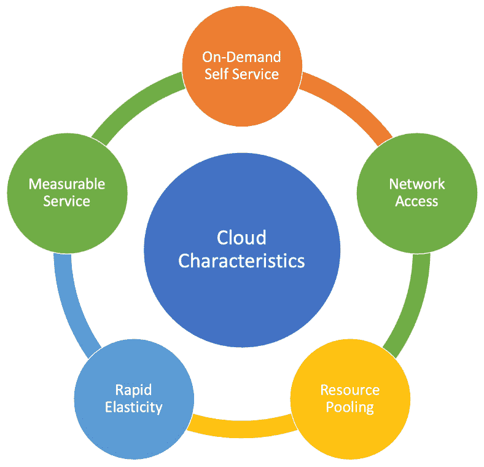
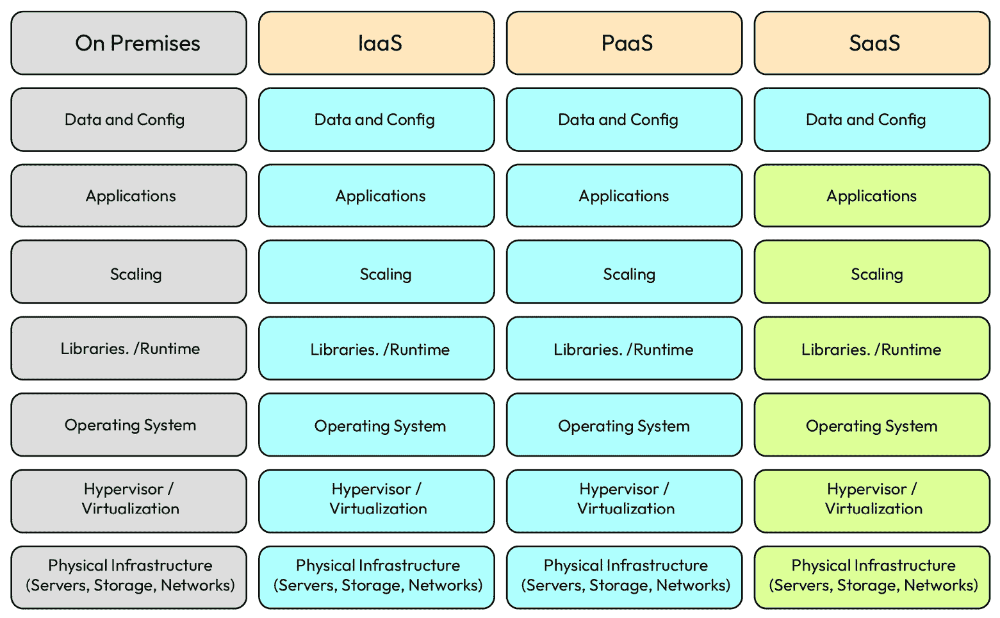
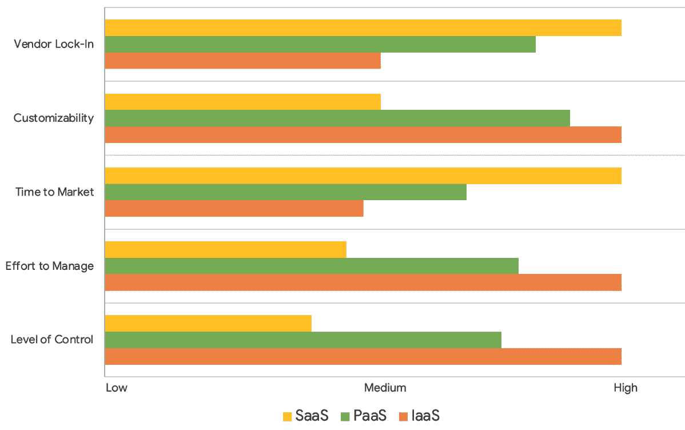
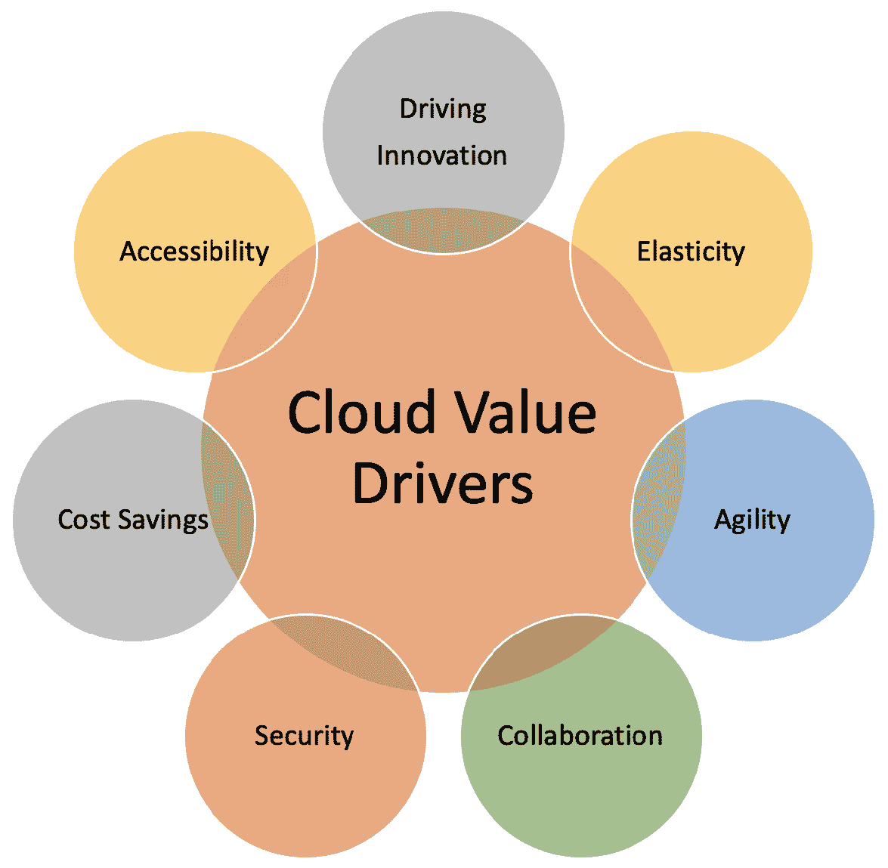

## 2 云计算入门
不到二十年前，地球上每家公司支持其业务的唯一方式是建立自己的数据中心。数据中心提供了一个集中设施，用于托管应用程序、存储数据、处理它们，并提供支持业务所需的关键 IT 服务。
然而，云的概念并非新事物。在现代世界，我们都习惯于 *cloud* 的一般概念。直到 19 世纪末，每个家庭都必须用柴火自发电并从自有物业的井中取水。随着电力的发明以及社区和城镇的演变，公用事业公司改变了家庭接收电力和水的方式。这既方便又可持续，因为家庭不再需要建造自己的水井、生产能源，更重要的是维护它们。它们还提供了一种交钥匙解决方案，带有计量和回收费功能，使消费者只需为所使用的部分付费，而无需担心安装、运行和维护生态系统，从而节省了巨大的精力和成本。
直到 1970 年代小型计算机被引入之前，大多数组织都负担不起自建 IT 基础设施或大型机。只有大型组织和政府机构拥有大型机。其他人都在一个最 commonly known as timesharing 的中央大型机系统上租赁计算能力。即使在今天，对于大多数组织而言，IT 仍是一个主要的成本中心，这意味着 IT 成本必须纳入预算，并且是跟上业务需求的必要支出。云计算已从仅仅是一个基础设施部署平台发展到彻底改变企业创新和转型的方式。它使各种规模的企业都能在数字时代更有效地竞争。通过利用云计算，初创企业能够比以往更快地创新并提供能力，甚至在各自行业中颠覆传统企业。
在本章中，我们将讨论云计算的基本概念，重点关注以下主题：
* 云的本质特征
* 利用云驱动业务敏捷性
* 不同行业的云采用
* 采用混合云
* 云采用的误区

## 云的本质特征
**国家科学技术研究所** (**NIST**) 对云计算的定义如下：
云计算是一种模型，用于通过网络以按需方式提供普遍、便捷的访问共享的、可配置的计算资源池（例如网络、服务器、存储、应用程序和服务），这些资源可以以最少的精力和服务提供商交互迅速进行配置和释放。
云模型由五个基本特征、三种服务模型和四种部署模型组成：

图 2.1 – 云的五个基本特征

# 云服务模型和特征

## 基本特征

为了使系统被认可为云系统，它应具备以下五项基本特征：

1. **按需自助服务**：消费者必须能够根据需要自动配置计算资源，例如计算能力、存储和网络，而无需与人工服务提供商交互。
2. **广泛网络访问**：所有服务功能均可通过标准网络协议在互联网或网络上访问，并可由各种客户端设备使用，例如工作站、手机、平板电脑和笔记本电脑。
3. **资源池化**：云提供商将计算资源汇集起来以通过多租户模型为多个消费者服务，其中底层资源根据需求动态共享、分配和重新分配。云消费者通常不知道也不控制计算资源托管的位置和方式。
4. **快速弹性**：云提供商提供可根据用户需求无缝配置或取消配置的能力，同时能够快速向上或向下扩展资源。对云消费者而言，容量似乎是无限且弹性的。
5. **可计量服务**：云系统利用配额、计量和费用回拨的概念来自动控制和优化云资源的使用。这使云提供商和消费者能够透明地控制、监控、衡量和报告基于所提供服务性质的资源消耗或使用情况。

## 服务模型

总体而言，云能力是通过三种主要服务模型提供的：

图 2.2 – 云服务模型

让我们简要回顾一下服务模型：

* **软件即服务** (**SaaS**)：在 SaaS 模型中，应用程序或服务的消费者被授予使用托管在云提供商基础设施上的应用程序的能力。云提供商承担拥有、管理和运营整个基础设施的责任，该基础设施包括为应用程序提供服务所需的网络、服务器和存储。消费者通常可以通过 Web 浏览器或移动设备使用或访问应用程序。值得注意的是，SaaS 产品的消费者免除了开发、管理和治理应用程序基础设施的责任，同时具有有限的定制或应用程序配置能力。SaaS 产品的知名示例包括 Google Workspace（Gmail、Google Meet 等）、Salesforce、Workday 和 Dropbox。
* **平台即服务** (**PaaS**)：PaaS 服务模型提供即用型开发和部署平台，使消费者能够快速构建和部署云原生应用程序，而无需担心底层基础设施需求。PaaS 产品提供完整的基于云的环境，其中包括开发团队编写、构建、测试、部署和扩展应用程序所需的一切，而云提供商管理底层硬件和软件基础设施。PaaS 消费者可以控制已部署的应用程序、二进制文件以及应用程序托管环境的配置设置。PaaS 产品的一些示例包括 AWS Lambda、Google App Engine、Azure Cosmos DB 和 Mulesoft。
* **基础设施即服务** (**IaaS**)：IaaS 服务模型提供计算、存储和网络等基础基础设施能力，使消费者能够虚拟运行任何软件或应用程序。从根本上讲，IaaS 平台充当托管基础设施，云提供商管理底层物理硬件基础设施，而消费者对在其上运行的操作系统、软件库和二进制文件具有完全控制权，同时对底层基础设施组件（如虚拟网络和协议）具有有限控制权。IaaS 服务模型允许用户配置和扩展运行应用程序所需的基础基础设施。IaaS 产品的一些常见示例包括 AWS EC2、Google Compute Engine 和 Azure Virtual Machines。

## 不同服务模型的价值驱动因素

在不同服务模型之间进行选择时，了解每个模型的优点和局限性非常重要。三种服务模型并非相互排斥。常见的做法是设计和构建利用不同服务模型组合的解决方案，通常会与现有的传统 IT 本地系统集成。重要的考虑因素还应基于组织的 IT 成熟度、技能和规模。

对于成熟的 IT 组织 *公司 A* 来说，完全有可能主要利用 IaaS 能力构建和管理自己的电子商务，而具有精简 IT 的 *公司 B* 则会发现电子商务 SaaS 解决方案是合适的选择。在这种情况下，公司 A 需要一个成熟的 IT 组织，为获得更高水平的控制而投入大量时间、精力和技能以及运营实力。公司 B 会以牺牲控制权为代价换取更快的上市时间和以 SLA 为驱动的管理服务产品：

表 2.3 – 云部署模型和价值差异化因素

还有一些更成熟的服务模型专为特定业务功能而构建。这些通常归类为 **一切即服务** (**XaaS**)。其中一些较为常见的如下：

1. **容器即服务** (**CaaS**)：CaaS 提供基于云的平台，消费者可以在受管理的平台上带来自己的容器和运行时并运行。云提供商管理底层硬件、虚拟化和操作系统层。CaaS 的一些示例包括 **Google Kubernetes Engine** (**GKE**)、**Azure Kubernetes Service** (**AKS**)，以及 Amazon **Elastic Kubernetes Service** (**EKS**)。
2. **统一通信即服务** (**UCaaS**)：UCaaS 提供基于云的平台，按订阅方式提供广泛的通信和协作服务，包括语音、视频、消息传递和在线状态。一些 UCaaS 提供商的示例包括 RingCentral、Zoom、8x8 和 Vonage。
3. **身份即服务** (**IdaaS**)：IdaaS 按订阅方式提供基于云的身份管理基础设施，使企业能够跨其应用程序和系统管理用户身份验证、授权和访问控制。IDaaS 提供商的一些示例包括 Okta、Azure AD、Google Identity 和 Ping。
4. **函数即服务** (**FaaS**)：FaaS 提供无服务器平台，使开发人员能够在无需管理自己的基础设施的情况下编码、构建和部署微服务和无服务器应用程序。FaaS 的一些示例包括 AWS Lambda、Google Cloud Functions 和 Azure Functions。
5. **联系中心即服务** (**CCaaS**)：CCaaS 是一种基于订阅的联系中心服务，包括呼入和呼出语音呼叫、电子邮件、聊天、社交媒体和消息传递服务。CCaaS 的一些示例包括 Genesys、NICE、Talkdesk 和 Five9。
6. **知识即服务** (**KaaS**)：KaaS 提供基于云的平台，用于在组织内捕获、存储和共享知识和信息。KaaS 的一些示例包括 Bloomfire、Thought Industries 和 WittyParrot。

虽然有多种云服务模型提供某些专业化服务，但企业通常会拥有其中几种服务模型以满足特定目的，同时允许互操作性。

## 云部署模型

我们在探讨了各种云服务模型之后，让我们回顾一些云部署模型。云部署模型的选型是组织在数字化转型过程中的基本决策之一，因为它最终决定了组织能够设想的云路线图和能力。

## 私有云
在此模型中，云基础设施专为单个组织提供专属使用，该组织包含多个使用者（例如业务单元）。它可以由组织、第三方或两者组合拥有、管理和运营，并且可以部署在本地或异地。

私有云可以通过三种不同的模式提供——托管、受管和虚拟：

### 托管私有云
在此模型中，组织将对其云环境拥有完全控制权，因为物理云服务器托管在其自身设施或数据中心内。通常，私有云厂商提供构建私有云所需的云栈组件，包括虚拟化、安全、网络和存储。然而，组织的 IT 人员需要负责部署、运营和管理。这最适合需要专用物理云服务器、数据驻留或数据主权要求，并且拥有具备管理运营云栈所需技能的 IT 人员的组织。托管私有云的一些示例包括 OpenStack 和 Apache CloudStack。

### 受管私有云
这与托管私有云非常相似，只是云服务器由服务提供商管理。通常，受管私有云提供商会代表组织托管、管理和运营云服务器。这极大地简化了组织的工作，因为它消除了对物理数据中心空间的需求、相关成本以及日常运营和管理。尽管组织仍对其云环境拥有更大的控制权，但大多数管理需求必须通过服务提供商进行。受管私有云的一些示例包括 Rackspace、NTT 和 Sungard。

### 虚拟私有云
尽管名称为私有云，但这是在公有云内的私有环境。更 commonly known as VPC，它是多租户云中的隔离租户。在此模型中，公有云提供商通常管理物理数据中心、服务器基础设施、网络和安全。订阅虚拟私有云的组织对其自己的 VPC 拥有完全控制权，但不拥有底层物理基础设施。提供 VPC 的云服务商示例包括 Google Cloud、AWS、Microsoft Azure 和 Oracle Cloud。

## 社区云
社区云是一种专门的云计算环境，通常由具有相似目标和需求的一组组织共享。它可以由组织或第三方服务提供商拥有和运营。社区云对于共享共同目的、目标、治理和监管要求的组织而言是不错的选择。这可能涉及访问或共享数据、服务或合规需求。社区云的一个示例是专为政府机构定制的专用云基础设施，更 commonly referred to as GovCloud（或 Cloud for Government），其中多个部门可能需要访问在严格监管合规要求（如 FedRAMP、CMMC 和 ITAR）下管理的共享数据和服务集。

其他一些常见的社区云是为特定行业量身定制的，以托管受行业法规约束的服务——医疗保健行业的 HIPAA、金融服务的 FINRA 和 PCI-DSS 等。

还有为大学和学院构建的社区云，教育机构可以利用可共享和复用的通用服务集。

## 公有云
公有云是最常见的云基础设施类型，可供几乎任何拥有互联网连接的人使用。公有云由服务提供商拥有、管理和运营，同时通过网络向消费者提供服务。从定义上讲，公有云基础设施托管在一个或多个位置，同时允许消费者订阅和使用。云提供商拥有并管理访问其服务所需的数据中心、服务器基础设施和软件栈，并通过互联网（通常通过订阅）提供其资源供消费。公有云是一种多租户模式，许多订阅者可以租用云服务。

一些受欢迎的公有云提供商有 **亚马逊网络服务** (**AWS**)、Google Cloud、Salesforce 和 Workday。

## 混合云
混合云将传统本地 IT 与一个或多个公有云集成，使组织能够无缝迁移工作负载。混合云使组织能够兼顾两者之长——由于合规、数据主权或数据驻留法规而将遗留应用和数据保留在本地，同时利用公有云能力构建和交付现代应用和增值服务。

混合云基础设施由一个或多个公有云与本地基础设施组成，允许在环境之间实现无缝的应用和数据可移植性。随着企业在云上进行创新和现代化，同时利用对传统本地基础设施、应用、系统和软件的现有投资，混合云已成为绝大多数企业的事实标准，因为它提供了更大的灵活性，可为每个工作负载选择最佳环境，或随着需求变化在云之间迁移工作负载。

混合云在设计和基础架构方面也需要仔细规划，因为这是成功实施的关键。混合云支持的一些高价值用例如下：

* **云突发**：云突发是指由于季节性需求或处理突发峰值而将应用或服务流量突发到云中的能力。在稳定状态下，应用会从本地数据中心提供服务，但可以无缝地将流量峰值转移到云中。
* **云中的灾难恢复（DR）**：在传统的本地数据中心中，构建 DR 环境通常成本高昂，因为它很少使用，但仍需要与生产环境同等规模，并产生相应的运营开销。云环境可以通过弹性扩展支持按需灾难恢复。
* **地理冗余和高可用性（HA）**：混合云可以为关键任务的本地应用提供高可用性和地理冗余，显著改善 SLA。
* **云中的开发测试**：在架构良好的混合云基础上，组织可以启动多个开发和测试环境，在不使用时关闭，不再需要时拆除。这也允许组织并行运行多个发布周期。
* **开拓新领域**：企业通常需要测试新水域并尝试新技术，并且希望 *快速失败、廉价失败*。云可以作为试验床和发射平台，直到建立稳定状态。

无论云部署模型如何，企业设想长期云战略都很重要，这将为通过技术实现成功的业务转型指明方向。在下一节中，我们将探讨云计算如何帮助推动业务敏捷性。

# 通过云驱动业务敏捷性

# 云价值驱动因素

云技术影响现代企业的主要方式之一是助力业务敏捷性。随着消费者需求激增和市场动态不断变化，各行各业的企业都必须引领创新、快速扩展并更快地进入市场以蓬勃发展。

以下是七项有助于推动业务敏捷性的云原则：

图 2.4 – 云价值驱动因素

让我们简要回顾云的七项业务敏捷性基础价值驱动因素：

### 1. 创新
创新一直是企业采用云的巨大价值驱动因素。云为组织提供了明显的优势，因为它们现在可以探索未知领域并尝试新技术和新兴技术，而无需花费大量时间和成本以及精力来构建昂贵的本地 IT 基础设施。这使企业能够快速失败并更快地交付新产品和服务。

IKEA 是总部位于荷兰的瑞典跨国集团，设计并销售可自行组装的家具、厨房电器、装饰品、家居用品以及各种其他商品和家居服务。利用尖端的云技术，IKEA 成功创新并提供沉浸式客户体验 *\[1\]*。随着 COVID-19 大流行影响整个社会和社区，购物者正在寻找独特且不同的购物方式以及送货方式。IKEA 通过提供创意和沉浸式体验来改变客户的购物方式，例如 AI 驱动的推荐、用于更简单但有效的客户服务的聊天机器人，以及用于在逼真房间中展示家具的 3D 可视化设计工具。

### 2. 弹性
当谈论云时，每个人首先想到的就是其固有的扩展能力。这与传统 IT 直接相反，传统 IT 中企业必须始终按高水位线——预期峰值负载来规划规模。传统本地部署中的容量规划是一个主要挑战，尤其是在应用需求具有季节性或不可预测时。规模过小会导致应用停机，造成糟糕的用户体验，而规模过大则会导致不必要的 CapEx（未使用的硬件和软件）以及 OpEx（升级、电力、冷却和维护）升高。云通过提供可根据应用需求上下扩展的按需容量来缓解容量规划问题，使企业能够快速响应需求变化，例如季节性波动或意外激增。

Netflix 是领先的互联网电视网络，在 190 多个国家拥有超过 2.3 亿订阅用户。从 DVD 租赁公司到今天的 Netflix，Netflix 是利用云创新和扩展的先驱。随着需求不断增长，Netflix 依靠云弹性来跟上需求 *\[2\]*。

### 3. 业务敏捷性
使企业获得显著竞争优势的关键价值驱动因素是能够灵活、快速实验、交付服务并更快响应以领先于市场需求。云的内在优势在于它为企业提供按需访问现代尖端技术的途径。例如，通过云战略，组织可以立即访问现代芯片组、软件平台、应用程序和增值服务，从而以低风险进行实验而不会花费太多。传统上，这需要大量的尽职调查、概念验证、评估和采购周期，这些都容易导致更高的成本和风险。

COVID-19 大流行在全球范围内影响了每个行业和企业。许多零售商被迫关门，还有一些直接倒闭。Target 在大流行前数年就开始了数字化转型。这使 Target 能够迅速响应新的健康和合规法规，在保持商店开放的同时也保护员工安全 \[*3*\]。Target 能够在数天内在其所有商店快速推出多项变更，例如在收银通道安装有机玻璃屏障、为弱势客人提供专用购物时间、对高需求商品实行数量限制等。更重要的是，他们可以通过数字渠道为客户提供更新更安全的购物方式，例如 Drive Up 和 Target Wallets。关于云如何推动业务敏捷性的问题，Target 首席执行官 Brian Cornell 在 *Masters of Scale* 播客中说，“*没有人知道会发生什么，但把我的团队放在首位，就等于把客户放在首位——并服务于 **更大的社区***。”

### 4. 协作
云技术以新颖创新的方式改变了团队和组织协作的方式，使实时通信、文档共享、视频会议和项目管理能够从任何地方进行。随着越来越多的企业采用混合和远程工作文化，团队在地理上分散。参与项目的全球团队可以利用基于云的协作工具（如 Google Workspace 或 Microsoft Teams）无缝协作，无论其位置或时区如何。这使团队能够有效协作、改善沟通并加快决策速度。

Pinterest 是领先的社交媒体平台，允许用户分享和发现视觉内容，例如图像和视频。拥有超过 4.5 亿月活跃用户，Pinterest 利用云技术支持其不断增长的用户群并处理用户产生的大量数据。

GitHub 是用于软件开发和版本控制的互联网托管服务。它改变了开发人员编写和共享代码和文档以及与同行开发人员协作的方式。GitHub 还作为开发人员公开建立联系、协作开展项目并推广其工作的社交网络平台 *\[4\]*。

### 5. 安全
云服务提供商通常具有强大的安全措施，例如加密、防火墙和访问控制。采用纵深防御安全策略，云服务提供商通常在其基础设施中内置多层安全，包括物理安全、网络安全和应用安全。在许多方面，基于云的应用程序和服务通常比传统数据中心托管的应用程序更安全。例如，大多数知名云服务提供商采用纵深防御安全策略，并建立了专门的能力来保护整体云环境。

组织每天必须防范的各种安全威胁，从有针对性的 DDoS 攻击到软件和硬件漏洞再到勒索软件不等。2017 年，Google 的 Project Zero 团队发现了由 *推测执行* 引起的安全漏洞，这是一种由大多数现代处理器（CPU）用于优化性能的技术。俗称 Spectre 和 Meltdown，这影响了几乎每台机器。在发现该漏洞及其解决方案后，Google 立即能够通过实时迁移在其云基础设施中修补数百万台服务器，以保护客户应用程序和数据。

Today’s modern internet-facing applications are at constant risk of **分布式拒绝服务** (**DDoS**) attacks, where rogue agents initiate large volumes of HTTP requests to an application from a variety of IPs that might seem legitimate. Unsuspecting applications tend to respond to this sudden spike by scaling constantly, and are eventually taken down after running out of resources. These kinds of attacks typically require security not just for the application but the entire IT stack, from intelligent firewalls to available network bandwidth—more commonly referred to as the **纵深防御** security strategy. In June of 2022, a customer application deployed on Google Cloud was the target of the largest-ever layer 7 DDoS attack *\[5\]*. The attack started with 10,000 **每秒请求数** (**RPS**) and peaked at 46 million RPS within the next few minutes. Leveraging the defense-in-depth security-first cloud architecture, the attack was mitigated and blocked at the network edge. Thanks to the massive network bandwidth and security controls such as Cloud Armor, customers’ services stayed online and continued serving.

## 成本
An important value driver for cloud adoption is cost savings. Cloud computing can help businesses save costs by eliminating the need to invest in expensive hardware and software. Additionally, cloud-based services are often billed on a pay-as-you-go basis, allowing businesses to only pay for usage. However, it is important for IT leaders to consider the realization of cost savings from a **总拥有成本** (**TCO**) and business value perspective. Although cloud comes with a promise of overall cost savings, ironically, runaway cloud costs are one of the primary reasons for failed cloud initiatives. Rushed migrations, lack of direction and clarity on cloud objectives, and poor architectural design are some of the common pitfalls \[*6*\]. However, organizations can realize potential cost savings by taking advantage of native cloud features such as elastic scaling, Serverless, automation, and Cloud FinOps best practices.

## 可访问性
Another key value of the cloud is that it allows employees, associates, and partners to gain access to business applications and data from virtually anywhere at any time. With a hybrid work culture and global teams with a follow-the-sun model, organizations have an increasing need to provide employees and partners with the right tools, applications, and services to ensure productivity and responsiveness to customer needs. For instance, a mobile workforce can use cloud-based APIs, applications, and services to access tools and data from any device anywhere at any time. For users with disabilities, the cloud can also enable assistive technology solutions such as voice recognition, text-to-speech APIs, screen readers, closed captioning, or real-time transcription.

In the next section, let’s explore how cloud adoption has impacted different industries.

# 不同行业的云采用
The following is true, according to McAfee’s *云采用和 **风险报告***:
* 87% of companies experienced business acceleration from leveraging cloud services
* 52% of organizations realized better security in the cloud than in traditional on-premises IT environments *\[7\]*

According to a 2021 report by O’Reilly, organizations across industry verticals continue to accelerate cloud adoption *\[8\]*.
Let’s explore the impact of cloud adoption in some key industry verticals.

## 零售
The retail industry has been at the forefront of Cloud adoption, as retailers seek to take advantage of cutting-edge cloud technology to meet ever-increasing consumer demands *\[9\]*.
The cloud has led retail innovation by optimizing supply chains, transforming stores as micro fulfillment centers, enabling new shopping experiences such as **网上购买，店内提货** (**BOPIS**) and curbside pickups, managing omnichannel inventory levels, and creating AI-infused shopping experiences to augmented/virtual reality. Let’s look at some areas where retailers are innovating and leading the digital transformation with the cloud.

### 未来的商店
Transforming shopping experiences for consumers is adding a significant competitive edge for retailers, and it is imperative for retailers to capture the market share. Several retailers are reimagining the creation of the **现代商店** or the **未来商店**, leveraging modern cloud technologies infused with AI that focus on providing rich shopping experiences, improving customer engagement, increasing the lifetime value of consumers, and enhancing brand loyalty.

### 销售点（POS）
Cloud-based POS systems have become increasingly popular as they allow retailers to manage store transactions more efficiently and enable real-time insights into sales data. Modern cloud-based POS enables retailers to efficiently manage inventory, personalize the customer shopping experience, and track customer behaviors, which was not possible with traditional POS.

### 从电子商务到全渠道商务
As more and more shoppers take to online shopping for the convenience it offers, e-commerce sales in the US reached over a trillion dollars in 2022.
As omnichannel commerce takes center stage and the lines are blurred between in-store and online shopping channels, it is extremely important for retailers to meet consumer demands wherever they are. Traditional monolith e-commerce solutions are no longer effective at meeting these demands, and retailers have a need to adopt cloud-based e-commerce platforms to offer omnichannel personalized shopping experiences for consumers. Omni-commerce focuses on providing customers with a seamless shopping experience across all channels, including online, in-store, mobile, or voice, resulting in a better-personalized shopping experience regardless of where and how they shop. Hence, it’s important for retailers to integrate different channels, follow customers’ journeys, and manage inventory effectively.

### 客户数据平台
As consumer privacy measures are tightened across the world (GDPR in the EU, for instance) and third-party data and cookies are becoming less reliable, it is crucial for retailers to build a solid data foundation with a primary focus on enriching their first-party data while still offering personalized experience to customers. Harnessing the power of data from various sources, a well-defined CDP strategy can help predict trends and customer sentiment, enhance marketing ROAS, build brand loyalty, and increase customer lifetime value.

### 供应链需求规划与预测
The exponential growth of omni-commerce has forced retailers to quickly adapt and respond to consumer demands. Consumers expect accurate real-time inventory availability, delivery commitments, end-to-end order tracking transparency, and visibility as orders are fulfilled. Antiquated and manual supply chain systems are struggling to meet these demands. Modern supply chain systems infused with AI/ML are dramatically improving autonomous planning and decision-making, preventing stockouts and markdowns.

### 员工生产力

确保员工（尤其是店内员工）的生产力是提供更好客户体验的关键。自动化日常繁琐的任务和操作，如货架补货、订单拣选、结账、排班和任务管理，可以大幅提高员工生产力，让店内员工专注于服务客户。技术可以帮助店内员工简化货架补货，确保不会缺货并且产品放置在正确的位置。自助和非接触式结账、辅助订单拣选、基于奖励的任务管理、基于优先级的任务排程以及员工经验水平，正在极大地提升店内员工的生产力水平，从而提高销售额和客户满意度。后台和在线客户服务员工可以从最佳下一步决策的指导、通过人工智能驱动的对话式聊天机器人提供的实时推荐以及现代联系中心解决方案中获益匪浅。借助基于云的协作工具，企业和 IT 部门的员工可以提高工作质量和效率，并将更多时间投入到创造性问题解决和创新中。

# 其他创新领域

一些零售商利用现代云原生技术和人工智能进行创新的其他领域包括以下内容：

* **边缘计算**：批量处理销售和库存数据的时代已经过去。零售商正在积极创新，在边缘处理数据以加速和改善客户体验。
* **损耗减少**：在利润微薄且竞争激烈的环境下，减少损耗对零售商的营收至关重要。诸如基于异常的报告的智能 POS 视频分析和边缘计算等技术可以生成实时警报，以防止和减少零售损耗。
* **物联网** (**IoT**)：物联网正在通过库存管理、欺诈检测、产品篡改、店内有针对性的营销活动和运营效率迅速改变零售业。随着设备、传感器和网关数量以及网络流量的指数级增长，云技术可以帮助高效管理。
* **区块链和零售联盟**：区块链是一种分布式账本技术，可用于创建安全、透明且防篡改的交易。这可以帮助零售商建立透明且安全的忠诚度计划，为监管合规管理客户数据和交易，通过提供产品真实性和产品追溯保护客户免受假货侵害，并促进买方和卖方之间安全即时的支付。
* **增强现实** (**AR**) **和虚拟现实** (**VR**)：AR 和 VR 是正在通过帮助客户在家中或企业中可视化产品、创造沉浸式购物体验以及与产品互动，从而革新零售业的新兴技术，从而带来更好的转化率。云计算提供了急需的现代可扩展且弹性基础设施来渲染复杂的 AR/VR 体验、存储和传输用于 3D 模型、纹理和视频的大量数据，并降低 IT 开发和部署 AR/VR 解决方案的复杂性。
* **应用 AI/ML**：AI/ML 革命对零售业产生了重大影响，并在零售的各个领域得到应用。零售商正在各业务线中嵌入 AI/ML 能力，从有效定向营销以提高 ROAS，到自动化客户服务、基于本地和宏观经济因素实施动态定价、个性化产品推荐、优化库存和检测欺诈。云技术提供可扩展的基础设施来训练和部署 AI/ML 模型并存储和管理大型数据集，以及工具和服务以快速测试和迭代，使其非常适合推动创新。

正如数据所示，零售业一直走在数字化转型的最前沿，并引领大规模创新。

# 医疗保健与生命科学

医疗保健是另一个正在经历数字化转型范式转变的垂直领域，从而改善患者护理和治疗效果。提供持续的患者护理、赋能护理人员做出明智的数据驱动临床决策以及加速药物开发，现代云和人工智能技术已经改变了医疗保健和生命科学行业。让我们回顾一下医疗保健和生命科学行业正在创新的一些领域。

## 连接健康

连接健康是指使用可穿戴技术将患者与医疗保健提供者连接起来，以远程监测患者健康并促进沟通。云技术支持 **远程患者监测** (**RPM**) 项目，使医疗保健提供者能够在传统临床环境之外监测患者的健康状况。这对患有慢性病或居住在医疗资源有限的偏远地区的患者尤其有益。

## 远程医疗与虚拟护理

远程医疗近年来变得越来越受欢迎。基于云的远程医疗平台允许提供者通过安全实时视频和音频通信与患者连接。这意味着患者可以随时随地接受医疗护理，无需前往实体医疗机构，即可接受虚拟咨询并续充处方。基于云的远程医疗平台还可用于提供虚拟咨询和处方续充以及远程监测患者健康状况。这使医疗保健提供者能够根据患者数量按需扩展服务，同时安全地管理患者数据并与后端 **电子健康记录** (**EHR**) *\[10\]* 集成。

## 药物依从性

药物依从性是指患者遵循医疗处方的程度。这一直是一个难以解决的挑战。未能遵守用药方案或过度用药可能导致患者健康结果不佳、医疗费用增加以及患者生活质量下降。基于云的解决方案让医疗保健提供者能够通过 RPM 追踪患者的生命体征和用药情况，发送用药提醒，提供关于药物的教育和支持，并提供社区支持。基于云的通信工具还能够实现患者与提供者之间的实时安全通信，以帮助支持患者的药物依从性。

## 基因组数据处理

基因组数据处理极其复杂且计算密集，需要大量数据存储和处理能力，在本地管理可能昂贵且耗时。面对庞大、敏感且不断增长的基因组数据集，云技术彻底改变了基因组数据存储、处理和分析的方式。它还通过提供可扩展、安全且经济高效的基因组数据处理平台来克服可扩展性、可用性和数据安全方面的挑战。更重要的是，基于云的平台促进协作研究，帮助不同地区的科研人员协作、分析和共享结果。

## 药物开发

速度和规模对于加快药物发现和开发至关重要，而这涉及来自临床研究和试验的大量数据整理和分析。这通常需要能够在长时间跨度内进行短时间突发计算的**高性能计算**（**HPC**）。云计算通过使健康科学能够加速发现和药物开发，从而改变了药物开发流程。现代 HPC 资源能够更快地分析大型数据集，减少药物开发的时间和成本。基于云的 AI/ML 平台和工具提供了进行预测建模、异常检测以及潜在药物靶点识别的能力。虚拟临床试验可以通过收集来自多样化患者群体的數據，显著降低临床试验的成本和时间。

## 银行、金融服务和保险

BFSI 行业正随着云技术的采用而经历重大转型，使组织能够提升客户体验和运营效率。从开放银行、欺诈检测、风险管理、简化监管报告以及提高运营效率来看，云技术帮助金融服务实现创新和扩展。让我们看看银行和金融服务行业中的一些高价值用例，以了解数字化转型是如何进行的。

### 数字银行

开放银行通过让消费者更容易比较产品和服务并找到最佳交易，正在彻底改变金融服务行业。这使金融服务提供商能够访问金融机构持有的客户数据，以开发新颖且创新的产品和服务，从而提升客户体验。一些流行的开放银行应用包括帮助消费者预算和跟踪支出的**个人财务管理 **（**PFM**）工具、帮助消费者获得信贷额度的透明信用评分工具、便捷的支付选项，以及帮助消费者找到更好交易工具。基于云的解决方案通过为消费者提供安全且可扩展的平台、实时访问财务数据，以及通过虚拟助手和聊天机器人等创新方式与消费者互动，帮助金融机构支持开放银行。

### 欺诈检测与预防

金融欺诈是各规模企业面临的主要挑战。根据**注册欺诈审查师协会**（**ACFE**）的说法，“*职业欺诈可能是世界上最昂贵且最常见的金融犯罪形式。这比医疗欺诈、逃税、洗钱和身份盗窃更为严重*。” ACFE 估计，典型组织每年约有 5% 的年收入因欺诈而损失。云计算可以通过多种方式帮助企业检测和预防金融欺诈，包括实时分析交易以帮助识别和阻止可疑交易，利用机器学习分析并识别异常模式以主动检测欺诈，以及分析海量数据集以发现趋势，从而制定更有效的欺诈预防策略。

### 监管报告

世界各地的监管机构都依赖金融机构及时、准确地提交财务报告。对于面临不断变化的法规的金融机构而言，这是一项关键活动，需要财务、法律和 IT 等多个部门协同努力。传统的手动流程往往耗时、昂贵且风险较高。基于云的解决方案提供技术驱动的数据管理、数据治理、不同业务线和第三方组织之间的数据聚合，以及为利益相关方提供实时、透明的洞察。它们还可以自动化和简化可重复的业务流程，从而实现快速、敏捷且稳健的监管报告。

### 风险管理

金融机构需要进行复杂的风险评估，以跟上市场变化并保持合规。采用蒙特卡洛等方法进行正式风险建模估值需要大量的计算能力。传统方法涉及构建虚拟服务器集群以满足庞大的基础设施需求和运营，这可能成本高昂。云服务提供商提供 HPC 网格和可按需实时扩展的基础设施，以高效且经济的方式执行及时的风险评估和模拟，例如**风险价值**（**VaR**）。

### 理赔处理和承保

理赔处理、理赔和承保对保险公司至关重要。这些流程可能复杂且耗时，但确保保单持有人得到公平对待并及时处理索赔非常重要。有多种因素会影响理赔处理时间，包括索赔的复杂性、文件可用性以及理赔部门的工作量。云技术帮助保险公司自动化数据录入和文件处理等任务，使理赔员能够专注于理赔调查和谈判，提高准确性和效率并创造更好的客户体验。在 AI/ML 的增强下，云技术使组织能够分析大量数据以检测模式和异常以防止欺诈、优先处理理赔分诊并自动化理赔处理，以及预测未来理赔趋势以帮助制定有效的承保策略。

## 电信

电信行业正经历快速的数字化转型期，由多种因素驱动，包括 5G、**多接入边缘计算**（**MEC**）等新技术的兴起、为消费者提供定制化服务的网络切片、量子计算、UcaaS 以及指数级增长的消费者需求。数字化转型对于电信公司保持竞争力和相关性至关重要。让我们看看电信行业在云计算驱动下正在转型和创新的一些领域。

### 网络功能虚拟化 (NFV)

电信领域的数字化转型涉及将路由、交换和防火墙等网络功能虚拟化。这对于扩展规模、降低专用硬件相关成本以及提高可扩展性、灵活性和敏捷性至关重要。云技术使电信公司能够更轻松地部署和交付新的网络功能和服务。

### 电信网络智能

电信**网络智能**（**NI**）是一种利用数据分析实时洞察网络性能和行为的技术。NI 解决方案通常从网络设备、移动应用程序和用户活动流等多种不同来源收集数据。利用云技术，可以使用机器学习算法分析海量数据，以识别网络模式和趋势、快速识别和解决网络问题、优化网络流量以提高性能、预测网络容量并防止威胁或网络攻击。这从而改善客户体验。

### 物联网 (IoT)

电信公司正在利用物联网创造新的收入来源并为客户提供增值和个性化服务。这涉及使用传感器和其他设备收集数据并提供有关客户行为和偏好的洞察。物联网还使新的商业模式成为可能，帮助一些此前不存在的行业，例如智慧城市解决方案、互联汽车服务、智能计量和能源优化。

### 基于云的联系中心

电信公司正在利用云技术提供呼叫中心解决方案，使企业能够通过语音、聊天、电子邮件和社交媒体等多种渠道提供客户服务。这使企业能够提供全渠道客户服务。

## Radio access network (RAN)

RAN 是电信网络中连接移动设备到核心网络的部分，使用户能够访问语音通话、数据和其他服务。传统上，RAN 使用专有硬件和软件部署，这可能昂贵且缺乏灵活性。随着云技术的兴起，电信公司正在探索将 RAN 功能迁移到云中的可能性。这有助于集中管理其网络、提高网络基础设施的效率并降低成本。

## Unified communications (UC)

基于云的 UC 解决方案由于其灵活性、可扩展性和成本效益，在商业世界中变得越来越受欢迎。基于云的 UC 解决方案使电信公司能够为客户提供完整的通信和协作工具套件，例如语音聊天、视频通话、消息传递和会议，均从云端交付。这改善了客户体验并使公司能够提供新的创收服务。

## Government

随着数字技术的兴起，世界各地的多个政府机构正在转向为公民提供数字服务，例如在线申请表、电子支付和数字签名。政府服务的数字化使公民更容易、更快地获取政府服务，减少了等待时间和运营成本，并最大程度地减少了面对面互动的需求。

政府机构越来越多地使用云计算来降低成本、提高效率并增加灵活性。通过使用云服务，机构可以根据需要访问软件、数据存储和计算能力，而无需投资昂贵的硬件基础设施。云计算还使政府机构能够更轻松地相互协作以及与外部合作伙伴协作。即使是数字化政府流程或服务的适度举措，通常也受大量监管指南和限制的约束。一些公共云提供商提供专门的 GovCloud，符合各种安全、监管和合规法规，例如通过分层加密的数据安全、数据隐私、数据保留、数据主权、审计跟踪以及符合世界各地多项政府法规，例如 FedRAMP、FISMA、PII 和 HIPAA、CJIR、MeitY 和 NISC。例如，**美国总务管理局** (**GSA**) 开发了一项名为 FedRAMP 的基于云的计划，为云产品和服务的提供安全评估、授权和持续监控的标准化方法。通过提供云安全的通用平台，FedRAMP 已帮助政府机构更有效地协作并安全地共享数据。让我们回顾一下政府机构在云端进行转型和创新的一些领域。

### Citizen services

政府机构正在利用云计算以多种方式改善公民服务，包括提供在线服务，例如在线申请、纳税申报、许可申请和执照续期，使公民与政府互动更加容易和方便。

公共卫生机构可以利用大数据分析、预测分析和云计算来监测新兴趋势，例如公共卫生威胁，并提供有效的干预措施。洛杉矶市开发了 **MyLA311** 系统，以便公民轻松报告垃圾、涂鸦和其他清理问题的服务请求 *\[11\]*。该市利用基于云的技术简化流程并监控现场工作人员进度。这通过对服务相关问题的快速响应和更高效的废物清除作业改善了公民的生活质量。

### Public health services

政府机构需要不断应对既地方性又大流行的公共卫生问题。肥胖、烟草使用、心理健康、污染和物质滥用等地方性问题需要系统性解决，而 COVID-19 等大流行情况则需要快速响应。

例如，政府机构几十年来一直在与阿片类药物危机作斗争。利用现代 AI/ML 技术，**俄克拉荷马州心理健康与药物滥用服务部** (**ODMHSAS**) 开发了一项基于云的阿片类药物应对解决方案，以在最早阶段识别趋势并在邮政编码级别实施有效的社区响应，同时扩大其范围以包括来自 500 多个学区的调查数据。这有助于推动预防和干预策略，使官员和社区在打击阿片类药物危机的斗争中团结起来 \[*12*\]。

同样，在 COVID-19 大流行期间，马萨诸塞州联邦利用云技术快速开发了一个集中系统，帮助公民注册、优先排序并为选民安排预约 \[*13*\]。这有助于提高全州疫苗分发的效率，并帮助居民根据分配的预约和地理邻近性主动收到通知。

### Food and safety

世界各地的公共卫生和食品安全监管机构负责确保国产、出口和进口的肉类、家禽和加工蛋制品安全、健康且标签和包装正确。这是一个繁琐的过程，因为它涉及大量需要收集、整合和分析的数据。云的采用为机构提供了实时数据访问，并提高了其运营的效率和准确性。

例如，**美国农业部** (**USDA**) 利用云计算提高其食品安全检查流程的效率。USDA 开发了一项名为 **公共卫生信息系统** (**PHIS**) 的基于云的系统，使检查员能够访问实时数据并远程进行检查 *\[14\]*。PHIS 提高了检查流程的效率，减少了检查所需的时间和资源，并提高了检查数据的准确性。

### Space research

云以及 AI/ML 领域相关技术创新的出现对空间研究机构快速推进空间研究非常有帮助。空间研究产生海量数据，例如卫星图像、空间观测和气候模型。复杂的模拟和计算需要计算密集型 HPC。

例如，美国 **国家航空航天局** (**NASA**) 正在使用云计算来利用先进技术。NASA 使用云服务处理和分析来自卫星、望远镜和其他仪器的大量数据。这种数据分析导致了新的发现和见解，例如新系外行星的发现和全球气候模式的绘制。

### Digital marketplace

政府采购和供应商招标是一个复杂的过程，由于成本、质量、可持续性、竞争、各种地方和联邦法规以及公平和透明的需求等挑战，可能耗时且昂贵。云技术简化了流程，并使政府机构能够通过实时数据访问和业务流程简化来确保透明度。

英国政府建立了一个广受欢迎的多云计算平台 G-Cloud，以改善公共服务并降低成本 *\[15\]*。G-Cloud 充当数字市场，为政府机构提供从已批准供应商采购云服务的框架。它帮助政府更好地规划各部门在 IT 采购成本方面的支出，并使政府机构能够为公民提供更高效、更有效的服务。

## Education

政府机构正在以过去无法实现的多样化方式使用云计算来促进教育。最常见的方式之一是通过开发提供教育资源访问的云平台，例如在线课程、数字教科书和多媒体内容。

一个例子是印度政府利用云计算改善教育可及性。印度政府开发了一个名为 `National Digital Library of India` (`NDLI`) 的云平台，为印度各地的学生和研究人员免费提供书籍、期刊和多媒体内容等数字资源的访问 *\[16\]*。`NDLI` 改善了对教育资源的访问，特别是在该国的偏远和弱势地区。

澳大利亚政府正在利用云计算为学生提供数字教科书和其他教育资源的访问。政府开发了一个名为 `Digital Education Revolution` 的云平台，为学生提供数字教科书、在线课程和其他资源的访问 *\[17\]*。`Digital Education Revolution` 改善了对教育资源的访问，特别是在偏远和弱势地区。

## Defense

国防部门的政府机构越来越多地使用现代云、网络安全、机器人技术和 AI/ML 来创新并提高国防能力和运营效率。世界各地的国防部门都在利用基于云的解决方案进行创新，从网络安全到多个机构可以无缝协作的协作工作环境、预测分析和经济高效的虚拟培训和模拟。

美国 `Department of Defense` (`DoD`) 已制定了一项企业云平台战略，涵盖 `SaaS`、`PaaS`、`IaaS` 以及多种服务模式，包括多云和混合云——`DEOS`、`Cloud One`、`DISA Stratus` 和 `JWCC` *\[18\]*。`DoD` 制定了 `DoD` Cloud Strategy 以与更大的 `DoD` cyber strategy 保持一致，加强构成该部门军事优势的网络和系统的安全性和弹性 *\[19\]*。

从各行业垂直领域的数据可以清楚地看出，云已从仅仅是另一个部署平台迅速发展成为创新和业务转型的强大引擎。在下一节中，我们将探讨企业如何采用混合云、实现此目的的一些常见策略以及采用的弊端。

# Adopting a hybrid cloud

混合云是企业 IT 的未来，因为它提供了两全其美的好处——公共云的规模、弹性和创新，加上私有云或本地云的控制和安全性。如前所述，混合云为企业提供了多个高价值用例，例如云爆发、地理冗余、备用灾难恢复以及创新的沙箱。本节将探讨混合云的采用以及构成混合云的内容。

近年来，混合云的市场份额迅速增长，因为越来越多的企业希望通过将公共云能力与现有的本地或私有云环境相结合来利用其带来的好处。推动混合云采用增长的一些关键因素包括数据主权、合规性、成本优化、敏捷性和可扩展性的需求。

尽管云基础设施的好处显而易见，但对于拥有本地 IT 资产和遗留关键任务应用的企业而言，至少在短期内，迁移到现代云部署模式仍不切实际。

根据 Data Bridge 的调查报告，混合云市场在 2021 年的价值为 47.67 亿美元，预计到 2029 年将达到 135.98 亿美元，复合年增长率为 14% *\[20\]*。

公共云提供商通过提供可跨多个部署模型使用的工具、平台和解决方案来应对这一趋势。虽然没有所有提供商都遵循的构建混合云的标准，但对于踏上云之旅的组织而言，评估混合云能力、支持模式和业务特定需求是明智的。

尽管在成熟的公共云厂商中，支持混合云架构的几个核心服务是共通的，例如网络互连、数据传输服务、身份服务和云管理，我们将回顾 AWS、Google 和 Azure 的一些专业服务。

AWS 提供了一种混合云模型，通过 `AWS Outposts`、`AWS Wavelength` 和 `AWS Snow Family` 等服务支持本地和非本地的 AWS。这使客户能够将公共 AWS 云能力扩展到所需的位置——本地数据中心、托管设施或边缘位置 *\[21\]*。这非常适合已经使用 AWS 或计划采用以 AWS 为中心的云战略的客户。

*   `AWS Outposts`：`AWS Outposts` 将 AWS 云基础设施和服务带到客户的本地数据中心、托管或托管设施，并扩展云服务以支持本地计算需求

*   `AWS Wavelength`：`AWS Wavelength` 将 AWS 基础设施扩展到边缘，使开发和交付可利用 5G 网络功能的高性能应用程序变得更容易

*   `AWS Snow Family`：`AWS Snow Family` 服务在网络连接不可靠或不一致的偏远站点和位置提供云计算能力

`Google Cloud Platform` (`GCP`) 提供混合和多云解决方案，通过 `Anthos`、全球负载均衡器和 Traffic Director 等服务使组织能够在任何地方运行应用程序 *\[22\]*。`Anthos` 提供了多种原地现代化应用程序的工具：

*   `Anthos for VMs`：您可以使用 Kubernetes 的强大功能来现代化基于 VM 的工作负载

*   `Anthos Multicloud`：`Anthos Multicloud` API 能够在 AWS 和 Azure 上配置和管理 `Google Kubernetes Engine` (`GKE`) 集群

*   `Anthos on Bare Metal`：您可以在裸机服务器上部署 `Anthos`，无需类型 1 超级监视器，从而实现新的场景，例如在边缘位置部署

*   `Serverless`：Cloud Run for `Anthos` 是一个灵活的无服务器开发平台，支持将工作负载部署到 `Anthos` 集群，并且是一个完全受支持的 Knative 产品和开源项目，支持在 Kubernetes 上运行无服务器工作负载

Microsoft Azure 通过其 Azure Stack 解决方案，使组织能够将 Azure 服务和功能扩展到所选环境——从数据中心到边缘位置和远程办公室——以帮助在 IT 生态系统中一致地构建、部署和运行混合和边缘计算应用程序 *\[23\]*：

*   `Azure Stack Edge`：一种由 Azure 管理的设备，可在边缘运行计算工作负载

*   `Azure Stack HCI`：Azure 的超融合解决方案，用于通过 Azure 管理的现代基础设施堆栈进行现代化

*   `Azure Stack Hub`：私有云，可在连接和断开连接模式下运行云原生应用程序和 Azure 服务

Oracle Cloud 是一种混合云解决方案，组织可以在本地利用公共云服务，包括 Oracle 的 `IaaS`、`PaaS` 和 `SaaS` 产品 *\[24\]*：

*   **Oracle Exadata Cloud@Customer**：一种超融合基础设施，可在客户本地数据中心运行，并提供 Oracle 的旗舰数据库 HCI Exadata
*   **Oracle Dedicated Region Cloud@Customer**：一个完整的 OCI 云区域，可在私有数据中心提供 OCI 公有云服务
*   **Oracle Roving Edge Infrastructure**：**坚固耐用的 Oracle Roving Edge 设备**（**Oracle REDs**），可在网络边缘和断开连接的位置提供计算和存储服务，实现靠近数据源的更快处理

正如我们所见，不同的公有云提供商在提供混合云服务方面有独特的方法。了解存在的各种私有云平台也很重要，例如 RedHat OpenShift、OpenStack、HPE Helion、Rackspace、VMware Cloud Foundation、Cloud Foundry、Cisco UCS 和 Dell EMC。

## 什么是混合云以及什么不是混合云？

随着我们审视混合云的采用，了解什么是混合云模型以及什么不是混合云模型非常重要。

一个组织使用多个公有云或多个私有云并不构成混合部署。与公有云不交互或不集成的私有云组件的孤立部署不符合混合云模型的定义。混合云模型的关键标准是组成一个或多个公有云与本地私有云环境、应用程序、API 或服务的集成，以及将组件作为单一系统进行管理。

## 采用混合云的挑战

尽管混合云使企业能够兼顾两者之长，但在选择云战略之前，组织必须意识到以下几个挑战：

*   **平台一致性**：混合云环境设计、部署和管理起来可能很复杂。IT 团队可能需要集成多个云提供商和本地系统，这会增加复杂性并引入潜在的故障点。
*   **集成**：在多个环境中集成应用程序和数据可能具有挑战性。某些应用程序可能与特定云环境不兼容，并且数据可能需要转换或迁移才能在混合云中工作。
*   **数据管理**：混合云环境会带来数据管理挑战，因为数据可能需要在多个系统之间移动和同步。这可能耗时且可能引入数据丢失或损坏的风险。
*   **安全**：安全是每个人的责任，在混合云环境中更是如此，因为敏感数据和应用程序可能分布在多个位置和基础设施中。在不同环境中确保一致的安全策略和控制可能很困难。
*   **治理**：混合云部署可能使执行一致的治理政策和流程变得困难。组织需要确保其治理框架设计为可在混合云环境中工作。
*   **供应商锁定**：组织可能面临被锁定在特定云提供商、技术堆栈或供应商的风险，使得更换提供商或在环境之间迁移工作负载变得困难。随着 HCI 选项的出现，这种情况会迅速加剧，因为硬件堆栈的投资巨大。
*   **性能**：混合云环境可能引入延迟和性能问题，特别是如果架构不当，因为数据需要在环境之间传输。组织需要确保其混合云环境的设计满足其性能要求。这也可能导致由于网络出站流量而产生更高的成本。
*   **变更管理**：对混合云环境某一部分的更改可能在环境其他部分产生意想不到的后果。组织需要确保其拥有有效的变更管理流程，以最大限度地降低中断风险。

## 云采用的迷思

围绕云采用存在一些迷思，有时可能阻碍组织充分拥抱云技术。在本节中，让我们探讨一些常见迷思及其背后的真相。

### 迷思 1 – 云是一刀切的解决方案方法

云是一刀切的迷思就是迷思。云计算是一个复杂且细致的领域，没有单一的解决方案适用于每个组织。然而，重要的是要理解云计算是一个广阔的光谱，涵盖了各种不同的应用程序、解决方案和服务。开始使用云相对容易。然而，做对却很棘手。特定组织的最佳云解决方案将取决于多种因素，包括组织的具体需求、预算和安全要求。

在云中为特定业务需求构建差异化解决方案是关键。在利用云构建差异化解决方案时，需要考虑的一些因素如下：

*   专注于行业垂直领域和市场需求
*   识别组织的独特卖点和业务目标
*   研究云服务提供商
*   专注于创新以支持客户群
*   安全和合规要求

### 迷思 2 – 云会造成供应商依赖和锁定

云计算会造成供应商锁定的迷思基于这样一种观点，即一旦将数据和应用程序迁移到云中，就无法轻松切换到另一家提供商甚至本地部署。云计算建立在广泛的开源技术和标准之上。事实上，云计算的许多核心组件，例如虚拟化、容器化和编排，都是作为开源项目开发的。一些例子包括 OpenStack、Kubernetes、Docker、**云原生计算基金会**（**CNCF**）、**开放容器倡议**（**OCI**）、**基于内核的虚拟机**（**KVMs**）、Linux、OpenAPI、Istio、Terraform、Prometheus 等。

虽然可以认为组织利用云提供商的增值服务（托管服务或专有服务）会导致供应商依赖，但同样的说法也适用于传统的本地 IT。然而，随着竞争格局和对开源需求的增加，云提供商越来越多地提供具有开源对等性的增值服务以实现可移植性。实际上，企业内部的传统技术投资和单体应用导致了高比例的供应商锁定和技术债务。

踏上云之旅的组织还应拥有促进可移植性的开放平台战略。需要考虑的一些因素包括以下内容：

*   定义可移植的应用架构（云原生架构、编程语言、框架、库、流程的选择）
*   利用 OCI 或 CNCF 的应用容器化
*   API（确保应用程序具备服务化能力）
*   支持平台无关部署的配置管理工具
*   DevSecOps（开发平台的选择、监控工具）
*   可扩展性、地理冗余

### 迷思 3 – 云比传统本地部署更昂贵

这种迷思源于一些基本假设和误解：

*   **盲目迁移和过度配置**：云技术带来了 IT 架构的范式转变，其目标是解决传统 IT 的不足，例如容量规划、按需扩展、容器化、将单体拆分为微服务、变更管理、运营弹性等。然而，当组织首次踏上云之旅时，未能重新思考和转型 IT 架构是一个关键障碍，可能导致云采用失败，最终被归因于成本。

## 盲目迁移的常见陷阱

一个常见的陷阱是组织为了规避风险和投入、抵制变革或多种因素的组合，而将传统本地应用或服务原封不动地迁移到云端。虽然出于数据中心退出、合同义务、软件或硬件许可续期等令人信服的原因，这在短期内可能是一种可行的解决方案，但从长远来看，这更常导致成本高昂且弊大于利。盲目迁移可能导致资源过度配置、不必要的复杂性、更高的成本以及更低的安全性。

* **未考虑云原生运营的成本评估**：云原生架构提供现代工具和运营控制，帮助企业实现云的全部潜力。其中包括按需扩展、使用 IaC 自动化基础设施、为持续或承诺使用优化成本，以及实施无服务器基础设施和原生管理与运营控制以帮助获取成本效益。

通常情况下，组织在迁移到云时期望保持其 IT 流程和运营不变。以下是可以不仅导致成本增加，还会造成业务价值损失的一些常见陷阱：

* **容量规划**：除非有强有力的业务支持，否则在云中对工作负载进行合理配置几乎没有理由。遵循传统容量规划（或 *按高水位线配置*）的组织在云中可能无法实现潜在的成本节约。

* **自动化**：云原则的核心是能够自动化一切。例如，通过利用 IaC 自动化，组织可以节省时间和精力以及金钱，因为繁琐的运营工作从 IT 人员身上转移。这还可以带来因人为错误而产生的成本节约的额外好处。

* **即使在迁移时进行再架构**：迁移传统本地应用或服务在投入、复杂性和风险方面是最容易的之一。然而，它可能不是最高效的。IT 领导者明智的做法是考虑应用生态系统中的组件，这些组件可以快速移植以利用云原生工具和运营，从而实现更好的价值。我们将在 *云采用路径* 章节中对此进行更详细的探讨。

* **管理与 SRE**：传统 IT 运营通常围绕遗留系统、现有技能和技术访问构建。云旨在使行政和 SRE 实践民主化，使各种规模的公司都能充分利用。组织必须努力利用持续集成和持续交付实践以及云原生运营自动化来节约成本。

* **成本优化与 FinOps**：成本优化一直是云采用的关键价值驱动因素。大多数云提供商提供成本优化工具和 FinOps 最佳实践，以帮助从云投资中获得更多价值。组织必须积极寻找机会，例如利用承诺、持续使用和预留的账单折扣，从而实现显著的成本节约。

* **未能估算总拥有成本和业务价值成本**：云采用的另一个常见障碍是未能衡量云计划的总拥有成本和业务价值。对于企业来说，理解真正的成本和价值，这对于首次云计划尤其至关重要。回避这一点可能会对数字化转型之旅造成不利影响，并冒着忽视大局的风险。

TCO 和业务价值分析将帮助企业做到以下几点：
  * 识别并量化特定云计划相关的所有成本，并帮助组织在踏上云之旅前做出明智决策
  * 帮助比较可用选项，因为否则可能难以直接比较它们
  * 识别可能与产品、服务、维护和人力资源相关的隐藏成本

组织在云迁移后进行价值实现练习以验证实际实现的业务价值，这也将是一个至关重要的考虑因素。通常，战略业务合作伙伴可以帮助估算 TCO 和业务价值。

## 神话 4 – 云比传统本地部署安全性更低

另一个常见神话是，托管在公共云上的解决方案比在本地数据中心托管的安全性更低。我们承认互联网上存在恶意行为者，任何 IT 部署模型都存在安全风险——云计算也不例外。云——尤其是公共云——还面临新的攻击向量。然而，与传统本地部署相比，云计算提供了许多安全优势，组织可以从中受益：

* **安全与合规专业知识**：云提供商在安全和合规方面拥有丰富的经验，安全专家团队不断努力改进云基础设施的安全性。如果云平台的整体安全性受到损害，云提供商将面临巨大风险。任何安全漏洞都可能导致客户记录泄露，并可能导致客户信任丧失以及云提供商遭受重大经济损失。

* **安全基础设施**：云提供商采用纵深防御安全策略，并在云基础设施安全方面投入大量资金。它们的数据中心通常位于安全设施中，并使用最新的安全技术。这包括防火墙、入侵检测系统和数据加密等。

* **冗余**：云提供商设有多个冗余层。这意味着即使其基础设施的某一部分出现故障，您的数据仍会安全。例如，如果一个数据中心宕机，您的数据将自动复制到另一个数据中心。

* **监控**：云提供商拥有安全专家团队，24/7 不间断地监控其基础设施是否存在任何安全威胁或可疑活动。这意味着他们可以快速识别并响应安全威胁。

* **合规**：云提供商提供一系列行业监管和合规认证，以帮助部署敏感数据和应用工作负载。这意味着客户可以确信存储和处理在云环境中的数据。例如，带有 FedRAMP 认证的 GovCloud、医疗工作负载的 HIPAA 认证、支付处理的 PCI DSS 合规、财务和运营合规的 SOC 等。

传统上，公共云提供商提供 *共同责任* 安全框架和模型来保护云计算环境。共同责任模型明确定义了云提供商和客户的责任。通常，云提供商负责底层基础设施的安全，而客户负责保护应用程序和数据。云安全的更现代方法 *共同命运* 模型，强调云提供商和客户之间协作的重要性。在该模型下，云提供商和客户都对整个云环境的安全以及识别和减轻安全风险负责。

## 神话 5 – 云是万灵药

又一个假设和常见神话是，由于云的弹性和可扩展性，云是定义不清的架构的万灵药。虽然云技术旨在解决传统本地 IT 周围的一些核心挑战，但它仍然需要仔细的规划、评估和管理。

云计算可以为应用程序带来多项即时益处，包括高可用性、弹性扩展和更快的上市时间。然而，在做出云部署选择之前，至关重要的是要了解工作负载、集成、安全、性能和兼容性需求的本质。

例如，糟糕的应用程序设计（未针对扩展或容错设计的应用程序）在原样迁移到云环境时可能会变得更加成问题，因为低效率会迅速表现为复杂性增加。即使在需要快速迁移的情况下，企业也应在迁移前仔细考虑诸如重构或优化应用程序设计等方法。

同样，效率低下或优化不良的代码可能导致资源蔓延、成本升高以及云环境中的性能下降，因为运行应用程序所需的资源可能超过必要量。虽然现代云平台可以提供强大的计算资源，但这无法弥补效率低下或优化不良的代码，组织最终会采取 *向其投入更多硬件* 综合征作为短期措施。企业若能解决真正的症结将获益匪浅。

此外，一些遗留应用程序根本不兼容现代云环境。这对企业而言可能构成重大挑战，因为如果这些应用程序是任务关键且对业务至关重要的，可能需要投入大量精力、投资和时间来更新或替换它们。企业可以在重新设计应用架构之前，采用诸如利用云选项（例如裸金属、VMware Cloud、容器）对基于虚拟机的负载进行重托管等各种策略作为中间步骤。

要充分利用云带来的价值和益处，企业需要进行范式转变并采取系统化的方法，因为一刀切行不通，云计算并非万能灵药。

## Summary

在本章中，我们讨论了不同的云部署和服务模型，以及企业如何利用云作为平台推进其数字化转型工作。我们还探讨了云基础设施在不同行业中的采用情况及其对各垂直领域的影响、云的价值驱动因素、企业如何采用混合云战略，以及围绕云计算的各种神话。

无论采用何种云范式，云转型的成功完全取决于组织的愿景以及制定与其相辅相成的云战略的能力。对于许多大型企业而言，采用混合云战略是一个受欢迎的选择，因为它使企业能够利用现代云计算平台解决业务挑战，同时也能利用在传统本地部署上的现有投资。

在下一章中，我们将讨论企业云采用的各种挑战及应对策略。

## Further readings

本章所用参考资料以及一些额外资源如下所示：

1. [`cloud.google.com/blog/topics/customers/how-ikea-is-creating-a-more-affordable-accessible-and-sustainable-future`](https://cloud.google.com/blog/topics/customers/how-ikea-is-creating-a-more-affordable-accessible-and-sustainable-future)
2. [`about.netflix.com/en/news/completing-the-netflix-cloud-migration`](https://about.netflix.com/en/news/completing-the-netflix-cloud-migration)
3. [`d3.harvard.edu/platform-digit/submission/covid-a-massive-distraction-or-an-opportunity-to-capture-online-market-share-for-target/`](https://d3.harvard.edu/platform-digit/submission/covid-a-massive-distraction-or-an-opportunity-to-capture-online-market-share-for-target/)
4. [`resources.github.com/devops/github-enterprise-ebook/`](https://resources.github.com/devops/github-enterprise-ebook/)
5. [`cloud.google.com/blog/products/identity-security/how-google-cloud-blocked-largest-layer-7-ddos-attack-at-46-million-rps`](https://cloud.google.com/blog/products/identity-security/how-google-cloud-blocked-largest-layer-7-ddos-attack-at-46-million-rps)
6. [`www.gartner.com/smarterwithgartner/6-ways-cloud-migration-costs-go-off-the-rails`](https://www.gartner.com/smarterwithgartner/6-ways-cloud-migration-costs-go-off-the-rails)
7. [`www.businesswire.com/news/home/20190617005945/en/New-McAfee-Report-Finds-Eighty-Seven-Percent-Companies`](https://www.businesswire.com/news/home/20190617005945/en/New-McAfee-Report-Finds-Eighty-Seven-Percent-Companies)
8. [`ae.oreilly.com/l/1009792/2023-05-30/gykj/1009792/1685463216GOlmcbeM/The_Cloud_in_2021_Adoption_Continues.pdf`](https://ae.oreilly.com/l/1009792/2023-05-30/gykj/1009792/1685463216GOlmcbeM/The_Cloud_in_2021_Adoption_Continues.pdf)
9. [`www.census.gov/retail/index.html`](https://www.census.gov/retail/index.html)
10. [`www.ncbi.nlm.nih.gov/pmc/articles/PMC3615826/`](https://www.ncbi.nlm.nih.gov/pmc/articles/PMC3615826/)
11. [`www.itadynamics.com/media/Microsoft-Dynamics-City-of-Los-Angeles-Bureau-of-Sanitation-Wastewater-Solid-Waste-Stormwater.pdf`](http://www.itadynamics.com/media/Microsoft-Dynamics-City-of-Los-Angeles-Bureau-of-Sanitation-Wastewater-Solid-Waste-Stormwater.pdf)
12. [`cloud.google.com/blog/topics/public-sector/how-state-oklahoma-using-data-fight-opioid-epidemic`](https://cloud.google.com/blog/topics/public-sector/how-state-oklahoma-using-data-fight-opioid-epidemic)
13. [`cloud.google.com/customers/commonwealth-ma`](https://cloud.google.com/customers/commonwealth-ma)
14. [`www.fsis.usda.gov/sites/default/files/media_file/documents/phis-industry-user-guide.pdf`](https://www.fsis.usda.gov/sites/default/files/media_file/documents/phis-industry-user-guide.pdf)
15. [`www.gov.uk/guidance/g-cloud-suppliers-guide`](https://www.gov.uk/guidance/g-cloud-suppliers-guide)
16. [`ndl.iitkgp.ac.in`](https://ndl.iitkgp.ac.in)
17. [`www.anao.gov.au/work/performance-audit/digital-education-revolution-program-national-secondary-schools-computer-fund`](https://www.anao.gov.au/work/performance-audit/digital-education-revolution-program-national-secondary-schools-computer-fund)
18. [`www.cloud.mil`](https://www.cloud.mil)
19. [`media.defense.gov/2019/Feb/04/2002085866/-1/-1/1/DOD-CLOUD-STRATEGY.PDF`](https://media.defense.gov/2019/Feb/04/2002085866/-1/-1/1/DOD-CLOUD-STRATEGY.PDF)
20. [`www.databridgemarketresearch.com/reports/global-hybrid-cloud-market`](https://www.databridgemarketresearch.com/reports/global-hybrid-cloud-market)
21. [`pages.awscloud.com/hybrid-cloud-outposts.html`](https://pages.awscloud.com/hybrid-cloud-outposts.html)
22. [`cloud.google.com/anthos`](https://cloud.google.com/anthos)
23. [`azure.microsoft.com/en-us/solutions/hybrid-cloud-app/#products`](https://azure.microsoft.com/en-us/solutions/hybrid-cloud-app/#products)
24. [`www.oracle.com/cloud/hybrid-cloud/#rc30p0`](https://www.oracle.com/cloud/hybrid-cloud/#rc30p0)
