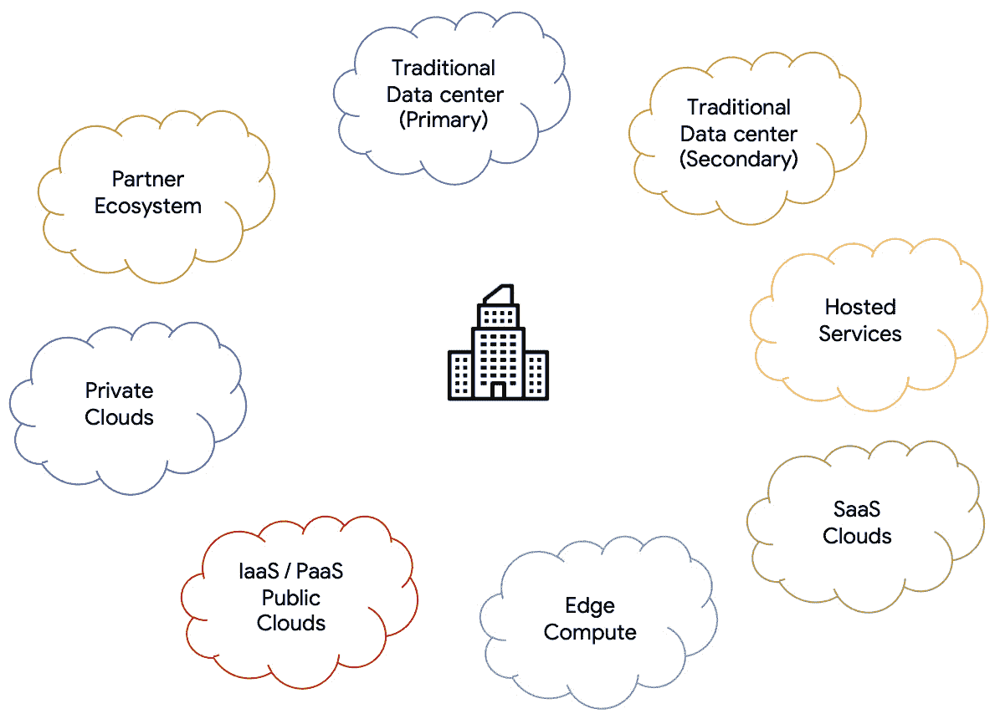
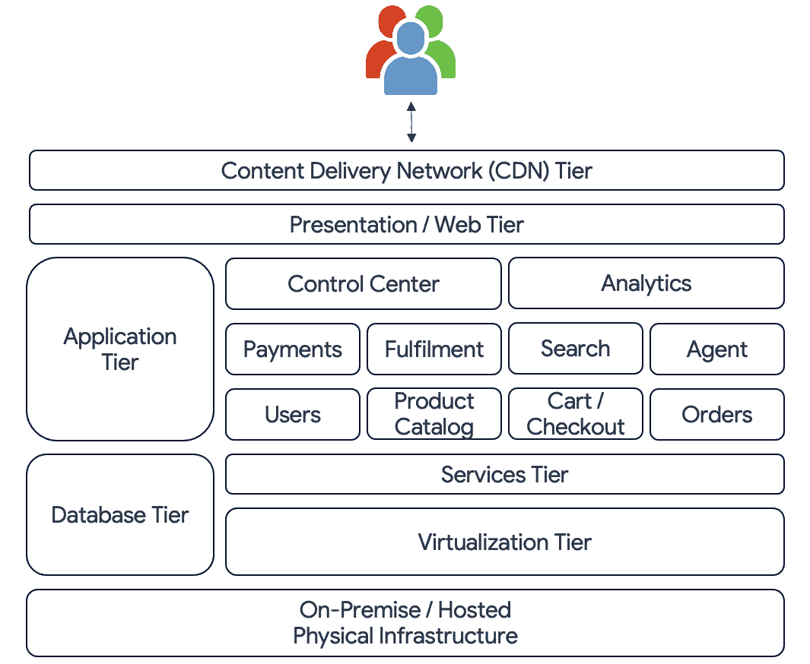
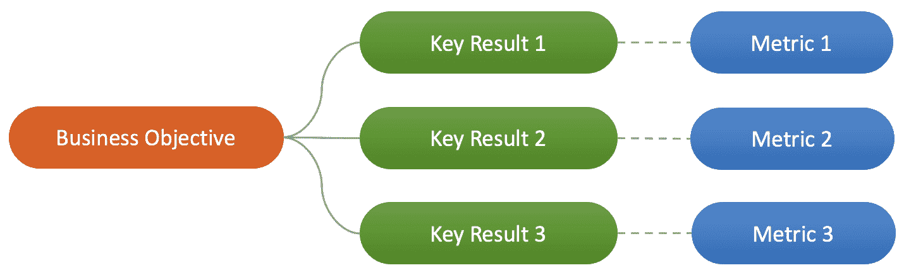
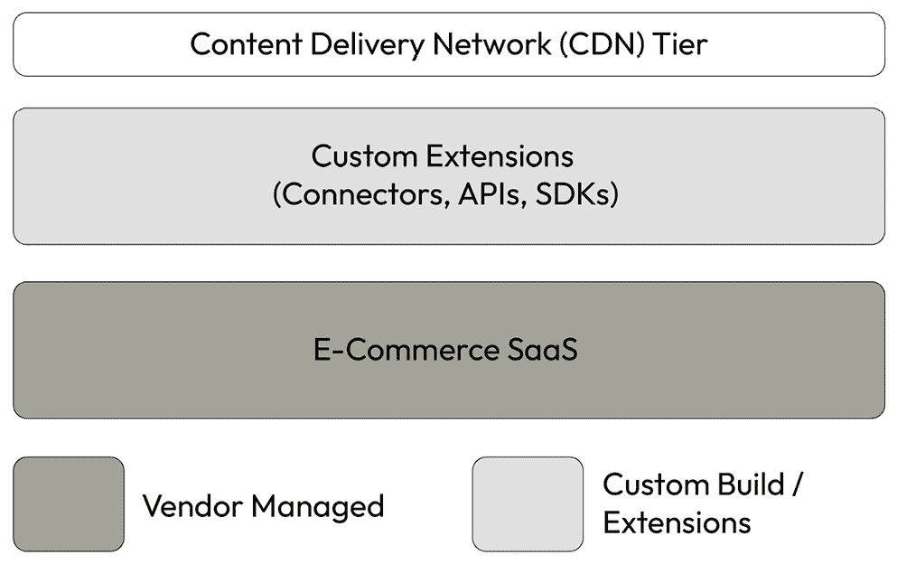
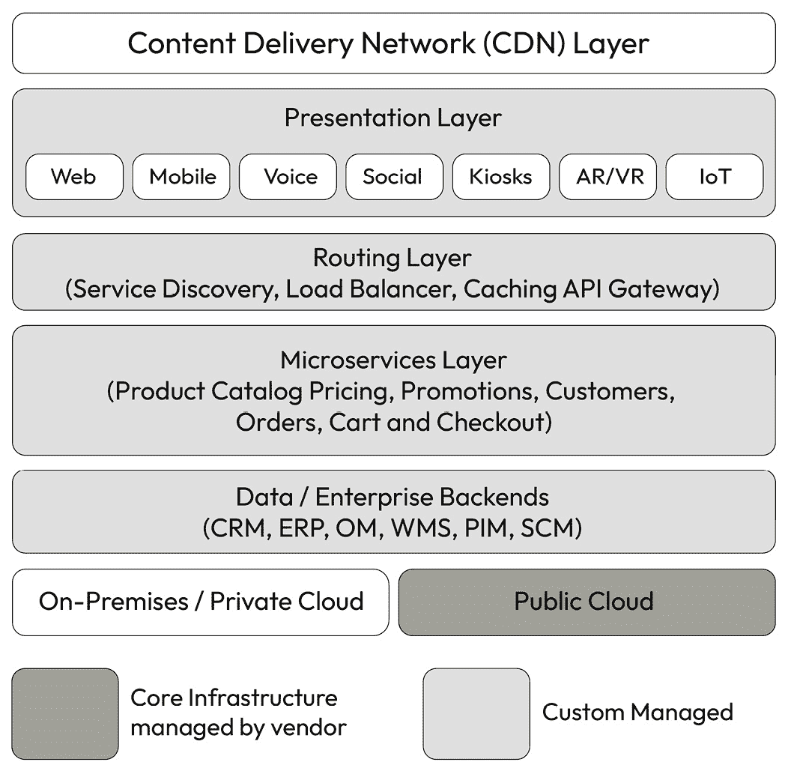
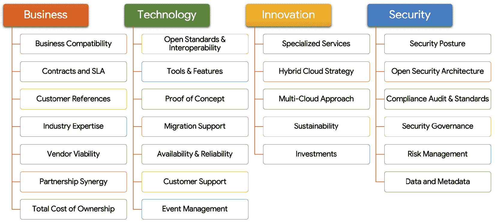

## 3 企业云采用面临的挑战

企业在数字化转型和采用云技术时面临的常见挑战之一，是其平衡现有传统本地 IT 生态系统与云的能力。在传统企业中，任何新技术的采用仍需依赖 IT 来提供业务能力。例如，计划重塑 ERP 的财务部门可以挑选 ERP 软件或供应商，但仍需与其 IT 部门合作提供基础设施、平台、安全性和集成，以使其完全发挥功能。现代云技术降低了业务与 IT 之间的摩擦和依赖。例如，销售组织可以几乎即时采购和运营 CRM SaaS 解决方案来满足其业务需求，而无需依赖 IT。当然，IT 组织仍需管理应用程序集成、数据集成和安全复杂性。下图说明了典型企业 IT 生态系统将是什么样的：

图 3.1 – 一个典型的企业 IT 生态系统

本章将探讨企业在数字化转型中面临的挑战和复杂性，以及应对这些挑战的一些策略。具体而言，我们将讨论并解决以下问题：
* 在企业 IT 生态系统复杂性之下，我们应从何处开始数字化转型？
* 通过电子商务应用现代化示例选择正确的云策略
* 如何识别适合云转型的 workload 以及各种策略
* 混合云和多云采用的最佳实践
* 企业如何应对新的财务模式——具体来说是从资本支出 CapEx 到运营支出 OpEx

# 我们从哪里开始？企业 IT 生态系统的复杂性

当今的企业 IT 生态系统已超越了物理企业的边界。随着有机增长和不断增长的业务需求，企业 IT 管理变得难以管理和维护。由于市场动态和不断增长的客户需求，企业已超越传统数据中心的范围，并涉足托管服务、SaaS 云、边缘计算（即微型数据中心）、私有云、公有云以及与合作伙伴生态系统的集成。尽管这些举措增强了业务能力，但仍存在数据蔓延、数据冗余、源于多种应用架构的反模式、集成、供应商管理、数据安全、隐私和合规等自然挑战。让我们回顾一下围绕企业 IT 的一些复杂性。

## 技术债务

技术债务或技术债是指在软件系统的开发和维护过程中，随着时间推移所做出的次优决策、妥协和捷径所累积的后果。它代表企业在为快速交付解决方案而以高维护成本进行权衡时，随着时间推移所承担的成本。技术债务在多个企业中普遍存在，可能源于各种因素，例如时间限制、预算限制、业务优先级的改变、技术专业知识不足、规划不足以及不断变化的技术环境。开发团队可能会选择快速而粗糙的解决方案以满足紧迫的截止日期，或因资源限制而偷工减料，从而导致技术债务累积。

技术债务可以表现为不同的形式：
* **架构债务**：次优的系统设计和架构决策
* **代码债务**：复杂、冗长且文档记录不佳的代码库
* **数据债务**：数据的冗余副本，也常被称为数据蔓延或数据孤岛
* **软件债务**：过时且不受支持的软件、冗余的软件功能
* **遗留债务**：需要大量维护和返工的遗留系统
* **硬件债务**：在硬件堆栈上的累积投资；需要专业顾问和支持的超融合基础设施

累积的技术债务可能对企业产生重大影响，因为它可能减缓开发、阻碍生产力、增加维护成本，并带来系统故障、错误和安全漏洞的更高风险。它可能阻碍创新并妨碍企业适应不断变化的市场需求的能力。

## 业务部门创建自己的 IT 中心

随着消费者和市场需求呈指数级增长，企业不断面临满足业务需求以保持竞争力的挑战。由于企业的主要驱动力是紧跟市场需求，业务部门领导者通常会选择提供更快上市时间、易于管理、低管理开销且对 IT 依赖较小的解决方案。随着 **软件即服务**（**SaaS**）商业模式的出现，业务部门可以投资于快速解决业务需求的解决方案。例如，销售团队可以利用其预算投资于现代 CRM 平台，以提高客户保留率、提供更好的客户服务、提高销售预测准确性并深入了解客户行为。尽管这可能在短期内帮助满足特定的业务需求，但这可能会迅速导致孤岛式解决方案以及企业 IT 生态系统内部多样化技术、平台和架构的 proliferate，从而导致应用程序集成、数据集成和安全复杂性。企业必须拥有明确的业务战略和相应的 IT 战略，以在不增加 IT 复杂性和维护负担的情况下实现可持续的长期业务目标。

## 专有私有云

云技术从根本上建立在开源技术之上。然而，随着越来越多的云厂商在开源技术之上构建专有包装以提供差异化的产品，谨慎的做法是企业在适当的规划、设计和管理下仔细评估利弊。这种效应在私有云产品中更为严重，因为私有云通常需要对基础设施、硬件、软件、开发方法和咨询工作进行大量前期投资。使用专有技术限制了灵活性并导致供应商锁定。在私有云中，资源分配和优化对于确保可用基础设施的高效利用至关重要。根据需求平衡工作负载、管理虚拟机放置以及优化资源分配可能是需要持续监控和微调的复杂任务。企业在选择私有云部署模型时，其他主要考虑因素是数据主权和合规需求。由于私有云存储敏感的企业数据和应用程序，因此需要强大的安全措施、管理访问控制、数据加密并防范威胁，这可能变得复杂。遵守行业特定法规（如 HIPAA 或 GDPR）增加了另一层复杂性，需要仔细配置和审计安全控制。构建和管理私有云的另一个常见挑战是提供 **服务等级协议**（**SLAs**）、监控、容量规划和计费回溯机制的能力，这些都需要强大的服务管理流程和工具。

## 数据蔓延与集成

## 数据蔓延
数字化转型中另一个非常常见的挑战是企业范围内的数据蔓延。数据蔓延是指数据在企业范围内不受控制的增长和分散，带来诸多复杂性。数据蔓延会使在需要时定位和访问相关数据变得困难。在多个系统和存储库中搜索和发现数据变得具有挑战性，导致数据驱动的决策流程效率低下和延迟。建立和执行一致的数据治理政策、维护数据质量和安全以及遵守法规变得具有挑战性。在多个系统和位置管理数据会导致存储和基础设施成本增加，而由于格式不一致和数据孤岛，数据集成和互操作性受损。发现和访问相关数据变得困难，影响决策流程，并使数据备份和恢复变得更加复杂。为应对这些复杂性，必须实施稳健的数据治理框架、集成策略和技术，同时配合数据分类、元数据管理和定期审计，以缓解数据蔓延带来的挑战。

## 安全
在企业数字化转型的过程中，安全挑战是一个关键考虑因素，因为组织采用新技术并拥抱数字化举措。随着企业 IT 生态系统开始跨越本地基础设施、公共云、边缘计算、第三方集成和物联网，它导致了攻击面增加的复杂且动态的 IT 环境。保护这一错综复杂的生态系统需要持续监控、威胁检测和漏洞管理。确保数据保护和隐私变得至关重要，尤其是在 GDPR 或 CCPA 等不断演进的法规下，企业必须制定和实施稳健的安全措施，包括加密、访问控制和数据生命周期管理。

## 选择合适的云策略
企业具有独特业务需求，评估、评估和规划合适的云策略至关重要。鉴于云部署模型和云超大规模厂商种类繁多，企业在踏上云之旅之前必须仔细评估其业务目标、识别工作负载适用性，并评估供应商的能力以及支持/安全措施。企业面临的主要挑战之一是决定从哪里开始云之旅。一个业务问题可以通过多种解决方案来解决。解决方案的选择主要取决于企业当前的 capabilities、技能组合、驱动事件、IT 成熟度以及资源的可用性。

### 示例
让我们考虑一个零售企业踏上数字化转型之旅，构建现代全渠道电子商务平台的示例。展示了传统的单体电子商务应用架构：

 
图 3.2 – 传统电子商务架构

从业务需求角度来看，零售商可以定义业务目标以及相关的关键结果和指标：

 
图 3.3 – 目标与关键结果 (OKR)

以下是 OKR 如何为电子商务现代化设想和定义的示例。

*   **目标**：目标是提高电子商务平台效率并提供全渠道用户体验，以满足、服务和支持现代购物者的需求。
*   **关键结果**：成果旨在解决电子商务现代化目标，例如平台效率、提供全渠道用户体验以及满足新的消费者期望。以下是可以直接影响整体目标的一些关键结果：
    *   **现代用户体验**：直观且易于导航的界面可在不同设备和屏幕尺寸上提供无缝用户体验，包括网页、移动应用、移动网页和语音助手。
    *   **移动体验**：随着智能手机、平板电脑、智能设备和可穿戴设备的普及，对电子商务平台进行全面移动优化以满足日益增长的移动购物者数量至关重要。
    *   **强大的产品目录管理**：实现产品信息的高效管理，包括详细描述、多个产品图片、价格、库存可用性和变体。
    *   **B2C、B2B、B2B2C 能力**：这是支持消费者、企业对企业商务和直接面向消费者销售的能力。
    *   **安全可靠的支付处理**：支持各种支付方式，包括信用卡/借记卡、数字钱包以及与开放银行生态系统的集成，以提供个性化灵活的支付和融资选项，例如 **先买后付** (**BNPL**) 和其他在线支付系统。
    *   **高效订单管理**：实现无缝的跨渠道订单处理，包括下单、跟踪和履约。与库存管理系统集成以提供准确的库存信息。
    *   **与第三方服务集成**：与外部服务（如物流提供商、分析工具、CRM 系统、供应链、营销自动化平台和企业后端系统）集成对于高效运营和数据分析至关重要。
    *   **强大的搜索和筛选功能**：强大的搜索功能和高级筛选选项帮助客户快速找到所需产品，提升用户体验并推动转化。
    *   **可扩展性和性能**：构建处理大量流量和交易的能力，而不会出现明显的性能下降，同时也能适应未来增长和需求激增，例如季节性或闪购。
    *   **跨渠道个性化**：在多个渠道（如网站、移动应用、社交媒体和实体店）提供无缝购物体验，使客户能够通过其偏好的渠道与品牌互动，并支持个性化促销、电子邮件和动态产品推荐。
    *   **嵌入式 AI**：支持利用现代 AI 解决方案的广泛能力，例如个性化购物体验、产品推荐、提供 24/7 支持的虚拟助手、智能产品发现、欺诈检测与预防、视觉和语音搜索能力、动态定价和促销。
    *   **安全与合规**：防范诸如勒索软件、DDoS 攻击、金融欺诈、智能抓取机器人、网络钓鱼、**跨站脚本** (**XSS**) 和 **中间人** (**MITM**) 攻击等恶意软件攻击。平台还应支持各种监管和合规法规，例如 PCI、PII、GDPR、COPPA 和 ADA。

从技术角度来看，这一问题陈述和目标可以通过多种方式解决。让我们探讨一些选项以及每种方法的优缺点。

### 选项 1：使用 SaaS 构建电子商务平台
SaaS 电子商务平台因其便利性、上市速度快和成本效益而变得越来越受欢迎。SaaS 电子商务平台对于寻求经济高效、可扩展且无忧的在线商店建立和管理解决方案的企业而言，是一个有吸引力的选择。然而，企业评估利用基于 SaaS 的电子商务平台的优缺点至关重要。

 
图 3.4 – 基于 SaaS 的电子商务架构

以下是 SaaS 方法的一些优势：

# SaaS 电商平台概述

## 优势

* **上市时间更快**：SaaS 平台提供用户友好的界面并提供预建模板和主题，使企业能够快速设置和启动其在线商店。
* **成本效益高**：SaaS 平台提供基于订阅的定价模式，允许企业按需付费，而非进行大额前期投资。这对于中小型企业或 IT 资源和预算有限的组织尤其有利，因为它可以帮助它们避免与托管、安全和维护相关的成本。
* **可扩展性**：SaaS 平台旨在随着业务增长而轻松扩展。SaaS 服务提供商承担扩展基础设施和资源以处理增加的流量、交易和产品目录的责任，而无需对底层架构进行重大更改。
* **安全性和合规性**：SaaS 提供商通常会大量投资安全措施，通过实施行业标准安全协议、进行定期安全审计并确保符合各种数据保护法规来保护其平台和客户数据。SaaS 平台提供强大的安全措施，包括数据加密、定期备份以及符合 PCI 等行业标准。平台提供商通常处理安全更新并确保平台免受漏洞威胁。
* **降低 IT 负担**：使用 SaaS 电商平台，企业可以将基础设施管理和技术复杂性转移给服务提供商。这使内部 IT 团队能够专注于更具战略性的任务和核心业务活动，而非日常维护和更新。
* **功能增强**：SaaS 平台通常提供频繁的更新和新功能发布，确保电商商店保持与最新技术和趋势同步。这些更新可以帮助企业在市场上保持竞争力。
* **运营和维护**：由于 SaaS 平台由服务提供商运营和维护，这非常适合中小型企业和精简的 IT 组织，企业可以将精力投入到其他业务优先事项上。
* **数据分析和洞察**：SaaS 电商平台包含内置的分析和报告功能，可提供有关业务绩效的宝贵洞察。组织可以跟踪关键指标、分析客户行为，并做出数据驱动的决策以优化电商运营并推动增长。

在上述优势之外，企业必须意识到存在一些缺点：

## 缺点

* **定制有限**：与自托管解决方案相比，SaaS 平台在定制选项方面可能存在限制。虽然它们提供可在一定程度上定制的模板和主题，但企业通常在修改底层代码或实施高度特定的设计和功能要求方面受到限制。
* **供应商依赖**：由于电商平台由提供商托管和管理，企业依赖于平台的正常运行时间、性能和支持。如果平台出现技术问题或停机，可能会影响在线商店的可用性和功能。
* **差异化服务**：基于 SaaS 的解决方案也可能成为实施独特差异化服务的障碍，例如嵌入基于 AI 的解决方案、第三方搜索/产品发现服务等。
* **数据所有权和迁移挑战**：使用 SaaS 平台时，数据存储在提供商的服务器上。如果未来决定更换平台，这可能会引发数据所有权和可移植性的担忧。企业在将数据和定制迁移到不同系统时也可能面临挑战。
* **集成和控制有限**：使用 SaaS 平台时，您对后端基础设施和服务器配置的控制有限。这对于具有特定托管要求或需要与外部或现有企业后端系统进行高级定制和集成的企业来说可能是一个劣势。
* **长期运营成本**：虽然基于订阅的定价模式对许多企业来说具有成本效益，但它可能成为长期支出。随着时间推移，企业需求增长，企业将需要利用各种附加服务来构建能力，累积的订阅成本可能超过构建和维护自托管电商解决方案的成本。

### 选项 2：基于无头电商构建电商平台

开发电商解决方案的另一个重要趋势是基于 **微服务化、API 优先、云原生和无头** (`MACH`) 架构的无头可组合电商。在无头可组合电商架构中，内容管理能力与电商应用的展示层或前端分离。无头可组合电商使开发人员能够从多个来源组合和合并内容，包括外部 API、微服务或其他内容存储库，从而在跨各种系统的内容聚合和集成方面提供更大的灵活性。无头电商为内容创作者和编辑提供用户友好的界面来创建、管理和组织内容，包括内容编辑、版本控制、内容工作流和用户权限等功能。使用无头 CMS，前端与后端分离，允许开发人员灵活选择最合适的[content]
# SaaS 电商平台概述

## 优势

* **上市时间更快**：SaaS 平台提供用户友好的界面并提供预建模板和主题，使企业能够快速设置和启动其在线商店。
* **成本效益高**：SaaS 平台提供基于订阅的定价模式，允许企业按需付费，而非进行大额前期投资。这对于中小型企业或 IT 资源和预算有限的组织尤其有利，因为它可以帮助它们避免与托管、安全和维护相关的成本。
* **可扩展性**：SaaS 平台旨在随着业务增长而轻松扩展。SaaS 服务提供商承担扩展基础设施和资源以处理增加的流量、交易和产品目录的责任，而无需对底层架构进行重大更改。
* **安全性和合规性**：SaaS 提供商通常会大量投资安全措施，通过实施行业标准安全协议、进行定期安全审计并确保符合各种数据保护法规来保护其平台和客户数据。SaaS 平台提供强大的安全措施，包括数据加密、定期备份以及符合 PCI 等行业标准。平台提供商通常处理安全更新并确保平台免受漏洞威胁。
* **降低 IT 负担**：使用 SaaS 电商平台，企业可以将基础设施管理和技术复杂性转移给服务提供商。这使内部 IT 团队能够专注于更具战略性的任务和核心业务活动，而非日常维护和更新。
* **功能增强**：SaaS 平台通常提供频繁的更新和新功能发布，确保电商商店保持与最新技术和趋势同步。这些更新可以帮助企业在市场上保持竞争力。
* **运营和维护**：由于 SaaS 平台由服务提供商运营和维护，这非常适合中小型企业和精简的 IT 组织，企业可以将精力投入到其他业务优先事项上。
* **数据分析和洞察**：SaaS 电商平台包含内置的分析和报告功能，可提供有关业务绩效的宝贵洞察。组织可以跟踪关键指标、分析客户行为，并做出数据驱动的决策以优化电商运营并推动增长。

在上述优势之外，企业必须意识到存在一些缺点：

## 缺点

* **定制有限**：与自托管解决方案相比，SaaS 平台在定制选项方面可能存在限制。虽然它们提供可在一定程度上定制的模板和主题，但企业通常在修改底层代码或实施高度特定的设计和功能要求方面受到限制。
* **供应商依赖**：由于电商平台由提供商托管和管理，企业依赖于平台的正常运行时间、性能和支持。如果平台出现技术问题或停机，可能会影响在线商店的可用性和功能。
* **差异化服务**：基于 SaaS 的解决方案也可能成为实施独特差异化服务的障碍，例如嵌入基于 AI 的解决方案、第三方搜索/产品发现服务等。
* **数据所有权和迁移挑战**：使用 SaaS 平台时，数据存储在提供商的服务器上。如果未来决定更换平台，这可能会引发数据所有权和可移植性的担忧。企业在将数据和定制迁移到不同系统时也可能面临挑战。
* **集成和控制有限**：使用 SaaS 平台时，您对后端基础设施和服务器配置的控制有限。这对于具有特定托管要求或需要与外部或现有企业后端系统进行高级定制和集成的企业来说可能是一个劣势。
* **长期运营成本**：虽然基于订阅的定价模式对许多企业来说具有成本效益，但它可能成为长期支出。随着时间推移，企业需求增长，企业将需要利用各种附加服务来构建能力，累积的订阅成本可能超过构建和维护自托管电商解决方案的成本。

### 选项 2：基于无头电商构建电商平台

开发电商解决方案的另一个重要趋势是基于 **微服务化、API 优先、云原生和无头** (`MACH`) 架构的无头可组合电商。在无头可组合电商架构中，内容管理能力与电商应用的展示层或前端分离。无头可组合电商使开发人员能够从多个来源组合和合并内容，包括外部 API、微服务或其他内容存储库，从而在跨各种系统的内容聚合和集成方面提供更大的灵活性。无头电商为内容创作者和编辑提供用户友好的界面来创建、管理和组织内容，包括内容编辑、版本控制、内容工作流和用户权限等功能。使用无头 CMS，前端与后端分离，允许开发人员灵活选择最合适的[content]
# SaaS 电商平台概述

## 优势

* **上市时间更快**：SaaS 平台提供用户友好的界面并提供预建模板和主题，使企业能够快速设置和启动其在线商店。
* **成本效益高**：SaaS 平台提供基于订阅的定价模式，允许企业按需付费，而非进行大额前期投资。这对于中小型企业或 IT 资源和预算有限的组织尤其有利，因为它可以帮助它们避免与托管、安全和维护相关的成本。
* **可扩展性**：SaaS 平台旨在随着业务增长而轻松扩展。SaaS 服务提供商承担扩展基础设施和资源以处理增加的流量、交易和产品目录的责任，而无需对底层架构进行重大更改。
* **安全性和合规性**：SaaS 提供商通常会大量投资安全措施，通过实施行业标准安全协议、进行定期安全审计并确保符合各种数据保护法规来保护其平台和客户数据。SaaS 平台提供强大的安全措施，包括数据加密、定期备份以及符合 PCI 等行业标准。平台提供商通常处理安全更新并确保平台免受漏洞威胁。
* **降低 IT 负担**：使用 SaaS 电商平台，企业可以将基础设施管理和技术复杂性转移给服务提供商。这使内部 IT 团队能够专注于更具战略性的任务和核心业务活动，而非日常维护和更新。
* **功能增强**：SaaS 平台通常提供频繁的更新和新功能发布，确保电商商店保持与最新技术和趋势同步。这些更新可以帮助企业在市场上保持竞争力。
* **运营和维护**：由于 SaaS 平台由服务提供商运营和维护，这非常适合中小型企业和精简的 IT 组织，企业可以将精力投入到其他业务优先事项上。
* **数据分析和洞察**：SaaS 电商平台包含内置的分析和报告功能，可提供有关业务绩效的宝贵洞察。组织可以跟踪关键指标、分析客户行为，并做出数据驱动的决策以优化电商运营并推动增长。

在上述优势之外，企业必须意识到存在一些缺点：

## 缺点

* **定制有限**：与自托管解决方案相比，SaaS 平台在定制选项方面可能存在限制。虽然它们提供可在一定程度上定制的模板和主题，但企业通常在修改底层代码或实施高度特定的设计和功能要求方面受到限制。
* **供应商依赖**：由于电商平台由提供商托管和管理，企业依赖于平台的正常运行时间、性能和支持。如果平台出现技术问题或停机，可能会影响在线商店的可用性和功能。
* **差异化服务**：基于 SaaS 的解决方案也可能成为实施独特差异化服务的障碍，例如嵌入基于 AI 的解决方案、第三方搜索/产品发现服务等。
* **数据所有权和迁移挑战**：使用 SaaS 平台时，数据存储在提供商的服务器上。如果未来决定更换平台，这可能会引发数据所有权和可移植性的担忧。企业在将数据和定制迁移到不同系统时也可能面临挑战。
* **集成和控制有限**：使用 SaaS 平台时，您对后端基础设施和服务器配置的控制有限。这对于具有特定托管要求或需要与外部或现有企业后端系统进行高级定制和集成的企业来说可能是一个劣势。
* **长期运营成本**：虽然基于订阅的定价模式对许多企业来说具有成本效益，但它可能成为长期支出。随着时间推移，企业需求增长，企业将需要利用各种附加服务来构建能力，累积的订阅成本可能超过构建和维护自托管电商解决方案的成本。

### 选项 2：基于无头电商构建电商平台

开发电商解决方案的另一个重要趋势是基于 **微服务化、API 优先、云原生和无头** (`MACH`) 架构的无头可组合电商。在无头可组合电商架构中，内容管理能力与电商应用的展示层或前端分离。无头可组合电商使开发人员能够从多个来源组合和合并内容，包括外部 API、微服务或其他内容存储库，从而在跨各种系统的内容聚合和集成方面提供更大的灵活性。无头电商为内容创作者和编辑提供用户友好的界面来创建、管理和组织内容，包括内容编辑、版本控制、内容工作流和用户权限等功能。使用无头 CMS，前端与后端分离，允许开发人员灵活选择最合适的

## 无头电商平台

* **更易集成**：无头可组合电商平台通常提供文档完善的 API，使得与企业后端系统、第三方服务、外部系统和微服务集成变得更容易。这使企业能够无缝利用支付、库存管理、分析或营销自动化等专业服务，扩展其电商平台的功能。

选择无头电商平台的缺点如下：

* **开发复杂性**：与传统的单体电商解决方案相比，实施无头可组合电商需要更高的技术专业知识。开发人员需要处理前端与后端的集成和同步，这可能会增加开发复杂性和时间。由于前端和后端是分开开发的，因此需要额外的开发工作来构建和维护，这可能会导致成本增加，尤其是在企业缺乏必要的 IT 资源或专业知识的情况下。
* **依赖 API 和后端稳定性**：后端及其 API 的性能和可靠性对于确保内容顺畅交付和整体平台功能至关重要。任何后端问题或 API 中断都可能直接影响用户体验并需要立即解决。
* **开箱即用功能有限**：与传统电商平台相比，无头可组合电商解决方案可能提供更少的开箱即用功能和特性，因为重点主要放在自定义前端和后端开发上，而非集成的电商功能。这要求企业投入额外的开发工作来构建或集成特定的电商功能。
* **系统复杂性增加**：无头可组合电商引入了额外的组件和集成，这可能会增加整体系统复杂性。管理和维护多种技术、API 和服务需要仔细协调和持续监控。这种复杂性可以通过利用供应商管理的技术栈来缓解。
* **运营成本**：无头电商平台要求企业在构建 IT 能力、技能组合、开发和运营资源方面进行大量投资。实施成本高昂，通常最适合拥有庞大且技术娴熟的电商团队的企业。

与任何架构设计决策一样，在选择无头电商方法之前，仔细评估其优缺点至关重要。

### 选项 3：构建云原生电商平台

基于微服务的电商系统对于寻求完全灵活性、精细控制以及通过电商提供独特客户体验的企业来说可能是一个完美的解决方案。在此模型中，传统的电商应用栈被拆分为更小、松耦合的服务，这些服务可以独立开发、部署和扩展。这涉及识别核心功能组件；定义服务边界；设计 API；选择合适的技术栈和部署平台；实施服务发现和编排；确保数据一致性、CI/CD 实践和部署；以及扩展自动化。需要注意的是，开发基于微服务的电商平台需要仔细的规划、协调和专业知识。以下是对基于云原生架构的典型电商应用的表示：

图 3.6 – 云原生电商平台架构

企业评估并了解这种方法的利弊将是明智的。让我们回顾一下其中的一些优势：

* **可扩展性和灵活性**：微服务允许根据需求独立扩展不同的组件。这种灵活性能够实现高效的资源利用，并在旺季和闪购期间处理高流量，同时也能适应未来的增长。
* **通过模块化开发加快上市时间**：微服务促进模块化开发，使团队能够独立地在不同服务上工作。这加快了开发周期，并能够使用最适合每个微服务需求的不同技术和框架。
* **快速创新和部署**：基于微服务的架构促进更快的部署周期，并使团队能够独立创新并发布新功能或更新。这种敏捷性使企业能够快速响应市场趋势和客户需求。
* **技术多样性**：借助微服务，IT 团队可以为每个功能服务选择不同的技术和编程语言。这使团队能够利用特定技术和框架的优势，实现最佳性能和生产力。
* **改进的故障隔离和恢复**：微服务提供更好的故障隔离，这意味着单个服务的故障不会影响整个系统。这种隔离便于故障排除、加快恢复速度并提高整体系统稳定性。

以下是这种方法的一些缺点：

* **复杂性增加**：管理微服务分布式系统与单体架构相比会引入额外的复杂性。诸如服务间通信、数据一致性和事务管理等挑战需要仔细解决。
* **运营开销**：维护和管理多个微服务需要额外的运营工作。部署、监控和编排等任务可能会变得更加复杂，需要强大的 DevOps 实践。
* **架构一致性**：微服务严重依赖服务间通信，这可能会引入网络延迟并影响整体系统性能。适当的设计和高效的通信模式对于缓解这一挑战至关重要。
* **数据完整性**：在多个微服务之间维护数据一致性可能很复杂，尤其是在处理事务或共享数据时。可能需要事件溯源或分布式事务等技术来确保数据完整性。
* **IT 技能和资源**：开发和管理微服务需要专业技能和专业知识。找到并留住具有构建和维护分布式系统经验的人才可能具有挑战性。
* **服务编排和集成**：协调和编排多个微服务可能具有挑战性。实施服务发现和 API 网关并确保服务之间无缝集成需要额外的规划和实施工作。

下表显示了不同方法各项标准的并排比较：

| 标准 | 传统电商（打包应用） | 基于 SaaS 的电商 | 无头电商 | 基于微服务的电商 |
| --- | --- | --- | --- | --- |
| 可扩展性 | 有限 | 高 | 高 | 高 |
| 预先投资 | $$$ | $ | $$ | $$ |
| 灵活性 | 高 | 低 | 中等 | 高 |
| 上市时间 | 慢 | 中等 | 快 | 快 |
| 所需 IT 技能 | 高级 | 基础 | 中级 | 高级 |
| 所需 IT 资源 | 高 | 低 | 中等 | 高 |
| 供应商依赖 | 低 | 高 | 高 | 低 |
| 内置安全和合规性 | 中等 | 高 | 中等 | 低 |
| 硬件/软件许可和支持 | 高 | 不适用 | 不适用 | 中等（本地部署）不适用（公有云） |
| 运营费用 | $ | $$$ | $$ | $$ |
| 集成支持 | 高 | 中等 | 中等 | 高 |

| 开箱即用的分析 || 有限 || 中等 || 中等 || 自定义 |
| 持续维护 || 高 || 低 || 高 || 高 |
表 3.1 – 不同电商架构方法的比较
对 IT 组织而言，审慎评估能力、考虑权衡、对照业务优先级进行评估并选择合适的策略是明智的。

# 识别云转型的合适工作负载

企业面临的主要挑战之一是识别云转型的合适工作负载，因为每个企业环境中的业务挑战都是独特的。即便是在同一行业垂直领域或具有相似商业模式和收入的企业中，一刀切的方法也不奏效，企业领导者必须对企业范围的云转型之旅有清晰的愿景和战略。企业可以根据独特的业务需求和驱动事件选择多种云转型策略，包括大爆炸迁移、数据中心退出、平移迁移、构建全新举措，或通过云原生能力增强应用程序。我们将在 *第 5 章**，企业云转型之旅* 中更详细地回顾这些云转型之旅。在本节中，让我们探讨一些企业云转型面临的挑战。

## 大爆炸迁移

大爆炸云迁移是一种方法，即在一次协调的努力中将整个企业的基础设施、应用程序和数据迁移到云中。大爆炸迁移的目标是在规定的时间内快速迁移并实现所有企业系统和应用程序到云的平稳无中断过渡，最小化停机时间并确保对业务运营的最小影响。它涉及将所有系统和工作负载从本地或托管数据中心迁移到基于云的基础设施。向云的过渡在相对较短的时间范围内进行，通常会计划停机以执行迁移过程。它通常涉及全面的分析和规划阶段，以确保在迁移前解决所有依赖关系、安全要求和合规性考虑。

组织可能会根据特定情况和要求选择大爆炸云迁移方法，例如数据中心整合、遗留系统现代化、全球业务扩张、合并、分拆或收购。虽然大爆炸迁移在某些情况下可以带来好处，但它需要仔细规划、资源分配和风险管理。企业应彻底评估其准备情况、评估依赖关系、进行适当的测试并制定稳健的应急计划，以减轻潜在风险，确保迁移成功。

与大爆炸迁移方法相关的一些挑战如下：
*   **规模和复杂性**：大爆炸迁移涉及一次性迁移整个企业基础设施和应用程序。这可能非常复杂，尤其对于大型组织而言，其拥有众多相互连接的系统和依赖关系。迁移的规模需要细致的规划、协调和执行，以确保平稳过渡。
*   **停机和中断**：大爆炸迁移通常在迁移过程中需要临时停机。这可能导致业务运营中断，包括在线服务、客户支持和内部工作流程。最小化停机时间并确保无缝过渡对于避免潜在收入损失和负面客户体验至关重要。
*   **迁移风险**：与分阶段或增量迁移方法相比，大爆炸迁移的失败风险更高。迁移过程中出现的问题可能同时影响整个企业，导致广泛中断。稳健的应急计划、彻底的测试和回退策略对于减轻迁移风险至关重要。
*   **数据和应用程序依赖关系**：许多企业系统和应用程序彼此之间存在错综复杂的依赖关系。大爆炸迁移可能会破坏这些依赖关系并导致不可预见的问题。在迁移前识别和解决依赖关系对于确保成功过渡并避免潜在数据不一致或应用程序故障至关重要。
*   **资源和预算管理**：大爆炸迁移需要大量资源，无论是人员还是预算。组织必须确保为规划、迁移、测试和迁移后支持分配足够的资源。充足的预算分配和资源规划对于防止延迟、瓶颈和预算超支至关重要。
*   **有限的回退选项**：在大爆炸迁移中，由于迁移的规模和复杂性，回滚到之前的环境或基础设施可能具有挑战性。这凸显了在执行迁移前进行彻底测试、验证和制定回退计划的重要性。
*   **变更管理**：企业范围的迁移影响整个组织，变更管理对于确保用户采用并最小化抵触至关重要。充分的沟通、培训和支持对于帮助用户过渡到新的云环境并确保他们能够有效利用新工具和服务是必要的。
*   **软件知识产权和许可**：许多传统企业系统和应用程序基于遗留的 COTS 和打包应用程序。某些专有软件部署可能包含关于目标部署平台和位置限制的合同条款，这可能成为云迁移的障碍。根据目标云平台的选择，这些应用程序和系统的迁移可能会触发许可和可支持性限制。因此，务必让各种内部和外部利益相关方和供应商参与评估和规划迁移。
*   **专用遗留系统和 HCI**：传统的大型组织通常拥有用于专用工作负载和业务功能的遗留、过时、已停止支持的软件堆栈和 **超融合基础设施** (**HCI**)。组织可以根据特定的业务目标和需求从多种可用方法中选择来迁移这些系统，包括退役（不再需要的系统）、重新托管（零代码更改重新部署应用程序）、同地部署（在目标云基础设施附近托管系统，尤其是专用硬件）、重新平台化（以最小更改迁移到基于云的运行时）、重构（重组和优化现有应用程序代码）或仿真（在仿真器上虚拟化应用程序以模拟遗留行为）。彻底的评估和规划对于确保在迁移前捕获并考虑这些因素至关重要。
*   **网络和安全**：企业在执行大爆炸迁移时面临的另一个常见挑战是从传统的分层 IP 网络转向扁平的云原生 **软件定义网络** (**SDN**)。尽管云网络可定制，并且多家主要提供商提供 BYOIP 等功能以及支持硬件负载均衡器和防火墙等组件的同地部署，但必须明确定义和规划全面的迁移策略。云原生 SDN 还引入了新的安全考虑，因为企业数据在网络边界之外传输。企业必须仔细规划和实施安全措施来保护数据，例如加密、访问控制和网络分段，利用云提供商提供的纵深防御安全架构和控制。

## 数据中心退出

# 数据中心退出策略

另一条多家企业选择的常见数字化转型路径是退出现有数据中心。虽然大爆炸式迁移侧重于在较短时间内将所有本地系统和应用程序完全转向公共云，但数据中心退出可能具有若干独特的企业目标。企业选择退出数据中心的主要动机包括成本优化、利用云规模经济、降低托管费用、可扩展性、将资源集中于核心业务、利用技术进步进行创新，以及简单地避免硬件和技术更新等迫在眉睫的事件。视业务动机和目标而定，数据中心退出策略必须经过仔细评估和规划。例如，某组织可能会选择退出数据中心并迁移到基于云的基础设施，以避免即将到来的硬件和技术更新。将数据中心迁移到云中可能会给企业带来若干挑战。以下是一些关键考虑因素：

## 关键考虑因素

### 遗留系统和应用程序
企业通常拥有与多个其他应用程序、服务和数据中心基础设施紧密集成的遗留系统和应用程序。这些系统可能依赖于特定的硬件或软件配置，使得直接迁移到云中变得困难。将这些遗留应用程序现代化或重新架构以使其云兼容可能耗时且复杂。必须制定明确的迁移评估和规划练习，以捕捉当前状况和目标未来状态。我们将在第 6 章中详细探讨一些迁移模式和蓝图以及如何构建云迁移评估计划，《构建开放且敏捷的 **云框架**》。

### 数据传输
将大量数据从数据中心迁移到云中可能具有挑战性，尤其是在线传输时，因为可用网络带宽可能有限，甚至可能变得成本高昂。数据在网络上传输所需的时间以及相关成本会影响迁移时间表和预算。企业需要仔细规划和优化数据传输流程以最大限度地减少中断。大多数公共云提供商提供经济实惠的离线批量数据传输/迁移服务，可通过物理存储设备促进从本地或托管数据中心的数据迁移。必须对数据加密给予认真考虑，以防止敏感数据丢失。

### 应用程序兼容性
并非所有应用程序都设计为在云环境中运行。某些应用程序可能需要修改、重构，甚至完全重写才能成为云原生并利用云效率和自动化能力。应用程序兼容性计划必须作为云迁移评估的一部分制定，并附带潜在选项，以确保迁移成功和业务连续性。

### 安全性和合规性
公共云提供商在 *共享责任* 和 *共享命运* 模式下运营。组织必须清楚了解云提供商提供的<|message|>安全范式至关重要。共享责任模型基于这样一种前提，即各层的安全责任界定明确，其中 **云服务提供商**（**CSPs**）和客户负责各自层级的<|message|>安全。然而，在共享命运模型中，CSP 在保护云环境方面发挥着更积极的作用。例如，支持共享命运的 CSP 通过采取合作方式保护客户租户，提供默认安全即开即用配置并满足合规义务、安全蓝图、风险保护计划和策略智能工具。重要的是要理解，云安全措施和实践可能与数据中心不同，需要对企业与云提供商之间的共享安全责任有透彻的理解。确保数据隐私、访问控制以及传输中和静态加密至关重要。我们将在第 9 章中深入探讨云安全框架和最佳实践，《 **数字转型** 的方面》。

### 供应商锁定
企业在选择云提供商时必须仔细考虑潜在的供应商锁定风险。将应用程序和数据迁移到特定云提供商的平台可能会限制未来轻松更换提供商的能力。制定开放的云友好策略或多云策略，将工作负载分布在不同的云提供商之间，可以降低供应商锁定的风险并提供更大的灵活性。

### 网络连接
建立企业本地基础设施与云环境之间可靠且高性能的网络连接至关重要，尤其是在选择混合云或多云方法时。视数据中心和云区域的地理位置而定，可能会出现网络延迟和连接问题。网络架构计划应作为迁移计划的一部分进行定义，以实施适当的网络配置来帮助优化网络性能。存在多种连接选项，包括专用连接，用于从数据中心到云建立直接 MPLS 连接；合作伙伴驱动连接，通过 ISP 建立到云的 MPLS 连接；对于已与云提供商同址的数据中心企业，可使用交叉连接；以及 IPSEC VPN，用于通过公共互联网安全连接到云服务。

### 技能差距
迁移到云需要可能与传统数据中心运营不同的专业技能。企业可能需要提升 IT 员工技能、与合作伙伴合作或聘请云专家来了解云技术、管理工具和最佳实践。确保员工具备管理并优化云环境所需技能，对于成功迁移至关重要。

### FinOps 和成本管理
虽然云提供潜在成本节约，但企业需要仔细管理和优化云成本。如果没有适当的监控和治理，云支出可能会迅速攀升。许多组织在开展云转型时常犯的一个错误是 *为高水位线配置*（这是指提前规划并配置服务器以满足预期峰值容量的做法），就像在传统数据中心中所做的那样，而没有利用云的弹性和按需付费模式。了解定价模式、优化资源利用率并实施成本控制措施对于避免意外成本超支至关重要。对于成熟的组织而言，建立 FinOps 实践以进行持续的成本管理和治理是明智之举。

### 云运营
数据中心中使用的运营流程和程序可能与云环境所需的不相符。企业需要调整其运营实践以有效管理和监控云资源。这包括配置自动扩展、实施监控和告警、管理云原生服务，并确保适当的治理和合规性。

## 云中的灾难恢复 (DR)
企业的一个专门用例是在云中设置新的灾难恢复实例，以增强本地生产环境的弹性，或退出 DR 数据中心以优化成本。企业必须仔细规划本地生产环境与云中 DR 之间在应用和环境方面的对等性，以实现无缝的灾难恢复。我们将在 *第 5 章* 中更详细地讨论这一旅程。

## 将应用迁移到云端
Lift and shift 策略，也称为 *重新托管* 或 *迁移并放置* 策略，是指将应用程序和系统从本地数据中心迁移到云环境，且修改最少或不做修改。在大多数情况下，lift and shift 策略通常是多阶段迁移方法中的第一步。在这种方法中，目标是快速将现有基础设施、应用程序和数据迁移到云平台，同时保留其功能和架构。Lift and shift 策略是在主要目标是实现云优势时选择的，例如可扩展性、成本优化、对业务运营的最小干扰、保留对应用程序和软件许可的现有投资，以及通过逐步重构或重新架构实现分阶段应用现代化的灵活性。我们将在 *第 5 章* 中更深入地探讨 lift and shift 作为云转型之旅。虽然 lift and shift 策略可以提供相对更快的云迁移路径，但它也给企业带来某些挑战和限制：
* **无法利用云原生优化**：Lift and shift 迁移通常优先考虑速度和简单性，而非充分利用云原生能力。因此，企业可能会错失优化应用程序以在短期内实现更好性能、可扩展性和成本效率的机会。然而，有了明确的应用现代化路线图，企业可以将 lift and shift 方法用作分阶段转型的良好落地区。例如，lift and shift 迁移将使团队更好地了解云平台，为利益相关者提供快速成果和信心，并提升 IT 团队的云原生应用现代化技能。
* **应用相互依赖**：企业关键任务应用通常与本地环境中的核心基础设施、库、数据库和其他系统存在复杂的相互依赖关系。应用依赖关系在迁移应用时可能带来挑战，需要仔细评估替代的云原生解决方案，以确保在云环境中的正常功能。必须为相关的基础设施需求和环境考虑因素以及外围应用程序和服务制定明确的迁移计划，以确保业务连续性。
* **数据传输和切换**：从本地环境到云的大规模数据传输可能耗时，影响整体迁移时间表。此外，企业必须规划一次性批量数据传输、通过线路的增量数据传输，以及切换策略，以最大限度地减少迁移过程中所考虑的应用程序的中断和停机时间。
* **性能和可扩展性**：迁移到云的应用程序可能无法自动受益于云固有规模和弹性的全部潜力。一些应用单体传统上是为垂直扩展而开发的。如果没有架构修改或优化，其中一些应用程序可能无法实现期望的性能改进或根据工作负载需求水平扩展的能力。企业可以通过重新架构、重构或重写应用程序来利用云原生的弹性、规模和性能优势。
* **成本优化有限**：虽然成本节约是云迁移的主要动机之一，但 lift and shift 策略可能无法完全优化成本。迁移到云的应用程序可能无法充分利用云优化资源利用的能力。如果没有适当的评估和优化，企业可能会过度配置资源或低利用可用的云资源，导致成本增加或性能不佳。适当的监控和优化工作对于长期实现成本节约是必要的。
* **运营挑战**：本地环境中使用的运营流程和工具可能无法与云环境无缝对齐。企业需要调整其运营实践，以有效管理监控云资源，包括实施云特定的监控、管理和治理流程。
* **许可和支持**：lift and shift 策略可能未考虑本地环境与云之间不同的软件许可模式或定价结构。企业需要审查和优化许可安排，并考虑潜在的成本影响，以避免意外支出或不合规。企业在迁移到云时确保基础设施和环境基线得到支持也至关重要。某些应用厂商还可能规定推荐或支持的云提供商或平台，以便获得持续的企业支持。
* **容错能力**：使用 lift and shift 策略迁移的应用程序可能无法从云内置的弹性和容错功能中 inherent 受益。企业应评估并实施适当的备份、灾难恢复和容错机制，以确保云中的高可用性和业务连续性。
* **安全和合规**：Lift and shift 迁移必须解决云环境特定的安全和合规要求。这包括确保数据保护、访问控制、身份和访问管理，以及遵守相关法规。企业需要评估云提供商的安全能力，实施身份同步和单点登录以实现无缝业务运营，并实施必要措施来保护迁移的应用程序和数据。
* **变更管理与用户采用**：将应用程序迁移到云需要变更管理工作以确保用户顺利采用。用户和利益相关者需要了解迁移过程，接受任何更改或新功能的培训，并在过渡期间获得支持，以最大限度地减少中断并最大化用户满意度。

## 混合云策略

## 混合云战略

一项 **混合云战略** 是企业能够结合使用公共云、私有云或本地环境以满足其独特业务需求的方法。在混合云设置中，组织将其部分应用程序、数据和基础设施保留在本地或私有云中，同时利用公共云服务来处理专门的工作负载和用例。该战略使企业能够获得两者的优势，并在公共云中创建灵活且可扩展的 IT 环境，作为其私有或本地 IT 基础设施的延伸。正如我们在 *第 2 章**, 云计算入门* 中探讨的各种云范式，根据 NIST 定义，“*混合云是由两个或多个不同的云基础设施组成的，这些基础设施保持独立实体，但通过标准化或专有技术绑定在一起，从而实现数据和应用的可移植性*。” 这里的关键短语是“*绑定在一起*”和“*实现数据和应用的可移植性*”。这意味着混合云环境必须使用由通用工具集管理的统一实体，使用户能够同时与私有云和公共云服务进行交互。仅在多个公共云、私有云和本地传统服务器中运营，而没有统一或可移植性能力的组织并不构成混合云架构。凭借明确定义的混合云战略，企业可以利用诸如在公共和私有云之间灵活的应用程序放置和部署；通过选择具有成本效益的部署模式、高效的数据集成、实施强大的灾难恢复和业务连续性解决方案来优化成本；为季节性需求实施云爆发；避免供应商锁定和统一管理等专业能力。组织可以通过仔细规划、架构设计和持续管理获得所有这些好处。我们将回顾企业在实施无缝混合云战略时面临的一些挑战：

* **架构复杂性**：混合云环境与孤立的本地和云部署相比会引入额外的复杂性。在一个或多个云平台、本地基础设施和数据中心之间集成和管理资源具有挑战性，需要仔细的规划和架构设计。如果做得正确，这可以作为企业更快交付现代业务能力的坚实基础和起点。
* **互操作性**：混合云架构可能带来互操作性挑战，确保公共云和私有云环境之间无缝的数据集成和互操作性可能很复杂。企业需要建立高效的数据移动机制，实施适当的集成解决方案，并在不同平台上保持数据一致性和安全性。
* **运营复杂性**：管理混合云部署需要有效的运营流程和工具。企业必须建立运营框架，自动化管理任务，并在本地和云环境中确保一致的监控和性能管理。这种复杂性会增加运营负担，并需要额外投资于 SRE 实践、管理工具和专业知识。
* **治理和合规**：建立统一的治理政策并确保本地和公共云平台之间的一致性对企业来说可能具有挑战性。组织需要在公共和私有云环境中定义和执行资源配置、访问控制、数据管理和合规监控的政策。
* **遗留系统集成**：由于架构、协议或兼容性差异，将遗留系统与混合云环境集成可能会带来挑战。企业可能需要投资现代化工作、应用程序重构或实施集成解决方案，以无缝连接遗留系统与云资源。
* **数据主权**：在混合云部署中，企业需要考虑数据主权和驻留法规，这些法规规定了某些类型数据可以存储和处理的位置。当数据分布在公共和私有云环境中时，确保遵守这些法规可能具有挑战性。
* **数据备份和恢复**：在混合云环境中实施一致的数据备份和恢复机制可能具有挑战性。企业需要确保关键数据得到适当备份，并在数据丢失或系统故障时能够恢复，同时考虑公共和私有云中可用的不同备份和恢复选项。
* **性能变化**：混合云部署可能由于网络延迟、数据中心区域、数据传输速度以及不同云平台性能的差异等因素而出现性能变化。确保混合环境中一致且可预测的性能需要仔细的架构设计和网络优化。
* **技能和专业知识**：混合云部署需要专门的技能和知识来架构、设计并在公共和私有云平台之间有效管理一致性和资源优化。企业可能面临寻找和留住具有云架构、集成、安全和混合云管理等方面正确专业知识的 IT 专业人员方面的挑战。
* **迁移和集成**：将现有应用程序和系统迁移到混合云环境并将其与新基础设施集成可能复杂且耗时。企业需要仔细规划和执行迁移策略，确保不同环境之间的兼容性，并最大限度地减少对业务运营的干扰。
* **供应商管理**：与多个提供商合作需要有效的供应商管理实践。企业需要与多个供应商建立关系，管理 SLA，并确保一致的支持和沟通渠道。在不同供应商之间协调和解决问题会增加管理流程的复杂性。
* **安全和合规**：在混合云部署中实施安全和合规控制会增加复杂性。企业必须确保公共和私有基础设施之间一致的安全控制和访问管理，保持一致的数据保护标准，并遵守行业特定法规。解决数据泄露或未经授权访问等安全风险需要明确的安全架构和策略。
* **组织文化**：采用混合云需要文化转变以及 IT 团队运营方式的变化，尤其是在采用现代云原生技术和运营时。企业可能面临管理变革、教育员工以及在管理不同云环境的团队之间促进协作方面的挑战。建立拥抱云技术并鼓励协作的文化对成功至关重要。

混合云战略为企业提供了无缝集成和管理本地基础设施、私有云服务和公共云资源的战略机会。让我们探索企业在多个公共云方面的多云战略。

## 多云战略

# 多云战略

众多企业采用 **多云战略**，即组织利用多个公共云与传统的本地部署基础设施相结合，以利用每个部署平台所提供的独特功能。企业良好的多云战略涉及利用多个云服务提供商来满足其特定的业务需求。它使组织能够避免供应商锁定，实现更高的可用性，优化成本，并获得更广泛的服务和功能。例如，组织可能会选择订阅 Google Cloud、Microsoft Azure 和 Amazon Web Services 公共云平台，以实现每个平台独特的价值主张。

成功的多云战略涉及明确目标；根据服务能力、定价模式、地理覆盖、可靠性、安全功能、合规能力、业务利益（业务冲突）以及客户支持来评估云服务提供商；确定工作负载部署位置；为互操作性进行架构设计；FinOps；以及建立一致的治理控制。为了充分发挥多云战略的潜力，例如灵活性和独特的优势，企业必须考虑组织的独特需求和限制，了解业务需求，并不断调整战略以最大化利用多个云服务提供商的好处。尽管多云战略提供独特的优势，企业仍必须解决一些关键挑战：

* **管理复杂性**：管理多个云服务提供商会带来复杂性，因为每个云服务提供商都有自己的工具、界面和管理控制台。企业必须投资专门的技能和工具，以高效管理跨云资源、部署和不同云中的配置。
* **供应商依赖**：虽然多云旨在避免供应商锁定，但企业必须仔细规划和设计其应用程序以确保可移植性。避免依赖专有服务和 API 对于保持灵活性和防止在提供商之间转换时出现挑战至关重要。
* **一致的服务体验**：在多个云中部署应用程序时，提供一致的用户体验可能具有挑战性，因为每个提供商可能具有不同的性能特征、服务级别、区域存在和可用区。在所有云中确保一致的服务质量和正常运行时间需要仔细规划和监控。尽管正在努力标准化云服务和 API，但不同提供商之间仍缺乏统一性。这可能导致兼容性问题，使得在多个云中一致地集成和管理服务变得困难。
* **供应商管理**：管理与多个云供应商的关系需要专门资源和有效的供应商管理实践。企业需要建立牢固的关系、谈判合同，并确保与每个提供商进行清晰的沟通和目标一致。
* **互操作性和集成**：确保不同云平台之间无缝互操作和集成可能具有挑战性，企业需要投资强大的集成解决方案，利用行业标准，并采用兼容的架构以实现云之间的顺畅数据和应用程序流。在多个云服务提供商之间管理数据需要明确定义的数据管理和治理策略。
* **安全控制**：在多个云中实施一致的安全措施和合规控制可能很复杂。每个提供商都有自己的规定性安全框架，企业必须确保在所有云中保持统一且强大的安全态势。监控、威胁检测和事件响应在分布式环境中可能变得更加困难。
* **FinOps**：虽然多云战略可以提供成本优化机会，但在不同提供商之间有效管理成本可能具有挑战性。企业必须实施一致且强大的 FinOps 实践，以在所有云中获得使用情况、支出和资源优化的可见性。选择合适的定价模式、利用成本管理工具以及监控使用情况至关重要。
* **提升技能和再培训**：采用多云战略需要 IT 团队具备专门的技能和培训。每个云服务提供商都有其独特的功能和管理界面，需要深入了解每个平台。企业必须投资培训计划，以确保其 IT 人员在多个云中具备熟练程度。不断提升和再培训 IT 团队对于成功的多云战略至关重要。
* **网络管理**：多云环境通常需要在不同云平台和本地基础设施之间实现互连。这可能导致网络管理工作和成本显著增加，尤其是与带宽和出站流量相关的成本。确保低延迟、高带宽和可靠的网络连接对于提供一致的用户体验至关重要。企业必须评估网络架构并建立稳健的连接以优化性能。
* **SLA 和支持**：在多个云服务提供商之间管理 SLA 和支持可能很复杂，组织必须了解每个提供商的服务保证、支持渠道和升级流程，以确保在所有云中保持一致且可靠的服务水平。
* **数据迁移和传输**：在多个云服务提供商之间传输数据可能很复杂且耗时，尤其是在处理大量数据时。确保高效的数据迁移流程、最小化停机时间并保持数据完整性在过渡期间可能带来挑战。
* **性能优化**：企业需要考虑数据本地性、网络延迟和工作负载分布等因素，以确保在所有云中实现最佳性能，因为在多云环境中优化性能可能很棘手。平衡资源分配和工作负载部署在多个提供商的情况下可能带来复杂性。
* **工作负载监控**：监控和排查分布在多个云中的应用程序和基础设施可能具有挑战性。组织应实施统一的监控和故障排除方法，以获得多云环境的可见性，以便快速识别和解决问题。

随着企业开展云转型，通常需要为具有不同业务优先级的多个工作负载采用多种策略。然而，进行详细的工作负载评估并考虑挑战、权衡以及成功的数字化转型的长期愿景至关重要。在确定正确的战略后，选择满足所有维度的合适的云服务提供商非常重要。在下一节中，我们将探讨选择云服务提供商时需要考虑的关键因素。

# 选择合适的云服务提供商

为企业用例选择合适的云服务提供商通常具有挑战性，尤其对于采用混合云和多云战略的组织而言，因为它构成了企业数字化转型的基础。选择合适的云服务提供商需要根据当前和未来的业务需求进行仔细评估和多维度考虑。评估 CSP 的可靠性、长期关注点和能力至关重要，因为我们将关键任务应用程序和数据托付给它。

图 3.7 – 选择云服务提供商时需要考虑的因素

让我们回顾企业在踏上云端之旅前必须评估和考量的一些关键因素。请注意，其中一些因素在选择私有云时也适用。

## 业务方面
首先要考虑的支柱是云服务提供商与企业商业模式的建设性价值、协作性和兼容性。这通常是一个关键因素，因为它会影响诸如支持长期愿景、行业专业知识和合规性等诸多方面。例如，选择具有竞争性商业模式的云服务提供商有时会对组织的商业利益和目标造成不利影响，尤其是在存储和提供敏感数据时。该支柱涵盖业务兼容性、SLAs、行业和技术领导力等诸多方面。
*   **业务兼容性**：选择 CSP 的第一步是明确定义组织的业务和功能需求、目标和优先事项，并根据 CSP 的能力制定评估地图。作为这一关键步骤的一部分，企业还必须考虑与 CSP 的业务兼容性，以确保不会出现商业利益冲突。
*   **合同和 SLA**：企业采购和采购团队的下一个关键步骤是仔细审查企业合同、商业条款和 SLA，以及与数据安全、数据隐私、**知识产权** (**IP**) 权利、数据处理、使用第三方供应商提供功能（如有）、终止和争议解决流程、价格和付款条款、责任和赔偿相关的细节。
*   **客户参考**：评估 CSP 成熟度和可靠性的一个关键标准是研究与企业行业和技术成熟度相符的客户参考和反馈。组织还可以与 IDC、Gartner 和 Forrester 等技术研究和咨询公司合作以获得洞察。通过寻求客户参考、与行业同行建立联系、参加会议或利用在线社区收集真实经验和建议，可以帮助企业做出明智的决策。
*   **行业专业知识**：除了纯技术能力之外，企业还必须考虑云服务提供商的行业专业知识和专业化程度。一些 CSP 可能会提供针对特定行业（如零售、医疗保健、制造、金融、电信等）量身定制的专业解决方案或服务，这可以增强企业的行业专业知识能力。选择对行业需求有深刻理解的提供商会非常有帮助。
*   **供应商可行性**：组织明智的做法是评估云服务提供商的声誉、财务稳定性和长期可行性，考虑因素包括其市场存在感、客户群、财务报告和战略合作伙伴关系。
*   **合作伙伴协同**：除了原生云服务提供商服务外，合作伙伴提供的服务通常为企业提供扩展能力、定制解决方案和快速启动。这对于在传统本地基础设施中已有现有解决方案和合作伙伴关系的企业也可能非常有益。企业必须了解 CSP 与不同供应商的合作关系、资质、技术能力和认证。理想的服务提供商可以轻松融入企业的更大生态系统。除了市场产品外，企业还必须考虑云服务提供商的 **系统集成商** (**SI**) 和 **托管服务提供商** (**MSP**) 合作伙伴关系。
*   **总拥有成本**：企业必须评估云服务提供商提供的各种定价模式，并了解其如何与预算和使用模式保持一致。组织还可以通过考虑按需付费、灵活承诺、抢占式实例、持续使用折扣和价格层级等因素，从 **总拥有成本** (**TCO**) 和 **投资回报率** (**ROI**) 评估中受益。确保透明的定价结构、提供商的成本管理工具和 FinOps 实践以优化云支出至关重要。

## 技术方面
选择云服务提供商时需要考虑的下一个重要支柱是技术。这指的是云服务提供商的技术能力，可以简化云转型，同时促进创新。这包括诸如遵循开放标准、通过工具简化迁移、针对行业垂直领域量身定制的流程以及客户支持等诸多方面：
*   **开放标准和互操作性**：供应商锁定通常是企业的一个严重问题，无论是通过合同还是专有技术。组织必须评估与每个云服务提供商相关的潜在供应商锁定风险。云本质上是建立在开源技术之上的，企业必须评估云服务提供商用于构建其托管服务所使用的服务的标准化程度、开放标准的使用情况和兼容性，以及避免和减轻供应商锁定的迁移工具和支持的可用性。
*   **工具和功能**：评估不同云服务提供商提供的服务和产品。考虑计算实例、存储选项、数据库、网络能力、安全功能、机器学习工具、托管服务产品和开发者服务等因素，以确定其与业务需求的一致性。
*   **概念验证**：考虑与入围的云服务提供商进行概念验证或试点项目。这使企业能够在承诺长期合作之前评估提供商的服务、性能、支持以及与应用程序和工作负载需求的兼容性。
*   **迁移工具和支持**：将现有工作负载迁移到公有云——尤其是数据量大的工作负载——是复杂、耗时且有风险的。但通过正确的规划，组织可以迅速建立正确的实践以加速迁移、降低风险并在云中取得成功。成熟的云服务提供商提供多个快速启动模板、迁移框架和工具集，专门针对遗留应用程序迁移、应用程序重构和数据现代化，这对企业非常有帮助。
*   **可用性和可靠性**：云服务提供商的性能、可靠性和可用性是企业云转型成功的基础和关键。考虑因素包括正常运行时间保证、可用区、网络连接和延迟要求。
*   **客户支持**：评估云服务提供商提供的支持和客户服务水平。了解其支持渠道、响应时间和升级流程非常重要，同时还应考虑文档、社区支持、论坛、技能可用性和培训资源等因素，以协助入职和故障排除。
*   **事件管理**：企业还可考虑 CSP 提供的针对业务需求的专业事件管理支持。例如，CSP 可能会为零售商在黑五销售等高峰季节提供容量规划和高级预订支持，为医疗保健的开放注册期提供专用支持机制等。

## 创新方面

# 创新与数字化颠覆

创新和数字化颠覆代表了任何企业云成熟度的最高水平。云服务提供商在创新方面的领导力、对开源社区的贡献以及技术专长， all can be 帮助引领创新的极其关键因素。例如，提供商的专业知识可以通过早期访问计划、运营研究计划以及在企业创新中心开展的研讨会进行交叉传播，从而加速创新进程。这一重要支柱涵盖了创意服务、获取新兴技术、开放标准支持和可持续性等方面。

### 专业化服务
云转型企业的主要驱动力之一是创新。企业必须考虑 CSP 提供的独特且专业化的服务方案，这些方案可以增强、受益于并推动企业的目标和愿景。例如，企业可以通过利用专门的 AI 方案为客户提供差异化服务。

### 混合云支持
即使混合云不是最初的考虑因素，企业仍应确保云服务提供商提供强大的混合云解决方案、产品和服务组合，能够无缝帮助企业在云和本地基础设施之间迁移工作负载。混合云支持可以为企业节省时间和精力与资源，并可支持 **一次构建，到处部署** (**BODA**) 架构。

### 多云方法
如果多云方法是在企业云战略的核心组成部分，组织必须确保 CSP 对开放标准和框架的支持，因为应用程序和数据可移植性至关重要。随着越来越多的云服务提供商继续标准化和构建基于开放架构的方案，这仍然是一个不断发展的领域。

### 可持续性
ESG 和可持续性目标是成熟现代企业的关键特征。随着双重实质性和 ESG 考量对长期成功至关重要，企业会明智地与在可持续性目标和减少碳足迹等方面具有共同目标的 CSP 合作，例如。

### 投资
云转型的首要目标之一是持续创新并跟上变化。这需要持续投资于现代技术以满足并超越消费者需求。企业可以评估 CSP 在研发、创新和技术投资方面的历史、当前和未来承诺，这可以直接惠及企业的愿景。

## 安全方面

安全是基础，但在选择云服务提供商时往往被视为事后考虑。确保云服务提供商的安全方面与企业安全蓝图一致非常重要。安全方面超出了基本合规要求，明智的做法是考虑诸如基础安全态势、遵守开放安全标准、与本地和第三方安全工具的集成、纵深防御安全以及风险管理等因素：

### 安全态势
安全是每个人的责任，在云转型之旅中比以往任何时候都更相关。企业必须仔细评估 CSP 提供的 security posture、框架和政策。这可能包括物理数据中心安全以及关于共享责任与共同命运的安全态势。企业必须评估云服务提供商的弹性，特别关注区域能力/历史可用性数据。

### 开放安全架构
随着企业开展云转型，明智的做法是设想一种开放安全架构，能够无缝支持多个部署目标。**开放安全架构** (**OSA**) 指的是为组织内部设计、实施和管理安全解决方案提供结构化方法的框架或方法论。选择支持 OSA 的云服务提供商促进了开放标准、最佳实践和协作的使用，以开发稳健有效的 security architectures。

### 合规审计
在选择云服务提供商时，企业必须考虑联邦、州和行业法规的影响。CSP 通常会按服务和区域发布一套合规性、鉴证和认证，这可以帮助企业自信地部署解决方案并遵守各种报告和监管义务。

### 安全治理
企业必须确保所选 CSP 提供全面的安全政策和程序，以控制对提供商和客户系统的访问。完善的云治理框架可以帮助管理风险、增强数据安全并实现企业的无缝云运营。

### 风险管理
云计算中的风险管理涉及识别、评估和减轻使用云服务相关的潜在风险。企业必须评估数据安全、数据隐私、数据治理、网络和共享基础设施风险并制定缓解策略。这还可能涉及评估 CSP 提供威胁情报、网络威胁检测、攻击向量检测和监控的能力。企业安全还必须在满足 SOC 等监管合规性之外定期进行渗透和漏洞测试。

### 数据安全与隐私
企业必须确保 CSP 为所有级别和类型的云服务提供全面的安全基础设施和访问控制策略。评估 CSP 的数据管理、数据驻留、数据备份、复制、保留和地理围栏安全政策和程序非常重要，以确保企业和客户数据的完整性。

## 处理财务问题

随着企业踏上首次云转型之旅，关于云是否像承诺的那样具有财务可行性和益处，常常存在巨大争论，因为这涉及融资范式的转变。传统的本地 IT 投资通常会产生前期 **资本支出** (**CapEx**)，预计将在多年内使用，未来继续惠及业务，并最终收回成本。**运营支出** (**OpEx**) 通过企业的日常运营产生，通常包括服务和维护。随着技术的指数级演进和业务需求的快速变化，CapEx 投资的使用寿命变得不确定，过时，甚至在收回成本之前就已过时。传统 CapEx 投资的另一个固有缺点是，组织可能最终为未来业务不需要的过剩容量付费，或陷入耗时且昂贵的扩容过程。由于云订阅费通常属于 OpEx，一些传统企业的 IT 领导者在说服财务部门关于成本价值方程时可能面临挑战，因为这涉及对传统 IT 投资摊销和折旧方式的根本性改变。正如我们在 *第 2 章**，云计算入门* 中探讨的那样，云转型需要在整个组织中进行文化转变，企业领导者必须建立涵盖 TCO、ROI 和业务价值的价值评估框架；优化 OpEx 的 FinOps 实践；以及衡量和展示价值的价值实现计划。当云计算背景下处理从 CapEx 到 OpEx 的转变时，企业可以采用多种策略：

### 财务规划
企业应仔细分析财务状况并结合长期目标，以确定在资本支出（CapEx）和运营支出（OpEx）之间进行资源分配的最合适方式。这涉及考虑现金流、税务影响、成本可预测性以及对组织整体财务影响等因素。

### FinOps 与成本管理
实施 FinOps 和健全的云成本管理实践对于优化云中的 OpEx 至关重要。这包括监控和分析云使用情况、实施成本控制措施、利用自动化进行资源配置和释放，以及定期审查和优化云资源利用率以最大限度地减少不必要的支出。

### 战略性工作负载部署
企业应分析工作负载，并确定哪些应用程序在成本节约、创新价值和运营效益方面更适合云。通过战略性地构建或迁移特定工作负载到云中，组织可以利用云的扩展性、灵活性和按需付费模式来优化 OpEx。

### 利用灵活的定价模式
云服务提供商提供各种定价模式，例如按需付费、预留实例、持续使用折扣和抢占式实例。企业应仔细评估这些选项，并选择与工作负载模式、成本可预测性和预算要求相一致的定价模式。选择合适的定价模式有助于有效管理 OpEx。

### 总拥有成本（TCO）分析
进行全面的 TCO 分析有助于企业比较在云中与本地基础设施部署和管理应用程序的成本。该分析考虑了硬件、软件许可、维护、人员和基础设施成本等因素，并提供了采用基于云的 OpEx 模式的财务影响的见解。这也有助于 IT 领导者构建业务价值论证。

### 供应商谈判
企业通常可以与云服务提供商谈判承诺合同和 SLA 以优化成本并确保灵活性。基于工作负载波动谈判折扣、有利的定价条款和灵活的协议有助于有效管理 OpEx。

### 云治理
建立治理框架并实施监控和跟踪机制使组织能够获得云使用情况和支出的可见性。这使他们能够识别成本优化领域、执行成本控制策略和警报，并确保符合预算限制。

### 混合云和多云策略
企业可以采用混合云或多云策略来实现 CapEx 和 OpEx 之间的平衡。通过利用本地基础设施、私有云和公有云的组合，组织可以根据特定工作负载要求优化成本并利用不同成本模型的优势。

### 持续优化
云成本和定价模式会发生变化，要求企业定期审查和优化云支出。这涉及进行定期成本评估、分析使用模式、识别优化领域并做出调整以确保持续的成本效率。

通过实施其中一些策略，企业可以有效管理从 CapEx 到 OpEx 在云中的过渡，优化云支出，并与云计算提供的财务模型和运营优势保持一致。

# 摘要
在本章中，我们探讨了企业在云采用和数字化转型方面面临的各种挑战。踏上云采用之旅的企业会遇到一系列需要战略规划和深思熟虑实施的挑战。应对这些障碍可确保云采用成为创新和效率的变革力量，而非意外复杂性的来源。
我们还讨论了企业如何识别和选择正确的云战略来现代化 IT——以零售商的电子商务应用程序为例——同时也探讨了各种云转型战略。此外，我们还讨论了企业在选择云服务提供商时必须评估和考虑的各个方面。
最后，我们讨论了如何处理云引入的新财务模式，并通过云采用实现财务可行性和价值。
在下一章中，我们将探讨企业在踏上云转型之旅时构建稳健云基础所需核心要素。
