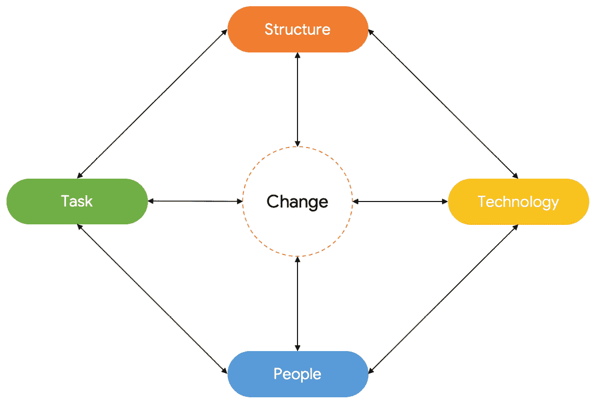
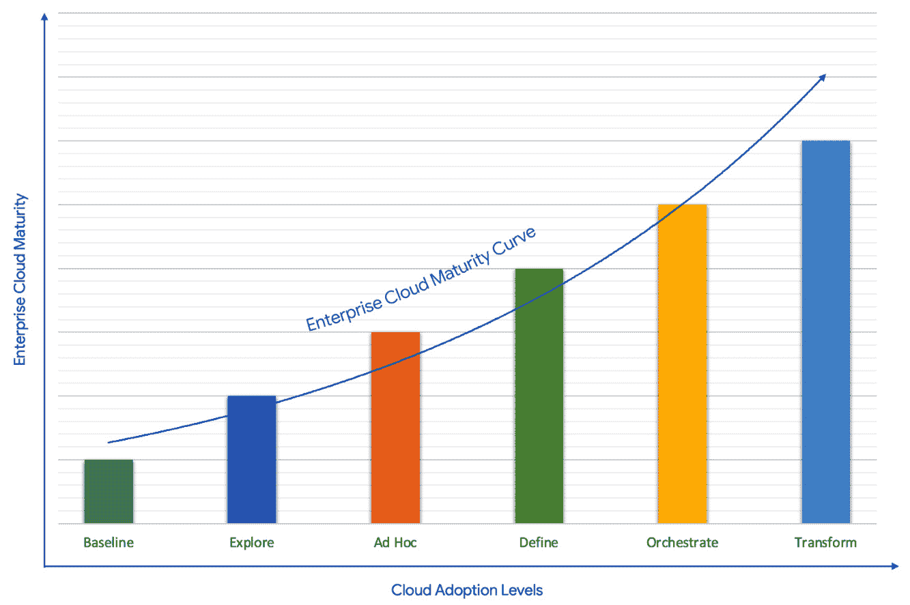
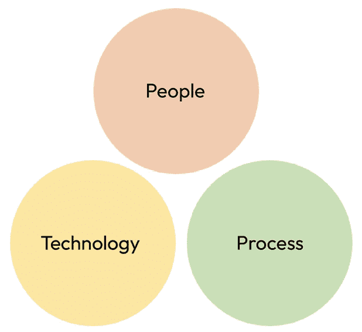
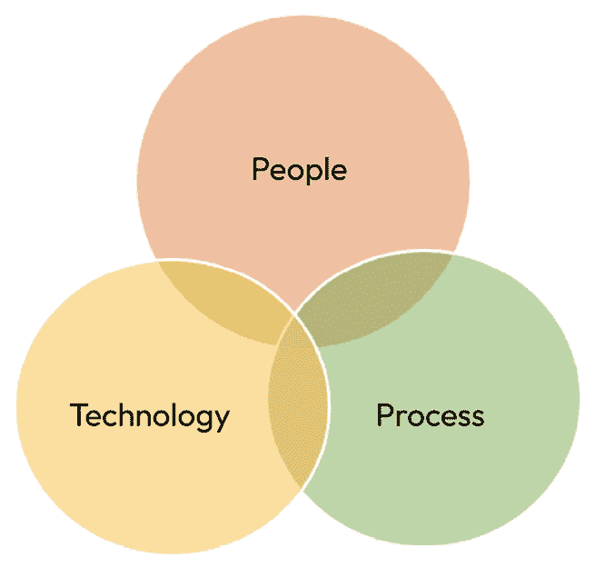
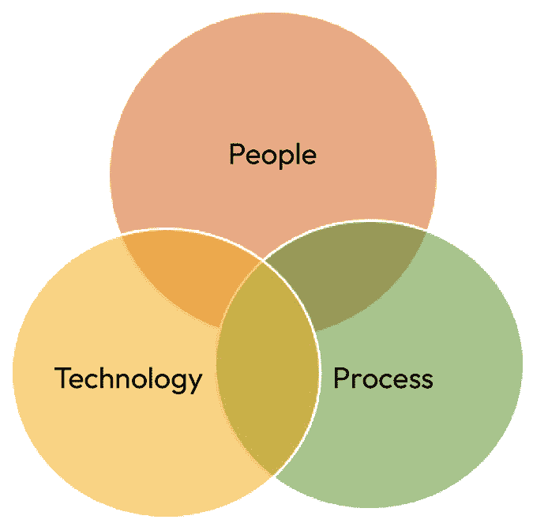
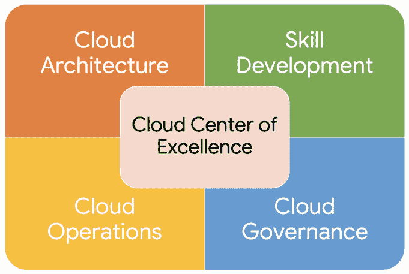
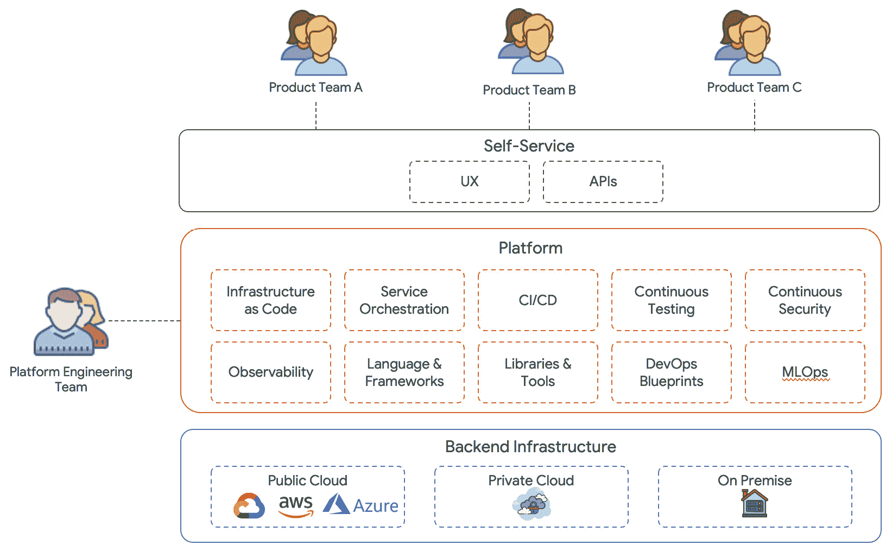

## 构建现代企业的基石
在上一章中，我们讨论了企业在引领数字化转型方面面临的挑战。作为企业 IT 领导者，确保为成功的云转型之旅奠定正确的基础非常重要。本章旨在概述一些基础框架，帮助企业有效应对复杂性并拥抱变革。在当今超竞争的商业环境中，组织力求在不断变化的市场动态和技术进步中取得并保持成功。为了应对这一复杂环境，企业需要一种全面的方法——一种涵盖人员、流程和技术之间相互作用的方法。管理变革对于企业蓬勃发展至关重要，使组织能够适应不断变化的市场趋势、创新变革、吸引员工、降低风险并获得竞争优势。随着我们探讨本章关于构建现代云就绪企业基础的内容，我们将探索各种策略、工具和框架，帮助企业领导者在其各自行业中管理、拥抱和引领数字化颠覆。
在本章中，我们将涵盖以下主题：
* 有助于企业管理变革的工具和框架
* 企业云采用策略和云成熟度评估框架
* 建立 **云卓越中心** (**CCoE**)
* 以创业心态、产品思维和平台工程构建云优先企业的基石
* 通过 **关键用户旅程** (**CUJs**) 实现以客户为中心的设计思维
* 在开源和开放标准上构建云基础

## 莱维特变革管理的钻石模型

# 利维特钻石变革管理

每个转型举措都会带来变革，而企业规模的数字化转型则加剧了这种变革。企业领导者在数字化转型中面临的最困难挑战之一，是在人员、流程和技术方面管理变革。深思熟虑的变革管理对数字化转型至关重要，因为它通过为员工做好准备、精简运营以及通过技术促进即将发生的变革的创新来减轻抵触。有效的变革管理确保组织内的每个人都朝着共同愿景努力。

1965 年，斯坦福大学组织行为学和心理学教授 **哈罗德·J·利维特** 提出了一个组织变革管理的综合模型，被称为 **利维特系统模型**，也被称为 **利维特钻石** *\[1\]*。利维特提出该模型是为了理解组织内部四个关键要素之间的相互关系——结构、人员、技术和任务。

图 4.1 – 利维特钻石变革管理的示意图

让我们更仔细地了解一下：

*   **结构**：组织结构是指组织内部角色、职责和汇报关系的正式安排，涵盖组织架构图、角色和职责等各方面。在当今企业中，结构已演进以适应扁平化层级、矩阵式组织和敏捷团队等变化。这种结构影响着沟通、决策和协调，并在支持协作、创新和灵活性方面发挥着至关重要的作用。

*   **人员**：人员要素强调员工在组织有效性中的重要性，以便有效地拥抱和管理变革。当今企业关注员工敬业度、人才管理、多样性和包容性举措。随着远程和灵活工作安排的重要性日益增加，管理虚拟团队和培养积极的组织文化是关键考量。支持员工的福祉、持续学习和职业发展至关重要，以确保员工作为变革推动者参与决策过程，同时影响高绩效目标。

*   **技术**：技术已成为现代企业不可或缺的一部分，涵盖组织内部用于帮助员工完成任务和实现目标的工具、系统和流程。它包括硬件和软件工具、系统和数字平台。随着企业利用 **人工智能** (**AI**)、大数据、云计算和自动化等新兴技术来提高效率、决策能力和客户体验，技术的采用和有效利用对于推动创新、竞争力和运营卓越至关重要。

*   **任务**：任务管理涵盖个人和团队为实现组织目标而承担的具体活动、流程和工作流。当今企业通常关注流程优化、工作流自动化和敏捷方法。精简流程、识别瓶颈和实施精益实践是提高效率、质量和客户满意度的关键。数字化转型的兴起导致任务被重新构想和重新设计，以便与数字能力和客户期望保持一致。

利维特钻石强调这四个要素相互关联、相互影响。一个要素的变化或修改可能会对其他要素产生连锁反应。例如，实施新技术可能需要对组织结构进行调整、改变工作任务以及对员工进行培训。该模型建议组织应努力在四个要素之间实现平衡对齐，以实现最佳绩效和有效性。通过考虑结构、人员、技术和任务之间的相互依赖性和交互作用，组织可以识别改进领域，有效管理变革并提升整体组织绩效。即使在今天，利维特钻石仍然是企业分析组织系统并识别改进机会的宝贵框架，包括组织行为、管理 and 系统思维。

在当今企业中应用利维特钻石涉及考虑这四个要素之间的相互依赖性和交互作用。这凸显了为实现组织有效性而实现对齐和整合的需求。以下是利维特钻石在当代企业中应用的一些示例：

*   **组织变革**：在实施变革时，例如采用新技术、重新组织团队或引入新流程，企业必须评估对钻石四个要素的全部影响。这可确保变革与组织结构保持一致，调动并支持员工，利用适当的技术，并优化任务以实现预期成果。

*   **数字化转型**：数字化转型举措要求企业评估并协调钻石的所有要素。这涉及从其对数字能力的支持角度考虑组织结构，对员工进行再培训或提升技能以利用新技术，整合适当的数字工具和平台，并重新定义任务和流程以利用数字优势。

*   **敏捷和跨职能团队**：采用敏捷方法论的企业需要考虑结构、人员、技术和任务之间的交互作用。组织必须确保具备适当的结构来支持协作和决策，选择具有多样化技能和专业知识的团队成员，为他们提供合适的技术工具和平台，并定义任务和工作流以实现敏捷性和迭代开发。

*   **变革管理**：应用变革管理原则涉及解决钻石的四个要素。这包括有效的沟通和利益相关者参与（人员）、评估变革对组织结构、角色和汇报线的影响、提供技术采用所需的培训和支持，以及重新定义任务和流程以与变革保持一致。

利维特钻石提供了一个变革管理框架和一种在组织内管理变革的整体方法。由于每个企业都是独特的，利维特钻石可以提供有关公司在四个要素——结构、任务、人员和技术方面的关键成功因素的见解。在下一节中，我们将探讨建立在利维特钻石之上的黄金三角的三个支柱。

# 黄金三角

在动态的商业环境中，企业面临着实现并维持成功的艰巨挑战。为应对这一挑战，需要一种整体方法——将人员、流程和技术整合为无缝框架。**人员-流程-技术**（**PPT**），也称为**黄金三角**，是另一个极受欢迎且重要的组织管理框架，企业必须利用它以确保在变革中无缝运作。PPT 建立在 Leavitt’s diamond 之上，并强调了人员、流程和技术在实现组织成功中的关键作用，强调了这三个要素的相互关联性和相互依赖性。它认识到每个支柱都是必不可少的且相互关联的，需要仔细关注和整合。通过关注培养和赋能人员、优化流程以及利用技术，组织可以提升其有效性、效率和创新能力。PPT 框架为企业构建坚实基础提供了路线图，并可为可持续增长、改善客户满意度和提高盈利能力铺平道路。

## 人才——组织成功的基石

人才支柱是黄金三角的基石，认识到人力资本对组织的重要性。它还强调了战略人力资源管理、人才发展以及重视个人的支持性工作文化的需求，促进组织与其最宝贵资源之间的共生关系。让我们更仔细地了解一下：

*   **人力资本**：人力资本由个人的技能、知识和能力构成，是创新、解决问题和创造力的核心要素，而这些都是成功数字化转型的关键组成部分。熟练的劳动力不仅能够实现数字解决方案的实施，还能培养敏捷和韧性的文化，使组织在技术颠覆中蓬勃发展。对人力资本的战略投资是释放数字技术变革力量的关键，并确保组织的长期成功和可持续性。

*   **组织文化与领导力**：组织文化和领导力在数字化转型计划的成功中发挥着关键作用，同时也应对变革阻力，而变革阻力是数字化转型期间的常见挑战。在技术不断演进的数字化转型背景下，积极且适应性强的组织文化提供了拥抱变革和创新的必要肥沃土壤。无论是高管还是中层管理层的领导力，对于设定组织数字化旅程的基调都至关重要。

*   **人才获取、发展与保留**：随着企业踏上数字化转型之路，人才管理变得极其重要，以确保组织拥有具备必要技能的合适人才，从而使他们保持相关性并保留顶尖人才以打造稳定且忠诚的员工队伍。在人才获取、发展和保留的三管齐下方法中，人才获取策略应侧重于吸纳来自不同背景的个人，他们不仅具备技术技能，还能带来新视角并展现创新思维和前瞻性思维。另一方面，人才发展策略必须侧重于提供持续学习机会、职业发展、培养适应能力以及拥抱变革的意愿。最后，积极包容的工作文化以及专业成长、奖励和认可的机会可以培养归属感并提高人才保留率。

## 流程——精简运营并提升效率

正如俗话所说，用旧流程拥抱新技术只会产生一个非常昂贵的旧流程。随着组织为现代数字企业奠定基础，识别并认识到用现代最佳实践取代旧流程的机会以实现更高投资回报率，变得极其重要。以下是企业可以拥抱的几个关键流程改进领域：

*   **运营卓越与持续改进**：精简和优化流程可提高效率。稳定一致的结果消除浪费并提升资源利用率。坚实的运营基础使组织能够专注于创新，因为日常运营顺畅运行，为创造性思考留出空间。实施精益和六西格玛方法使组织能够识别并消除流程瓶颈和变异。持续改进不仅帮助组织提升当前运营，还使其保持对变化趋势的适应性。运营卓越与持续改进共同使组织能够持续交付高质量的产品或服务，满足客户期望并保持竞争力。

*   **工作流程与协作**：拥抱数字化转型使组织能够迅速响应不断变化的市场趋势和客户期望。然而，这需要在开发、运营和流程控制方面实现范式转变。企业必须采用敏捷方法来培养持续改进的文化，重点是通过定期反馈循环交付有形的增量价值，使团队能够在项目生命周期内调整和完善策略。培养业务与 IT 团队之间的跨职能协作以打破信息孤岛，从而全面理解组织目标和客户需求，也至关重要。

*   **质量保证与风险管理**：新技术的整合、流程变化以及不断演变的监管环境引入了各种风险，例如网络安全威胁、数据泄露和运营中断。随着技术进步的指数级演进和采用，确保数字解决方案的质量对于满足客户期望、赢得客户信任以及实现业务目标至关重要。质量保证实践涉及对数字流程和技术进行严格的测试、验证和确认，以保证其功能性、可靠性和安全性。这不仅提升了整体用户体验，也有助于组织的信誉和可信度。同时，积极的风险管理和遵守监管和法律合规对于识别、评估和减轻不确定性以及建立利益相关者信任至关重要。

## 技术——推动创新和竞争优势

技术是促进创新并推动数字化转型的催化剂。它使组织能够重新构想传统流程、提升效率并创造新的商业模式。持续采用新兴技术是企业创新并巩固其作为数字颠覆领导者地位的数字化转型的核心：

*   **新兴技术与自动化**：新兴技术提供变革性能力，有助于重新定义传统商业模式并使组织能够利用技术力量提升客户体验，同时推动运营效率。通过拥抱自动化和新兴技术，组织可以解锁新的敏捷性、可扩展性和竞争力水平，使其处于行业演进的前沿，并确保数字化转型的长期成功。

# 数据转换
组织可以战略性地利用数据转换作为成功数字化转型计划的支点。在现代数字环境中，数据是每个企业都不可估量的资产，充分发挥其全部潜力至关重要。数据转换涉及收集、清洗、组织和分析数据的全面过程，以得出可操作的洞察。数据驱动的洞察使组织能够了解客户行为、预测市场趋势、定制营销策略，并优化供应链管理以提高效率。

## 企业云成熟度评估
为现代云就绪企业建立坚实的基础对于确保数字化转型成功至关重要。云就绪评估是了解组织在成熟度曲线中的位置并制定与业务目标一致的适当策略不可或缺的第一步。由于每个企业都是独特的，成熟度评估可以成为一个有用的工具，不仅可以评估当前状态，还可以作为未来转型目标的指引。云成熟度评估是一个重要工具，可以帮助企业改进云采用和使用。几种成熟度评估侧重于特定功能，例如云就绪、安全性和服务成熟度。企业最佳的云成熟度模型将取决于组织的具体需求和目标。然而，所有模型都可以为组织的云成熟度水平提供有价值的见解，并帮助制定改进路线图。

### 云采用成熟度模型 (CAMM)
CAMM 是一个有见地的框架，有助于企业评估和衡量其云采用成熟度。通过评估其当前的云成熟度，组织可以获得有价值的见解，推动其努力实现变革性成熟度水平。基于我在多个行业领域与多家企业合作的经验，该 CAMM 框架是对多个行业领先框架的改编，旨在与企业需求保持一致。CAMM 模型由不同维度上的六个成熟度级别组成，并独特地与黄金三角相联系，以帮助管理变革：
* **Baseline**: 在此级别，企业主要在传统的本地或托管环境中运行，使用遗留系统和单体应用堆栈。部门或组织层面没有重大的云计划，也没有迁移或采用云计算的计划。
* **Explore**: 处于此成熟度水平的企业处于调查阶段。任何云服务采用和使用通常是探索性的且有限的，孤立的概念验证不涉及高管赞助。
* **Ad hoc**: 此级别的组织正在开展云计算，无论是私有云还是公有云部署。大多数云使用是部门级的，并由特定的业务需求驱动，以增加 IT 因速度或能力限制而无法提供的现代功能。在此级别，没有全企业范围的云采用，主要是由业务部门领导推动。
* **Define**: 在此级别，企业开始将云计算作为企业范围内的标准采用，但由于缺乏既定的治理政策、最佳实践和控制措施，云的使用仍然是战术性的且受限。在此阶段，云访问通常是集中的，使得团队更难访问、探索和创新。组织层面存在一定程度的高管赞助。
* **Orchestrate**: 处于此成熟度水平的组织拥有明确的云战略，并已实施流程和控制措施以高效管理监控云环境。本地、公有云和私有云之间实现了无缝集成，并采用统一的 DevOps 实践、自动化、流程、控制和工具。在此级别，企业通常已定义治理政策、流程和工具，使团队能够引领变革并比以往更快地交付云中的高级功能。在此阶段，云访问是分散的，各个团队承担所有权和责任。
* **Transform**: 此级别的组织持续优化云环境以提高性能、弹性、安全性和成本效率。在此阶段，数字化转型开始，企业工作负载高度灵活、安全、可移植，并且可以在不同平台上开发和托管。此成熟度水平的企业通常引领数字颠覆，被视为各自行业中的领导者。

下图描绘了企业云采用和成熟度的级别：

图 4.2 – 企业云采用和成熟度级别

CAMM 框架是企业各种规模的宝贵工具，有助于衡量组织的当前成熟度水平并改进云采用和使用。它使用起来相当容易，可以根据组织的具体需求进行定制。通过利用 CAMM 框架，组织可以实现一些重大收益，例如评估组织的云成熟度水平、识别云使用和采用的改进领域、确保组织的云战略安全合规、评估组织的云治理能力、与长期业务目标保持一致，并能够制定云成熟度改进路线图。

企业的云成熟度通常在黄金三角或 PPT 框架的不同维度上进行衡量。典型的评估涉及衡量组织在每个维度上的成熟度得分，累计得分表示整体成熟度得分。这通常是企业衡量、跟踪和改进整体云成熟度的第一步。由于每个企业都是独特的，组织可以考虑在三个支柱中的每一个上采用更少或更多的维度。让我们详细回顾成熟度级别以及它们如何在这些维度上进行评估。

### 人才支柱
人才支柱涉及组织技能发展、招聘、战略合作伙伴关系和团队协作等维度。本节提供了组织如何利用 CAMM 框架自我评估云采用成熟度的指南。

#### 组织技能发展
组织技能发展涉及组织为提升其员工的技能、能力和素质而做出的有意且系统性的努力。随着技术、行业趋势和工作要求的不断发展，持续的组织技能发展对于保持熟练、积极和有韧性的劳动力至关重要：
* **Ad hoc**: 未建立正式的培训目标、认证或指标。
* **Explore**: 培训、认证和动手练习必须专门申请
* **Define**: 提供按需和讲师指导的培训，并积极支持和推广正式认证
* **Orchestrate**: 除正式培训和按需学习外，还推广和奖励跨组织知识共享、个性化发展计划和基于角色的认证指导
* **Transform**: 组织推广外部知识共享、技术分享、行业领导力、黑客马拉松以及提升技能的绩效激励

#### 招聘流程

## 人员支柱

### 员工队伍
该维度指的是组织为吸引和聘用不仅精通云和数字技术，而且热衷于推动创新并为组织数字化转型之旅做出贡献的员工所采取的战略步骤：
* **临时**: 候选人无需具备先前的云经验
* **探索**: 某些职位要求具备先前的云经验
* **定义**: 最相关的职位要求候选人具备先前的云经验
* **编排**: 相关岗位被重新定义，要求员工提升技能，作为构建云优先组织的基石
* **转型**: 所有职位招聘均要求具备云经验，目标是实现企业数字化转型

### 合作伙伴
合作伙伴维度定义了组织利用与供应商和合作伙伴的战略合作伙伴关系的能力，以推动其 IT 成熟度并引领行业技术变革：
* **临时**: 依赖第三方提供云能力。合作伙伴拥有并维护云租户
* **探索**: 第三方提供大部分云能力
* **定义**: 合作伙伴提供专业知识或技能以交付现代云能力
* **编排**: 合作伙伴与内部 IT 部门合作提供云能力，同时注重提升技能
* **转型**: 第三方主要用于人员补充和咨询服务

### 团队构成
团队构成维度指的是 IT 团队能够与跨职能团队有效协作并分享其专业知识和经验，以便为共同的业务目标做出贡献的能力：
* **临时**: 团队彼此独立工作，按职能划分，基于本地角色定义形成信息孤岛
* **探索**: 组织存在云专业知识的局部区域，并进行非正式的跨职能协作
* **定义**: 正式的跨职能协作，CCoE 提供基础支持
* **编排**: 团队利用 CCoE 定义的标准、模板和模式，跨职能协作在组织内普遍存在
* **转型**: 完全自主且自给自足的团队，在技术和流程领域具备专业知识

## 流程支柱
流程支柱涉及领导力、高管赞助、KPI 衡量和预算分配等维度。本节解释组织如何利用 CAMM 框架对云采用成熟度进行自我评估。

### 领导力与赞助
该维度有助于评估组织在进行云转型时领导层的参与度和高管赞助情况。这是决定组织数字化转型成功基调的重要维度：
* **临时**: 云计划无高管赞助
* **探索**: 来自业务部门负责人或高级管理层的赞助
* **定义**: 来自一个或多个 C 级高管的赞助
* **编排**: 对云采用和迁移进行全面的 C 级赞助
* **转型**: 高管赞助为企业范围内的云优先采用、研发和创新设定基调和步伐

### 衡量
正如俗话所说，*无法衡量的就无法改进*。衡量是一个关键维度，有助于评估和指导组织如何衡量云计划的成功和成果：
* **临时**: 云计划无明确的成功标准
* **探索**: 概念验证和 **最小可行产品** (**MVP**) 工作指导企业探索并充当伪衡量指标
* **定义**: 通过将生产工作负载部署到云中并实现业务价值来衡量成功成果
* **编排**: 成功标准作为扩展生产工作负载、运营与关键任务企业应用集成的核心服务的函数来衡量
* **转型**: 成功标准基于通过转型计划和创新创造的业务价值来衡量

### 预算
该维度有助于评估组织如何为直接影响和推动业务价值的云计划提供资金并分配财务资源：
* **临时**: 云计划无明确资金，或企业纯粹基于预计成本节约分配云预算
* **探索**: 为特定云项目分配部门级预算
* **定义**: 为特定计划和部分基于云的研发提供专用预算
* **编排**: 为云优先计划分配预算，减少对本地投资的关注
* **转型**: 为实现业务价值而对云计划进行隐性预算分配，仅在合理时进行本地投资

## 技术支柱
技术支柱涵盖 IT 架构、自动化能力、IT 运营、安全、数据管理以及人工智能和机器学习等新兴技术等维度。本节概述组织如何利用 CAMM 框架对技术支柱中的云采用成熟度进行自我评估。

### 架构
架构维度评估组织在 IT 成熟度方面的程度，即其如何利用现代云原生架构进行 IT 计划：
* **临时**: 主要为本地单体应用，采用多种技术栈，通常为预期峰值进行配置。
* **探索**: 大多数工作负载部署在长期运行的虚拟机中。对容器和微服务的实验有限。云中基于容器的负载提供可扩展性优势。
* **定义**: 生产工作负载部署在容器或无服务器计算上，部分工作负载仍在短期虚拟机上，利用自动扩缩容部分工作负载
* **编排**: 大多数应用采用基于微服务的架构。定期使用短期虚拟机、容器或基于函数的计算，导致根据应用指标利用自动扩缩容。
* **转型**: 广泛使用具有弹性、可扩展且一致安全的架构蓝图。在此，您可以利用容器、无服务器函数和优化的虚拟机，并在部署拓扑——本地或云——中一致使用云原生工具。

### 自动化能力
自动化是关键能力，有助于简化运营、消除错误、改善上市时间并实现成本节约。该维度对于开展云转型的组织至关重要，有助于评估企业的自动化成熟度：
* **临时**: 手动或不进行云服务配置
* **探索**: 云服务通过脚本配置，但不存在正式的组织范围流程和标准
* **定义**: 云服务配置已自动化，但未在项目间一致使用
* **编排**: 大多数项目团队利用 **基础设施即代码** (**IaC**) 工具来自动化云服务配置
* **转型**: 一致的 IaC 工具和流程在全企业范围内使用，按 CCoE 规定

### 运营
运营维度评估 IT 组织采用现代 DevOps 实践（如 IaC、CI/CD 和 SRE 实践）的能力：
* **临时**: 项目采用传统的代码、构建、测试和部署实践。未建立 CI/CD 流程。应用程序就地更新。
* **探索**: 缺乏一致的 SRE 实践，CI/CD 工具和流程使用有限。新的发布通过滚动更新交付，需要维护窗口。
* **定义**: 许多项目团队利用 CI/CD 和 SRE 实践。新的发布与当前版本并行部署，并采用手动切换和回退机制。

* **编排**: 全组织范围内使用 SRE 最佳实践和基于项目的 CI/CD。现代 SRE 实践（如金丝雀或蓝绿部署）与随时部署策略相结合。
* **转型**: 企业范围内拥有标准化且一致的 SRE 和 CI/CD 工具。 新版本透明且增量发布每天进行多次，无需人工干预。

## 安全
安全维度有助于评估组织在云中的安全措施及其跟上现代安全威胁的能力：
* **临时**: 手动进行用户或系统账户配置，身份策略不一致。基础设施安全主要依赖网络防火墙。系统管理员根据临时请求手动管理访问控制。
* **探索**: 集中式组织 IDP，拥有统一的身份、审计和访问策略，但需人工干预。基于网络的安全通过用户身份上下文验证得到增强。访问控制定期审查，但本地和云环境分开。
* **定义**: 在本地和云基础设施中建立了统一的 IDP 标准，并制定全组织范围的身份、审计和访问控制策略。此时可引入 2FA 或 MFA，并定期进行访问策略和控制审查。
* **编排**: 跨本地和云环境实现联合身份管理及自动同步，采用 SSO 并强制所有用户使用 2FA/MFA。基于风险的自动化工作流控制访问管理，对网络安全控制的依赖减少。访问策略和控制定期审查和认证，问题得到主动补救。
* **转型**: 这是用户和服务身份的单一来源，具有完全集中化和自动化的身份和访问控制策略。MFA 和 SSO 已成为企业标准，采用即时权限进行访问管理并提供实时告警。还提供完全集成且自动化的基于风险的访问权限审查，几乎不依赖网络安全，访问由用户身份、上下文和设备管理。

## 数据管理
数据管理维度有助于评估组织的数据成熟度，因为数据分布在本地和云基础设施中：
* **临时**: 数据蔓延，数据管理分散，组织几乎不了解数据存储位置。没有手动数据分类。备份在本地或跨站点维护。
* **探索**: 各部门持有数据并记录模式、敏感性和数据访问策略。存在防止未经授权数据访问的策略。关键应用的数据备份在网络连接设备上实现自动化。
* **定义**: 存在数据清单，并手动维护数据分类和敏感性。有一套集中的策略和控制，但监控有限。大多数云应用的数据备份已自动化，但需人工干预。
* **编排**: 组织全面了解数据位置、血缘、冗余、分类和敏感性。数据外泄风险通过预防性、检测性和纠正性策略和控制得到缓解。数据备份完全自动化，并提供不可变副本以实现更快恢复。
* **转型**: 自动化的数据和元数据目录、业务友好的术语表、数据质量指标、数据血缘跟踪、自动化备份和恢复测试，以及具有不可变副本的数据冗余。它提供完全自动化的预防控制、主动监控、异常检测、审计和告警。

## AI/ML
AI/ML 维度描述了组织采用现代 AI/ML 能力以推进业务目标并引领数字化颠覆的能力：
* **临时**: AI/ML 不是组织的重点。
* **探索**: 组织仍处于评估模式。没有正式的全组织标准，各部门构建原型以解决有趣的问题。
* **定义**: CCoE 制定 AI 愿景并提供系统化的蓝图和指导。组织从概念验证转向将部分 AI 工作负载投入生产
* **编排**: 组织倡导将 AI/ML 嵌入应用中，并创建 AI 实践以探索、研究和现代化。
* **转型**: AI 已成为组织 DNA 的一部分，多款应用利用 AI 能力改变业务运营方式。组织开始引领这一颠覆。

需要注意的是，CAMM 框架下讨论的维度只是部分核心维度，并不详尽。由于每个企业都是独特的，组织必须努力在人员、流程和技术三大支柱中定义维度和属性，同时确保保持更新。对云成熟度的定期评估对于衡量当前状态并确立目标至关重要。

## Google 的云采用框架 (CAF)
存在多种云就绪评估框架变体。我个人最喜欢之一是 **Google 的** CAF，因为它建立在人员、流程和技术 *\[2\]* 的黄金三角评分标准之上。这是一个通用的框架，企业可以利用它来评估云成熟度并朝着云优先组织发展。该框架在三个阶段中规定了四个领域，有助于衡量和改进组织的云就绪程度。这是一个有主见的框架，主张在构建云优先组织时，组织必须在四个领域中都表现出色。

### 四个领域
CAF 定义了四个领域——learn、lead、scale 和 secure——有助于评估和衡量组织的云就绪程度和采用成熟度：
* **学习**: 该支柱描述了组织提供的学习和技能提升计划的范围和水平，以及组织持续学习、提升技能和再培训的能力。该领域还有助于组织了解提供的学习计划的质量以及与第三方供应商和合作伙伴合作通过云推进业务目标的能力。
* **领导**: 该支柱有助于评估领导层赞助和云转型的自上而下承诺，以及跨职能团队推动云采用举措实现共同业务目标的自下而上动力。
* **扩展**: 该支柱描述了组织利用云原生架构、托管服务和无服务器产品来抽象基础设施的能力，从而实现无缝扩展同时降低运营开销。
* **安全**: 该支柱描述了组织利用纵深防御安全模型保护云中应用程序和服务免受未经授权和非请求访问的能力。

### 三个阶段
CAF 还为组织定义了三个云成熟度阶段——战术、战略和变革：
* **战术**: 在战术成熟度阶段，组织通常有明确的目标部署单个云工作负载，而没有为未来扩展的更大计划或战略。在此阶段，主要目标是通过云迁移实现特定系统和应用的成本降低。虽然这种方法可能带来快速成果和短期收益，但缺乏可扩展性和创新的必要基础。

图 4.3 – 战术成熟度阶段的 PPT 对齐

### 战略
在战略成熟度阶段，组织由一个涵盖多个工作负载的全面愿景指导。这些工作负载经过精心架构和设计，重点关注未来需求和可扩展性。在此阶段，组织踏上转型之旅，积极将人员和流程纳入其中。IT 团队表现出卓越的效率和效能，提升了利用云进行业务运营所带来的业务价值。

图 4.4 – 战略成熟度阶段的 PPT 对齐

### 变革
在变革成熟度阶段，组织拥有成熟稳定运行的云运营，并专注于整合从云经验中获得的数据和洞察。组织将云作为战略平台来降低运营开销，使团队能够专注于创新和业务转型。这一技术转变进一步得到人员和流程转型的支持。在战略成熟度阶段，IT 已从成本中心演变为战略业务合作伙伴。

图 4.5 – 变革成熟度阶段的 PPT 对齐

CAF 可作为组织如何利用框架来评估、衡量和改进其云采用和成熟度的良好示例。然而，随着组织为云转型奠定基础，该框架可以作为一个良好的起点，并可根据特定需求进行定制和演进。在下一节中，我们将回顾企业如何建立和设立 CCoE 以推进数字化颠覆。

## CCoE
随着云采用的持续增长，建立 CCoE 成为寻求在数字时代蓬勃发展的企业不可或缺的举措。建立 CCOE 是拥抱云计算的企业至关重要的一步。通过提供领导力、治理、架构指导、技能发展、成本优化策略并促进协作，CCoE 使组织能够充分发挥云计算的全部潜力。CCoE 确保云计划与组织的整体业务目标保持一致，确保云采用支持公司的愿景、使命和长期目标。通过建立治理政策、指南和控制措施，CCoE 使企业能够有效管理与云相关的风险。它确保符合监管要求、数据保护、安全和隐私标准。更重要的是，CCoE 在包括 IT 团队、开发人员、运营和业务部门在内的各利益相关者之间培育知识共享和协作文化，促进跨职能专业知识并加速云技术的采用。

图 4.6 – CCoE 框架

### CCoE 的关键组成部分
CCoE 专注于四个主要组成部分——从定义云架构蓝图和最佳实践并促进云技能发展和专业知识，到实施云运营最佳实践和建立云治理：

* **云架构和最佳实践**：
  * **架构框架**：CCoE 定义云架构框架和参考架构，为设计和部署云解决方案提供指导。这些框架必须考虑可扩展性、可用性、安全性和性能，以确保基于云的应用程序和基础设施的成功实施。
  * **最佳实践**：CCoE 识别并推广云采用各个方面的最佳实践，包括云迁移策略、应用程序开发方法、基础设施管理和安全协议。它促进持续改进并鼓励采用业界认可的标准和框架。
* **技能发展**：
  * **云培训计划**：CCoE 开发并提供培训计划，以教育员工了解云计算概念、技术和服务。它提供认证、工作坊和学习资源，以提升组织内云知识和技能。
  * **技能评估与发展**：CCoE 进行技能评估以识别技能差距和改进领域。它与人力资源和培训团队合作制定有针对性的技能发展计划，并为员工提供在云架构、安全、DevOps、数据分析以及高级技能如 AI/ML 方面提升技能的资源。
* **云运营**：
  * **成本优化策略**：CCoE 实施成本优化策略以有效管理云支出。它利用资源利用率监控工具，识别诸如 rightsizing 实例、预留实例和 Spot 实例等成本节约机会，并建立预算分配和跟踪政策。
  * **财务治理**：CCoE 开发财务治理框架以确保云支出方面的财务问责和控制。它建立成本分摊、预算管理和利用云资源的内部部门或项目的分摊机制流程。
* **云治理**：
  * **领导力赞助**：成功的 CCoE 需要强大的高层赞助来推动云采用并确保与业务目标保持一致。高层领导必须担任执行赞助人，提供指导、支持决策并在整个组织中倡导云的好处。
  * **治理框架**：建立企业范围的治理政策、标准和控制措施以管理与云相关的风险是 CCoE 的主要职责之一。它定义角色和职责，建立决策流程，并确保符合监管要求和行业最佳实践。

随着组织在云环境的复杂性中航行，CCoE 成为精心策划和成功的云采用和数字化转型的战略驱动力。CCoE 为组织在云中实现长期成功和创新奠定基础，同时最大限度地降低风险。

# 为云就绪企业奠定基础
数字化转型涉及随着云计算等新技术的不断发展而重新构想企业内部的 IT 流程和技术团队。在传统的 IT 环境中，典型的 **软件开发生命周期** (**SDLC**) 实践，如瀑布方法，在开发、测试、安全和运营的独立团队中已足够。然而，随着业务需求和云计算等技术的快速发展，技术组织面临着在竞争环境中蓬勃发展所需的苛刻上市速度和 IT 敏捷性，并需要在软件工程实践中进行根本性的文化转变。DevSecOps 是现代企业成功 IT 管理的关键，它清楚地说明了开发、安全和运营之间的紧密相互依赖性。正如我们讨论的黄金三角在数字化转型中的关键作用，了解企业需要在人员、流程和技术这三个方面采用的范式转变非常重要。让我们回顾一些企业可以利用的最佳实践，以为云就绪组织建立坚实的基础。

## 初创心态

虽然企业完全复制初创公司文化的各个方面并不总是可行或理想，但采用初创公司思维可以为组织提供在快速变化的商业环境中蓬勃发展所需的敏捷性、创新性和以客户为中心。它使企业能够拥抱变化，承担经过计算的风险，并抓住增长和转型的机会。初创公司通常通过引入新的商业模式、产品和服务来颠覆成熟行业。它们倾向于优先理解客户需求并提供价值，在快节奏的环境中运营，吸引顶尖人才，并优先考虑学习和实验。采用初创公司思维运营的企业可以主动识别并利用新兴机会，相对于更传统的同行获得竞争优势。为了以初创公司思维运营，企业可以采取以下几个步骤在整个组织中培养这种文化：
* **创业者思维**：鼓励员工像企业家一样思考将促进自主性、主人翁意识和承担风险的意愿。创造一个支持快速实验、快速失败以及从失败中学习的环境，对数字化转型可以产生巨大的积极影响。
* **以客户为中心**：每个举措或项目都必须高度强调理解客户需求和偏好。实施客户反馈循环、开展用户研究以及让客户参与产品开发过程将确保与业务和市场需求保持一致。
* **扁平化组织结构**：减少层级结构并培养更扁平的组织层级，促进开放沟通和快速决策，同时也赋予员工贡献其想法和专业知识的能力。
* **流程简化**：大多数组织在拥抱新技术时未能做到的就是审视可以被淘汰的现有流程。新方法和功能往往因现有流程的压力而受阻，而这些流程是为不同的问题陈述而设计的。识别并消除阻碍决策的官僚流程、简化审批工作流程，以及在预定义边界内授权员工自主决策，可以对员工生产力和运营效率产生放大影响。
* **敏捷项目管理**：实施 Scrum、Kanban、精益开发、Crystal 或极限编程等敏捷项目管理方法，以促进灵活性、适应性和增量进展，可以实现更短的开发周期、更频繁的反馈循环以及快速转型的能力。
* **增量价值交付**：传统上，企业应用以全有或全无的方式交付。初创公司思维将增加对行动和成果的偏向，以便更快地交付增量价值和最小可行产品，并迅速纳入反馈。

## 一切皆产品
在传统的 IT 中，组织倾向于关注技术基础设施、维护、提供技术服务以及满足内部利益相关者的需求，优先考虑技术要求和限制而非用户需求。更重要的是，IT 在孤岛中运作，对技术如何与更广泛的业务目标保持一致缺乏深入理解，其主要目标是维护和支持现有系统，而非主动寻求改进它们的方式。与之相反，产品思维更强调以用户为中心，为终端用户或客户提供价值。它帮助组织通过定义产品愿景、优先考虑功能并确保与业务目标和用户需求保持一致来拥抱产品所有权。它优先考虑理解用户需求、设计直观的用户体验，并根据用户反馈持续改进产品。以下是企业在数字化转型中培养产品思维可以利用的一些关键原则：
* **产品愿景**：*一切皆产品* 的思维方式能够建立清晰的产品愿景，并确定云转型应交付的期望成果、利益和价值，使其与整体业务目标保持一致。
* **以用户为中心**：产品思维的主要目标是以用户为中心的设计，在设计和开发基于云的解决方案时优先考虑终端用户的需求和要求。产品思维有助于更深入地了解用户画像、开展用户研究并收集反馈，以确保解决方案与用户期望保持一致并提供无缝体验。
* **产品所有权和价值交付**：企业应指定产品负责人或产品经理，负责推动云转型计划。产品负责人必须深入了解业务和技术方面，并作为客户和利益相关者的倡导者，识别云采用的最高价值领域，并根据其潜在影响和可行性对其进行优先排序。这有助于组织专注于尽早、频繁地交付增量价值，解决关键的业务需求和痛点。
* **MVPs**：在数字原生云转型中，尤其是在组织大规模创新的情况下，并非总是可以预测和规划。产品思维强调构建和交付 MVP 以验证假设、测试假设并在云转型过程早期收集反馈的概念。这种方法允许更快地学习，减少浪费，并确保资源集中于提供价值。
* **构思、迭代和创新**：采用迭代和敏捷的方法来构建和改进云服务，促进整个云转型旅程中持续改进和实验的文化。这鼓励团队尝试不同的云服务、架构和技术，以确定最适合企业特定需求的解决方案。这涉及将云解决方案分解为更小、可管理的增量，并根据用户反馈和不断变化的业务需求持续迭代和完善。

## 平台即产品
采用产品思维方法，企业可以开始设计、架构和开发优秀的产品。然而，一切都归结于这些产品交付的速度。在动态的商业环境中，上市速度是保持竞争力和获得市场份额的关键。DevOps 通过整合开发和运营统一了 SDLC，获得了流程可扩展性并权衡了复杂性。采用 *你构建它，你运行它* 的思维方式，随着更多产品采用更现代的技术和工具推出，尤其是在云原生时代，开发者的复杂性变得呈指数级增长。例如，在诸如十二要素应用和云原生十五要素等方法中，开发人员必须学习如何编码、构建、测试、发布、部署、运营、监控，并掌握支持 DevOps 生命周期各个方面的众多工具。Spotify、Netflix 和 Uber 等多个组织通过开发一个 *平台* 来克服这一挑战，该平台可以帮助自动化 SDLC，从而催生了现代的 *平台工程* 趋势。在 Gartner 的敏捷和 DevOps  hype cycle 中，平台工程被视为云原生环境中的自然演进。

根据 `www.platformengineering.org`，“*Platform engineering is the discipline of designing and building toolchains and workflows that enable self-service capabilities for software engineering organizations in the cloud-native **era.***” [*3*]

## 内部开发者平台

平台工程师通常会构建一个平台，能够满足整个软件开发生命周期（SDLC）中最常见和运营上的需求，避免重复造轮子。这通常被称为 IDP。为什么它被称为 IDP？每个 IDP 都应根据技术选型、架构模式、安全控制和蓝图为每个企业量身定制，因此具有独特性。在传统的 IT 系统中，存在一个名为 *系统管理员* 的传统角色，通常是管理应用程序或软件运营的守门人。开发人员通常开发软件应用程序，然后将其 *扔过栅栏* 给系统管理员进行部署和运营，导致双方体验都很差。

平台工程的目标是开发和维护一个 IDP，从而抽象掉运营和管理软件与基础设施层下方的复杂性。采用 *一切皆产品* 的方法，IDP 必须被视为一种产品，其消费者或利益相关者是产品团队。IDP 的主要目标是提供一个自助服务平台，使技术团队能够交互并自助获取运行其应用程序所需的基础设施，通过将交付产品所需的工具链粘合在一起使技术栈标准化，减少变异性，并自动化基础设施交付：

图 4.7 – IDP 的层级与交互

IDP 定义了三个不同的层级——后端基础设施、平台和自助服务——以抽象底层基础设施，从而简化并普及访问：

*   **后端基础设施层**：这是平台工程团队将支持的最基础层级。这涉及平台和厂商选型，是否支持混合云或多云架构的决策，在安全、合规和企业目标维度上创建经批准、授权和支持的服务矩阵，以及管理所选平台相关的维护、扩展和 FinOps。平台工程还需要定期审查、发布、评估并启用云厂商提供的最新技术和功能。

*   **平台层**：这是核心抽象层，有助于规范化 DevSecOps 功能，而不论底层基础设施选择如何。该层级的目标是自动化和简化基础设施管理，并制定最佳实践，使产品团队能够更快地实施解决方案，而无需在 DevSecOps 方面重复造轮子。例如，该层级将为产品团队在软件架构框架、服务编排、CI/CD 流水线、安全控制和可观测性方面的选择提供明确的观点。

*   **自助服务层**：自助服务层是产品团队开展云计划时的主要接口。理想的自助服务层将提供用户体验和 API，帮助企业各产品团队配置沙箱、研发测试床，甚至生产级环境。通过统一的平台方法，产品团队可以交付能够无缝与其他产品交互的解决方案，同时快速开发和迭代，从而实现运营效率和上市速度。

# 专注于 CUJ

在敏捷开发方法论中，用户故事是许多组织用于软件开发和用户体验设计的基础组件。用户故事通常限定在单个开发迭代或冲刺范围内，这有助于将较大的功能或功能性分解为更小、可管理的任务单元，并主要指导开发团队实施特定的功能或功能性。另一方面，CUJ 采用更广阔的视角，提供用户旅程的端到端视图。它们涵盖多个用户故事，并在不同的触点和交互中捕捉完整的端到端用户体验。但为什么 CUJ 很重要？在产品——通常被称为 **服务等级目标**（**SLOs**）——并根据服务的健康状况配置警报。这是确保 CUJ 成功并可作为进一步改进反馈循环的关键步骤。

采用 CUJ 方法进行应用程序和产品开发，增强了组织以客户和用户为中心、提供无缝客户体验的能力。

## 拥抱云中的开源

云本质上是由开源软件（`OSS`）和开放标准构建并驱动的。一些构成云平台基础的流行开源软件包括 Linux、KVM、Kubernetes、Docker、Nginx、PostgreSQL、Git、Jenkins、Apache Kafka、TensorFlow，以及开放标准如 HTTP、TCP/IP、REST、SSL/TLS、ANSI、XML、JDBC、AMQP、SAML、JSON、MQTT 等。日益增长的是，大多数云服务提供商要么参与其中，要么为开源软件和开放标准做出贡献，例如 CNCF、OASIS 和 CSA。如果云建立在开源之上，企业是否应该在其应用程序上构建开源软件？简单的答案是肯定的。有几个令人信服的理由，例如成本效益、灵活性、供应商中立性、充满活力的社区支持和互操作性，企业应考虑在云上基于开源软件和标准构建 IT 基础。然而，在企业用例的背景下，选择并不总是容易的。虽然利用开源技术有巨大的优势，其中两个主要动机是由于避免许可或订阅费用而带来的前期成本节约以及防止供应商锁定，但企业必须注意一些考虑因素，例如与 OSS 定制、实施和维护相关的成本、对社区支持的依赖、熟练资源的可用性，以及可扩展性、安全性和性能要求。

自建与购买现成解决方案之间始终存在激烈的争论。只要企业对其优势有自我认知，并且其决策与整体愿景保持一致，就没有哪种方法更好或更差。*理解企业基因至关重要*。在我担任企业架构师的职责中，我曾遇到一家财富 100 强零售企业，它更倾向于商业现成（`COTS`）和托管服务产品，使其精简的 IT 部门能够花费更多时间和精力解决业务需求，同时将软件维护、支持、功能发布、安全性和合规性外包。这完全契合其组织的基因。在光谱的另一端，另一家财富 100 强企业强烈偏好从头构建并利用开源软件。虽然这种策略使他们能够灵活地定制、定制并构建适合其需求的功能，但他们需要在 IT 和维护方面进行大量投资。

正如我们在上一章讨论的那样，企业必须努力降低供应商锁定风险，但在大多数情况下无法完全避免。在构建与购买之间取得正确的平衡对于数字化转型成功至关重要。当企业选择云提供商时也必须引起共鸣。构建支持开放标准的软件和应用程序比开源与闭源软件的选择更为关键，因为它有助于互操作性。例如，组织 A 可以选择 COTS B2B 软件与供应商发送和接收采购订单和发票，而组织 B 倾向于使用开源技术构建 B2B 软件。这里的关键考虑是确保采用开放标准，例如 EDI。在云术语中，企业可以考虑以下因素来驾驭供应商中立性和互操作性优势：

* **可移植性的通用平台**：而不是直接在供应商平台或服务架构上构建，企业可以通过构建基于开源和开放标准、可以在任何地方运行的通用平台基础来获得长期利益。这可以成为企业在任何目标平台或基础设施上运行应用程序和服务的绝佳混合云和多云策略。

* **云提供商选择**：企业可以通过选择投资并采用开源和开放标准的云提供商来避免供应商锁定。例如，利用云提供商的托管服务本身并不构成锁定，只要该服务建立在未分叉的开源软件上并基于开放标准。利用这一点，企业可以构建无缝的退出策略。

* **云无关架构**：基于开放标准（如 IaC、微服务和开放 API）设计基础设施、应用程序和服务可以实现无缝的可移植性和互操作性，并有助于供应商中立。

拥抱开源和开放标准是企业踏上云转型之旅时的自然设计选择，因为云基础建立在开源之上。它使组织能够获得关键能力，包括应用程序可移植性和互操作性，同时降低供应商锁定风险。

# 摘要
在本章中，我们讨论了如何为云优先企业构建坚实的基础，以及如何在组织内的人、流程和技术职能中拥抱和管理变革。我们回顾了云采用成熟度模型和可定制以评估、衡量和改进企业云成熟度的成熟度评估框架。我们还探讨了如何构想和建立 CCoE，使其作为组织内的中央实体，为云架构和运营最佳实践提供建议和倡导，以确保云采用成功并降低风险。

然后，我们讨论了企业如何通过拥抱创业心态、产品思维和平台工程来为云转型构建稳健的基础。我们还阐述了设计思维如何通过利用 CUJs 等框架帮助组织以客户为中心进行创新。最后，我们探讨了基于开源和开放标准制定云战略的好处。

在下一章中，我们将探讨企业可以利用的各种云转型旅程和策略，以实现 IT 现代化和创新。

# 延伸阅读
本章使用的参考资料以及一些额外资源如下列出：

1. [`cio-wiki.org/wiki/Leavitt%27s_Alignment_Model`](https://cio-wiki.org/wiki/Leavitt%27s_Alignment_Model)
2. [`services.google.com/fh/files/misc/google_cloud_adoption_framework_whitepaper.pdf`](https://services.google.com/fh/files/misc/google_cloud_adoption_framework_whitepaper.pdf)
3. [`platformengineering.org/blog/what-is-platform-engineering#:~:text=Platform%20engineering%20is%20the%20discipline,in%20the%20cloud%2Dnative%20era`](https://platformengineering.org/blog/what-is-platform-engineering#:~:text=Platform%20engineering%20is%20the%20discipline,in%20the%20cloud%2Dnative%20era)
