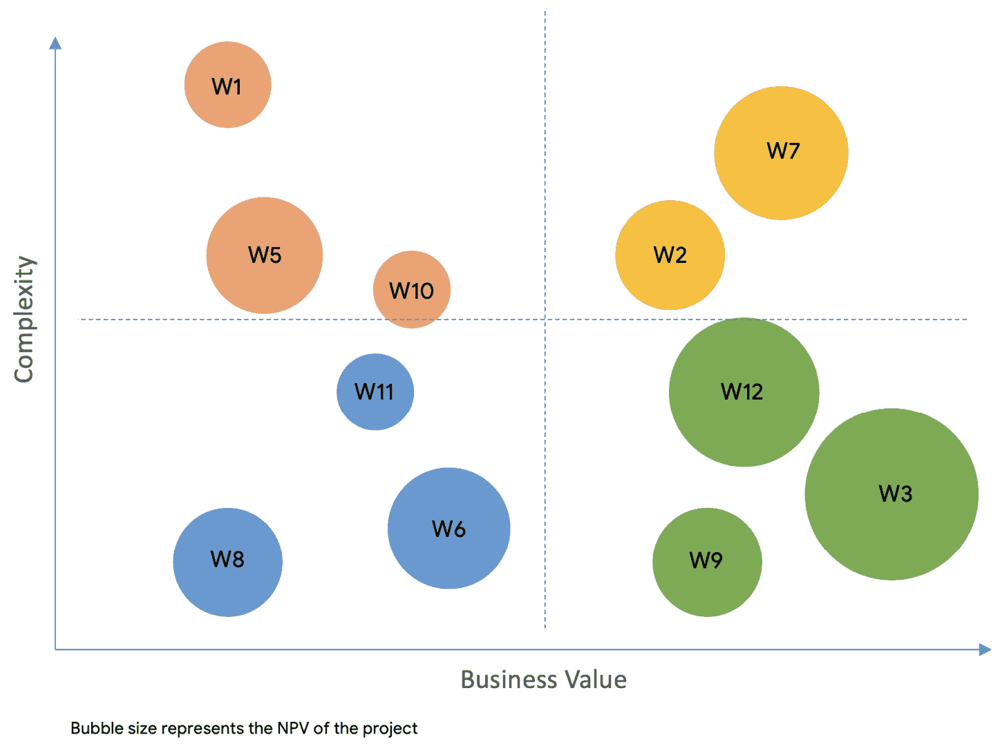
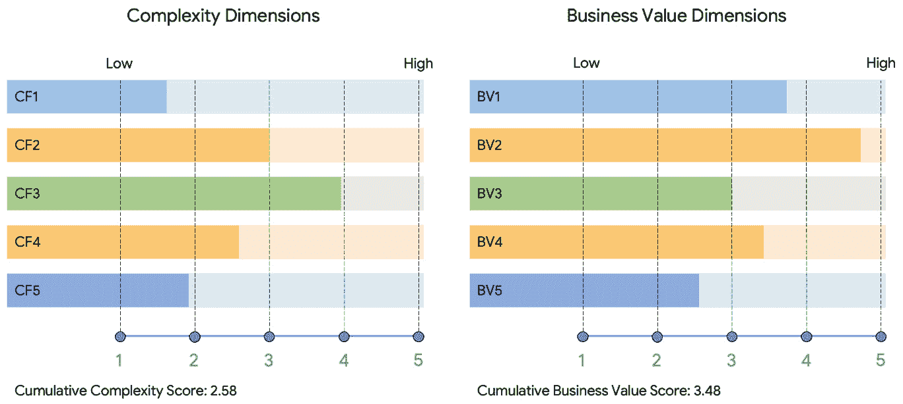
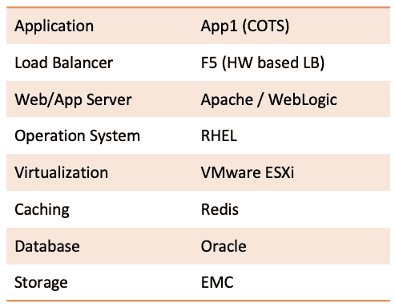
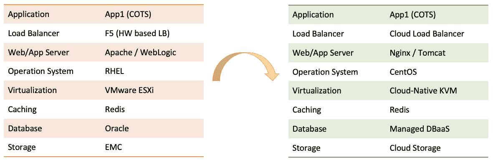

## 5 企业迈向云转型的旅程

云计算已被证明是企业在多个维度实现数字化转型的引擎，其动力源于创新和竞争的渴望。如我们在 *第 4 章**，构建现代企业的基石* 中探讨的那样，云转型可以为企业带来诸多益处，包括增强灵活性、可靠性、提升运营韧性、降低 IT 成本并推动创新。然而，通往云端的旅程并非一刀切的过程，因为每个企业都踏上独特的征程，受其特定目标、挑战和组织文化的影响。企业通往云端的旅程是一个高度个性化的过程，受多种因素影响，例如现有的 IT 格局、行业法规、组织文化、时机和市场需求。云之旅还取决于企业的成熟度水平。根据具体的业务目标和成熟度水平，一些企业可能会优先考虑成本削减，并寻求将基础设施迁移到云端以实现运营效率，而其他企业则可能专注于利用云的弹性和灵活性来推动创新并引领数字化颠覆。在本章中，我们将探讨企业面临的各种云之旅，包括以下内容：

* 使用多维度价值-复杂性矩阵挑选合适的云计划
* 各种企业云转型之旅
* 迁移工作负载到云时的策略
* 混合云策略
* 通过新兴技术在云中创新

# 使用多维度价值-复杂性矩阵挑选合适的云计划

在上一章中，我们讨论了组织可以采用的各种策略来构建现代云就绪企业的基石，以及用于评估云成熟度的云就绪评估框架。企业云之旅中最关键的步骤之一是为云选择合适的工作负载。组织可以利用多种不同的策略在云中迁移或构建应用程序。然而，选择合适的工作负载至关重要——尤其是如果这是组织首次涉足云端——以确保数字化转型的成功。在本节中，我们将探讨企业可以利用的多维度价值矩阵作为工具，帮助为云之旅挑选合适的工作负载。在传统方法中，组织通常使用衡量价值与复杂性比率的价值-复杂性矩阵来评估合适的工作负载。多维度价值-复杂性矩阵方法允许采用更全面的方法，在多个维度上评估价值和复杂性。图 5.1 中的价值-复杂性矩阵显示了各种项目根据感知价值和复杂性绘制的图表，其中气泡大小代表项目的 **净现值** (`NPV`)：

图 5.1 – 价值复杂性矩阵

在 `Y` 轴上绘制复杂性因素，在 `X` 轴上绘制业务价值要素，同时以气泡大小代表一项计划或项目的 `NPV`，可以全面了解哪些计划最适合云。在每个企业成熟度水平上，DNA 和感知的业务价值都是独特的，建立价值-复杂性矩阵以挑选出能产生正确业务价值回报的工作负载至关重要。例如，多维度因素，如工作负载的业务关键性、与其他企业系统的互依赖性、安全考虑、数据主权、许可、迁移或实施所需的工作量以及成本，都可能决定特定计划或工作负载的复杂性。同样，通过创新、上市速度、总拥有成本、进入新市场、增强性能以及改善客户 **满意度和可持续性**（基于 `ESG` 框架）实现的价值，凸显了业务价值效益。我们将在 *第 11 章**，ESG 和可持续性* 中更详细地介绍 `ESG` 和可持续性。最后，企业评估可归因于云计划的业务价值实现的 `NPV` 可能是一个明智的做法。

让我们回顾复杂性和业务价值因素，以及企业如何对这些要素进行评分。

## 复杂性因素

**复杂性因素** 定义了任何云计划所涉及的复杂性和风险。这些因素可能包括诸如应用程序架构复杂性、上游或下游系统的互依赖性、时间、工作量和成本复杂性等。由于企业环境中的每个云计划都可能独一无二，组织可以定制这些复杂性因素。然而，以下是一些需要考虑的复杂性因素：

* **业务关键性**：这代表根据业务影响评估和分类工作负载或应用程序的过程。这可能受应用程序的各种属性影响，例如其收入产生影响、业务连续性、客户影响、**恢复时间目标** (`RTO`)、**恢复点目标** (`RPO`) 和风险状况。根据这些属性，应用程序、计划或工作负载可以被归类为任务关键型、重要型、重要或辅助型。考虑到应用程序的业务关键性很重要，因为任何中断或停机都可能对业务造成不利影响。

* **互依赖性**：应用程序互依赖性构成了另一个关键的复杂性因素，在云迁移中经常被误解，无论是由于随着时间的推移的有机增长还是缺乏文档。一个任务关键型应用程序可能拥有数十甚至数百个来自上游和下游系统的集成，这可能增加其复杂性。了解并对应用程序的互依赖性进行评分并相应分类至关重要。

* **安全**：在云转型中需要考虑的另一个关键因素是应用程序的安全态势。这可能涉及数据安全、网络安全、访问控制和 Web 应用程序防火墙。面向内部的应用程序的安全考虑可能与其面向外部的对应物截然不同。

* **数据主权**：由于数据的广泛收集和处理、对隐私和安全的担忧以及遵守各种数据保护法规的需求，数据主权变得越来越重要。确保遵守适用的数据保护法律并了解数据驻留的法律影响，对于维护应用程序的数据主权至关重要。这是一个重要的复杂性因素，需要考虑以维护应用程序的完整性和合规性。

* **许可和支持**：另一个关键的复杂性，尤其与云 lift and shift 迁移相关的是所考虑的应用程序或软件的许可和支持考虑。某些应用程序和软件供应商已授权并支持他们将持续提供支持的云平台。企业也必须探索替代策略，例如应用程序重构、市场可用性等。

* **工作量**：在云转型中最重要的考虑因素是实施或迁移解决方案到云所需的工作量。开展首个云计划的企业必须确保工作负载并非极其任务关键且不需要大量工作。

## 治理与运营
治理和运营方面的考虑，例如应用正常运行时间、可用性、SLA、SLO、网络架构以及监控和发布管理，对于确保关键应用的 disruptions 保持在最低限度至关重要。另一个重要考虑因素是，云环境中应用的运营和治理可能与传统的本地部署设置有显著不同。

在回顾了复杂性因素之后，让我们回顾业务价值因素。

## 业务价值因素
业务价值因素定义了组织可从云计划中实现的 perceived value。这些因素可能包括组织的创新速度、提供现代能力、上市时间、性能改进以及总拥有成本的降低，等等。以下是一些需要考虑的业务价值因素：

### 创新
衡量创新的价值至关重要，但也具有挑战性，因为创新的价值不易量化，且通常涉及定性和长期成果。然而，企业可以利用多个关键指标和度量来评估创新工作的价值，例如盈利能力提升、客户反馈和满意度、专利和知识产权申请、社会影响评分以及市场份额。

### 总拥有成本（TCO）
评估云计划潜在业务价值的另一个关键指标是 TCO。全面的 TCO 和 ROI 评估可以为选择合适的 workload 或项目指明方向。

### 应用性能
诸如应用可扩展性、弹性、性能、可用性和易用性等性能考虑因素会直接影响业务价值。例如，零售电商网站是经典示例，也是客户体验的可靠衡量标准，因为网站的性能和易用性可以带来转化率提升，以及网站的可扩展性，这两者在季节性高峰期间同等重要。

### 客户满意度
客户满意度评分是评估云计划业务价值和影响的另一个关键要素。这可能包括客户服务、访问便捷性、联系中心自动化、忠诚度计划、沉浸式体验、个性化服务或产品推荐、无缝全渠道体验等方面的增量改进。已识别 workload 的 CSAT 评分可以决定该计划的业务价值。

### 环境、社会和治理（ESG）
云计划的 ESG 评分可通过定性和定量指标的组合来衡量。为了衡量 ESG 评分，企业可以创建定制框架或采用专业评级机构提供的现有 ESG 评级方法。这些方法通常使用来自公开披露、报告和独立评估的数据组合。例如，环境影响可通过可再生能源驱动的节能技术、应用的碳足迹以及认可机构颁发的绿色认证来衡量。同样，社会因素可通过数据隐私和安全标准（如 GDPR 合规性）、劳动实践、供应链责任和可访问性来衡量。同样，数据治理、透明度以及遵守道德标准和法规等治理指标也会直接影响 ESG 评分并带来业务价值。

重要的是要理解这些是方向性的业务价值因素，组织必须根据业务背景仔细选择和定制它们。现在我们已经回顾了各种业务价值因素，让我们看看如何为所选的云计划定义和评估净现值。

## 净现值
财务可行性对每个计划都至关重要，也适用于云转型。企业普遍的抱怨是未能评估和评价财务可行性，这可能对数字化转型工作造成不利影响。计算云计划的净现值涉及估算该计划在其生命周期内相关的预期现金流，并使用适当的折现率将其折现为现值。这包括估算现金流、确定净现值以及进行敏感性分析。在现金流估算中，重要的是同时考虑初始投资（例如迁移成本和设置成本）和持续运营成本（例如订阅费和维护成本）。净现值评估超出了本书范围。在价值-复杂性矩阵中，气泡大小代表云 workload 或计划的净现值。气泡越大代表净现值评分越好，负净现值应被忽略，因为它们在财务上不可行。对于负净现值计划，必须考虑替代策略。

一旦确定了复杂性和业务价值因素，企业可以利用评分框架为每个已识别的 workload 或计划中的每个因素进行评分。累计得分构成 workload 的整体复杂性和业务价值。通常，具有云卓越中心（CCoE）实践的组织负责制定框架和指导，以确保企业范围内评分的一致性。以下是一些有助于评估所考虑 workload 复杂性和业务价值的问题：

| 序号 | 评估主题 | 影响领域 |
| --- | --- | --- |
| 1 | 应用基础设施是否需要即将到来的硬件更新？ | TCO/ROI |
| 2 | 与本地部署相比，云中运行该应用的成本是否显著更低？ | TCO/ROI |
| 3 | 该应用是否能从云原生规模、可用性、弹性以及灾难恢复中受益？ | 性能 |
| 4 | 该应用是否能从显著提升性能的云原生服务中受益？ | 性能 |
| 5 | 该应用的业务关键性如何？ | 业务关键性 |
| 6 | 该应用是面向外部（客户）还是面向内部（企业）？ | 业务关键性 |
| 7 | 该应用有多少集成/依赖？ | 互依赖性 |
| 8 | 该应用是否有清晰、最新的架构文档？ | 工作量 |
| 9 | 该 workload 的运营要求（SLA、SLO）是什么？ | 治理 |
| 10 | 该 workload 是否有任何法律、监管或合规要求？ | 安全、数据主权 |
| 11 | 该应用的延迟敏感性如何？ | 治理、业务关键性 |
| 12 | 该应用是否可移植？该应用是否能从在云原生平台上运行中受益？ | 工作量 |
| 13 | 应用数据是否受数据驻留或其他隐私法规管辖？ | 数据主权 |
| 14 | 该应用是否有许可和支持要求（COTS 应用、遗留系统、开源）？ | 许可和支持 |
| 15 | 该应用是否能从重新托管、再平台化、重新采购或重构中受益？ | 工作量 |
| 16 | 应用迁移是否存在时间敏感性（许可续期、数据中心退出、合同义务等）？ | 许可和支持、工作量、互依赖性 |
| 17 | 该应用是否有特定的硬件依赖？ | 互依赖性 |
| 18 | IT 团队是否具备所需的技能和资源进行迁移？ | 工作量 |

表 5.1 – 云 workload 复杂性和业务价值评估

在评估了复杂度和业务价值因素后，必须对各个维度进行单独评分，以得出复杂度和业务价值的累计得分。重要的是要为各种复杂度和业务价值维度采用加权评分机制，因为并非所有维度都相等。例如，在特定的业务环境中，安全复杂性因素可能需要更高的权重，而 TCO 业务价值维度可能需要相对较低的权重。

图 5.2 – 对复杂度和业务价值维度进行评分

利用这一框架，企业可以选择通过云转型能够带来最佳业务价值的合适工作负载。在迁移之前，评估工作负载的价值和复杂性非常重要。例如，选择第四象限（高价值、低复杂度）的工作负载作为云迁移的首个工作负载似乎是不言而喻的决定。然而，该工作负载可能极其关键，迁移、切换和时间线相关的风险可能超过业务价值。相反，迁移一个辅助且不常用的应用程序将难以证明其价值。获得一些早期成果至关重要，尤其是在第一次云转型之旅中；因此，经验法则是选择对业务至关重要、提供显著业务价值、正的净现值（NPV）且相对复杂度较低的工作负载。

在下一节中，我们将探讨企业可以考虑的各种云转型之旅以及每种方法的利弊。

# 企业云转型之旅

每个企业的上云之旅都是独一无二的，并由特定的业务目标指导。企业云之旅可能与组织本身一样多样化。每段旅程的独特性受技术目标、行业特定挑战、文化准备度以及创新愿望等因素影响。总体而言，主要有三种云转型之旅：

* 现代化本地部署应用
* 优化本地数据中心
* 云原生诞生

让我们踏上这些云转型之旅并探索它们。

## 现代化本地部署应用

这是最常见的云之旅，因为大多数企业拥有包含遗留系统和应用的传统数据中心和 IT 资产。成熟的组织选择云之旅来现代化现有应用，以提高敏捷性、可扩展性和成本效率。企业可以根据既定的业务目标采用多种策略来现代化本地 IT 环境。让我们考虑一些场景。

### 数据中心退出

数据中心退出云之旅是寻求优化运营、现代化应用、降低成本并提高可扩展性的企业的战略决策。通过将本地数据中心迁移到云端，组织可以利用更快的应用程序部署、弹性资源分配和改进的灾难恢复能力。一些企业选择数据中心退出作为从传统数据中心迁移并在云端现代化的策略。这可能源于多种原因，例如组织希望专注于业务功能并退出数据中心业务、数据中心运营成本高昂、即将进行大规模硬件更新，以及托管解决方案情况下的数据中心租约续签、收购、剥离等。无论理由如何，企业都可以利用这一机会在云端现代化应用。成功的数据中心退出云之旅需要周密的规划和执行。企业必须评估其当前的基础设施和应用程序，以确定最佳迁移方法，同时考虑时间、努力和复杂性之间的平衡——无论是重新托管、就地迁移、重构还是重新采购。这使组织能够获得云的优势，例如可扩展性、灵活性、成本优化以及访问尖端技术。虽然旅程可能带来挑战，但周密的规划、遵循最佳实践以及与云服务提供商的合作可以帮助企业成功完成数据中心退出。通过拥抱云，企业能够在快速变化的数字环境中蓬勃发展，并保持对未来创新的适应性。以下是关于数据中心退出的一些考虑因素：

* **优点**：数据中心退出使组织能够重组和重新构想 IT 格局并为创新奠定基础
* **缺点**：典型的数据中心退出可能复杂而繁琐，因此需要仔细评估、规划和协作

数据中心退出通常是企业的战略性且大胆的选择，也体现了领导层对未来的承诺和愿景。更重要的是，它使组织能够专注于核心业务，而不是拥有和运营 IT 数据中心。

### 迁移并转移应用

将应用迁移并转移到云端的旅程是企业在最大限度减少干扰的同时快速拥抱云计算的宝贵策略。通过将应用程序原样迁移到云端，企业可以获得即时收益，例如可扩展性、成本效益和改进的访问性。迁移并转移迁移策略涉及以最少更改将工作负载从本地数据中心迁移到云端。在这种方法中，应用程序的底层架构、代码库和功能基本保持不变。目标是快速将应用程序过渡到云端，而无需广泛的重构或重构，从而减少迁移复杂性和停机时间。通过将应用程序原样迁移到云端，企业可以实现诸如改进的访问性、可扩展性和降低维护成本等即时收益。这种迁移策略是迈向更全面云采用的垫脚石，与其他迁移方法相比可提供更快的投资回报率。以下是迁移并转移方法的利弊：

* **优点**：迁移并转移策略使企业能够以极少的更改快速将应用程序迁移到云端
* **缺点**：迁移并转移策略无法充分利用云原生能力，可能导致价值实现不佳

通常被认为是对云的快速而粗糙的方法，迁移并转移策略使组织能够快速迁移到云端，利用云能力，同时允许分阶段转型。

### 升级到 SaaS

## 升级到 SaaS 云旅程
升级到 SaaS 云的旅程代表了企业的一次变革性转变，使其能够获得灵活、可扩展且成本高效的软件解决方案。通过采用 SaaS，组织可以专注于核心业务活动，同时将软件更新、维护和安全交给云服务提供商负责。企业可能会出于业务转型的需求选择此策略，因为现有应用无法应对增长或创新、提供新功能，以及缺乏现有的应用路线图。升级到 SaaS 涉及从传统的本地软件安装转向基于 Web 的订阅式解决方案，使组织能够利用多样化的云原生应用。虽然采用 SaaS 带来诸多益处，但围绕数据迁移、集成和治理制定策略至关重要。在组织将应用升级到 SaaS 时，以下是一些需要考虑的事项：
- **Pros**：采用 SaaS 可提供多项即时益处，例如根据用户需求进行扩展、内置业务连续性计划、降低维护工作量、访问现代技术，以及改善可访问性和协作
- **Cons**：SaaS 可能会强制限制定制，企业必须围绕应用集成、数据访问和迁移制定明确的策略
除其带来的益处外，升级到 SaaS 对于精简 IT 团队的组织而言也可能极具优势。

## 在云上重新架构
企业可利用的另一项常见现代化应用策略是在云上重新架构应用。在云上重新架构应用是一项战略举措，使组织能够充分发挥云平台的全部潜力。这是一个全面的过程，超越了简单的迁移和搬迁，涉及将单体应用拆分为更小、模块化的微服务，以便独立部署和管理。通过采用云原生实践，组织可以优化性能、增强可扩展性并简化运营。以下是重新架构云上应用的一些利弊：
- **Pros**：重新架构的应用可实现动态扩展、弹性、资源效率、成本节约和创新
- **Cons**：重新架构应用需要深入了解应用架构、依赖关系和 IT 技能，以及大量的时间和资源
除了利弊之外，重新架构应用还能让企业从零开始，重新构想未来的应用。

## 优化本地数据中心
随着企业越来越多地采用云计算以获得敏捷性、可扩展性和成本效益，优化现有本地数据中心可能成为关键要素。能够将本地基础设施与云服务集成，使组织能够在最大限度减少对持续运营干扰的同时，兼顾两者的优势。本地数据中心多年来一直是企业 IT 基础设施的支柱，提供控制、隐私和直接访问数据。它们是关键任务应用的基础，确保低延迟运行并遵守特定的监管和合规要求。然而，本地环境通常未针对云规模的扩展性、灵活性以及技术进步进行优化。企业可以利用多种策略来优化本地数据中心。让我们来看看。

### 构建私有云
构建私有云涉及将传统的本地数据中心战略性地转变为动态且以自助服务为导向的云环境。这包括通过虚拟化和软件定义技术现代化基础设施，实现资源的自动化配置和管理。私有云之旅为企业提供了一个变革性的机会，使其能够在数据中心内实现云计算的优势，同时保持控制和灵活性，与遗留应用共存，并符合数据驻留或合规需求之间取得平衡。通过踏上这段旅程，组织可以现代化其 IT 基础设施、优化资源利用并促进应用部署的敏捷性。以下是利弊：
- **Pros**：私有云为企业提供灵活性，可根据特定需求定制针对性能优化的云环境，提供对数据主权完全的控制，并提供可预测的性能。
- **Cons**：构建私有云通常需要更高的初始成本，这对某些组织而言可能成本过高，与公共云超大规模提供商相比限制可扩展性，并带来维护复杂性
通过在安全且隔离的环境中提供专用资源，私有云使企业能够在遵守严格监管要求的同时托管和管理敏感数据和关键应用。这种控制和定制水平确保组织能够根据特定需求定制私有云环境，优化性能并满足独特的业务需求。

### 混合云采用
本地优化的另一种方法是在本地构建云能力，以构建混合云战略。多家公共云提供商提供服务，可帮助企业在其数据中心内构建公共云能力。这是一个利基领域，对于某些企业而言可能极具益处，因为由于本地存在对延迟敏感的应用和数据驻留要求，最近的公共云数据中心访问并不可行。对于已建立公共云战略并寻求混合云选项以弥补差距的企业而言，这可能是一个很好的方法。该模型的主要优势在于它模仿了相同的公共云架构，可无缝扩展到本地应用。一些服务提供商将其作为完全托管的服务提供，而其他则可自行管理。这也有助于解决企业某些利基云用例，例如云爆发。一些示例包括 AWS Outposts、Google Anthos、Azure Stack 和 Oracle Cloud@Customer。以下是混合云方法的一些考虑因素：
- **Pros**：公共云以超低延迟在您所在的位置与您相遇，它解决了数据驻留限制，并且具有与公共云相同的架构
- **Cons**：前期投资高；在完全托管服务的情况下，可能存在更长的合同义务，并且公共云中的并非所有服务都完全具备功能或可用
混合云方法允许本地和云环境之间无缝集成，提供利用两全其美优势的能力，并且通常是拥有大量本地投资的企业所寻求的战略。

## Born in the Cloud
**Born in the cloud** 指的是以云原生思维构思和建立的企业和组织，从成立之初就将云计算作为其运营的基础。与后期才迁移到云的传统企业不同，born in the cloud 实体从第一天起就充分利用云计算的全部潜力。*born in the cloud* 的含义是以对云技术的基础性依赖建立组织，用于其基础设施、应用和服务。
Born in the cloud 为组织提供了创新并颠覆传统行业竞争对手的诸多优势：

# 云上诞生

*   **敏捷性**：对于没有传统 IT 和遗留应用负担的组织而言，云上诞生有助于它们快速开发、测试和部署新的应用和功能。这使企业能够快速响应市场变化、客户需求和新兴趋势，培养持续创新的文化。
*   **资源效率**：云上原生组织可以避免构建本地基础设施相关的前期资本支出。在云优先模式下，它们只为所消耗的资源付费，降低财务风险并实现资源的有效分配。
*   **全球覆盖**：云平台天生提供全球数据中心网络，使云上原生实体无需庞大的全球物理基础设施即可触达世界各地的客户和用户。这种全球存在支持快速扩张和市场渗透。
*   **精简 IT**：通过将基础设施管理外包给云服务提供商，云上原生组织倾向于将资源和专业知识集中在其核心能力和业务差异化上。
*   **技术创新**：云服务提供商提供大量先进技术和服务，例如人工智能、机器学习、大数据分析以及 **物联网** (**IoT**) 能力。这使云上原生组织能够快速实验、创新并将其轻松集成到其产品中。
*   **可持续性**：与传统同行相比，云上原生实体通常具有更小的碳足迹，因为它们更高效地消耗资源并减少电子废弃物。

云上诞生不仅仅是一种技术方法。随着技术的不断进步，它不仅代表一种商业方式，更是重新定义组织在数字时代动态环境中能够实现什么本质的途径。

一些公司示例体现了云上原生方法，包括 Slack、Twilio、Zoom、Stripe 和 HashiCorp *\[1\] \[**2\] \[3\]*。

## 其他独特的转型之旅

以下部分涵盖了一些企业采用的独特云之旅，这些之旅深受创新、颠覆市场和引领行业转型的愿望影响。

### 全球扩张之旅

希望全球扩张或进入新市场的企业可能会利用公共云快速在不同地区建立自身。扩展到新地理区域时，企业必须遵守各种当地监管和合规协议。公共云为进入新市场的企业提供以下几个主要优势：

*   在新地理区域建设新的数据中心和 IT 生态系统耗时极长；成熟的云服务提供商提供主要优势——易用性和上市速度
*   云服务提供商通常遵守各种当地和政府法规，这对企业快速启动并保持合规具有巨大优势
*   在一个地区已建立公共云战略的企业可以利用相同的<|message|> 基础设施、架构、网络、安全和运营模式。

### 数据云之旅

正如俗话所说 *数据是新的石油*，利用云满足数据需求是企业的另一条独特之旅。企业的创新和数字化转型成功主要取决于其如何利用第一方数据与第二方和第三方数据相结合的力量。强大的数据基础是激活现代用例同时利用人工智能和机器学习的关键。这使组织能够通过统一客户数据并实时利用人工智能和自动化对洞察采取行动，从而做出数据驱动的决策、获得洞察并提供个性化体验。

### 绿色云之旅

除了技术和商业动机之外，注重环境的企业会开展以可持续性措施为重点的云转型之旅，例如最大限度减少电子废弃物和碳足迹。许多超大规模云服务提供商因在无碳能源和可再生能源上运营云数据中心而更加关注 ESG，提供可视化和报告云服务使用碳排放的工具，建设更智能、更节能的数据中心，并推广可持续供应链实践。关注绿色云计划的企业可以选择具有可持续性记录和承诺的云服务提供商。据世界经济论坛报告称，2021 年至 2024 年间向云计算的转型应至少防止 6.29 亿公吨二氧化碳进入大气 *\[4\]*。为了便于理解，这相当于在一年内将 410 万英亩美国森林免于转为耕地所固碳的量。

云之旅是独特的，必须由企业的更大愿景指导，后者为云转型定下基调。现在，让我们探讨企业可以利用的各种云迁移策略。

# 云迁移策略

在仔细评估并了解 IT 格局后，企业云转型的最关键阶段是开始迁移。本章前面我们回顾了价值-复杂性矩阵，它可以帮助您为云迁移选择合适的 workload。本节将讨论企业可以利用的不同云迁移策略。

## 应用迁移策略的 6R

2010 年，Gartner 发布了将应用迁移到云的 5R 方法——*重新托管，重构，修订，重建，和替换* *\[5\]*。此后，出现了多种其他 *R* 迁移策略，例如 AWS 的 6R、Citrix 的 7R 和 Infosys 的 8R。然而，核心目标是为组织在迁移应用到云时可利用的各种策略提供指导。多年来，云迁移策略演变为我们更常称之为应用迁移的 6R——Rehost、Replatform、Repurchase、Refactor、Retire 和 Retain。必须理解，这些迁移策略并非相互排斥。大多数企业都有可通过一种或多种迁移策略解决的应用迁移。重要的是评估与整体业务目标相符的每种策略的利弊。例如，一个应用可以被重新托管、重构或重新购买。有趣的是，一个应用甚至可能包含属于一个或多个 R 的部分——应用的一部分可以被重新平台化，而另一部分可以被重新托管。决策取决于多种因素，并且在每个企业环境中都是独特的。让我们回顾这些云迁移策略。

### Rehosting – 也称为 lift and shift

Rehosting，也更常被称为 **lift and shift**，是最常见的迁移方法。它是指将应用和工作负载从本地基础设施迁移到云端，而无需对应用进行重大修改。大多数企业以重新托管策略开始其云转型之旅，作为快速测试云能力和实现价值的方式。在这种方法中，应用的核心架构和功能基本保持不变，以实现快速迁移，同时利用云的优势，例如可扩展性、易于管理以及潜在的成本节约。企业可以根据应用的类型、复杂性和业务目标选择几种不同的方式在云上重新托管应用。

# 重托管与再平台化概述

## 平移迁移 – 公有云作为基础设施平台

利用公有云作为基础设施平台——主要利用计算、存储和网络——将应用程序平移迁移到云端。这可能是一种可行的策略，当应用程序可以在云原生虚拟机上运行时。采用此方法，应用程序架构基本保持不变，仅对网络和操作系统进行少量更改。组织可以受益于快速的迁移时间、低迁移工作量、云原生可扩展性、可用性、备份以及下层维护的卸载。在这种方法中，企业仍无法获得全方位的云优势，因为仍存在维护负担——在自定义操作系统的情况下进行操作系统/内核修补、应用程序、库和数据库维护。

## 基于仿真器的遗留应用程序迁移

那些根本不适合在云基础设施上运行的遗留应用程序可以受益于公有云提供商或第三方解决方案提供的仿真器。当由于业务需求（如数据中心退出、硬件更新周期或合同义务）而需要迁移时，这种方法对企业有益。作为迈向更大优化之旅的中间步骤，仿真选项为遗留应用程序提供了一个落地区。尽管仿真是一个很好的中间解决方案，但可能会对应用程序的性能产生影响。将大型机现代化迁移到云端是基于仿真器迁移的一个例子。

## 嵌套虚拟化

嵌套虚拟化是企业可以利用的另一个选项，对于无法承受架构任何更改的应用程序来说是一个很好的选择，包括 IP 地址、操作系统、内核和网络。一些遗留应用程序需要静态 IP 地址以及特定的操作系统和内核补丁级别，这些在云上维护起来更困难或根本不可行。在这种情况下，公有云上的嵌套虚拟化解决方案是一个很好的选择，因为应用程序的功能和架构没有修改。硬件辅助的嵌套虚拟化往往比基于软件的解决方案更好。然而，应用程序仍可能存在性能影响。

## 公有云上的 VMware

作为应用程序现代化的一个部分，各种企业工作负载仍基于 `VMware`。随着企业寻求利用现有投资并以很少的更改迁移这些工作负载，在公有云上创建和运行 `VMware` 可以提供一种无缝的方式，使工作负载的运行方式与传统本地运行的方式相同。尽管这提供了迁移的便利性，但由于 `VMware` 的许可和维护成本，工作负载仍无法受益于水平扩展和 TCO 等云原生功能。

## 托管

另一种不太常见的重托管方法，尽管在某些情况下至关重要，例如大爆炸式数据中心退出、收购或剥离情况，就是托管。将遗留硬件、应用程序以及负载均衡器、防火墙和超融合基础设施等基于硬件的解决方案进行托管，可以为企业提供一种新颖的方式，在优化云转型之旅时兼顾两者之长。随着遗留堆栈在物理上与云提供商的网络和基础设施相邻，企业可以受益于更低的延迟和渐进式转型。

## 重托管的优势

总体而言，重托管可以为企业提供以下几个优势：

* **速度**：重托管提供了一条直接的迁移路径，使其成为快速高效的选择。无需进行大量代码更改，减少了迁移的复杂性和所需时间。
* **云优势**：通过重托管，企业可以快速利用云功能，如可扩展性、高可用性、自动备份、维护和管理。这使组织能够在不改造应用程序架构的情况下享受云优势。
* **成本节约**：虽然从长期来看并非最具成本效益的选择，但重托管可以通过避免重新开发或重构应用程序的需求而产生初始成本节约。对于希望迅速迁移并在以后优化云环境的组织而言，这可以是一个切实可行的第一步。
* **风险缓解**：重托管通过保留现有功能并减少迁移过程中引入新错误或错误的可能性，从而最大限度地降低了迁移关键应用程序相关的风险。

## 重托管的劣势

以下是重托管的一些劣势：

* **云利用率不佳**：重托管的应用程序无法充分利用云功能和云原生能力，可能导致云资源利用不足并错失成本优化的机会。例如，已重托管的应用程序通常垂直扩展，导致资源过度配置。
* **敏捷性和创新性受限**：虽然重托管提供了快速迁移，但它可能会阻碍利用云原生功能实现敏捷性和创新的能力。组织必须将重托管作为中间步骤，并在以后重构应用程序以释放云的全部潜力。
* **潜在的安全漏洞**：重托管的应用程序可能会继承其原始环境中的安全漏洞或配置。在云中确保适当的安全措施和访问控制至关重要，否则可能使应用程序暴露于网络威胁，从而可能需要额外的安全措施。
* **缺乏成本优化**：虽然可以实现初始成本节约，但组织可能无法达到与云原生策略相同的成本优化水平。需要仔细分析长期成本影响。

虽然重托管可能无法提供与更具变革性的迁移策略相同的优化和创新水平，但其重要性在于能够提供一条快速且相对低风险的云采用路径。它使组织能够在保留现有应用程序架构的同时开始受益于云的可扩展性、灵活性和成本效益。

## 再平台化 – 又称迁移并改进

再平台化涉及在进行最小代码更改的同时将应用程序迁移到云端，以利用云原生功能。与平移迁移方法不同，再平台化允许对应用程序架构、配置和集成进行有针对性的调整，以优化应用程序在云原生环境中的性能和效率。不是简单地将应用程序原样迁移到云端，再平台化的重点是将应用程序堆栈的部分迁移到云原生服务，以更好地利用云能力和规模经济。需要注意的是，再平台化并不打算更改所考虑的应用程序的核心架构。例如，考虑一个在本地运行的以下堆栈的打包应用程序：

图 5.3 – 一个示例的本地 Web 应用栈

虽然重托管迁移会寻求以绝对最小的修改部署堆栈原样，但再平台化练习涉及对应用程序架构、认证和可支持性的更深入调查。在前面的示例中，对企业业务功能至关重要的 `COTS` 应用程序可能具有多种经过认证和支持的目标平台。即使是看似较小的再平台化工作，企业也可以实现潜在的长期收益，例如更低的 TCO、改进的性能、降低的许可要求以及更低的管理和维护工作。例如，将应用程序的虚拟化堆栈从商业 hypervisor 再平台化到云原生 hypervisor（如 `KVM`）可以对给定应用程序的整体 TCO、移植性、可用性和可维护性产生显著积极影响。

## 再平台化

在前面的示例中，再平台化的应用栈可能看起来像这样：

图 5.4 – 从本地部署到云的应用再平台化

### 优势

再平台化提供多项优势：

* **性能优化**：再平台化使企业能够微调应用程序，以最大程度利用云功能和云原生能力，从而提高性能、响应速度和可扩展性。
* **成本效益**：通过优化应用程序性能和资源利用率以将应用程序从商业栈中卸载，再平台化可以更高效地使用内置云功能，从而降低运营成本和 TCO，并避免资源浪费。
* **可用性与可扩展性**：再平台化后的应用程序更能处理动态工作负载，可根据需求自动按需扩展或缩减资源，从而确保高峰期性能最优。通过利用云原生能力，再平台化后的应用程序能够固有地提供更好的 SLA（例如在云负载均衡器后面运行应用程序的多个实例、在多个区域间分布应用程序实例、并创建灾难恢复环境），从而提高应用程序的可用性。
* **更易管理**：云原生功能如自动扩缩容、负载均衡、修补、安全性调优和自动化备份简化了繁琐的管理任务，释放 IT 资源，使团队能够专注于业务功能、创新和增值活动。
* **集成与创新**：再平台化允许企业将应用程序与各种云服务（如数据库、分析、机器学习）无缝集成，增强功能并实现数据驱动洞察。例如，再平台化后的应用程序更能增强能力，提高上市速度。

### 挑战与注意事项

企业必须注意以下挑战和注意事项：

* **应用程序兼容性**：虽然再平台化最大限度地减少了代码更改，但仍可能需要重大调整以确保与云环境和服务的兼容性，这可能会引入复杂性和潜在问题。如前所述，评估目标平台上的应用程序栈、兼容性、认证和可支持性非常重要。在商业应用程序中，组织还必须考虑许可和支持限制，以确保业务连续性。
* **并非终点**：尽管再平台化可以是一种有吸引力的迁移方法，但必须理解这可能不是最终状态。持续改进和渐进式变更（例如可能的重构考虑和设想基于微服务的架构）必须分阶段进行评估和实施。
* **资源限制**：组织必须仔细评估再平台化所需的资源，包括云技术的专业知识以及对项目时间线的潜在影响。构建 MVP 和采用分阶段迁移方法至关重要。
* **数据迁移与集成**：确保数据迁移顺畅并与现有系统集成，对于在再平台化过程中维护数据完整性和业务连续性至关重要。
* **测试与验证**：全面的测试和验证对于识别和解决再平台化后可能出现的性能或兼容性问题至关重要。

再平台化为企业在现代化应用程序与最小化中断之间提供了良好的平衡。它为组织提供了高效的云采用路径，使其能够利用云基础设施的优势，同时保持与现有系统的兼容性并最大限度降低风险。

## 重新采购 – 又称 drop and shop

重新采购，更常被称为 drop and shop 迁移策略，涉及用云原生替代方案替换现有软件应用程序。在这种方法中，企业做出战略决策，从本地部署或遗留系统过渡到专为提供改进功能、可扩展性和与现代业务需求一致而构建的云服务。与我们之前讨论的迁移方法——重新托管和再平台化——相比，后者的战术重点是在增强云原生能力的同时保留核心应用程序架构、功能和业务流程集成，重新采购是一种战略性的迁移策略和决策。更常见的是，重新采购决策主要由业务部门利益相关者做出，因为业务需求已超出现有技术。例如，考虑一个传统 CRM 解决方案，它曾在捕获和管理客户信息方面表现出色。然而，随着企业在数字时代发展并应对客户和市场需求，传统 CRM 软件在提供全渠道客户体验、客户 360 度视图、移动访问、精准营销、预测分析、预测以及与人工智能、聊天机器人等新兴技术集成的现代能力方面已显不足，阻碍了增长和创新。与重新托管或再平台化不同，重新采购迁移策略体现了应用程序的战略演进，使企业能够充分利用云原生软件解决方案的全部潜力。

重新采购为企业提供以下几个战略优势：

* **访问前沿功能**：云原生软件解决方案通常配备先进的功能、能力和集成，使组织具备增强功能并更好地与不断变化的业务需求保持一致。
* **可扩展性与灵活性**：重新采购使企业能够利用云固有的可扩展性，使其能够实时调整软件能力以匹配不同的工作负载和需求。重新采购策略还提供以 SLA 为驱动的服务能力，具有内置的高可用性和灾难恢复。
* **资源效率**：通过重新采购，组织可以释放宝贵的 IT 资源，专注于关键业务功能，而非繁琐的日常管理和维护。重新采购决策还能减少并释放数据中心占用空间。
* **快速部署**：云原生软件解决方案专为快速部署而设计，使组织能够缩短实施时间并加速新功能或服务上市时间。
* **成本优化**：虽然重新采购可能涉及可观的初始和订阅成本，但长期收益可能包括降低维护、运营和支持费用，从而随着时间的推移实现总体拥有成本节约。
* **供应商管理**：云原生解决方案通常附带托管服务，减轻了软件维护和更新的负担，使企业能够专注于核心竞争力。

企业还必须注意以下挑战和注意事项：

* **数据迁移与集成**：过渡到新的云软件解决方案需要仔细规划，以确保数据和与现有系统的集成顺利迁移。应用程序集成可能很棘手，可能涉及额外的软件考虑、实施工作和成本。对这些集成和数据出站的仔细评估有助于缓解这一挑战。

* **变更管理**：重新采购可能需要在组织内部产生文化转变——尤其是业务用户在适应新的工作流程和界面时。变更管理策略对于减轻抵制并促进平稳过渡至关重要。
* **供应商锁定**：虽然重新采购具有显著优势，但组织必须警惕潜在的供应商锁定风险，在这种情况下，迁移离开云服务可能复杂或昂贵。
* **定制化**：与定制构建的本地应用程序相比，一些云原生解决方案可能提供的定制选项有限。组织应评估所需的定制程度与所选解决方案的功能。

随着技术不断塑造业务的未来，重新采购或丢弃并采购代表了组织快速转型的战略选择，并为组织在动态数字环境中创新、优化和蓬勃发展提供了途径。

## 重构 – 又称为重新架构

在努力充分发挥云的全部潜力时，企业在遗留应用现代化方面常常面临十字路口。尽管存在多种迁移策略，如重新托管、重新采购和再平台化，但重新架构有望在满足不断变化的业务需求的同时解锁云的优势。通常，在组织能够从量身定制的解决方案中受益时采用此策略，该解决方案能够在市场上独树一帜，带来高业务价值。重新架构是一种范式转变，其中应用程序被重新设计和重写以符合云原生原则，从而充分利用云功能。它还有助于添加新功能和改进，使应用程序面向未来。就云上应用现代化而言，重新架构真正体现了彻底的转型，帮助企业重新构想如何在响应业务需求的同时重建和运营遗留应用程序。重新架构也可以是企业能够投入时间和精力完全重写应用程序的绝佳策略。然而，必须确保应用程序重写遵循最佳实践，例如遵守开源、开放标准和可移植性。企业应将此策略用于关键任务应用程序，因为这可能需要大量资源、精力和时间，以确保潜在的长期收益超过投资。重新架构在接近生命周期末期或严重过时的应用程序的情况下也可能是一个有说服力的策略选择。例如，组织可能会考虑将老化或打包的电子商务应用程序重新架构为基于微服务的架构，以解锁诸如弹性可扩展性以支持季节性高峰、改善客户体验、提供个性化推荐、数字助理和**增强现实/虚拟现实**（**AR/VR**）等现代功能以增强购物体验、提高网站弹性并在资源和成本方面提高整体效率等能力。

重构或重新架构可以为企业提供显著优势：
* **云原生优化**：重新架构的应用程序充分拥抱云提供的原生功能和服务，从而实现性能、可扩展性和资源利用率的优化。重构利用了云的固有能力，并为应用程序实现更高的可用性和弹性，最小化停机时间并确保业务连续性。
* **微服务的敏捷性**：重新架构通常涉及采用微服务架构，这使得可以独立开发、测试和部署更小、更集中的组件，从而增强敏捷性和模块化开发并便于维护。
* **成本效益**：通过利用云规模经济，重新架构可以通过高效的资源使用和分配实现更好的成本管理。诸如按需自动扩展和按使用付费定价模式等云功能使组织能够通过仅为使用的资源付费来优化支出。
* **面向未来**：重新架构使应用程序为未来创新做好准备，允许随着技术的发展快速采用新兴技术和功能。
* **减轻供应商锁定**：通过将应用程序重新架构以遵守云中的开放标准和最佳实践，组织可以降低供应商锁定的风险。这使得将来更易于移植、迁移或与其他云提供商集成。

虽然为云重写应用程序有诸多好处，但重要的是要考虑挑战并加以解决：
* **重新架构的复杂性**：重新架构是一项复杂且资源密集的任务，因为它需要大量的努力、时间、专业知识和财务投入来分析、设计、开发、测试和部署新架构。在规划重新架构之前，这是一个需要考虑的重要因素，同时还要考虑整体业务目标。还必须考虑在重新架构完成之前运行并行应用程序基础设施的成本。
* **IT 技能和投入**：采用云原生技术和架构要求开发团队获得新的技能和知识。这一学习曲线可能最初会减慢开发速度并影响生产力。组织可以通过聘请合作伙伴和系统集成商，同时提升内部 IT 技能，来利用一些战术性和战略性投资。
* **数据迁移和完整性**：将数据从遗留系统迁移到重新架构的应用程序可能复杂且耗时。确保数据完整性、一致性以及旧系统和新系统之间的兼容性可能带来挑战。
* **潜在的过度设计**：在追求云原生优化的过程中，也存在过度设计应用程序的风险，导致不必要的复杂性和功能可能与实际业务需求不一致。
* **持续维护和更新**：云原生应用程序需要持续监控、维护和更新，以跟上不断发展的云技术、安全漏洞和最佳实践。企业可以通过采用云托管服务，同时仍与开放标准保持一致来缓解这一挑战，从而在维护开销和供应商锁定之间取得良好平衡。
* **不确定的投资回报率和业务影响**：重新架构的投资回报率可能并不总是立即可见或有保证。组织需要仔细评估潜在的业务影响和长期收益与前期成本和投入。强有力的业务价值评估和价值实现练习可以帮助缓解这些不确定性。

为云重构或重新架构应用程序代表了一种超越单纯迁移的战略举措。它帮助企业释放云计算的全部潜力，并使组织在快速发展的数字环境中实现可扩展性、效率和创新。

## 退役 – 又称为日落应用

# 应用退役

应用退役是企业为识别并退役不再使用或不再为业务创造价值的遗留应用而采取的一项有针对性的举措。在典型的企业环境中，应用组合里存在孤立应用或同一应用的多个版本并不罕见。应用退役是指审慎停止使用和支持软件应用的过程。随着业务发展、技术进步和用户需求变化，遗留应用可能阻碍增长、增加运营成本，还会造成潜在的安全漏洞和威胁。例如，仍依赖或运行在旧版操作系统和协议上的遗留应用可能成为企业 IT 安全的薄弱环节。随着网络攻击的增加，例如 Petya 和 NotPetya 等勒索软件就利用了旧版 Windows 服务器上的 SMBv1 协议来锁定目标并发动攻击 *\[6\]\[7\]*。

在退役或逐步停用应用时，企业必须根据用户影响和业务价值评估并确定应用下线的优先级，周密规划和执行数据迁移流程，确保有价值的数据和敏感数据得到保留或转移，让合适的利益相关者参与，并按需完成用户迁移。

以下是应用退役的核心收益：

* **成本节约**：应用退役可消除与遗留软件相关的维护、许可和支持成本，释放资源用于更具战略性的举措。
* **增强安全性**：过时应用最容易受到安全入侵。退役这些应用可减少攻击面并最大限度降低网络安全风险。
* **简化 IT 环境**：精简的应用组合可简化 IT 管理，使企业更容易专注于维护和改进关键系统。
* **运营效率**：需要管理的应用更少，IT 团队可以更高效地分配资源，并更迅速地响应业务需求。
* **改善用户体验**：迁移到现代应用通常能改善用户体验，提供增强的功能、更好的性能和更直观的界面。

退役应用时的一些注意事项如下：

* **数据迁移与保存**：在保持数据完整性的同时，将数据从已退役应用转移到新系统可能很复杂，尤其是在数据结构不兼容的情况下。
* **用户影响**：习惯使用已退役应用的用户在迁移到新系统时可能面临学习曲线，这可能导致抵触情绪和生产力下降。在某些情况下，由于缺乏对系统、文档或使用情况的了解，可能难以评估和评价用户影响。仔细的评估和规划有助于减轻用户影响。
* **与其他系统的集成**：退役某个应用可能会中断与其他软件或服务的集成，需要周密规划以确保业务无缝连续性。
* **法规合规**：如果应用包含敏感或受监管数据，退役该应用必须遵守数据保护和合规要求。

应用退役是一项战略要务，可帮助组织优化成本、提高敏捷性、减少技术债务并增强安全性。定期评估和停用应用是云战略和治理不可或缺的一部分，有助于长期成功和可持续发展。

## 保留应用

尽管云的吸引力不可否认，但对许多企业而言，在本地保留应用仍是一种有效的战略和选择，其驱动因素包括数据敏感性、技术或监管限制。随着越来越多的组织采用混合云战略，某些可能无法从云规模经济或云能力中获益、同时仍具有较低总拥有成本的应用，有理由将它们保留在本地。影响在本地保留应用决策的因素有多种，例如数据主权、复杂的遗留系统，以及需要外围组件之间低延迟通信的应用、成本和管理便捷性。

以下是保留策略的一些优势：

* **数据主权**：通过在本地保留应用，组织可以完全控制其数据以及数据所在位置。这对于某些高度监管行业（如政府、医疗和金融行业）的企业尤为重要，有助于遵守数据保护法规和数据驻留要求。
* **定制与控制**：本地环境为根据特定业务需求定制和调优应用提供了更大的灵活性。应用有特定的基础设施要求，组织已在经过精细调整的硬件、超融合基础设施、软件和配置上进行投资，以优化性能。
* **可预测的成本**：组织可以更好地控制预算和预测，因为可以避免云服务成本的潜在波动。这对于工作负载稳定的应用尤其有利。
* **数据传输或出站流量**：对于需要在本地系统之间进行大量数据传输的应用，将其保留在本地可以消除或降低与云迁移相关的数据传输成本。
* **合规与法律**：具有严格监管要求或法律义务的行业可能会发现，将应用和数据保留在本地更容易保持合规，因为这样可以更直接地进行监督并满足网络保险的合规要求。

在本地保留应用时的一些注意事项和缓解策略如下：

* **可扩展性与灵活性**：本地环境可能需要持续进行基础设施调整和容量规划，以支持可扩展性和兼容性需求。组织可以通过仔细规划未来增长并投资适当的硬件和资源来缓解这一问题。
* **维护与升级**：在本地保留应用时，组织负责本地系统的维护、更新和补丁。建立稳健的 IT 管理实践并定期监控，对于确保系统稳定性和安全性至关重要。
* **专业知识与技能组合**：本地环境需要内部具备硬件和软件管理方面的专业知识。组织可能需要投资培训或雇用专业人员来有效管理这些系统。
* **灾难恢复与冗余**：云提供商通常提供内置的冗余和灾难恢复选项。在本地保留应用的组织必须规划并实施稳健的灾难恢复和备份策略，以确保业务连续性。

正如我们所回顾的，企业可以利用的各种云迁移策略、优势和注意事项都需要经过细致评估和规划，以确保云转型成功。尽管存在多种策略，但在企业环境中它们并不相互排斥，可以同时采用多种迁移方法。

# 混合云策略

传统上，企业在本地或托管的数据中心拥有大量投资，这使得从零开始变得更加困难。在大多数情况下，这在财务上也没有意义。采用混合云战略可以帮助组织利用云解决方案带来的增量优势，同时利用本地投资，实现两全其美。通过混合云之旅，企业可以用一些易于实现的使用场景开始在云中创新。企业可以在混合云战略中利用的一些策略如下：

* 云中开发测试，本地生产
* 云中灾难恢复
* 云突发

让我们更详细地探讨这些混合云策略。

## 云中开发测试，本地生产

云中开发测试、本地生产的方案体现了云端敏捷性与本地控制的融合，同时满足了企业现代软件开发的多样化需求。这意味着在云环境中进行软件项目的开发和测试阶段，同时将生产环境部署在本地。它利用了云和本地基础设施各自的优势，为软件开发的多方面挑战提供了一种细致而平衡的解决方案。该策略的目标是充分利用按需付费模式，开发和测试团队可以按需创建和运行多个开发和测试实例，在不使用时停止环境，并在不再需要时拆除环境。这有助于企业创建多个同时进行的发布周期，并为金丝雀、A/B 或蓝绿部署运营多个项目流，同时在迭代中不断创新。

开发团队还受益于在云上提供的各种基础设施和平台选项上对软件或代码进行实验，而在本地进行测试和基准测试可能极具挑战性且成本高昂。例如，软件工程团队可以编写应用程序软件并将其部署在各种 CPU 和 GPU 计算系列、操作系统和库组合上，以进行基准测试并优化规模和性能。这可以为本地生产环境的构建提供坚实参考。这也有助于开发团队在开发方面快速起步，而本地基础设施的构建可能耗时，尤其是在全新计划中。云中开发测试还可以帮助优化成本，尤其是在有多个分支发布每个都需要专用环境时。另一种策略是仅在工作时间运行非生产实例，以优化资源使用和成本。虽然这是一个很棒的混合云策略，但至关重要的是要确保遵循云原生原则，重点是采用微服务架构、**基础设施即代码** (**IaC**)、安全数据管理、自动化测试、备份以及监控和分析，因为它们可以在云和本地之间无缝移植。

以下是该方法的一些关键优势：

* **敏捷开发**：云平台能够快速配置资源，使开发团队能够快速创建、测试和迭代软件解决方案。云的可扩展性和灵活性加速了开发生命周期。
* **成本效益**：云计算的按需付费模式最大限度地降低了开发和测试的前期资本支出，而在本地部署生产环境有助于管理持续的运营成本。
* **资源优化**：云环境可以动态扩展以适应开发和测试的波动资源需求，从而提高资源效率。非生产环境可以根据需要启动、停止或拆除，以确保资源优化。
* **实验**：云的沙箱功能提供了一个隔离的实验环境，降低了开发和测试期间干扰生产系统的风险。
* **全球协作**：基于云的开发促进了地理分布团队之间的协作，实现无缝沟通和知识共享。

虽然这种混合云策略很棒，但必须考虑并解决以下挑战：

* **混合云复杂性**：在两个不同的环境中管理资源会在配置、部署和监控方面引入复杂性，需要有条理的方法以确保一致性。企业必须在设计应用程序和解决方案时始终采用云原生原则，以减轻复杂性。
* **应用兼容性**：确保云端开发与本地生产环境之间的兼容性需要细致的设计和严格的测试。
* **运营效率**：在云和本地环境中保持一致的部署和更新，开发与运营之间的有效协调变得至关重要。通过 IaC 工具自动化基础设施配置、通过 CI/CD 管道进行开发和部署，以及通过 Ansible 等工具进行配置管理并进行测试自动化，可以帮助缓解这一挑战并有效拥抱混合云。
* **数据安全**：在云和本地环境之间传输敏感数据需要强大的加密以及对行业标准和法规的合规性。
* **网络延迟**：实时应用程序在云和本地系统之间通信时可能会遇到延迟挑战，需要仔细的网络优化。建立到云环境的专用网络互连并通过它们路由关键网络流量可以帮助缓解这一挑战。

云中开发测试并在本地运行生产环境为企业在混合云之旅中提供了更安全的云切入点，同时还带来了资源和成本优化等诸多好处。现在，让我们探讨另一个低风险的混合云之旅——在云中运行灾难恢复。

## 云中灾难恢复

云计算彻底改变了企业在面对不可预见中断时确保数据完整性和业务连续性的方式之一，就是云中的备份和灾难恢复。虽然许多企业中的关键任务应用程序和数据都有灾难恢复策略，但对于其他仍然关键且对业务连续性至关重要的应用程序而言，设置和管理这些策略也可能成本高昂且工作量大。云提供了一种经济高效的方式来在冷、暖甚至热的灾难恢复环境中创建数据备份。组织可以实时跨多个地理区域复制关键数据和应用程序，从而在发生灾难时实现无缝故障转移。这种复制确保不存在单点故障，显著降低了数据丢失和停机的风险。自动故障转移机制发挥着关键作用，迅速将流量和工作负载重定向到复制资源，最小化服务中断并保持无缝的用户体验。

# 灾难恢复与云解决方案

典型的企业 IT 架构通常由分布在不同地理区域的两个数据中心组成——一个用于生产（主用），另一个专用于灾难恢复（次要）。次要数据中心传统上要么自行管理，要么外包给可用性服务提供商。无论采用何种模式，运营和维护次要数据中心都可能产生高昂的资本支出和运营支出。在本地部署专用灾难恢复环境时，另一个主要复杂性是需要按其生产环境对应方的峰值容量需求对其进行规模设计。具有讽刺意味的是，这种容量在绝大多数时间里处于空闲状态。正如俗话所说，配置不足的灾难恢复等于没有灾难恢复——因为配置不足的灾难恢复环境会在峰值流量下以降级性能运行，更糟糕的是会崩溃。相比之下，基于云的解决方案遵循按需付费模式，降低了资本支出，并允许组织仅在需要时按需增减资源。这为企业提供了几种独特的组合：

* **利用云存储进行备份**：在此设置中，云纯粹用于应用程序和数据的备份。
* **云用于冷灾难恢复**：在此，数据和应用一致的备份会被同步，但没有活跃运行的实例。在此模式下，应用程序的 RTO 足够高以启动实例。
* **云用于温灾难恢复**：在此，应用程序和数据同步到云端，并在最低容量上运行，可在灾难恢复事件中进行扩展。这类应用程序的 RTO 需求为中等。
* **云用于主动（热）灾难恢复**：在此模式下，关键任务应用程序可受益于严格的 RPO 和 RTO 目标，因为云环境表现得像一个活跃的灾难恢复实例，其中本地流量可以无缝且不中断地重定向到云端。

这种灵活性不仅优化了成本，还消除了过度配置资源的需求，使灾难恢复解决方案对各种规模的企业都更易于获取。这种成本效益，加上简化的管理和自动化的恢复流程，确保组织能够专注于核心运营，同时保持强大的灾难恢复态势。

云解锁的另一个关键用例是提供安全、不可变的备份，以防止和抵御恶意网络安全攻击，例如勒索软件。尽管在本地建立或拥有一个专用的次要数据中心可以满足业务连续性需求，但企业安全必须在各个层面——从网络到磁盘到应用——投入额外的控制措施，并跟上修补安全漏洞的步伐。大多数现代网络攻击都针对组织内部的薄弱环节，并在网络中横向传播。例如，勒索软件等恶意恶意软件攻击可能起源于 IT 网络中的任何位置，但也可以有效地加密连接服务器上的数据，从而使次要站点的备份和灾难恢复无法使用。云存储备份由 **云服务提供商** (**CSP**) 管理的各个层级进行安全加固，并提供创建安全不可变备份的机制。

云灾难恢复的好处是多方面的。快速的恢复时间确保停机时间最小化，减少收入损失并保持客户信任。按需付费的成本模式消除了对物理基础设施的巨额前期投资，将灾难恢复转变为运营支出。此外，云庞大的数据中心网络确保了地理多样性和弹性，增强了数据完整性和可用性。然而，组织必须积极考虑和应对挑战。数据安全和合规性考虑要求在数据复制和故障转移过程中进行强大的加密并遵守行业法规。网络延迟，特别是在混合云场景中，会影响 RTO 和 RPO，需要在设计和实施基于云的灾难恢复策略时全面了解组织的具体需求。

## 云爆发

**云爆发** 是一种利基混合云策略，企业可以利用它来优化资源利用、增强性能并有效管理成本。云爆发是指当对计算能力、存储或其他资源的需求激增时，从私有或本地云环境向公共云动态且无缝地扩展计算资源的过程。这使组织能够利用云的容量和可扩展性来适应工作负载的临时峰值，同时保持其核心运营在本地基础设施内。为了使云爆发成功，组织在私有（本地）环境以及云中都保持资源基线。本地作为主要环境，满足常规工作负载流量，在需求增加期间，例如季节性高峰，多余的流量会动态转移到公共云（协同主用）。这种转移通过自动化流程和预定的触发器进行编排，确保对不断变化的资源需求做出迅速高效的响应。为了促进云爆发，组织在其私有云和选定的公共云提供商之间建立连接。此连接可使用专用网络链路、**虚拟专用网络** (**VPNs**) 或直接互连来建立，确保环境之间安全高效的数据传输。

云爆发可以帮助解锁以下优势：

* **可扩展性**：云爆发使组织能够即时无缝地扩展资源以满足峰值需求，确保最佳性能和用户体验。
* **成本效益**：通过仅在需要时使用公共云资源，组织避免了在本地硬件和资源上的过度配置，从而在需求较低期间降低了基础设施成本。
* **业务连续性**：云爆发通过防止服务中断并确保关键应用程序和服务的持续访问来增强业务弹性。这也可以在本地基础设施需要计划或非计划维护时，将云作为主要环境，而不会对业务功能造成中断。
* **性能提升**：来自公共云的爆发资源可在高流量期间显著增强应用程序性能，提高响应时间和用户满意度。
* **资源优化**：组织可以在保持精简的本地基础设施的同时，在必要时利用公共云的弹性容量。

尽管具有优势，云爆发仍存在一些需要仔细考虑的挑战：

* **数据传输和延迟**：在私有云和公共云之间移动数据会引入延迟，可能影响性能和用户体验。维护两个基线并确保本地和云之间应用程序和数据的同步可能很复杂且具有挑战性。
* **数据安全和合规性**：确保在多个环境中数据传输和处理期间的数据安全和合规性至关重要。
* **应用兼容性**：应用程序必须设计或修改以在环境之间无缝过渡，考虑到配置和依赖项的潜在差异。
* **网络复杂性**：管理私有云和公共云之间的网络连接和流量需要强大的网络基础设施、安全控制和仔细监控。

* **成本管理**：虽然云突发可以优化成本，但适当的监控和治理对于防止与突发资源相关的意外支出至关重要。

现在我们已经回顾了各种混合云策略，让我们探讨企业如何在云中实现差异化和创新。

# 通过新兴技术在云中创新

除了将云计算作为纯基础设施、部署模型或传统数据中心的扩展之外，一些企业将云平台视为创新的载体。随着数字趋势的演变和现代技术主要以云原生为主，云已成为企业引领创新的变革推动者，既可转型业务又可转型 IT。在本节中，我们将回顾企业可以采用的一些以创新为驱动的云之旅。

## IoT

两项开创性技术 IoT 与云计算的交汇，引发了设备、数据和服务互联互通与管理方式的范式转变。IoT 指的是配备传感器、软件和连接能力的物理边缘设备互联网络。该先进网络使这些设备能够收集、交换和通信数据，从而实现各种应用。云计算另一方面提供了一个灵活、可扩展且易于访问的平台，用于存储、处理和分析数据。物联网与云计算的融合创造了强大的协同效应，使组织能够无缝连接、管理并从众多 IoT 设备中获取洞察。IoT 设备产生惊人的数据量，从智能恒温器和可穿戴健身追踪器到工业传感器和自动驾驶汽车。云计算提供了处理和分析这些数据的理想环境。通过利用云的计算能力和存储容量，组织可以从 IoT 产生的数据洪流中获得可操作的洞察，从而实现明智的决策、预测性维护和资源优化配置。例如，在医疗保健领域，物联网已实现诸如智能可穿戴设备等用例，有助于远程患者监测和快速应急响应。在制造业，支持物联网的机器可以与云系统通信，以优化生产流程并最大限度地减少停机时间。同样，在零售业，物联网设备可以帮助跟踪商店实时库存水平、分析消费者行为并提升个性化购物体验。

## 人工智能

人工智能在数字转型的各个方面都有应用，并已实现从高级数据分析、预测分析、**自然语言处理**（**NLP**）和构建自主系统到网络安全和威胁检测等现代用例。多模态生成式 AI 能力正在革新组织利用现代技术自动化复杂创意任务并提供个性化、动态的全新用户体验的方式。云计算提供了一种现代、可扩展且成本高效的基础设施，支持人工智能生命周期，从海量数据存储和处理到模型开发、训练和部署。云计算与人工智能之间的协同作用在使 AI 能力民主化方面发挥着关键作用，使其可供各规模的组织使用并加速创新步伐。从按需访问现代芯片组、GPU 和 TPU 到预训练即插即用 API，云计算平台已成为人工智能和机器学习应用的事实标准。例如，组织可以将人工智能能力几乎嵌入到所有应用中，以增强现有应用功能、改善用户体验并发挥数据的作用。

## 边缘计算

边缘计算是一种创新的部署模式，企业可以在边缘部署计算集群——这可以是商店、餐厅、医院等等——在那里，来自数千甚至数百万设备和传感器的源头（边缘）数据和信号可以被即时处理和响应，以创造沉浸式客户体验。边缘计算专注于在数据源附近处理数据，最小化延迟并增强实时响应能力。边缘设备，如 IoT 传感器和边缘服务器，可本地处理数据，减少了向集中式云服务器持续传输数据的需求。这为组织在边缘部署功能齐全的应用打开了广泛的可能性。例如，在零售业，边缘计算可以实现现代购物体验，如店内虚拟试衣、AR、VR、损耗减少、货架检查和无感结账体验。同样，在物流和供应链中，边缘计算支持实时库存跟踪、托盘和产品匹配、拣选以及**自动导引车**（**AGV**）导航等用例。

## 区块链

区块链是云中诞生的另一项新兴技术的例子。从**去中心化金融**（**DeFi**）到安全患者数据管理，区块链为各行各业的企业解锁了新的业务机会。在网络威胁日益严重的世界中，企业可以利用区块链来保护敏感信息、防止数据泄露并建立不可否认的交易记录。区块链的加密原理创建了不可变且防篡改的账本，确保数据保持安全和可信。通过消除对中介和中央机构的需求，区块链降低了欺诈和未经授权访问的风险，增强了客户、合作伙伴和利益相关者的信心。

区块链的透明和去中心化特性确保每笔交易都以可追溯和可验证的方式记录。这可以解锁诸如会计透明度和独立交易审计等能力。例如，追踪和验证商品在供应链中的来源和旅程的能力增强了可见性并有助于防止假冒，最终带来更可靠和合乎道德的商业实践。

在推动创新数字之旅的背景下，随着新兴技术持续快速演进和不断变化，云计算已成熟为大中小企业的创新平台，同时推动带来积极业务成果的新业务机会。

# 总结

每个企业都有独特的商业模式，需要独特的云转型之旅。必须将云之旅与业务目标保持一致。在本章中，我们探讨了组织可以利用的多维价值-复杂性框架，以识别和选择能够提供最大业务价值的正确云计划。我们讨论了各种云转型之旅及其优缺点。我们还回顾了不同的云迁移策略，包括企业可以作为结构化框架来迁移和在云中创新的 6 R。

对于拥有传统本地生态系统的企业，我们探讨了不同的混合云策略和云转型之旅，这些策略和之旅可以带来增量的业务价值。最后，我们回顾了组织可以用作推动创新和数字颠覆的工具的现代用例。

在下一章中，我们将学习企业如何通过明确定义的框架启动数字转型。

# 进一步阅读

欲了解更多本章涵盖的主题内容，请查阅以下参考资料：

1. [`investors.twilio.com/news/news-details/2023/Twilio-and-Google-Cloud-Expand-Partnership-to-Improve-Customer-Experience-with-AI/default.aspx`](https://investors.twilio.com/news/news-details/2023/Twilio-and-Google-Cloud-Expand-Partnership-to-Improve-Customer-Experience-with-AI/default.aspx)
2. [`www.forbes.com/sites/amazonwebservices/2021/12/07/the-future-of-work-how-slack-is-reinventing-hybrid-collaboration-with-machine-learning/?sh=7d53ff353dce`](https://www.forbes.com/sites/amazonwebservices/2021/12/07/the-future-of-work-how-slack-is-reinventing-hybrid-collaboration-with-machine-learning/?sh=7d53ff353dce)
3. [`explore.zoom.us/docs/doc/WhitePaper_CE2_2015.pdf`](https://explore.zoom.us/docs/doc/WhitePaper_CE2_2015.pdf)
4. [`www.weforum.org/agenda/2021/09/the-next-big-cloud-competition-is-the-race-to-zero-emissions/`](https://www.weforum.org/agenda/2021/09/the-next-big-cloud-competition-is-the-race-to-zero-emissions/)
5. [`www.gartner.com/en/documents/1485116?_its=JTdCJTIydmlkJTIyJTNBJTIyYTk3NDg4ZjktN2VhMS00ZmM1LWJjMzUtYjU2YmVlNTA0MDVmJTIyJTJDJTIyc3RhdGUlMjIlM0ElMjJybHR%2BMTY5MTI2ODYyMX5sYW5kfjJfMTY0NjVfc2VvXzlhY2IwMjk3ZDJmODkwNTZhOGEyMTc3ODg3MmZkOGM0JTIyJTJDJTIyc2l0ZUlkJTIyJTNBN DAxMzElN0Q%3D`](https://www.gartner.com/en/documents/1485116?_its=JTdCJTIydmlkJTIyJTNBJTIyYTk3NDg4ZjktN2VhMS00ZmM1LWJjMzUtYjU2YmVlNTA0MDVmJTIyJTJDJTIyc3RhdGUlMjIlM0ElMjJybHR%2BMTY5MTI2ODYyMX5sYW5kfjJfMTY0NjVfc2VvXzlhY2IwMjk3ZDJmODkwNTZhOGEyMTc3ODg3MmZkOGM0JTIyJTJDJTIyc2l0ZUlkJTIyJTNBN DAxMzElN0Q%3D)
6. [`nvd.nist.gov/vuln/detail/cve-2017-0144`](https://nvd.nist.gov/vuln/detail/cve-2017-0144)
7. [`www.malwarebytes.com/petya-and-notpetya`](https://www.malwarebytes.com/petya-and-notpetya)
