## 6 构建开放且灵活的云框架

在我们探讨了各种云转型之旅后，下一个关键步骤是建立一个开放且灵活的基础，以支持当前和未来的业务需求。开放的云框架对于企业数字化转型的成功至关重要，但在组织开始云之旅时往往是一个被忽视的方面。例如，一个组织可能在其孤立的业务部门内启动云之旅，不断推动数字化创新和转型的边界，随着时间的推移，这可能导致 **云债务**。云债务可能源于缺乏标准化的基础设施或平台、缺乏集成的既定标准、云反模式、缺乏治理以及缺乏复用。

选择合适的技术栈和工具比实际选择云提供商和平台更为重要。无论组织是建立单一的战略云选择、混合云策略还是多云策略，建立基于开放标准且稳健的技术栈基础对于实现未来保障和助力可移植性都是必不可少的。建立基于开放标准的云框架需要在栈的各个层级进行仔细的评估和规划，包括基础基础设施、平台、应用、数据、安全和治理。在本章中，我们将探讨企业可以利用的策略来构建云转型的框架，包括平台、技术、工具的选择，以及企业必须警惕的一些云反模式。本章重点关注以下关键主题：

* 定义一个云采用框架，可为云转型提供结构化和方法化的方法
* 各种混合云和多云部署模式
* 混合和多云部署架构的基础网络蓝图
* 企业的安全基础
* 设计安全优先的云架构
* 云原生反模式

在前几章中，我们探讨了企业可以采用的各种策略来选择合适的云提供商和平台、评估成熟度和能力，并进行工作负载评估和迁移策略。云转型之旅中的下一步逻辑是定义 **云采用框架** (**CAF**)。CAF 提供了一套结构化的指南，帮助组织以系统和高效的方式迁移到云端。它还充当规划、执行和治理云采用计划的蓝图。尽管 CAF 可以以各种粒度来定义，但定义云采用框架的四个核心阶段包括评估、规划、部署和优化。

## 评估

评估阶段充当诊断和规划步骤，帮助组织了解其当前状态并为迁移到云环境做好准备。评估阶段之后是其他阶段，重点关注更深入的规划、实际的云迁移或部署，然后是持续的管理和优化。评估阶段所做工作的质量直接影响整个云采用之旅的成功。评估阶段的关键步骤如下：

* **云成熟度评估**：这是一个关键步骤，尤其对于开展首次云计划的组织而言。正如我们所讨论的评估组织云成熟度的各种方法，此步骤有助于在技能、文化和流程等多个维度上评估组织的准备情况。
* **IT 格局评估**：评估当前 IT 格局在基础设施、应用、数据、安全和合规方面的足迹是评估阶段的下一个关键步骤。在云迁移的情况下，这有助于制定正确的云迁移策略，而在全新云计划的情况下，它提供了利用现有最佳实践和架构协同效应的见解。
* **识别业务目标**：评估阶段的下一步是识别企业通过云转型将实现的前三大业务目标。每个云转型目标都是独特的，可以由已识别的业务目标指导，例如成本节约、创新、敏捷性或上市速度。
* **选择云模型**：在此步骤中，企业决定最适合的云模型——IaaS、PaaS 或 SaaS——以及部署模型——公有、私有、混合或多云——以最好地契合组织目标。
* **商业案例开发**：商业案例的开发在评估阶段早期就开始，因为它对云转型的成功至关重要。它首先确保关键利益相关者和领导层的协调，概述关键里程碑和潜在价值实现。这将与转型后发生的业务价值实现相联系。
* **依赖性分析**：依赖性分析提供了业务和技术依赖性、潜在风险和集成触点的见解。
* **财务评估**：财务评估有助于定义、预算和分配云计划的财务资源，并识别持续运营成本。在此步骤中，企业执行成本效益和投资回报率分析。

## 规划

规划阶段是 CAF 中继评估阶段后的下一个关键阶段。在规划阶段，组织将策略正式化，创建详细的架构和迁移计划，并为云环境的实施做好准备。规划阶段为云采用框架中的后续阶段提供了必要的蓝图，有助于最大限度地降低风险，确保资源的高效使用，并为成功的云采用奠定基础。以下是规划阶段通常涉及的关键活动的分解：

# 规划

### 正式化云战略
在此步骤中，企业创建一份详细的商业论证，概述范围、收益、风险和投资回报率。组织还建立关键绩效指标以衡量云采用之旅的成功。

### 技术计划
开发架构设计、迁移计划（在从本地迁移到云的情况下）、部署计划（在云原生项目的情况下）以及安全和合规计划构成了此步骤。在此步骤中，组织基于评估阶段得出的发现和决策开发云架构。这包括设立企业架构评审委员会（`EARB`）（如果尚不存在），以细化基础设施设计、网络架构、安全架构、集成设计和存储规划的细节。

### 资源配置
资源配置包括人力和财务资源的计划。对内部团队进行培训或识别外部合作伙伴以弥补技能差距，确认云采用流程的预算分配，包括迁移和运营支出。

### 应用程序和平台服务
规划阶段的另一个关键步骤是选择应用程序和平台组件及服务。各种应用程序和平台组件的选择可能取决于所考虑的云转型或迁移策略。

### 云卓越中心 (`CCoE`)
开展战略性云转型计划的企业必须考虑建立一个集中的 `CCoE` 来治理、管理和指导并影响云转型或采用计划。

### 运营就绪
规划阶段的此步骤有助于建立云管理的治理框架，并识别和定义运营模型，其中包括监控、告警、事件管理、SLA 和 SLO。

### 沟通计划
建立沟通和变更管理计划对整体云转型的成功至关重要。制定沟通计划对于在云采用过程中让利益相关者保持知情和参与非常重要，并为组织做好准备，以应对云转型带来的技术、流程和工作流的变革。

### 路线图创建
在此步骤中，组织创建详细的时间表和路线图，明确各种云组件将如何、何时以及以何种方式构建或迁移，识别依赖关系并制定应急计划。核心成功标准和指标的定义是衡量云计划成功与否的关键规划练习。

### 验证
开发概念验证（`PoCs`）、价值验证（`PoV`）、最小可行产品（`MVPs`）以及针对复杂迁移或新架构的基准测试，对于确保更广泛的云转型的验证至关重要。这也有助于组织快速失败并制定回退策略。

# 部署
CAF 中的部署阶段是真正付诸实践的阶段。在全面评估和规划之后，部署阶段涉及将资源、应用程序和数据实际部署或迁移到云环境中。此阶段通常是最耗资源且时间最关键的阶段，需要跨职能团队、部门和利益相关者之间进行细致的协调。以下是部署阶段通常涉及的活动分解：

### 迁移前检查清单
部署阶段的第一步涉及验证并根据架构设计设置目标云基础设施。一些关键活动包括确保关键数据和配置的完整备份，并验证所有依赖性要求是否得到解决，最终确定切换和回滚计划。

### 云资源配置
此步骤涉及根据架构设计创建或分配云资源、云租户设置、身份和访问策略、与企业身份提供者（`IDP`）的集成、单点登录（`SSO`）配置、基线安全和合规设计活动。

### 网络设计
网络设计是技术云架构设计中最关键的元素之一，做对了可以带来长期成功。尤其是在公共云 IaaS 和 PaaS 部署的情况下，组织必须专注于创建既可扩展又高效的稳健网络设计。建立专用多协议标签交换（`MPLS`）和边界网关协议（`BGP`）网络电路到云提供商网络，以及配置 VLAN、VPN 和防火墙，是云网络设计中的一些关键步骤。

### 安全架构设计
与网络设计类似，安全架构对云转型成功至关重要。随着网络安全事件的不断增加，使用云原生工具保护云基础设施并遵循现有安全架构蓝图至关重要。

### 数据迁移
对于涉及将应用程序或数据迁移到公共云的云转型，安全高效地将数据从本地迁移到云至关重要。在此步骤中，基于数据的性质、数据量和数据敏感性，组织必须仔细评估诸如通过网络传输数据或使用数据传输设备等选项。

### 应用程序和平台服务
此阶段涉及创建和配置应用程序和平台服务，例如 API 接口、API 网关、Kubernetes 集群、Web 服务器、负载均衡器等。

### 测试
在此步骤中，进行基本功能测试，例如单元测试、集成测试、性能或负载测试、用户验收测试和安全测试，以确保满足所有核心成功标准。

### 演练
此步骤涉及执行演练和 A/B 测试，以验证和确认云部署是否符合定义的标准和目标。

### 治理
在此阶段，组织实施日志记录和监控工具，并创建仪表板以捕获和报告应用程序性能指标、用于 KPI 跟踪的告警以及用于合规报告的审计追踪。

### 运营过渡
生产发布和切换完成后，运营将移交给 CloudOps 团队进行持续维护和支持，部署阶段最终形成一个完全运行的云环境，与组织的战略目标保持一致。

# 优化
CAF 的优化阶段旨在微调云服务和解决方案，以为业务提供更好的价值。在初始云部署之后，此阶段确保运营不仅稳定，而且高效且具有成本效益。与前三个阶段不同，优化阶段是一个持续进行的流程，包括定期审查、调整以及对云环境和应用程序足迹的微调，以更高效地持续满足业务目标。此阶段的一些关键步骤包括以下内容：

### 治理和合规
由于治理和合规政策往往会根据行业法规、安全态势和技术进步而定期发生变化，因此定期评估治理和合规性是确保云服务和应用程序符合所需标准的关键步骤。这是组织平台团队的核心职能。

# 云采用框架优化阶段

### FinOps
成本管理是任何云转型的关键，因为如果订阅式服务管理不当，可能会出现意外。定期评估应用需求并持续优化环境规模、设置预算和警报、利用云原生成本管理工具监控和分析成本、审查各种成本效益杠杆（如云承诺和持续使用折扣），以及在可能的情况下迁移到云原生框架（如无服务器），共同构成战略性的 FinOps 实践。

### Site reliability engineering (SRE)
此步骤包括监控 **关键绩效指标** (**KPIs**) 以衡量云服务有效性、日志聚合和分析以追踪和理解用户行为、**应用性能监控** (**APM**)、安全补丁以及确保高可用性和可靠性。这些因素对任何云转型计划的成功至关重要。

### Automating everything
这也被视为 SRE 的一部分；自动化一切的做法被认为是云转型的最高成熟度级别，因为这可以由于减少人为干预和错误而带来可重复且可靠的系统。自动化常见任务和工作流程，例如通过 **基础设施即代码** (**IaC**) 进行的基础设施自动化、配置自动化、应用部署、备份、自动扩缩容和拆除，是本阶段的重要组成部分。

### Business continuity
在此步骤中，组织实施健全的 **业务连续性计划** (**BCPs**) 和数据备份并定期测试它们。

### Identifying reuse
优化阶段的另一个关键要素是能够识别可在整个企业中重复使用的模式和架构。云运营、CCoE 和 EARB 之间必须存在一致的反馈循环，以识别架构蓝图并在整个组织中应用最佳实践，避免重复造轮子。

在了解了建立云采用框架的重要阶段和构成要素之后，让我们探讨组织如何为混合云部署奠定基础。

# 各种混合云和多云部署模式

对于大多数企业而言，混合云部署模型提供了公有云的独特灵活性和私有基础设施的控制力。然而，将公有云架构与传统的本地部署统一起来会带来挑战，主要是因为它们在运营、安全和治理框架上存在本质差异。由于基础设施、现有的 DevOps 实践、技能、工作负载和流程对每个企业环境都是独特的，因此混合云或多云部署策略必须根据具体需求进行调整。混合云和多云的术语通常被过度使用且使用不一致。**混合云** 指的是将应用程序或工作负载部署在本地和公有云之间并通过公共网络互联的部署策略，而 **多云** 指的是将应用程序或工作负载部署在多个公有云中的部署策略，可选择性地集成本地环境。本节将回顾一些常见的混合云部署模式。

## 分层混合云模式

分层混合云部署模式涉及根据工作负载和应用程序的关键性、性能要求和安全问题，对其在云和本地私有计算环境之间进行战略性分配。该模式通常将应用程序或工作负载分为两个层级——**前端** 和 **后端**。面向用户的**前端**运行在现代技术栈上并根据需求波动，而**后端**则是服务于关键业务功能且更难重新平台化的传统应用程序或系统。在此模式中，前端利用灵活且现代的公有云基础设施，而后端则保持原样在本地环境中运行。该模式允许组织针对特定任务利用各环境优势，提供成本、性能和安全的平衡方法。

该模式的一些关键优势包括以下内容：

*   **实验与创新**：该模式允许在本地有大量投资的企业在云中更快地测试、实验和创新，同时保留关键资产在本地环境中。
*   **可扩展性和资源优化**：分层模式允许企业根据公有云环境中的需求动态增减资源，同时利用现有资源并优化本地后端。应用程序也可以在不同层级之间动态迁移，优化资源利用并确保最佳性能。
*   **安全性和合规性**：关键且敏感的应用程序可在私有云或本地环境中得到保护，确保符合行业法规、数据驻留和数据保护标准。较不敏感的工作负载可放置在公有云中，同时保持适当的安全措施。
*   **成本优化**：通过战略性地分配工作负载，组织可在公有云和本地之间优化成本。重新托管、重新平台化或重新架构风险过高或耗时过长的关键后端可以继续在本地或私有云中运行，以避免潜在的数据传输成本，而前端和应用程序组件则可利用公有云的成本效益可扩展性。
*   **性能优化**：根据性能要求对工作负载进行分层可确保应用程序获得满足性能期望所需的资源。这可防止在“一刀切”的云方法中可能出现的资源争用和延迟问题。

虽然该模式有诸多优势，但组织必须注意以下挑战和考虑因素。

*   **复杂性**：在各种公有云环境中管理多个层级可能很复杂，需要专业技能和工具。将层级拆分到公有云和本地环境跨越异构部署范式，因此需要透彻了解工作负载特征、架构、数据流和安全要求。另一个关键考虑因素是选择可在公有云和本地环境之间无缝运行的兼容技术。
*   **网络延迟**：由于层级分布在公有云和本地环境之间，可能引入网络延迟，尤其对于需要实时数据处理的应用程序而言。精心规划网络架构、接口设计和 API 网关对于缓解这一挑战至关重要。
*   **资源分配**：在高峰需求或意外工作负载期间，将资源适当分配给在公有云和本地环境中运行的工作负载可能具有挑战性。仔细的设计考虑，例如实施监控资源利用率和动态资源分配的机制，对于缓解这一挑战至关重要。

## 分区多云模式

分区多云模式利用多云部署策略，将应用程序部署在多个云环境中。该策略为企业提供了最大程度的灵活性，可将工作负载部署到最适合或可在最佳云环境中高效运行的环境中。该模式有两种变体：

*   工作负载被分区并分布在多个云中，允许应用程序流量无缝穿越。

# 分区多云模式

应用根据最佳匹配原则部署在云环境中，同时保持可移植性。

## 关键组件

分区多云模式中的一些关键组件包括以下内容：

* **计算分区**：在此模式中，云环境纯粹被用作基础设施部署平台，通过遵循开放标准来支持工作负载的可移植性。例如，AWS EC2、Google Compute Engine 和 Azure VM 等服务可以根据服务或应用程序的具体计算需求进行选择。同样，这也可以推广到超 visor 级别的可移植性，用于利用 Hyper-V、KVM 或 VMware 的基于 VM 的实时迁移。
* **容器分区**：在此模型中，会在多个云中选择一个通用的容器编排平台，以帮助无缝部署、移植或迁移应用程序。例如，服务如 **Google Kubernetes Engine**（**GKE**）、AWS EKS 和 **Azure Kubernetes Service**（**AKS**）可以简化 Kubernetes 集群在多个云中的部署，包括本地部署，作为开发和部署现代云原生微服务架构应用程序的一种方式。
* **数据存储分区**：利用统一的数据存储架构可以帮助企业无缝扩展统一存储平台，以增强数据耐久性和冗余度并优化成本。例如，可以使用通用的基于 S3 的存储 API 利用 AWS S3、Google Cloud Storage 和 Oracle Object Storage。
* **网络分区**：网络分区对于多云部署架构模式至关重要。通过利用软件定义网络，组织可以定义虚拟私有云以满足不同的网络需求，同时通过交叉连接实现无缝的云间通信。一些公共云提供商原生支持交叉连接，或可通过云交换服务提供商如 Equinix、Digital Realty 或 CenturyLink 启用。

## 优势

分区多云为企业提供一些独特的优势，如下所示：

* **最佳方案组合方法**：组织能够利用不同云提供商的专业化服务，通过采用最佳方案组合解决方案最大化能力和效率。
* **供应商独立性**：避免供应商锁定是企业的主要优势，因为分区方法降低了供应商锁定的风险，使得根据需要更轻松地为特定服务切换提供商。
* **资源优化**：与一刀切的方法相比，不同云提供商提供的资源和专业化服务的最佳利用通常可以带来更好的资源效率和财务结果。
* **标准化**：分区多云可以实现企业 IT 的标准化，从而实现现代技术和开放标准的无缝采用。

## 挑战

虽然该模式提供了包括灵活性和成本效益在内的诸多优势，但也存在不应忽视的挑战。

* **复杂性**：管理多个云提供商在管理、计费和治理方面增加了复杂性。
* **数据传输和集成**：在不同云提供商之间传输数据可能会产生成本和延迟问题。周密的规划对于减轻跨云延迟和出口成本至关重要。
* **安全策略**：在处理多个云提供商时，定义和管理可在各分区统一应用的统一安全态势和合规性可能会变得具有挑战性。
* **技能和投入**：需要多样化的技能来构建、管理和优化来自不同云平台的服务。技术栈的标准化与自动化对于解决这一挑战至关重要。

# 边缘计算部署模式

在混合边缘计算部署模式中，主要目标是在集中式云基础设施和更靠近数据源的边缘计算节点之间共享计算负载。这有助于企业创建灵活的部署模式，其中数据可以根据计算复杂性、延迟敏感性、用户体验或其他特定要求在边缘本地处理或发送到中央服务器。混合边缘计算部署模式的典型应用包括以下内容：

* **物联网**（**IoT**）部署包括部署在网络边缘的设备、传感器和网关，应用于零售店、医院、制造设施和物流等各种环境。边缘的物联网部署会产生大量数据，这些数据会使用可用的计算能力在本地处理。随后，相关联并整合的数据会传输到中央云计算基础设施进行进一步处理和分析。
* 亭机、**销售点**（**POS**）系统和 **下一代计算单元**（**NUC**）可以在边缘处理数据，以实现极快的响应时间来改善用户体验，或在发送到中央云服务之前进行微批处理。此用例的典型应用可在餐厅和零售店中找到。
* 远程连接或缺乏网络可用性保证的区域可以利用此模式提供业务关键服务，例如，远洋船只、农业农场、远程部署的监控机器人/设备，这些设备可以定期与中央云服务器同步数据。

## 优势

该模式的一些关键优势如下：

* **低延迟应用**：混合边缘计算模式通过使数据处理更靠近源头来降低延迟。这对于需要实时分析或控制的应用尤其重要，例如自动驾驶汽车或工业自动化系统。
* **高效带宽利用**：通过在边缘预处理数据，只需将相关信息发送到集中式云，从而节省带宽并降低传输成本。
* **可扩展性**：这种方法允许组织从边缘小规模开始并向上扩展，根据需要整合更多集中式云资源。
* **资源优化**：混合边缘模型允许根据资源需求和限制将任务分配给最合适的处理单元，无论是边缘节点还是中央云服务器。

## 挑战

该模式的挑战包括以下内容：

* **技术复杂性**：由于需要动态任务分配、数据同步和网络管理，管理混合系统比纯集中式或基于边缘的模型更复杂。
* **前期成本**：边缘基础设施的初始设置成本可能很高。然而，这可能会被长期运营成本节约和整体解决方案带来的价值所抵消。
* **安全性和合规性**：由于其分布式特性，混合模型可能会带来更多组织需要积极管理的安全挑战。例如，保护边缘设备极其关键，因为它们可能成为恶意行为者获取企业数据和 **中间人**（**MITM**）攻击的容易目标。

# 冗余混合部署模式

冗余混合部署是指一种架构模式，其中计算资源在云和数据中心之间进行战略性复制。在此模式中，在每个级别引入冗余以确保高可用性和容错性，使任务和数据能够在多个位置处理，并设有同步机制以维护数据一致性和完整性。企业可以利用此模式来实现三种混合用例：

## 环境混合模式
通常被称为云端 dev-test，这是指一种模式，其中应用程序的开发和测试环境按需在云环境中创建和销毁，而生产环境则构建在私有本地部署中。这种模式乍一看似乎有风险，因为在公有云和传统本地部署之间建立环境一致性很困难。然而，这使组织能够在所有环境中实现功能等价，而非环境一致性，从而需要采用云原生部署范式。这也是一种低风险模式，适合踏上混合云之旅的企业，有助于熟悉云概念并更有信心地迁移后续工作负载。

### 主要优势
* 使用 IaC 构造的按需和自动化环境配置可以标准化整个环境配置、部署代码、执行测试以及拆除环境。
* 开发和测试环境通常间歇性使用。将这些环境配置在云环境中可以通过停止未使用的环境并仅按需配置来帮助降低成本。基于云的环境还能为应用程序实现多个并行发布周期。
* 利用云中具有技术等价性（开源软件）的托管服务，可以节省安装、管理和修补以及为多个非生产环境管理这些服务的时间和资源。

### 架构考虑因素
* 确保网络拓扑允许并阻止环境之间的通信。例如，非生产环境可能具有逻辑应用程序和数据网络隔离，而生产环境网络则与较低环境隔离。
* 为了确保应用程序或工作负载的可移植性并抽象掉环境一致性方面的考虑，企业需要设计和构建一个通用工具链，以促进利用容器和容器编排平台的基于微服务的部署方法。
* 为了应对本地部署和云环境之间基础设施和资源可用性的差异，选择支持混合云部署模型的 CI/CD 工具非常重要，这些工具提供灵活性、可移植性和与现有系统的集成。设计标准化工作流并实施变更管理流程以跟踪和管理 CI/CD 管道、基础设施和应用程序中的变更至关重要。
* 实施单一视图治理模型，有助于为混合云环境中的 CI/CD 流程建立整体治理和合规策略。从监控和可观测性角度来看，明智的做法是实施全面的监控和可观测性工具，以跟踪本地部署和云系统上 CI/CD 管道以及已部署应用程序的健康状况、性能和安全性。
* 缓存、存储、消息传递和数据库服务的选择需在本地部署和云托管服务之间保持一致。例如，Apache Kafka 主题可能是本地部署的首选消息服务，而 Cloud Pub/Sub（GCP）或 Amazon MSK（AWS）可作为托管服务用于实现消息代理的功能等价性。

## 业务连续性混合模式
在业务连续性混合模式中，生产环境主要在本地数据中心运行，而灾难恢复（DR）环境则配置在公有云上。关键任务应用程序和系统通常以在灾难期间保持弹性为目标进行配置。通过在公有云中复制关键任务系统，企业可以避免单点故障，最大限度地降低影响本地基础设施的风险，并防范不可预见的安全威胁。该模式也为企业提供了进入云端的低风险途径。DR 规划的一个关键方面是定期将数据复制并备份到公有云，以最大限度地减少恢复点目标（RPO），并保持云端（暖备或热备）待机以最大限度地减少恢复时间目标（RTO）。

### 优势
* 公有云提供商通常拥有多个具有冗余数据中心的云区域，通常称为可用区或域，这些区域可原生提供正常运行时间、可用性和弹性基础设施架构。
* 借助公有云的弹性扩展能力，数据可以安全地复制和备份到公有云，使用不可变备份并通过 HSM 加密和保护。
* 公有云中的灾难恢复环境配置可能大幅更经济，尤其是配置为暖备或冷备时，因为停止的资源通常在公有云中不会产生费用。
* 公有云环境中的热备可以扩展以服务不同地理区域的流量，并支持诸如 A/B 测试、金丝雀部署等创新策略。
* 该模式使能够并支持新的业务连续性计划，针对在传统本地部署环境中因成本、投入和维护更高而更难实现的应用和工作负载。

### 注意事项
* 每个应用程序都需要一份全面的业务连续性计划（BCP），以帮助配置正确的 DR 策略、RPO 和 RTO 目标。
* 由于数据在本地部署和云之间传输或交换，必须建立具有冗余和备用连接的稳健网络拓扑，以确保无缝且安全的数据流。
* 与其他本地系统的负载依赖关系必须仔细评估，以避免因流量激增导致的瓶颈——尤其是在热备或主动-主动设置中。
* 尤其是在主动-主动配置中，本地部署与公有云环境之间的双向数据同步可能使环境暴露于脑裂问题，导致冲突、数据不一致，甚至数据丢失或损坏。脑裂问题的常见原因之一是网络集群配置不正确或不足。应考虑缓解策略，例如确保冗余网络、仲裁检查或专用主节点。
* 自动化一切至关重要，这可以避免架构中的单点故障，例如，如果一个环境变得不可用，确保 CI/CD 流程能够在新环境中部署新版本并应用配置。
* 定期且有意的故障切换测试对于确保 BCP 稳定、最新且完全可用至关重要。

## 云突发模式

公有云为企业提供的边缘用例之一是云突发。云突发模式的思路是利用本地部署或私有云环境处理稳定的应用负载，并在流量高峰或需要额外容量时突发到公有云。通常，经历流量波动的面向互联网应用、批处理作业或训练 AI/ML 模型都是该模式的良好候选者。在传统设置中，这一挑战是通过过度配置本地资源来缓解的。这种方法可能成本高昂。然而，云突发的关键要求是确保应用程序或工作负载的可移植性，并制定无缝跨环境分发流量的策略。通常，对于面向互联网的应用，必须在本地环境或公有云中配置全局负载均衡器，以便能够智能地跟踪和适当路由流量。

### 主要优势

* 云突发可在本地部署和公有云环境之间实现高资源利用率，因为企业无需为预期峰值而过度配置本地资源。
* 容量规划可能很繁琐，尤其对于在闪购或季节性期间出现不可预测流量峰值的组织而言，而云突发可以确保应用在高峰需求下的可用性和可靠性。
* 云突发还允许组织以创造性方式应对本地部署（主）应用程序或资源维护方面的挑战，例如重大升级、滚动更新、修补或甚至硬件更新周期，而无需导致应用停机。
* 可以利用该模式在公有云环境中运行批处理作业，这些作业通常需要在本地环境中排队以便在非高峰时段运行或在需要过度配置资源时运行。利用抢占式或可抢占 VM 实例时，这也可能极具成本效益。
* 通过利用该模式，企业还可以开发和构建现代基于 AI/ML 的应用程序和服务，通过在公有云中训练机器学习模型，因为数据随时可用，且模型训练可按需获得 CPU 和 GPU。

### 注意事项

* 网状网络拓扑对于确保本地部署和云环境之间资源无缝访问至关重要。
* 在选择公有云提供商和区域时必须慎重考虑，同时还要考虑能够满足应用当前和未来需求的能力，例如，选择地理位置更靠近本地数据中心的云区域，建立低延迟 MPLS 连接和平台及托管服务支持，并具备可与本地部署资源共存的核心基础设施能力，例如混合全局负载均衡器。
* 必须对安全、访问控制和策略进行细致规划以减少攻击面。例如，所有网络流量必须加密，且仅通过 VPN 隧道或专用 MPLS 电路等受信任通道路由，建立通用身份以在环境边界之间安全认证。
* 应用程序，尤其是对流量峰值做出反应的面向互联网应用，必须遵循现代云原生应用架构和最佳实践以实现无缝工作负载可移植性。有状态的应用组件处理起来可能很棘手，尤其是在云突发期间。
* DevOps 和 SRE 实践必须确保 CI/CD 流程、监控、可观测性和治理的标准化。

在回顾了各种云部署模式、其优点和注意事项之后，让我们探索一些混合云和多云部署的基础网络拓扑蓝图。

# 混合云和多云部署架构的基础网络蓝图

在着手云转型之前，安全可靠地将企业的本地数据中心或私有计算环境连接到公有云对于任何成功的混合云或多云部署都至关重要。随着企业应对混合云和多云部署的复杂性，可靠、可扩展且安全的网络架构变得越来越重要，并充当支持高可用性、性能优化、增强安全性和高效可扩展性的骨干。最终，强大的网络架构不仅仅是运营要求，更是战略使能因素，可显著影响组织的敏捷性。由于每个企业的云之旅都是独一无二的，所选的基础架构和网络拓扑必须满足业务需求。在本节中，我们将探讨企业混合云和多云部署的一些基础蓝图。

## 网状混合云网络拓扑

在此拓扑中，本地私有计算环境与公有云提供商之间通过简单的 VPN 隧道配置或专用 MPLS 电路建立连接。这也常被称为网状网络拓扑，因为它建立了一个可跨多个环境扩展的扁平网络，使所有系统和服务能够无缝相互通信。细粒度的访问控制由路由规则和防火墙管理。该拓扑最适合分层应用和云突发场景。

图 6.1 显示了典型的网状混合云网络架构，其中本地环境通过 VPN（通过公共互联网）、专用互连（MPLS）或其组合建立到公有云的连接，以实现故障转移和冗余：

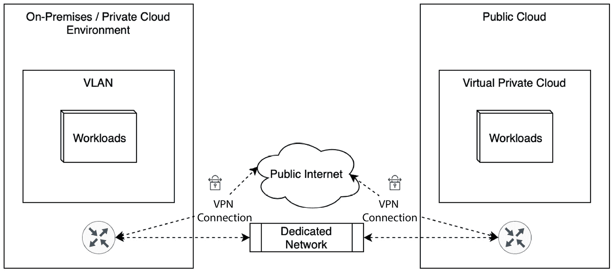
图 6.1 – 网状混合云网络拓扑

## 多云网络拓扑

类似于混合云网络拓扑，多云网络拓扑涉及至少两个与本地私有计算环境交互的公有云提供商。采用多云战略的企业可以与每个公有云建立专用 MPLS 网络连接——最好通过能够支持多个云网络的云交换合作伙伴，同时启用冗余 VPN 隧道作为故障转移和高可用网络网状。为了为每个云配置不重叠的唯一地址范围、路由逻辑、出口管理、网络防火墙和安全，需要细致的网络和安全架构规划。

此架构的细微变化可能包括以下内容：

* 配置并仅允许从本地网络对云环境进行私有访问。
* 建立交叉连接以实现云到云的数据流和通信——该拓扑对于工作负载迁移和跨云分析用例特别有用。
* 设置通用 Layer 4 网络防火墙安全。
* 仅从本地 VLAN 环境配置公共出口。

如图 6.2 所示，最好通过云交换建立专用网络以连接到所选的公有云网络。或者，也可通过公共互联网建立安全 VPN 连接以实现与延迟无关的连接或网络冗余。选择能够支持所有考虑中的公有云的云交换提供商也是一个重要的设计。

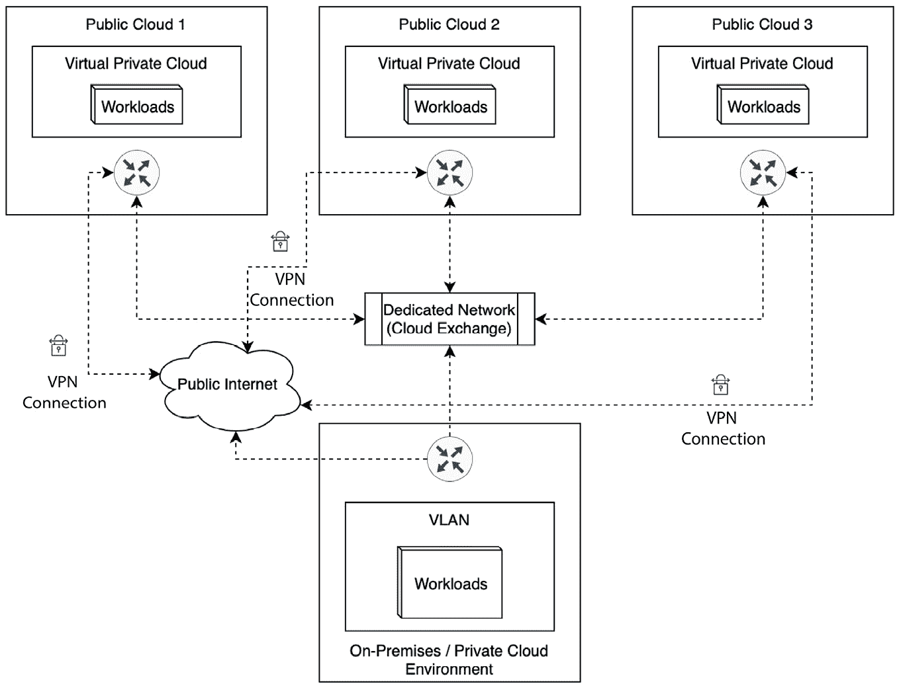
图 6.2 – 多云网络拓扑

## 网关出口混合云拓扑

## 网关出口混合云拓扑

**网关出口网络**拓扑的基本思想是仅将本地部署环境中的选定服务和 API 暴露给公有云工作负载。此拓扑可防止暴露应用 VLAN，其中 API 网关部署在充当网络流量守门员的 DMZ 网络区域中。此拓扑非常适合流量需要仅限制到特定服务和工作负载以及在本地部署环境中创建网络边界的用例。在此拓扑中，本地部署工作负载或服务不允许直接与公有云通信，并且连接始终由公有云通过本地部署 DMZ 发起。

*图 6.3* 显示了网关出口混合云网络拓扑，其中对本地 API 的连接通过 API 网关暴露给所选公有云网络，可通过专用网络或通过公共互联网上的 VPN 实现：

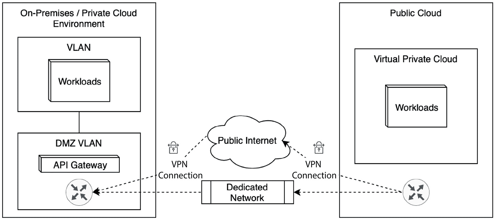

图 6.3 – 网关出口混合云网络拓扑

## 网关入口混合云拓扑

**网关入口拓扑**是网关出口模型的完全相反，其中公有云资源和服务通过特定端点或 API 暴露给本地部署环境。在此网络拓扑中，托管在公有云内的资源和服务通常配置为拒绝所有流量，除非来自受信任的本地部署网络。此拓扑非常适合仅将特定端点暴露给外部世界的边缘混合场景。

如 *图 6.4* 所示，网关入口混合云网络拓扑有助于通过 API 网关将部署在一个或多个公有云中的 API 服务层暴露给本地部署环境，可通过专用网络或通过公共互联网上的 VPN 实现：

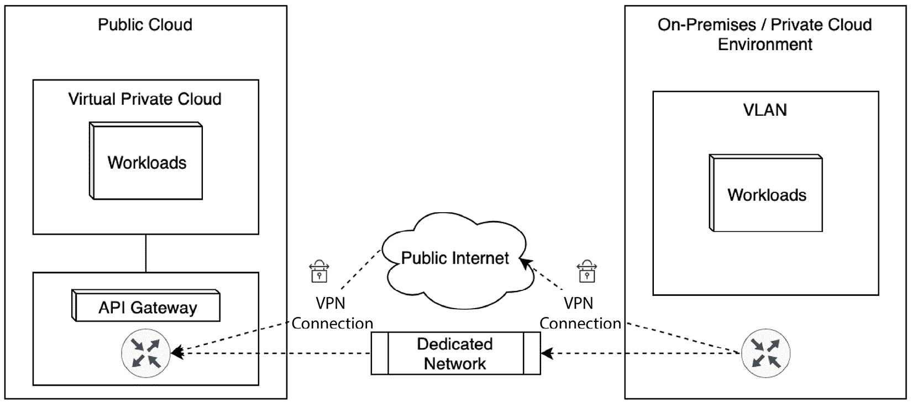

图 6.4 – 网关入口混合云网络拓扑

## 共享网络拓扑

**共享网络架构**允许在主机项目中创建可与服务项目共享的常用资源。此拓扑可以帮助网络管理员对子网、路由和防火墙等网络资源进行集中控制，同时将某些管理职责委托给服务项目。需要注意的是，共享网络的概念因云提供商而异。

*图 6.5* 描述了共享云网络拓扑，该拓扑有助于通过专用 VPC 网络，通常称为主机 VPC，将所有从公有云进入或流出的网络流量进行隔离和 containment：

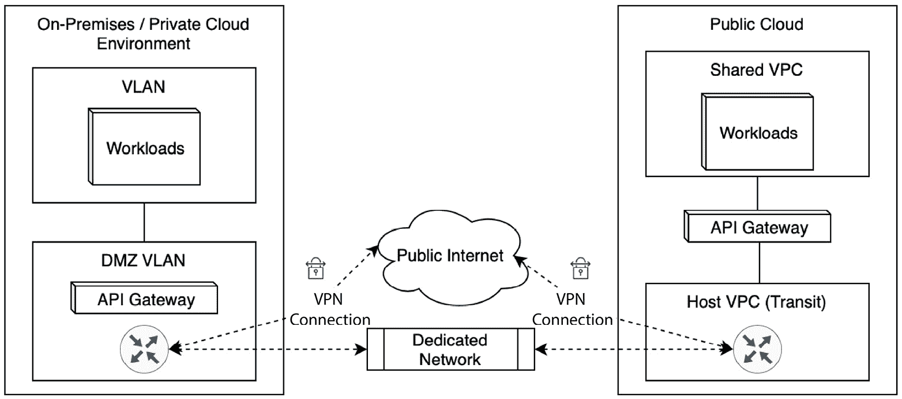

图 6.5 – 共享网络拓扑

## 私有混合拓扑

在 **私有混合网络**拓扑中，公有云环境中的资源配置为*仅为私有*，并且不允许任何互联网流量。对于互联网访问，来自公有云的流量会被路由回本地部署路由器以提供请求。虽然这可以使用公有云内的 NAT 网关（原生）来实现，但对于在极其敏感的安全边界内运营并希望对出口流量进行精细控制的企业而言，这非常有帮助。

从 *图 6.6* 可以看出，公有云网络的所有互联网流量均被禁止，并且通过专用网络或 VPN 与本地部署环境的连接得以建立。所有从公有云环境发往互联网的流量均被路由到本地部署：

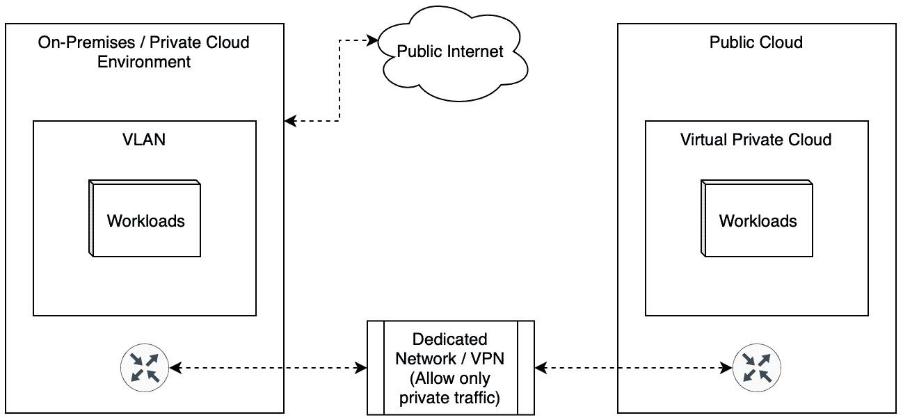

图 6.6 – 私有混合云网络拓扑

## 网络对等拓扑

**网络对等**是又一种极其强大的网络拓扑，其中多个云网络可以在网状或集线和定制架构中相互对等。网络对等允许跨多个网络甚至跨组织边界的公有云资源相互通信。这可以是一个极其强大的拓扑，其中拥有多个具有隔离网络边界的部门的企业仍可在网络之间通信，同时保持对其网络的专用控制。此网络拓扑支持的另外一些创造性用例包括以下内容：

* 组织可以通过一个虚拟云网络私下构建和发布定制的 **软件即服务**（**SaaS**）产品到另一个虚拟云网络。
* 恰好位于同一云提供商网络上的合作伙伴和服务提供商可以在不经过公共网络的情况下私下通信。
* 此架构还可以提供极低的网络延迟，因为流量经过私有内部网络结构传输，同时还提供高网络安全性和相对较低的网络出口成本。

*图 6.7* 中描述了一个示例网络对等拓扑，其中两个虚拟云网络相互对等以形成网络网状，使 VPC 1 和 VPC 2 中的服务之间的流量能够在私有网络上无缝通信，而无需经过外部网络：

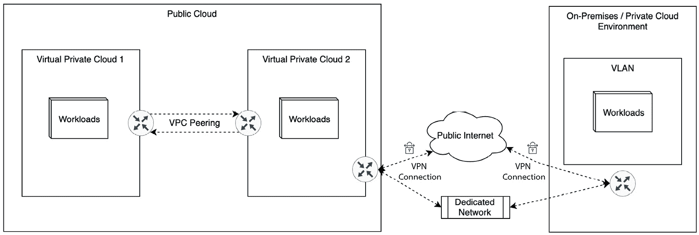

图 6.7 – 网络对等拓扑

## 边缘网络拓扑

**边缘网络**拓扑最适合具有边缘计算和物联网需求的企业。在此架构中，来自物联网传感器、设备和边缘计算设备（如 NUCs）的数据在边缘使用边缘网关进行聚合和处理，并实时或以微批量的形式发送到公有云进行进一步处理、遥测或分析。

如 *图 6.8* 所示的边缘网络拓扑描述了一个典型的边缘站点，其中容纳了边缘设备，例如物联网传感器和 NUCs，它们通过轻量级消息协议，如 **消息队列遥测传输**（**MQTT**）以及 Zigbee 或 Z-Wave 本地连接到物联网网关，以进行本地处理、合并和关联。然后网关设备定期或实时与公有云网络交互以进行进一步处理和分析。

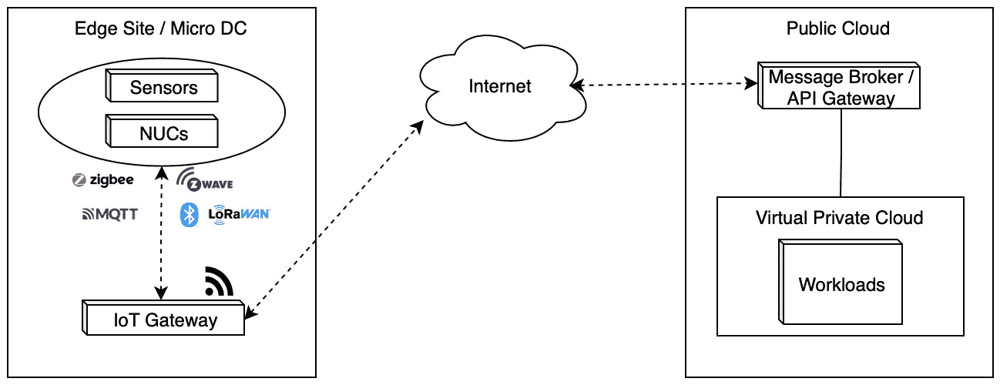

图 6.8 – 边缘网络拓扑

在探讨了各种混合云、多云和边缘网络拓扑以及组织如何建立坚实的网络基础之后，让我们现在了解如何为云建立坚实的安全基础。

# 企业安全基础

一旦网络基础搭建完成，接下来最重要的基础层就是安全。安全是一个宽泛的话题，涵盖了多个安全层级。对于踏上云端之旅的企业而言——无论是原生混合云、多云还是全云方法——确保各层都具备稳健的安全基础至关重要。正如俗话所说，安全是每个人的责任；在云部署模式下，这一观点更为相关且突出，因为云转型的方方面面——从应用开发、部署、数据存储、访问到合规——都具有核心的安全依赖。私有本地环境中的传统安全架构与公有云安全在本质上存在差异，因为存在共享责任模型——，意味着安全方面的某些部分由云服务提供商管理和治理，而其余部分由企业管理。共享责任因所使用的云服务提供商和提供的服务类型而异。例如，SaaS 提供商负责大部分云栈的安全，而 IaaS 服务仅管理底层物理硬件直至客户操作系统层的安全。一般而言，共享责任模型对于各种云部署模型如下图所示，尽管就实际目的而言，一些服务存在重叠的责任。例如，云基础设施（IaaS）提供商可能声称负责物理网络管理，而软件定义网络配置则是客户的责任。图 6.9 显示了云服务提供商在多个服务领域中典型的共享责任模型：

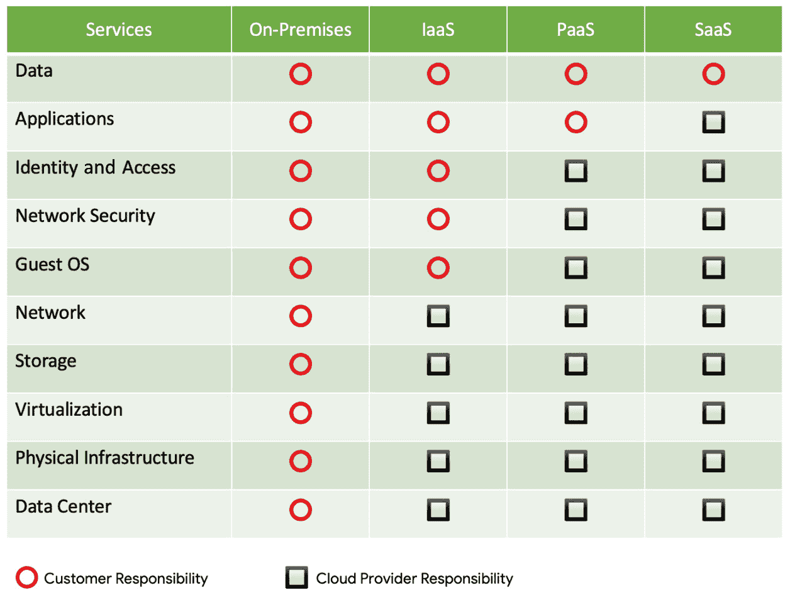

图 6.9 – 公有云共享责任模型

现在让我们探索主要云服务提供商，即 Amazon Web Services（AWS）、Google Cloud Platform（GCP）和 Microsoft Azure 所倡导的共享安全模型。

## 主要 CSP 的共享安全模型

Amazon Web Services（AWS）将共享责任模型定义如下：

AWS 负责“云的安全”，而客户负责“云中的安全”。

*AWS 负责保护运行 AWS 云中所有服务的基础设施。该基础设施由运行 AWS 云服务的硬件、软件、网络和设施组成。*

*客户的责任将由客户选择的 AWS 云服务决定。这决定了客户作为其安全责任的一部分必须执行多少配置工作。*

图 6.10 改编自 AWS 文档，展示了 AWS 与客户责任的明确划分 [1]：

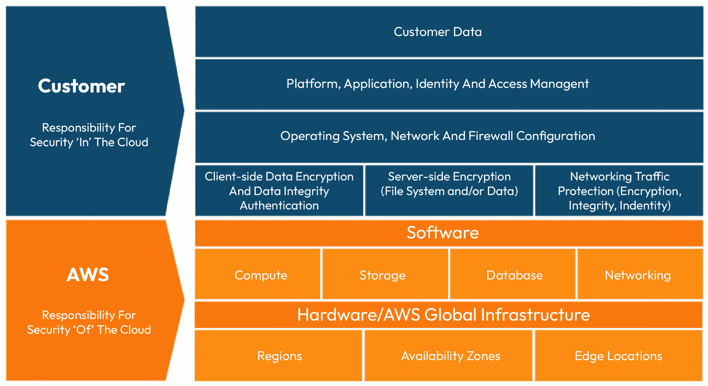

图 6.10 – AWS 共享责任模型

例如，纯 IaaS 服务要求客户执行所有必要的安全配置和管理任务，而 PaaS 服务或抽象化服务仅要求客户保护平台上的数据资产。要详细了解 AWS 共享责任模型，请参阅进一步阅读部分。

AWS 还提供了一套全面的安全参考架构，与 AWS 安全基础保持一致 [2]：

* **AWS CAF**：提供在 AWS 上构建解决方案的最佳实践和方法的指导。
* **AWS well-architected framework**：专注于云架构师，帮助构建安全、弹性且高效的 AWS 云环境。

Microsoft Azure 支持在各种提供的服务之间划分责任。无论部署类型如何，物理数据中心、网络和主机均由 Azure 完全管理，而数据、端点、账户和访问管理则是客户的责任。图 6.11 改编自 Azure 文档，展示了 Azure 共享责任模型 [3]：

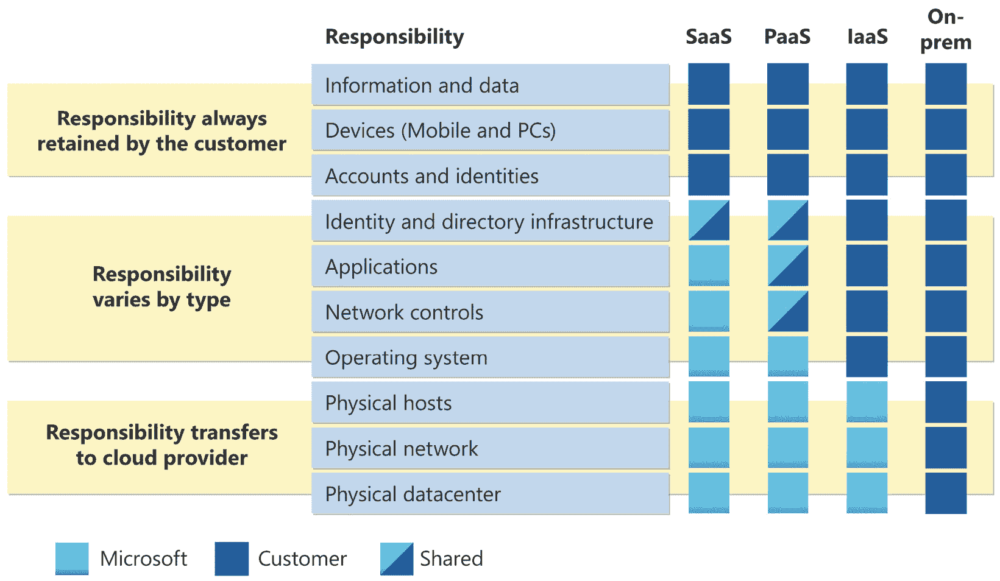

图 6.11 – Azure 共享责任模型

Microsoft Azure 还提供了一份 **Azure Security Benchmark Foundation** 蓝图，帮助构建安全且合规的 Azure 环境。请参阅本章末尾的进一步阅读部分以获取更多详细信息 [4]。

Google Cloud 提倡一种 **shared fate model** 共享命运模型，该模型超越了传统的云共享责任模型。共享命运建立在共享责任模型之上，但通过提供明确的、有见地的、透明的安全控制、登陆区、安全基础蓝图和最佳实践，将云安全视为一种持续的合作伙伴关系。图 6.12 描述了 Google Cloud 的共享命运模型 [5]：

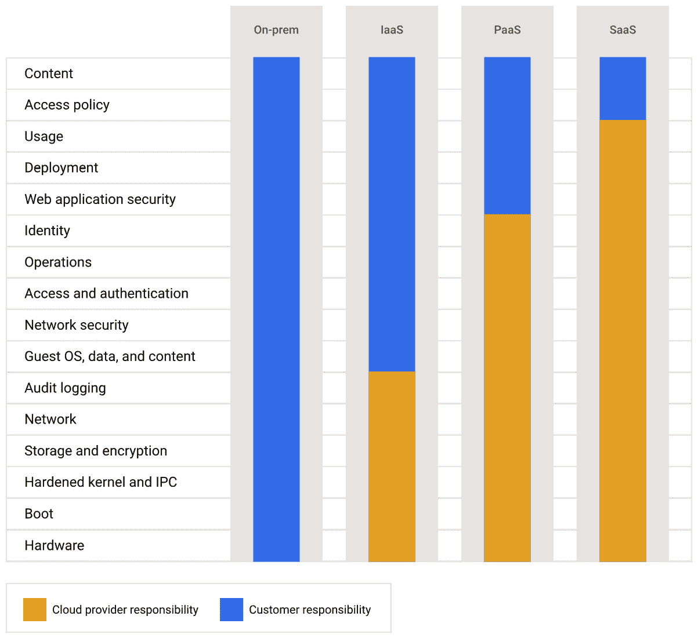

图 6.12 – Google Cloud 平台共享命运模型

Google Cloud 对 Google Cloud 安全最佳实践提供了有见地的观点，以帮助企业根据需要进行定制和调整。有关 Google Cloud 共享命运模型的更多详细信息，请参阅本章末尾的进一步阅读部分 [6]。

现在让我们探索如何构建以安全为先的云基础架构。

## 设计以安全为先的云架构

由于以下原因，保护云基础设施与传统的本地环境大不相同：

* 与传统锁定在本地的环境相比，云环境的部署方式、访问方式和暴露方式存在根本差异。
* 现代云原生 DevSecOps 实践的演进使微服务、容器和 API-first 等应用开发方法论民主化。
* 云服务和产品的速度和多样性以及它们的使用方式。

企业必须建立纵深防御安全策略，以确保云栈的每一层都得到加固。随着公有云服务的可用性不断演进，企业安全架构必须定期根据一系列安全和合规标准评估和认证公有云服务，并在内部发布为企业团队在公有云上构建应用程序的指南。例如，云服务和标准可以被标记为 required、approved、conditionally approved、alternative 或 denied：

* **Required**：指特定部署的先决条件。例如，仅可对组织范围内的资源使用私有 IP 地址范围。
* **Approved**：指可用于云应用开发的完全批准的服务列表。这指的是已通过所需安全和合规控制的服务。
* **Conditionally approved**：指在某些限定条件下批准的一组云服务。例如，云对象存储仅在限制为私有访问时才可使用。
* **Alternative**：指作为托管服务或产品的替代方案而使用的替代解决方案——开源或现有第三方。例如，使用 `Terraform` 进行基础设施自动化，以替代提供商原生解决方案。
* **Denied**：指预期在企业云部署中不使用的一组服务，且未获得安全许可或尚未评估。

让我们回顾一些基础安全方面和最佳实践。

### 网络安全

## 网络安全
在基础层面，网络安全对于防止来自互联网或外部要素的入站网络威胁进入部署在云环境中的资源至关重要。优化云网络架构对云安全至关重要。网络安全的一些关键要素包括以下内容：
* 通过专用 `MPLS` 连接或 `VPN` 隧道保护本地网络与公有云之间的流量。
* 通过 `VPCs` 和 `VPC` 网络对等连接对网络进行分段和保护，以减少横向网络流量移动。
* 实施有状态和无状态防火墙以帮助控制网络流量。
* 采用零信任网络安全架构，其中云网络内部或外部的任何实体默认都不被信任，从而最大程度地降低内部和外部威胁的风险。
* 采用端点安全解决方案来监控和保护连接的设备。
* 实施入侵检测 (`IDS`) 来监控网络流量中的异常和异常模式，这些模式可能表明正在进行的攻击，以及入侵预防 (`IPS`) 以主动识别与正常系统行为的偏差。
* 通过下一代防火墙 (`NGFW`) 解决方案实施数据包检测以确保网络安全。`NGFWs` 是企业的重要保障，尤其是在医疗保健或金融等监管严格的行业中。典型的 `NGFW` 还执行深度数据包检测 (`DPI`)，其超越了传统防火墙方法，后者仅检查协议头。`NGFW` 解决方案可以帮助检查和跟踪从 `Layer 2` 到应用层的所有网络流量。

## 身份和访问管理
身份和访问管理 (`IAM`) 是网络安全的基础，尤其是在云环境中，资源和服务分布在各个位置并由众多用户访问。`IAM` 是云资源的守门人，在云安全中发挥着至关重要的作用。`IAM` 是向合适的人员以合适的访问级别授予对合适云资源的访问权限的做法。由于云环境通常具有复杂且不断变化的用户、设备、应用程序和服务集合，`IAM` 最佳实践的应用变得至关重要。`IAM` 的一些最佳实践包括以下内容：
* 基于角色的访问控制 (`RBAC`)：`RBAC` 是 `IAM` 的关键要素，它根据组织内的角色限制系统访问。`RBAC` 确保用户仅拥有履行其工作所需的访问权限，遵循 *最小权限* 原则。通过根据工作职责将用户组织成角色，并仅向这些角色而非个人用户分配访问权限，组织可以简化权限管理流程，从而降低未经授权或不必要的访问风险。
* 身份管理：在云中管理身份构成了 `IAM` 的基础。虽然它是基础性的，但管理云 `IAM` 中身份、用户、角色和组的配置、保护和取消配置也很重要。利用提供商原生的密钥管理解决方案轮换密钥、利用基于硬件安全模块 (`HSM`) 的密钥，或利用现有的本地密钥管理解决方案，都可以成为保护凭据的良好策略。主要存在三种身份：
  * 企业身份：这些身份标识需要访问企业资源的企业员工、合作伙伴和承包商。
  * 服务身份：通常也称为服务账户，这些身份有助于管理应用到应用或系统到系统的交互。
  * 客户身份：这些身份标识与部署在云上的应用程序或系统交互的最终用户或客户。
* 身份联合和单点登录：`SSO` 解决方案可以为用户提供使用一套凭据访问多个服务或平台的便利性。在安全实施的情况下，`SSO` 减少了用户需要记住和管理的密码数量，从而降低了与密码相关的安全风险。尽管大多数云提供商提供身份平台，但在典型的企业环境中，可以利用现有的身份提供商，例如 `Active Directory` ——通常称为 `IDP` —— 而无需在云 `IDP` 中重新创建用户组织。在这种情况下，云提供商充当服务提供商 (`SP`)，并支持 `SAML` 等标准联合协议以启用 `SSO`。
* `IAM` 生命周期管理：`IAM` 最佳实践还涉及管理身份的整个生命周期。这包括用户身份的入职、配置、取消配置和离职。自动化系统可以帮助简化此流程，确保在需要时快速授予访问权限，并在不再需要时撤销访问权限，从而最大程度地减少未经授权访问的机会窗口。
* 特权访问管理：特权账户，例如网络管理员和安全管理员账户，通常具有广泛而强大的访问权限，使其成为攻击者的主要目标。特权访问管理 (`PAM`) 解决方案通过各种机制（例如会话隔离和监控）帮助保护这些敏感账户，并要求使用时提供理由。在云环境中实施 `PAM` 变得更加关键，因为管理访问可能会影响多个服务和数据存储。
* 多因素身份验证：`IAM` 最佳实践的主要原则之一是实施 `MFA`。采用 `MFA` 提供额外的安全层，建立强大的安全基础设施以确保对云资源的受控访问。仅输入用户名和密码是不够的；用户可能还必须输入发送到其手机的代码或提供生物识别验证。实施 `MFA` 可降低未经授权访问的可能性，即使密码被泄露也是如此。
* 即时访问：在遵循最小权限原则的同时，而不是授予永久访问权限，组织可以向用户授予完成日常活动所需且仅所需的访问权限，而不多也不少。此原则可以降低与对敏感资源进行特权访问管理相关的重大风险，同时减少用户完成工作时的摩擦。
* 定期审计和审查：对访问控制和权限进行持续监控和定期审计可以在问题变得严重之前突出潜在问题。对角色、权限和身份验证策略进行定期安排的审查有助于保持安全的 `IAM` 态势。这也有助于使 `IAM` 策略适应组织内部不断变化的需求和结构变化。

## 基础设施安全
公有云中的计算资源，例如 `VMs`、`containers`、`serverless` 和 `storage`，构成了应用程序和数据的底层基础。在公有云环境中保护计算资源对于确保在其上运行的应用程序和数据的保密性、完整性和可用性至关重要。每个基础设施组件，例如 `VM`、`container` 或 `storage`，都需要不同类型的保护。虽然公有云提供商提供共享责任或共享命运模型，其中底层物理基础设施安全由云厂商管理，但组织仍需保护上层基础设施，例如 `VMs` 中的客户操作系统、`storage` 的 `RBAC`，以及为 `containers` 保护容器注册表。以下是在公有云中保护基础设施时应考虑的一些最佳实践：

## 网络安全组 (NSGs) 和防火墙
NSGs 和防火墙通常作为基础设施安全的首道防线，通过监管流向 **网络接口卡** (**NICs**)、**虚拟机** (**VMs**) 以及其他网络资源的入站和出站流量。NSGs 由一系列安全规则组成，这些规则根据源 IP 地址和目标 IP 地址、端口号以及所使用的协议等因素允许或拒绝流量。它们具有高度可扩展性，可以与子网、单个 VM 或甚至特定的网络接口关联，提供对网络流量的精细控制。另一方面，防火墙可以是基于硬件的或基于软件的，并提供更复杂的功能集，包括深度包检测、入侵检测系统和应用层过滤。防火墙通常与 NSGs 结合使用以实现分层安全，通常称为纵深防御安全策略。

## 全组织范围策略
随着组织内部云使用量的不断增长，安全管理员识别、检测和修复反模式可能会变得困难。例如，生产环境中的 VM 实例配置了关联公共 IP 地址的 NIC，或对象存储桶配置为暴露于互联网的公共存储桶，这可能意味着安全威胁。组织可以利用云原生功能，例如组织策略或服务控制策略，来控制云资源的最佳实践使用。在前述示例中，可以设置全组织范围策略以阻止在所有项目中创建公共存储桶。

## 服务账号
服务账号是专门用于应用程序、服务和自动化任务在公共云中与其他资源交互的身份。在云环境中，服务账号通常用于运行需要对某些资源进行受限访问的进程。例如，服务账号可能用于运行定期检查数据库新条目然后根据这些条目执行某些操作的脚本。授予该服务账号的权限将被精确定义，仅允许访问脚本所需的特定数据库和操作。这符合最小权限原则，该原则规定账号应仅拥有完成任务所需的权限，从而最大程度地减少因意外配置错误或恶意攻击造成的潜在损害。服务账号也可以与安全策略协同使用，以控制对云资源的访问，提供细粒度的安全控制。

## 补丁管理
在公共云环境中，补丁管理是维护安全稳定基础设施的关键方面。利用云原生工具进行清单管理、漏洞扫描和自动化修补可以帮助组织保持强大的安全态势，同时利用云环境提供的可扩展性和灵活性。云服务提供商通常提供用于自动化常规任务的内置服务，包括补丁管理，使组织能够更轻松地使用最新的安全补丁和功能更新保持系统最新。云补丁管理中的关键步骤之一是维护所有资产的清单。了解正在运行哪些实例、服务和软件对于确定需要修补的内容至关重要。云服务通常带有标记功能，使分类和管理资源变得更容易。建立清单后，组织可以使用自动化扫描工具识别需要修补的漏洞。这些扫描可以安排在定期间隔运行，并可在补丁可用时触发自动化工作流以应用补丁。

## 容器安全
随着组织继续开发云原生应用程序，在容器安全方面通常需要范式转变。尽管基于微服务的架构可以为 IT 和业务提供极致的规模、灵活性和敏捷性，但它需要一套专门的安全控制措施。容器安全的一些最佳实践和注意事项包括以下内容：
* 利用专为容器使用而优化且经过安全加固的容器优化操作系统，其操作系统占用空间更小。
* 使用云原生工具，例如 `binary authorization`，在部署前对容器镜像进行认证和信任，并定期使用安全补丁更新它们。
* 限制容器注册表访问以防止未经授权访问容器镜像。
* 使用不可变镜像以防止恶意部署。
* 实施运行时安全措施，例如使用工具监控恶意活动。

## 加密
加密对于保护静态数据和传输中数据至关重要。大多数云服务提供商提供即用型解决方案和工具，可自动加密和解密存储卷、持久磁盘和网络流量。然而，组织可以利用定制的本地密钥管理解决方案来管理加密密钥，或使用 HSM 密钥管理解决方案以进一步改善安全态势。

## 机密计算环境
在高度监管行业运营或处理敏感数据的企业可以利用大多数公共云服务提供商提供的机密计算选项。它涉及使用专用硬件和固件来保护 **使用中的数据**，在数据被解密进行处理时，数据会暴露于各种风险中，包括未经授权的系统访问或潜在黑客。机密计算，也通常被称为 GCP 中的 Shielded VM 和 AWS 中的 Nitro System，通过使用专用硬件来实现——通常称为 **可信执行环境** (**TEEs**) 或安全飞地——该硬件在处理器的安全部分中隔离并执行代码。通过在整个生命周期中保护数据，机密计算为安全数据分析、隐私保护计算和跨组织数据共享等应用开辟了新的可能性。

## 工厂模式
最后，自动化对安全至关重要，因为它可以防止用户错误并实现云中的 **默认安全** 操作。通过 `IaC` 自动化工具（如 `Terraform`）配置安全蓝图，该蓝图涵盖预定义的身份验证、授权、日志记录、监控、VM 和容器的已批准受信任镜像（也称为黄金镜像）以及预防性和检测性控制，企业可以确保以安全为先的云转型。

## 应用安全
随着企业将现有应用程序迁移到云端或构建全新的云原生应用程序，应用安全问题日益突出。虽然云环境提供无与伦比的可扩展性和灵活性，并作为创新的起点，但它们也引入了一系列独特的安全挑战，尤其针对应用程序。云中有效的应用安全需要将针对本地软件量身定制的传统实践与云环境特有的新方法相结合。云中应用安全的基础要素之一是安全设计。这包括应用程序本身的架构以及它在云中与其他服务交互的方式。无论选择何种应用程序开发策略和框架，例如 `12-factor app` 或 `15-factor app`，从开发过程开始就采用 *安全设计* 方法可以最大程度地减少漏洞。例如，实施基于微服务的架构可以将故障和潜在的安全漏洞隔离到更小的攻击面，从而限制损害：

- **应用迁移**：对于迁移到云端的应用——特别是在直接迁移或迁移并优化场景中，强制执行云原生最佳实践可能是不可能的，或者仅限于最小程度。在这种情况下，企业可以通过使用云原生组件现代化外围应用组件来加强应用安全；这些措施包括利用原生云虚拟化代替虚拟机监控程序直接迁移，使用增强了 **Web 应用防火墙** (**WAF**) 的云原生负载均衡器来防范 SQL 注入、代码注入和 **跨站脚本攻击** (XSS)，以及使用安全计算环境，如机密计算、加固的操作系统和内核进程间通信。

- **云原生应用开发**：踏上重构或重新架构应用开发战略的企业可以利用现代 AppDev 原则，如 12 要素或 15 要素方法论，来开发安全的云原生应用 [7]。这有助于利用声明式格式实现应用设置自动化，确保无论部署平台如何都能实现最大可移植性，构建具有弹性、可扩展的应用，并最大限度地减少开发环境与生产环境之间的差异。让我们简要回顾一下云原生应用开发的 15 个要素：

    - **代码库**：一个在版本控制中跟踪的代码库，可部署多份
    - **依赖**：显式声明并隔离依赖
    - **配置**：在环境中存储配置
    - **后端服务**：将后端服务视为附加资源
    - **构建、发布和运行**：严格分离构建和运行阶段
    - **进程**：将应用作为一个或多个无状态进程执行
    - **端口绑定**：通过端口绑定导出服务
    - **并发**：通过进程模型横向扩展
    - **可丢弃性**：通过快速启动和优雅关闭最大化健壮性
    - **开发/生产环境一致性**：保持开发、预发布和生产环境尽可能相似
    - **日志**：将日志视为事件流
    - **管理进程**：将管理/运维任务作为一次性进程运行
    - **API 优先**：定义服务契约
    - **遥测**：监控进程性能
    - **认证**：跨硬件、网络和软件层保护应用安全

- **API 安全**：在云环境中，应用通过 API 与其他服务和资源交互。保护这些 API 对整体应用安全至关重要。这涉及使用安全的方法进行 API 调用，在 API 网关后保护 API，利用现代认证和授权协议（如 OpenID 和 OAuth），使用 **JSON Web 令牌** (**JWT**) 进行内部 API 通信，以及为应用 API 访问创建作用域等最佳实践。

- **DevSecOps 实践**：将安全集成到 DevOps 中对于确保安全优先架构至关重要，也是推荐的最佳实践，因为 DevSecOps 旨在通过在 **软件开发生命周期** (**SDLC**) 的早期和贯穿始终集成安全来保护应用开发过程。这通常也被称为 **左移**。例如，从 *图 6.13* 可以看出，安全方面在早期和架构规划阶段就已集成，集成了 **静态应用安全测试** (**SAST**) 以分析和查找源代码漏洞、软件成分分析、**动态应用安全测试** (**DAST**) 以检测运行中应用的漏洞、执行渗透测试、漏洞测试、合规验证、日志记录、审计、安全监控、威胁情报和合规验证。

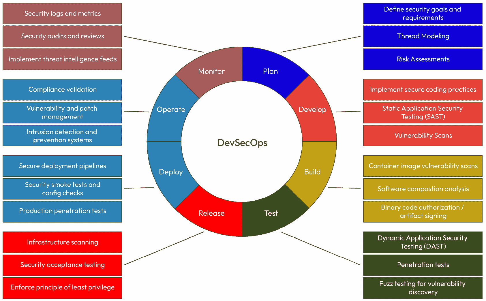

图 6.13 – DevSecOps 流程

- **API 管理**：通过向云服务添加代理层，API 网关充当抽象层或外观以保护后端 API。API 管理平台还有助于抽象应用代码，通过尖峰抑制、威胁防护、数据脱敏和审计流量来强制执行配额和服务等级。

- **微服务**：虽然微服务提供了极大的灵活性和可扩展性，但设计良好的基于微服务的架构最重要的是通过遏制请求在环境中横向遍历来减少攻击面，并且必须将安全从代码构建、持续集成和部署集成到 SDLC 中。例如，利用容器分析漏洞扫描工具、在服务边界内保护制品或容器注册表，以及使用二进制授权仅允许部署可信镜像，可以帮助在多个层级保护云环境安全。

- **服务网格**：服务网格为管理复杂、分布式、基于微服务的应用提供了强大的能力。它基于零信任原则运行，不仅仅依赖网络边界进行安全防护，而是要求在每个接触点进行验证。采用最佳实践，如 **双向 TLS** (**mTLS**)、细粒度授权、用于密钥和证书管理的集中式 **证书颁发机构** (**CA**)、持续监控、用于 **策略执行点** (**PEPs**) 的边车代理和边界代理，以及配置自动化，可以帮助提高云原生应用的整体安全性。

- **漏洞管理**：定期渗透测试和漏洞评估对于识别潜在安全弱点不可或缺。云提供商通常提供工具，用于持续监控和扫描应用以识别已知漏洞，第三方解决方案甚至可以提供更全面的能力。

- **无服务器架构**：无服务器架构虽然提供了可扩展性和成本效益等诸多优势，但也带来了一组不同的安全考量，在许多方面，它比传统的基于服务器的架构更安全。例如，由于无需管理服务器，与无服务器相关的攻击面减小了。由于其短暂和短生命周期的特性，无服务器可以限制攻击向量的时间窗口，能抵御 DDoS 攻击，并能利用内置安全功能，如 RBAC、专用网络和加密。通过应用最小权限原则并在单独的容器中隔离，无服务器的影响范围也可以被最小化。

在回顾了如何为安全优先的云环境进行设计和架构的各种考量后，现在让我们探讨一下在开发云原生应用时的一些反模式。

# 云原生反模式

正如我们迄今为止所探讨的，云原生架构彻底改变了企业重新构想 IT 以及管理和部署其软件和服务的方式。它提供了一系列好处，如可扩展性、灵活性和成本效益。然而，云并非解决所有问题的灵丹妙药。事实上，伴随好处而来的是挑战，这些挑战往往表现为反模式——导致意外后果并阻碍云原生解决方案充分发挥潜力的常见做法。了解这些反模式有助于避免陷阱，并充分利用云计算的优势。在本节中，我们将回顾一些在踏上云转型之旅时需要警惕的常见云原生反模式。

## 云端的单体城堡

云转型中常见的反模式之一是将单体应用直接“搬迁上云”。尽管该反模式存在特定例外情况——例如合同义务或数据中心退出场景，此时它被用作云原生转型前的过渡阶段——但这在各种规模的企业中仍是一种更为常见的模式。单体架构虽广泛应用于传统软件开发，但置于云环境中时会暴露出多个弊端。由于单体应用设计为作为单一单元运行，这会阻碍扩展、降低响应速度，并阻止组织利用现代技术：

*   **阻碍扩展性**：单体应用通常设计为单一单元，难以独立扩展各个组件。在云环境中，动态扩展资源以应对不断变化的工作负载至关重要。采用单体架构时，扩展意味着必须扩展整个应用，即使只有特定部分面临需求激增。这会导致资源利用率低下和成本增加。

*   **降低敏捷性**：云原生应用应具备敏捷性，能快速响应需求变更。单体架构会拖慢开发周期，因为应用的任何变更或更新都需要大量的测试和协调，这是由于组件间的相互关联性所致。这阻碍了云原生开发所倡导的快速迭代和部署。

*   **单点故障**：云原生架构通过隔离和复制组件及服务来实现高可用，从而提升容错能力。反之，单体应用存在单点故障。如果单体的某一部分失效，整个应用可能变得不可用，影响用户体验和业务运营。云环境提供了构建弹性和高可用系统的机会，而单体架构难以实现这一点。

*   **技术创新受限**：云平台提供广泛的服务和工具，可增强应用性能、创新、安全性和可扩展性。在单体架构中，因应用内部的相互依赖，采用新技术或服务以满足业务需求可能非常复杂。这阻碍了组织充分释放云平台的能力。

*   **过度配置的风险**：单体应用通常需要静态资源分配以确保整个技术栈正常运行。在云环境中，资源可动态分配以匹配需求，从而提高资源利用率和成本效益。单体架构往往导致资源过度配置或利用不足，影响运营成本。

## 忽视资源与成本优化

资源与成本优化是云转型的关键考量与亮点。在云环境中忽视成本优化会给企业带来显著的负面后果，可能导致超支、预算受限和资源利用低效。这是导致企业云资源利用低效、云计划投资回报率（ROI）降低的常见反模式之一：

*   **过度配置**：大多数企业从传统本地部署思维中延续下来的一个常见反模式是资源过度配置。按高水位线或峰值使用量进行规模规划，并预先分配资源，是云原生架构的反模式。云资源通常按使用量计费，若缺乏监控和控制，极易在未充分利用的服务上超支。忽视成本优化会导致开支膨胀，影响组织整体财务健康。

*   **资源利用低效**：若无合理的成本优化策略，组织可能配置超出必要的资源，导致利用率不足。这浪费了宝贵的算力，在不带来相应业务价值的情况下增加成本。

*   **错失良机**：大多数云服务商提供各种成本优化和 FinOps 工具及功能，如 `auto-scaling`（自动扩缩容）、`reserved instances`（预留实例）、`spot instances`（抢占式实例）以及 `spend or commit-based discounts`（基于消费或承诺的折扣）。未能利用这些机会，会导致在维持或提升服务质量的同时降低成本的良机流失。

*   **ROI 降低**：云投资旨在通过提升性能、可扩展性和效率来实现投资回报。忽视成本优化会侵蚀潜在 `ROI`，因为云服务的收益可能被不必要的开支抵消。

*   **创新受限**：在云资源上的超支会挤占本可投入创新项目和其他战略举措的资源。忽视成本优化会阻碍组织为业务增长和技术进步分配资源。

## 非差异化重体力劳动

当组织管理本可通过云服务自动化的运维任务（如资源配置和维护）时，就会出现此反模式。这会导致复杂性增加、敏捷性降低，并产生分散核心业务目标精力的运维开销。非差异化重体力劳动涵盖云用户需管理但无法提供竞争优势、亦不直接贡献于核心业务目标的运维任务。这些任务包括配置服务器、管理数据库、配置网络和确保安全合规等活动。虽这些任务对云资源平稳运行至关重要，但会将宝贵的时间和资源从创新和核心业务活动中分流。该反模式的另一变体是过度使用或过度依赖开源或第三方工具及产品，而非简单的云原生或厂商原生产品。例如，因担心供应商锁定，选择在 `compute VM`（计算虚拟机）上部署 `PostgreSQL` 数据库，而非利用原生支持 `PostgreSQL` 的托管数据库产品。这对企业而言可能是高度非差异化的重体力劳动，因为底层软件——此处为 `PostgreSQL`——是数据库标准，可轻松移植或迁移至不同部署平台。该反模式的主要挑战包括：

*   **资源消耗**：组织常花费大量时间精力管理基础设施相关任务，而这些任务无法直接在市场上差异化其产品或服务。这将资源从战略举措和创新中分流，是该反模式的关键阻碍之一。

*   **方案复杂性**：单纯将云平台视为另一种基础设施或本地环境的替代品，会使方案过度复杂。这很快会变得难以维护和管理。

*   **上市时间延迟**：花费在非差异化重体力劳动上的时间会拖慢开发周期和新功能、服务的 `time-to-market`（上市时间）。

## 臃肿的容器

## 臃肿的容器

企业构建云原生应用时面临的另一个常见反模式是**臃肿容器**的挑战。臃肿容器是指容器体积增大的情况，这可能导致多种挑战，影响应用集群的效率、性能和可管理性。容器镜像体积可能因多种因素而增加，例如低效的依赖管理、未使用的构建产物、不必要的层缓存、使用完整操作系统作为基础层构建镜像，以及包含大型二进制文件（如编译后的可执行文件或媒体文件）构建镜像。该反模式的一些主要挑战包括：

*   **资源消耗低效**：臃肿容器消耗更多的 CPU、内存和存储资源。这可能导致资源利用率低下，从而增加成本并降低整体集群性能。
*   **可扩展性**：过大的容器会影响 Kubernetes 高效扩展应用的能力。当扩展基于资源利用率时，较大的容器可能导致不准确的扩展决策，从而造成资源的过度配置或配置不足。
*   **启动时间缓慢**：较大的容器通常需要更长的启动时间，因为它们需要加载更多的资源和依赖项。这会拖慢部署和扩展流程，影响应用的响应能力。
*   **攻击面增加**：较大的容器可能包含不必要的软件或依赖项，增加潜在的攻击面和安全风险。未修补或不必要的软件可能使应用容易受到漏洞利用和攻击。
*   **故障排查复杂性**：臃肿容器会使故障排查和调试更加复杂，因为当容器包含大量组件和依赖项时，识别性能瓶颈、资源争用问题或兼容性问题会变得更难。
*   **网络流量**：依赖项过多的容器会产生更多网络流量，影响整体网络性能，导致拥塞或延迟问题。
*   **资源碎片化**：大型容器可能需要的资源超过单个节点上的可用资源。这可能导致资源碎片化和利用率不足，因为原本可以在同一节点上调度多个较小的容器。
*   **可维护性**：随着时间的推移，管理大型或复杂的容器变得更具挑战性。升级、修补和维护此类容器容易出错且耗时。

## 可变基础设施

**可变基础设施**是指直接对现有基础设施组件进行更改，而不是用新组件替换它们的做法。在云计算语境下，这涉及修改现有资源（如虚拟机、数据库和网络组件），而不是从头创建新实例，这可能是一种反模式。云原生架构主张将基础设施组件视为不可变的，这指的是创建新实例而不是修改现有实例的做法。云环境中可变基础设施的一些挑战包括：

*   **配置漂移**：随着时间的推移，在可变基础设施中，不同实例上的配置设置可能会偏离其原始状态，导致配置漂移。这可能导致不一致，并难以维护一个可预测且稳定的环境。
*   **依赖管理**：随着可变基础设施中对组件进行增量修改，这些组件之间的依赖关系可能变得复杂且难以管理。确保对一个组件的更改不会无意中影响其他组件，需要仔细考量。
*   **回滚挑战**：如果更新失败或更改导致问题，在可变基础设施设置中回滚更改可能更具挑战性。这要求回滚机制定义明确且经过测试，以最大限度地减少停机时间和潜在数据丢失。
*   **版本控制与追踪**：如果没有适当的版本控制和追踪机制，管理可变基础设施组件的更改将极具挑战性。追踪更改内容、更改人及更改原因对于故障排查和审计至关重要。

当组织踏上云转型之旅时，反模式可能会阻碍云价值的最佳利用。理解并识别这些反模式对于组织避免昂贵的错误、最大化效率、提高可靠性并充分发挥云优势至关重要。

# 总结

在本章中，我们重点介绍了组织如何构建一个稳健、开放且敏捷的面向云的企业基础，以支持当前和未来的业务需求。我们探讨了云采用框架的四个阶段，即评估、规划、部署和优化，以及每个阶段中能为云转型计划提供结构化方法的关键要素。我们还详细讨论了企业可以采用的各种混合云和多云部署模式，特别关注拥有大量本地 IT 资产的组织，并确认了云采用面临的挑战。

当组织在混合云和多云部署的复杂性中航行时，一个可扩展且安全的网络架构对于支持高可用性、性能优化和规模扩展等关键考量至关重要。考虑到这一点，我们回顾了一些核心基础网络架构蓝图、其适用性及注意事项。我们还深入探讨了企业如何将安全架构为其云环境的一等公民，重点关注身份与访问管理、基础设施安全和应用安全等各个安全方面。随后，我们探讨了 AWS、Azure 和 Google Cloud 等主要云服务提供商提供的安全模型。

最后，我们讨论了组织从本地迁移到云时常见的五个云原生反模式陷阱。在下一章中，我们将探讨一些大型企业的云用例。

# 延伸阅读

本章使用的参考资料及一些额外资源列表如下：

1.  AWS 共享责任模型：[`aws.amazon.com/compliance/shared-responsibility-model/`](https://aws.amazon.com/compliance/shared-responsibility-model/)
2.  AWS 安全基础：[`docs.aws.amazon.com/prescriptive-guidance/latest/security-reference-architecture/foundations.html`](https://docs.aws.amazon.com/prescriptive-guidance/latest/security-reference-architecture/foundations.html)
3.  Azure 共享责任模型：[`learn.microsoft.com/en-us/azure/security/fundamentals/shared-responsibility`](https://learn.microsoft.com/en-us/azure/security/fundamentals/shared-responsibility)
4.  Azure 安全基准基础：[`learn.microsoft.com/en-us/azure/governance/blueprints/samples/azure-security-benchmark-foundation/`](https://learn.microsoft.com/en-us/azure/governance/blueprints/samples/azure-security-benchmark-foundation/)
5.  Google Cloud 共同命运模型：[`cloud.google.com/architecture/framework/security/shared-responsibility-shared-fate`](https://cloud.google.com/architecture/framework/security/shared-responsibility-shared-fate)
6.  Google Cloud 企业基础：[`cloud.google.com/architecture/security-foundations#a_defense-in-depth_security_model`](https://cloud.google.com/architecture/security-foundations#a_defense-in-depth_security_model)
7.  12 Factor App：[`12factor.net/`](https://12factor.net/)
