## 7. 混合云用例

在过去十年中，云计算不仅解决了企业面临的常见挑战，如按需服务供给、弹性扩展和降低总拥有成本，还通过普及现代技术，成为数字化转型的引擎。随着客户体验成为焦点，上市速度、弹性和可用性已成为任何企业蓬勃发展的基本要求。当组织寻求通过 Web 3.0、生成式 AI 或元宇宙等现代技术颠覆市场时，云计算成为业务转型的事实标准。就在十年前，那些拥有资本、资源和实力构建并维护 Tier 4 数据中心的企业，相对于在 Tier 1 数据中心运营的竞争对手，拥有一种惊人的优势。云计算已经普及了计算能力以及现代技术的访问途径，使各种规模的企业都能进行创新并大规模交付。

至关重要的是，云计算使企业能够引领一场由技术驱动的业务转型，而这样的转型在其他情况下是不可能或极难培养出相应能力的。例如，开发具有现代 AI 能力的应用程序需要构建服务器基础设施 AI 集群，这在人力和成本方面都可能耗费大量资源。再加上不断变化的硬件技术格局，这很快就会变得成本过高且难以扩展。基于云的基础设施不仅提供对现代硬件的按需访问，更重要的是，它允许团队进行实验、快速失败并迅速创新。

在本章中，我们将探讨几个在不同程度上拥抱云计算的企业案例研究，包括现有模型面临的挑战、采用云计算的驱动因素，以及它们实现的业务收益。

在本章中，我们将介绍以下公司/企业的用例：

* Airbnb
* 家乐福
* 温迪
* 第一资本

# Airbnb——以技术引领业务转型

Airbnb 创立于 2008 年，是一个在线市场，致力于为消费者提供短期和长期民宿以及独特的体验。该公司提供一个基于网络的平台，将世界各地的客人和房东连接起来，房东可以在平台上列出自己的房产，而客人可以搜索、查看可用性和价格并预订住宿。自成立以来，Airbnb 平台已拥有超过 500 万房东，并服务了全球超过 15 亿客人。

## 颠覆酒店业

Airbnb 在 2022 年报告了 84 亿美元的收入，并拥有 800 亿美元的市值 *[1]*。作为对比，Airbnb 在 2014 年的收入为 4 亿美元，并实现了数倍同比增长。Airbnb 在多个方面颠覆了传统酒店业，包括从根本上改变了人们旅行和预订住宿的方式。在某种程度上，Airbnb 仅通过在互联网上搭建一个社区平台，就成为了酒店业的领导者，而无需拥有、运营和维护房产。Airbnb 颠覆该行业的一些关键方式如下：

* **引入点对点模式**：Airbnb 引入了点对点模式，允许个人将房屋或空闲房间出租给旅行者。这有别于传统的酒店业模式，在传统模式下，旅行者通常住在酒店、汽车旅馆或其他商业住宿场所。

* **多样化的住宿选择**：Airbnb 提供了一系列富有创意的住宿选择，包括公寓、房屋、共管公寓，甚至还有树屋或船屋等独特空间。这种多样化有别于传统酒店或度假村以标准化产品运营的方式。这也使 Airbnb 能够为客人创造和提供独特体验，同时让房东在经济上可行，从而形成三赢策略。

* **全球化思维，本地化体验**：Airbnb 为旅行者提供了像当地人一样体验目的地的独特机会。与标准酒店相比，住在别人家中可以提供更真实、独一无二的体验。这让 Airbnb 能够超越传统酒店的物理空间进行扩展，将客人与房东联系起来。

* **灵活的预订**：Airbnb 推出了灵活的预订选项，包括短期和长期租赁。这种灵活性为需求各异的旅行者提供了极大的便利，无论是简单的周末短途旅行还是长期住宿。

* **社区平台**：Airbnb 允许房东和客人留下评论、反馈和评分，从而建立了社区感和信任。这种反馈机制作为一种信任手段，帮助房东和旅行者做出明智决策。更重要的是，Airbnb 通过允许房东出租空间赚取收入，同时为客人提供独特体验，对社区产生了经济影响。

* **数字平台**：Airbnb 专注于打造一个易于使用且可扩展的数字平台，让社区成员只需通过浏览器或移动应用就能极其简单轻松地浏览、预订和管理住宿。这使得 Airbnb 能够扩展到全球，让旅行者几乎在世界任何角落都能找到住宿。

## 云上诞生的业务

Airbnb 拥有独特的业务模式，主要依赖于无缝、弹性且可扩展的数字平台。因此，Airbnb 需要现代化的 IT 基础设施，以便按需扩展，帮助业务拓展以支持全球运营，尤其注重卓越的客户体验和上市速度。在精简的 IT 团队支持下，关键是让资源专注于核心的高价值业务功能，而不是耗费在日常事务（如 IT 运营和持续维护）上。Airbnb 成立于**亚马逊云服务**（**AWS**）推出约两年后。云计算对 Airbnb 来说是一个显而易见的选择，因为它提供了急需的按需、托管、可扩展且弹性的基础设施，帮助它们快速启动并运行。通过云原生方式，Airbnb 能够以简单的云架构起步，同时随着时间推移不断调整，实现运营和财务效率的提升。让我们来看看 Airbnb 是如何随着时间推移演进其服务和效率的。

## 最初的架构

Airbnb 作为一家商业企业，其成功的很大一部分归功于其敏捷性——随着时间推移，不断采用尖端技术以适应不断变化的趋势，确保顶级客户体验，并无缝满足业务需求。在云计算仍属于小众领域的时候，Airbnb 利用云技术实现了两个主要目标：随着业务扩展无缝扩展的能力，以及以超精简的 IT 运营团队运营的能力。Airbnb 利用了 AWS 最早提供的一些云服务，如 EC2、S3、RDS、DynamoDB、ElastiCache 和 Route53，构建了一个简单、可扩展且具有弹性的平台。由于该应用程序由 Ruby on Rails 驱动且具有单体架构，这一架构被称为“单轨”（monorail）。该平台利用了 AWS 提供的一些基础云服务 *[2]*：

* **EC2**：Web 服务器、应用程序和服务

* **S3**：存储房源中不断增长的图片和视频

* **ElastiCache**：通过数据缓存提高性能

* **RDS**：处理事务性数据

* **DynamoDB**：元数据、NoSQL 和汇总数据

* **Route 53**：下图展示了 Airbnb 的初始云架构：

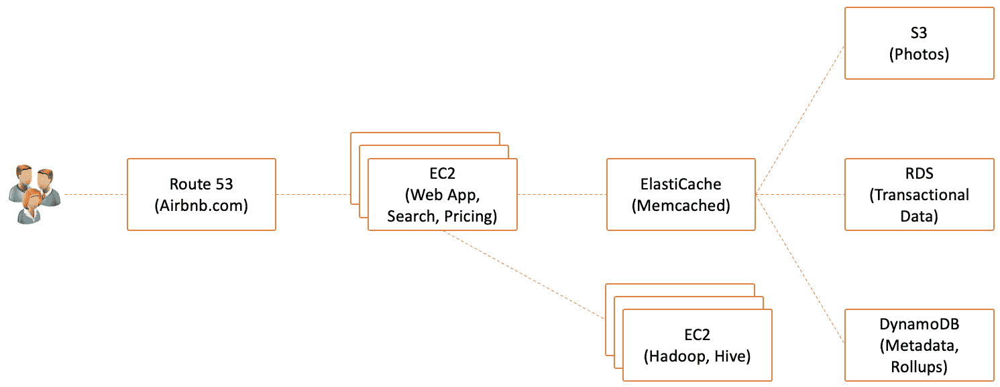 

图 7.1 – Airbnb 的初始云架构

这对 Airbnb 平台最初的需求和需要来说非常合适，因为 Airbnb 花了几年时间才获得人气和动力。这种单体平台提供了诸多好处，例如简单、易于构建、监控和部署，同时还减少了开销，使这个小团队能够迅速将 Airbnb 推向市场。云平台能够无缝按需扩展，以支持 Airbnb 的增长突增，2013 年用户总数增加了一倍多，从 400 万增至 900 万。最初的一些服务包括房产搜索、定价和欺诈预测。值得注意的是，Airbnb 能够以极其精简的团队持续满足消费者需求，而这个架构仅由一个五人运维团队支持。

## 向微服务演进

随着 Airbnb 继续全球扩张并进入超高速增长阶段，最初的 Monorail 单体平台带来了一些挑战。Airbnb 正处于一个拐点。例如，单体架构无法无限扩展，无法快速发布新功能，也无法实现无缝的开发者协作，尤其是在组织实力不断壮大的情况下。2014 年，Airbnb 进行了一次重大的品牌重塑活动。这也意味着 Airbnb 的工程团队必须投入大量资源来重新设计平台的每个方面。到 2016 年，Airbnb 推出了`Airbnb Experiences`，世界各地的当地房东或旅游运营商可以设计和提供独特的体验给客人。基于压倒性的积极客户体验和反馈，Airbnb 还推出了`Airbnb Plus`和`Airbnb Collections`。通过云优先策略，Airbnb 能够迅速从单体架构转向云原生的面向服务架构，而无需担心技术债务。不仅如此，云还使 Airbnb 团队能够快速试验、部署和大规模扩展新功能[3][4]。

凭借一千多名工程师专注于提供尖端服务，Airbnb 得以将 Monorail 重构为面向服务的架构，实现了 API 驱动的方式，将独立服务组件模块化、标准化通信协议，并独立扩展服务，从而更易于维护。这提供了更好的问责制，并能更快地交付新功能，有助于提升业务敏捷性。该平台还能够无缝支持移动等新平台，结果也证明了这一点。由于回滚减少，Airbnb 平台的停机时间显著减少，页面性能提升了 10 倍。

从架构角度来看，Airbnb 逐渐摆脱了`EC2`等核心基础设施服务，转向`Kubernetes`平台，以更好地适应微服务范式。一个非常关键的改进是，基于`Kubernetes`的微服务架构允许 Airbnb 按需自动独立扩展各个服务，如下面的微服务架构图所示[5]：

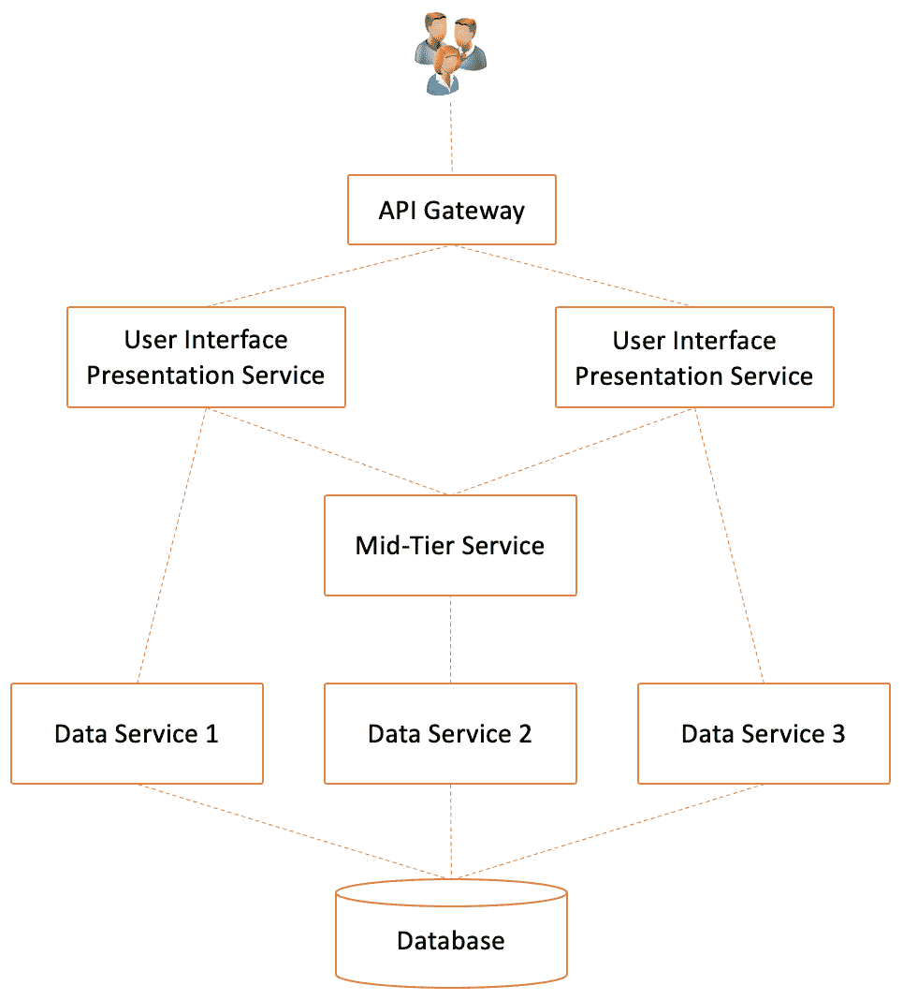

图 7.2 – Airbnb 的微服务架构

若干关键的渐进式改进使 Airbnb 能够扩展平台，以支持数亿用户，并投资于结合了内部技术和开源技术的通用基础设施。以下是一些关键的架构组件：

*   **API 框架**：基于`HTTP`上的`Thrift`开发的内部框架
*   **Powergrid**：用于编排和管理任务的**有向无环图**（`DAG`）
*   **OneTouch**：一个`Kubernetes`框架，可跨环境高效管理服务
*   **Spinnaker**：开源持续交付平台
*   **GraphQL**：用于数据访问的统一模式

这是 Airbnb 持续数字化转型中的一个重要里程碑，因此拥抱云技术以进一步实现业务目标[6]：

## 多云采用与转型

随着 Airbnb 继续全球扩张，团队也在全球范围内壮大。保护跨本地数据中心和云运行的任务关键型企业应用成为首要任务。`Airbnb.com`主要托管在`AWS`上，而一些特定的支持服务则出于延迟考虑运行在本地数据中心内。有一段时间，Airbnb 和任何企业一样，利用`VPN`等传统技术让员工连接到企业应用。然而，随着团队出差或从不同地点连接企业应用和服务，在保证安全访问的同时提供无缝体验成为一项挑战。完全依赖`VPN`进行访问控制意味着要么速度缓慢，要么体验不一致。Airbnb 希望改变安全实施方式，为员工提供低延迟连接，无论他们身在何处，同时让他们能够在任何地方（陆地或空中）工作，只要有互联网接入即可。

解决方案是**BeyondCorp**，这是由`Google`开发的一种安全模型，利用身份和上下文来评估访问决策的信任度，而不是将企业网络作为边界[7]。Airbnb 迅速采用了多云战略，由`Google Cloud`管理 Airbnb 服务的网络和安全态势，无论它们在哪里运行。下图展示了 Airbnb 如何利用`BeyondCorp`的上下文感知访问的高层架构：

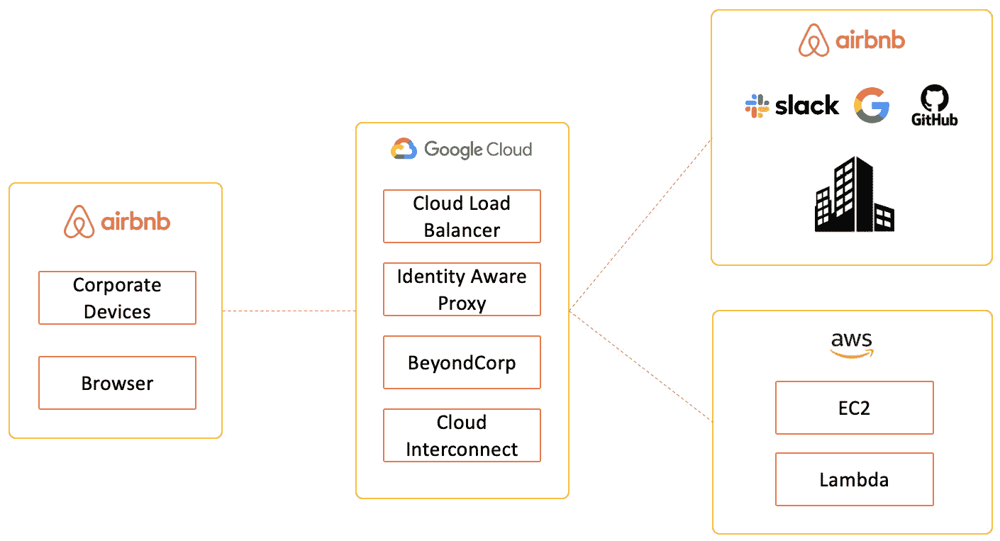

图 7.3 – Airbnb 的多云架构

## 疫情与经济放缓——优化阶段

云架构为企业提供的另一项关键能力是，能够以低得多的风险阈值快速试验新技术，同时将成本控制在合理范围内。`Covid-19`疫情对全球多个行业和企业造成了大规模影响，Airbnb 也不例外。然而，Airbnb 很早就组建了一个云`FinOps`团队，并开始研究其云使用情况以寻找优化途径，部分原因是为其`IPO`做准备，并实现了显著的云成本优化。云治理和`FinOps`实践使 Airbnb 比一些同行更好地应对了全球疫情的影响，而那些同行正在裁员数十名员工。Airbnb 成功优化了其云存储成本约 27%，并将`OpenSearch`服务成本优化了 60%[8]。

让我们来看看 Airbnb 进行的一些关键云优化：

*   **全面识别并可视化当前云使用情况，同时利用云提供商提供的工具**：在这种情况下，Airbnb 利用了名为`AWS Cost Explorer`的成本分配可视化引擎，以及来自`AWS Cost & Usage Report`工具的数据。这帮助 Airbnb 在细粒度层面可视化、理解、管理和优化其云技术栈。
*   **识别并优化跨云环境的大型数据存储**：云提供商提供不同层级的数据存储选项——从即时访问到归档——以满足特定的应用需求。在这种情况下，Airbnb 利用了`AWS S3`的智能分层功能，优化并将正确的数据存储需求与正确的存储层级对齐，从而大幅节省存储成本。
*   **在云中创建扁平网络**：这不仅节省了成本，还带来了低维护和改进的性能效率。
*   **识别并利用现有的各种节省计划与合同工具**：通过这样做，Airbnb 能够在运行相同工作负载时获得更高的节省。例如，承诺使用一定基线的用量，这有助于 Airbnb 以折扣价格实现显著的成本效益。

## Airbnb 的云原生转型

- **迁移到定义的无服务器平台**：从原始的专用计算基础设施迁移到具有应用程序定义的横向扩展规则的无服务器平台，可对成本节约产生积极影响。

- **利用交互式日志分析和实时应用程序**：作为一项持续的 FinOps 最佳实践，Airbnb 还利用交互式日志分析和实时应用程序监控功能，持续评估和优化云成本。

通过采用云优先的云原生方法，Airbnb 不仅通过技术颠覆了酒店业，还成功适应了动态的市场条件，同时保持了敏捷和以客户为中心。

# 家乐福的可持续数字化转型之旅

家乐福成立于 1959 年，是一家跨国零售集团，是世界上最大、最知名的超市和大卖场连锁品牌之一。截至 2024 年，家乐福仍是全球第八大零售商，业务遍及 30 个国家，经营超过 12,225 家门店。家乐福经营多种零售业态，包括大卖场、超市、便利店和电商平台，提供种类繁多的商品，包括生鲜食品、日用百货、电子产品、服装和家居用品。家乐福被视为行业领导者，主导了一些大胆且成功的数字化转型举措，包括开发现代电商平台和数字服务，以提升客户购物体验。家乐福还参与了各种可持续发展和环保举措，包括承诺减少碳足迹、推广可持续采购和减少食物浪费。家乐福在零售业的成功使其成为全球市场的重要参与者，为许多国家的消费者提供各种产品和服务。其持续的扩张和对不断变化的消费者需求的适应，使其能够保持在零售业的突出地位。

家乐福的数字化转型是其为保持在不断演变的零售市场中具有竞争力而做出的更广泛努力的一部分，在该市场中，数字技术和不断变化的消费者行为发挥着重要作用。这一转型使公司能够满足日益数字化和互联的客户群体的需求，并优化其运营以提高效率和可持续性。家乐福数字化转型举措的几个关键方面如下：

- **电商现代化**：家乐福利用云技术大幅扩展其电商业务，让顾客能在线购买生鲜杂货和各类商品。这包括传统电商平台和移动应用，为顾客提供了创新的购物方式，即下单配送或选择“点击自提”选项。这使家乐福能动态扩展以满足消费者需求，提供个性化推荐，同时优化运营和基础设施维护相关成本。

- **数字服务**：家乐福推出各种数字服务以提升客户体验，包括在线订购、送货上门，以及电子目录、购物清单和个性化推荐等功能。它还开发了移动应用程序，为客户提供便捷的购物方式、获取折扣和促销信息、管理会员卡。家乐福还采用并提供各种数字支付方式，包括移动钱包和非接触式支付选项，以方便客户进行更快捷、更便利的交易。

- **忠诚度计划**：家乐福将其忠诚度计划数字化，根据客户的购物习惯和偏好提供个性化折扣和奖励。

- **供应链优化**：数字技术使家乐福能够提高供应链效率，降低成本并准确预测需求，确保门店和在线订单的产品供应。

- **全渠道整合**：家乐福致力于整合其线下和线上渠道，为客户提供无缝购物体验。这让客户能灵活购物，家乐福将其定义为 “*想买什么就买什么，想在哪买就在哪买，想什么时候买就什么时候买，想怎么买就怎么买*”。这使家乐福能够挽回流失客户、增加忠诚度并提升在线销售额。

- **数据洞察**：家乐福利用现代数据分析深入了解客户行为、购物趋势和库存管理。这种数据驱动的方法帮助公司做出明智决策并改进运营。

- **环保举措**：家乐福利用数字工具推动可持续发展。2018 年，家乐福董事长兼首席执行官 Alexandre Bompard 发起了 *Act for Food* 全球计划，通过具体举措帮助其客户和员工吃得更好——无论身在何处——且价格实惠。例如，公司利用技术减少食物浪费、优化能源消耗并支持环保举措。

- **客户互动**：家乐福利用数字渠道通过营销、社交媒体和客户支持与客户互动，促进更牢固的品牌与消费者关系。这极为有效，帮助家乐福在消费者中建立了强大的品牌价值。

- **创新合作伙伴关系**：家乐福与科技公司和初创企业建立战略合作伙伴关系，推动零售创新。这些合作促成了新服务和解决方案的开发。

## 家乐福的全渠道战略

2017 年 4 月，在巴黎的投资者日上，家乐福展示了其零售战略及其面向 *赋能消费者* 的愿景 \[9\]。主要重点是确保家乐福对透明度的承诺，并为质量、标准和消费者忠诚度建立基准。这一年，家乐福认识到新消费者时代的到来，他们更加城市化、数字化和移动化，并关注所分享的数据。市场调研数据中的一些有趣观察包括以下内容：

- 2014 年城市化率为 54%，预计 2050 年将达到 66%
- 数字化渗透率仅在 2000 年至 2016 年间就增长了七倍
- 消费者所有购买中有 34% 通过移动设备完成
- 58% 的消费者因全天候可用性而更喜欢在线购物

针对这些统计数据，家乐福投资构建多业态、全渠道的零售体验，不仅方便无缝，还提供愉悦的购物体验。作为多业态使命的一部分，家乐福的每种业态都专注于提供独特的体验。例如，大卖场确保消费者能在一个屋檐下以有竞争力的价格买到几乎所需的一切，而超市则战略性地选址在居民区附近，专注于提供生鲜食品。便利店提供生活必需品并延长营业时间，而 *Cash & Carry*（现购自运）门店则以批发价提供产品，带来无花哨的购物体验。最重要的是，电商店通过最全的产品品类丰富了产品目录，提供全面、便捷、随时随地的购物体验。电商平台 *Carrefour banque et assurance*（家乐福银行与保险）还提供预订旅游体验、租车和保险等增值服务。

全渠道模式抓住了确保电子商务可持续发展的独特机遇。例如，家乐福整合了其供应链、CRM、人力资源、电子商务和数字营销，以实现无缝的全渠道转型，将后端订单管理投入运营，使消费者能够在不同业态（大卖场、超市或便利店）之间跨店取货，提供送货上门服务，并提供店内“点击提货”以及储物柜等自提点。这是帮助家乐福整个生态系统中消费者的关键因素。它通过长期忠诚度、提高钱包份额和购物频率、焕活客户群以及赢回流失消费者来实现这一点。

家乐福数字化转型战略的另一个关键方面是构建一套凝聚力的数据战略，收集相关的客户和运营数据。家乐福为**数据即服务**模式奠定了基础，该模式有助于从其庞大的第一方数据（与第三方数据混合）中提取有意义的洞察。第一方数据包括家乐福从其电子商务应用、移动应用、忠诚度计划和社交媒体中获取的消费者和运营数据，而第三方数据则涉及匿名数据。这些宝贵的数据使家乐福能够通过提供个性化推荐、检测客户流失和提高忠诚度来改善客户关注度，同时通过实时检测**销售点**（**POS**）和缺货异常以及改进需求预测来提高运营关注度。

## 一项由云转型助推的大胆举措

2018 年，家乐福推出了*“食品行动”*，这是一项全球性的具体举措计划，旨在让消费者无论身处何地都能以可负担的价格吃得更好。该计划与公司层面的转型计划保持一致，即致力于成为全球*食品转型*领域的领导者。**食品转型**被定义为向可持续食品体系的过渡，在该体系中，食品的生产和消费不会损害子孙后代营养的经济、社会和环境基础。在接下来的几个月里，家乐福采取了一项大胆的战略举措，利用云技术作为基础支柱，将技术注入其业务目标的服务中。这意味着家乐福利用其核心数字化转型理念，与超大规模云服务商合作，以快速创新、引领和转型。家乐福选择谷歌云作为其战略合作伙伴，不仅是为了助力数字化转型之旅，更重要的是利用谷歌在零售中心解决方案、数据分析、人工智能、营销、媒体转型和现代数字工作场所方面的专业知识 *\[11\]*。

在云转型之旅开始之前，家乐福主要利用本地数据中心、私有云和公有云的组合来支持其跨地域的电子商务。这些选择通常由当地的家乐福在本地做出，导致服务提供商布局分散。家乐福为其云转型之旅奠定了四大关键支柱：

- **定义云愿景和战略**：家乐福数字化转型的核心思想是让所有 IT 工作聚焦于更好地服务客户。家乐福观察到零售业的快速演变趋势，并很早就认识到上市速度是绝对优先事项，从而制定了云环境下的数字化转型愿景和战略。
- **明确专用云服务模式**：正如每个企业都是独一无二的，数字化转型也是如此。家乐福定义了围绕不同云服务模式（IaaS、PaaS 和 SaaS）的使用标准。例如，虽然其大部分应用程序可以在 IaaS 和 PaaS 上进行定制和现代化改造，但某些支持功能（如人力资源和财务）可以快速受益于专用的 SaaS 应用程序。
- **组织对齐**：当企业踏上重大数字化转型之旅时，传统组织必须发展和适应以支持这一进程。家乐福认识到需要建立**云卓越中心**（**CCoE**）来发展云运营方面的专业知识、管理新技术栈、识别合适的解决方案、制定路线图、招聘云专家，并定义参考架构蓝图，同时注入云 FinOps 等关键治理功能。
- **沟通**：家乐福大规模云转型成功的主要原因之一归功于有效的沟通。家乐福公开了其云转型的意图，同时确保愿景和战略在整个组织中得到充分传达。这有助于确立组织方向，并激励团队朝着这一更大的使命迈进。

当家乐福开始对其零售业务进行数字化转型并在云端创新时，它制定了一些与业务挑战相关的非常明确的价值主张：

- **无缝扩展**：无论在架构上还是运营上，维护单体电子商务平台对 IT 团队来说都很艰难，这使其难以适应业务需求。采用云原生的方法有望解决这一挑战。
- **上市速度**：上市速度与响应市场需求的业务敏捷性成正比。当家乐福致力于数字化转型时，云计算通过消除许多平凡但关键的本地决策（如选择合适的基础设施、采购、软件和硬件合规性以及容量规划）直接改善了上市速度，从而补充了该战略。
- **持续创新**：采用云原生和**自由开源软件**（**FOSS**）战略帮助家乐福利用尖端技术，同时以低风险快速进行实验。家乐福也认识到，在竞争激烈的零售环境中，持续创新对于蓬勃发展和持续生存至关重要。
- **可用性**：在现有的本地环境中，从资源、成本和时间限制来看，实现持续的高可用性极其困难。例如，三个 9 的可用性与四个 9 的可用性表面上似乎差异很小，但可能导致应用程序正常运行时间产生 8 倍的影响。
- **可持续性**：云转型的主要动机之一是家乐福对全面可持续性的坚定关注。家乐福的云战略能够使其实现显著更高的**电源使用效率**（**PUE**），优化能源使用，并减少其全球碳足迹。
- **安全性**：随着网络威胁持续上升，保护 IT 基础设施变得比以往任何时候都更加复杂。通过其云战略，家乐福可以利用云提供商的安全专业知识，并采用现代云原生安全解决方案和纵深防御安全架构来管理、监控和保护其关键应用程序和数据。
- **效率**：通过其云战略，家乐福可以将所有资源集中在业务优先事项上，而不是建设和运营数据中心。家乐福根据用例的性质采用了多模式云，以提高整体效率。

## 将传统 IT 转变为现代云

家乐福在数十个国家开展业务，其面临的主要挑战之一是：每个地区的家乐福集团都拥有自己的 IT 部门、数据中心、应用程序和技术选型。这种模式在一段时间内运作良好；然而，多年来，组织内部的各个业务单元构建了大量应用程序，导致基础设施环境分散且异构，存在冗余解决方案和数据孤岛。随着零售市场需求呈指数级增长，这些应用程序、基础设施和解决方案中的许多已触及极限，这迫切需要进行革新，以制定面向未来的可扩展、有弹性且现代化的 IT 战略。在构建零售业未来的过程中，家乐福采取了精简且分阶段的方法，推动跨区域的 IT 转型。

## GearUp 计划

家乐福的云转型第一阶段始于 2019 年，主要重点是改进 IT 运营以推动性能和创新。该计划代号为 GearUp。GearUp 计划的核心思想是专注于重塑 IT 并确保业务对齐。这包含以下几个方面：

*   **评估现状**：这涉及采访业务利益相关者以了解业务愿景和顾虑，同时评估跨基础设施、应用程序和业务流程的当前 IT 全景。
*   **战略对齐**：家乐福通过研讨会与 Gartner 合作，以获得关于战略和组织对齐的见解。
*   **IT 路线图定义**：这涉及为各种 IT 项目定义近期、中期和长期路线图。
*   **利益相关者沟通**：家乐福向业务和 IT 利益相关者展示并传达了愿景、战略和路线图，并获得了支持。

根据初步评估，家乐福必须解决的一个关键挑战是重塑这个拥有 60 年历史的组织，并使其适应新一代 IT。家乐福在现有 IT 运营中识别出一组 23 个痛点。以下是家乐福实施的一些运营和流程变更，这些变更对其业务优先级产生了直接的积极影响：

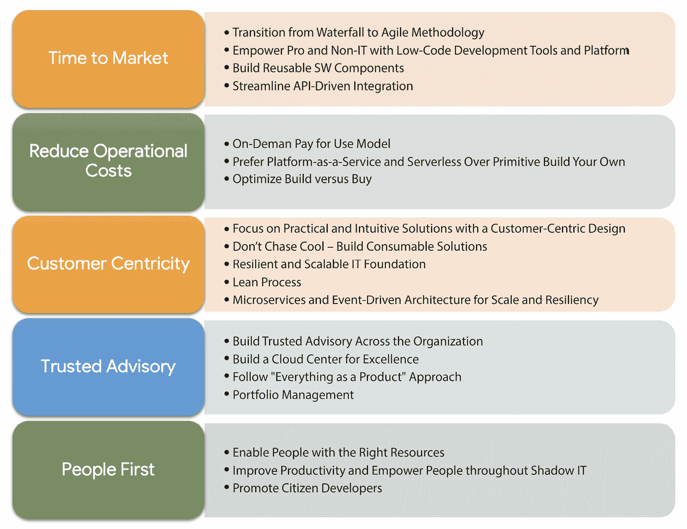

图 7.4 – 传统 IT 转型的关注领域

既然我们已经探讨了家乐福在传统 IT 转型方面的战略，现在让我们回顾一下家乐福西班牙在云端的数字化转型。

## 家乐福西班牙的数字化转型

家乐福的使命是通过为全球客户提供最优质的购物体验、以最优价格提供最优产品，来转型零售业的未来。家乐福西班牙作为其西班牙子公司，是家乐福集团中最早拥抱数字化转型的实体之一，在全国拥有 1,000 多家实体门店，每年服务 140 万笔在线交易。为了确保家乐福无论通过哪个购物渠道都能为客户提供同等高质量的服务，整合来自多个数据流和后台职能（涉及产品、本地库存、定价和可用性）的数据至关重要。意识到现有本地 IT 基础设施的局限性、消费者对无缝全渠道购物体验的需求以及利用技术创新的潜力，家乐福西班牙决定彻底改造并现代化其老旧的 IT 基础设施，同时为未来构建以数据为中心的技术基础。其主要目标包括：

*   **整合并现代化后台 ERP 基础设施**

    多年来，家乐福在本地构建了大量应用程序和解决方案来满足其 ERP 需求。这导致了两大挑战——不一致的数据孤岛和无法支持业务需求的遗留基础设施——从而造成数据蔓延和数据孤岛。家乐福西班牙在 Google Cloud 上现代化了其 SAP，这提供了一个绝佳机会来标准化和整合其数据流及后台业务流程 [12]。在 4 个月内，家乐福便利用混合云基础设施实现了第一阶段的投入运营。借助基于云的 ERP 基础设施，家乐福西班牙能够整合并集成 2,000 多个数据流，利用可扩展的基础设施实时收集、分析并处理信息，这为以数据为中心的基础设施奠定了基础骨干。这种现代化还使家乐福能够快速扩展 ERP 功能，集成物联网 (IoT) 和机器学习能力，用于预测性分析，如需求预测。

*   **现代化电商平台以实现无缝扩展并交付新能力**

    家乐福西班牙关注的另一个关键优先事项是现代化其电商平台和基础设施。现有的电商平台是单体架构，基于老旧的本地基础设施。该平台的可用性和弹性是一个巨大的隐患，尤其是在电商流量的季节性高峰期间，因为公司必须仔细评估并推测本地基础设施的容量。家乐福西班牙将其电商平台重新部署到 Google Cloud，同时利用现代开源容器技术 Kubernetes，这有助于根据需求无缝部署和扩展。这个现代化平台还使家乐福西班牙能够快速向客户交付新能力，而无需将资源分流到构建、配置、扩展和管理基础设施上。转型成果显著，家乐福西班牙能够无缝扩展以适应并维持每秒 20,000 多次操作的性能，即使在达到正常工作负载 4 倍的极端流量高峰时也是如此。云原生平台还允许他们部署各种客户应用程序，从库存管理到“点击自提”。

*   **为未来构建以云为中心的基础**

    云迁移对家乐福的 IT 团队产生了重大影响，特别是对他们的工作方式。例如，开发人员能够专注于代码并快速实验，而无需解决基础设施容量挑战和环境一致性问题；运维团队采用了现代云原生实践，如 IaC，可在几分钟内对环境进行快速简便的更改。这极大地提高了生产力，团队能够构建并迭代多个更新，从而提供更高质量的服务。

## 家乐福的 IT 架构战略

家乐福的云转型旨在从三个层面优化组织——基础设施、应用和安全现代化。为了最大化 Google Cloud 采用的效益，家乐福的云转型历程结合了 Google V1 和 Google V2：前者专注于利用 IaaS 产品进行基础设施现代化，后者旨在利用 PaaS 产品进行应用转型。这使家乐福能够通过以下方式优化资源分配并利用每种环境的独特能力：

*   **基础设施现代化**：为提高运营效率，家乐福从物理服务器过渡到无服务器架构，采用 DevOps 流程，从批处理迁移到实时处理，并实现了部署和测试程序的自动化。这些变更降低了运营复杂性并提高了可扩展性。

# 家乐福云转型案例研究

## 初始转型策略

### 应用转型
家乐福专注于从单体架构向微服务架构迁移，采用**面向服务的架构（SOA）**方法，并在应用层面从计划流程转向实时流程。通过将应用拆解为更小、更模块化的组件，他们增强了灵活性、敏捷性以及单独扩展各个服务的能力。

### 安全现代化
为保证其应用和服务在混合云环境中的安全，家乐福实施了零信任模型，基于用户身份和上下文授予访问权限。公司还将控制权从网络层移至应用层，强化了安全措施。这种方法提供了对访问权限的细粒度控制，减少了攻击面并提高了数据保护水平。

## 六层蓝图设计
家乐福定义并采用了一种开放平台策略，配合解耦的六层蓝图设计，可支持广泛的应用架构和需求。如下图 [13] 所示：

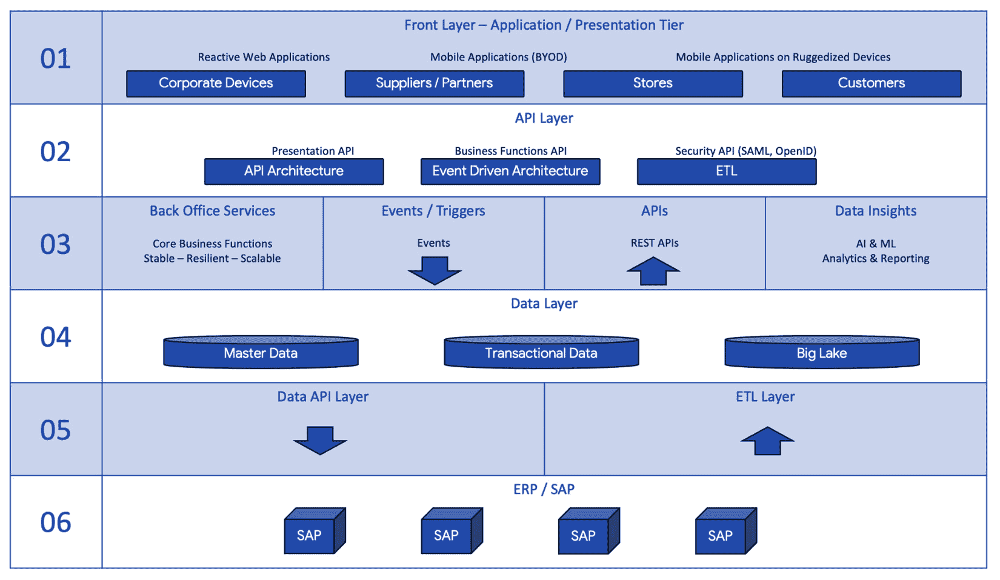

**图 7.5 – 家乐福的六层蓝图设计**

## 2019 年底的成果
到 2019 年底，云转型战略为家乐福带来了令人瞩目的成果。

### 规模与敏捷性
西班牙电商业务从本地单体架构现代化迁移至云原生微服务架构，使家乐福在黑色星期五等季节性高峰期拥有了极致的扩展能力。这还使公司能更快地交付新的客户体验。例如，家乐福实现了约 400 多次新功能部署，而本地环境仅为 52 次。另一个显著成果是谷歌云上的数据湖现代化：本地数据湖上限为 700 TB 且难以扩展，而谷歌云上的数据湖每日维持 2 TB 的增量数据量，同时服务 80 多个应用和每月 1 亿次请求。

### 上市速度
利用云平台的敏捷性和规模，家乐福能在几分钟内完成算力和平台资源的供给，而采购、上架和配置服务器通常需要长达 3 个月。另一大优势是云原生环境中对容量需求可以“随意悲观”或“过度乐观”。在首次新冠疫情封控期间，家乐福利用全球云数据中心，跨其运营的多个国家快速推出了一系列“一次性”网站和服务，为客户提供生活必需品。疫情结束后这些服务即下线。一个典型例子是 *Les essentials Carrefour* 网站，它根据位置提供固定日期的食品包裹送货上门服务，并保证基本食品的供应 [14]。

### 专注创新
谷歌云平台为家乐福提供了最前沿的现代技术。更重要的是，这意味着公司能以更低的风险、成本和精力快速试验和测试这些能力。家乐福利用预训练的 AI 模型（如 Vision AI）融入图像识别等功能。谷歌在开源目标上是家乐福的协同合作伙伴，公司受益于多项开源贡献，如 Dataflow（基于 Apache Beam）、Google Kubernetes Engine（基于 Google Kubernetes）、TensorFlow，并遵循 **云原生计算基金会（CNCF）**。例如，创新的核心在于谷歌的技术领导力：谷歌工程师发现并修补了微处理器安全漏洞——**Spectre 和 Meltdown**——以及 Heartbleed 和 Rowhammer 等其他漏洞，且在其所有云数据中心实现了零停机修补。

### 弹性与高可用性
凭借云中各项服务基于 SLA 的可用性，家乐福获得了更好的应用栈可用性和弹性。例如，在本地为三层应用实现三个 9（99.9%）的可用性，意味着整个栈必须全冗余，且每年最大停机时间不足 9 小时，这极难实现且成本高昂。而在云环境中，家乐福以有限的精力和投入即达成了这一目标。

### 云上可持续发展
可持续发展是家乐福的核心基因，与谷歌的合作确保家乐福能快速实现其可持续发展目标。传统数据中心的平均**电源使用效率（PUE）**得分约为 1.5，而谷歌云节能数据中心的平均 PUE 得分为 1.1。通过对多种云服务选择相关的碳排放透明化，家乐福能准确测量其碳足迹总量，追踪云项目的排放概况，并在报告和披露中纳入碳排放数据，助力其达成 ESG 目标。

## 下一阶段：以客户为中心与数据中心迁移
凭借云迁移的初步成功，家乐福进入了云上数字化转型的下一阶段，聚焦于以客户为中心。为加速向云过渡，团队开始关闭多个本地数据中心并将应用迁移至云端。以下是家乐福实施的一些关键转型策略：

## 关键转型策略（下一阶段）

### 提升并迁移 VMware 工作负载
家乐福拥有大规模的 VMware 环境，承载着各类应用工作负载。重构或重新架构所有这些应用意味着团队需投入大量时间精力，同时面临应用兼容性和集成风险。为加速云转型，家乐福利用 Google Cloud VMware Engine（一种原生谷歌云服务）无缝迁移并在 GCP 上运行 VMware 工作负载 [15]。该方案还提供灵活的按需容量，并与现有本地应用保持完全的运营兼容性和一致性。这使家乐福能利用云基础设施优化资源与成本，同时实现效率提升。在云环境中，家乐福采用了 FinOps 最佳实践，如在不需要时自动关闭非生产环境。通过这一举措，家乐福将总拥有成本降低了 30%。

### 数据与分析转型
作为其云转型使命的一部分，家乐福团队将目光聚焦于核心使命——以客户为先。为在更深层次上了解客户，家乐福利用谷歌云数据生态系统转型并现代化其数据平台（内部称为达尔文项目）。达尔文项目为海量数据集提供了单一、统一、安全且透明的事实来源。Google BigQuery 成为该数据平台的基石，为公司数据科学家提供可靠的数据访问，助力开发更智能的 AI/ML 模型。此外，这使团队能构建与电商集成的推荐引擎，为客户提供个性化购物体验。转型成果显著：

*   凭借现代 AI/ML 能力的采用和全新个性化推荐引擎，家乐福能为客户定制并交付个性化购物体验，在新冠疫情期间在线收入实现了令人印象深刻的 60% 至 70% 增长。
*   其数据平台扩展以满足业务需求与增长。

# 家乐福的数字化转型

- 家乐福利用 Looker——一个用于商业智能、数据应用和嵌入式分析的企业平台——不仅实时可视化和分析数据，还通过提供基于数据的洞察来改善与供应商和合作伙伴的协作。

- **以 API 为主导的集成**：随着家乐福构建数字服务和平台，为跨渠道客户提供顺畅无缝的在线体验，消费者需求增长到数十亿次 API 请求。为了更好地应对流量高峰并提供可扩展、低延迟的体验，家乐福利用 Apigee 标准化 API 集成和管理。Apigee 平台使开发人员能够构建、管理、扩展和保护 API，同时充当后端服务 API 的门面，提供安全性、速率限制、配额和可见性。这也大大提高了开发人员的工作效率，因为他们可以专注于构建服务，而无需担心服务机制。

- **以可持续发展为核心的数字转型**：与 Google Cloud 的合作使家乐福得以实现其可持续发展目标。例如，仅通过将工作负载从物理数据中心迁移到 Google Cloud VMware Engine，家乐福就将能耗降低了 35%。家乐福与 Google Cloud 共同创建的另一项关键举措是家乐福的*生鲜品类解决方案*。该解决方案使当地门店能够根据需求更好地调节和管理生鲜订单。这有助于减少食物浪费，同时让消费者及时获得合适的生鲜产品。

## 展望未来——家乐福 2026 年数字零售战略

家乐福目前正在制定 2026 年数字零售战略，这是其自 2018 年以来深度数字化转型的成果。凭借以数据为中心、数字优先的方针，家乐福的目标是到 2026 年将其电子商务**商品交易总额**（**GMV**）增至三倍，达到 100 亿欧元，届时数字业务将为经常性营业利润额外贡献 6 亿欧元。为实现这一目标，家乐福计划将数字投资增加 50%，同时到 2030 年实现其电子商务活动的碳中和——比家乐福集团 2040 年的整体目标提前 10 年。以数据为中心、数字优先的战略将取决于四个关键驱动因素：

- **加速电子商务**：家乐福打算通过创新的数字形式来巩固其零售领导地位，例如极速配送（3 小时内送达）、即时零售（15 分钟以内）、社交电商、B2B 和直播购物。

- **加强数据和零售媒体**：通过*家乐福链接*平台，家乐福预计将从其丰富的第一方和第三方数据中提取价值。例如，家乐福的产业合作伙伴可以在多个渠道（门店、移动应用和网站）开展营销活动，获得端到端的可见性，并衡量影响。

- **金融服务数字化**：家乐福打算利用其在金融和保险服务领域的强大影响力和专业知识，将金融服务活动、产品和服务数字化，为 B2C 和 B2B 客户提供新能力，如**先买后付**（**BNPL**）、小额信贷和联名保险。

- **通过数字技术深度变革传统零售**：家乐福已将其 30% 的应用迁移到云端，并计划到 2026 年全面云化。通过采用以数据为中心、数字优先的战略，家乐福将推动其业务流程的数字化，通过运营效率和个性化来改善客户体验。

在回顾了家乐福的数字化转型及其对零售市场的更大影响之后，让我们简要探讨温迪如何改变消费者体验并颠覆餐饮行业。

# 温迪重塑消费者体验

温迪总部位于美国俄亥俄州都柏林，是一家美国快餐连锁店，也是世界第三大汉堡快餐连锁品牌。作为 50 多年前率先推出取餐窗口的餐饮品牌，温迪始终走在创新的前沿。1970 年，温迪创始人戴夫·托马斯（Dave Thomas）在其独立式温迪餐厅中设想了一个新的设计元素——*取餐窗口*，这是一项突破性创新，彻底改变了客户体验。温迪的第一个现代得来速也是催化剂，推动温迪从一家拥有四家门店的本地汉堡连锁店成长为蓬勃发展的全球品牌。在设计和创新的传承基础上，温迪最近宣布了一项全球餐厅设计新标准——*全球下一代*——该标准有望通过现代数字技术提升其餐厅的客户体验，并改善员工的体验 *[16]*。

## 全球下一代

2023 年 2 月，温迪公布了其 2030 年气候目标。作为**快餐服务餐厅**（**QSRs**）的领导者，温迪的目标是将其范围 1 和范围 2 的温室气体绝对排放量以及范围 3 的排放量减少 47% *[17]*。为实现这一雄心勃勃的目标，关键行动之一是为其新餐厅建设推出温迪全球下一代设计，该设计比传统温迪标准餐厅节能约 10%。作为全球下一代战略的一部分，温迪的每个业务职能部门（从运营到技术）都将参与设计和战略制定，以帮助满足日益增长的客户需求和期望。一些关键设计特点包括：为配送司机提供便捷、更快的取餐窗口；提供专门的移动订单取餐选项，包括专用停车位和货架；重新设计厨房以提高销售点效率和加快订单履行；优化基础设施以减少能源消耗；以及大力投资下一代技术，以应对数字业务和创新的增长 *[18]*。

## 通过技术重塑餐厅体验

温迪一直处于数字化转型的前沿，通过大胆重塑客户体验来革新餐饮行业。从移动点餐和非接触式支付，到个性化忠诚度计划和 AI 驱动的推荐，温迪一直在利用技术创造无缝、愉悦的体验，以满足现代食客不断变化的需求。通过与尖端技术提供商的战略合作，温迪推出了一系列创新解决方案，改变了顾客点餐、互动和享受餐食的方式。让我们回顾一下温迪如何利用新兴技术进行创新的几个亮点。

### 利用生成式 AI 重塑得来速体验

# Wendy’s – 变革得来速与餐厅体验

随着 75% 至 80% 的 Wendy’s 顾客偏爱得来速，提供无缝的得来速点餐体验一直是一项挑战。基于与 Google 的技术合作，Wendy’s 采用现代生成式 AI 技术开发了一个突破性的 AI 平台——Wendy’s FreshAI。FreshAI——自动得来速点餐系统——将带来与 Wendy’s 店员互动般自然的体验。目标是简化得来速点餐流程，并缩短顾客在得来速车道中的等待时间。菜单不断变化且有数千种定制可能性，训练 AI/ML 模型可能是一项难以逾越的挑战。在此案例中，Wendy’s 利用多种生成式 AI 能力来定制和训练大语言模型，使其包含 Wendy’s 及其顾客独有的短语、同义表达和术语，从而提供无缝的餐厅体验。例如，JBC 指 Junior Bacon Cheeseburger（小培根芝士汉堡），而大杯巧克力奶昔指大杯巧克力 Frosty。Wendy’s 还将 AI 驱动的语音助手与可视化订单显示屏配对，让顾客对订单准确性更有信心。通过创新的餐厅技术，Wendy’s 旨在消除得来速点餐和数字订单取餐体验中的复杂性，同时让店员能够专注于提供新鲜、快速且优质的食物 *\[19\]*。

## 通过数据释放价值

作为社会，仅在过去十年，我们已从数据稀缺转变为数据过剩。对企业而言也是如此，如今大多数企业面临的挑战是数据利用不足——即把正确的数据用于正确的用途。Wendy’s 曾可获取大量第一方和第三方数据，而数据是其释放全新顾客、店员和餐厅体验愿景的核心。Wendy’s 利用数据消除消费者与其餐厅体验之间的摩擦。例如，了解消费者是希望尽快拿到食物还是喜欢尝试新事物，对于提供最佳体验至关重要。对数据的洞察使 Wendy’s 能够通过个性化优惠提供差异化结果。同样，Wendy’s 利用来自其加盟店和业务职能部门的数据，改善加盟商和餐厅团队的运营。

## 偏向云端的混合云

与大多数企业一样，Wendy’s 拥有庞大的本地数据中心足迹，支持其关键任务应用。Wendy’s 的 IT 战略，尤其是在交付新能力时，一直采用移动优先和云优先设计。云优先战略为 Wendy’s 带来优势：尽早利用前沿技术、创新、更快实验，并以低得多的成本和风险更快交付新能力。Wendy’s 与 Google Cloud 的合作使公司能够通过云原生数据分析、预训练 AI/ML 模型以及对混合云的支持，为客户提供无缝体验。使用合适的工具和技术配置基础设施不再是主要瓶颈，这赋能业务，并让 Wendy’s 团队专注于核心业务职能。

## 边缘计算实现即时客户体验

Wendy’s 拥有独特优势，可获取分布在多个地点的大量且多样化的数据。在正确的时间处理正确的数据，并在正确的地点激活它，对长期成功至关重要。虽然一些应用可从历史数据分析中受益，但某些应用需要实时分析。Wendy’s 将这些分析称为“相关时间”。凭借其分布式地点，Wendy’s 通过边缘计算释放了新价值。正如 Wendy’s 所说，快餐店（QSR）的圣杯是 POS 系统必须能够在餐厅内、云端或边缘运行，因为这为几乎任何地方——城市、乡村和偏远地区——开设 Wendy’s 餐厅提供了巨大灵活性。传统 POS 旨在接收订单并处理订单。然而，在当今数字世界中，这还不够。借助 Google Anthos——一种混合云解决方案——Wendy’s 可以设想并在边缘执行 AI 功能，以提供即时且个性化的客户体验 *\[20\]*。

# Capital One – 通过技术变革银行业

Capital One 是一家美国银行控股公司，总部位于弗吉尼亚州麦克莱恩，业务主要在美国。按**管理资产总额**（**AUM**）衡量，它是美国前 10 大银行之一，也是 Visa 和 Mastercard 信用卡的第三大发卡机构。Capital One 最初是一家以信用卡为主的单线银行，随后将业务扩展至汽车贷款，并于 2005 年进入零售银行市场。自 20 世纪 90 年代以来，Capital One 一直是金融服务行业的颠覆者，当时它迅速意识到信用卡服务行业几乎没有差异化。当业内大多数企业采用*一刀切*的统一定价方法时，早在 90 年代，Capital One 就利用数据的力量，并使用基于公开信用和人口统计数据的统计模型来了解其消费者群体，并定制信用卡产品以满足客户需求——将合适的产品提供给合适的客户。

Capital One 在前沿引领数字创新，这从其收购战略到技术采用都显而易见。从收购角度看，Capital One 通过一系列收购增强和巩固了其数字优先战略，例如 ING Direct，以提供高价值数字银行服务；Bankons，一家创建基于地理位置的优惠的移动初创公司；Bundle，一家支出数据分析公司；Sail，一套移动销售点刷卡系统；Confyrm，一项数字身份和欺诈警报服务；以及 Wikibuy，一款购物比价应用 *\[21\]*。Capital One 也是云计算的早期采用者之一，并一直处于数字化转型的前沿。

## Capital One 的云转型之旅

Capital One 是最早试验和利用现代云技术推进其数字化转型目标的金融服务公司之一。Capital One 创立于这样一种信念：银行业将被数字技术彻底变革；其战略一直是将领先科技公司的技术创新与其风险管理能力相结合，通过使用包括 AI/ML 和数据在内的现代技术来构建并交付卓越客户体验。Capital One 拥有超过 6500 万个账户，不仅仅是一家信用卡公司或银行。其商业模式的基础是一家技术驱动型公司。Capital One 很早就意识到，其客户绝大多数通过数字渠道互动来申请产品和服务，并反过来通过数字渠道获得服务。例如，Capital One 客户使用其移动应用的频率是网页应用的两倍。为迎合其精通数字技术的消费者，Capital One 采用了云优先战略，云使其能够为客户构建出色的银行应用，而不是将注意力和投资转移到建设数据中心基础设施上。

Capital One 基于以下原则构建其 IT 战略：

* 大规模投资于顶尖工程人才
* 利用开源软件栈并协作构建软件
* 使用敏捷方法交付软件并实施 DevOps
* 采用 API 优先和基于微服务的架构
* 利用大数据和快速数据进行分析

在 2010 年代初，Capital One 以实验模式利用云来测试其能力，并迅速在企业范围内推广云。该公司将云技术视为一种颠覆性力量，使其能够创新并专注于通过技术提供卓越的客户体验。Capital One 确定了云的六项关键转型优势 [22]：

*   **速度**：云能够按需、即时地配置基础设施，带来巨大的生产力提升和上市速度。
*   **弹性**：面对波动的客户需求，云计算能够动态扩展基础设施容量，相比传统的本地部署具有显著优势。
*   **可用性**：随着 Capital One 努力通过数字渠道提供服务，高可用性是基本要求。云技术提供了多层弹性，这在本地环境中实现起来极其困难和昂贵。
*   **安全性**：在数字渠道运营会面临网络安全威胁。然而，利用云平台的纵深防御安全机制，Capital One 能够在细粒度级别管理安全性。
*   **技术访问**：云中的创新速度是 Capital One IT 战略的关键要素，它提供了亟需的现代技术访问途径。
*   **人才**：Capital One 对云的积极态度帮助其寻找并吸引行业顶尖人才，以提供前沿解决方案。

Capital One 的云转型之旅经历了四个采用阶段 [24]：

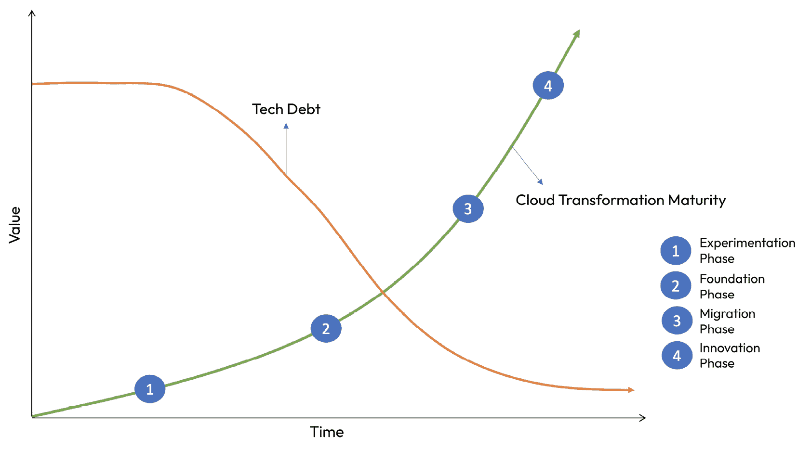

图 7.6 – Capital One 的云转型之旅和阶段

让我们更详细地探讨这些云转型阶段。

### 实验阶段

2013 年至 2014 年间，云技术仍处于起步阶段，Capital One 开始了与 `AWS` 合作的公有云之旅，主要目的是试验技术和运营模式。在这一阶段，Capital One 的创新实验室——*Capital One 实验室*——创建了小规模学习环境，以证明技术和工具的适用性。Capital One 实验室的使命陈述如下：*我们探索新兴技术与金融的交汇点*。由于投入规模较小，只有少数软件工程师参与了这一实验阶段。试验成功后，建议继续使用公有云，按需、即时地配置基础设施容量，并利用其高可用性和弹性来加速创新步伐。

### 基础阶段

大约在 2015 年，Capital One 在 `AWS` 上部署了生产就绪的云原生应用，这标志着一个巨大的里程碑。这一阶段意味着对大量 IT 员工进行培训和技能提升，使其能够在云原生环境中开发和工作。由于 Capital One 在本地数据中心也有大量投资，确保云应用能够与本地环境无缝集成以降低应用交付流程中的摩擦至关重要。建立 `DirectConnect` 使 Capital One 能够将数据中心从本地扩展到云（`AWS` 数据中心），从而帮助所有新工作负载向云优先架构过渡。在这一阶段，Capital One 还建立了 `CCoE`，由云原生专家团队组成，包括开发人员、解决方案架构师、产品团队和技术客户经理。`CCoE` 在定义云工程模式和最佳实践方面发挥了重要作用，并与 `AWS` 合作，同时帮助 Capital One 各团队进行交叉交流与培训。在 `AWS` 年度大会 `ReInvent 2015` 上，Capital One 分享了其愿景，即将数据中心足迹从 2014 年的八个减少到 2016 年底的五个，并在 2018 年进一步减少到仅三个。这一宏大愿景和目标促使 Capital One 专注于利用公有云来简化基础设施、推动创新，并将节省的成本回馈到业务中：

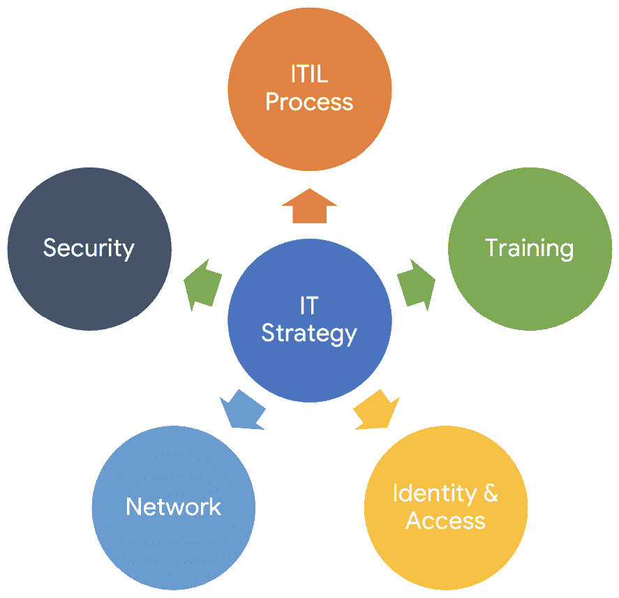

图 7.7 – Capital One 云之旅的基础要素

### 迁移阶段

接下来的几年标志着 Capital One 的“大迁移”阶段。Capital One 团队继续与 `AWS` 及众多合作伙伴携手，协助建立模式和流程，以应对大规模云迁移。Capital One 战略性地采用了 `6 R` 迁移方法——*重新托管*、*重新平台化*、*重构*、*保留*、*回购* 和 *退役*——以支持其摆脱数据中心业务的愿景。例如，对于只需要进行小幅更改且差异化不大的应用程序，Capital One 倾向于采用 *重新托管*（直接迁移）策略；而对于具有重大业务影响的应用程序，则采用 *重新平台化* 和 *重新架构*。在这一阶段，Capital One 还通过利用 `AWS` 平台产品（如 `Amazon Simple Queue Service`（`SQS`）用于消息队列的重新平台化，以及 `Amazon Relational Database Service`（`RDS`）用于传统事务性数据库的重新平台化）受益于云技术的进步，从而降低了扩展、打补丁、备份、升级等管理复杂性，同时也释放了更高的性能效率。

### 创新阶段

随着 `AWS` 足迹的扩大，以及 Capital One 具备多年的云成熟度，这一阶段标志着向创新迈进。Capital One 利用云平台创新银行业的未来，并利用 `AI/ML` 能力进行欺诈检测，通过移动助手（如 `Eno`）提供个性化体验。这一阶段还使 Capital One 能够优化其云投资，主要目的是提高性能和成本效率。早期的一些优化工作包括调整应用基础设施、实施基础设施自动化，以及在 `PaaS` 产品（如无服务器产品）上重构应用。以下是一些关键优化：

*   检测 `AWS` 上运行的应用工作负载的未使用容量，并优化 `Linux` 发行版。这有助于减少计算基础设施的使用量和成本：

    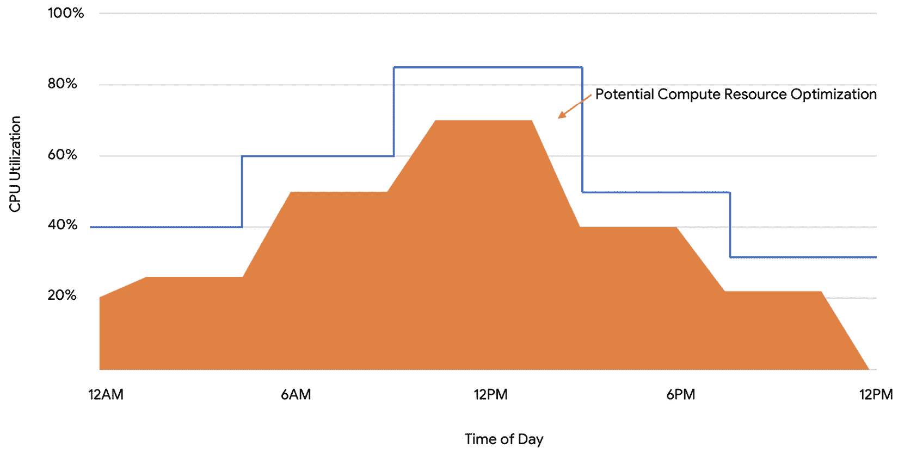

    图 7.8 – 云中平均计算资源使用量及其优化潜力的示意图

*   实施 `IaC`，在云中动态即时地创建和拆除环境。

*   将应用从传统基础设施（基于容量）重新平台化到无服务器 `PaaS` 产品（基于使用量）。例如，在计算实例（`EC2`）上部署服务意味着 Capital One 必须为*盒子里的所有东西*付费，无论该服务是否在使用中，同时还要管理基础设施：

    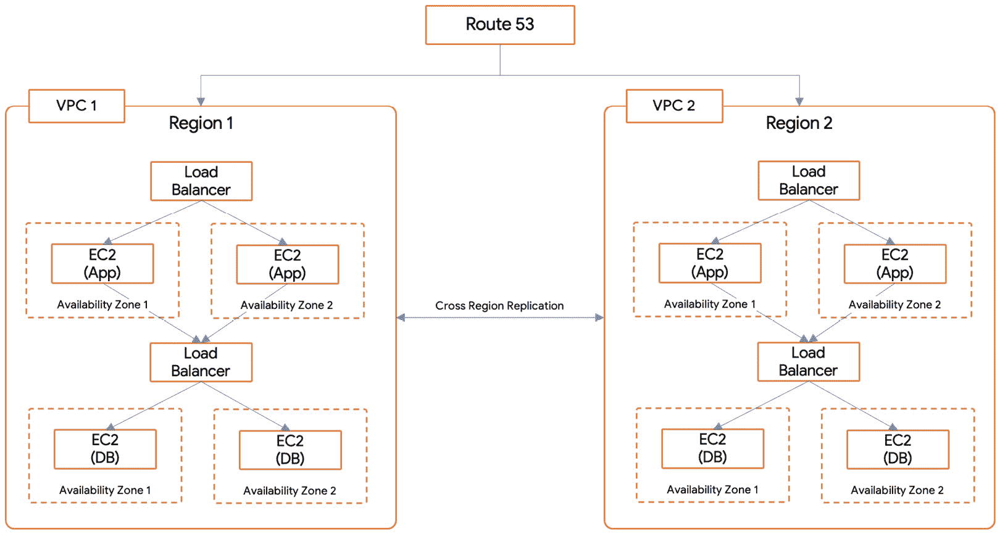

    图 7.9 – 基于基础设施的应用架构

将此应用和服务重构到无服务器平台（`Lambda`）意味着 Capital One 只需在服务运行时付费：

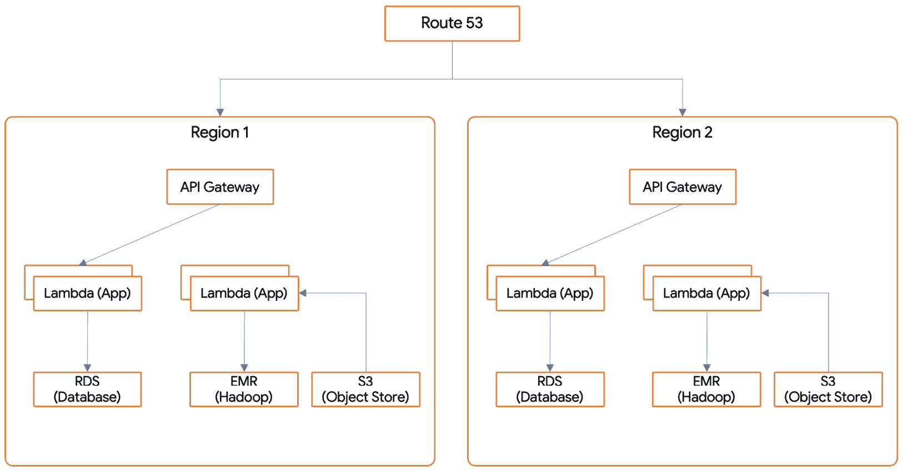

图 7.10 – 基于平台和无服务器的应用架构

## Capital One 的人才招聘策略

# Capital One 的云转型与移动应用重构

## 将 IT 员工提升为云专家

在本节中，我们将简要探讨 Capital One 如何将其才华横溢的 IT 员工（他们主要是内部部署技术专家）提升为云主题专家。为了寻求变革，Capital One 的领导层制定了一个“独角兽”职位规格，并希望从市场上招聘顶尖的云人才。这根本行不通，因为那种“独角兽”根本不存在。Capital One 迅速意识到，他们可以转型已有的极具技能、积极主动且敬业的人才。事后看来，Capital One 阐述了其采取的、效果显著的步骤 *[25]*：

1.  **接受**：这是关键的第一步，Capital One 必须说服其才华横溢的工程师和领导者，他们能够学习现代云技能——在本例中是 AWS——并能够提升技能。灌输适当的自信、创造学习环境、规划清晰路径、给予充足时间以及提供激励，这些就足够了。

2.  **培训**：Capital One 团队迅速开始通过官方课堂培训为团队提供学习机会。

3.  **动手实践**：改变极其困难，违背人类心理。然而，创建一个无责备后果的正确环境可以成为强大的变革推动者。Capital One 为工程师提供了沙箱环境，让他们在云端摸索实践，从而帮助创建了扎实的学习环境。

4.  **两个披萨团队**：Capital One 组建的第一个工程团队由来自不同专业领域的 IT 人员组成，如网络、数据库、系统管理员、应用工程师、存储管理员和安全工程师。这非常合理，因为云技术模糊了这些职位角色之间的界限，而在传统的内部部署环境中，这些角色通常是截然不同的。

5.  **引入外部专业知识进行交叉融合**：必须帮助内部 IT 与一些外部辅导和指导进行交叉融合。这就是合作伙伴关系能带来显著优势的地方。Capital One 引入了经过专业认证的 AWS 合作伙伴专家，协助初始推出。这产生了变革性的效果，Capital One 团队通过观看、提问和亲自实践来学习，为未来做好准备。

6.  **落地实施**：为两个披萨团队设定构建和交付真实生产负载的目标，这是关键一招。此处的目标是找到一个重要但不过于关键任务的工作负载。关键在于确保该工作负载不需要过多定制云构建模块（本例中为 AWS），因为这起初可能成为技术障碍。

7.  **以细胞分裂方式扩大学习**：一旦第一个团队交付成功成果，就该分裂这个团队——他们现在拥有必要的经验——变成两个四人团队，同时每个团队再引入四名工程师。这有助于通过动手实践和在职学习来扩大学习。Capital One 重复这一过程，直到拥有数百名熟练的云工程师，并产生了大量全新云应用的额外副作用。

8.  **云认证**：Capital One 发现工程师认证与在 AWS 上交付的应用数量之间存在直接相关性。认证流程确保 Capital One 的工程师理解 AWS 语言，并对技术有更广泛的理解。

9.  **扩大认证与领导力**：Capital One 主张让 10%的工程师获得认证并成为平台倡导者，达到临界质量后网络效应便会生效。培养和激励工程师获得认证产生了光环效应，这不仅有助于内部认知，也改善了外部形象。

10. **认可与奖励**：Capital One 的云（AWS）认证被视为一项伟大成就。公开认可和奖励工程师对团队士气和动力产生了巨大影响。

11. **挑战自我**：作为领导者，身体力行也很重要。在 Capital One，领导层主动接受认证挑战，以获得对 AWS 术语更广泛、更深入的理解。

12. **重新定义职位系列**：云产生了深远影响，这不仅是技术领域的转型，也涉及业务职能、流程和运营。Capital One 重新定义了职位组合以反映这一点。

这一整体战略帮助 Capital One 不仅从市场上获取了合适的人才，还通过提升技能实现云转型，激活了内部人才。现在，让我们探讨 Capital One 如何构想并开创面向消费者的创新移动体验。

## 在云上重构 Capital One 移动应用

Capital One 云转型工作的巅峰是其最大的面向客户的移动应用的重构。这是一个雄心勃勃的项目，因为该移动应用拥有数千万用户。这远不止简单的“迁移”，而是需要对整个应用进行全面重构，包括集成、编排系统和运维支持工具。构建云原生软件往往是一套全新的游戏规则，因为它要求思维从传统软件开发转向云原生 DevSecOps *[26]*。

使命很简单：Capital One Mobile 必须能够跟上消费者需求，由随产品需求而动的基础设施提供支持。

Capital One 拥有一大优势，即移动应用现有架构的大部分已“云就绪”。例如，该应用利用了基于微服务的 API 驱动架构（Capital One 称之为微体验 API——稍后详述）、用于服务端负载均衡的 Netflix Zuul OSS、用于服务容错的 Netflix Hystrix OSS、作为服务注册表的 Netflix Eureka，以及用于运维自动化的 Ansible。这意味着 Capital One 团队只需进行微调，即可确保充分利用 AWS 的云原生能力 *[27]*。例如，从在内部部署的单一封闭基础设施中部署服务组件，转变为在 AWS 的分布式基础设施上部署，可以实现更好的扩展性和容错性。

Capital One 创造了**体验 API**（**xAPIs**）和**微体验**的概念。xAPIs 与常规 API 的区别在于，xAPIs 专注于交付用户体验流程，而常规 API 可能指服务于资源或数据模型。微体验本质上是多个 xAPIs 的集合，可放入单个可部署单元中。例如，客户点击*兑换奖励*可以是一个微体验，它可包含多个微体验 API。

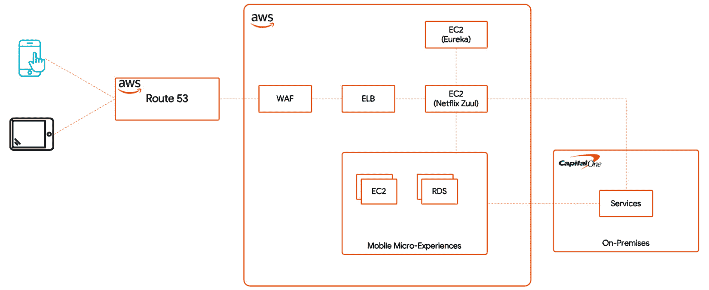

图 7.11 – Capital One 的移动应用架构

在探讨了 Capital One 的移动应用架构后，让我们回顾一下他们早期云 DevOps 工作中的挑战和经验教训。

### DevOps 挑战与经验教训

以下是我们从 Capital One 大规模云转型工作中总结出的一些云 DevOps 最佳实践：

*   尽可能利用云原生能力以提高效率。例如，Capital One 用 AWS Route53 替换了企业 GTM 解决方案，并将数据存储从内部部署的 RDBMS 迁移到 RDS。

*   为基于服务的部署开发部署模式，而非全栈部署，以提高微发布和增量部署的频率。

* 利用**自动扩缩组**（**ASGs**）执行蓝绿部署。这对于确保真实环境测试在出现问题时不会产生较大影响至关重要。
* 构建一个预置了所有应用程序和服务器级依赖项的黄金镜像。
* 将一切自动化——构建 DevOps 和 SRE 最佳实践，同时利用自动化减少不必要的人为接触点和错误。
* 拥有稳健的性能测试计划有助于识别云环境中可优化的机会。这包括在不同计算系列和存储类型上测试软件，以获得最佳的性价比。
* 将服务器基础设施视为“牲畜”而非“宠物”。
* 基于扩缩事件或性能指标持续调优应用软件，往往能暴露应用程序的差距和漏洞，而在本地环境中，过度配置的硬件或容量可能掩盖了这些问题。
* 利用模拟测试软件进行按需模拟测试。Capital One 采用了基于 Mountebank 开源软件的解决方案。
* 在云中，为功能而构建，为韧性而设计架构。

### 全面拥抱云

2020 年，Capital One 坚守目标，关闭了八个本地数据中心，并完全迁移到云端。在此过程中，它回收了 103 吨铜和钢，同时在云端运行着数以千计的应用程序 *\[28\]*。Capital One 在行业中处于独特地位，作为一家数字银行运营，仅在少数几个州保留实体分行，同时通过遍布全国的 40,000 台 ATM 提供其服务。此外还有 Capital One 咖啡馆，作为社区中心，Capital One 也几乎可以在任何地方为客户提供技术访问。Capital One 是一个成熟的例子，证明了金融服务等高度监管行业中的财富 100 强公司，可以将传统的本地生态迁移到云端，并交付由数据和 AI 驱动的全新客户体验。

以下是云如何加速 Capital One 创新的一些关键亮点：

* 首先，实现的关键优势之一是能够几乎即时地以几乎无限的规模访问计算资源，同时还能灵活地按使用付费。这把开发环境的前置时间从大约 3 个月缩短到几分钟。应用程序现在可以按需使用或多或少的资源，以维持和满足业务需求。
* 退出数据中心帮助 Capital One 利用云规模经济实现了更低的**总体拥有成本**（**TCO**）。
* Capital One 从按季度和月度更新应用程序，转变为每天多次向生产环境发布变更，从而加快了上市速度，更快地交付新功能。它还观察到事务错误数量减少了 50%，关键事件解决时间也缩短了。
* Capital One 的技术人员得以随时访问现代技术，并利用实时数据流、机器学习以及云的力量来解决独特的业务挑战。
* 云为其系统和应用程序实现了极高的可用性和韧性。大多数应用程序转向了双活架构，并实现了自动化故障转移，无需付出太多努力，也无需投入大量基础设施来支持。例如，如果云中的一个可用区发生故障，工作负载可以在该区域内的另一个可用区中移动或继续服务；如果整个云区域发生故障，则可以在新的云区域中启动相同的工作负载。这在传统数据中心范围内几乎是不可能实现的。Capital One 在测试中观察到灾难恢复能力提升了 70%。
* 云已成为 Capital One 以客户为中心的创新的支柱。一个典型的例子是 Eno——完全使用 Amazon EC2、Lambda、DynamoDB 和 Kinesis 等云技术开发的智能助手。Eno 的主动洞察可帮助 Capital One 客户保障账户安全：留意异常信用卡收费、跟踪支出，并在发现更优优惠时发送有用的提示。另一个例子是 Capital One Shopping，这是一个免费工具，通过比较各网站的价格、主动寻找可用优惠券，并提供价格跟踪和提醒来帮助购物者省钱。云使 Capital One 能够快速尝试新技术和新产品，而无需大量前期投资和风险。
* 向现代架构和流程（如 RESTful API、微服务和 DevSecOps）的转变，使 Capital One 在业务上更加敏捷。

总之，Capital One 的案例研究很好地展示了企业如何利用云作为催化剂来推动业务目标的实现。通过利用云的可扩展性、敏捷性和成本效益，Capital One 得以更快地交付创新产品和服务，改善客户体验，并在金融行业中获得竞争优势。Capital One 的云之旅证明了云计算和开源在推动数字时代业务增长和成功方面的巨大潜力。

# 总结

正如我们在本章中所探讨的，云计算已从一种服务模式演变为现代技术演进的中心。这为企业和初创公司提供了颠覆行业的巨大机遇。从某种意义上说，云重塑了公平竞争的环境，客户体验成为蓬勃发展的关键。从我们探索的云转型之旅和业务成果中，让我们思考一些共同的要点。

组织愿景极为关键，而在许多转型任务中，它往往被忽视。通过云技术对企业进行数字化转型也不例外。我们从 Airbnb（酒店行业）、家乐福（零售业）和 Capital One（金融服务业）等组织为其团队设定的清晰目标中可以看出这一点。这为整个组织围绕一个愿景团结一致定下了基调。

从案例研究中可以看出，沟通是极其重要的一个方面，它确保愿景在业务和 IT 职能之间得到传达。家乐福的云战略将沟通视为成功数字化转型的主要驱动力之一。我们还探讨了关注业务成果而非底层技术的重要性。例如，技术格局日新月异，IT 组织很容易对多年来构建的技术或基础设施产生偏爱，这可能对业务成果产生不利影响。这就是“牲畜与宠物”的心态。

从 Airbnb 和家乐福的用例中，我们可以看到云如何被用作创新的跳板，成为成功企业的基石。当今所有现代技术，从数字助手到生成式 AI，从实时数据流到物联网，从区块链到 AR/VR，都在云上构建和交付。尽早接触、进行试验，并更快地推动客户体验至关重要。

轻视“直接迁移”（lift and shift）并将其视为毫无价值的云计划，是大多数企业（尤其是当今）常见的陷阱。然而，正如我们从 Capital One 退出数据中心中看到的那样，这完全是一种误解。直接迁移为成熟企业提供了一个独特的机会，使其摆脱技术债务，充当学习的跳板，帮助启动下一阶段的云成熟度，使公司对人才库更具吸引力，最重要的是有助于节省资源、优化成本并实现 ESG 目标。

混合云是大多数拥有大量本地部署业务的企业的切实可行且易于获取收益的策略，其重点在于在云优先策略下开启新的业务合作。

在下一章中，我们将探讨如何设计下一代企业云战略，特别关注主要云提供商的规范性框架和价值实现。

# 延伸阅读

要了解本章涵盖的主题，请查看以下参考资料：

1. [`s26.q4cdn.com/656283129/files/doc\_financials/2023/q2/3aec2916-f24a-4a9e-8a59-bdbcabe8c4bb.pdf`](https://s26.q4cdn.com/656283129/files/doc_financials/2023/q2/3aec2916-f24a-4a9e-8a59-bdbcabe8c4bb.pdf)
2. [`aws.amazon.com/solutions/case-studies/airbnb-case-study/`](https://aws.amazon.com/solutions/case-studies/airbnb-case-study/)
3. [`www.infoq.com/presentations/airbnb-culture-soa/`](https://www.infoq.com/presentations/airbnb-culture-soa/)
4. [`www.youtube.com/watch?v=Z3\_V5ooxfxs`](https://www.youtube.com/watch?v=Z3_V5ooxfxs)
5. [`medium.com/airbnb-engineering/dynamic-kubernetes-cluster-scaling-at-airbnb-d79ae3afa132`](https://medium.com/airbnb-engineering/dynamic-kubernetes-cluster-scaling-at-airbnb-d79ae3afa132)
6. [`medium.com/airbnb-engineering/building-services-at-airbnb-part-1-c4c1d8fa811b`](https://medium.com/airbnb-engineering/building-services-at-airbnb-part-1-c4c1d8fa811b)
7. [`www.youtube.com/watch?v=Sq9gp8KBsY0`](https://www.youtube.com/watch?v=Sq9gp8KBsY0)
8. [`aws.amazon.com/solutions/case-studies/airbnb-optimizes-usage-and-costs-case-study/`](https://aws.amazon.com/solutions/case-studies/airbnb-optimizes-usage-and-costs-case-study/)
9. [`www.carrefour.com/en/news/investor-day-carrefour-omnichannel-experience`](https://www.carrefour.com/en/news/investor-day-carrefour-omnichannel-experience)
10. [`www.carrefour.com/sites/default/files/2020-01/investor\_day\_presentation\_vfinal\_v005pm\_0.pdf`](https://www.carrefour.com/sites/default/files/2020-01/investor_day_presentation_vfinal_v005pm_0.pdf)
11. [`horizons.carrefour.com/tech/google-cloud-the-fuel-of-digital-transformation`](https://horizons.carrefour.com/tech/google-cloud-the-fuel-of-digital-transformation)
12. [`cloud.google.com/customers/carrefour`](https://cloud.google.com/customers/carrefour)
13. [`gcloud.devoteam.com/blog/peter-winkelmans-head-of-enterprise-architects-at-carrefour-driving-business-growth-through-cloud-infrastructure/`](https://gcloud.devoteam.com/blog/peter-winkelmans-head-of-enterprise-architects-at-carrefour-driving-business-growth-through-cloud-infrastructure/)
14. [`horizons.carrefour.com/e-commerce/launching-a-home-delivery-service-in-6-days`](https://horizons.carrefour.com/e-commerce/launching-a-home-delivery-service-in-6-days)
15. [`cloud.google.com/customers/carrefour-gcve`](https://cloud.google.com/customers/carrefour-gcve)
16. [`www.irwendys.com/news/news-details/2022/Wendys-Announces-Innovative-New-Global-Restaurant-Design-Standard-Global-Next-Gen/default.aspx`](https://www.irwendys.com/news/news-details/2022/Wendys-Announces-Innovative-New-Global-Restaurant-Design-Standard-Global-Next-Gen/default.aspx)
17. [`www.wendys.com/blog/wendys-reduce-greenhouse-gas-emissions-47`](https://www.wendys.com/blog/wendys-reduce-greenhouse-gas-emissions-47)
18. [`www.wendys.com/blog/blog-home/blog-wendys-innovative-new-qsr-design-approach`](https://www.wendys.com/blog/blog-home/blog-wendys-innovative-new-qsr-design-approach)
19. [`www.wendys.com/blog/how-wendys-using-ai-restaurant-innovation`](https://www.wendys.com/blog/how-wendys-using-ai-restaurant-innovation)
20. [`www.forbes.com/sites/maribellopez/2023/01/12/wendys-cooks-up-new-experiences-with-ai-cloud-and-edge-computing/?sh=303f57ad6f1f`](https://www.forbes.com/sites/maribellopez/2023/01/12/wendys-cooks-up-new-experiences-with-ai-cloud-and-edge-computing/?sh=303f57ad6f1f)
21. [`www.capgemini.com/wp-content/uploads/2017/07/capital-one-doing-business-the-digital-way\_0.pdf`](https://www.capgemini.com/wp-content/uploads/2017/07/capital-one-doing-business-the-digital-way_0.pdf)
22. [`medium.com/capital-one-tech/we-re-a-disruptive-bank-a21f7cce25b6`](https://medium.com/capital-one-tech/we-re-a-disruptive-bank-a21f7cce25b6)
23. [`medium.com/aws-enterprise-collection/capital-ones-cloud-journey-through-the-stages-of-adoption-bb0895d7772c`](https://medium.com/aws-enterprise-collection/capital-ones-cloud-journey-through-the-stages-of-adoption-bb0895d7772c)
24. [`medium.com/capital-one-tech/serverless-is-the-paas-i-always-wanted-9e9c7d925539`](https://medium.com/capital-one-tech/serverless-is-the-paas-i-always-wanted-9e9c7d925539)
25. [`medium.com/aws-enterprise-collection/a-12-step-program-to-get-from-zero-to-hundreds-of-aws-certified-engineers-287a4b45d39a`](https://medium.com/aws-enterprise-collection/a-12-step-program-to-get-from-zero-to-hundreds-of-aws-certified-engineers-287a4b45d39a)
26. [`medium.com/capital-one-tech/moving-one-of-capital-ones-largest-customer-facing-apps-to-aws-668d797af6fc`](https://medium.com/capital-one-tech/moving-one-of-capital-ones-largest-customer-facing-apps-to-aws-668d797af6fc)
27. [`medium.com/capital-one-tech/mobile-orchestration-innovation-on-the-edge-9835e4cbd69e`](https://medium.com/capital-one-tech/mobile-orchestration-innovation-on-the-edge-9835e4cbd69e)
28. [`aws.amazon.com/solutions/case-studies/capital-one-all-in-on-aws/`](https://aws.amazon.com/solutions/case-studies/capital-one-all-in-on-aws/)
