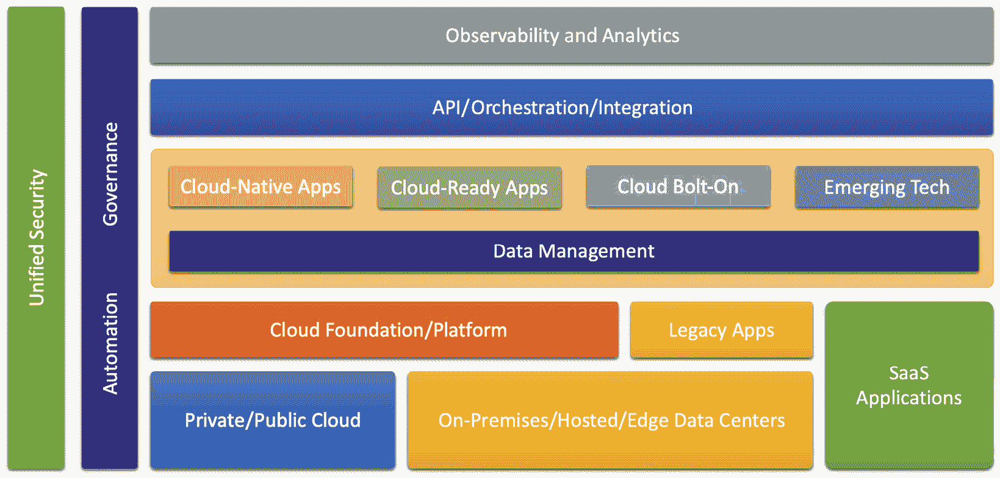
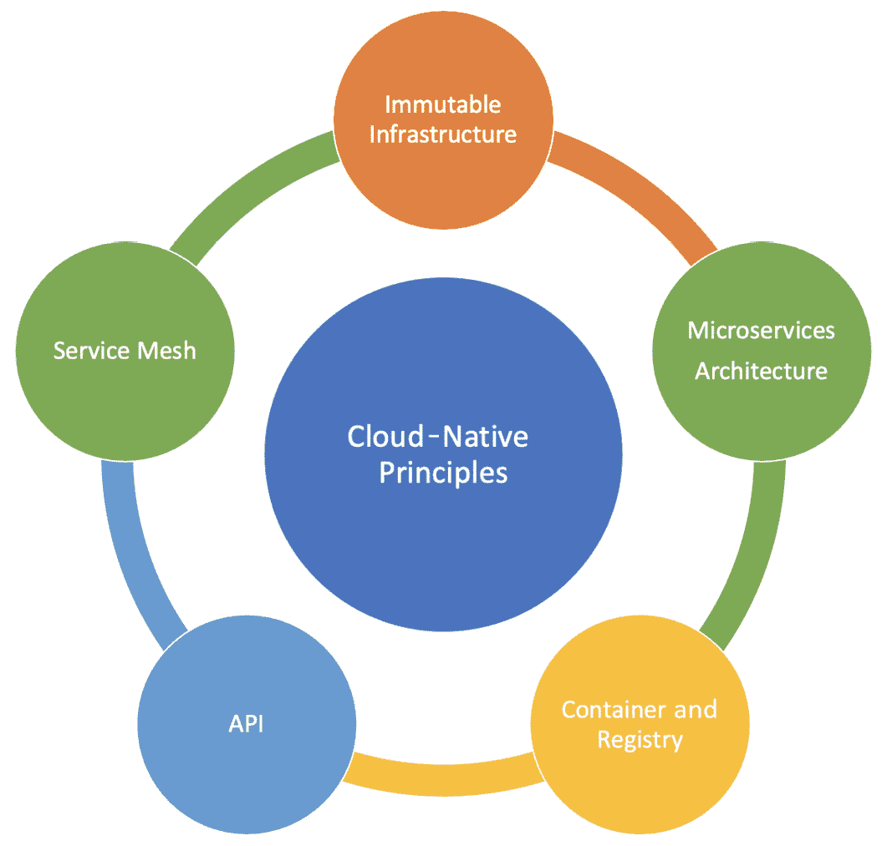
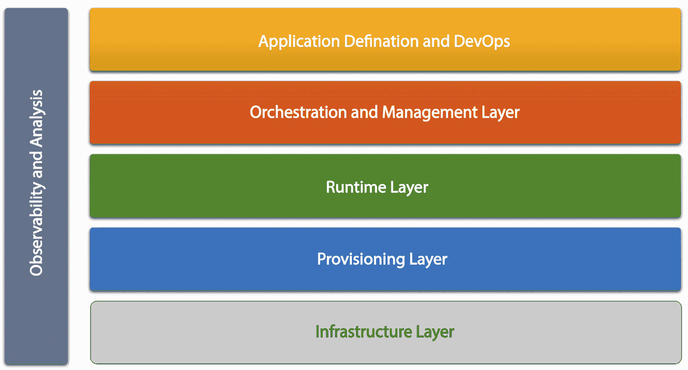
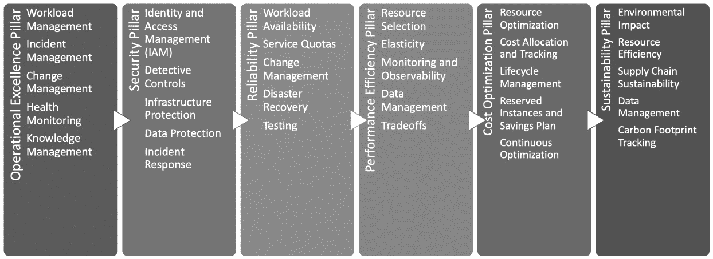
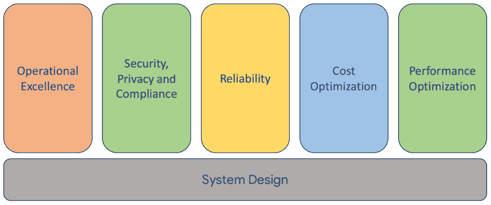
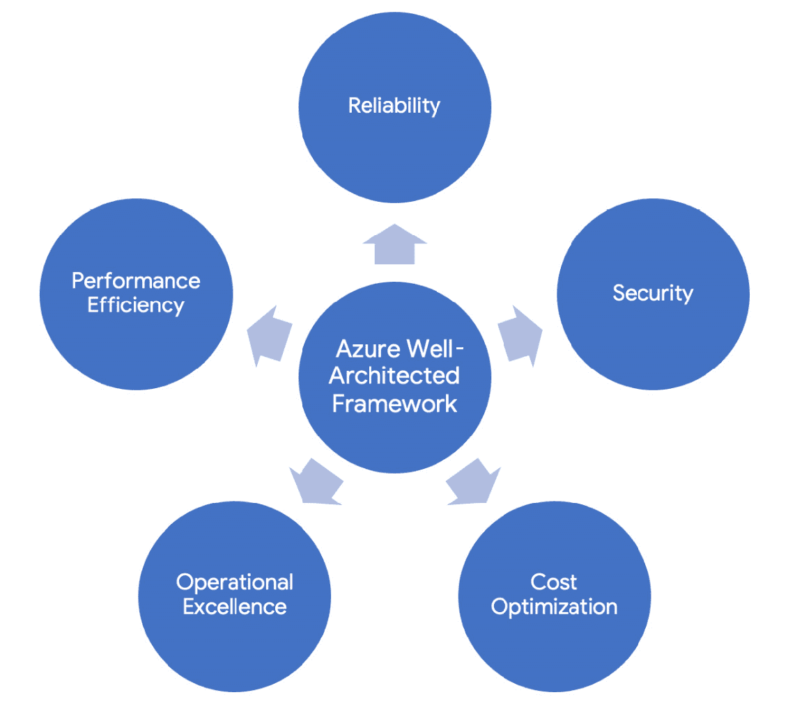

## 8 架构设计云就绪企业

成功的企业有什么共同点？它们都具备保持敏捷且与时俱进的根本能力，以满足消费者的需求和期望。正如我们在前面章节中探讨的那样，当今商业环境中的业务与科技的影响密不可分。麦肯锡的研究发现，2000 年标准普尔前 10 家公司的中位年龄为 85 岁，而到 2018 年已降至 33 岁 *\[1\]*。更有趣的是，该研究估计到 2027 年，标普 500 成分公司的平均存续时间将仅为 12 年。在当今的数字经济中，随着独角兽初创企业通过现代科技颠覆市场，企业生存和持续发展的能力在很大程度上取决于通过战略性地利用技术保持敏捷。

在上一章中，我们探讨了企业如何采用云策略以实现数字化转型。在本章中，我们将讨论如何架构设计一个云就绪企业，从而提高组织保持灵活、更快地对消费者需求做出反应和响应，并领先于竞争对手的能力。在本章中，我们将探讨以下主题：

* 一个具有明确观点的混合云框架，可作为架构设计中立厂商的云就绪企业的基础蓝图

*   主要云服务提供商（AWS、Google Cloud 和 Azure）的规范性云架构框架
*   私有云和混合云策略

# 为云就绪型企业构建框架

成熟企业通常拥有现有的数据中心，具有大量的基础设施、技术和软件资产，从零开始并不现实。在前几章中，我们讨论了领导力在引领和规划成功数字化转型道路中的关键作用，以及愿景、意愿和思维转变的重要性。现在我们已经确立了由云技术主导的全企业范围数字化转型的必要性，重新定义和构建基础构建模块以使 IT 组织走向成功变得至关重要。这引出了对规范性框架的根本需求，无论选择何种平台或提供商。许多企业陷入了采用速成、一次性转型的陷阱，由于缺乏坚实基础，这些转型往往以失败告终，导致复杂性、工作量和成本方面出现不良结果。例如，Acme Corp. 在没有强大数据基础的情况下投资现代数据分析解决方案，引发了数据集成和语义层重新设计的巨大复杂性和成本，同时仍无法在正确的时间将正确的数据提供给正确的角色。

在本节中，我们将探讨一个与提供商无关的框架，它有助于重新定义和构建云就绪型企业，无论企业部署平台如何。这是一个我创建、倡导并为企业架构师和 IT 领导者开具的有主见的框架，它遵循并符合一些通用的企业架构框架。典型的企业 IT 占地面积通常包含本地数据中心、任务关键型应用程序（包括遗留应用程序）、支持 SaaS 的业务职能，以及可能混合的私有云和公有云服务。企业在这种模式下面临的一个共同挑战是如何在确保业务连续性的同时达到云原生状态。根据 `Cloud Native Computing Foundation` (`CNCF`) 的定义，“*云原生技术使组织能够在现代动态环境（如公有云、私有云和混合云）中构建和运行可扩展的应用程序。容器、服务网格、微服务、不可变基础设施和声明式 API 体现了这种方法。*” *[2]*。云原生方法使企业能够构建松耦合、具有弹性、可管理和可观测的系统，同时能够频繁且可预测地交付高影响力的变更。

企业通常也会开始遵循云原生架构构建全新的应用程序。然而，如果没有云基础和生态系统来支持它，这可能导致孤岛效应，难以与现有的本地系统和应用程序集成，甚至导致复杂性和工作量增加。将应用程序广泛分类并识别为三个主要类别也将被证明是明智之举：

*   **遗留应用程序**：这些是服务于企业主要业务职能且对业务至关重要的应用程序。这些应用程序通常需要更长的路线图才能完全转型到云端，最适合在现有的本地环境中运行。
*   **云就绪型**：这些是使用传统软件开发方法设计和构建的应用程序，但有潜力重新平台化或重构以在云环境中运行。
*   **云原生**：这些通常是诞生于云端的应用程序，或从头重新架构以成为云原生的应用程序。

以下是构建云就绪型企业架构时的一些主要目标：

*   通过提高开发速度和开发人员生产力，改善业务敏捷性和上市速度
*   减少支持业务职能和增长所需的 IT 工作量和时间——考虑基础设施扩展、补丁管理、DevOps、自动化、升级和维护
*   确保应用程序可用性、可扩展性和弹性作为基本要求
*   支持创新、原型设计和利用现代技术快速试验新想法的环境
*   通过采用开放标准和开放技术，确保应用程序可移植性并减少对底层基础设施和平台的依赖

**图 8.1** 描述了企业混合云框架的核心组成部分和层级：

图 8.1 – 企业混合云框架的层级

现在，让我们详细回顾这些层级。

## 云基础层

这是最重要的基础层，由基础设施服务和平台服务的组合构成。该层的主要目标是将底层核心基础设施与应用服务解耦，以确保可移植性和平台无关的部署。云基础层中需要考虑的一些关键架构组件如下：

*   网络基础设施现代化
*   计算基础设施现代化
*   存储基础设施现代化
*   云原生应用设计原则

### 网络基础设施现代化

无论是私有云、公有云还是多云策略，成功数字化转型最关键的因素都是网络基础设施。不幸的是，当企业努力尽可能高效地向客户交付新产品和服务时，这往往也是许多企业最容易忽视的方面。在传统方法中，网络边界被限制在可预测的范围内并得到加固，遵循单一窗口访问策略。这更容易构建、控制、保护和管理。然而，在数字化时代，网络边界已扩展以满足多种需求，并开放了多个入口和访问点。例如，引入 SaaS 服务以满足特定业务需求、采用一个或多个公有云平台、全球办事处和远程办公的企业合作伙伴、通过 5G 等现代协议连接到企业网络的物联网设备、供应商和合作伙伴的第三方访问、在边缘或门店部署计算设备——所有这些都导致网络边界模糊，凸显了网络基础设施现代化的必要性。随着数字化转型的加剧，企业网络的商业价值从未如此之高。

传统网络从根本上建立在涉及物理网络、路由器、交换机、基于硬件的负载均衡器、网络安全设备和协议标准的前提上，这些通常由各个网络或设备供应商定义。在传统网络基础设施中，数据平面和管理平面紧密耦合，每当网络需要变更时，都需要巨大的工作量来进行设备配置。相比之下，现代基于云的基础设施依赖 `software-defined networking` (`SDN`) 原则，抽象掉了物理网络基础设施。`SDN` 将控制平面与数据平面解耦，使网络管理员能够近实时地传播网络配置和变更。

`SDN` 实现了一项关键能力，即网络管理员可以使用标准 `SDN` API 像操作软件一样操作和管理网络。`SDN` 为企业启用的一些关键能力如下：

# 云基础现代化

## 网络基础设施现代化

- **开放标准**：基于 SDN 的架构通过开放 API 引入开放标准，以支持多云和供应商中立的互操作性。这也有助于网络运营商通过 API 管理网络服务和控制。
- **网络抽象**：SDN 带来的主要优势是对底层网络硬件和技术的抽象，从而实现无缝连接和互操作性。
- **网络智能**：传统网络本质上是分布式的，对网络状态的感知有限，而基于 SDN 的网络提供集中式的基于策略的控制，利用人工智能来管理网络性能、带宽和安全性。

这种网络现代化不仅仅局限于数据中心。随着 SD-WAN 的出现，企业可以采用软件定义的方法，为企业范围内的业务应用提供安全可靠的访问。

## 计算基础设施现代化

在典型企业中，传统的本地计算基础设施通常包含多种计算资源，涵盖商品化的通用硬件基础设施以及专业化的专有超融合基础设施。专门负责管理传统数据中心基础设施的团队，其大部分工作集中在维护和修补活动、管理硬件刷新周期以及维持日常运行上。

随着业务对更现代、更先进、更强大计算资源的需求持续增长，例如**高性能计算**（HPC）、**图形处理单元**（GPU）和**张量处理单元**（TPU），数据中心的管理和维护对企业来说正变得成本高昂。云平台使各种计算能力的获取变得大众化，改变了组织快速试验和使用计算资源的方式，无需承担长期承诺、维护和刷新开销。

以下是企业在设计面向云就绪的计算基础设施时可以采纳的一些最佳实践，尤其是在混合云的背景下：

- **虚拟化和容器化**：通过利用开放标准的虚拟化和容器化技术，组织可以创建独立于底层物理基础设施的抽象计算环境。这提高了计算资源的灵活性、可移植性和可重用性。
- **基础设施即代码（IaC）**：IaC 工具使组织能够将计算基础设施定义为代码，自动化调配、配置和管理。这简化了流程，减少了错误，并确保了跨环境的一致性。
- **计算实例标准化**：在两种环境中建立标准的实例类型和配置，可以简化容量规划、资源分配和成本管理。组织可以通过利用一致的配置来优化其计算基础设施。
- **集中式镜像管理**：为操作系统和应用镜像建立集中式存储库，可确保一致性、安全性和合规性。通过维护单一的镜像来源，组织可以简化计算环境的部署和维护。
- **混合云管理平台**：混合云管理平台提供了一个集中式仪表盘，用于管理本地和云环境中的计算资源。它支持无缝工作负载迁移、资源优化和简化管理。

组织还可以从实施自动化修补流程、建立全面的监控和日志系统，以及设计覆盖本地和云环境的统一**灾难恢复**（DR）和**业务连续性计划**（BCP）中受益。

## 存储基础设施现代化

随着企业采用混合云以同时获得本地环境和云环境的优势，必须对存储基础设施进行现代化和标准化，以优化效率和灵活性。典型的本地存储解决方案包括用于块级存储的**存储区域网络**（SAN）、用于文件级存储的**网络附加存储**（NAS），以及用于存储和管理企业数据的**对象存储设备**（OSD）。

云原生存储服务通过利用对象存储处理大型数据集、块存储处理高性能应用、文件存储处理传统文件型工作负载，提供可扩展、弹性且经济高效的存储解决方案。除云原生存储解决方案之外，企业还可以采用 S3 API 等通用协议，在混合云环境中访问存储解决方案，同时利用存储网关无缝处理本地和云端之间的数据类型和协议。

以下是在混合云环境中标准化和现代化存储基础设施的一些最佳实践：

- **存储虚拟化**：使用存储虚拟化技术将存储基础设施资源从物理基础设施中抽象出来，以实现无缝数据访问和迁移，并提高资源利用率。
- **数据分层**：在存储基础设施设计方面，根据数据访问、频率、合规性和性能需求实施分层存储策略始终是最佳实践。例如，可以对频繁访问的数据使用高性能存储，对归档数据使用经济高效的存储。
- **统一数据管理**：实施统一数据管理平台，为管理本地和云环境中的存储提供单一管理视图，实现集中化的数据可见性、控制和治理。
- **数据加密与安全**：对静态数据和传输中的数据进行加密，确保数据的机密性和安全性。实施访问控制策略和审计机制，防止未经授权的访问。
- **备份与灾难恢复**：建立包含本地和云端存储的稳健备份和灾难恢复策略，以确保在发生故障或灾难时数据保护和业务连续性。

在回顾了云基础层的核心基础设施组件——网络、计算和存储——之后，让我们探讨企业如何在利用云原生原则的同时设计和构建现代应用。

## 设计云原生应用

随着云原生技术催化应用开发、部署和管理方式的革命性转变，建立一个一致、开放且可移植的平台以支持云原生架构至关重要。云原生是一种构建现代应用的软件方法，这些应用具有高度可扩展性、灵活性和弹性，组织在交付软件应用时可以获得显著的竞争优势，例如提高效率、平台独立性、更快上市，以及降低技术债务和整体 TCO。

传统的软件应用开发采用单体方法，所有应用功能都位于一个单一的块式结构中，之后移交给运维团队进行软件交付和管理。对应用的任何细微更改都需要进行长时间、全面的回归测试和部署。

相比之下，云原生应用提倡微服务架构方法，将应用拆分为更小的微服务，这些微服务协同工作以提供应用功能。这意味着开发团队可以独立地处理各自的服务，这些服务可以被独立地管理、运维和扩展。

站在这场变革最前沿的是 CNCF，它是一个开源的、厂商中立的云原生计算中心，推动着创新、标准化和社区参与。订阅 CNCF 项目和标准可以为企业提供一套丰富的技术产品，这些产品遵循云原生架构的核心原则。一些流行且值得关注的 CNCF 项目包括 Kubernetes、Istio、Envoy、Fluentd、Helm 和 Prometheus。更重要的是，几家主要云服务提供商都是 CNCF 的活跃贡献者。在当代数字化环境中，采用云原生基础对企业至关重要，且是成功数字化转型的典型要素，无论部署模式是私有云、公有云还是混合云。其核心在于，云原生架构遵循以下指导原则：

图 8.2 – 云原生应用的指导原则

让我们逐一了解这些原则：

* **不可变基础设施**：该原则是云原生架构的首要要求，即底层基础设施与应用程序完全解耦。以声明方式部署的应用程序定义了底层基础设施需求，并可在任何满足该需求的基础设施上运行。这提倡了*将基础设施视为牲畜而非宠物*的理念。例如，单体应用必须依赖非常特定的同构基础设施组件，缺少这些组件就会失败。相比之下，云原生应用本质上是分布式的，可以在硬件故障、计划内或计划外停机或扩缩容事件等情况下丢弃底层基础设施。

* **微服务架构**：微服务架构是一种现代软件设计实践，应用程序由小型、独立的服务组成，每个服务专注于特定的业务能力。与传统单体架构不同，微服务将复杂应用拆解为模块化、松耦合的组件，它们独立运行、通过定义良好的 API 通信，并可独立开发、部署和扩展。这促进了敏捷性、可扩展性和易维护性，使组织能够快速适应不断变化的需求，并为应用程序的不同部分利用多样化技术。

* **容器和镜像仓库**：容器是轻量级、可移植且自给自足的单元，封装了软件及其依赖项，确保在各种计算环境中一致且可靠地执行。这提供了一个隔离且标准化的运行时环境，允许开发人员将应用程序与所有必要的库和依赖项打包在一起，无论底层基础设施如何，都能独立运行。容器化技术（以 Docker 为代表）简化了开发和部署流程，增强了可扩展性，并促进了微服务架构的创建。容器在实现高效、一致的应用交付方面发挥着关键作用，贯穿开发、测试到生产的全过程，促进了更敏捷、可复现的软件开发生命周期。

* **API 优先**：云原生应用提倡 API 优先设计，这是微服务在应用内部以及跨应用通信中的规定通信模式。API 有助于解耦应用程序间的相互依赖，并为请求响应定义契约。

* **服务网格**：服务网格是一个专用的基础设施层，用于促进分布式应用中微服务之间的通信、管理和控制。它充当一个透明的、与语言无关的网络，处理服务间通信，从而在微服务架构中实现更好的可观测性、可靠性和安全性。服务网格（如 Istio 和 Linkerd）提供流量管理、负载均衡、加密和监控等功能，使开发人员更容易构建有弹性和可扩展的应用程序。它们抽象掉了网络通信的复杂性，使开发团队能够专注于构建和维护微服务的功能，而不必纠结于网络问题。

如*图 8.3*所述，云原生应用栈包含以下层：

* **基础设施**：这是基础层，由计算资源组成，包括操作系统、网络和存储，这些通常由云服务提供商或平台管理。

* **供应/配置**：这是云原生栈中的第一层，包含用于配置、构建和加固应用程序基础的工具。该层包括用于自动配置、创建和管理底层基础设施的工具，以及用于容器镜像扫描和存储的工具。

* **运行时**：该层提供容器运行所需的技术和工具，包括访问云原生存储、云原生网络和容器运行时。

* **编排和管理**：云原生应用天生具备可扩展性并依赖自动化。该层包含管理容器化服务的工具，如服务编排、服务发现、调度、服务代理、API 网关和服务网格。

* **应用定义和 DevOps**：这是 CNCF 栈的顶层，专注于开发和部署云原生应用的工具。这包括数据库、流处理、消息传递、应用定义、镜像构建和 CI/CD 工具。

* **可观测性和分析**：可观测性和分析是云原生应用的关键层之一，因为它提供工具来度量、记录、监控、追踪和分析应用的各个方面，以检测和修复异常：

图 8.3 – 云原生应用的层级

正如我们所见，虽然构建云原生应用带来了规模、弹性、灵活性和效率等优势，但企业仍必须制定计划来管理遗留应用并与之集成。让我们回顾一些策略，帮助遗留应用与其云原生对应应用共存。

## 遗留应用

对于踏上混合云战略的企业来说，周密的规划和路线图对于运行和维护遗留应用至关重要。在企业语境下，这些通常是无法在云原生环境中轻松重新架构、重新平台化或重构，但仍然至关重要的业务应用。正如我们在*第 5 章**《企业云转型之旅》*中回顾的云迁移“6 R”策略，这些应用将归入*保留直至退役*类别。企业可以根据特定业务需求采用多种策略：

* **数据优先方法**：在该方法中，从遗留系统中提取关键数据并迁移到云原生数据库。此策略可帮助企业释放数据价值，利用多种云能力，包括利用数据进行人工智能/机器学习建模、分析和报告，从而减少对遗留系统在外围需求上的依赖。

* **重构**：根据考虑的遗留应用或系统，企业可以利用代码转换或翻译工具将应用迁移到云就绪或云原生技术栈。

- **重构（Re-architect）**：如果没有紧迫的压力，例如即将到期的合同续约或数据中心退出计划，企业可以选择重构并重写遗留应用程序，无论是原生地重构在云上，还是用 COTS（商用现成软件）或 SaaS（软件即服务）产品来替代它们。这种策略通常耗时较长，但拥有从头开始（clean slate）的优势。
- **重新托管（Rehost）或云邻接**：如果面临即将到来的数据中心退出，或者企业 IT 的重心已转移到公共云模式，这通常是速度最快的选择。将遗留系统重新托管到紧邻公共云的托管数据中心中，可以提供云服务之间的低延迟连接，提高运营效率和 IT 管理维护工作的效率，同时降低 TCO（总体拥有成本）。在遗留系统的功能正在云上原生重构的过渡阶段，这也可能是一个中期策略。
- **API 黑盒**：根据遗留系统的类型，组织通过中间件或 API 网关实施集成策略将更为明智，这可以在无需底层或专有连接的情况下实现对遗留应用程序的连接。例如，云服务或云原生应用程序可以通过 API 与遗留应用程序无缝交互，而无需考虑遗留系统运行在何处以及如何运行。

## 应用开发与运维

在确定了针对遗留应用程序的策略后，让我们将注意力转移到企业内其他类别的应用程序上。我们可以将应用程序大致分为四类：云原生应用、云就绪应用、云附加应用和新兴技术应用。让我们简要定义这些分类：

- **云原生应用**：这些是*生于云*的应用程序，完全按照云原生原则从底层进行架构设计和开发。当企业着手进行云转型时，这一类应用起初规模较小，随着应用程序的现代化改造而逐渐增长。
- **云就绪应用**：这些应用程序可以通过少量的重构或重新平台化工作来确保其云就绪状态，但无法充分利用云原生能力。例如，应用程序的某些组件，如 Web 服务器、操作系统、负载均衡器或数据库，可以被重新平台化为云原生（即服务）组件，而应用程序本身基本保持不变。通常，这是企业在分阶段进行云原生转型过程中的一个中间阶段。云就绪演化架构中的一个关键模式是*绞杀榕（strangler fig）*模式 *\[3\]*。与完全重写应用程序不同，这种模式允许重构应用程序的部分，同时使它们仍然能与原始的单块应用程序通信。
- **云附加应用**：这是可以利用现有云解决方案的一类应用程序。一些例子包括可以基于现有云应用程序或数据快速构建的低代码或无代码解决方案，以及为 SaaS 应用程序定制开发的扩展功能。这些应用程序通常支持特定的业务功能和需求，开发部署速度快。
- **新兴技术**：这些应用程序是云转型的创新基石。该类别的应用程序利用新兴技术为企业产品组合带来全新能力。该类别的应用程序通常是人工智能、区块链、机器人、AR/VR 等新兴技术的早期采用者。这些应用程序的成功采用和部署将作为其他应用程序的指引灯塔。

## API 编排与集成层

在云原生应用程序架构领域，API 编排和集成在发挥云计算全部潜力方面起着关键作用。云原生应用由众多微服务组成，每个微服务负责特定功能，API 实现了这些服务之间的无缝通信和数据交换。在混合云的背景下，API 和编排层起着至关重要的作用，因为它有助于抽象底层基础设施和服务，使开发人员能够专注于业务逻辑，而不是复杂的集成。这种抽象能力使组织能够提高敏捷性和灵活性，以应对不断变化的业务需求。

API 编排和集成层也是帮助提高应用程序可扩展性和性能的重要组成部分。这通过管理 API 流量、负载均衡和缓存来实现。通过优化 API 交互，该层增强了应用程序性能，并确保系统在重载下仍保持响应性。由于现代应用程序通常依赖于外部服务（如支付网关、分析平台和社交媒体集成），API 编排和集成层通过提供标准化接口并管理 API 凭据和认证，简化了与这些服务的集成过程。这也有助于简化开发流程，并减少与第三方集成相关的运营复杂性。

API 编排和集成层提供的另一个显著优势是安全和治理控制。经过良好架构设计的 API 层是流量管理、实施安全策略（如身份验证、授权和威胁检测）的中心点。以下是一些有助于解锁云原生计算益处的考量事项和最佳实践：

- **定义 API 标准**：建立清晰的 API 标准和治理对于可扩展性和互操作性至关重要。这包括定义一致的命名约定、数据格式和安全协议。企业还应考虑 REST 或 GraphQL 等行业最佳实践，以确保互操作性和可维护性。
- **实施 API 网关**：API 网关是所有 API 请求的入口点，提供请求路由、负载均衡、身份验证和速率限制等功能。网关将底层微服务从外部消费者处进行抽象，提供统一的接口和增强的安全性。
- **构建服务网格**：对于复杂的微服务环境，服务网格极具价值。它在服务间通信层面提供服务发现、流量管理、可观测性和安全性。服务网格增强了云原生应用程序的可靠性和弹性。
- **第三方集成**：API 编排和集成层应支持与第三方服务的无缝集成。对于组织来说，考虑提供全面连接器和适配器套件的 API 堆栈将是明智之举，以简化与数据库、外部 API 和消息队列的连接。
- **治理**：强大的监控和分析对于了解 API 使用情况、识别性能瓶颈和检测安全威胁至关重要。企业应实施工具来跟踪 API 指标、生成警报，并提供见解以支持持续改进。

### 可观测性与分析层

随着云原生应用为现代 IT 基础设施带来前所未有的灵活性和可扩展性，可观测性成为确保云原生系统可靠性、性能和安全性的一个极其重要的因素。可观测性是指根据系统的外部输出洞察其内部状态的能力。在云原生应用的背景下，可观测性涵盖了整个软件栈的监控、日志记录、追踪和指标收集，从单个微服务到底层基础设施组件。采用全面的可观测性实践使组织能够有效地实时检测、诊断和排查问题，从而提高系统可靠性和正常运行时间。在设计可观测性和分析层时，特别是对于采用混合云策略的企业，以下是一些需要考虑的关键因素：

* **集中式日志聚合**：可观测性的基础在于集中式日志聚合。企业应实施一套统一的工具，从本地和云环境中的各种来源（包括应用程序、基础设施和网络设备）收集、存储和索引日志，以获得系统事件的综合视图。

* **监控和指标**：建立强大的监控能力，持续监控关键性能指标并发出警报，例如 `CPU utilization`、`memory usage` 和 `network latency`。企业可以利用提供实时仪表板、警报和历史趋势分析的监控工具。

* **分布式追踪**：对于复杂的微服务架构，实施分布式追踪能力至关重要，因为它允许企业跟踪请求在其遍历多个服务的过程，从而识别瓶颈、性能问题和依赖关系。为了实现更高层级的治理和可观测性能力，组织还可以专注于在分布式追踪的基础上实施 `business transaction management` (`BTM`) 能力，以深入了解业务交易与后端 IT 服务的关联情况。

* **基础设施可观测性**：在混合云环境中，监控本地和云中基础设施的健康状况和性能至关重要。这包括监控计算实例、存储系统和网络资源的指标。企业应利用云原生监控服务或第三方工具来获得对其基础设施的可见性。

* **应用性能管理 (APM)**：`APM` 工具提供对应用性能的深度洞察，包括响应时间、错误率和代码级分析。通过监控最终用户体验，企业可以主动解决性能问题并优化应用功能。

* **安全监控和警报**：可观测性延伸至安全监控。企业应实施工具以检测潜在威胁，例如可疑的网络活动、未经授权的访问尝试和漏洞利用。自动化警报和事件响应机制对于降低安全风险至关重要。

### 数据管理层

随着数据呈指数级增长，在云原生环境中设计数据栈是一项战略性工作，要求在可扩展性、弹性和价值创造之间取得微妙的平衡。传统的本地数据栈本质上是孤岛式的，并且不断面临数据快速增长、规模扩大、数据蔓延、数据重复和适应性挑战。云原生数据管理方法要求一个开放的数据栈，该栈去中心化、API 驱动，并优先考虑数据模块化，以支持不断增长的业务需求。`IDC` 估计，全球数据圈将从 `2018` 年的 `33ZB` 增长到 `2025` 年的 `175ZB`，增长 `530%` [4]。`Harvard Business Review` (`HBR`) 的另一项研究表明，组织中用于决策的结构化数据不到 `50%`，非结构化数据不到 `1%`。这清楚地表明，数据收集和数据处理在企业内部不是挑战，但在正确的时间激活正确的数据并采取行动以创造正确的价值仍然是一个主要瓶颈。在某种程度上，云和现代技术（如边缘计算、移动、 `IoT` 和 `artificial intelligence`/`machine learning`）的出现只会加剧数据挑战。例如，在典型企业中，数据源曾主要来自企业应用程序和系统，现在涵盖来自 `SaaS` 应用程序、供应商、合作伙伴、消费设备、市场趋势、第三方数据和 `IoT` 设备的数据。现代数据战略的核心原则包括从单体数据平台向具有联邦数据访问的灵活、专用数据集群的战略转变，以及通过 `data-as-a-product` 构建实现数据所有权和访问的民主化。让我们简要回顾现代数据分析平台的核心阶段：

* **数据摄取**：现代数据平台必须支持从各种来源摄取数据，包括实时流式传输、事务系统、与 `SaaS` 系统的集成，以及结构化、半结构化和非结构化数据。

* **数据存储**：传统数据组织拥有众多数据平台和技术，遍布整个领域，包括事务系统、专有数据格式、超融合数据仓库和难以扩展的数据湖。这通常意味着在系统间不断移动数据，导致数据蔓延。利用支持 `Avro`、`Apache Parquet` 和 `Iceberg` 等开放文件格式的分析湖仓方法可以标准化数据存储，无论底层平台如何。现代云数据平台还必须支持数据存储层和数据处理层的关注点分离，使其能够独立扩展。数据存储层还必须为各种数据消费者提供无缝的读写 API。

* **数据处理**：这是关键层，因为组织必须在此设计 `data-as-a-product` 架构。在 `data mesh` 架构中，数据在区域间处理和移动，以根据业务需求实现跨企业的消费。数据网格旨在将数据生产者直接连接到业务用户，以获取最大价值。我们将在 *第 9 章**、数字化转型的侧面* 中深入探讨数据网格架构。云原生数据处理平台的另一个关键考虑因素是利用无服务器能力的能力。例如，在传统数据系统中，数据处理层随数据存储成比例扩展。然而，无服务器数据解决方案可以在成本、时间和精力方面提供显著收益，并根据数据处理的持续时间按需弹性扩展。

* **数据消费者**：解耦数据层使各种应用消费者能够利用来自传统 BI 分析工具和数据科学的数据。例如，报告应用程序可以直接在精选数据的语义层上交互，而机器学习应用程序可以在原始数据湖上工作，而不是复制它，从而加速价值实现时间。

* **数据治理**：建立统一的数据治理提供了一个中心位置，用于管理、监控和治理湖仓中的数据，并使其安全地可供各种数据分析和数据科学工具访问。该层包含三个主要关注点：

    * **数据管理**：这涉及数据搜索、发现、数据血缘、数据安全、数据访问和数据质量等关注点。

## 数据层

*   **可观测性**：这涉及数据 SRE、日志记录、监控和告警。

*   **数据编排**：这涉及自动化数据工作流编排、创作管道、调度和监控。

*   **数据 FinOps**：数据 FinOps 代表了数据管理的战略演进，其中财务考量成为决策过程不可或缺的一部分。随着组织在复杂的数据环境中航行，实施数据 FinOps 原则可带来成本优化、改进资源分配，并采取更负责任、更具战略性的数据投资方法。它还有助于组织识别未充分利用的资源并优化数据工作流。更重要的是，通过了解不同数据流程的成本影响，组织可以优先投资于能带来最大影响和价值的领域。

## 自动化和治理层

自动化和治理是一个横切层，对于确保云原生应用安全、合规、高性价比地部署和运行以实现可持续增长和成功至关重要。云原生应用旨在利用云基础设施和微服务架构，需要全面的自动化实践来简化部署、扩展和管理。此外，治理框架确保合规性、安全性和成本效率，为成功的云原生运营提供必要的护栏。以下是企业在混合云环境背景下采用云原生实践时的一些最佳实践和考量因素：

*   **`IaC`**：`IaC` 通过自动化手动活动发挥着关键作用。通过使用 `Terraform` 或 `Ansible` 等工具将基础设施配置代码化，企业可以自动完成基础设施预置、管理和更新。这减少了人为错误，强制执行一致性，并加速了部署流程。

*   **配置管理**：配置管理工具（如 `Puppet` 或 `Chef`）使企业能够集中管理和强制执行期望的应用程序和系统配置。这确保了环境保持一致并符合既定标准。

*   **持续集成和持续交付 (`CI/CD`)**：`CI/CD` 管道自动化构建、测试和部署流程，实现更快、更频繁的软件发布。实施 `CI/CD` 工具使组织能够简化软件交付生命周期并缩短上市时间。

*   **容器编排**：容器编排平台（如 `Kubernetes`）简化了容器化应用的部署、扩展和管理。通过自动化这些任务，企业可以优化资源利用率并降低运营开销。

*   **策略驱动治理**：策略驱动治理对于维持对混合云环境的控制至关重要。通过定义和建立管控资源使用、安全性和合规性的策略，企业可以自动化并强制执行标准，以预防和缓解风险。策略引擎可以自动监控并强制执行这些策略。

## 统一安全层

随着组织越来越多地采用混合云和云原生架构以利用可扩展性、灵活性和创新性的优势，确保这些环境中的强大安全性变得极其关键。混合云环境由本地基础设施和公有/私有云服务组成，给安全团队带来了复杂性和挑战。跨不同环境管理安全策略、访问控制和身份管理可能变得碎片化且难以维护。此外，构建于微服务架构和容器化之上的云原生应用引入了新的攻击向量和安全考量，例如容器漏洞、`API` 安全和编排平台安全等。统一安全是指在单一集成框架下保护传统本地基础设施和云原生应用的凝聚力方法。统一安全层提供一致的安全策略、集中式可见性和控制、集成的身份与访问管理、协同的威胁检测与响应，以及简化的合规管理。以下是在设计统一安全层时应考虑的一些最佳实践：

*   **采用零信任架构**：零信任安全架构假设所有用户和设备均不可信，并仅基于显式验证授予访问权限。传统企业基于封锁式 IT 原则运行，由明确的边界管控，通过 `VPN` 等安全构造更易于管理。随着 IT 环境扩展到传统 IT 边界之外，例如公有云、与外部服务的集成（如合作伙伴网络、`IoT` 网络和 `BYOD` 策略）以及全球分布的员工队伍，保护边界变得比以往任何时候都更难。零信任架构主要将安全性从网络边界推向边缘。更重要的是，零信任架构消除了企业的 `VPN` 瓶颈，可显著提升性能和整体安全性。

*   **集中式安全管理平台**：对于拥有混合云策略的组织而言，另一个关键考量是部署能够跨本地和云环境集成安全工具和服务、实现集中式可见性和控制的 `SIEM` 解决方案。

*   **身份与访问管理 (`IAM`)**：建立强大的混合 `IAM` 解决方案，配备中央身份提供商，并通过开放安全标准与云服务提供商集成。强制实施 `MFA`、建立策略驱动的访问控制并自动化审计以审查访问权限和风险也至关重要。

*   **网络安全**：通过 `SDN` 实施细粒度网络分段，并部署下一代防火墙和 `IDS/IPS` 以防范未经授权的访问和恶意流量。

*   **数据安全**：倾向于使用强加密算法来加密存储在云存储服务、数据库和本地文件系统中的静态数据。根据数据敏感度需求建立安全策略。例如，考虑使用云原生 `HSM` 来安全地存储和管理加密密钥，同时满足 `FIPS 140-2` 等合规要求。

*   **安全监控和审计**：配置跨本地和云环境的统一安全事件日志记录和监控。利用威胁情报源和漏洞扫描工具识别潜在威胁。建立事件响应和取证分析的安全治理流程，并维护安全事件和安全态势变更的可审计日志。

在探讨了混合云基础设施的各个层面以及企业如何构建云原生框架之后，让我们简要回顾一下主要云服务提供商倡导的规范性云架构框架。

# 主要云服务提供商的云架构框架

在本节中，我们将探索并回顾主流云服务商（CSP）所规定的云架构框架。这些框架是多年云经验的结晶，它们不断更新，并反映了帮助组织构建安全、具有弹性且高效的云基础设施的最佳实践和指南。它还充当了企业架构师以及开发运营（DevOps）团队的蓝图，使其能够与行业最佳实践保持一致并据此进行适应。无论企业的战略是完全部署在单一云上，采用混合云方法，还是多云策略，企业架构师制定一个符合开放标准、缓解供应商锁定、评估权衡并确保可移植性的云策略都是明智之举。

由于这些框架通常可以在在线找到，并由各自的云服务提供商维护并保持最新状态，因此我们只会简要介绍每个供应商所倡导的理念和重点领域。虽然你会发现这些云提供商所倡导的一些支柱和概念有很多共同点，但承认它们独特的观点也很重要，同时也应认识到这些原则必须适应组织所选择的云策略。你可以通过参考章节末尾提供的链接，在*Further reading*（延伸阅读）部分了解有关这些框架的更多信息。

## AWS 善构框架（Well-Architected Framework）

**AWS 善构框架（AWS Well-Architected Framework）** 是一套基于六大关键支柱——运营卓越、安全性、可靠性、性能效率、成本优化和可持续性*[5]*——用于设计和在 AWS 云上运行应用程序的最佳实践。该框架旨在面向 CTO、企业架构师、开发人员及运维团队成员，并提供一种一致的架构方法，帮助从 AWS 中获得最大价值。它还能使云架构师在 AWS 上构建可扩展、可持续且高性能的应用程序。善构框架还为各个行业和技术领域提供了特殊指导——这些通常被称为 AWS 善构透镜（Well-Architected Lens），例如政府架构透镜、医疗行业透镜、混合网络透镜和机器学习透镜等。AWS 还提供了一种名为 AWS 善构工具（AWS WA Tool，又称 AWS 善构工具）的云服务，帮助审查和衡量应用程序架构是否符合最佳实践。该工具还提供改进工作负载可靠性、安全性、性能和成本的建议。AWS 善构框架组织为以下六大支柱或类别：

图 8.4 – AWS 善构框架的表示图

让我们仔细看看。

### 运营卓越支柱

运营卓越支柱专注于运行和监控系统以持续交付业务价值。该支柱倡导自动化、频繁测试以及改进运营程序，以提高效率并保持强大的运营卓越性。它包括将基础设施和运营程序视为代码、进行小型且可逆的变更、利用托管服务、定期改进程序以及预期故障并从中学习。

### 安全设计支柱

AWS 善构框架的安全支柱专注于保护 AWS 工作负载，并保护数据和系统的机密性、完整性和可用性。它包含五个关键组成部分：IAM（身份和访问管理）、检测控制、基础设施保护、数据保护以及事件响应。IAM 涉及管理用户访问和权限，以确保只有授权人员才能访问敏感资源。检测控制提供机制来监控和检测安全事件，例如恶意活动或未经授权的访问尝试。基础设施保护包括保护网络、计算资源和存储系统免受外部威胁的措施。数据保护涉及实施加密、数据分类和备份策略，以保护数据的机密性和完整性。最后，事件响应专注于建立响应和恢复安全事件的程序，以最大程度减少损害并确保业务连续性。通过解决这些方面，安全支柱旨在创建一种强大的安全态势，保护 AWS 资源和工作负载免受各种威胁。

### 可靠性设计支柱

AWS 善构框架的可靠性支柱强调设计和运行能够承受故障并快速恢复的系统。它包含五个组成部分：工作负载可用性、服务配额、变更管理、灾难恢复（DR）以及测试。工作负载可用性专注于确保系统以最大化正常运行时间并最小化中断的方式进行设计和部署。服务配额帮助组织理解和管理工作负载限制，以防止因超出这些限制而导致的可靠性问题。变更管理涉及实施过程来控制和跟踪环境中的变更，从而降低计划外中断的风险。灾难恢复（DR）计划概述了在发生重大中断时恢复系统和数据的程序。最后，测试涉及定期验证恢复程序和故障转移机制，以确保系统能够迅速从故障中恢复并保持业务连续性。

### 性能效率设计支柱

AWS 善构框架的性能效率支柱指导组织选择并优化云资源，以平衡成本和其他考量，同时实现所需的性能水平。它由五个组成部分构成：资源选择、弹性、监控与可观测性、数据管理以及权衡。资源选择涉及根据工作负载要求选择合适的计算、存储和网络资源。弹性使系统能够动态扩展资源以满足变化的需求。监控与可观测性提供系统性能的见解，使组织能够识别瓶颈并相应地优化资源。数据管理专注于优化数据存储和访问模式以提高性能。最后，权衡强调需要在性能目标与成本、安全性和可用性等要素之间取得平衡，确保整个系统高效地满足所需的性能目标。

### 成本优化设计支柱

AWS 善构框架的成本优化支柱专注于在保持服务质量并满足业务需求的同时管理和降低云成本的策略。它包含五个组成部分：资源优化、成本分配与跟踪、生命周期管理、预留实例与节省计划，以及持续优化。资源优化涉及最大化资源利用率并消除浪费。成本分配与跟踪使组织能够将成本归因于特定工作负载或部门，促进问责制和明智的决策。生命周期管理有助于管理资源的生命周期，减少与闲置或过度配置资源相关的成本。预留实例和节省计划为可预测的工作负载提供成本节约机制。最后，持续优化要求组织定期审查和调整其云基础设施和使用模式，以识别进一步降低成本的机会。通过实施这些最佳实践，组织可以优化其 AWS 支出，并最大化从云投资中获得的价值。

### 可持续性支柱

AWS Well-Architected Framework 的可持续性支柱强调了减少云计算环境影响的重要性。它包含五个要素：环境影响、资源效率、供应链可持续性、数据管理和碳足迹跟踪。环境影响侧重于评估和最小化 AWS 工作负载的碳足迹。资源效率提倡使用节能资源并优化资源利用率以降低功耗。供应链可持续性鼓励 AWS 供应链中的负责任实践和道德采购。数据管理涉及可持续地管理数据存储和处置，包括最小化数据存储量和实施安全处置方法。最后，碳足迹跟踪使组织能够监控和报告其 AWS 碳排放，为进一步的优化和减排计划提供见解。通过解决这些方面，可持续性支柱帮助组织最小化其环境影响，并为云计算资源的负责任使用做出贡献。

AWS Well-Architected Framework 提供了一套全面的指南和最佳实践，旨在指导组织在 AWS 平台上设计和运行可靠、安全、高效、具有成本效益且可持续的基于云的系统。现在，让我们探讨一下 Google Cloud Architecture Framework。

## Google Cloud Architecture Framework

`Google Cloud Architecture Framework` 为 IT 领导者、架构师和云从业者提供最佳实践建议，以在 `Google Cloud Platform` (`GCP`) 上设计和运行安全、高效、弹性强、高性能且具有成本效益的云拓扑 [6]。该框架倡导的最佳实践和设计建议反映了 Google Cloud 不断扩展的能力、行业最佳实践、社区知识和行业反馈。`Google Cloud Architecture Framework` 组织为六个关键类别：

图 8.5 – Google Cloud Architecture Framework

### 系统设计支柱

系统设计支柱构成了 `Google Cloud Architecture Framework` 的基础，并提供了一套全面的设计原则、架构建议和最佳实践，用于在 `GCP` 上构建稳健的云基础。这是一套 Google 倡导的非常广泛的系统设计原则，包括选择云区域、管理云资源、设计基础架构（网络、计算、存储）、优化数据库、数据分析，以及实施机器学习策略以设计可持续的云工作负载。系统设计支柱还深入探讨了设计现代云原生架构，如无状态和无服务器架构。重要的是要注意，Google 的 Cloud Architecture Framework 将可持续性规定为系统设计的基础方面，而不是将其视为一个单独的支柱。

### 运营卓越支柱

运营卓越支柱提供了关于如何在云中实现运营卓越的指导。该支柱侧重于如何在 Google Cloud 上高效地部署、运行、管理和监控云工作负载。它涵盖了自动化部署、设置监控、告警、日志记录、建立云支持和升级流程、管理容量和配额、规划高峰流量和发布活动、以及创建自动化文化等主题。通过遵循此类别中概述的最佳实践，组织可以提高其云运营的可靠性、可扩展性和效率。该支柱还讨论了支持运营卓越目标的 `GCP` 产品和功能。

### 安全、隐私和合规支柱

`Google Cloud Architecture Framework` 的安全、隐私和合规支柱是一套详尽的原则，为保护 `GCP` 内的云资产、数据和工作负载提供指导。Google 首创的一些核心安全原则，如多层纵深防御安全模型、共同命运和零信任，构成了安全支柱的基础。它涵盖了广泛的主题，包括 Google 倡导的共同命运优于共担责任、风险管理、资产管理、身份和访问管理、计算和容器安全、网络安全、数据安全、应用安全、合规义务、数据驻留和主权要求、隐私要求，以及日志记录和检测控制。通过遵循此类别中的指导，组织可以保护其资产、维护数据隐私并满足监管义务，从而能够自信地在云中运行并蓬勃发展。

### 可靠性支柱

在 `Google Cloud Architecture Framework` 中，可靠性支柱提供了关于在 `GCP` 上设计和维护高弹性服务的指导。该支柱侧重于组织如何定义、衡量和管理可靠性目标，包括定义 `service-level indicators` (`SLIs`) 和 `service-level objectives` (`SLOs`) 以及管理错误预算以提高云中的服务可靠性。可靠性支柱还提供了云设计模式和操作程序，以便为扩展性、高可用性和业务连续性设计工作负载。通过遵守可靠性原则和最佳实践，组织可以设计和实施高可用、高弹性且能够快速从故障中恢复的系统，确保其基于云的服务平稳运行。

### 成本优化支柱

`Google Cloud Architecture Framework` 中成本优化支柱的主要重点是最大化 Google Cloud 中云投资的企业业务价值。成本优化支柱提供了策略和技术，帮助您在 Google Cloud 中管理和优化成本。它涵盖了成本管理的各个方面，包括 `FinOps` 采用和实施、监控和控制成本，以及针对特定服务优化成本，如计算、容器、无服务器、存储、数据库、智能分析、网络和云运维。通过遵循该支柱提供的最佳实践、工具和技术，组织可以在保持应用性能和可靠性的同时优化云成本。

### 性能优化支柱

性能优化支柱涉及设计和调优 Google Cloud 资源和服务以实现最佳性能。优化云中工作负载的性能可为组织带来诸多益处，包括提高效率、改善客户满意度、增加收入和降低成本。性能优化支柱提供了关于实施性能优化、持续监控和分析云资源性能，以及优化计算、存储、网络、数据库和分析性能的指导。

正如我们所讨论的，`Google Cloud Architecture Framework` 为组织提供了一个结构化且全面的指南，用于在 `GCP` 上构建和运行企业级云原生解决方案，满足质量、安全、可靠性、性能、成本效率和敏捷性的最高标准。现在，让我们探讨一下 Azure 的 Well-Architected Framework。

## Microsoft Azure Well-Architected Framework

与 AWS 和 Google 的云架构框架类似，Microsoft Azure 也制定了一套 Azure 架构良好的框架（Well-Architected Framework），它作为一组经过验证的最佳实践和建议，旨在最大化部署在 Azure 上的工作负载的业务价值 *\[7\]*。Azure 架构良好的框架为组织应对云架构的复杂性提供了指导。通过整合每个支柱中概述的原则，组织可以在 Azure 云中构建弹性、安全且经济高效的解决方案。随着技术的持续演进，该框架仍是一种动态资源，指导组织充分利用云计算的潜力，同时为数字化转型奠定坚实基础：

图 8.6 – Azure 架构良好的框架

Azure 架构良好的框架建立在五大核心支柱之上，每个支柱都针对云架构的关键方面。

### 可靠性支柱

Azure 架构良好的框架的可靠性支柱建立在关键原则之上，这些原则有助于在 Azure 上创建健壮且可靠的云架构。该支柱侧重于确保在 Azure 中设计的云解决方案具有高可用性、弹性，并且能够从故障中恢复。它强调需要设计简单且易于实现的系统，这些系统可以利用平台功能，并承受组件故障、网络中断和其他意外事件。该支柱涵盖容错、冗余和灾难恢复等关键概念。通过优先考虑可靠性，组织可以最大限度地减少服务中断并保持业务连续性。该框架提供了关于实现多个可用区、负载均衡器、自动故障转移机制以及备份和恢复策略的指导，以增强云工作负载的弹性和可用性，确保关键应用程序和服务保持可访问和可操作。

### 成本优化支柱

Azure 架构良好的框架的成本优化支柱侧重于管理和降低云成本，同时最大化云投资的业务价值。它提供了优化资源利用、利用成本节约机制和实施成本意识文化的策略。关键考虑因素包括选择合适的云资源、实现自动扩展和弹性、利用预留实例以及监控云消费模式。通过采用成本优化的最佳实践，组织可以减少浪费性支出，有效预测和控制云预算，并确保其云投资与业务目标保持一致。该框架强调了持续成本分析、性能监控以及利用自动化来识别和实施成本降低机会的重要性。

### 安全支柱

Azure 架构良好的框架的安全支柱优先保护云工作负载免受潜在威胁、数据泄露和合规性违规的影响。它包含多个安全措施层，包括 IAM、网络安全、数据加密以及威胁检测和响应。该框架提供了关于实现 Azure 安全中心、利用**基于角色的访问控制**（**RBAC**）、通过防火墙和网络安全组保护网络流量以及对静态和传输中的敏感数据进行加密的指导。通过遵循安全最佳实践，组织可以建立强大的安全态势，保护其云资产免受恶意行为者的侵害，并确保符合行业标准和法规，如 ISO 27001、SOC 2 和 HIPAA。

### 运维卓越支柱

Azure 架构良好的框架的运维卓越支柱侧重于构建和维护能够实现运维效率、弹性以及快速响应变化能力的云解决方案。它强调了自动化、DevOps 实践和监控系统的重要性。关键方面包括自动化基础设施配置、实施 CI/CD 管道、监控**关键绩效指标**（**KPI**）以及进行定期补丁管理。通过优先考虑运维卓越，组织可以简化其云运维，提高服务可靠性，减少人为错误，并增强整体客户体验。该框架提供了关于利用 Azure Monitor、Azure Automation 和其他工具来监控工作负载、自动化任务以及持续提高云解决方案效率和有效性的指导。

### 性能效率支柱

Azure 架构良好的框架的性能效率支柱指导组织选择和优化云资源，以实现所需的性能水平。它涉及在资源类型、大小和可扩展性等因素与成本和安全性考量之间进行平衡。关键概念包括选择适当的计算、存储和网络资源，实施自动扩展和弹性机制，以及优化数据访问模式。通过关注性能效率，组织可以确保其云解决方案能够处理变化的工作负载，提供一致的性能，并满足最终用户的期望。该框架提供了关于监控性能指标、识别瓶颈以及通过 Azure Monitor 和 Azure Load Balancer 等工具优化资源利用的建议。

AWS、Google 和 Azure 的规范性云架构框架在核心原则方面有很多共同之处，例如可靠性、运维卓越和成本优化。所有框架还通过特定于平台的服务提供了实现这些目标的指导和最佳实践。从安全角度来看，AWS 强调运维安全，Azure 侧重于安全治理和合规性，而 Google Cloud 引入了共享命运模型（shared-fate model），这与共享责任模型有显著不同。当组织踏上云转型之旅时，可持续性往往是企业领导者最关心的问题。AWS 将可持续性作为一个独立的支柱来强调，而 Google Cloud 则主张将可持续性考量作为基础性系统设计支柱的一部分。无论采用哪种方法——单云、混合云还是多云——对于企业架构师来说，明智的做法是吸收最佳实践和指导，并开发一个与组织愿景和目标相一致的、与供应商无关的云框架。现在，让我们探讨一些可用的私有云和混合云策略。

# 私有云和混合云策略

# 私有云与混合云产品

虽然公有云提供了可扩展性和灵活性，但在某些情况下，组织会选择私有云解决方案，以应对与安全、合规、监管控制及限制相关的特定需求。私有云战略代表了一种精细化的云计算方法，在云的优势与控制、安全和合规需求之间为组织提供了平衡。无论是部署在本地还是由第三方提供商托管，私有云都使组织能够根据特定需求定制其 IT 基础设施，从而为其数字化运营提供灵活且安全的基础。私有云是一种专用于单一组织的云计算模型。与在多个用户之间共享的公有云不同，私有云将其资源专供单个组织使用。这种隔离性增强了对数据、安全和合规的控制。多家公有云提供商也提供私有云解决方案，使组织能够在其本地环境中同样利用公有云的原则、架构和技能组合。然而，如前所述，企业必须谨慎架构和设计符合开放标准、开放 API 和开放文件格式的云框架。让我们来回顾一些常见的私有云和混合云产品。

## VMware Cloud Foundation（VCF）

**VCF** 是一个集成平台，将 VMware 的虚拟化、软件定义存储和网络虚拟化技术整合到一个统一的技术栈中。它旨在跨私有云和公有云提供一致且标准化的基础设施，从而打造更敏捷、更高效的 IT 环境。对于在 IT 环境中拥有大量 VMware 部署并希望保持对基础设施控制权的企业来说，这可能是一个不错的选择。

让我们来看一下 VCF 的一些关键组件：

*   **vSphere**：VMware Cloud Foundation 的核心是 vSphere，即 VMware 的旗舰虚拟化平台。vSphere 为虚拟化计算资源提供了基础，使组织能够以高性能和高效率运行和管理**虚拟机**（**VM**）。
*   **虚拟存储区域网络（vSAN）**：VMware Cloud Foundation 利用 vSAN 实现软件定义存储。vSAN 将服务器节点上的直连存储资源进行池化，无需外部存储阵列即可创建高度可扩展且弹性的存储基础设施。
*   **NSX**：网络虚拟化通过 VMware NSX 实现，它允许组织创建和管理虚拟网络，为应用程序和服务的部署提供敏捷性和灵活性。
*   **vRealize Suite**：包含 vRealize Suite 增强了 VCF 的管理能力。它提供全面的云管理、自动化和监控工具，使组织能够优化资源利用并提升运营效率。

主要的公有云提供商也在公有云上提供 VCF，这对于采用混合云战略、即将退出数据中心或存在云爆发等用例的组织极为有益。VCF 的一些关键优势包括统一的基础设施管理、确保本地、私有云和公有云环境之间的一致性、集成的管理工具、自动化以及加速部署。然而，相关挑战包括初始投资、复杂性和对 VMware 生态系统的依赖，应在规划和实施阶段仔细考虑并加以解决。

## OpenStack

**OpenStack** 是一个云计算平台，提供一套用于构建和管理公有云及私有云的软件工具。它使组织能够创建和管理可扩展的**基础设施即服务**（**IaaS**）环境，提供灵活性、可扩展性和定制化能力。作为开源云计算平台，OpenStack 已成为云技术动态格局中的一股变革力量。OpenStack 于 2010 年推出，已迅速演变为一个由社区驱动的项目，促进了创新与协作。OpenStack 广泛用于在组织内部构建私有云，为内部需求提供安全且可扩展的基础设施。它同时也可作为各种服务提供商提供的公有云服务的基础。组织通常利用 OpenStack 构建混合云环境，集成私有云和公有云服务。这为工作负载的部署位置提供了灵活性，并在不同云环境之间实现了无缝体验。

以下是 OpenStack 的一些关键组件：

*   **Nova（计算）**：OpenStack Nova 是负责管理虚拟机并提供可扩展、按需计算服务的计算组件。它使组织能够运行虚拟机实例，满足各种计算需求。
*   **Swift（对象存储）**：Swift 是 OpenStack 的对象存储组件，专为存储和检索大量非结构化数据而设计。它提供可扩展、冗余且持久的存储能力，适用于存储镜像、视频和备份等数据对象。
*   **Cinder（块存储）**：Cinder 在 OpenStack 中提供块存储服务，允许组织将存储卷附加到虚拟机。这为应用程序和数据库提供了额外的存储容量，并提供了高性能的块存储解决方案。
*   **Neutron（网络）**：Neutron 是 OpenStack 的网络组件，提供**网络即服务**（**NaaS**）。它使组织能够在云基础设施内定义和管理网络及连接，支持多样化的网络拓扑。
*   **Keystone（身份）**：Keystone 充当 OpenStack 中的身份和认证服务。它提供用户及其权限的中央目录，确保所有 OpenStack 服务的安全访问控制和身份验证。
*   **Glance（镜像服务）**：Glance 是镜像服务组件，允许用户发现、注册和检索虚拟机镜像。它有助于高效管理用于创建虚拟机的操作系统镜像。
*   **Horizon（仪表板）**：Horizon 是 OpenStack 基于 Web 的仪表板，为用户提供图形化界面来访问和管理资源。它简化了用户体验，并允许管理员监控和控制云资源。

OpenStack 证明了开源协作和社区驱动开发在塑造云基础设施未来方面的力量。它对私有云和公有云、研究、教育、电信及混合云场景的影响，凸显了其多功能性和适应性。随着技术的不断发展，OpenStack 在赋能组织构建可扩展、可互操作且灵活的云环境方面的作用，在云计算的不断演进格局中仍然至关重要。然而，企业必须考虑以下挑战：

*   **部署复杂性**：部署和配置 OpenStack 可能很复杂，需要专业知识和周密规划。不过，各种发行版和部署工具旨在简化这一过程。
*   **生态系统演变**：云技术格局的快速演变给使 OpenStack 与新兴技术保持一致带来了挑战。社区通过定期更新和增强来积极应对这些挑战。
*   **竞争技术**：OpenStack 面临来自其他云平台和服务的竞争，包括专有解决方案和替代性开源项目。随着新技术的出现，这一格局也在持续演变。

## AWS Outposts

### AWS Outposts

在云计算时代，组织正在持续寻找创新解决方案，将云的优势与本地基础设施无缝融合。**AWS Outposts** 由 AWS 推出，代表了弥合本地数据中心与云之间差距的一种方法。AWS Outposts 是 AWS 云基础设施的延伸，将 AWS 服务、计算、存储和数据库功能带到本地环境中。它旨在解决某些工作负载、数据或应用程序因特定需求（如低延迟、数据驻留、监管合规、需要超低延迟的应用程序以及边缘计算）而必须驻留在本地数据中心中的场景。AWS Outposts 提供以下关键优势：

*   **混合云能力**：AWS Outposts 通过将本地基础设施与 AWS 云无缝集成，使组织能够构建真正的混合云环境。这使得两个环境之间可以实现一致的操作。
*   **全托管服务**：AWS Outposts 是一项全托管服务，意味着 AWS 负责硬件安装、维护和软件更新。这消除了组织在运维方面的负担，并确保基础设施始终保持最新状态。
*   **原生 AWS 服务**：借助 AWS Outposts，组织可以在本地利用广泛的 AWS 服务，包括计算实例（EC2）、存储（S3、EBS）和数据库（RDS）。这确保了与 AWS 云的一致性，并促进了工作负载的可移植性。
*   **本地处理和低延迟**：AWS Outposts 将计算和存储能力直接带到本地位置，最大限度地减少了需要本地处理的应用程序的延迟。这对于延迟敏感型工作负载特别有益。
*   **安全且一致的操作**：AWS Outposts 将 AWS 的安全性和合规性延伸到本地环境。组织可以应用 AWS IAM 策略，使用 AWS **密钥管理服务**（**KMS**），并实施 VPC 对等连接，以实现安全且一致的操作。

以下是使用此策略的企业需要考虑的一些关键事项：

*   **初始部署复杂性**：尽管 AWS 管理硬件和软件更新，但 AWS Outposts 的初始部署可能需要仔细规划并与 AWS 进行协调。组织需要确保本地环境满足必要的前置条件。
*   **成本考量**：AWS Outposts 涉及硬件成本和 AWS 持续管理的费用。组织需要评估总拥有成本（TCO），并确定收益是否证明投资是合理的。
*   **与现有基础设施的集成**：将 AWS Outposts 与现有的本地基础设施和网络配置集成可能会带来挑战。适当的规划并与 AWS 合作对于确保顺利集成至关重要。
*   **以 AWS 为核心的云**：如果企业战略完全投入 AWS，那么这可能是一个绝佳的选择。

### Google GKE Enterprise (Anthos)

**GKE Enterprise**，通常也被称为 Google Anthos，是一个现代云应用平台，旨在为混合和多云环境提供一致的开发和操作体验。Anthos 使组织能够跨本地数据中心、GCP 和其他云提供商无缝构建、部署和管理应用程序。Google Anthos 处于这一转型的最前沿，提供了一个综合平台，促进应用现代化、环境间的一致性以及运营效率。

以下是 GKE Enterprise（Anthos）的一些主要功能：

*   **多云和混合云支持**：Google Anthos 采用多云和混合云方法，允许组织在不同的云提供商、本地环境和 GCP 之间一致地运行应用程序。这种灵活性提供了摆脱供应商锁定自由，并支持多样化的基础设施需求。
*   **Google 分布式云边缘**：分布式边缘功能允许企业将本地 GKE 集群添加到他们的舰队中，这些集群运行在由 Google 提供和维护的硬件上，并几乎可以在任何地方支持 GKE Enterprise 功能的一个子集。
*   **基于 Kubernetes 的容器编排**：Google Anthos 的核心是 Kubernetes，一个开源容器编排平台。Anthos 利用 Kubernetes 自动化容器化应用的部署、扩展和管理，促进可移植性和可扩展性。
*   **Anthos 配置管理**：Anthos 配置管理使组织能够在其 Kubernetes 集群中一致地执行策略和配置设置，无论底层基础设施如何。这种集中管理简化了操作并确保治理。
*   **Anthos 服务网格**：Anthos 服务网格基于开源 Istio 项目构建，为应用程序中的微服务提供统一且安全的通信层。它增强了微服务架构的可见性、控制力和安全性。
*   **多云可移植性**：Google Anthos 使组织能够构建和管理可在多个云提供商上运行的应用程序，促进多云策略。这降低了供应商锁定的风险，并提供选择最合适云服务的灵活性。
*   **迁移和现代化应用程序**：Google Anthos 通过允许组织将工作负载直接迁移（lift and shift）或将应用程序重构为容器，促进现有应用程序的现代化。这支持向云原生架构的逐步过渡。
*   **集成的 DevOps 和工具**：Anthos 与流行的开发工具集成，包括 Google Cloud Build 和 Google Cloud Code，为开发人员提供熟悉且简化的环境，用于构建、测试和部署应用程序。

在采用 GKE Enterprise（Anthos）时，需要考虑的一些事项如下：

*   **运营复杂性**：虽然 GKE Enterprise 简化了混合云和多云操作的某些方面，但管理混合环境可能仍然很复杂。组织需要投资于培训和资源，以有效地运行和维护 GKE Enterprise。
*   **成本考量**：组织应仔细评估在本地部署和维护 GKE Enterprise 的总拥有成本（TCO）。这包括硬件成本、许可证费用以及持续的运营费用，就像企业对本地基础设施所做的那样。

### Azure Stack

**Azure Stack** 是 Microsoft Azure（微软的云计算平台）的延伸。它允许组织在其基础设施上本地部署 Azure 服务，创建一致的混合云环境。Azure Stack 支持开发和部署可以在本地和 Azure 云环境中运行的应用程序。通过提供一致的 Azure 体验，Azure Stack 使拥有 Azure 战略的组织能够拥抱混合云战略，支持多样化的工作负载和场景。

以下是 Azure Stack 的一些主要功能：

*   **一致的 Azure 体验**：Azure Stack 提供与 Azure 一致的体验，允许组织使用相同的 **Azure 资源管理器**（**ARM**）模板、Azure 门户和 Azure PowerShell 命令。这种一致性简化了跨环境的应用程序开发和部署。
*   **本地的 Azure 服务**：借助 Azure Stack，组织可以将部分 Azure 服务引入其数据中心。这包括诸如 Azure 应用服务、Azure 函数、Azure Blob 存储等服务。这使得能够创建利用本地云能力的应用程序。

- **混合云灵活性**：Azure Stack 支持混合云战略，使组织能够在本地和 Azure 公有云中运行工作负载。对于因监管要求、数据驻留问题或特定性能需求而需要将某些工作负载保留在本地的场景，这种灵活性非常有价值。
- **集成的安全性和合规性**：Azure Stack 继承了 Azure 的安全功能和合规认证。这确保在 Azure Stack 上运行的工作负载能够获得与 Azure 公有云中相同级别的安全控制、身份管理和合规标准。
- **面向容器的应用服务**：Azure Stack 通过 **Azure Kubernetes Service**（**AKS**）和 **Azure Container Instances**（**ACI**）支持容器。这使组织能够使用容器化架构现代化应用，同时保持在本地运行它们的灵活性。
- **边缘和断连场景**：Azure Stack 适用于低延迟处理至关重要的边缘计算场景。它使组织能够在偏远地点或连接受限的区域部署 Azure 服务，确保一致的计算体验。

以下是一些关键考量：

- **硬件兼容性和要求**：部署 Azure Stack 需要符合 Microsoft 规格的兼容硬件。组织需要确保其现有基础设施或新投资与 Azure Stack 的要求保持一致。
- **运营复杂性**：虽然 Azure Stack 简化了混合云运营的某些方面，但管理混合环境仍然可能很复杂。组织需要投入培训和资源，以有效运营和维护 Azure Stack。
- **成本考量**：组织应仔细评估部署和维护 Azure Stack 的总体拥有成本（TCO）。这包括硬件成本、许可费用和持续的运营支出。

## 总结

在本章中，我们讨论了在本地 IT 基础设施上投入大量资金的企业如何采用云计算来加速并转变其业务目标。我们探讨了组织如何通过一个带有明确方法论且厂商中立的框架来构建混合云的基础，以及构成该框架的核心层。我们还探讨了组织在云中设计和开发现代应用时必须考虑的云原生原则。

随后，我们探讨了不同的云架构框架，以及三大云服务提供商——AWS、Google Cloud 和 Azure——所倡导的各个支柱。最后，我们讨论了企业可以采用的一些独特的私有云和混合云战略及产品。

在下一章中，我们将讨论数字化转型的各个方面。

## 延伸阅读

要了解本章涵盖主题的更多信息，请查看以下参考资料：

1. [`www.mckinsey.com/~/media/McKinsey/Industries/Electric%20Power%20and%20Natural%20Gas/Our%20Insights/Traditional%20company%20new%20businesses%20The%20pairing%20that%20can%20ensure%20an%20incumbents%20survival/Traditional-company-new-businesses-VF.pdf`](https://www.mckinsey.com/~/media/McKinsey/Industries/Electric%20Power%20and%20Natural%20Gas/Our%20Insights/Traditional%20company%20new%20businesses%20The%20pairing%20that%20can%20ensure%20an%20incumbents%20survival/Traditional-company-new-businesses-VF.pd)
2. [`landscape.cncf.io/`](https://landscape.cncf.io/)
3. [`martinfowler.com/bliki/StranglerFigApplication.html`](https://martinfowler.com/bliki/StranglerFigApplication.html)
4. [`www.seagate.com/files/www-content/our-story/trends/files/idc-seagate-dataage-whitepaper.pdf`](https://www.seagate.com/files/www-content/our-story/trends/files/idc-seagate-dataage-whitepaper.pdf)
5. [`docs.aws.amazon.com/wellarchitected/latest/framework/welcome.html`](https://docs.aws.amazon.com/wellarchitected/latest/framework/welcome.html)
6. [`cloud.google.com/architecture/framework`](https://cloud.google.com/architecture/framework)
7. [`azure.microsoft.com/en-us/solutions/cloud-enablement/well-architected/#reliability`](https://azure.microsoft.com/en-us/solutions/cloud-enablement/well-architected/#reliability)
