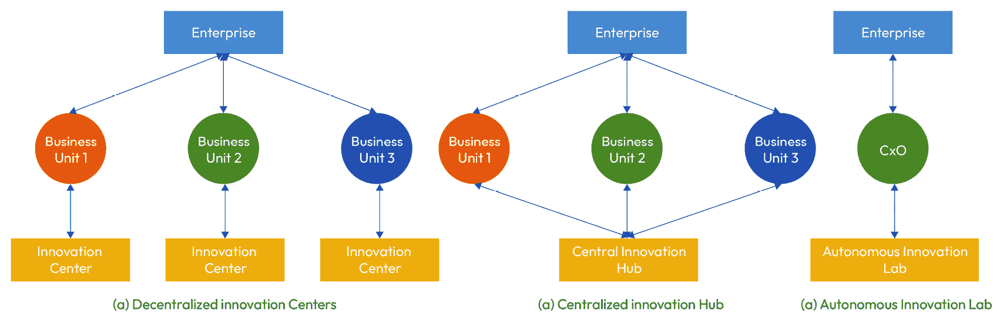
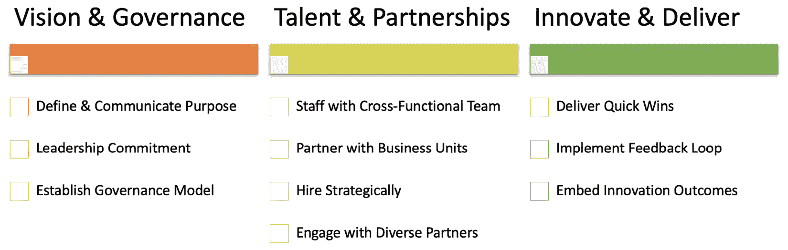

## 10 借助云引领和创新

在数字时代，创新对于企业蓬勃发展和跟上数字进步至关重要。除了利用云获得 IT 成本优化、可扩展性和运营便利等明显好处外，云计算的真正价值在于将云作为启动平台来推动创新和引领数字颠覆。根据麦肯锡的一项研究，预计云价值的 75%来自推动创新。企业通过创新驱动增长、更快产品开发和超大规模扩展可获得的云价值估计为 7700 亿美元，而通过降低成本和风险可获得的为 4300 亿美元 *\[1\]*。Airbnb、家乐福、Netflix 和 Uber 等公司利用云的力量不仅进行创新，还实现差异化并颠覆各自行业。麦当劳和蒂芙尼等标志性品牌正在重塑自我，以与客户、粉丝和文化建立联系，并利用现代技术的进步。例如，麦当劳发起了一项“粉丝对粉丝”（Fan-to-Fan）活动，借助 TikTok 上的菜单改造趋势，让顾客能够自定义菜单并创造新的食品，随后这些食品将在全国各地的菜单中推出 *\[2\]*。该活动大获成功，因为它凸显了粉丝的创造力，并拉近了麦当劳与消费者的距离。

大多数企业以“直接迁移”（lift-and-shift）方法开启云之旅，以合理化应用。然而，随着企业达到更高水平的云成熟度并努力让技术服务于业务，可以释放更大的价值。正如我们在*第 7 章* *混合云用例* 中讨论的，Capital One 是企业如何在更高云成熟度下进行创新并交付更大业务价值的经典例子。在一个信用卡业务采用一刀切方式且差异化极小的行业中，Capital One 是采用云技术重组其 IT 员工队伍并颠覆信用卡行业的先驱。Capital One 利用云计算快速实验、开发并向消费者部署创新服务。Capital One 通过数字技术改变传统工作方式，坚定不移地聚焦数字化，从根本上颠覆了该行业。

Capital One 推出了 Capital One Labs，其使命是与风险投资家和学者合作，创新和开发数字产品。这对 Capital One 而言是一个改变游戏规则的举措，使其能够在低风险且不影响正在进行项目的情况下，探索和实验现代技术中的新想法。多年来 Capital One Labs 为企业交付价值的关键亮点包括以下内容：

- 2013 年推出 Spark Pay，使商家能够在移动设备上接受客户付款。
- 2014 年，Capital One 推出并试验了咖啡馆风格的分行，为客户提供补充服务，以提高客户忠诚度和亲密度。
- Capital One 早期抓住移动趋势，利用全渠道方法，推出了从移动支付、**近场通信** (**NFC**)、二维码到**点对点** (**P2P**)支付等前沿服务。
- Capital One 拥抱社交媒体，将其作为在线与客户互动、建立品牌知名度和开展定向营销活动的渠道。
- Capital One 挖掘大数据和分析的潜力，为客户提供有针对性的个性化推荐和服务，同时推出 *Purchase Eraser* 和 *Mobile Deals* 等独特服务。Capital One 每年进行超过 80,000 次大数据实验 *\[3\]*。

正如 Capital One 首席技术官 Monique Shivanandan 所说，Capital One Labs 的成功归功于以下几点：“*我们在实验室中汇集技术人员、数据分析师、营销人员、品牌经理和产品经理，以确保我们不仅关注酷炫的技术，还关注创新的产品和服务，以取悦**客户**。*” *\[4\]*

在本章中，我们将探讨企业如何在云中实现颠覆和创新的某些策略，包括以下内容：

- 组织如何通过建立创新**卓越中心** (**CoEs**) 在云中进行创新
- 利用云中的新兴技术进行创新，包括大数据、无服务器、**人工智能** (**AI**)、**扩展现实** (**XR**)、边缘计算、区块链和量子计算
- 负责任地使用新兴技术

## 借助云进行创新

我们很难找到一家企业没有至少一个以创新为宗旨的组织形式。这通常有各种名称——创新中心、创新实验室、研究中心、业务加速器和创新 CoEs。对于在高度监管行业运营或采用传统方法的公司而言，创新中心是一个可以安全地实验和迭代新项目与新技术的地方。这是企业的重要投资领域。然而，许多组织仍难以从这些创新中心获得价值。消费者期望持续上升，满足消费者需求对企业蓬勃发展极为重要。云计算已成为创新和数字颠覆的事实上的中心，涵盖从先进硬件、**人工智能（AI）/机器学习** (**ML**)、XR、边缘计算和**生成式人工智能** (**GenAI**) 到量子计算。

在追求创新的过程中，挫折是不可避免的结果。然而，组织往往投入大量资源，包括旷日持久的实验工作，这使创新过程不可持续。云计算通过提供对尖端技术和资源的按需访问来缓解这一挑战，同时促进快速实验，而无需大量前期投资。

## 为什么创新实验室会陷入困境

以下是创新实验室难以成功并交付价值的一些主要原因：

*   **缺乏与业务优先级的对齐**：在某些情况下，创新中心的建立模式没有明确的战略与组织的业务优先级保持一致。
*   **缺乏治理**：通常情况下，创新实验室没有明确的流程或治理机制，以便将漏斗顶端的实验精简并推进到下一个合乎逻辑的步骤。
*   **眼光放得太远**：创新中心犯下的一个滔天大罪是拥有极具野心但过于超前的未来思维，这可能导致不切实际的期望。
*   **脱离现实**：通常情况下，创新实验室——尤其是当它们被自主或去中心化地建立时——会导致孤岛式的实验，从而脱离真实的消费者需求。
*   **缺乏关键绩效指标 (KPI) / 度量标准**：并非所有实验都必须产出结果或成功。然而，缺乏 KPI 和度量标准来跟踪创新实验室的绩效和结果可能是灾难性的。与领导层和利益相关者共同明确界定清晰、有形的**投资回报率 (ROI)** 至关重要。

## 建立创新实验室

创新中心为企业提供了探索、构思、实验和实现市场颠覆的空间。创新中心的核心目标是通过重新思考客户体验、提高运营效率，并利用现代技术测试新商业模式，从而加速数字化创新。创新中心还能帮助企业紧跟市场上最新的数字化进步和即将到来的技术。没有通用的方法来启动创新计划，因为每个企业都是独特的。一些组织可能选择投资于中心化的数字实验室，而另一些可能选择以去中心化的方式拥有较小的指导小组。建立专门的创新中心或实验室可以为企业带来一系列有形和无形的收益。例如，凭借对创新坚定不移的关注，实验室可以成为新想法的源泉，在探索和实验的同时加快创新速度。从无形方面来看，专门的创新实验室展示了组织的关注度和投入，这往往能吸引顶尖人才，增强企业的冒险能力，并培养积极的创新文化循环。更重要的是，创新实验室赋予企业初创公司般的优势——快速实验和发布。根据创新的重点不同，创新实验室可以建立为中心化、去中心化或自主式。在建立创新实验室时，企业必须对其有明确的目的和愿景。下图展示了组织可以根据愿景利用的各种创新实验室架构：

图 10.1 – 创新实验室模型

让我们看看这些模型各自的含义：

*   **去中心化创新中心**：在该模型中，企业内部的各个**业务单元 (BU)** 为各自的创新实验室提供资金。该模型的一个主要优势是创新实验室离 BU 更近，因此能与业务需求保持同步。但是，必须注意不要在创新实验室之间模仿、复制或重复工作，从而导致时间、精力和成本的浪费。该模型还可能在整体治理、资金和管理方面引入一些复杂性。
*   **中心化创新枢纽**：中心化的数字创新枢纽通常能为其运营提供更好的控制和治理。它还充当跨多个 BU 的中心化技术聚焦型实验室。
*   **自主创新实验室**：自主创新实验室通常向一位 CXO 汇报，往往带有明确的使命，基本独立运作。自主创新中心可以与中心化或去中心化创新实验室共存，其特定目的通常是截然不同的。例如，自主创新中心可以帮助企业探索更新的市场或新的商业模式。

无论采用哪种模型，组织都必须考虑以下屏幕截图所示的一些关键因素，以确保创新实验室为业务提供持续的长期价值：

图 10.2 – 创新实验室支柱

让我们详细探讨创新实验室的支柱。

## 愿景与治理

明确的愿景为创新实验室提供指导性目的，并定义了实验室存在的原因及其旨在实现的目标。愿景作为战略决策的指南针，帮助实验室确定项目优先级、分配资源并做出正确选择。这一总体目标有助于将活动和举措与企业的共同目标对齐。治理结构常被忽视，但有助于资源、资金、人才和时间的有效分配。治理框架在管理与创新项目相关的风险方面发挥着关键作用。它们支持对潜在失败影响的评估、风险缓解策略的实施，以及营造一个在最大限度减少不利结果的同时鼓励实验的环境。定义绩效指标有助于评估和衡量创新的影响。在利用现代技术进行创新时，围绕道德考量建立治理也很重要，以确保项目遵守道德标准、数据隐私法规以及其他法律和道德准则。让我们探讨*愿景与治理*支柱的关键组成部分：

*   **定义并传达目的**：为创新中心定义清晰的目的和重点至关重要。这将作为创新实验室的北极星，确保其专注于正确的业务优先级。这也将防止创新实验室挑选没有合乎逻辑的业务成果的极度未来主义项目，或陷入常规项目中。
*   **领导层承诺**：为了培养创新文化，远见卓识的领导和认同对长期成功至关重要。创新理想情况下应自上而下驱动，领导者为创新实验室提供资金和培育，并成为组织内部举措的倡导者，这至关重要。高管赞助和参与是创新中心成功的基石。
*   **建立治理模式**：在人员、流程和技术方面建立中心化治理模式，是创新实验室另一个极其关键的基础要素。治理框架有助于确保创新实验室高效运行并最大化其影响力。例如，在涉及 AI/ML 的现代技术实验中，这极其关键，因为管理不善或不受控的推出和采用可能对组织的道德运营和品牌声誉构成重大风险。

## 人才与合作伙伴关系

## 人才与合作伙伴关系

从人员角度来看，拥有一流的人才库和建立战略合作伙伴关系在创新实验室的成功和可持续发展中发挥着至关重要的作用。有才华的个人为实验室带来创造力和创新思维，且通常具备创业思维，这对于推动创新至关重要。这种思维包含勇于承担风险、从失败中学习，以及追求能带来积极成果的机会。创新需要持续学习和适应。他们多样化的技能组合和视角有助于产生新颖的想法和解决方案。与各类实体建立战略合作伙伴关系——从学术界高校、积极参与开源社区项目，到科技初创企业和超大规模云服务商——能够获得外部资源、专业知识和机会，从而显著增强实验室的创新能力。让我们探讨**人才与合作伙伴关系**支柱的关键组成部分：

### 配备跨职能团队

拥有跨职能专家的多元化团队是创新的强大催化剂。在多元化团队中，成员带来独特的背景、文化洞察和方法，挑战传统思维，激发更广泛的想法。多元化团队更有能力理解并满足广泛的最终用户需求，确保创新产品和服务更具包容性，并反映全球受众的多样化需求。多元人才的协同效应还能促进开放和适应性的文化，这些是在动态创新环境中导航的关键要素。

### 与业务单元合作

创新实验室面临的主要风险之一是孤岛式运作，这可能导致实验室的关注点偏离业务优先级。让业务利益相关者密切参与创新实验室，以选择、界定范围并执行创新项目，这至关重要。通过与业务单元紧密合作，创新中心可以深入了解组织面临的具体业务挑战、市场动态和客户期望。这种直接联系确保创新解决方案不是在孤立环境中开发的，而是建立在对业务背景的深刻理解之上。与业务单元的合作可以形成共生关系，促进跨职能协作文化，打破孤岛，鼓励组织不同部门间的思想交流。

### 战略性招聘

战略性招聘是在组织内培育创新环境的关键。这要求创新中心战略性地招募人才，不仅寻找具备必要技术技能的个人，还要寻找带来多元视角、创造性思维和解决问题激情的人才。战略性招聘还有助于识别表现出创业思维、适应性和拥抱变化意愿的候选人——这些是在动态创新环境中必不可少的素质。

### 与多元合作伙伴互动

建立战略合作伙伴关系使创新实验室能够融入更广泛的生态系统，如行业网络、研究机构和初创社区，培育支持持续创新的协作环境。例如，通过与学术机构合作，企业可以获得前沿研究、新兴技术以及各领域尖端人才库。这种合作促进了学术洞察向实际应用的转化，加速了创新解决方案的开发。同时，大学能从现实的行业挑战中受益，为学生和研究人员提供在实际环境中应用理论知识的机会。与超大规模云服务商合作，使企业能够获得尖端技术、可扩展基础设施，以及大量基于云的服务和技术人才。这种合作使企业能够利用超大规模云服务商的先进能力，如 AI、ML 和大数据分析，从而更高效地解决复杂问题并进行创新。此外，企业还能从超大规模云服务商的全球覆盖和可靠性中受益，为其数字化计划确保稳健安全的基础。在更成熟的模式中，组织与开放社区合作，同时也向社区贡献回馈。一些现代技术进步是精通技术的组织的创新实验室的成果。

## 创新与交付

创新实验室的核心在于实验和交付尖端技术解决方案，这些方案能带来增量业务价值并颠覆市场。该支柱对于展示价值和兑现创新实验室的核心承诺至关重要。让我们回顾**创新与交付**支柱的核心构成要素：

### 交付快速成果

由于创新中心通常倾向于从事周期较长的项目，因此向业务单元交付快速成果和增量价值也非常重要。领先的创新中心拥有短期和长期使命，并被设计为以速度和灵活性运作，使团队能够快速制作原型、测试和迭代新想法。通过专注于短期可实现的目标，创新实验室可以交付有形成果，向业务展示即时价值。快速成果不仅证明了创新解决方案的可行性和影响力，还在利益相关者中产生了动力和热情。

### 实施反馈循环

创新中心依靠实验和试错迭代过程蓬勃发展。然而，为了优化资源分配并最大化影响力，战略性地优先考虑最可行、最可行的项目至关重要。同样重要的是终止那些被证明不可行或无法增加价值的项目和计划。创新实验室必须在业务单元内建立强大的反馈循环，培育持续改进和优化的循环。通过积极与利益相关者、客户和最终用户互动，创新实验室收集关于原型、概念和初步实施的宝贵见解和反馈。组织可以采用 A/B 测试和金丝雀发布等实践，更快地向市场推出新功能，并通过分析反馈数据，在风险大幅降低的情况下做出最佳决策。这一迭代过程有助于识别优势、劣势和改进领域，并确保创新实验室能够快速迭代想法，根据现实世界的输入进行优化。建立反馈循环不仅仅是一个技术过程；它是一种文化转变，促进开放、协作和持续改进的承诺，将创新实验室定位为组织内创新的动态枢纽。

### 内化创新成果

当创新中心成功地将其创新实践传播到其直接边界之外，并深度融入各个业务单元和职能中，而不是作为独立项目存在时，它就达到了最高成熟度。其中一种方法是成为知识中心，向各部门团队提供培训计划、资源和专业知识，以标准化和制度化成功的方法。这不仅简化了运营，还培育了围绕创新的共同语言和思维，使整个组织能够以敏捷和高效的方式应对挑战并抓住机遇。

创新并非一种放之四海而皆准的方法，必须根据组织的基因独特地定义。随着技术的指数级演进，创新实验室帮助企业跟上市场需求，更重要的是，帮助它们避免被淘汰。云计算让各种规模的企业都能平等地获取新兴技术，使得中小企业或初创公司能够向市场提供新功能或新能力，而这在过去需要大型企业投入数年的时间、经验和精力。在接下来的几节中，我们将回顾企业利用云通过新兴技术进行创新的一些方式。

# 利用大数据和无服务器进行创新

数字技术的融合、连接设备的扩展以及数据类型日益增长的复杂性，共同推动了当今企业数据的指数级演变。连接设备、物联网、社交媒体、点击流数据、日志以及多媒体丰富型应用的激增，加剧了数据生成的多样性和数量。根据《哈佛商业评论》（`HBR`）的一项研究，组织用于商业决策的结构化数据不足 50%，而非结构化数据甚至只有不到 1% 被利用 [5]。以下方面定义了大数据——也通过 7-V 模型 [6] 进行描述：

1. `Variety`（多样性）：指跨多种格式（结构化、半结构化和非结构化）的数据源和数据的多样性
2. `Volume`（容量）：这是区分大数据的主要因素，涉及跨交易、文件、信号和事件不断增长的数据量
3. `Velocity`（速度）：数据在批处理和实时流中被处理、访问和分析的速度
4. `Veracity`（真实性/准确性）：定义系统中数据的质量、准确性和可信度
5. `Value`（价值）：大数据的 ROI 和价值
6. `Variability`（可变性）：指在上下文中分析数据以预测基于上下文结果的能力
7. `Visibility`（可视化）：以有意义的方式为多种角色呈现数据

随着云技术的进步持续降低收集海量数据集、可扩展存储和实时数据处理的门槛，且投资显著降低，无服务器数据处理、实时流式传输以及用于预测分析的 AI/ML 等新兴技术有助于释放巨大的商业机会。在以下章节中，让我们看看各行各业的企业是如何利用大数据和新兴技术的力量进行创新的。

## 银行与金融服务

大数据在银行和金融服务领域发挥着极其重要的作用，并彻底改变了银行业务。通过利用大型数据集，公司可以深入洞察客户行为、优化运营、管理合规性、降低成本并改善客户体验。以下是大数据的一些创新用途：

* `Fraud detection`（欺诈检测）：银行利用基于 AI 和 ML 的大数据分析，通过在事件发生前分析模式来识别和标记洗钱或身份盗窃等可疑活动。
* `Risk management`（风险管理）：凭借海量历史市场数据，金融机构可以利用预测分析模型更好地评估与投资和贷款相关的风险。预测分析有助于建模和评估信用风险，提高信用评分和贷款决策的准确性。
* `Robo advisors and algorithmic trading`（机器人顾问和算法交易）：金融机构利用大数据和 ML 算法进行算法交易，实时分析市场数据并做出毫秒级交易决策，优化投资策略。这也帮助投资组合经理评估广泛因素，以制定资产配置策略和多元化技术。
* `Regulatory compliance`（合规监管）：利用增强了 AI/ML 的大数据分析，金融机构可以确保遵守复杂的监管要求，如合规报告、文档记录和监控活动，以符合金融法规。
* `Cybersecurity`（网络安全）：面对日益增长的网络安全威胁，不断演进的高级分析有助于实时检测和响应网络安全威胁，保护敏感财务数据。

## 零售

数据是零售业的基石，因为零售商可以利用大量第一方和第三方数据来推动创新。以下是零售商利用大数据进行创新的方式：

* `Customer segmentation and personalization`（客户细分与个性化）：零售商利用大数据分析，根据客户的偏好、行为和购买历史对其进行细分。这支持个性化营销活动、产品推荐和定向促销，从而带来更定制化、更具吸引力的消费者购物体验。
* `Demand forecasting`（需求预测）：大数据分析通过分析历史销售数据、市场趋势和外部因素，帮助预测客户需求并优化库存水平。准确的需求预测至关重要，可直接影响零售商的利润，帮助做出更准确的库存决策，减少缺货和积压情况。
* `Dynamic price optimization`（动态价格优化）：零售商可以利用大数据洞察，根据需求、竞争对手定价和市场状况等因素动态调整价格。动态定价策略有助于优化收入、最大化竞争力，并实时响应市场变化。
* `Supply chain visibility`（供应链可视性）：大数据为零售商提供了供应链的端到端可视性。这包括跟踪货物流动、监控供应商绩效和识别潜在中断。改进的供应链可视性提高了效率、降低了成本，并确保运营更顺畅。
* `Fraud detection and prevention`（欺诈检测与预防）：大数据分析有助于检测欺诈活动并防止因盗窃和其他可疑活动造成的损失。高级分析模型分析模式以识别交易中的异常，降低欺诈风险。
* `Sentiment analysis`（`SA`，情感分析）：零售商利用大数据分析监控社交媒体，洞察客户情绪、偏好和趋势。这些信息有助于制定营销策略、了解品牌认知并与社交平台上的客户互动。
* `In-store analytics`（店内分析）：大数据分析应用于店内数据，包括客流模式、停留时间和热力图。这些信息可用于优化店铺布局、改进产品陈列并提升整体店内体验。

## 医疗保健

在医疗保健行业，企业正利用大数据推动创新、提升患者护理水平、提高运营效率并促进医学研究。以下是企业在医疗保健领域利用大数据进行创新的方式：

* `Predictive analytics for disease prevention`（用于疾病预防的预测分析）：通过分析包括患者记录、环境因素和人口健康数据在内的大型数据集，医疗保健组织可以识别可能预示潜在疾病爆发的模式和趋势，从而采取主动预防措施。
* `Clinical decision support systems`（`CDSS`，临床决策支持系统）：分析海量患者数据有助于创建 `decision support systems`（`DSS`，决策支持系统），为个性化治疗方案、药物推荐和诊断洞察提供支持。
* `Population health management`（人群健康管理）：通过识别高风险人群、监测健康趋势和优化预防性护理策略，人群健康管理改善了总体人口的整体医疗保健结果。

- **电子健康记录（EHR）分析**：企业利用大数据分析从 EHR 中提取有价值的见解。这包括识别患者人口统计数据、治疗结果和疾病模式的趋势，使医疗服务提供者能够做出明智的决策并改善患者护理。

- **基因组数据分析**：大数据在用于个性化医疗的基因组数据分析中发挥着关键作用。通过大规模检查遗传信息，医疗组织可以识别基因标记、理解疾病易感性，并根据个体患者的遗传特征制定治疗方案。

- **实时患者监测**：大数据促进了实时患者监测，特别是针对慢性病患者的监测。连接设备和可穿戴设备收集连续的健康数据流，使医疗服务提供者能够远程监测患者、识别潜在问题并主动干预。

- **患者参与度与行为分析**：大数据分析被应用于理解患者行为和参与模式。通过分析患者与医疗应用程序、网站和教育材料的互动，医疗服务提供者可以定制参与度策略并提高患者对治疗方案的依从性。

在回顾了各行业如何创新利用大数据和基于云的无服务器技术来推进业务目标后，让我们探索企业如何利用人工智能进行创新。

# 在企业中嵌入人工智能

人工智能正在改变各行各业的企業，带来了在业务运营、决策制定和与客户互动方式上的变革性变化。随着 AI 从芯片到应用程序全面嵌入 IT 资产中，AI/ML 的应用已成为增强决策制定、自动化重复任务、个性化客户体验、欺诈检测与预防、客户体验分析以及供应链优化不可或缺的一部分。根据国际数据公司（IDC）的一项研究，全球在 AI 上的支出预计将超过 3010 亿美元。云计算使 AI 的使用和应用在整个范围内得以普及——从提供专用 GPU 和 TPU，到运行可按需使用、付费使用模式的 AI 模型，提供预建 AI 模型的 API，**自动化机器学习**（**AutoML**），以及 AI SDK。此外，生成式 AI 的出现正在革新创造力，并证明正在改变企业的运营方式。

以下是企业利用人工智能进行创新的几种方式：

- **AI 支持的 API 和 SDK**：利用预建 AI 模型和 SDK，开发人员可以迅速将 AI 能力（如**自然语言处理**（**NLP**）、图像识别和客户体验分析等）集成到应用程序中。例如，应用程序开发人员现在可以直接将 ML 模型嵌入应用程序中，以实现实时决策、个性化推荐和预测分析等功能。

- **聊天机器人和虚拟助手**：由 AI 驱动的聊天机器人和虚拟助手被集成到应用程序中，以增强客户互动和支持服务。这些应用程序利用 NLP 来理解用户查询和意图，并提供相关的响应或协助。

- **融入 AI 的安全**：AI 在增强企业安全方面发挥着关键作用，提供威胁检测、预防和响应的高级功能。从智能身份验证和访问控制到行为分析和恶意软件检测，AI 技术增强了企业的网络安全态势，为日益复杂的网络攻击提供了强大且自适应的防御。AI 驱动的安全系统利用 ML 算法分析海量数据集，识别表明恶意活动的模式，并实时检测异常，从而对网络威胁提供主动防御。

- **IT 运营**：AI 通过引入智能自动化、提高效率并实现主动管理，正在改变 IT 运营。从用于问题预防的预测分析、智能**事件管理**（**IM**）、容量规划、自动化故障排除、修复和优化到，AI 的应用正在提高 IT 流程的整体效率，同时也有助于构建更具弹性和响应能力的 IT 基础设施。

- **员工生产力**：AI 被整合到员工生产力工具中，以增强协作、自动化行政任务并简化工作流程。这包括智能日程安排、文档摘要和自动化数据输入等功能。

各行各业的企業正在利用 AI 的力量进行创新并引入新的功能，如下所述：

- **金融服务**：在金融服务领域，AI 的创新应用正在颠覆传统做法并重塑行业。AI 驱动的欺诈检测**威胁情报**（**TI**）系统分析海量数据集和交易，以实时识别表明欺诈活动的异常模式；基于 AI 的机器人顾问正在改变财富管理，提供根据个人偏好和风险特征量身定制的算法驱动投资建议；信贷评分和承保过程受益于预测分析，使金融机构能够做出更准确的贷款决策；由 NLP 驱动的聊天机器人和虚拟助手有助于增强客户互动、提供个性化支持、解答查询，甚至促进交易。

- **零售业**：在零售业，AI 正在推动运营、客户体验和供应链管理各个方面的创新。AI 正在实现创新零售体验，包括个性化购物推荐、视觉搜索、动态定价优化、智能需求预测、客户流失预测、微库存管理、用于试穿体验的**增强现实**（**AR**）、客户体验分析、自动化货架检查和缩减损失。

- **制造业**：AI 在制造业领域取得了重大进展，引入了提高效率、生产力和整体运营绩效的创新应用。AI 的应用正在使现代用例成为可能，包括预测性维护、**质量控制**（**QC**）、**机器人流程自动化**（**RPA**）、用于仿真的数字孪生、协作机器人、AI 驱动的维护调度和增材制造工艺。

- **医疗保健**：AI 正在为医疗行业带来变革性变化，提供创新解决方案以改善患者护理、增强诊断并简化运营。AI 的一些显著进步包括诊断成像、患者结果的预测分析、药物发现与开发、虚拟健康助手、远程患者监测、临床文档记录、基因组数据分析以及药物依从性管理。

# 生成式 AI

生成式 AI 正在作为 AI 技术的变革性分支而出现，在各行业的创新边界上不断突破。通过其自主创造新颖内容、音频、图像、视频甚至模拟人类创造力的完整虚拟环境的能力，生成式 AI 正在释放前所未有的机会。与分析和解释数据的传统 AI 系统不同，生成式 AI 基于从训练数据中学习的模式生成新内容。这主要通过**深度学习**（**DL**）模型（如**生成对抗网络**（**GANs**）、**变分自编码器**（**VAEs**）和基于 Transformer 的架构（如**生成式预训练 Transformer**（**GPT**））来实现。随着生成式 AI 的不断演变，其对行业垂直领域的影响预计将不断增长，在数字时代释放新的可能性并推动创新。以下是生成式 AI 在各行业的一些创新应用：

# 生成式 AI（GenAI）

## 医疗保健

在医疗保健领域，GenAI 正在推动医学图像合成、药物发现和个性化治疗方案制定。研究人员可以利用生成模型生成合成医学图像，用于训练诊断算法和模拟医疗场景。此外，GenAI 还有潜力通过加速新分子的设计与合成来推动药物发现的进步，并帮助汇总临床记录，使医疗服务提供者能够及时获取关键健康信息。

## 金融服务

借助 GenAI 的力量，投资顾问可以从新闻、分析师报告和年度报告等公开信息中生成有意义且可操作的洞察。金融机构可以利用 GenAI 生成合成金融数据，用于训练预测模型和模拟市场情景，从而实现更精准的风险管理和投资策略。GenAI 还被应用于金融文档合成，对大量金融文档进行搜索、整合和摘要，以加快文档处理速度。

## 零售

在竞争激烈的零售领域，GenAI 正在帮助零售商重新构想客户体验。通过引导式、定制化和个性化的购物体验与消费者互动，零售商有望在提高客户满意度的同时提升转化率。零售商可以生成个性化产品配置，并根据客户的规格和偏好提供可定制产品及设计服务。通过部署由 GenAI 驱动的虚拟个人购物助手，帮助顾客根据其偏好、预算和风格寻找产品，零售商可以利用 NLP 和**计算机视觉**（**CV**）技术理解客户查询并推荐相关产品，从而在店内和线上提供个性化购物体验。零售商还可以利用 GenAI 自动创建营销活动和产品目录的引人注目的内容，通过生成与目标受众产生共鸣的文本、图像、音频和视频，提升参与度和品牌知名度。

## 媒体与娱乐

在娱乐行业，GenAI 正在彻底改变内容创作。它能够为电影、电子游戏和**虚拟现实**（**VR**）体验自动生成剧本、音乐和视觉效果。它为创作者释放创造力，帮助他们产生新颖的想法、创作音乐和打造惊艳的视觉效果。通过自动化重复性任务，它使创作者得以解放出来，专注于更高层次的概念构思和探索。

## 制造业

GenAI 正成为一项通过设计更高效的组件和减少浪费来优化制造流程的技术。例如，它支持创建数字孪生——真实世界系统的虚拟表示，从而改进质量控制。通过自动化设计任务，GenAI 可以加速产品开发周期并促进创新。

## 营销与广告

GenAI 在营销和广告活动中发挥着至关重要的作用，能够以前所未有的速度和规模创作引人入胜的内容，包括广告、产品描述和促销材料。品牌可以利用生成模型生成针对个体消费者的个性化营销活动，从而提高参与度和转化率。

# XR（扩展现实）

XR 是涵盖 AR、VR 和**混合现实**（**MR**）的总称。XR 体验通过技术增强或叠加虚拟世界来改变现实，从而创造沉浸式用户体验*\[7\]*。XR 正在从根本上改变多个行业的交互式和沉浸式客户体验。以下是 XR 在各行业垂直领域的一些创新应用：

## 娱乐与游戏

娱乐和游戏可能是 VR 和 AR 最为人熟知的应用。XR 根据情境将玩家置于虚拟体验的中心——从现场音乐活动、体育赛事到奇幻世界，提供沉浸式游戏体验。

## 制造业

在工程和制造领域，拥有熟练的劳动力至关重要。针对复杂工程任务和危险设备的培训资源往往昂贵且耗时。XR 工具通过降低成本、防止伤害提供了一种解决方案，因此成为有价值的投资。在那些某些制造功能本身可能具有危险性的领域，AR 提供了一种解决方案，使工人能够在安全距离外执行这些任务。一个例子是**计算机辅助设计**（**CAD**），设计师和客户可以在绘图时沉浸于真实比例的模型中，从而实现对设计空间更深入的探索。

## 零售与消费品（CPG）

AR 和 VR 有潜力为店内和线上的购物者提供沉浸式、个性化的购物体验。例如，店内购物者可以在多种环境中可视化和体验商品，尤其是在复杂或引导式销售体验中。AR 还在帮助线上购物者更接近实体体验，同时被证明可以减少产品退货。XR 和 3D 技术正在增强消费者的线上购买信心。

## 医疗保健

XR 正在推动技术在医疗保健领域的创新应用，包括远程患者监测、定制化康复计划、药物试验模拟、外科培训和协作。XR 的一个应用是医学成像，它使医疗专业人员能够将传统的二维图像以三维形式可视化和呈现，从而进行更快、更准确的诊断。XR 的另一个典型例子是外科培训，它帮助外科医生练习复杂手术并开发新的手术技术，而无需冒生命危险。

## 教育与学习

教育机构和企业学习环境可以提供 AR 和 VR，通过虚拟实地考察、历史重现和交互式教学模块带来沉浸式学习体验，增强参与度和理解力。XR 已被证明能够提升培训速度、参与度和知识保留率。AR 让学习者无需教室即可获得动手实践的真实世界体验，，包括游戏化教学——让课程变得趣味盎然，并进一步提升学习效果。

# 边缘计算

各行业的企业正在利用边缘计算的潜力推动创新。边缘计算在更靠近数据生成源头的位置处理数据，从而降低延迟、改善实时决策，同时减少将信号和事件数据传输到集中位置进行处理的需求。随着分布式云边缘计算的发展，边缘计算的采用在塑造去中心化和智能计算架构的未来方面发挥着重要作用。边缘计算还通过在本地处理敏感数据来增强安全性和隐私性。以下是边缘计算的一些创新应用：

## 物联网（IoT）

在物联网领域，边缘计算解决了管理大量生成数据的设备的挑战。通过在边缘处理数据，企业可以减轻集中式云服务器的负载，并提高物联网应用的效率。这在带宽有限或需要实时响应的场景中尤为关键。例如，零售场所可以处理摄像头、销售点（POS）和传感器捕获的实时数据，以减少损耗。

- **实时分析与洞察**：边缘计算有助于实时数据处理和分析，使企业无需承受将数据发送至集中式服务器所带来的延迟，即可提取有价值的洞察。这在金融等行业至关重要，因为分秒必争的决策至关重要；在制造业中同样重要，因为即时调整可以优化生产流程。
- **客户互动**：边缘计算可以赋能实时库存管理，使零售商能够高效地跟踪产品和库存水平。它还能通过个性化推荐、实时定制优惠和无人收银结账体验等应用支持客户互动，提升整体购物体验。
- **医疗诊断和监测**：边缘计算通过支持实时诊断和患者监测，正在改变医疗保健行业。配备边缘处理能力的医疗设备和可穿戴设备可以在本地分析健康数据，为医疗专业人员提供及时的洞察，并促进远程患者监测。
- **智能制造**：边缘计算是工业 4.0 计划的基石，赋能智能制造流程。通过在边缘处理数据，制造商可以实现预测性维护、监控设备健康状态并优化生产效率，从而构建更加敏捷、响应迅速的制造生态系统。
- **能源管理与智能电网**：在能源领域，边缘计算被应用于高效管理智能电网。它能够实时监控能源分配、负载均衡以及可再生能源的并网，从而构建更具弹性和响应能力的能源基础设施。
- **边缘到云集成**：企业正在通过将边缘计算与公有云服务集成来进行创新。这种分布式边缘混合架构可实现边缘与云之间的无缝数据流动，既具备本地处理和存储的优势，又拥有云的可扩展性和集中管理能力。

# 区块链

区块链应用超越了加密货币，为数字化转型带来了新的机遇。凭借去中心化网络、不可篡改的记账、智能合约、透明性和可追溯性，区块链正在为各行业的企业赋能创新型应用。以下是区块链在各行业的一些创新应用：

- **供应链管理**：在各行业中，区块链可以增强供应链的透明度和可追溯性。企业可以将每笔交易和货物流动记录在区块链上，形成安全且不可篡改的账本，有助于验证产品真伪、减少欺诈和优化供应链流程。这是区块链一个极其重要的应用，可以增强消费者在购买从时装等高价值商品到农产品等各类商品时的信心。
- **B2B 智能合约**：智能合约是一种自动执行的合约，协议条款直接写入代码中，可以在区块链平台上实现而无需中介。企业利用智能合约来自动化和执行合同协议，减少对中介的需求，并确保业务流程执行中的信任。通过特定行业的区块链联盟，这一过程可以进一步简化。
- **身份管理与凭证认证**：区块链提供了一种安全、去中心化的方式来管理数字身份。企业可以利用区块链进行身份验证、认证和访问管理，以帮助防止身份盗窃、简化入职流程并增强整体安全性。这在医疗保健专业凭证认证中有一个有趣的应用，可以验证真实性。
- **资产代币化**：物理和数字资产的代币化，即在区块链上表示所有权或权利。这可以包括房地产、艺术品、股票或其他资产。代币化提高了流动性，促进了部分所有权，并简化了资产转让。
- **不可篡改的医疗记录**：区块链可用于创建安全且不可篡改的医疗数据记录。患者记录、治疗史和其他医疗信息可以存储在区块链上，确保数据的完整性、可访问性和隐私性。
- **知识产权（IP）与版税**：区块链可用于管理和跟踪知识产权与版税。这确保了创作者因其作品获得公平报酬，并简化了音乐、出版和娱乐等行业中复杂的版税分配流程。
- **食品安全与可追溯性**：在食品行业，区块链可用于通过提供农产品的端到端可追溯性来增强食品安全。供应链中的每一步，从农场到餐桌，都记录在区块链上，能够快速识别问题、追溯产品来源并解决食品安全问题。
- **质量保证（QA）**：区块链可用于记录和验证制造过程中产品的质量。制造过程的每一步都记录在区块链上，提供安全且不可更改的生产记录，这对于质量标准严格的行业尤为重要。

# 量子计算

**量子计算**是新兴技术指数级演进的力证。随着技术突破不断加速，谷歌等超大规模云服务商以及 IBM、D-Wave 等公司已经推出了商业云服务（**量子即服务**或 **QaaS**）。尽管这一领域尚属小众，但潜力无限，能够帮助推动多个科学技术领域达到曾经被认为不可能实现的里程碑。例如，在谷歌的一项实验中，其 70 量子比特量子计算机可以在瞬间完成一项任务，而这项任务通常需要世界上最快的超级计算机耗时 47 年才能完成*\[8\]*。在可预见的未来，随着量子计算技术的发展，**高性能计算**（**HPC**）将在云领域发挥更重要的作用。这是另一个经典例子，展示了云的规模经济和无止境的创新如何塑造企业运营的未来，因为 QaaS 模式将为企业带来最大价值。

麦肯锡的一项研究估计，到 2035 年，制药、化工、汽车和金融行业企业的保守估值将高达近 7000 亿美元*\[9\]*。在制药领域，药物发现、研究和开发通常需要数年时间才能取得成果，同时耗费数十亿美元。量子计算可能成为颠覆者，能够加快研发流程和临床供应链。同样，在化工和汽车行业，即使研发、生产和供应链优化方面的改进比例很小，也能带来数十亿美元的节省，同时提高整体效率。

# 新兴技术的负责任使用

负责任地利用新兴技术对企业至关重要，这有助于确保道德实践和合规性、建立客户对品牌的信任，并赢得利益相关者的信任。随着企业不断采用新兴技术，确保这些技术得到负责任的使用极为重要。负责任的技术采用不仅能降低技术采用风险，还能使企业在不断演变的数字化格局中成为道德领导者。以下是企业可以采用的负责任地利用新兴技术的原则：

- **伦理考量**：在新兴技术的开发和部署中优先考虑伦理问题。建立伦理指南和框架以指导决策，解决隐私、透明度、偏见和公平等问题。
- **法规遵从**：及时了解行业内和运营地区与新兴技术相关的法律法规。确保技术的实施符合数据保护、安全及其他监管要求。
- **数据隐私与安全**：在企业范围内将数据隐私和安全作为首要原则，实施强有力的措施保护敏感信息。采用加密、安全访问控制和数据匿名化技术来保护用户数据并维护机密性。
- **促进透明度**：通过清晰传达新兴技术的使用方式及目的，促进其使用过程中的透明度。在组织内建立问责机制，确保与技术采用相关的负责任使用和决策。
- **多元化与包容性**：在新兴技术的开发和部署中促进多元化和包容性。确保考虑多元化视角，以减少偏见并增强技术解决方案的包容性。
- **以人为本的设计方法**：采用以人为本的设计方法，优先考虑最终用户的福祉和体验。考虑技术的社会影响，努力创造增强人类生活并最大限度减少负面影响的解决方案。
- **负责任的人工智能实践**：在利用人工智能时，遵循负责任的人工智能实践。实施治理措施以解决偏见、确保可解释性，并监控人工智能系统以防意外后果。为人工智能决策建立治理框架。
- **教育与培训**：为员工提供教育和培训计划，提高他们对负责任技术使用的认识。培养合乎伦理的决策文化，并赋予团队应对伦理挑战所需的知识和技能。
- **可持续性**：考虑新兴技术对环境的影响。努力采用可持续实践，尽量减少技术部署相关的生态足迹，尤其是在云计算和数据中心等领域。

# 本章小结

在本章中，我们讨论了创新的重要性，以及企业如何利用云领域的新兴技术来引领、颠覆和创新。我们探讨了组织可以利用的各种创新实验室，以建立其创新卓越中心（CoE）。我们还探讨了创新中心的三大支柱，它们作为指导原则，确保创新中心能够为企业持续提供长期价值。

我们接着讨论了云原生大数据与无服务器技术的融合如何在各个行业的企业应用和数据生态系统现代化中发挥核心作用。最后，我们探讨了人工智能（AI）、生成式人工智能（GenAI）、扩展现实（XR）、区块链和量子计算等各种新兴技术在行业背景下的作用，以及企业如何在云中进行负责任的创新。

在下一章中，我们将探讨 ESG 标准和可持续性对现代企业的重要性，以及企业如何利用云计算作为实现 ESG 目标的驱动力。

# 延伸阅读

要了解本章涵盖主题的更多信息，请参阅以下参考资料：

1. [`www.mckinsey.com/capabilities/mckinsey-digital/our-insights/five-fifty-cloudy-with-a-chance-of-billions`](https://www.mckinsey.com/capabilities/mckinsey-digital/our-insights/five-fifty-cloudy-with-a-chance-of-billions)
2. [`www.fastcompany.com/90850282/mcdonalds-marketing-cultural-moments-addictive-fries`](https://www.fastcompany.com/90850282/mcdonalds-marketing-cultural-moments-addictive-fries)
3. [`www.sogeti.com/globalassets/uk/reports/sogetiuk\_vint4\_your\_big\_data\_potential\_wp.pdf`](https://www.sogeti.com/globalassets/uk/reports/sogetiuk_vint4_your_big_data_potential_wp.pdf)
4. [`www.computerworld.com/article/2711618/how-enterprise-it-gets-creative.html`](https://www.computerworld.com/article/2711618/how-enterprise-it-gets-creative.html)
5. [`hbr.org/webinar/2017/04/whats-your-data-strategy`](https://hbr.org/webinar/2017/04/whats-your-data-strategy)
6. [`www.researchgate.net/figure/The-7Vs-of-Big-Data-Volume-Velocity-Variety-Variability-Veracity-Value-and\_fig1\_341622174#:~:text=by%20Virginia%20Niculescu-,The%207Vs%20of%20Big%20Data%3A%20Volume%2C%20Velocity%2C%20Variety%2C,%2C%20Veracity%2C%20Value%2C%20and%20Visibility`](https://www.researchgate.net/figure/The-7Vs-of-Big-Data-Volume-Velocity-Variety-Variability-Veracity-Value-and_fig1_341622174#:~:text=by%20Virginia%20Niculescu-,The%207Vs%20of%20Big%20Data%3A%20Volume%2C%20Velocity%2C%20Variety%2C,%2C%20Veracity%2C%20Value%2C%20and%20Valu)
7. [`channellife.com.au/story/ar-vr-and-3d-tech-boost-consumer-confidence-in-online-purchases-report`](https://channellife.com.au/story/ar-vr-and-3d-tech-boost-consumer-confidence-in-online-purchases-report)
8. [`www.earth.com/news/quantum-computer-can-instantly-execute-a-task-that-would-normally-take-47-years/`](https://www.earth.com/news/quantum-computer-can-instantly-execute-a-task-that-would-normally-take-47-years/)
9. [`www.mckinsey.com/capabilities/mckinsey-digital/our-insights/quantum-computing-use-cases-are-getting-real-what-you-need-to-know`](https://www.mckinsey.com/capabilities/mckinsey-digital/our-insights/quantum-computing-use-cases-are-getting-real-what-you-need-to-know)
