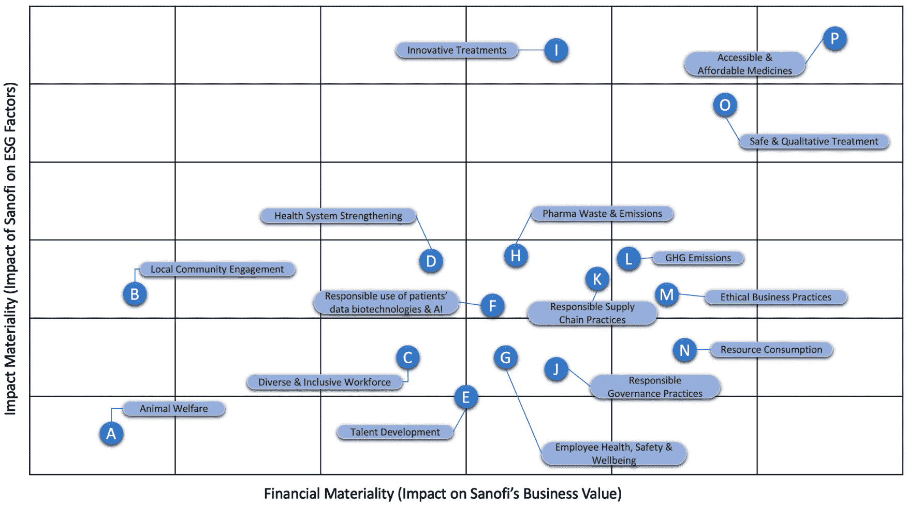
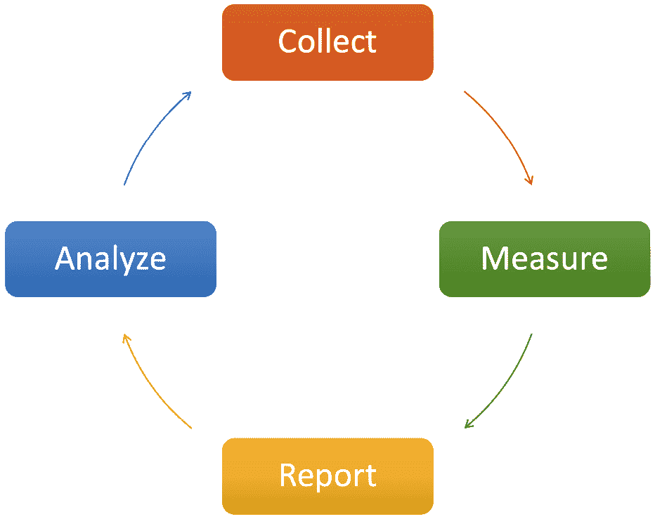

## 11 ESG 与可持续发展

**联合国气候变化大会**（**COP28**）在迪拜闭幕，达成了一项协议，标志着化石燃料时代*结束的开始*，该协议通过深度减排和扩大融资，推动向可再生能源进行公正公平的过渡*[1]*。**ESG**代表**环境、社会和治理**，包含一套用于衡量公司运营的可持续性和道德影响的标准。随着 ESG 原则在各行各业的重要性日益凸显，它们不仅是锦上添花，更已成为企业蓬勃发展的核心必需品。由于利益相关者的期望、监管压力、竞争优势以及企业对应对全球挑战所起作用更广泛认知的汇合，可持续发展已成为各行业首席执行官的关键目标。随着首席执行官将可持续发展列为优先事项，企业不仅是在应对外部压力，也在认识到可持续实践为组织带来的战略价值和长期生存能力。

全球范围内，涉及气候披露、供应链尽职调查、**多元、公平与包容**（**DEI**）以及制造业和循环经济等广泛主题的可持续发展和 ESG（环境、社会和公司治理）相关立法与法规正在日益增多。例如，2022 年，美国**证券交易委员会**（**SEC**）提出了一项规则提案，旨在增强并规范公共公司提供的气候披露要求。根据新规定，各组织必须在注册文件和年度报告中提供具体的气候相关信息披露，包括与气候相关财务影响和支出相关的基本指标。作为旨在成为首个气候中和大洲的《欧洲绿色协议》的一部分，**欧洲联盟**（**欧盟**）法律要求所有大型企业和所有上市公司披露有关 ESG 的信息 *\[2\]*。随着 ESG 和**企业社会责任**（**CSR**）标准在全球各地区不断演进，例如**欧洲可持续发展报告标准**（**ESRS**）、**国际可持续发展准则理事会**（**ISSB**）以及**自然相关财务披露工作组**（**TNFD**），在多个地区开展业务的全球组织将需要遵守这些法规。

在本章中，我们将涵盖以下主题：

- ESG 和可持续发展的原则
- ESG 整合对企业产生的价值
- 构建并实施 ESG 报告计划
- 利用云作为 ESG 的赋能者

# ESG 与可持续发展的定义

ESG 指的是投资者和其他利益相关者用于评估一家公司超越其财务绩效之外对地球产生影响的准则集合。将 ESG 考量纳入企业实践的业务利益是多样的，且能对公司运营的各个方面产生积极影响。ESG 原则有助于评估组织运营在可持续性和道德方面的影响。以下是 ESG 各组成部分的详细说明。

## 环境影响

这一维度评估公司如何管理其对环境影响——对气候、生物多样性以及自然资源使用的影响：

- **气候变化**：减少温室气体排放的努力、能源效率以及可再生能源的使用
- **资源使用**：原材料的可持续采购、能源管理、水资源管理、燃料管理以及废物减量
- **生物多样性**：保护生物多样性和生态系统的倡议、减少产品环境影响的努力以及材料采购

## 社会影响

社会维度关注公司与员工、客户、社区和其他利益相关者的关系：

- **员工关系**：在员工健康、安全与福祉方面的努力，实施公平工资、劳动实践、多元与包容
- **社区参与**：社会责任、慈善事业以及对社区发展的贡献
- **客户关系**：产品安全、质量、道德营销、公平广告、公平披露及产品标签
- **人权**：尊重供应链和企业运营中的人权

## 公司治理

治理考察指导组织的系统和结构，包括其领导力、透明度和问责制：

- **董事会结构**：董事会的独立性、多样性及其有效性
- **风险管理**：事故和安全管理、系统性风险管理实践
- **高管薪酬**：公平透明的高管薪酬实践
- **反腐败措施**：防止腐败和贿赂的政策与实践
- **股东权利**：保护股东权利及公平对待

这些 ESG 原则通常被用作评估企业可持续性和道德实践的框架，因为投资者、评级机构和其他利益相关者越来越多地将 ESG 因素纳入其决策过程。展现出强劲 ESG 绩效的公司通常被视为更具韧性、更具责任感，并更受那些优先考虑可持续和社会责任投资的投资者青睐。

# ESG 对企业来说的价值

将 ESG 整合到业务实践中可以提升品牌声誉、改善风险管理、降低成本、增加融资渠道并增强长期韧性，最终有助于企业的整体成功与可持续发展。以下是可持续性成为企业首要议程的关键原因。

## 利益相关者的期望

随着 ESG 原则成为核心焦点，内部和外部利益相关者的需求持续推动着业务优先事项。以下是利益相关者的主要期望：

- **投资者需求**：投资者越来越要求公司不仅要展示财务绩效，还要体现 ESG 责任。如今，许多投资者将可持续性因素视为衡量公司长期可行性的关键指标。
- **客户偏好**：消费者正变得更加具有环境和社会意识。那些与可持续实践相符的公司，可能通过吸引那些偏好来自环境和负责任公司的产品与服务的客户而获得竞争优势。
- **员工期望**：劳动力，特别是年轻一代，越来越寻求与其价值观一致的雇主。优先考虑可持续发展的公司可以通过营造具有目的驱动性和社会责任的工作环境来吸引和留住顶尖人才。

## 竞争优势

驱动业务价值的另一个主要考量因素是企业 ESG 目标在行业中带来的竞争优势：

- **创新与差异化**：可持续性可以驱动公司内部的创新，从而促成新产品、新服务和流程的开发。优先考虑可持续发展的公司往往致力于培育一种创新文化，以开发环保的产品和流程，从而实现长期的竞争力。首席执行官们认识到，对可持续发展的承诺可以让其公司在市场中独树一帜，并增强竞争力。
- **品牌声誉**：消费者和其他利益相关者重视具有强大可持续发展资质的公司。首席执行官们理解，在环境和社会责任方面拥有良好声誉可以增强品牌忠诚度和信任，从而对购买决策产生积极影响。

## 长期业务可行性

长期业务可行性是 ESG 驱动的另一项重大价值，其结果包括：

- **韧性与适应性**：面对全球挑战，首席执行官们日益认识到长期韧性和适应性的重要性。可持续的商业实践通过考虑对环境、社会和治理的长期影响，有助于提升公司的整体韧性。
- **资源效率**：诸如能源效率和负责任资源管理等可持续实践有助于节约成本和运营效率，支持公司的长期财务健康。
- **员工生产力**：拥有强大社会实践（包括公平劳动标准、多样性和员工福祉计划）的公司，往往具有更高的员工满意度和生产力，从而降低流失率和招聘成本。

## 风险缓解

随着全球对道德责任要求的提高，商业伙伴更倾向于与拥有共同 ESG 目标的组织合作。采用 ESG 原则可以通过以下方式帮助缓解风险：

# 构建可持续发展计划

构建有效的 ESG 可持续发展计划需要采取战略性和综合性的方法。这涉及从各种数据源收集 ESG 数据、定义指标、进行测量、基准对比和报告。在本节中，我们将回顾主流的 ESG 报告标准和框架，并构建一个可持续发展计划。

## 为什么 ESG 能驱动商业价值

### 气候与环境风险
气候变化和环境退化对商业可持续性构成重大风险。企业认识到纳入可持续发展实践以减轻环境风险、确保长期运营连续性并避免潜在法律和财务挑战的必要性。

### 供应链韧性
可持续发展举措（如负责任采购和供应链透明度）有助于构建更具韧性、更不易受干扰影响的供应链。

### 监管格局
全球各国政府正日益实施并收紧与环境和社会问题相关的法规。CEO 们明白，使其公司与可持续发展目标保持一致，不仅是道德责任的体现，也是遵守当前和未来监管要求的策略。

## ESG 报告标准与框架

ESG 标准和框架为组织提供了一种结构化方法，用于评估和改进其在影响环境、社会和治理的关键领域的表现。如今，存在各种框架和标准——自愿报告、监管类和基准测试类——以指导组织将 ESG 原则融入业务运营。ESG 咨询公司治理与问责研究院在一项研究中报告称，标普 500 指数中的最大型公司 ESG 披露率已接近 100%，而构成罗素 1000 指数中市值最小一半的中型公司也在持续缩小差距，2022 年有 82% 发布了报告。

那么，为什么 ESG 框架和标准很重要？如果没有遵循的框架或标准，对公司 ESG 得分所处位置进行基准测试和衡量极其困难，也会给目标设定留下空间，导致目标要么过于遥远且缺乏阶段性里程碑，要么随意设定，甚至导致漂绿等意外做法。漂绿是指公司利用误导性广告或语言，将自身或其产品宣传为可持续或环保的做法。这可能导致罚款甚至品牌声誉受损等后果。例如，一家公司可能设定一个宏大的、跨越数十年的目标，即到 2050 年实现碳中和或净零排放，又或设定购买碳信用额或碳抵消等表面性目标。碳抵消是指公司投资于绿色减排项目，以换取碳信用证书，而非自行减少碳排放的项目。

尽管不同地区存在多种不断演进的 ESG 框架和标准，但框架的选择取决于组织的实质性评估、利益相关者期望、区域或地理分布以及行业需求。以下是一些主流框架。

### 可持续发展会计准则委员会 (SASB)
SASB 是一个非营利组织，成立于 2011 年，专注于可持续发展会计以及环境、社会和公司治理。截至 2022 年，SASB 标准制定职责由国际财务报告准则 (IFRS) 基金会下属的 ISSB 承担。SASB 标准赋能组织向利益相关者提供行业特定的披露，内容涉及可能影响现金流并影响投资者决策的可持续发展风险和机遇。SASB 确定了 77 个行业，并定义了每个行业中与投资者决策最相关的可持续发展议题。

### ISSB
作为 IFRS 基金会的一部分，ISSB 发布了两项可持续发展披露准则，旨在创建一套统一的全球披露标准，用于向投资者报告 ESG 数据。IFRS S1 涉及与可持续发展相关的财务信息一般要求，IFRS S2 涉及气候相关披露。

### 全球报告倡议组织 (GRI)
GRI 是一个自愿报告框架，也是国际上最受认可的标准和框架之一。GRI 标准为组织编制自身的可持续发展报告提供指导 [3]。GRI 标准设计为模块化，通过三大标准全面展示组织的实质性议题、相关影响及其管理方式：

- **通用标准**：帮助报告人权和环境尽职调查，符合适用于所有组织的政府间期望
- **行业标准**：帮助实现行业或部门特定标准的一致性报告
- **专题标准**：帮助适应通用标准的修订和披露

### 碳信息披露项目 (CDP)
CDP 是一个非营利慈善组织，运营着面向投资者、公司、城市、州和地区的全球披露系统，以管理其环境影响 [4]。使用 CDP 的组织需回复 CDP 问卷，并相应获得 CDP 评分。CDP 被视为企业环境报告的黄金标准，并完全符合气候相关财务信息披露工作组 (TCFD) 的建议 [5]。截至 2023 年 10 月，TCFD 已解散并并入 IFRS 基金会，接管对公司气候相关披露的监测和进度跟踪工作。

### 国际综合报告框架
国际综合报告框架现已并入 IFRS 基金会，旨在推动综合报告的采用 [6]。该框架旨在提高投资者和金融资本提供者可获取信息的质量，推动统一高效的企业报告方法，强化对多种资本的问责和受托责任，并鼓励优先考虑短、中、长期创造企业价值的决策。

### 欧盟企业可持续发展报告指令 (CSRD)
欧盟 CSRD 建立了一个名为 ESRS 的报告框架。该框架包含环境、社会、治理和横切性要求，旨在增强欧盟 ESG 报告的广度、深度和一致性，同时提高可持续发展信息对投资者的可靠性和实用性 [7]。该框架已最终确定 12 项 ESRS 准则，包括 2 项适用于所有可持续发展事项的横切性准则，以及 10 项涵盖广泛环境、社会和治理事项的专题准则：

- **环境准则**：ESRS E1 气候变化，ESRS E2 污染，ESRS E3 水和海洋资源，ESRS E4 生物多样性和生态系统，ESRS E5 资源利用和循环经济。
- **社会准则**：ESRS S1 组织自身员工，ESRS S2 价值链工人，ESRS S3 受影响社区，ESRS S4 消费者和最终用户。
- **治理准则**：ESRS G1 商业行为。
- **横切性准则**：ESRS 1 规定一般要求，ESRS 2 规定一般披露。

### 联合国全球契约

联合国全球契约为企业可持续发展规定了五大核心特征，包括负责任经营、强化社会贡献、承诺最高层领导力、报告进展以及采取本地行动。联合国全球契约还提供了一个动态管理框架——联合国全球契约管理模型，作为四大领域的指南：人权、劳工、环境和反腐败。

在回顾了提供结构化 ESG 报告方法的各类 ESG 标准和报告框架后，让我们探讨双重重要性的概念及其对企业的影响。

# 双重重要性评估与报告

双重重要性的概念承认了企业与其外部环境在 ESG 因素方面的双向关系。它强调了同时考虑外部因素如何影响企业，以及企业如何通过其行动和决策影响更广泛的 ESG 格局的重要性。这对于旨在将可持续发展融入核心业务战略和运营的企业至关重要。双重重要性是财务重要性与影响重要性的交集或并集。虽然财务重要性是传统财务报告中一个成熟的概念，但在 ESG 报告的背景下它已有所演变。ESG 领域的财务重要性描述了企业通过 ESG 和可持续发展举措创造经济价值的情况。影响重要性描述了企业决策对环境和外部利益相关者的影响。

每当企业做出战略决策时，各行各业都能看到双重重要性的体现。例如，当一家制造企业为其生产采购原材料时，影响重要性可以描述在上游和下游价值链上实施可持续采购实践如何影响环境，而财务重要性则描述企业在材料成本、消费者忠诚度和品牌声誉等方面的财务影响。

从组织背景、行业和运营的角度来看，每个组织都是独一无二的，双重重要性的方法也是如此。然而，组织可以考虑一些最佳实践，例如进行双重重要性评估，并利用标准框架进行双重重要性报告。进行双重重要性评估通常类似于一个研究项目，有助于识别哪些环境、社会和治理问题对业务具有影响力和相关性。这通常可以通过精心挑选公司内部的利益相关者群体来识别和描述用于双重重要性评估考量的实质性议题来完成。组织还可以对利益相关者进行访谈，以了解他们对影响、风险和机遇的看法，随后将其总结以得出财务重要性和影响重要性。以下是**赛诺菲**——一家总部位于法国巴黎的跨国制药和医疗保健公司——进行的双重重要性评估示例 *\[8\]*。该矩阵展示了赛诺菲在 2022 年识别出的 16 个实质性议题，这些议题在 `y` 轴上的影响重要性与 `x` 轴上的影响重要性进行了映射：

图 11.1 – 赛诺菲双重重要性评估示意图

无论双重重要性评估是否由法规强制要求，它都能为企业利益相关者和董事会提供更深入的可见性和洞察，了解其对 ESG 和商业价值的影响。

# 采用 ESG 报告计划

无论选择哪种 ESG 标准和框架，ESG 数据收集和衡量的准确性与透明度、ESG 流程的自动化以及可审计性，都是成功采用和报告 ESG 的核心。类似于为人力资源 (`HR`)、企业资源计划 (`ERP`) 和财务等各种业务职能实施专用 `IT` 软件系统，ESG 报告也需要专用的软件系统。组织可以从专业的 ESG 软件平台中受益，以跨多个维度采集 ESG 数据，并衡量排放数据和可持续发展举措。ESG 报告软件可以通过直接从多个来源自动采集数据、基准测试和透明报告，帮助组织保持井井有条，同时遵守不断变化的监管要求。以下是组织可以利用的四阶段方法，以简化和优化 ESG 报告：

图 11.2 – ESG 报告生命周期

让我们详细了解这些阶段：

*   **收集**：数据收集是可持续发展报告的第一步。ESG 数据收集对于为组织提供所需信息以做出明智决策、管理风险、建立信任，并为可持续和负责任的商业环境做出贡献至关重要。这涉及跨多个企业数据源、系统和应用程序无缝收集和整合数据，汇聚到单一的统一事实存储库中。

*   **衡量**：ESG 报告的下一步是衡量和基准测试。衡行为组织提供可量化的指标来评估 ESG 绩效。这些指标有助于评估可持续发展举措的有效性，识别改进领域，并为未来进展设定基准。衡量使公司能够将其 ESG 绩效与行业同行、行业基准和最佳实践进行比较。这种比较分析有助于组织了解其相对地位，以及可能需要追赶或引领的领域。

*   **报告**：报告通常是帮助组织向内部或外部利益相关者报告 ESG 状况的关键步骤。无论是自愿报告还是应对审计或监管要求，ESG 报告的透明度和准确性都至关重要，因为利益相关者越来越多地利用报告的 ESG 信息做出明智决策。这也是组织传达其对 ESG 价值观承诺的机会，这更有可能吸引资本、建立积极的品牌形象，并吸引和留住顶尖人才。

*   **分析**：*分析*阶段帮助组织深入了解 ESG 指标，并将其转化为可执行的战略和绩效基准。通过仪表板深入了解 ESG 指标，企业领导者可以访问、筛选和可视化 ESG 数据，从而更快地做出更好的决策。利用预测分析，组织可以为正确的目标业务成果模拟不同的目标和结果。

# 云计算作为 ESG 赋能者

云计算可以通过多种方式助力 ESG 目标，符合可持续和负责任的商业实践，涵盖环境考量、社会影响和治理。利用云服务使组织能够优化资源、增强协作、负责任地创新，并采用更可持续、高效的 `IT` 实践。以下是云计算帮助组织推进可持续发展和 ESG 目标的一些方式。

## 环境因素

## 环境因素

随着企业努力实现零碳和碳中和等更大、更大胆的目标，云计算为实现这些愿景提供了一条无缝的路径。通过利用云服务提供商的绿色数据中心、节能计算选项以及持续演进的即用型 ESG 报告能力，组织可以实现长期商业价值，同时将资源集中于更宏大、更核心的业务目标上。以下是一些有助于组织履行 ESG 承诺的环境因素。

### 能源效率

通过利用云服务提供商的节能基础设施、应用和服务，企业可以借助基础设施整合与优化，同时将技术进步与环境责任相结合。以下是一些超大规模云服务商助力提升能源效率的示例：

* **绿色数据中心**：超大规模云服务商投资于绿色数据中心技术，利用可再生能源、水资源补给计划、节能硬件和先进冷却系统来最大程度地减少对环境的影响。**电能使用效率**（**PUE**）通常被用作衡量数据中心效率的常用指标。PUE 的定义是描述数据中心使用能源效率的指标。理想的 PUE 值为 1.0，表示数据中心效率完美，即设施 100%的电力都输送给 IT 设备。典型数据中心的年平均 PUE 为 1.58 *[9]*。让我们将这个指标与一些主流云服务提供商的数据中心进行比较。例如，**亚马逊云服务**（**AWS**）的 PUE 为 1.2，Azure 为 1.12，谷歌云为 1.10（分数越低，效率越高）*[10] [11]*。这对企业意味着什么？通过在云端运行工作负载，组织可以对其 ESG 目标产生显著的积极影响。除能源之外，各大云服务提供商还制定了净零目标，实施水资源管理和补给计划，并朝着循环经济的目标实现零废弃物。更重要的是，随着超大规模云服务商大力投入并不断朝着更宏大的可持续发展目标努力，企业可以共享并利用这些收益。
* **基础设施整合**：云服务提供商运营大规模数据中心，通过高效的服务器整合，与本地部署的基础设施相比，可实现更高的资源利用率并降低每个工作负载的能耗。多家云服务提供商还针对使用绿色能源、低碳强度或无碳能源（**CFE**）运行的数据中心区域提供透明指标。这使得有可持续发展目标的组织可以选择 CFE 占比更佳、更清洁的区域来运行其工作负载。例如，谷歌通过展示 CFE 百分比和当地电网的碳强度来发布其所有云区域的碳数据，AWS 则发布电力地图。

### 减少碳足迹

凭借云计算的规模经济、无服务器技术、弹性扩展以及减少电子废弃物，组织可以显著降低总体碳排放。以下是一些有助于减少碳足迹的关键因素：

* **规模经济**：云服务提供商通过多租户模式实现规模经济，允许多个组织在同一基础设施上共享计算资源。与各组织自行管理数据中心相比，这降低了整体碳足迹。传统数据中心消耗大量能源，产生大量碳排放。相比之下，云端工作负载的聚合提高了服务器利用率并推动了规模经济，融入了更新的高效服务器，并利用回收或再生水来冷却云数据中心。根据**世界经济论坛**（**WEF**）发表的一项研究，2021 年至 2024 年间向云计算的迁移应可避免至少 6.29 亿公吨二氧化碳进入大气层。
* **动态扩展**：云服务使组织能够根据需求弹性地扩展或缩减资源。这种弹性有助于避免过度配置，从而在需求较低的时期降低能源消耗。在最基本的层面上，传统数据中心以过度配置来应对流量高峰为原则运行——有时闲置容量甚至高达 3 倍。相比之下，凭借云计算的弹性按需扩展，服务器效率得到显著提升，从而使整体数据中心运营更加高效。企业还可以通过选择云中的全托管服务和产品（例如无服务器和无实例服务）来进一步提高效率，因为这些服务具有更高的打包、部署和运营效率。
* **减少电子废弃物**：通过依赖云服务，组织可以减少维护和处理物理 IT 设备的需求，从而有助于减少电子废弃物（e-waste）。

### 可持续发展影响仪表板

多家超大规模云服务商提供可持续发展仪表板，可深入了解组织的碳排放情况。这有助于企业衡量、跟踪、报告并落实可持续发展目标。例如，谷歌云提供即用型仪表板，可概览与谷歌云服务使用相关的电力总碳排放量，并按服务、项目和区域进行细分。同样，Azure 提供 Emissions Impact Dashboard（排放影响仪表板），以提高碳排放的透明度。这有助于组织做出有针对性的决策，围绕云使用创造新的效率。

## 社会因素

ESG 中的社会因素对于构建负责任且可持续的商业模式不可或缺。优先考虑社会因素的企业展现了对道德实践、员工福祉、社区参与和客户满意度的承诺，有助于在日益注重社会责任的商业环境中取得长期成功。以下是一些云计算如何推动积极社会影响的示例：

* **促进远程协作**：从本质上讲，云计算遍布全球，支持企业和员工几乎从任何地方访问云服务。虚拟桌面、**统一通信即服务**（**UCaaS**）和生产力工作空间工具等云解决方案促进了灵活办公和远程办公。设想一个 SaaS ERP 应用这样的云解决方案，只需通过带互联网连接的浏览器即可访问，而传统本地部署的封闭生态系统则远非如此。开放安全防火墙和访问权限往往极为棘手，而云服务从一开始就是为开放安全而设计的。从社会影响的角度来看，云计算服务通过让员工随时随地访问应用、数据和协作工具来支持远程工作。这有助于实现工作与生活的平衡，同时减少通勤相关的环境影响，从而产生积极的社会影响。
* **全球协作**：基于云的协作工具和平台还促进了全球协作——这是一个重要的社会维度，使组织能够与多元化团队和合作伙伴携手合作，助力实现社会和文化多样性目标。从某种意义上说，云计算拉平了竞争环境，使最合适的人选能够胜任工作岗位，无论其身在何处。

*   **无障碍与多样性**：云技术为残障人士或有特殊需求的人群提供了平等使用现代应用和服务的机会。他们不再受制于必须到办公室上班的约束，并继续享有同等的资源获取渠道和职业发展机会。

## 治理因素

尽管治理在 ESG 中排在最后，但公司治理是锚定并驱动环境和社会方面的基础要素。公司治理的范畴涵盖多种要素，包括公司结构、董事会构成、商业道德实践以及反腐败措施。下面我们来回顾公司治理中与 ESG 原则相关的一些关键方面。

### 数据安全与隐私

数据安全与隐私是 ESG 框架的关键组成部分，在治理和商业道德实践中发挥着重要作用。随着企业持续将 ESG 原则置于优先位置，强大的数据保护措施已成为践行商业道德、赢得利益相关者信任以及履行企业整体责任的关键保障：

*   **数据保护与合规**：数据安全与合规是组织内部治理的关键组成部分。云服务提供商在强大的安全措施、数据加密和合规认证方面投入巨大。采用云服务可以帮助组织增强数据保护和治理实践，从而与 ESG 原则保持一致。

*   **法规遵从**：云服务提供商通常会提供全面的工具、报告和合规可见性，帮助组织遵守数据保护法规，从而促进良好治理并遵循法律和道德标准。这些工具和开箱即用的报告提高了透明度，并简化了审计、跟踪和行业法规遵从的流程。

*   **日志记录、监控与审计**：云平台通常提供全面的日志记录和审计功能，使组织能够跟踪用户活动、配置更改和系统事件，从而支持透明度和可审计性。借助实时监控能力，组织可以主动识别并解决潜在的治理问题，以实现更好的决策和风险缓解。

### 业务连续性（BC）

业务连续性（BC）在 ESG 背景下至关重要，因为它能确保企业在中断期间维持运营，保障利益相关者的利益并促进社会责任。通过优先考虑业务连续性，企业展示了其对韧性和风险管理的承诺，从而赢得投资者和社区的信任：

*   **灾难恢复（DR）与韧性**：云服务提供强大的灾难恢复能力，包括备份、灾难恢复和冗余功能，确保在不可预见事件面前维持业务连续性。这种韧性通过最大程度地减少运营中断，与 ESG 目标保持一致。

*   **强化风险评估**：云计算使组织能够更有效地评估和管理风险，包括与数据泄露、系统停机和其他潜在中断相关的风险。通过利用基于云的工具和服务，企业可以增强其整体风险管理实践，促进更好的治理。

### 供应商风险管理

供应商风险管理是 ESG 的一个重要方面，因为它确保了整个供应链中的道德和可持续实践。通过评估和缓解与供应商相关的风险，企业展示了其对社会责任、公平劳动实践和环境标准的承诺。它还能增强治理并加强利益相关者的信任，有助于构建更负责任、更可持续的商业生态系统：

*   **云服务提供商的尽职调查**：组织可以对**云服务提供商**（**CSP**）进行尽职调查，以评估其安全实践、合规认证以及对道德商业行为的承诺。这通过确保第三方关系与组织价值观和标准保持一致来支持治理。

*   **合同协议**：云计算合同通常包含与数据保护、安全和合规相关的条款。有效的治理涉及审查并与云服务提供商协商合同协议，以符合组织的治理目标。

既然我们已经回顾了云如何助力组织实现整体 ESG 目标，接下来让我们探讨组织在云端设计和构建应用时，如何融入 ESG 和可持续性原则。

## 在云端构建可持续应用

构建可持续的云应用需要在应用的整个生命周期中综合考虑环境、社会和经济因素。可持续云应用旨在最大限度地减少对环境的影响、促进社会责任并助力长期经济可行性。虽然从传统的本地数据中心迁移到云端有助于实现组织的可持续发展目标，但这并不是可持续发展之旅的终点。为了延续并推进可持续发展承诺，自上而下的领导层承诺至关重要，需要从基础层面将 ESG 原则推动并嵌入到应用中。以下是一些设计原则和架构最佳实践，可帮助将可持续性置于每个应用的核心：

*   **选择可持续的云服务提供商**：选择同样致力于可持续发展并运营绿色数据中心的云服务提供商。投资于可再生能源和节能基础设施的提供商有助于降低整体环境影响，从而直接有利于组织的 ESG 目标。可考虑那些透明报告其碳足迹、用水效率、水资源补充、循环经济和废弃物减少情况的云服务提供商。选择发布年度可持续发展报告并详细说明其环保举措*\[12\]*的提供商。

*   **优化云资源**：精心优化计算资源、存储和网络带宽的分配，以最大限度地减少过度配置和资源浪费。确保应用架构设计充分利用支持动态扩展的云服务，以匹配实际需求。

*   **节能计算**：优先选择在数据中心重视能源效率的云服务提供商和服务。在云端部署工作负载时，选择使用无碳能源（CFE）、低碳强度和可再生能源的区域和可用区。

*   **为效率而设计**：在设计应用时，应优先选择完全托管的服务以及无服务器（serverless）和无实例（instanceless）架构，而不是自行构建。手动安装和部署的应用在效率上不如由提供商托管的应用。

*   **优化代码**：鼓励开发团队编写高效且优化的代码，以减少资源消耗。这包括尽量减少不必要的计算、优化算法以及使用缓存策略。

*   **迭代开发**：采用迭代式开发流程，以便持续进行增强和优化。定期重新评估和更新应用，融入最新的可持续实践和技术。

*   **内部培训**：对开发团队进行可持续实践和技术环境影响方面的教育。在组织内部推广具有环保意识和责任感的氛围。向用户提供有关应用可持续性功能的教育和信息，以鼓励环保的使用模式，并宣传使用可持续技术带来的积极影响。

- **数据压缩与去重**：实施数据压缩和去重技术，以最大限度地减少存储需求、存储加密和哈希处理，并减少不必要的数据移动、带宽消耗和数据传输成本。
- **数据生命周期管理（DLM）**：定义 DLM 策略，自动归档或清除不再需要的数据。这有助于控制存储成本并提高效率。
- **持续监控**：实施监控工具，持续评估应用程序的性能和资源利用率。识别优化和效率改进的机会。
- **成本管理**：定期审查并优化云成本。利用云提供商的工具和第三方解决方案来识别节省成本的机会，并确保资源的高效利用。一些云提供商提供与 ESG 数据相关联的推荐服务，以识别浪费的资源，并推荐替代方案以提高效率。
- **安全与合规**：对传输中和静态数据实施强加密实践，以改进治理实践。保护敏感数据，以维护用户隐私并遵守数据保护法规。确保应用程序符合相关的环境和社会责任标准，并遵守行业特定的法规和认证要求。
- **包容性与可访问性**：为促进社会责任，设计应用程序时需考虑包容性和可访问性，确保面向用户的应用程序可供具有不同能力和背景的用户使用。
- **数据的道德使用**：实施合乎道德的数据实践，确保负责任地收集、使用和存储数据。清楚传达隐私政策，并在处理数据前获得用户同意。
- **支持非营利组织**：考虑向符合可持续性和社会责任目标的非营利组织或项目提供云资源或服务。
- **开源贡献**：为专注于可持续和道德技术实践的开源项目做贡献。与社区分享专业知识和最佳实践，以推进负责任的技术发展。
- **反馈循环**：建立反馈循环，从内部和外部用户及利益相关者处收集见解。利用这些反馈对应用程序进行持续改进，解决可持续性问题并满足用户期望。

通过将这些考量融入云应用程序的基础设计、开发和运营，组织可以为构建可持续、环境友好且具有社会责任感的解决方案做出贡献。目标是创造不仅满足功能需求，而且符合更广泛的 ESG 原则，并对世界产生积极影响的技术。

# 总结

在本章中，我们讨论了企业 ESG 的各种指导原则，以及云计算如何促进组织实现其整体 ESG 目标。我们还探讨了各种 ESG 监管报告标准（包括双重重要性），以及整合 ESG 原则的价值。此外，我们回顾了企业如何利用云计算作为 ESG 推动因素，并通过选择致力于可持续发展的提供商、优化资源分配、使用节能计算以及面向效率进行设计来构建可持续的云应用程序。

通过将这些考虑因素整合到云应用程序的设计、开发和运营中，组织可以创造出符合更广泛 ESG 原则、并对世界产生积极影响的技术。

# 延伸阅读

要了解本章所涵盖主题的更多信息，请参阅以下参考资料：

1. [`unfccc.int/news/cop28-agreement-signals-beginning-of-the-end-of-the-fossil-fuel-era`](https://unfccc.int/news/cop28-agreement-signals-beginning-of-the-end-of-the-fossil-fuel-era)
2. [`commission.europa.eu/strategy-and-policy/priorities-2019-2024/european-green-deal\_en`](https://commission.europa.eu/strategy-and-policy/priorities-2019-2024/european-green-deal_en)
3. [`www.globalreporting.org/standards/`](https://www.globalreporting.org/standards/)
4. [`www.cdp.net/en`](https://www.cdp.net/en)
5. [`www.fsb-tcfd.org`](https://www.fsb-tcfd.org)
6. [`www.integratedreporting.org/resource/international-ir-framework/`](https://www.integratedreporting.org/resource/international-ir-framework/)
7. [`finance.ec.europa.eu/capital-markets-union-and-financial-markets/company-reporting-and-auditing/company-reporting/corporate-sustainability-reporting\_en`](https://finance.ec.europa.eu/capital-markets-union-and-financial-markets/company-reporting-and-auditing/company-reporting/corporate-sustainability-reporting_en)
8. [`www.sanofi.com/en/investors/environment-social-governance/our-double-materiality-assessment`](https://www.sanofi.com/en/investors/environment-social-governance/our-double-materiality-assessment)
9. [`www.statista.com/statistics/1229367/data-center-average-annual-pue-worldwide/`](https://www.statista.com/statistics/1229367/data-center-average-annual-pue-worldwide/)
10. [`www.nutanix.dev/2023/05/04/digging-into-data-center-efficiency-pue-and-the-imp`](https://www.nutanix.dev/2023/05/04/digging-into-data-center-efficiency-pue-and-the-imp)
11. [`www.google.com/about/datacenters/efficiency/`](https://www.google.com/about/datacenters/efficiency/)
12. [`www.weforum.org/agenda/2021/09/the-next-big-cloud-competition-is-the-race-to-zero-emissions/`](https://www.weforum.org/agenda/2021/09/the-next-big-cloud-competition-is-the-race-to-zero-emissions/)
