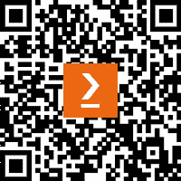

# 索引

由于本电子书版本没有固定分页，以下页码仅基于本书印刷版提供超链接以供参考。

## 符号

- 6R 应用迁移策略 132
  - 重构 138\-140
  - 重新托管 132\-134
  - 更换平台 134\-137
  - 改购 137, 138
  - 保留 141, 142
  - 退役 140, 141

## A

- 高级持续性威胁（APTs）263
- AI/ML 革命 39
- Airbnb 体验 194
- Airbnb 用例 192
  - 诞生于云端的业务 193
  - 颠覆酒店业 192
  - 初始云架构 193, 194
  - 微服务演进 194\-196
  - 多云采用与转型 196
  - 疫情与经济放缓 197, 198
- Amazon 关系型数据库服务（RDS）216
- Amazon 简单队列服务（SQS）216
- Amazon Web Services（AWS）31, 313
- Anthos
  - Anthos Multicloud 47
  - Anthos on Bare Metal 47
  - 用于 VM 47

# 索引

- 无服务器 47
- Anthos 配置管理 258
- Anthos 服务网格 258
- API 优先设计 236
- API 编排和集成层 240
  - 解锁云原生计算优势的注意事项和最佳实践 240、241
  - 应用程序开发和运营 239
- 应用程序现代化战略 273
  - 云原生 DevOps 274、275
  - 传统应用程序现代化 273、274
- 应用程序性能管理（APM） 242
- 应用程序退役 140
- 应用程序安全
  - 最佳实践 267、268
- 人工智能（AI） 148、293
  - 在整个企业中嵌入 293、294
  - 用于创新 293\-295
- CAF 评估阶段 152
  - 业务案例开发 152
  - 识别业务目标 152
  - 云成熟度评估 152
  - 选择云模型 152
  - 依赖关系分析 152
  - 财务评估 153
  - IT 环境评估 152
- 管理资产（AUM） 212
- 注册舞弊审查师协会（ACFE） 41
- 增强现实（AR） 39、294
- 增强现实/虚拟现实（AR/VR） 139、279
- 自动导引车（AGV） 149
- 自动化机器学习（AutoML） 293
- 自动化和治理层 244
  - 最佳实践和注意事项 244
- 自动扩展组（ASG） 221
- 可用区 162
- AWS CAF 173
- 以 AWS 为中心的云战略
  - AWS Outposts 47
  - AWS Snow 系列 47
  - AWS Wavelength 47
- AWS 密钥管理服务（KMS） 257
- AWS Outposts 256
  - 优势 257
  - 注意事项 257
- AWS 共同责任模型 173
- AWS 架构良好的框架 173、246
  - 成本优化设计支柱 248
  - 卓越运营支柱 247
  - 性能效率设计支柱 248
  - 可靠性设计支柱 248
  - 安全性设计支柱 247
  - 可持续性支柱 249
- Azure Kubernetes 服务（AKS） 158
- Azure 资源管理器（ARM）模板 259
- Azure 安全基准基础蓝图 174
- Azure 共同责任模型 174
- Azure Stack 259
  - 注意事项 259、260
  - 功能 259
- Azure Stack Edge 48
- Azure Stack HCI 48
- Azure Stack Hub 48

## B

- 自动化和治理层的最佳实践和注意事项
  - CI/CD 244
  - 配置管理 244
  - 容器编排 244
  - IaC 244
  - 策略驱动的治理 244
- 计算基础设施现代化的最佳实践
  - 集中式映像管理 233
  - 容器化 233
  - 混合云管理平台 233
  - 基础设施即代码（IaC） 233
  - 计算实例标准化 233
  - 虚拟化 233
- 存储基础设施现代化的最佳实践
  - 备份和灾难恢复 234
  - 数据加密和安全性 234
  - 数据分层 234
  - 存储虚拟化 234
  - 统一数据管理 234
- 统一安全层的最佳实践
  - 集中式安全管理平台 245
  - 数据安全 245
  - 身份和访问管理（IAM） 245
  - 网络安全 245
  - 安全监控和审计 245
  - 采用零信任架构 245
- BeyondCorp 196
- BFSI 行业采用云计算 40
  - 理赔处理和承保 42
  - 数字银行 41
  - 欺诈检测和防范 41
  - 监管报告 41
  - 风险管理 41
- 云计算大爆炸式迁移 71
  - 挑战 71\-73
- 大数据
  - 价值 290
  - 可变性 291
  - 多样性 290
  - 速度 290
  - 真实性 290
  - 可见性 291
  - 规模 290
- 臃肿的容器 187
- Blockbuster 案例研究 4\-6
- 区块链 38、149、298
  - 创新应用 298、299
  - 零售联盟 38
- 边界网关协议（BGP） 154

## B

- 生于云端 130
  - 优势 130
- 自带设备 (BYOD) 策略 245
- 一次构建，到处部署 (BODA) 架构 85
- 推动业务敏捷性 32
  - 云原则 33
- 业务伙伴协议 (BAA) 264
- 业务连续性混合模式 162
- 业务连续性计划 (BCP) 156, 163, 233
- 业务-IT 对齐，数字化转型
  - 业务敏捷性 16
  - 协作与沟通 15
  - 客户体验 16
  - 有效的变更管理 16
  - 高效的资源分配 16
  - 创新与竞争优势 16
  - 抓住机遇 17
  - 风险缓解与安全 17
  - 可扩展性与未来就绪 16
  - 无缝集成 15
  - 利益相关者满意度 16
- 业务事务管理 (BTM) 能力 242
- 业务单元 (BUs) 278
- 业务价值因素 122
  - 考量因素 122, 123
- 先买后付 (BNPL) 62
- 网购自提 (BOPIS) 36

## C

- CAMM 框架 97, 99
  - 临时级别 97
  - 基准级别 97
  - 定义级别 97
  - 探索级别 97
  - 编排级别 98
  - 转型级别 98
- CapEx 转向 OpEx
  - 策略 86, 87
- 资本支出 86
- Capital One 用例 212
  - 云转型历程 213, 214
  - 亮点 222, 223
  - 移动应用，云上重构架构 220, 221
  - 人才获取策略 219, 220
- 碳信息披露项目 (CDP) 308
- 无碳能源 (CFE) 313
- 家乐福可持续数字化转型历程 198, 199
  - 家乐福全渠道战略 200
  - 2026 数字零售战略 209, 210
  - 由云转型增强的举措 201, 202
  - IT 架构战略 206-209
  - 遗留 IT，在现代云上转型 203
- 集中化镜像管理 233
- 集中化安全管理平台 245
- 证书颁发机构 (CA) 183
- 首席数据与分析官 (CDAO) 275
- 首席数据官 (CDO) 275
- CI/CD 流水线 264
- Cinder 256
- 云
  - 基于开源构建 115, 116
  - 特征 26, 27
  - 构建可持续应用 316
- 云访问安全代理 (CASB) 267
- 云采纳 36
  - 创新领域 38, 39
  - 员工生产力 38
  - 银行、金融服务与保险 (BFSI) 行业 40
  - 客户数据平台 37
  - 从电商到全渠道商业 37
  - 政府 43
  - 医疗健康与生命科学 39
  - 现代门店 37
  - 迷思 49-54
  - 销售终端 (POS) 37
  - 零售行业 36
  - 供应链需求规划与预测 37
  - 电信行业 42
- 云采纳框架 (CAF) 152, 281
  - 评估阶段 152
  - 部署阶段 154, 155
  - 优化阶段 155, 156
  - 规划阶段 153
- 云无关架构 117
- 云架构框架 246
  - AWS 井然架构框架 246
  - Google Cloud 架构框架 249
  - Microsoft Azure 井然架构框架 251, 252
- 云挂载应用 240
- 云爆发 146
  - 优势 147
  - 挑战 147
- 云爆发模式 163
- 云卓越中心 (CCoE) 108, 124
  - 架构框架 108
  - 最佳实践 109
  - 云治理 109
  - 云运维 109
  - 组件 108, 109
  - 技能发展 109
- 云计算 26
- 云计算作为 ESG 赋能者 312
  - 环境因素 312
  - 治理因素 315
  - 社会因素 314, 315
- 云数据处理附录 (CDPA) 264
- 云债务 151

- 云部署模型 30
- 社区云 31
- 联络中心即服务（CCaaS） 30
- 容器即服务（CaaS） 29
- 一切即服务（XaaS） 29
- 函数即服务（FaaS） 30
- 混合云 31, 32
- 身份即服务（IdaaS） 29
- 知识即服务（KaaS） 30
- 私有云 30
- 公有云 31
- 统一通信即服务（UCaaS） 29
- 互联网安全云（CIS） 264
- 云基础层 231
- 计算基础设施现代化 233
- 网络基础设施现代化 232
- 存储基础设施现代化 234
- 云计划
  - 使用多维价值-复杂度矩阵进行选择 120, 121
- 云迁移策略 132
- 6R 应用迁移策略 132
- 云原生反模式 184
  - 臃肿容器 187
  - 云中的单体城堡 184, 185
  - 可变基础设施 187, 188
  - 忽视资源和成本优化 185
  - 无差别繁重工作 186
- 云原生应用 230, 239, 274
  - 应用定义与 DevOps 237
  - 最佳实践 274, 275
  - 设计 234
  - 基础设施层 237
  - 可观测性与分析层 237
  - 编排与管理层 237
  - 供应层 237
  - 运行时层 237
- 云原生应用原则
  - API 优先 236
  - 容器与镜像仓库 236
  - 不可变基础设施 236
  - 微服务架构 236
  - 服务网格 236
- 云原生计算基金会（CNCF） 50, 230
- 云原生电子商务平台
  - 优势 69
  - 构建 68
  - 劣势 69
- 云原生技术 230
- 云优化 278
- 云提供商选择 116
- 云提供商选择考量 81
  - 业务方面 82, 83
  - 财务处理 86-88
  - 创新方面 84
  - 安全方面 85, 86
  - 技术方面 83, 84
- 云就绪应用 230
- 云就绪应用 239
- 云就绪企业
  - 框架构建 230
  - 架构设计目标 231
- 云就绪企业基础
  - 构建 110
  - 一切皆产品思维 111, 112
  - 内部开发者平台（IDP） 112-114
  - 平台即产品 112
  - 初创企业思维 110
- 云安全联盟（CSA）云控制矩阵（CCM） 264
- 云服务模型 27, 28
  - 基础设施即服务（IaaS） 28
  - 平台即服务（PaaS） 28
  - 软件即服务（SaaS） 28
  - 价值驱动因素 28, 29
- 云服务提供商（CSP） 74, 146, 262, 316
- 云战略
  - 构建云原生电子商务平台 68-70
  - 使用 SaaS 构建电子商务平台 63-65
  - 示例 61
  - 构建无头商务架构 66-68
  - 目标与关键结果（OKR） 62, 63
  - 选择 61
- 云转型之旅，第一资本（Capital One） 213
  - 效益 213, 214
  - 实验阶段 215
  - 基础阶段 215
  - 创新阶段 217
  - 迁移阶段 216
- 云价值驱动因素
  - 可访问性 36
  - 业务敏捷性 34
  - 协作 34, 35
  - 成本 35
  - 弹性 34
  - 创新 33
  - 安全 35
- 命令查询职责分离（CQRS） 275
- 商用现货（COTS） 116
- 用于可移植性的通用平台 116
- 通用漏洞披露（CVEs） 262
- 社区云 31
- 企业 IT 生态系统的复杂性
  - 业务部门创建 IT 集市 59
  - 云战略选择 61
  - 数据蔓延与集成 60
  - 专有私有云 59
  - 安全 60

技术债务 `58`, `59`

复杂性因素 `121`

考量 `121`, `122`

组件, OpenStack

Cinder (块存储) `256`

Glance (镜像服务) `256`

Horizon (仪表板) `256`

Keystone (身份验证) `256`

Neutron (网络) `256`

Nova (计算) `255`

Swift (对象存储) `255`

组件, VMware Cloud Foundation (`VCF`)

NSX `255`

虚拟存储区域网络 (`vSAN`) `255`

vRealize 套件 `255`

vSphere `254`

计算基础设施 `270`

最佳实践 `270`

计算基础设施现代化 `233`

最佳实践 `233`

计算机辅助设计 (`CAD`) `297`

配置管理 `244`

考量, 可观测性和分析层

应用程序性能管理 (`APM`) `242`

集中式日志聚合 `241`

分布式追踪 `241`

基础设施可观测性 `242`

监控与指标 `241`

安全监控与告警 `242`

联络中心即服务 (`CCaaS`) `30`

容器化 `233`

容器原生云基金会 (`CNCF`) `208`

容器编排 `244`

容器 `236`

容器即服务 (`CaaS`) `29`

Amazon Elastic Kubernetes Service (`EKS`) `29`

Azure Kubernetes Service (`AKS`) `29`

Google Kubernetes Engine (`GKE`) `29`

容器安全 `180`

持续集成和持续交付 (`CI/CD`) `244`

企业身份 `178`

企业社会责任 (`CSR`) `303`

成本治理 `278`

关键用户旅程 (`CUJ`) `20`, `114`

分类 `115`

评估 `115`

示例 `114`

目标 `114`

可观测性 `115`

优先级排序 `115`

角色 `114`

用户 `114`

跨站脚本 (`XSS`) `63`, `267`

创新文化, 数字化转型

持续改进 `20`

跨职能协作 `19`

员工, 赋能 `19`

外部参与 `19`

反馈循环 `20`

培养学习心态 `19`

资源与支持 `19`

客户关注, 数字化转型 `17`

竞争优势 `18`

满足客户需求 `17`

客户体验 `17`

客户忠诚度和留存 `18`

员工敬业度 `18`

创新和敏捷性 `18`

组织文化 `18`, `19`

收入来源 `18`

风险缓解 `18`

客户身份 `178`

D

DAST 工具 `268`

数据激活 `277`

数据分析 `277`

数据即服务模式 `200`

数据中心退出

考量 `73`, `74`

数据中心退出云之旅 `126`

缺点 `126`

优点 `126`

数据云之旅 `131`

数据消费者 `243`

数据 FinOps `243`

数据治理 `243`, `278`

数据摄取 `242`, `276`

数据管理 `243`

数据管理层 `242`

数据现代化 `275`

最佳实践 `276`-`278`

原则 `275`, `276`

数据编排 `243`

数据处理 `243`, `277`

数据驻留

最佳实践 `269`

数据安全 `245`, `268`, `278`

最佳实践 `268`

数据主权

最佳实践 `269`

数据存储 `243`, `277`

去中心化金融 (`DeFi`) `149`

决策支持系统 (`DSS`) `292`

深度学习 (`DL`) 模型

`GANs` `295`

`GPT` `295`

`VAEs` `295`

深度包检测 (`DPI`) `177`

纵深防御安全策略 `35`

部署阶段, `CAF` `154`

应用程序和平台服务 `155`

云资源供应 `154`

数据迁移 `154`

演练 `155`

治理 `155`

网络设计 `154`

运维交接 `155`

迁移前检查清单 `154`

安全架构设计 `154`

测试 `155`

`DevOps` `274`

## C

- 挑战与经验教训 221

## D

- 云中开发测试、本地生产的方法 143, 144
  - 优势 144
  - 挑战 144, 145
- 数字教育革命 46
- 数字化转型 42
- 数字化转型的衡量
  - 客户体验指标 20
  - 数字采用率 20
  - 数字成熟度评估 20
  - 员工参与度和赋能 20
  - 财务绩效 21
  - 创新与敏捷性指标 21
- 灾难恢复 (DR) 162, 233
- 云中的灾难恢复 145, 146
- 分布式拒绝服务 (DDoS) 攻击 263
- 多样性、公平与包容 (DEI) 303
- 双重重要性评估与报告 309-311
- 丢弃并采购迁移策略 137
- 灾难恢复计划 (DRP) 268
- 动态分析安全测试 (DAST) 182

## E

- EBITDA 278
- 边缘计算 38, 149, 297
  - 创新应用 297, 298
- 边缘计算部署模式 159
  - 应用 159
  - 优势 160
  - 挑战 160
- 边缘网络拓扑 170, 171
- 电子健康记录 (EHR) 40
- 新兴技术应用 240
- 新兴技术
  - 负责任地利用 300, 301
- 企业架构审查委员会 (EARB) 153
- 企业云成熟度评估 97
  - CCoE 108
  - 云采用成熟度模型 (CAMM) 97
  - Google 的 CAF 105
  - 人员支柱 99
  - 流程支柱 101
  - 技术支柱 102
- 企业云转型之旅 125
  - 云上诞生 130
  - 数据云之旅 131
  - 全球扩展之旅 131
  - 绿色云之旅 131, 132
  - 本地应用现代化 126
  - 本地应用优化 128
- 企业数字化转型
  - 业务与 IT 对齐 15
  - 以客户为中心 17
  - 环境、社会与治理 (ESG) 21
  - 领导 12, 13
  - 衡量 20, 21
  - 组织文化 18, 19
  - 愿景与战略 13, 14
- 企业混合云框架
  - 层 231
- 企业 IT 生态系统
  - 复杂性 58
- 环境因素 312
  - 减少碳足迹 313, 314
  - 能源效率 313
  - 可持续性影响仪表板 314
- 环境、社会与治理 (ESG) 121, 123, 303
  - 定义 304
  - 环境影响 304
  - 治理 305
  - 社会影响 304
- ESG 与数字化转型 21
  - 环境可持续性 21
  - 伦理治理与问责 22
  - 投资者与财务考量 22
  - 长期价值创造 22
  - 监管合规 22
  - 声誉与品牌资产 22
  - 社会影响与包容 21
  - 利益相关者期望与声誉 22
- ESG 报告计划
  - 采用 311
  - 阶段 311, 312
- ESG 报告标准与框架 307
  - 碳披露项目 (CDP) 308
  - 欧盟企业可持续发展报告指令 (CSRD) 309
  - 全球报告倡议组织 (GRI) 308
  - 国际综合报告框架 308
  - ISSB 308
  - 可持续发展会计准则委员会 (SASB) 308
  - 联合国全球契约 309
- ESG 可持续发展计划
  - 构建 307
- ESG 对企业的价值 305
  - 竞争优势 306
  - 长期业务可行性 306
  - 监管环境 307
  - 风险缓解 306
  - 利益相关者期望 305
- 欧盟企业可持续发展报告指令 (CSRD) 309
- 欧洲可持续发展报告标准 (ESRS) 303
- 一切皆服务 (XaaS) 29
- 体验 API (xAPIs) 221
- 扩展现实 (XR) 296
  - 创新用途 296, 297

## F

- 联邦信息处理标准 (FIPS) 268
- FinOps 278
  - 卓越中心 (CoE) 279
  - 通知阶段 279, 280

- 运维阶段 281
- 优化阶段 280
- 防火墙 179
- 面向企业混合云和多云部署的基础蓝图 165
- 边缘网络拓扑 170, 171
- 门控入口混合云拓扑 167
- 网状混合云网络拓扑 165
- 多云网络拓扑 166
- 网络对等拓扑 169, 170
- 私有混合网络拓扑 169
- 共享网络拓扑 168
- 基础安全原则 263
  - 补偿性控制 264
  - 数据主权和数据驻留合规性 264
  - 自动化部署与安全监控 264
  - 着陆区设计 263
  - 分层安全设计/左移安全策略 264
  - 用于安全自动化的机器学习（ML） 264
  - 风险评估 264
  - 风险保护计划 265
  - 安全蓝图 264
  - 安全审计与评估 265
  - 零信任架构（ZTA） 263
- 自由开源软件（FOSS）策略 202
- 函数即服务（FaaS） 30

## G

- 门控出口混合云拓扑 167
- 门控入口混合云拓扑 167
- G-Cloud 45
- 生成式 AI（GenAI） 295
  - 创新应用 295, 296
- Glance 256
- 全球扩张之旅 131
  - 优势 131
- 全球报告倡议组织（GRI） 308
- Google Cloud 架构框架 249
  - 成本优化支柱 251
  - 运营卓越支柱 250
  - 性能优化支柱 251
  - 可靠性支柱 250
  - 安全、隐私和合规支柱 250
  - 系统设计支柱 250
- Google Cloud Platform（GCP） 47, 249
- Google Cloud 平台共享命运模型 175
- Google GKE Enterprise（Anthos） 257
  - 注意事项 258
  - 特性 258
- Google Kubernetes Engine（GKE） 158
- Google 的云采用框架（CAF） 105
  - 引领 106
  - 学习 106
  - 战略成熟度阶段 107
  - 战术成熟度阶段 106
  - 转型成熟度阶段 107, 108
- 治理因素 315
  - 业务连续性（BC） 316
  - 数据安全与隐私 315
  - 供应商风险管理 316
- 政府领域的云采用 43
  - 公民服务 44
  - 国防 46
  - 数字市场 45
  - 教育 45
  - 食品与安全 44
  - 公共卫生服务 44
  - 太空研究 45
- 图形处理单元（GPU） 233
- 绿色云之旅 131, 132
- 漂绿 307
- 商品交易总额（GMV） 209

## H

- 硬件安全模块（HSM） 177, 245, 268
- 《哈佛商业评论》（HBR） 242, 275, 290
- 无头商务平台
  - 优势 66, 67
  - 构建 66
  - 劣势 67
- 医疗和生命科学领域的云采用 39
  - 互联医疗 39
  - 药物依从性 40
  - 药物研发 40
  - 基因组数据处理 40
  - 远程医疗和虚拟护理 39
- 高可用性（HA） 271
- 高性能计算（HPC） 40, 233, 300
- Horizon 256
- 混合云 31, 32, 46\-48
  - 采用 46, 47
  - 挑战 48, 49
  - 云爆发 32
  - 开发测试 32
  - 灾难恢复（DR） 32
  - 地理冗余和高可用性（HA） 32
  - 区域与特许经营 32
- 混合云采用 129
  - 缺点 129
  - 优点 129
- 混合云管理平台 233
- 混合云策略 77, 143, 156
  - 挑战 77\-79
  - 云爆发 146, 147
  - 云端开发测试、本地生产环境策略 143\-145
  - 云端灾难恢复 145, 146
- 混合云用例
  - Airbnb 192
  - Capital One 212

- 家乐福 198, 199
- 温迪餐厅转型消费者体验 210
- 超融合基础设施 (HCI) 72

## I
- 身份与访问管理 (IAM) 177, 245, 263\-265
  - 最佳实践 265, 266
  - 生命周期管理 178
- 身份即服务 (IdaaS) 29
- 身份管理 177
- 身份提供商 (IDP) 154
- IDS/入侵防御系统 (IPS) 271
- 不可变基础设施 236
- 事件管理 (IM) 294
- 事件响应 (IR) 264
- 信息阶段，FinOps 279
  - 最佳实践 280
- 基础设施即服务 (IaaS) 模型 28
- 基础设施即代码 (IaC) 156, 233, 244
- 基础设施即代码 (IaC) 工具 265
- 基础设施组件
  - 计算基础设施 270
  - 网络基础设施 271
  - 存储基础设施 272
- 基础设施现代化 269
- 创新维度 279
- 创新 283
  - 促进，组织内部 7
  - 局限性 285
  - 结合云 284
- 创新连续体 8, 9
  - 策展 9
  - 创意构思 9
  - 孵化与开发 9
  - 优先级排序 9
  - 解决方案假设 9
- 创新驱动的云之旅
  - 人工智能 148
  - 区块链 149
  - 边缘计算 149
  - 物联网 148
- 创新实验室
  - 创新与交付支柱 289, 290
  - 设立 285\-287
  - 人才与合作伙伴支柱 288, 289
  - 愿景与治理支柱 287, 288
- 创新实验室模型
  - 自主创新实验室 286
  - 集中式创新中心 286
  - 去中心化创新中心 286
- 创新，结合大数据与无服务器 290, 291
  - 银行与金融服务 291
  - 医疗保健 292, 293
  - 零售 291, 292
- 知识产权 (IP) 82
- 内部开发者平台 (IDP) 112
  - 后端基础设施层 113
  - 平台层 114
  - 自助服务层 114
- 国际财务报告准则 (IFRS) 308
- 国际综合报告框架 308
- 国际可持续准则理事会 (ISSB) 303
- 物联网 38, 130, 148, 159, 290
- 入侵检测 (IDS) 177
- 入侵检测/防御系统 (IDS/IPS) 245
- 入侵检测系统 (IDS) 266
- 入侵防御 (IPS) 177
- ISSB 308
- IT 转型 203
  - 家乐福西班牙数字化转型 204\-206
  - GearUp 计划 203, 204

## J
- J.Leavitt, Harold 92
- JSON Web 令牌 (JWTs) 182
- 即时 (JIT) 访问 178
  - 策略 266

## K
- 基于内核的虚拟机 (KVMs) 50, 273
- 关键绩效指标 (KPIs) 15, 155, 253
- Keystone 256
- 知识即服务 (KaaS) 30

## L
- 层级，企业混合云框架
  - API 编排与集成层 240
  - 自动化与治理层 244
  - 云基础层 231, 232
  - 数据管理层 242
  - 遗留应用 238, 239
  - 可观测性与分析层 241
  - 统一安全层 244
- 领导力 12
  - 两家企业的故事 10\-12
- Leavitt 菱形变革管理 92
  - 组成要素 92, 93
  - 示例 93, 94
- 遗留应用程序 230, 238
  - API 黑盒 239
  - 数据优先方法 238
  - 重新架构 239
  - 重构 239
  - 重新托管或云邻近部署 239
- 迁移应用（直接迁移） 127
  - 缺点 127
  - 优点 127
- 直接迁移策略 75, 132
  - 挑战 75\-77

## M

## M

- MACH 66
- 托管服务提供商 (MSP) 83
- 中间人 (MITM) 攻击 63, 160, 263
- 网状混合云网络拓扑 165
- 消息队列遥测传输 (MQTT) 170
- 微体验 221
- 微服务架构 236
- Microsoft Azure 设计良好的架构框架 251, 252
    - 成本优化支柱 252
    - 运营卓越支柱 253
    - 性能效率支柱 253, 254
    - 可靠性支柱 252
    - 安全性支柱 253
- 最小可行性产品 (MVP) 101, 112
- 混合现实 (MR) 296
- 现代数据分析平台，核心阶段
    - 数据消费者 243
    - 数据 FinOps 243
    - 数据治理 243
    - 数据摄取 242
    - 数据处理 243
    - 数据存储 243
- 移动并改进迁移策略 134
- 多接入边缘计算 (MEC) 42
- 多云网络拓扑 166
- 多云策略 79, 156
    - 挑战 79-81
- 多维价值复杂度矩阵
    - 用于选择云计划 120, 121
- 多因素身份验证 (MFA) 178, 245, 263
- 多协议标签交换 (MPLS) 154
- 双向 TLS (mTLS) 183

## N

- NASA 45
- 印度国家数字图书馆 (NDLI) 45
- 美国国家标准与技术研究院 (NIST) 262
- 国家漏洞数据库 (NVD) 262
- 自然语言处理 (NLP) 148, 293
- 净现值 (NPV) 120, 123, 125
- 净推荐值 (NPS) 20
- 网络附属存储 (NAS) 234
- 网络文件系统 (NFS) 272
- 网络基础设施
    - 最佳实践 271
    - 设计 271
- 网络基础设施现代化 232
- 网络即服务 (NaaS) 256
- 网络接口 (NICs) 179
- 网络对等拓扑 169, 170
- 网络安全 245, 266
    - 最佳实践 266
- 网络安全组 (NSGs) 179
- Neutron 256
- 下一代防火墙 (NGFWs) 266
- 下一代计算单元 (NUC) 160
- NSX 255

## O

- 目标与关键结果 (OKRs) 20
    - 运作 62, 63
- 对象存储设备 (OSDs) 234
- 可观测性 243
- 可观测性与分析层 241
    - 考量因素 241, 242
- ODMHSAS 44
- 本地应用程序，现代化策略 126
    - 数据中心退出 126
    - 直接迁移应用程序 127
    - 在云上重新构建应用程序架构 128
    - 升级，至 SaaS 127
    - 升级，至 SaaS 云之旅 128
- 本地数据中心，优化策略 128
    - 混合云采用 129
    - 私有云，构建 128, 129
- 开放授权 (OAuth) 265
- 开放容器倡议 (OCI) 50
- 开放安全架构 (OSA) 85
- 开源软件 (OSS) 115
- OpenStack 255
    - 挑战 256
    - 组件 255, 256
        - OpenStack Nova 255
- 运营阶段，FinOps 281
    - 最佳实践 281
- 运营支出 (OpEx) 86
- 优化行列式 (ORC) 276
- 优化阶段，CAF 155
    - 自动化 156
    - 业务连续性 156
    - FinOps 155
    - 治理与合规 155
    - 复用识别 156
    - 站点可靠性工程 (SRE) 155
- 优化阶段，FinOps 280
    - 活动 280
- Oracle 专用区域 Cloud@Customer 48
- Oracle Exadata Cloud@Customer 48
- Oracle REDs 48
- Oracle Roving Edge 基础设施 48
- 全组织策略 179

## P

- 分区多云模式 158
    - 优势 159
    - 挑战 159
    - 组件 158
        - 计算分区 158
        - 容器分区 158
        - 数据存储分区 158
        - 网络分区 158
    - 变体 158
- 补丁管理 180
- 支付卡接口 (PCI) 263

- 人员支柱，企业云成熟度评估 99
- 招聘流程 100
- 组织技能发展 99
- 合作伙伴 100
- 团队构成 100
- 人员-流程-技术 (PPT) 框架 94
- 人员支柱 94, 95
- 流程支柱 95, 96
- 技术支柱 96
- 个人财务管理 (PFM) 工具 41
- 个人身份信息 (PII) 278
- 先锋维度 279
- 规划阶段, CAF 153
  - 应用与平台服务 153
  - 云卓越中心 (CcoE) 153
  - 云战略 153
  - 沟通计划 153
  - 运营就绪 153
  - 资源配置 153
  - 路线图创建 154
  - 技术规划 153
  - 验证 154
- 平台即服务 (PaaS) 模型 28
- 销售终端 (POS) 201
- 策略驱动治理 244
- 策略执行点 (PEPs) 183
- 电源使用效率 (PUE) 202, 208, 313
- 私有云与混合云策略 254
- 私有云 30
  - 构建 128
  - 缺点 129
  - 托管私有云 30
  - 管理型私有云 30
  - 优点 129
  - 虚拟私有云 31
- 私有云与混合云产品
  - AWS Outposts 256, 257
  - Azure Stack 259, 260
  - Google GKE Enterprise (Anthos) 257, 258
  - OpenStack 255, 256
  - VMware Cloud Foundation (VCF) 254, 255
- 私有混合网络拓扑 169
- 特权访问管理 (PAM) 178
- 流程支柱, 企业云成熟度评估
  - 预算 102
  - 领导力与赞助 101
  - 度量 101
- GearUp 计划 203, 204
- 概念验证 (PoCs) 154
- 价值验证 (PoV) 154
- 公有云 31
- 公共卫生信息系统 (PHIS) 45
- Q
  - 质量控制 (QC) 295
  - 量子即服务 (QaaS) 299
  - 量子计算 299
    - 示例 299, 300
  - 快餐店 (QSRs) 210
- R
  - 在云上重构应用程序 128
    - 缺点 128
    - 优点 128
  - 恢复点目标 (RPO) 121, 162
  - 恢复时间目标 (RTO) 121, 162
  - Red Hat Virtualization (RHV) 273
  - 冗余混合部署模式 161
    - 优势 162
    - 收益 163, 164
    - 注意事项 163, 164
    - 用例 161
  - 重构/重新架构 138, 139
    - 优势 139
    - 挑战 139, 140
  - 注册表 236
  - 重新托管 132, 133
    - 优势, 对企业而言 133, 134
    - 劣势 134
  - 焕新维度 278
  - 远程患者监护 (RPM) 项目 39
  - 重新平台化 134, 135
    - 收益 136
    - 挑战与注意事项 136, 137
  - 重新购买 137
    - 优势, 致企业 137, 138
    - 挑战与注意事项 138
  - 每秒请求数 (RPS) 35
  - 在本地保留应用程序 141
    - 收益 142
    - 注意事项与缓解策略 142
  - 退役/停用应用程序 140
    - 收益 141
    - 注意事项 141
  - 投资回报率 (ROI) 83
  - 机器人流程自动化 (RPA) 295
  - 基于角色的访问控制 (RBAC) 177, 253
- S
  - SaaS
    - 应用程序, 升级至 127, 128
  - 基于 SaaS 的电子商务平台
    - 优势 64
    - 构建 63
    - 劣势 65
  - 赛诺菲 310
  - 默认安全操作 181
  - 证券交易委员会 (SEC) 303
  - 安全
    - 企业安全基础 171
  - 安全断言标记语言 (SAML) 265
  - 安全优先的云架构
    - 应用安全 181-184, 267, 268
    - 构建 262

- 云资产管理，自动化 265
- 数据驻留 269
- 数据安全 268
- 数据主权 269
- 设计 176
- 基础安全原则 263, 264
- IAM 265, 266
- 身份和访问管理（IAM） 177
- 基础设施安全 179\-181
- 网络安全 176, 177, 266
- 安全信息和事件管理（SIEM）系统 265
- 安全监控与审计 245
- 服务账户 179
- 服务身份 178
- 服务等级协议（SLAs） 60
- 服务等级指标（SLIs） 115, 250
- 服务等级目标（SLOs） 115, 250
- 服务网格 236
- 服务提供商（SP） 178, 271
- 共享网络拓扑 168
- 共享安全模型
  - 主要 CSP 的 172\-175
- 左移 182
- 缩减 38
- 单一面板（SPOG） 265
- 单点登录（SSO） 154, 178
- 社会因素，ESG 中的 314, 315
- 软件即服务（SaaS）模式 28
- 软件定义网络（SDN） 73, 232
  - 网络抽象 232
  - 网络智能 232
  - 开放标准 232
- 软件开发生命周期（SDLC） 182
- 静态应用安全测试（SAST） 182
- 存储区域网络（SANs） 234
- 存储基础设施 272
  - 最佳实践 272, 273
- 存储基础设施现代化 234
  - 最佳实践 234
- 可持续性 304
- 可持续性会计准则委员会（SASB） 308
- 可持续应用
  - 在云中构建 316
  - 设计原则与架构最佳实践 317, 318
- Swift 255
- 系统集成商（SI） 83

## T

- 气候相关财务信息披露工作组（TCFD） 308
- 自然相关财务信息披露工作组（TNFD） 303
- 技术支柱，企业云成熟度评估 102
  - AI/ML 维度 105
  - 架构 102
  - 自动化能力 103
  - 数据管理 104, 105
  - 运维 103
  - 安全 104
- 电信行业，云采用 42
  - 云联络中心 43
  - 物联网（IoT） 42
  - 网络功能虚拟化（NFV） 42
  - 无线接入网络（RAN） 43
  - 电信网络智能 42
  - 统一通信（UC） 43
- 张量处理单元（TPUs） 233
- 黄金三角 94
- 威胁情报（TI）系统 294
- 分层混合云模式 156
  - 后端 156
  - 优势 157
  - 挑战 157
  - 注意事项 157
  - 前端 157
- 上市时间（TTM） 279
- 总拥有成本（TCO） 35, 83, 122, 280
- 传统应用现代化
  - 最佳实践 273, 274
- 可信执行环境（TEEs） 181

## U

- 统一通信即服务（UCaaS） 29, 314
- 统一安全层 244
  - 最佳实践 245
- 联合国气候变化大会（COP28） 303
- 联合国全球契约 309
- 美国农业部（USDA） 45
- 用户和实体行为分析（UEBA） 264
- 美国总务管理局（GSA） 43

## V

- 风险价值（VaR） 41
- 虚拟化 233
- 虚拟机（VMs） 179, 254, 264
- 虚拟专用网络（VPNs） 147, 266
- 虚拟现实（VR） 39
- 虚拟存储区域网络（vSAN） 255
- 愿景与战略，数字化转型 13
  - 适应性与敏捷性 15
  - 工作对齐 14
  - 衡量基础 15
  - 目标清晰度 14
  - 专注与优先级排序 14
  - 面向未来 14
  - 变革阻力 15
  - 利益相关者参与 14
- VMware Cloud Foundation（VCF） 254, 255
  - 组件 254
  - vRealize Suite 255
  - vSphere 254

## W

# Web 应用防火墙 (WAF)

- 181
- 267

# 优秀架构框架 (WAF)

- 281

# Wendy’s 转型消费者体验

- 全球下一代 210
- 餐厅体验，通过技术重塑 211, 212

# 云转型工作负载

- **大爆炸式云迁移** 71, 72
- **数据中心退出** 73–75
- **混合云策略** 77
- **识别** 71
- **搬迁式策略** 75
- **多云策略** 79

# 世界经济论坛 (WEF)

- 314

# Z

- **零信任架构 (ZTA)** 263

---

[packtpub.com](http://packtpub.com)

订阅我们的在线数字图书馆，即可完全访问超过 7,000 本书籍和视频，以及行业领先的工具，帮助您规划个人发展并提升职业生涯。如需更多信息，请访问我们的网站。

## 为什么要订阅？

*   通过来自 4,000 多位行业专业人士的实用电子书和视频，减少学习时间，增加编码时间
*   通过专为您打造的技能计划改善学习
*   每月免费获取一本电子书或一个视频
*   全文搜索，轻松访问重要信息
*   复制粘贴、打印和书签内容

您知道吗？Packt 为每本出版的书籍提供电子书版本，可获取 `PDF` 和 `ePub` 文件。您可以在 [packtpub.com](http://packtpub.com) 升级到电子书版本，作为纸质书客户，您有权享受电子书副本的折扣。请通过 `customercare@packtpub.com` 联系我们以获取更多详情。

在 [www.packtpub.com](http://www.packtpub.com)，您还可以阅读免费技术文章合集，注册各类免费通讯，并接收 Packt 书籍和电子书的独家折扣和优惠。

# 您可能喜欢的其他书籍

如果您喜欢这本书，可能对 Packt 的以下其他书籍感兴趣：

[Image: Multi-Cloud Handbook](https://www.amazon.in/dp/1804618705)

**`Multi-Cloud Handbook`** 面向 **`Developers`**

Subash Natarajan, Jeveen Jacob

ISBN: `9781804618707`

*   理解云原生和多云应用的核心结构与影响
*   探索构建敏捷、可扩展且面向未来的应用的关键原则和模式
*   掌握云原生要素：服务网格、`DDD` 和以 API 为中心的方法
*   使用先进的 `IaC`、`CI/CD`、`DevSecOps` 和 `GitOps` 技术实施部署流水线
*   在多云场景中管理和监控数据、安全、合规性和身份访问
*   通过向左迁移和 `FinOps` 实践优化云成本
*   为云原生和多云技术的未来做好准备

[Image: Achieving Digital Transformation Using Hybrid Cloud](https://packt.link/183763369X)

**`Achieving Digital Transformation Using`** **`Hybrid Cloud`**

Vikas Grover, Ishu Verma, Praveen Rajagopalan

ISBN: `9781837633692`

*   为混合云平台设计和构建基础
*   利用 `Kubernetes`、容器和 `GitOps` 实现混合云
*   使用架构模式蓝图在混合云上交付应用程序
*   实现托管在不同云上的应用程序之间的通信
*   在混合架构中推出零接触预配和监控
*   在无需重建应用的情况下增强稳定性并实现横向扩缩容
*   了解应用堆栈的混合云安全原则
*   基于混合云经济学设计成本优化系统

# Packt 正在寻找像您这样的作者

如果您有兴趣成为 Packt 的作者，请访问 [authors.packtpub.com](http://authors.packtpub.com) 立即申请。我们已与数千名开发人员和技术专业人士合作，就像您一样，帮助他们与全球技术社区分享见解。您可以提交一般申请，申请我们正在招募作者的特定热门主题，或提交您自己的想法。

# 分享您的想法

现在您已读完 *Enterprise-Grade Hybrid and Multi-Cloud Strategies*（企业级混合云与多云策略），我们非常想听听您的想法！如果您在 `Amazon` 购买了本书，请[点击此处直接前往该书的 Amazon 评论页面](https://packt.link/r/1804615110)分享您的反馈，或在您购买的网站上留下评论。

您的评论对我们和技术社区都很重要，将帮助我们确保提供优质内容。

# 下载本书的免费 PDF 副本

感谢您购买本书！

您喜欢随时随地阅读，但无法随身携带纸质书？

您购买的 `eBook` 与您选择的设备不兼容？

别担心，现在购买每本 Packt 书籍，您都可以免费获得该书的 `无 DRM 限制的 PDF` 版本。

随时随地，在任何设备上阅读。直接从您喜爱的技术书籍中搜索、复制并粘贴代码到您的应用程序中。

福利不止于此，您还可以独家获得折扣、通讯和每日发送到您收件箱的优质免费内容。

请遵循以下简单步骤获取福利：

1.  扫描 `QR` 码或访问下方链接

    

    `https://packt.link/free-ebook/9781804615119`

2.  提交您的购买凭证

3.  就这些！我们会直接将您的免费 `PDF` 和其他福利发送到您的邮箱

