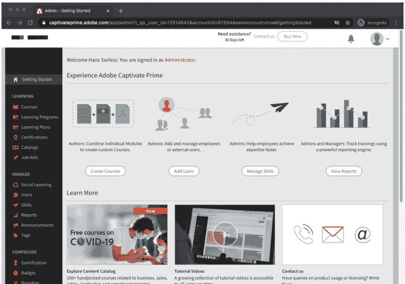
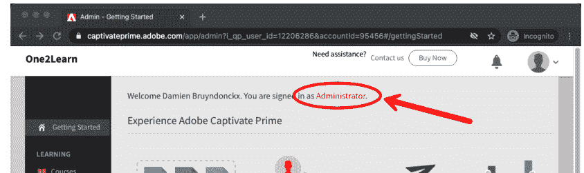
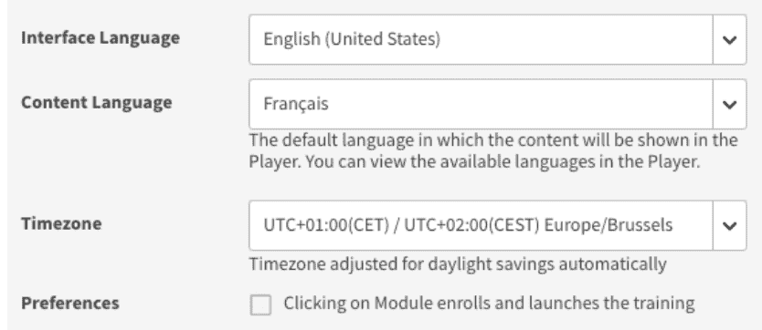
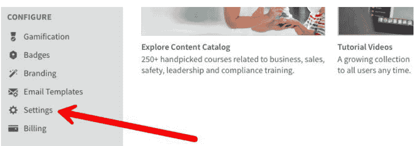
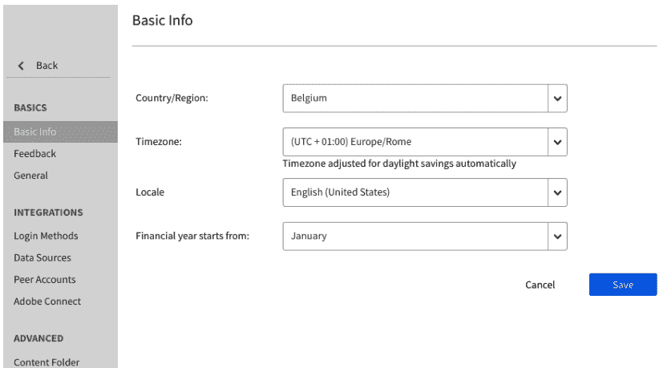
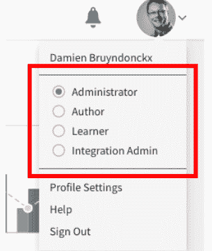

# Adobe Captivate Prime 企业级 LMS：为您的员工、合作伙伴和客户设计并开发世界级学习体验

本书献给那些毕生致力于通过教育改变他人生活的教师和讲师。重要的是并非他们所教授的科目，而是他们日常行为和态度所传达的生活教训。衷心感谢我的五年级老师 Jacques Baret，以及我的十一年级和十二年级数学老师 Guy Deveaux，他们教会了我做事出色的热爱。

- Damien Bruyndonckx

## 贡献者

## 关于作者

**Damien Bruyndonckx** 是 One2Learn 的创始人兼首席执行官，One2Learn 是一家比利时公司，专注于内容开发、教学视频、虚拟课堂以及领先的电子学习内容创作工具培训。Damien 在电子学习行业活跃超过 15 年，曾与众多不同客户和 LMS 实施项目合作。他是 Adobe 的长期合作伙伴，并担任官方 Adobe Captivate 认证项目的讲师。Damien 是 LinkedIn Learning 的 30 多门视频课程的作者，也是 Packt Publishing 出版的 *Mastering Adobe Captivate* 系列的合著者。

> *我谨向帮助我将本书付诸现实的卓越团队表示感谢。特别感谢我的挚友 Yannick Le Garff 和 Sean Mullen 接受担任技术审阅者，以及 Packt Publishing 的出色团队。最后，我要感谢我的可爱 Celine，无论我承担多么疯狂的项目，她始终在我身边。*

## 关于审阅者

**Yannick Le Garff** 是一名电信工程师。他在 Hewlett Packard Labs 和 EADS 开始了软件开发工程师的职业生涯。他在数字技术领域工作超过 20 年，这些技术正在改变组织沟通和工作的方式。他目前负责 MeetingOne 在欧洲的业务拓展，MeetingOne 是 Adobe 用于数字学习解决方案的国际合作伙伴。

Yannick 对新学习方式的出现以及它如何改变组织和社会充满热情。

**Seán Mullen** 自 2001 年以来一直从事技术培训和咨询工作。他于 2009 年联合创立了 Engage Systems，这是一家专注于电子学习和虚拟课堂模式的 Adobe Systems 金牌合作伙伴。Seán 自 2006 年起担任 Adobe Connect 的 Adobe 认证讲师。他已在美国 50 个州中的 43 个州培训了 Adobe Connect 的地方政府用户，并曾前往加拿大、英国、中国和日本。Seán 和 Engage Systems 团队于 2013 年和 2019 年获得 Adobe Connect 年度合作伙伴奖。Engage Systems 于 2015 年被选为 Adobe Captivate Prime 的启动合作伙伴，并于 2020 年获得首届“Adobe Captivate Prime Partner of the Year”奖。

## 您可能喜欢的其他书籍

## 索引

## 前言
Adobe Captivate Prime 是 Adobe 屡获殊荣的企业级 LMS。与任何其他 LMS 一样，Captivate Prime 可让您托管各种类型的学习内容并将其交付给学习者。它还提供了一系列用于跟踪学生进度、存储测验结果、生成复杂的学习报告等的工具。但 Captivate Prime 超越了这些常见的 LMS 功能。它为员工、您组织的合作伙伴甚至客户提供真正的学习体验。毕竟，加盟商培训是您组织品牌形象的一部分，而受过良好教育的客户更有可能成为满意的客户。这模糊了营销与企业培训之间的界限，而 Captivate Prime 正是理解、认可并在此基础上构建的。这就是为什么 Captivate Prime 除了是一款出色的 LMS 解决方案之外，还是一款 **学习体验平台 (LXP)**。

本书旨在通过将所讨论的每个功能与每个人都能理解的实用业务用例联系起来，加快并简化您对 Adobe Captivate Prime LMS 的探索，无论您组织的规模、类型或行业如何。您将从探索任何 LMS 的典型功能开始：内容上传、课程创建、用户管理、报告等。然后，您将发现 Captivate Prime 的游戏化、社交学习和 AI 驱动的推荐功能，这将使您能够为访问您 Prime 账户的每个学习者提供真正独特且个性化的学习体验。最后，您将学习如何管理平台以及如何使用内置连接器和/或 Captivate Prime API 将 Captivate Prime 集成到您现有的 IT 环境中。

## 本书适合谁
本书面向学习与发展专业人员、人力资源经理、企业讲师、LMS 管理员以及希望使用 Adobe Captivate Prime LMS 为员工、合作伙伴和客户设置和管理培训与发展计划的团队领导。

## 本书涵盖内容
- 第 1 章《Adobe Captivate Prime 简介》向您介绍 Adobe Captivate Prime 平台和 Adobe eLearning 工具生态系统。它还将指导您激活完成本书练习所需的 Prime 试用账户。
- 第 2 章《自定义 Captivate Prime 的外观和风格》在您拥有可用的 Prime 试用账户后，指导您完成基本配置任务，包括根据您组织的品牌指南调整账户的外观和风格。
- 第 3 章《上传学习内容和管理内容库》让您担任作者角色，将不同类型的学习内容上传到 Captivate Prime 内容库。
- 第 4 章《创建技能和课程》开始讨论技能的概念以及在您的 Prime 账户中创建技能。然后，您将使用上一章上传到内容库的内容创建课程。
- 第 5 章《管理用户》描述了在 Captivate Prime 账户中定义各种类型用户的不同方式，因为现在您的 Prime 账户中已有课程，您需要学生。它还描述了如何将用户分配到角色以及如何创建自定义角色。
- 第 6 章《为课程注册学习者》引导您创建课程实例、学习计划和认证，然后展示如何将学习者注册到这些学习对象中。
- 第 7 章《审阅学习者体验》让您担任学习者角色，体验 Captivate Prime 提供的学习体验。您将了解流体播放器以及学习者在 Captivate Prime LMS 中参加课程的不同方式。
- 第 8 章《探索讲师角色》探索讲师角色并解释该角色与作者角色的区别。您还将了解讲师用于管理学习会话和审阅学习者提交内容的 Captivate Prime 工具。
- 第 9 章《配置和使用反馈》描述了 Adobe Captivate Prime 中可用的反馈层级。它展示了如何设置 L1 和 L3 反馈、如何设置反馈提醒，以及如何作为经理提供 L3 反馈。
- 第 10 章《Captivate Prime 中的报告》重点介绍了 Adobe Captivate Prime 的高级报告功能，组织使用这些功能日常跟踪其 Prime 账户并利用平台生成的培训数据。

第11章，*徽章与游戏化*，将带你了解在 Adobe Captivate Prime 中配置和使用徽章及其他游戏化功能的过程。

第12章，*启用和管理社交学习*，介绍了 Adobe Captivate Prime 中包含的社交平台。它展示了如何从管理员的角度管理社交学习，以及如何从学习者的角度使用它。

第13章，*面向学习者的 AI 驱动推荐*，讨论了使用 Adobe Sensei（Adobe 自家的 AI 技术）为学习者生成个性化课程推荐。您还将了解管理员用来影响此 AI 在其 Prime 账户中工作方式的工具。

第14章，*使用目录和同行账户*，教你如何通过使用课程目录仅向特定受众提供课程。你还将使用同行账户功能与其他 Prime 账户共享你的课程目录。

第15章，*使用消息和公告*，介绍了 Adobe Captivate Prime 的公告和消息系统。你将学习如何创建 masthead 和通知公告，以及如何自定义 Captivate Prime 发送的电子邮件消息。

第16章，*探索集成管理员角色*，重点介绍 Captivate Prime 如何集成到组织内部使用的其他系统。它带你浏览可用连接器的列表，并帮助你迈出使用 Captivate Prime API 进行自定义开发和无头部署的第一步。

## 从本书中获得最大收益

本书假定你具备操作系统的工作知识以及大多数 L&D 专业人员常用的工具。Adobe Captivate Prime 是一款基于云的应用，现代网络浏览器是你跟随本书中练习所需的一切。

你将使用 Captivate Prime 的免费 30 天试用版来完成练习。激活免费试用需要你拥有 Adobe ID。如果你还没有 Adobe ID，可以在 `https://account.adobe.com/` 免费创建一个。

最后，你需要在 Prime 试用账户中为你创建的不同用户创建几个电子邮件地址。你可以使用任何流行的免费电子邮件服务，例如 Gmail、Hotmail 或 Yahoo Mail。有关此过程的详细信息将在相关章节中提供。

## 下载支持文件

你可以直接从 https://static.packt-cdn.com/downloads/9781801073837_primeBook_exercises.zip 下载本书的支持文件。如果代码有更新，将在 GitHub 仓库中更新。

我们还有其他代码包来自我们丰富的书籍和视频目录，可在 https://github.com/PacktPublishing/ 获取。快来看看吧！

## 下载彩色图片

我们还提供了一份 PDF 文件，其中包含本书中使用的屏幕截图和图表的彩色图片。你可以在此处下载：https://static.packt-cdn.com/downloads/9781801073837_ColorImages.pdf。

## 使用的约定

本书在全文中使用了多种文本约定。

Code in text: 表示文本中的代码词、数据库表名、文件夹名、文件名、文件扩展名、路径名、虚拟 URL、用户输入和 Twitter 账号。示例：“在徽章名称字段中输入 Cybersecurity Fighter。”

**Bold**: 表示新术语、重要词语或你在屏幕上看到的词语。例如，菜单或对话框中的词语以 **粗体** 显示。示例：“从管理员主页，单击左侧边栏 **Configure** 部分中的 **Badges** 链接。”

> **提示或重要说明**
> 如下所示。

## 联系我们

我们欢迎读者的反馈。

**General feedback:** 如果你对本书的任何方面有疑问，请发送电子邮件至 `customercare@packtpub.com`，并在邮件主题中提及书名。

**Errata:** 尽管我们已尽一切努力确保内容的准确性，但错误难免。如果你发现本书中的错误，我们将不胜感激你向我们报告。请访问 `www.packtpub.com/support/errata` 并填写表格。

**Piracy:** 如果你在互联网上发现我们作品的任何形式的非法复制，我们将不胜感激你提供位置地址或网站名称。请通过 `copyright@packt.com` 联系我们，并附上材料的链接。

**If you are interested in becoming an author:** 如果你有专业知识的主题，并且有兴趣撰写或为一本书做出贡献，请访问 `authors.packtpub.com`。

## 分享你的想法

在阅读完 *Enterprise LMS with Adobe Captivate Prime* 后，我们很想听听你的想法！请 `click here to go straight to the Amazon review page` 为本书分享你的反馈。

你的评价对我们和技术社区都很重要，将帮助我们确保提供优质内容。

# Section 1:
发布学习内容

首先，你将激活你的 Captivate Prime 试用账户并执行基本配置任务。然后，你将向平台上传各种类型的学习内容并将这些内容整理成课程。

本部分包含以下章节：

- 第1章，介绍 Adobe Captivate Prime
- 第2章，自定义 Captivate Prime 的外观和风格
- 第3章，上传学习内容和管理内容库
- 第4章，创建技能和课程

## 1 什么是 Adobe Captivate Prime？
介绍 Adobe Captivate Prime

欢迎阅读 *Enterprise LMS with Adobe Captivate Prime*。Adobe Captivate Prime 于 2015 年首次发布，因此在 LMS 领域相对较新。尽管年轻，Captivate Prime 已建立了坚实的声誉，成为市场上最好的企业 LMS 之一，这一点从其年轻生涯中获得的众多奖项中可见一斑。

就像任何其他 LMS 一样，你可以使用 Captivate Prime 来托管 eLearning 内容，将内容整理成课程，维护用户和培训师列表，将学习者注册到课程中，跟踪用户进度等。但 Captivate Prime 远不止于此！它具有一些独特功能，例如强大的游戏化引擎、内置社交学习活动和 AI 驱动的推荐引擎。这使得 Captivate Prime 成为下一代企业 LMS 的先驱。

你可以通过利用 Prime 与其他企业级系统之间的众多集成来进一步扩展 Captivate Prime 的功能，例如目录服务、营销自动化工具、**内容管理系统 (CMSes)**、**企业资源规划 (ERP)** 平台等。这使组织能够超越传统的学习管理系统，设计真正全面的学习体验，使其与企业图形标识保持一致并与其他营销工作保持一致。这套增强的功能使 Captivate Prime 能够提供适合每个学习者个人需求的定制学习内容。这就是为什么越来越多的人将 Captivate Prime 视为 **学习体验平台 (LXP)** 而非 LMS。

你将在本书中探索所有这些特性和功能。你将首先探索 Captivate Prime 的基本 LMS 功能。为实现这一目标，你将向系统上传培训模块，将这些模块整理成课程，创建各种类型的用户，并将学习者分配到课程中。然后，你将通过启用游戏化、社交学习等高级功能来增强学习者体验。最后，你将加入人工智能的触感来为学习者提供个性化推荐，并将 Captivate Prime 集成到组织的其他系统。这将帮助你为员工、合作伙伴和客户构建完整的学习体验。

这有很多令人兴奋的功能可供发现和讨论的用例，所以让我们从基础开始。在本章中，你将学习以下主题：

- 了解 Captivate Prime 是什么以及它在 LMS 格局中的定位。
- 了解 Captivate Prime 在 Adobe 应用和服务生态系统中的定位。
- 激活你的 Captivate Prime 试用账户。
- 浏览 Captivate Prime 应用以及系统中可用的主要角色。

## 什么是 Adobe Captivate Prime？

在更深入地了解 Captivate Prime 的具体细节之前，了解 Captivate Prime 是什么以及它在 LMS 格局和 Adobe 应用与服务生态系统中的定位非常重要。

在最基本层面，Adobe Captivate Prime 是一个 **学习管理系统 (LMS)**。LMS 是一种用于托管、交付、管理和跟踪以及报告学习活动等的 Web 应用程序。LMS 的概念可以追溯到 1990 年代中期，最初出现在高等教育领域。此后，LMS 不断发展，集成了协作学习、社会化学习、游戏化、移动学习等功能。它们推动了新的教学设计策略（如翻转课堂）的出现，并突破了教育行业的狭窄界限，拓展到企业培训领域。如今，LMS 可在各种各样的组织中找到。从教育机构到大型企业，从小学到政府机构，LMS 已成为越来越多组织学习与发展战略的核心组成部分。

为了了解 LMS 的基本功能，让我们设想一个想要参加课程的人（例如学生或员工）：

- 首先，该人员登录 LMS 并被系统识别为学习者。
- LMS 向该学习者展示他/她已注册的课程列表。
- 学习者选择想要参加的课程，LMS 开始交付内容。学习材料通常由不同类型的课程模块列表组成。这些可以是观看的视频教程、阅读的 PDF 文件、参加的测验、完成的调查、上传的评估等。
- 随着学习者进入课程，LMS 会记录每一次交互，例如已查看的课程模块、浏览模块花费的时间、测验结果、调查回复、已提交的作业等。
- 基于这些数据，LMS 可以自动做出一些决策，例如在适当时授予用户访问下一模块的权限或将用户重定向到额外的补救材料。LMS 还可以在课程完成后自动发放徽章或证书。

这提供了良好的基本用户体验。但 LMS 对教师（也称为教练、讲师等）也很有用。因此，让我们设想另一个登录系统的人。这次，该人员被识别为讲师：

- LMS 显示该人员担任讲师的课程列表。

- 讲师随后可以生成有关每位学生在课程中进展的报告。例如，讲师可以查看学生的成绩、测验问题的答案、论坛上留下的消息、学生提出的问题、学生上传的作业等。
- 如有需要，讲师可以向学生发送有关即将到来的截止日期或其他课程相关消息的提醒。
- 当然，讲师还可以修改课程内容或完全创建全新的课程。

LMS 收集的数据可由组织的 **人力资源 (HR)** 或 **学习与发展 (L&D)** 部门用于实施和跟进整体学习与发展战略。例如，合规官可以使用 LMS 来证明已完成所需的教育学时/单元、已接受培训、新员工已注册入职课程、合作伙伴、供应商和自由职业者已得到适当培训等。

这些是每个 LMS 都应提供的[content]
在最基本层面，Adobe Captivate Prime 是一个 **学习管理系统 (LMS)**。LMS 是一种用于托管、交付、管理和跟踪以及报告学习活动等的 Web 应用程序。LMS 的概念可以追溯到 1990 年代中期，最初出现在高等教育领域。此后，LMS 不断发展，集成了协作学习、社会化学习、游戏化、移动学习等功能。它们推动了新的教学设计策略（如翻转课堂）的出现，并突破了教育行业的狭窄界限，拓展到企业培训领域。如今，LMS 可在各种各样的组织中找到。从教育机构到大型企业，从小学到政府机构，LMS 已成为越来越多组织学习与发展战略的核心组成部分。

为了了解 LMS 的基本功能，让我们设想一个想要参加课程的人（例如学生或员工）：

- 首先，该人员登录 LMS 并被系统识别为学习者。
- LMS 向该学习者展示他/她已注册的课程列表。
- 学习者选择想要参加的课程，LMS 开始交付内容。学习材料通常由不同类型的课程模块列表组成。这些可以是观看的视频教程、阅读的 PDF 文件、参加的测验、完成的调查、上传的评估等。
- 随着学习者进入课程，LMS 会记录每一次交互，例如已查看的课程模块、浏览模块花费的时间、测验结果、调查回复、已提交的作业等。
- 基于这些数据，LMS 可以自动做出一些决策，例如在适当时授予用户访问下一模块的权限或将用户重定向到额外的补救材料。LMS 还可以在课程完成后自动发放徽章或证书。

这提供了良好的基本用户体验。但 LMS 对教师（也称为教练、讲师等）也很有用。因此，让我们设想另一个登录系统的人。这次，该人员被识别为讲师：

- LMS 显示该人员担任讲师的课程列表。

- 讲师随后可以生成有关每位学生在课程中进展的报告。例如，讲师可以查看学生的成绩、测验问题的答案、论坛上留下的消息、学生提出的问题、学生上传的作业等。
- 如有需要，讲师可以向学生发送有关即将到来的截止日期或其他课程相关消息的提醒。
- 当然，讲师还可以修改课程内容或完全创建全新的课程。

LMS 收集的数据可由组织的 **人力资源 (HR)** 或 **学习与发展 (L&D)** 部门用于实施和跟进整体学习与发展战略。例如，合规官可以使用 LMS 来证明已完成所需的教育学时/单元、已接受培训、新员工已注册入职课程、合作伙伴、供应商和自由职业者已得到适当培训等。

这些是每个 LMS 都应提供的[content]
在最基本层面，Adobe Captivate Prime 是一个 **学习管理系统 (LMS)**。LMS 是一种用于托管、交付、管理和跟踪以及报告学习活动等的 Web 应用程序。LMS 的概念可以追溯到 1990 年代中期，最初出现在高等教育领域。此后，LMS 不断发展，集成了协作学习、社会化学习、游戏化、移动学习等功能。它们推动了新的教学设计策略（如翻转课堂）的出现，并突破了教育行业的狭窄界限，拓展到企业培训领域。如今，LMS 可在各种各样的组织中找到。从教育机构到大型企业，从小学到政府机构，LMS 已成为越来越多组织学习与发展战略的核心组成部分。

为了了解 LMS 的基本功能，让我们设想一个想要参加课程的人（例如学生或员工）：

- 首先，该人员登录 LMS 并被系统识别为学习者。
- LMS 向该学习者展示他/她已注册的课程列表。
- 学习者选择想要参加的课程，LMS 开始交付内容。学习材料通常由不同类型的课程模块列表组成。这些可以是观看的视频教程、阅读的 PDF 文件、参加的测验、完成的调查、上传的评估等。
- 随着学习者进入课程，LMS 会记录每一次交互，例如已查看的课程模块、浏览模块花费的时间、测验结果、调查回复、已提交的作业等。
- 基于这些数据，LMS 可以自动做出一些决策，例如在适当时授予用户访问下一模块的权限或将用户重定向到额外的补救材料。LMS 还可以在课程完成后自动发放徽章或证书。

这提供了良好的基本用户体验。但 LMS 对教师（也称为教练、讲师等）也很有用。因此，让我们设想另一个登录系统的人。这次，该人员被识别为讲师：

- LMS 显示该人员担任讲师的课程列表。

- 讲师随后可以生成有关每位学生在课程中进展的报告。例如，讲师可以查看学生的成绩、测验问题的答案、论坛上留下的消息、学生提出的问题、学生上传的作业等。
- 如有需要，讲师可以向学生发送有关即将到来的截止日期或其他课程相关消息的提醒。
- 当然，讲师还可以修改课程内容或完全创建全新的课程。

LMS 收集的数据可由组织的 **人力资源 (HR)** 或 **学习与发展 (L&D)** 部门用于实施和跟进整体学习与发展战略。例如，合规官可以使用 LMS 来证明已完成所需的教育学时/单元、已接受培训、新员工已注册入职课程、合作伙伴、供应商和自由职业者已得到适当培训等。

这些是每个 LMS 都应提供的[content]
在最基本层面，Adobe Captivate Prime 是一个 **学习管理系统 (LMS)**。LMS 是一种用于托管、交付、管理和跟踪以及报告学习活动等的 Web 应用程序。LMS 的概念可以追溯到 1990 年代中期，最初出现在高等教育领域。此后，LMS 不断发展，集成了协作学习、社会化学习、游戏化、移动学习等功能。它们推动了新的教学设计策略（如翻转课堂）的出现，并突破了教育行业的狭窄界限，拓展到企业培训领域。如今，LMS 可在各种各样的组织中找到。从教育机构到大型企业，从小学到政府机构，LMS 已成为越来越多组织学习与发展战略的核心组成部分。

为了了解 LMS 的基本功能，让我们设想一个想要参加课程的人（例如学生或员工）：

- 首先，该人员登录 LMS 并被系统识别为学习者。
- LMS 向该学习者展示他/她已注册的课程列表。
- 学习者选择想要参加的课程，LMS 开始交付内容。学习材料通常由不同类型的课程模块列表组成。这些可以是观看的视频教程、阅读的 PDF 文件、参加的测验、完成的调查、上传的评估等。
- 随着学习者进入课程，LMS 会记录每一次交互，例如已查看的课程模块、浏览模块花费的时间、测验结果、调查回复、已提交的作业等。
- 基于这些数据，LMS 可以自动做出一些决策，例如在适当时授予用户访问下一模块的权限或将用户重定向到额外的补救材料。LMS 还可以在课程完成后自动发放徽章或证书。

这提供了良好的基本用户体验。但 LMS 对教师（也称为教练、讲师等）也很有用。因此，让我们设想另一个登录系统的人。这次，该人员被识别为讲师：

- LMS 显示该人员担任讲师的课程列表。

- 讲师随后可以生成有关每位学生在课程中进展的报告。例如，讲师可以查看学生的成绩、测验问题的答案、论坛上留下的消息、学生提出的问题、学生上传的作业等。
- 如有需要，讲师可以向学生发送有关即将到来的截止日期或其他课程相关消息的提醒。
- 当然，讲师还可以修改课程内容或完全创建全新的课程。

LMS 收集的数据可由组织的 **人力资源 (HR)** 或 **学习与发展 (L&D)** 部门用于实施和跟进整体学习与发展战略。例如，合规官可以使用 LMS 来证明已完成所需的教育学时/单元、已接受培训、新员工已注册入职课程、合作伙伴、供应商和自由职业者已得到适当培训等。

这些是每个 LMS 都应提供的[content]
在最基本层面，Adobe Captivate Prime 是一个 **学习管理系统 (LMS)**。LMS 是一种用于托管、交付、管理和跟踪以及报告学习活动等的 Web 应用程序。LMS 的概念可以追溯到 1990 年代中期，最初出现在高等教育领域。此后，LMS 不断发展，集成了协作学习、社会化学习、游戏化、移动学习等功能。它们推动了新的教学设计策略（如翻转课堂）的出现，并突破了教育行业的狭窄界限，拓展到企业培训领域。如今，LMS 可在各种各样的组织中找到。从教育机构到大型企业，从小学到政府机构，LMS 已成为越来越多组织学习与发展战略的核心组成部分。

为了了解 LMS 的基本功能，让我们设想一个想要参加课程的人（例如学生或员工）：

- 首先，该人员登录 LMS 并被系统识别为学习者。
- LMS 向该学习者展示他/她已注册的课程列表。
- 学习者选择想要参加的课程，LMS 开始交付内容。学习材料通常由不同类型的课程模块列表组成。这些可以是观看的视频教程、阅读的 PDF 文件、参加的测验、完成的调查、上传的评估等。
- 随着学习者进入课程，LMS 会记录每一次交互，例如已查看的课程模块、浏览模块花费的时间、测验结果、调查回复、已提交的作业等。
- 基于这些数据，LMS 可以自动做出一些决策，例如在适当时授予用户访问下一模块的权限或将用户重定向到额外的补救材料。LMS 还可以在课程完成后自动发放徽章或证书。

这提供了良好的基本用户体验。但 LMS 对教师（也称为教练、讲师等）也很有用。因此，让我们设想另一个登录系统的人。这次，该人员被识别为讲师：

- LMS 显示该人员担任讲师的课程列表。

- 讲师随后可以生成有关每位学生在课程中进展的报告。例如，讲师可以查看学生的成绩、测验问题的答案、论坛上留下的消息、学生提出的问题、学生上传的作业等。
- 如有需要，讲师可以向学生发送有关即将到来的截止日期或其他课程相关消息的提醒。
- 当然，讲师还可以修改课程内容或完全创建全新的课程。

LMS 收集的数据可由组织的 **人力资源 (HR)** 或 **学习与发展 (L&D)** 部门用于实施和跟进整体学习与发展战略。例如，合规官可以使用 LMS 来证明已完成所需的教育学时/单元、已接受培训、新员工已注册入职课程、合作伙伴、供应商和自由职业者已得到适当培训等。

这些是每个 LMS 都应提供的[content]
在最基本层面，Adobe Captivate Prime 是一个 **学习管理系统 (LMS)**。LMS 是一种用于托管、交付、管理和跟踪以及报告学习活动等的 Web 应用程序。LMS 的概念可以追溯到 1990 年代中期，最初出现在高等教育领域。此后，LMS 不断发展，集成了协作学习、社会化学习、游戏化、移动学习等功能。它们推动了新的教学设计策略（如翻转课堂）的出现，并突破了教育行业的狭窄界限，拓展到企业培训领域。如今，LMS 可在各种各样的组织中找到。从教育机构到大型企业，从小学到政府机构，LMS 已成为越来越多组织学习与发展战略的核心组成部分。

为了了解 LMS 的基本功能，让我们设想一个想要参加课程的人（例如学生或员工）：

- 首先，该人员登录 LMS 并被系统识别为学习者。
- LMS 向该学习者展示他/她已注册的课程列表。
- 学习者选择想要参加的课程，LMS 开始交付内容。学习材料通常由不同类型的课程模块列表组成。这些可以是观看的视频教程、阅读的 PDF 文件、参加的测验、完成的调查、上传的评估等。
- 随着学习者进入课程，LMS 会记录每一次交互，例如已查看的课程模块、浏览模块花费的时间、测验结果、调查回复、已提交的作业等。
- 基于这些数据，LMS 可以自动做出一些决策，例如在适当时授予用户访问下一模块的权限或将用户重定向到额外的补救材料。LMS 还可以在课程完成后自动发放徽章或证书。

这提供了良好的基本用户体验。但 LMS 对教师（也称为教练、讲师等）也很有用。因此，让我们设想另一个登录系统的人。这次，该人员被识别为讲师：

- LMS 显示该人员担任讲师的课程列表。

- 讲师随后可以生成有关每位学生在课程中进展的报告。例如，讲师可以查看学生的成绩、测验问题的答案、论坛上留下的消息、学生提出的问题、学生上传的作业等。
- 如有需要，讲师可以向学生发送有关即将到来的截止日期或其他课程相关消息的提醒。
- 当然，讲师还可以修改课程内容或完全创建全新的课程。

LMS 收集的数据可由组织的 **人力资源 (HR)** 或 **学习与发展 (L&D)** 部门用于实施和跟进整体学习与发展战略。例如，合规官可以使用 LMS 来证明已完成所需的教育学时/单元、已接受培训、新员工已注册入职课程、合作伙伴、供应商和自由职业者已得到适当培训等。

这些是每个 LMS 都应提供的[content]
在最基本层面，Adobe Captivate Prime 是一个 **学习管理系统 (LMS)**。LMS 是一种用于托管、交付、管理和跟踪以及报告学习活动等的 Web 应用。LMS 概念可追溯至 1990 年代中期，最初出现在高等教育领域。此后 LMS 不断演进，集成了协作学习、社会化学习、游戏化、移动学习等功能。它们推动了新的教学设计策略如翻转课堂的出现，并突破教育行业边界拓展到企业培训。如今 LMS 可见于各类组织，从教育机构到大型企业，从小学到政府机构，LMS 已成为越来越多组织学习与发展战略的核心。

为了解 LMS 的基本功能，设想一位想参加课程的人，如学生或员工：

- 首先，该人员登录 LMS 并被识别为学习者。
- LMS 向学习者展示其已注册的课程列表。
- 学习者选择课程，LMS 开始交付内容。学习材料通常由不同类型的课程模块组成，可为视频教程、PDF 文件、测验、调查、上传评估等。
- 学习者学习过程中，LMS 记录每次交互，如已查看模块、花费时间、测验结果、调查回复、提交作业等。
- 基于这些数据，LMS 可自动决策，如授予下一模块访问权限或重定向至补救材料，也可在课程完成后自动发放徽章或证书。

这提供了良好的基础用户体验。LMS 对教师即教练、讲师等也很有用。设想另一位登录系统的人，此次被识别为讲师：

- LMS 显示其担任讲师的课程列表。

- 讲师可生成每位学生在课程中的进展报告。例如查看学生成绩、测验答案、论坛留言、学生提问、上传作业等。
- 如需，讲师可向学生发送截止日期提醒或其他课程相关消息。
- 讲师也可修改课程内容或创建全新课程。

LMS 收集的数据可由组织的 **人力资源 (HR)** 或 **学习与发展 (L&D)** 部门用于实施和跟进整体学习与发展战略。例如合规官可用来证明已完成规定教育学时/单元、已接受培训、新员工已注册入职课程、合作伙伴、供应商和自由职业者已得到适当培训等。

这些是每个 LMS 都应提供的[content]
在最基本层面，Adobe Captivate Prime 是一个 **学习管理系统 (LMS)**。LMS 是一种用于托管、交付、管理和跟踪以及报告学习活动等的 Web 应用。LMS 概念可追溯至 1990 年代中期，最初出现在高等教育领域。此后 LMS 不断演进，集成了协作学习、社会化学习、游戏化、移动学习等功能。它们推动了新的教学设计策略如翻转课堂的出现，并突破教育行业边界拓展到企业培训。如今 LMS 可见于各类组织，从教育机构到大型企业，从小学到政府机构，LMS 已成为越来越多组织学习与发展战略的核心。

为了解 LMS 的基本功能，设想一位想参加课程的人，如学生或员工：

- 首先，该人员登录 LMS 并被识别为学习者。
- LMS 向学习者展示其已注册的课程列表。
- 学习者选择课程，LMS 开始交付内容。学习材料通常由不同类型的课程模块组成，可为视频教程、PDF 文件、测验、调查、上传评估等。
- 学习者学习过程中，LMS 记录每次交互，如已查看模块、花费时间、测验结果、调查回复、提交作业等。
- 基于这些数据，LMS 可自动决策，如授予下一模块访问权限或重定向至补救材料，也可在课程完成后自动发放徽章或证书。

这提供了良好的基础用户体验。LMS 对教师即教练、讲师等也很有用。设想另一位登录系统的人，此次被识别为讲师：

- LMS 显示其担任讲师的课程列表。

- 讲师可生成每位学生在课程中的进展报告。例如查看学生成绩、测验答案、论坛留言、学生提问、上传作业等。
- 如需，讲师可向学生发送截止日期提醒或其他课程相关消息。
- 讲师也可修改课程内容或创建全新课程。

LMS 收集的数据可由组织的 **人力资源 (HR)** 或 **学习与发展 (L&D)** 部门用于实施和跟进整体学习与发展战略。例如合规官可用来证明已完成规定教育学时/单元、已接受培训、新员工已注册入职课程、合作伙伴、供应商和自由职业者已得到适当培训等。

这些就是每个 LMS 都应该具备的基础功能。这些任务可归为以下基本类别：

- 管理和交付课程
- 管理用户和角色
- 在线评估和跟踪学生
- 自动化各种任务，如发放徽章和证书
- 报告和分析

由于 Captivate Prime 是 LMS，这些功能代表了 Prime 系统本身的基础工具集。但 Prime 还能提供更多。因此在接下来的几节中，我们将探讨使 Captivate Prime 与其他工具区别开来的一些特点。

## Captivate Prime 是企业级 LMS

Captivate Prime 由 Adobe 从零开始开发，并未被收购。其关键区别在于 Prime 从一开始就被设计为企业级 LMS。因此，尽管可在学校或大学使用，但在企业环境中，尤其是在拥有大量课程材料和学习者的大型组织中，Adobe Captivate Prime 的独特功能最有意义。

确立 Captivate Prime 为企业级 LMS 的功能包括：

- 专用的管理者视图，帮助管理者为团队成员注册课程并跟踪学习进度。
- 能够整合来自其他 Prime 账户或第三方提供商的现成学习内容。
- 强大的报告能力。
- 与其他 Adobe 企业级服务或公司现有工具生态系统集成，如用户目录服务、虚拟课堂工具、CRM、CMS、ERP 等。
- 学习者可自行注册认为相关的课程，并集成 AI 驱动的推荐引擎，帮助学习者在庞大的课程目录中导航。
- 等等。

## Captivate Prime 是云端 LMS

市面上有数百种学习管理系统！有些是专有软件，有些是用户社区开发的开源系统。Captivate Prime 属于前者。它是 Adobe 开发的闭源专有软件。

有些 LMS 可自行托管，即可下载并安装到自有服务器。其他 LMS 如 Captivate Prime 则是云端的。这意味着 Adobe Captivate Prime 完全部署在 Adobe 服务器上，所有托管和 IT 相关负担均由 Adobe 管理。换言之，你无法在自有基础设施上自行下载并安装 Captivate Prime 服务器。这种云端方式符合近年来越来越多公司将工具和服务迁移到云端的趋势。这也是 Adobe 最初进入 LMS 业务的原因之一。

> **关于基础设施的一点说明**
> Adobe Captivate Prime 部署在 Amazon Web Services 以及 Brightcove 等其他云合作伙伴上，后者提供业界领先的视频内容交付。这也使 Captivate Prime 能够扩展到非常大的部署，有时涉及数万名常规用户。

这种模式被称为 **软件即服务** 模式，也称为其缩写 **SaaS**。

## 更新 Captivate Prime LMS

SaaS 模式的主要优势之一是系统更新方式。由于 Prime 完全由 Adobe 托管和管理，所有更新均由 Adobe 直接部署到服务器，并立即对所有 Prime 客户可用。

Adobe 不断更新 Adobe Captivate Prime，作为 Prime 客户，你无需做任何操作即可受益于最新更新。

> **注意**
>
> 你可以在 https://helpx.adobe.com/captivate-prime/user-guide.html/captivate-prime/whats-new.ug.html 找到有关最新更新的信息。
>
> 所有过往更新的发行说明可在 https://helpx.adobe.com/captivate-prime/user-guide.html/captivate-prime/release-note/release-notes.ug.html 找到。

截至撰写时，最新可用更新于 2021 年 8 月部署。此次更新引入的主要新功能包括全新的内容市场、课程的新星级评分系统以及对 Badgr 徽章的支持。

## Captivate Prime 是以学习者为中心的 LMS

Captivate Prime 的主要目的是支持在涵盖经济几乎每个行业的大量组织中工作的终身学习者。因此 Captivate Prime 以学习目录为核心，学习者可在其中搜索自助注册的课程。换句话说，Captivate Prime 提供类似 Netflix 的体验：大量课程可供学习者选择，就像浏览 Netflix 庞大的目录寻找喜爱的电影或剧集一样！

这与教育领域使用的大多数 LMS 形成鲜明对比，后者旨在帮助教师实施教学策略。虽然组织完全可以使用 Adobe Captivate Prime 实施培训策略，但整体体验依赖于学习者掌握主动权。

您现在应该对 Captivate Prime 是什么以及它与其他 LMS 平台有何不同有了高层次的理解。在下一节中，您将探讨 Captivate Prime 在 Adobe 提供的其他解决方案中的定位。您会发现，当 Captivate Prime 与其他企业系统协同工作时，可以发挥出强大的额外能力。

## Captivate Prime 在 Adobe 数字学习解决方案生态系统中的位置

Captivate Prime 是 Adobe 开发的三个与电子学习相关的产品之一。
另外两个是：

- Adobe Captivate
- Adobe Connect

当然，Adobe 在这三个产品之间开发了紧密的集成，因此同时使用这三款产品的客户可获得额外优势。也就是说，Adobe 在开发这些应用程序时非常注重采用成熟的行业标准，如 HTML5、SCORM、xAPI 等。这意味着 Adobe 数字学习解决方案可与任何第三方创作工具、应用程序或服务无缝集成，而不仅仅是与其他 Adobe 品牌解决方案集成。

在本节中，您将更详细地探索 Adobe 数字学习工具和服务，以便更好地理解它们如何相互配合。

> **更多信息**
> 有关 Adobe 数字学习解决方案的更多信息，可访问 https://www.adobe.com/elearning.html。

## Adobe Captivate

Adobe Captivate 是一款屡获殊荣的电子学习创作工具。您可以使用 Adobe Captivate 来 *创建* 各类交互式电子学习内容，例如合规培训、交互式视频、高度吸引人的测验、虚拟现实培训、软件演示和模拟等。

使用 Adobe Captivate 创建的内容必须部署在 LMS 上才能交付给学生并由系统跟踪。该 LMS 可以是 Captivate Prime，也可以是任何其他 LMS 系统。

这是一个重要方面，因为名称相似导致许多用户产生大量困惑。一些用户认为托管在 Captivate Prime 中的内容必须由 Adobe Captivate 生成，并且 Adobe Captivate 生成的内容只能上传到 Captivate Prime。尽管这两个系统的名称相似，但 **这两个说法完全是错误的**：

- Adobe Captivate 生成的内容可以上传到 *任何* 符合 AICC、SCORM 或 xAPI 标准的 LMS。
- 托管在 Adobe Captivate Prime 上的内容可以由 *任何* 创作工具生成，前提是该创作工具能够生成符合 AICC、SCORM 或 XAPI 标准的包。

使用 Adobe Captivate 创建内容时唯一的优势是，您拥有从 Adobe Captivate 到 Captivate Prime 的直接发布机制，以及培训报告中可用的一些额外数据。除此之外，这两个系统完全独立。

> **注意**
> AICC、SCORM 和 xAPI 是电子学习行业中使用的三种标准，用于实现学习内容与其托管的 LMS 之间的通信。

本节有三个主要要点：

- 尽管名称相似，Captivate 和 Captivate Prime 是两个完全不同的事物，可以单独使用。
- Adobe Captivate 可以生成符合 AICC、SCORM 和 xAPI 标准的包，这些包可以托管在 *任何* 符合 AICC、SCORM 或 xAPI 标准的 LMS 中。
- Adobe Captivate Prime 符合 AICC、SCORM 和 xAPI 标准。因此，它可以托管由 *任何* 符合 AICC、SCORM 或 xAPI 标准的创作工具生成的内容。

总结本节，只需记住 Adobe Captivate 用于 *创建* 学习内容，而 Adobe Captivate Prime 用于 *托管*、*交付* 和 *跟踪* 学习内容。

> **更多信息**
> 有关 Adobe Captivate 的更多信息，可访问 https://www.adobe.com/products/captivate.html。

## Adobe Connect

Adobe Connect 是一款屡获殊荣的视频会议软件，可用于交付远程虚拟课程。Adobe Connect 交付的学习活动被称为 *同步* 的，而与 Adobe Captivate 生成的 *异步* 内容相对：

- *同步* 学习活动是指所有学习者同时连接的活动。典型的同步学习活动是虚拟课程，但网络研讨会或直播也可以被视为同步活动。同步活动的优势在于学习者可以直接互动，因为他们同时连接到同一活动。需要注意的是，在实际教室或讲堂中进行的传统教师主导的现场课程也可以被视为同步学习活动。
- *异步* 学习活动是发布在 LMS 上的课程模块。每个学习者都可以根据自己的方便访问内容。典型的异步学习活动包括托管在 LMS 上的教学视频、在线测验、PDF 文件或 PowerPoint 演示文稿。

在线课程可以同时包含同步和异步活动。例如，您可以要求学生在参加教师主导的现场或虚拟课程之前先在线观看一系列教学视频。以这种方式混合技术通常被称为 *混合式学习*。您为学习者提供的整体学习体验是异步和同步活动的结合。

> **学习工程师**
> 我经常将教学设计师和教师称为学习的 *工程师* 或 *建筑师*。我喜欢这个比喻的地方在于，就像建筑师或建筑工程师一样，教师需要组装基本元素来构建体验。如果您将每种类型的学习活动视为一个积木，那么您为学习者提供的整体体验取决于您如何组装这些积木，就像最终建筑取决于工程师和建筑师如何组装简单形状一样。就学习而言，这些积木就是您能想象到的所有同步、异步、远程和现场学习活动。从这个角度来看，电子学习技术只是为教师的工具箱带来了额外的积木。而额外的积木意味着更多组合这些积木的机会。这正是本节中讨论的 *混合式学习* 概念的精神。

在第 4 章《创建技能和课程》中，您将学习如何将各种类型的学习活动组装成课程。目前，只需说 Adobe Captivate Prime 支持在同一课程中混合同步和异步活动。您甚至可以使用 Captivate Prime 来管理传统教师主导的现场课程（在实际教室或讲堂举行）的注册、候补名单和出勤表。

在向课程添加同步虚拟课堂活动时，可以使用大量虚拟课堂工具和平台，其中最受欢迎的是 Zoom、Microsoft Teams 和 Google Hangouts。Adobe Connect 只是众多可用解决方案之一。

Captivate Prime 支持任何虚拟课堂平台，但如果您使用 Adobe Connect，则可获得一些额外优势。Prime 可以从您的 Connect 帐户自动检索信息（如房间名称、房间 URL、已安排的会议、授权教师列表等），从而轻松将由 Adobe Connect 驱动的虚拟课堂添加到您的 Prime 课程中。

本节的主要要点如下：

- Prime 课程可以由同步、异步、远程和现场学习活动的混合组成。
- 有许多工具可以进行同步虚拟课堂。Adobe Connect 只是其中之一。
- 您可以使用任何虚拟课堂平台与 Adobe Captivate Prime 配合使用，但如果您使用 Adobe Connect，则可以利用这两个系统之间紧密的集成。

> 更多信息
> 有关 Adobe Connect 的更多信息，您可以浏览官方 Adobe Connect 主页 https://www.adobe.com/products/adobeconnect.html。

## 结论

凭借 Adobe Captivate、Adobe Connect 和 Adobe Captivate Prime，Adobe 拥有一个非常强大的服务和应用程序生态系统，可让您开展几乎任何类型的在线学习活动：

- 您可以使用 Adobe Captivate 创建各种异步学习内容。
- 您可以使用 Adobe Connect 进行非常有效的同步虚拟课堂。

-   最后，你可以将这些构建模块 *组装* 成课程，并使用 Adobe Captivate Prime LMS 将内容 *交付* 给合适的学员。

但是尽管这个生态系统非常强大且高效，Adobe *不* 强制你同时使用这三个应用程序。

Adobe Captivate Prime 可无缝集成 *任何* 异步电子学习制作工具，前提是所选工具能够生成符合 AICC-、SCORM- 或 xAPI 标准的包（这应该是它们都能够做到的）。Adobe Captivate Prime 还支持 *任何* 同步虚拟课堂解决方案，而不仅仅是 Adobe Connect。因此，在使用 Adobe Captivate Prime 构建在线课程时，你可以自由地混合搭配来自任何厂商的解决方案。

也就是说，如果你决定坚持使用 Adobe 解决方案，你将能够利用一些不错的集成，从而简化工作流程，让生活更轻松。

但 Adobe 提供的解决方案远不止本节讨论的三个电子学习产品。在下一节中，你将发现 Captivate Prime 可以与 Adobe Experience Cloud 中的解决方案集成。这将让你释放更多强大功能，并为你的业务提供更多机会。

## Captivate Prime 与 Adobe Experience Cloud

诸如 Photoshop、Illustrator、InDesign、Premiere Pro、Acrobat 等产品让 Adobe 品牌声名远扬。但你知道 Adobe Experience Cloud 吗？

**Adobe Experience Cloud (AEC)**（前身为 Adobe Marketing Cloud）是一套用于在线营销、网站分析、内容管理、电子商务等的集成应用程序和服务集合。AEC 被广泛且不断增长的大型组织使用。它不如 Creative Cloud 为公众所熟知，但在其领域内是世界领先者之一。

使 Adobe Captivate Prime 真正独特的原因之一是 Prime 系统与 Adobe Experience Cloud 的两个主要服务之间存在的集成：

-   Adobe Experience Manager
-   Marketo Engage

在本节中，你将探索这些集成，以了解 Captivate Prime 如何融入更广泛的 Adobe 生态系统，以及这些集成如何使 Captivate Prime 成为当今 LMS 格局中真正独特的企业解决方案。

在此过程中，请记住这些集成完全是可选的。你可以单独使用 Captivate Prime 作为功能强大的独立 LMS。你也可以将 Captivate Prime 与其他第三方营销和 CMS 解决方案集成。

>   **有关 AEC 的更多信息**
>   有关 Adobe Experience Cloud 及其组件的更多信息，你可以浏览 Adobe 网站上的官方 AEC 页面 https://business.adobe.com/。

## Prime 与 Adobe Experience Manager

Adobe Experience Manager (AEM) 是一款内容管理系统（CMS），并配有强大的数字资产管理（DAM）平台，可让你向目标受众提供定制内容。AEM 的关键组件之一称为 Sites。

Sites 是 AEM 的 CMS 组件。它允许公司创建各种类型的网站，包括公司在不同语言下的主网站、产品网站、用于活动或特别促销的微型网站等。

AEM 是面向营销人员的工具，而非开发人员，因此通过使用模板和可由页面创建者拖放的页面组件来构建这些网站变得非常简单。无需编码！

AEM 现在拥有一个全新的学习组件，允许你直接在 Adobe Experience Manager 网站内集成 Captivate Prime 内容（包括但不限于课程）。这使得控制学习体验的外观和感觉变得容易，并将其集成到你为员工、用户、学习者和客户提供的更广泛的在线体验中。

>   **有关 AEM 的更多信息**
>   不要犹豫浏览官方 Adobe Experience Manager 页面以获取更多信息：https://business.adobe.com/products/experience-manager/adobe-experience-manager.html。

## Prime 与 Marketo Engage

Marketo Engage 是 Adobe Experience Cloud 的营销自动化工具。它允许组织通过电子邮件、社交媒体、网站等多个渠道更有效地营销其产品。

为此，Marketo Engage 会收集有关你的用户的数据，包括他们在你的应用程序上的行为、他们的意图、他们对之前营销活动的响应等。凭借这些数据和一个巧妙的 **人工智能 (AI)** 层，你公司的营销团队可以细分客户并提供个性化的营销活动，从而提高潜在客户转化率和业务收入。

借助用于 Captivate Prime 的 Marketo Engage 连接器，你可以将学习平台的数据（例如用户添加、课程注册、课程完成等）输入到你的营销自动化系统中，这使你能够基于来自 Captivate Prime LMS 的学习数据驱动营销活动。

例如，你可以创建针对完成特定课程的所有用户、对特定主题表现出兴趣的所有学习者、或获得特定徽章或完成认证路径的用户进行营销的活动。可能性无穷无尽……

Marketo Engage 与 Captivate Prime 之间的数据流也是双向的。例如，你可以向购买了特定产品的所有客户推荐课程，你可以向订阅了你服务的所有客户交叉销售学习材料，甚至向在社交媒体渠道上分享过你页面的用户进行交叉销售，等等。

通过这种集成，你的学习材料成为营销和客户教育工具包不可或缺的一部分。这就是 Captivate Prime 开始超越传统 LMS 范式，成为你 LXP 核心的所在。

**有关 Marketo Engage 的更多信息**
你可以在 Adobe 网站上浏览官方 Marketo Engage 页面以获取更多信息：https://business.adobe.com/products/marketo/adobe-marketo.html。

## 销售 Captivate Prime 内容

尽管在撰写本文时 Captivate Prime 不包含内置的购物车解决方案，但使用 Captivate Prime API 很容易将其与几乎任何可用的电子商务平台集成。值得一提的是，Adobe Experience Cloud 提供了自己的电子商务解决方案，名为 Magento Commerce。

**更多信息**
有关 Magento Commerce 的更多信息，可访问 https://business.adobe.com/products/magento/magento-commerce.html。

## 结论

尽管 Captivate Prime 可以作为简单（但功能强大）的 LMS 单独使用，你也可以将其与其他公司系统集成。这包括你的 **内容管理系统 (CMS)**、你的营销自动化工具和你的电子商务解决方案。这是在当今 LMS 格局中使 Captivate Prime 明显脱颖而出的因素：

-   首先，它将 Prime 确立为企业 LMS，而许多其他 LMS 解决方案则专注于教育市场。
-   它还允许公司将其学习策略纳入更广泛的营销、品牌知名度和客户教育策略中。仅此一点就是一场革命，使 Captivate Prime 成为首批 **学习体验平台 (LXP)** 之一。

当然，这些额外服务的访问权限不包含在 Captivate Prime 的价格标签中，但允许你利用与这些额外服务集成的连接器和 API 是 Prime 的标准开箱即用功能，可供所有客户免费使用。

再次强调，你可以将 Captivate Prime 与 *任何* CMS、*任何* 营销自动化工具和 *任何* 电子商务解决方案集成，而不仅仅是 Adobe 开发的那些。然而，如果你决定使用 Adobe 解决方案，你可以访问特定的连接器，使这些集成超级易于实施。

在本节中，主要关键词之一一直是 *体验*。作为学习者和消费者，我们在浏览互联网、使用移动应用程序或走进商店时都在寻找 *体验*。如今，*体验* 是我们期望品牌和公司提供的内容。我们希望这些 *体验* 在设备和渠道之间保持一致，归根结底，我们希望它们是个性化和相关的。

这正是 Adobe Experience Cloud 以及 Captivate Prime 在 AEC 内的集成所设计的精神。

到目前为止，你应该对 Captivate Prime 是什么以及它如何在 Adobe 生态系统中发挥作用有了很好的了解。如果你和我一样，我敢打赌这会让你渴望亲手学习该平台！好吧，这正是你将要做的事情，从下一节开始。

## 获取 Captivate Prime 访问权限

由于 Captivate Prime 采用 SaaS 模式分发，获取 Prime 系统访问权限只需填写表格注册服务即可。

话虽如此，Prime 是一项付费服务。因此，除了注册之外，您还需要选择许可模式并配置您的账户。

Adobe Captivate Prime 可用的两种主要定价模式如下：

- **注册用户定价** 模式允许您在 Prime 账户内购买固定数量的用户席位。然后您可以将这些许可证分配给个人学习者。此模式适用于希望为员工提供 LMS 访问权限的组织。截至撰写时，基础价格为每月每用户 4 美元，但如果用户数量很多，则适用批量折扣。
- **月活跃用户定价** 模式在您拥有浮动受众时非常理想，这意味着学习者数量每月都会变化。例如，涉及客户教育、合作伙伴培训等的组织可能不知道沿途需要多少席位，例如当您拥有每年仅需要一到两个跟踪课程的受众时（例如，出于合规原因）。这允许雇主仅为交付的小量课程付费。在此许可模式下，您仅需为 *active* 用户数量付费，但这要求您至少拥有 1,000 名月活跃用户。

> **注意**
> 更多信息可在以下网址找到：https://www.adobe.com/products/captivateprime/pricing.html。您也可以联系 Captivate Prime 销售团队 captivateprimesales@adobe.com。

## 激活您的试用账户

Adobe 提供 Captivate Prime 免费 30 天试用访问权限。这使您可以在承诺付费账户之前亲身体验测试 Captivate Prime。它也应为您提供足够的时间阅读本书中提供的信息。

在本节中，我们将介绍激活您的 Captivate Prime 试用账户所需的步骤：

- 1. 打开您的网络浏览器并访问以下页面：https://www.adobe.com/products/captivateprime.html。
- 2. 点击页面上出现的 **Free 30-day trial** 按钮。您可能需要等待几秒钟按钮才会可用。
- 3. 使用您的 Adobe ID 登录。如果您还没有 Adobe ID，请点击 **Create an account** 链接并按照提供的步骤操作。Adobe ID 是激活您的 Captivate Prime 试用账户所必需的。
- 4. 登录后，填写屏幕上出现的表单。
- 5. 接受 Adobe Captivate Prime 使用条款。
- 6. 系统将自动以管理员身份将您登录到新的 Captivate Prime 账户。

填写表单时，请特别注意 **Organization name** 字段。您的 Prime 账户的 URL 将基于此特定字段生成。

欢迎使用 Captivate Prime！您现在是全新的 Captivate Prime 试用账户的自豪管理员。您的计算机屏幕应与以下屏幕截图类似：

图 1.1 – 您对 Captivate Prime 管理员界面的首次了解

> **重要**
> 如果您使用的是 Firefox 或 Opera 浏览器，您会在屏幕顶部看到一条警告消息，提示您的浏览器不建议用于访问 Captivate Prime。截至撰写时，只有 Google Chrome、Apple Safari 和 Microsoft Internet Explorer（或 Edge）被 Adobe 推荐用于访问 Captivate Prime 的 *admin* 应用。*learner* 体验也支持 Firefox 57 及更高版本。

## 发现您的 Prime 账户 URL

最后一步是记下您新的 Captivate Prime 账户 URL。这是您用于访问账户的地址，也是您与[content]
话虽如此，Prime 是一项付费服务。因此，除了注册之外，您还需要选择许可模式并配置您的账户。

Adobe Captivate Prime 可用的两种主要定价模式如下：

- **注册用户定价** 模式允许您在 Prime 账户内购买固定数量的用户席位。然后您可以将这些许可证分配给个人学习者。此模式适用于希望为员工提供 LMS 访问权限的组织。截至撰写时，基础价格为每月每用户 4 美元，但如果用户数量很多，则适用批量折扣。
- **月活跃用户定价** 模式在您拥有浮动受众时非常理想，这意味着学习者数量每月都会变化。例如，涉及客户教育、合作伙伴培训等的组织可能不知道沿途需要多少席位，例如当您拥有每年仅需要一到两个跟踪课程的受众时（例如，出于合规原因）。这允许雇主仅为交付的小量课程付费。在此许可模式下，您仅需为 *活跃* 用户数量付费，但这要求您至少拥有 1,000 名月活跃用户。

> **注意**
> 更多信息可在以下网址找到：https://www.adobe.com/products/captivateprime/pricing.html。您也可以联系 Captivate Prime 销售团队 captivateprimesales@adobe.com。

## 激活您的试用账户

Adobe 提供 Captivate Prime 免费 30 天试用访问权限。这使您可以在承诺付费账户之前亲身体验测试 Captivate Prime。它也应为您提供足够的时间阅读本书中提供的信息。

在本节中，我们将介绍激活您的 Captivate Prime 试用账户所需的步骤：

- 1. 打开您的网络浏览器并访问以下页面：https://www.adobe.com/products/captivateprime.html。
- 2. 点击页面上出现的 **免费 30 天试用** 按钮。您可能需要等待几秒钟按钮才会可用。
- 3. 使用您的 Adobe ID 登录。如果您还没有 Adobe ID，请点击 **创建账户** 链接并按照提供的步骤操作。Adobe ID 是激活您的 Captivate Prime 试用账户所必需的。
- 4. 登录后，填写屏幕上出现的表单。
- 5. 接受 Adobe Captivate Prime 使用条款。
- 6. 系统将自动以管理员身份将您登录到新的 Captivate Prime 账户。

填写表单时，请特别注意 **组织名称** 字段。您的 Prime 账户的 URL 将基于此特定字段生成。

欢迎使用 Captivate Prime！您现在是全新的 Captivate Prime 试用账户的自豪管理员。您的计算机屏幕应与以下屏幕截图类似：

图 1.1 – 您对 Captivate Prime 管理员界面的首次了解

> **重要**
> 如果您使用的是 Firefox 或 Opera 浏览器，您会在屏幕顶部看到一条警告消息，提示您的浏览器不建议用于访问 Captivate Prime。截至撰写时，只有 Google Chrome、Apple Safari 和 Microsoft Internet Explorer（或 Edge）被 Adobe 推荐用于访问 Captivate Prime 的 *管理员* 应用。*学习者* 体验也支持 Firefox 57 及更高版本。

## 发现您的 Prime 账户 URL

最后一步是记下您新的 Captivate Prime 账户 URL。这是您用于访问账户的地址，也是您与[content]
话虽如此，Prime 是一项付费服务。因此，除了注册之外，您还需要选择许可模式并配置您的账户。

Adobe Captivate Prime 可用的两种主要定价模式如下：

- **注册用户定价** 模式允许您在 Prime 账户内购买固定数量的用户席位。然后您可以将这些许可证分配给个人学习者。此模式适用于希望为员工提供 LMS 访问权限的组织。截至撰写时，基础价格为每月每用户 4 美元，但如果用户数量很多，则适用批量折扣。
- **月活跃用户定价** 模式在您拥有浮动受众时非常理想，这意味着学习者数量每月都会变化。例如，涉及客户教育、合作伙伴培训等的组织可能不知道沿途需要多少席位，例如当您拥有每年仅需要一到两个跟踪课程的受众时（例如，出于合规原因）。这允许雇主仅为交付的小量课程付费。在此许可模式下，您仅需为 *活跃* 用户数量付费，但这要求您至少拥有 1,000 名月活跃用户。

> **注意**
> 更多信息可在以下网址找到：https://www.adobe.com/products/captivateprime/pricing.html。您也可以联系 Captivate Prime 销售团队 captivateprimesales@adobe.com。

## 激活您的试用账户

Adobe 提供 Captivate Prime 免费 30 天试用访问权限。这使您可以在承诺付费账户之前亲身体验测试 Captivate Prime。它也应为您提供足够的时间阅读本书中提供的信息。

在本节中，我们将介绍激活您的 Captivate Prime 试用账户所需的步骤：

- 1. 打开您的网络浏览器并访问以下页面：https://www.adobe.com/products/captivateprime.html。
- 2. 点击页面上出现的 **免费 30 天试用** 按钮。您可能需要等待几秒钟按钮才会可用。
- 3. 使用您的 Adobe ID 登录。如果您还没有 Adobe ID，请点击 **创建账户** 链接并按照提供的步骤操作。Adobe ID 是激活您的 Captivate Prime 试用账户所必需的。
- 4. 登录后，填写屏幕上出现的表单。
- 5. 接受 Adobe Captivate Prime 使用条款。
- 6. 系统将自动以管理员身份将您登录到新的 Captivate Prime 账户。

填写表单时，请特别注意 **组织名称** 字段。您的 Prime 账户的 URL 将基于此特定字段生成。

欢迎使用 Captivate Prime！您现在是全新的 Captivate Prime 试用账户的自豪管理员。您的计算机屏幕应与以下屏幕截图类似：

图 1.1 – 您对 Captivate Prime 管理员界面的首次了解

> **重要**
> 如果您使用的是 Firefox 或 Opera 浏览器，您会在屏幕顶部看到一条警告消息，提示您的浏览器不建议用于访问 Captivate Prime。截至撰写时，只有 Google Chrome、Apple Safari 和 Microsoft Internet Explorer（或 Edge）被 Adobe 推荐用于访问 Captivate Prime 的 *管理员* 应用。*学习者* 体验也支持 Firefox 57 及更高版本。

## 发现您的 Prime 账户 URL

最后一步是记下您新的 Captivate Prime 账户 URL。这是您用于访问账户的地址，也是您与[content]
话虽如此，Prime 是一项付费服务。因此，除了注册之外，您还需要选择许可模式并配置您的账户。

Adobe Captivate Prime 可用的两种主要定价模式如下：

- **注册用户定价** 模式允许您在 Prime 账户内购买固定数量的用户席位。然后您可以将这些许可证分配给个人学习者。此模式适用于希望为员工提供 LMS 访问权限的组织。截至撰写时，基础价格为每月每用户 4 美元，但如果用户数量很多，则适用批量折扣。
- **月活跃用户定价** 模式在您拥有浮动受众时非常理想，这意味着学习者数量每月都会变化。例如，涉及客户教育、合作伙伴培训等的组织可能不知道沿途需要多少席位，例如当您拥有每年仅需要一到两个跟踪课程的受众时（例如，出于合规原因）。这允许雇主仅为交付的小量课程付费。在此许可模式下，您仅需为 *活跃* 用户数量付费，但这要求您至少拥有 1,000 名月活跃用户。

> **注意**
> 更多信息可在以下网址找到：https://www.adobe.com/products/captivateprime/pricing.html。您也可以联系 Captivate Prime 销售团队 captivateprimesales@adobe.com。

## 激活您的试用账户

Adobe 提供 Captivate Prime 免费 30 天试用访问权限。这使您可以在承诺付费账户之前亲身体验测试 Captivate Prime。它也应为您提供足够的时间阅读本书中提供的信息。

在本节中，我们将介绍激活您的 Captivate Prime 试用账户所需的步骤：

- 1. 打开您的网络浏览器并访问以下页面：https://www.adobe.com/products/captivateprime.html。
- 2. 点击页面上出现的 **免费 30 天试用** 按钮。您可能需要等待几秒钟按钮才会可用。
- 3. 使用您的 Adobe ID 登录。如果您还没有 Adobe ID，请点击 **创建账户** 链接并按照提供的步骤操作。Adobe ID 是激活您的 Captivate Prime 试用账户所必需的。
- 4. 登录后，填写屏幕上出现的表单。
- 5. 接受 Adobe Captivate Prime 使用条款。
- 6. 系统将自动以管理员身份将您登录到新的 Captivate Prime 账户。

填写表单时，请特别注意 **组织名称** 字段。您的 Prime 账户的 URL 将基于此特定字段生成。

欢迎使用 Captivate Prime！您现在是全新的 Captivate Prime 试用账户的自豪管理员。您的计算机屏幕应与以下屏幕截图类似：

图 1.1 – 您对 Captivate Prime 管理员界面的首次了解

> **重要**
> 如果您使用的是 Firefox 或 Opera 浏览器，您会在屏幕顶部看到一条警告消息，提示您的浏览器不建议用于访问 Captivate Prime。截至撰写时，只有 Google Chrome、Apple Safari 和 Microsoft Internet Explorer（或 Edge）被 Adobe 推荐用于访问 Captivate Prime 的 *管理员* 应用。*学习者* 体验也支持 Firefox 57 及更高版本。

## 发现您的 Prime 账户 URL

最后一步是记下您新的 Captivate Prime 账户 URL。这是您用于访问账户的地址，也是您与[content]
话虽如此，Prime 是一项付费服务。因此，除了注册之外，您还需要选择许可模式并配置您的账户。

Adobe Captivate Prime 可用的两种主要定价模式如下：

- **注册用户定价** 模式允许您在 Prime 账户内购买固定数量的用户席位。然后您可以将这些许可证分配给个人学习者。此模式适用于希望为员工提供 LMS 访问权限的组织。截至撰写时，基础价格为每月每用户 4 美元，但如果用户数量很多，则适用批量折扣。
- **月活跃用户定价** 模式在您拥有浮动受众时非常理想，这意味着学习者数量每月都会变化。例如，涉及客户教育、合作伙伴培训等的组织可能不知道沿途需要多少席位，例如当您拥有每年仅需要一到两个跟踪课程的受众时（例如，出于合规原因）。这允许雇主仅为交付的小量课程付费。在此许可模式下，您仅需为 *活跃* 用户数量付费，但这要求您至少拥有 1,000 名月活跃用户。

> **注意**
> 更多信息可在以下网址找到：https://www.adobe.com/products/captivateprime/pricing.html。您也可以联系 Captivate Prime 销售团队 captivateprimesales@adobe.com。

## 激活您的试用账户

Adobe 提供 Captivate Prime 免费 30 天试用访问权限。这使您可以在承诺付费账户之前亲身体验测试 Captivate Prime。它也应为您提供足够的时间阅读本书中提供的信息。

在本节中，我们将介绍激活您的 Captivate Prime 试用账户所需的步骤：

- 1. 打开您的网络浏览器并访问以下页面：https://www.adobe.com/products/captivateprime.html。
- 2. 点击页面上出现的 **免费 30 天试用** 按钮。您可能需要等待几秒钟按钮才会可用。
- 3. 使用您的 Adobe ID 登录。如果您还没有 Adobe ID，请点击 **创建账户** 链接并按照提供的步骤操作。Adobe ID 是激活您的 Captivate Prime 试用账户所必需的。
- 4. 登录后，填写屏幕上出现的表单。
- 5. 接受 Adobe Captivate Prime 使用条款。
- 6. 系统将自动以管理员身份将您登录到新的 Captivate Prime 账户。

填写表单时，请特别注意 **组织名称** 字段。您的 Prime 账户的 URL 将基于此特定字段生成。

欢迎使用 Captivate Prime！您现在是全新的 Captivate Prime 试用账户的自豪管理员。您的计算机屏幕应与以下屏幕截图类似：

图 1.1 – 您对 Captivate Prime 管理员界面的首次了解

> **重要**
> 如果您使用的是 Firefox 或 Opera 浏览器，您会在屏幕顶部看到一条警告消息，提示您的浏览器不建议用于访问 Captivate Prime。截至撰写时，只有 Google Chrome、Apple Safari 和 Microsoft Internet Explorer（或 Edge）被 Adobe 推荐用于访问 Captivate Prime 的 *管理员* 应用。*学习者* 体验也支持 Firefox 57 及更高版本。

## 发现您的 Prime 账户 URL

最后一步是记下您新的 Captivate Prime 账户 URL。这是您用于访问账户的地址，也是您与[content]
话虽如此，Prime 是一项付费服务。因此，除了注册之外，您还需要选择许可模式并配置您的账户。

Adobe Captivate Prime 可用的两种主要定价模式如下：

- **注册用户定价** 模式允许您在 Prime 账户内购买固定数量的用户席位。然后您可以将这些许可证分配给个人学习者。此模式适用于希望为员工提供 LMS 访问权限的组织。截至撰写时，基础价格为每月每用户 4 美元，但如果用户数量很多，则适用批量折扣。
- **月活跃用户定价** 模式在您拥有浮动受众时非常理想，这意味着学习者数量每月都会变化。例如，涉及客户教育、合作伙伴培训等的组织可能不知道沿途需要多少席位，例如当您拥有每年仅需要一到两个跟踪课程的受众时（例如，出于合规原因）。这允许雇主仅为交付的小量课程付费。在此许可模式下，您仅需为 *活跃* 用户数量付费，但这要求您至少拥有 1,000 名月活跃用户。

> **注意**
> 更多信息可在以下网址找到：https://www.adobe.com/products/captivateprime/pricing.html。您也可以联系 Captivate Prime 销售团队 captivateprimesales@adobe.com。

## 激活您的试用账户

Adobe 提供 Captivate Prime 免费 30 天试用访问权限。这使您可以在承诺付费账户之前亲身体验测试 Captivate Prime。它也应为您提供足够的时间阅读本书中提供的信息。

在本节中，我们将介绍激活您的 Captivate Prime 试用账户所需的步骤：

- 1. 打开您的网络浏览器并访问以下页面：https://www.adobe.com/products/captivateprime.html。
- 2. 点击页面上出现的 **免费 30 天试用** 按钮。您可能需要等待几秒钟按钮才会可用。
- 3. 使用您的 Adobe ID 登录。如果您还没有 Adobe ID，请点击 **创建账户** 链接并按照提供的步骤操作。Adobe ID 是激活您的 Captivate Prime 试用账户所必需的。
- 4. 登录后，填写屏幕上出现的表单。
- 5. 接受 Adobe Captivate Prime 使用条款。
- 6. 系统将自动以管理员身份将您登录到新的 Captivate Prime 账户。

填写表单时，请特别注意 **组织名称** 字段。您的 Prime 账户的 URL 将基于此特定字段生成。

欢迎使用 Captivate Prime！您现在是全新的 Captivate Prime 试用账户的自豪管理员。您的计算机屏幕应与以下屏幕截图类似：

图 1.1 – 您对 Captivate Prime 管理员界面的首次了解

> **重要**
> 如果您使用的是 Firefox 或 Opera 浏览器，您会在屏幕顶部看到一条警告消息，提示您的浏览器不建议用于访问 Captivate Prime。截至撰写时，只有 Google Chrome、Apple Safari 和 Microsoft Internet Explorer（或 Edge）被 Adobe 推荐用于访问 Captivate Prime 的 *管理员* 应用。*学习者* 体验也支持 Firefox 57 及更高版本。

## 发现您的 Prime 账户 URL

最后一步是记下您新的 Captivate Prime 账户 URL。这是您用于访问账户的地址，也是您与[content]
话虽如此，Prime 是一项付费服务。因此，除了注册之外，您还需要选择许可模式并配置您的账户。

Adobe Captivate Prime 可用的两种主要定价模式如下：

- **注册用户定价** 模式允许您在 Prime 账户内购买固定数量的用户席位。然后您可以将这些许可证分配给个人学习者。此模式适用于希望为员工提供 LMS 访问权限的组织。截至撰写时，基础价格为每月每用户 4 美元，但如果用户数量很多，则适用批量折扣。
- **月活跃用户定价** 模式在您拥有浮动受众时非常理想，这意味着学习者数量每月都会变化。例如，涉及客户教育、合作伙伴培训等的组织可能不知道沿途需要多少席位，例如当您拥有每年仅需要一到两个跟踪课程的受众时（例如，出于合规原因）。这允许雇主仅为交付的小量课程付费。在此许可模式下，您仅需为 *活跃* 用户数量付费，但这要求您至少拥有 1,000 名月活跃用户。

> **注意**
> 更多信息可在以下网址找到：https://www.adobe.com/products/captivateprime/pricing.html。您也可以联系 Captivate Prime 销售团队 captivateprimesales@adobe.com。

## 激活您的试用账户

Adobe 提供 Captivate Prime 免费 30 天试用访问权限。这使您可以在承诺付费账户之前亲身体验测试 Captivate Prime。它也应为您提供足够的时间阅读本书中提供的信息。

在本节中，我们将介绍激活您的 Captivate Prime 试用账户所需的步骤：

- 1. 打开您的网络浏览器并访问以下页面：https://www.adobe.com/products/captivateprime.html。
- 2. 点击页面上出现的 **免费 30 天试用** 按钮。您可能需要等待几秒钟按钮才会可用。
- 3. 使用您的 Adobe ID 登录。如果您还没有 Adobe ID，请点击 **创建账户** 链接并按照提供的步骤操作。Adobe ID 是激活您的 Captivate Prime 试用账户所必需的。
- 4. 登录后，填写屏幕上出现的表单。
- 5. 接受 Adobe Captivate Prime 使用条款。
- 6. 系统将自动以管理员身份将您登录到新的 Captivate Prime 账户。

填写表单时，请特别注意 **组织名称** 字段。您的 Prime 账户的 URL 将基于此特定字段生成。

欢迎使用 Captivate Prime！您现在是全新的 Captivate Prime 试用账户的自豪管理员。您的计算机屏幕应与以下屏幕截图类似：

图 1.1 – 您对 Captivate Prime 管理员界面的首次了解

> **重要**
> 如果您使用的是 Firefox 或 Opera 浏览器，您会在屏幕顶部看到一条警告消息，提示您的浏览器不建议用于访问 Captivate Prime。截至撰写时，只有 Google Chrome、Apple Safari 和 Microsoft Internet Explorer（或 Edge）被 Adobe 推荐用于访问 Captivate Prime 的 *管理员* 应用。*学习者* 体验也支持 Firefox 57 及更高版本。

## 发现您的 Prime 账户 URL

最后一步是记下您新的 Captivate Prime 账户 URL。这是您用于访问账户的地址，也是您与[content]
话虽如此，Prime 是一项付费服务。因此，除了注册之外，您还需要选择许可模式并配置您的账户。

Adobe Captivate Prime 可用的两种主要定价模式如下：

- **注册用户定价** 模式允许您在 Prime 账户内购买固定数量的用户席位。然后您可以将这些许可证分配给个人学习者。此模式适用于希望为员工提供 LMS 访问权限的组织。截至撰写时，基础价格为每月每用户 4 美元，但如果用户数量很多，则适用批量折扣。
- **月活跃用户定价** 模式在您拥有浮动受众时非常理想，这意味着学习者数量每月都会变化。例如，涉及客户教育、合作伙伴培训等的组织可能不知道沿途需要多少席位，例如当您拥有每年仅需要一到两个跟踪课程的受众时（例如，出于合规原因）。这允许雇主仅为交付的小量课程付费。在此许可模式下，您仅需为 *活跃* 用户数量付费，但这要求您至少拥有 1,000 名月活跃用户。

> **注意**
> 更多信息可在以下网址找到：https://www.adobe.com/products/captivateprime/pricing.html。您也可以联系 Captivate Prime 销售团队 captivateprimesales@adobe.com。

## 激活您的试用账户

Adobe 提供 Captivate Prime 免费 30 天试用访问权限。这使您可以在承诺付费账户之前亲身体验测试 Captivate Prime。它也应为您提供足够的时间阅读本书中提供的信息。

在本节中，我们将介绍激活您的 Captivate Prime 试用账户所需的步骤：

- 1. 打开您的网络浏览器并访问以下页面：https://www.adobe.com/products/captivateprime.html。
- 2. 点击页面上出现的 **免费 30 天试用** 按钮。您可能需要等待几秒钟按钮才会可用。
- 3. 使用您的 Adobe ID 登录。如果您还没有 Adobe ID，请点击 **创建账户** 链接并按照提供的步骤操作。Adobe ID 是激活您的 Captivate Prime 试用账户所必需的。
- 4. 登录后，填写屏幕上出现的表单。
- 5. 接受 Adobe Captivate Prime 使用条款。
- 6. 系统将自动以管理员身份将您登录到新的 Captivate Prime 账户。

填写表单时，请特别注意 **组织名称** 字段。您的 Prime 账户的 URL 将基于此特定字段生成。

欢迎使用 Captivate Prime！您现在是全新的 Captivate Prime 试用账户的自豪管理员。您的计算机屏幕应与以下屏幕截图类似：

图 1.1 – 您对 Captivate Prime 管理员界面的首次了解

> **重要**
> 如果您使用的是 Firefox 或 Opera 浏览器，您会在屏幕顶部看到一条警告消息，提示您的浏览器不建议用于访问 Captivate Prime。截至撰写时，只有 Google Chrome、Apple Safari 和 Microsoft Internet Explorer（或 Edge）被 Adobe 推荐用于访问 Captivate Prime 的 *管理员* 应用。*学习者* 体验也支持 Firefox 57 及更高版本。

## 发现您的 Prime 账户 URL

最后一步是记下您新的 Captivate Prime 账户 URL。这是您用于访问账户的地址，也是您与[content]
话虽如此，Prime 是一项付费服务。因此，除了注册之外，您还需要选择许可模式并配置您的账户。

Adobe Captivate Prime 可用的两种主要定价模式如下：

- **注册用户定价** 模式允许您在 Prime 账户内购买固定数量的用户席位。然后您可以将这些许可证分配给个人学习者。此模式适用于希望为员工提供 LMS 访问权限的组织。截至撰写时，基础价格为每月每用户 4 美元，但如果用户数量很多，则适用批量折扣。
- **月活跃用户定价** 模式在您拥有浮动受众时非常理想，这意味着学习者数量每月都会变化。例如，涉及客户教育、合作伙伴培训等的组织可能不知道沿途需要多少席位，例如当您拥有每年仅需要一到两个跟踪课程的受众时（例如，出于合规原因）。这允许雇主仅为交付的小量课程付费。在此许可模式下，您仅需为 *活跃* 用户数量付费，但这要求您至少拥有 1,000 名月活跃用户。

> **注意**
> 更多信息可在以下网址找到：https://www.adobe.com/products/captivateprime/pricing.html。您也可以联系 Captivate Prime 销售团队 captivateprimesales@adobe.com。

## 激活您的试用账户

Adobe 提供 Captivate Prime 免费 30 天试用访问权限。这使您可以在承诺付费账户之前亲身体验测试 Captivate Prime。它也应为您提供足够的时间阅读本书中提供的信息。

在本节中，我们将介绍激活您的 Captivate Prime 试用账户所需的步骤：

- 1. 打开您的网络浏览器并访问以下页面：https://www.adobe.com/products/captivateprime.html。
- 2. 点击页面上出现的 **免费 30 天试用** 按钮。您可能需要等待几秒钟按钮才会可用。
- 3. 使用您的 Adobe ID 登录。如果您还没有 Adobe ID，请点击 **创建账户** 链接并按照提供的步骤操作。Adobe ID 是激活您的 Captivate Prime 试用账户所必需的。
- 4. 登录后，填写屏幕上出现的表单。
- 5. 接受 Adobe Captivate Prime 使用条款。
- 6. 系统将自动以管理员身份将您登录到新的 Captivate Prime 账户。

填写表单时，请特别注意 **组织名称** 字段。您的 Prime 账户的 URL 将基于此特定字段生成。

欢迎使用 Captivate Prime！您现在是全新的 Captivate Prime 试用账户的自豪管理员。您的计算机屏幕应与以下屏幕截图类似：

图 1.1 – 您对 Captivate Prime 管理员界面的首次了解

> **重要**
> 如果您使用的是 Firefox 或 Opera 浏览器，您会在屏幕顶部看到一条警告消息，提示您的浏览器不建议用于访问 Captivate Prime。截至撰写时，只有 Google Chrome、Apple Safari 和 Microsoft Internet Explorer（或 Edge）被 Adobe 推荐用于访问 Captivate Prime 的 *管理员* 应用。*学习者* 体验也支持 Firefox 57 及更高版本。

## 发现您的 Prime 账户 URL

最后一步是记下您新的 Captivate Prime 账户 URL。这是您用于访问账户的地址，也是您与[content]
话虽如此，Prime 是一项付费服务。因此，除了注册之外，您还需要选择许可模式并配置您的账户。

Adobe Captivate Prime 可用的两种主要定价模式如下：

- **注册用户定价** 模式允许您在 Prime 账户内购买固定数量的用户席位。然后您可以将这些许可证分配给个人学习者。此模式适用于希望为员工提供 LMS 访问权限的组织。截至撰写时，基础价格为每月每用户 4 美元，但如果用户数量很多，则适用批量折扣。
- **月活跃用户定价** 模式在您拥有浮动受众时非常理想，这意味着学习者数量每月都会变化。例如，涉及客户教育、合作伙伴培训等的组织可能不知道沿途需要多少席位，例如当您拥有每年仅需要一到两个跟踪课程的受众时（例如，出于合规原因）。这允许雇主仅为交付的小量课程付费。在此许可模式下，您仅需为 *活跃* 用户数量付费，但这要求您至少拥有 1,000 名月活跃用户。

> **注意**
> 更多信息可在以下网址找到：https://www.adobe.com/products/captivateprime/pricing.html。您也可以联系 Captivate Prime 销售团队 captivateprimesales@adobe.com。

## 激活您的试用账户

Adobe 提供 Captivate Prime 免费 30 天试用访问权限。这使您可以在承诺付费账户之前亲身体验测试 Captivate Prime。它也应为您提供足够的时间阅读本书中提供的信息。

在本节中，我们将介绍激活您的 Captivate Prime 试用账户所需的步骤：

- 1. 打开您的网络浏览器并访问以下页面：https://www.adobe.com/products/captivateprime.html。
- 2. 点击页面上出现的 **免费 30 天试用** 按钮。您可能需要等待几秒钟按钮才会可用。
- 3. 使用您的 Adobe ID 登录。如果您还没有 Adobe ID，请点击 **创建账户** 链接并按照提供的步骤操作。Adobe ID 是激活您的 Captivate Prime 试用账户所必需的。
- 4. 登录后，填写屏幕上出现的表单。
- 5. 接受 Adobe Captivate Prime 使用条款。
- 6. 系统将自动以管理员身份将您登录到新的 Captivate Prime 账户。

填写表单时，请特别注意 **组织名称** 字段。您的 Prime 账户的 URL 将基于此特定字段生成。

欢迎使用 Captivate Prime！您现在是全新的 Captivate Prime 试用账户的自豪管理员。您的计算机屏幕应与以下屏幕截图类似：

图 1.1 – 您对 Captivate Prime 管理员界面的首次了解

> **重要**
> 如果您使用的是 Firefox 或 Opera 浏览器，您会在屏幕顶部看到一条警告消息，提示您的浏览器不建议用于访问 Captivate Prime。截至撰写时，只有 Google Chrome、Apple Safari 和 Microsoft Internet Explorer（或 Edge）被 Adobe 推荐用于访问 Captivate Prime 的 *管理员* 应用。*学习者* 体验也支持 Firefox 57 及更高版本。

## 发现您的 Prime 账户 URL

最后一步是记下您新的 Captivate Prime 账户 URL。这是您用于访问账户的地址，也是您与[content]
如果您查看网络浏览器的地址栏，您应该会看到类似 `https://captivateprime.adobe.com/app/admin?...` 的内容。

要发现您的 Captivate Prime 账户地址，您只需退出新的 Prime 账户即可：

- 1. 点击 Captivate Prime 界面右上角的用户图标。
- 2. 在菜单末尾，点击 **注销** 链接。

退出登录后，再次查看浏览器的地址栏。您的 Prime 账户的 URL 对应以下模式：`https://captivateprime.adobe.com/<YOUR ACCOUNT NAME>`。请注意，您的账户名称（即账户 URL 的最后一部分）源自您在激活试用账户时填写的组织名称。

> **自定义您的 Prime 域名**
> 可以自定义 Captivate Prime 账户的地址，但这会产生额外费用，并需要 Prime 支持团队的手动干预。更多信息可在以下网址找到：`https://helpx.adobe.com/captivate-prime/custom-domain.html`。

现在您拥有了一个可用的 Captivate Prime 试用账户，是时候首次浏览该应用程序了。

## 了解 Captivate Prime

默认情况下，您应以管理员身份登录。这在屏幕顶部有显示，如以下屏幕截图所示：

图 1.2 – 默认情况下，您以管理员身份登录

Adobe Captivate Prime 界面分为三个主要区域：

- 跨越屏幕顶部的标题栏在左侧显示您的 Prime 账户名称，右侧显示用户个人资料图标。另外，请注意铃铛图标，用于通知您重要的系统消息。
- 界面左侧的深色侧边栏包含指向系统各个区域的链接列表。
- 最后，主要内容区域显示 Captivate Prime 管理员最常见的活动。从那里，您可以创建课程、添加用户、管理技能并查看报告。这些活动也可以通过左侧的深色侧边栏访问。

主区域顶部的链接只是指向最常见管理任务的快捷方式。

在主区域底部，您可以找到指向 Captivate Prime 示例课程的链接、帮助您入门的视频教程，以及如有其他问题可联系 Prime 团队的链接。

## 修改您的账户设置

在继续之前，让我们先进行自定义 Captivate Prime 用户个人资料的首次操作：

- 1. 点击屏幕右上角的用户个人资料图标。
- 2. 在打开的下拉菜单中，选择个人资料设置。

这将打开包含您主要个人资料设置的对话框。从这里，您可以通过添加个人资料图片和关于自己的简短描述等来自定义用户个人资料。您还可以选择时区，这在安排或参加实时培训活动时特别有用。

但此对话框最重要的部分是它允许您进行两个语言选择：

- **界面语言** 下拉列表定义了 Captivate Prime 应用程序本身的语言。选择此下拉列表中的其他语言时，Captivate Prime 的各种屏幕元素的标签将以所选语言显示。
- **内容语言** 下拉列表让您可以定义 *内容* 将以何种默认语言交付。这可以与界面语言不同。

在 *第 3 章，上传学习内容和管理内容库* 中，您将学习如何部署同一课程模块的多个语言版本。向用户显示的课程模块的默认语言版本取决于用户在其个人 **个人资料设置** 对话框中做出的 **内容语言** 选择。

让我们以以下屏幕截图为例：

图 1.3 – 个人资料设置对话框中的界面语言和内容语言下拉列表

在前面的屏幕截图中，**界面语言** 设置为 **英语（美国）**。这意味着 *对于该用户*，Captivate Prime 的链接、文本、表单元素、按钮等均以美式英语显示。请注意，这对于您的 Prime 账户中的每个用户可能不同，因为这取决于他们在 **个人资料设置** 中选择的内容。在为用户提供支持时，请务必牢记这一点。

这里需要注意的另一点是 **内容语言** 设置为 **法语**（*Français* 是法语中法语的说法）。这意味着，当这位特定用户参加课程时，课程内容默认以法语显示（当然，前提是课程模块有法语版本可用）。如果没有法语版本的课程，Prime 会回退到您 Prime 账户的默认语言。请记住，此选项可能对每个用户都不同。这意味着注册同一门课程的所有学生可能不会接触到该课程的相同语言版本。再次提醒，在为用户提供支持或将他们注册到现场课程活动时，请牢记这一点。

**个人资料设置** 对话框的另一个重要功能是页面末尾的 **下载我的学习成绩单（XLS）** 链接。此功能允许每个用户下载一份 Excel 工作表，其中包含该用户所消费的所有学习对象的相关信息，以及完成状态、截止日期、获得的技能等。这是为用户提供其学习概况全面概述的快速方法。

## 更改您的 Prime 账户的默认语言

在上一节中，您了解到 Captivate Prime 在界面语言（应用程序本身的语言）和内容语言（向用户展示的课程模块的默认语言）之间有所区别。您还了解到，如果所选语言版本的课程模块不存在，Captivate Prime 会回退到您账户的默认语言。

因此，在本节中，您将学习如何选择 Captivate Prime 账户的默认语言。让我们开始：

- 1. 确保您以管理员身份登录，**个人资料设置** 对话框已关闭，并且您位于管理员主页。
- 2. 滚动到页面底部并点击左侧列最底部位置的 **设置** 链接，如以下屏幕截图所示：

图 1.4 – 点击左侧列底部的设置链接

页面重新加载后，您应位于基本信息页面。请注意左侧列中的内容已发生变化。此外，请注意左侧列最顶部的返回链接，该链接可带您返回到上一个屏幕。

- 3. 点击基本信息区域右上角的更改链接。
从这里，您可以更改您的 Captivate Prime 账户的基本信息。
- 4. 要更改默认语言，请打开区域设置下拉列表并选择适当的默认语言。
- 5. 点击基本信息表单右下角的保存按钮以保存更改并返回到上一个屏幕。

花点时间阅读语言更改确认消息。该消息应同时以您 Prime 账户的旧语言和您在上一个屏幕中选择的新的语言显示。它明确指出每个用户都可以在其个人资料设置页面上覆盖您刚刚选择的默认平台语言。

- 6. 点击确定按钮以丢弃语言更改确认消息。
Captivate Prime 自动重新加载后，新语言应应用于系统。请注意，如果您在个人资料设置对话框中更改了界面语言，则使用的语言是您个人资料的语言，而不是您刚刚更改的平台的默认语言。
- 7. 再次点击基本信息区域右上角的更改按钮。

花点时间查看此页面上可以更改的其他 **基本信息** 属性。您在此处选择的 **时区** 属性是系统的默认时区。请记住，这又是每个用户可以在其 **个人资料设置** 页面上覆盖的设置之一：

图 1.5 – 花点时间查看此页面上可以更改的基本信息属性

对于本书的其余部分，假设 **英语（美国）** 是您 Prime 账户的默认区域设置。也假设您的管理员个人资料同时使用 **英语（美国）** 作为 **界面语言** 和 **内容语言。**

- 8. 如有必要，将平台的默认区域设置以及您用户个人资料的默认语言恢复为 **英语（美国）**。

- 9. 在继续下一部分之前，请确保您已返回管理员主页。

在本节结束时，您已检查了用户个人资料中可用的选项以及 Captivate Prime 账户的基本信息。

## 了解主要角色

您当前以管理员身份登录。在 Prime 系统中，管理员的主要任务是管理员主页顶部部分可见的任务：

- 创建课程
- 添加用户
- 管理技能
- 查看报告

除了这些基本管理任务之外，管理员还负责维护整个平台的主要设置。查看左侧列中可用的链接，以更好地了解属于 Captivate Prime 管理员职责范围的任务。

请注意，创建课程内容、管理学生活动、评分学生的作业、参加课程等并不是 Captivate Prime 管理员可用的任务。这是因为这些任务分配给系统中的其他类型的用户。

让我们快速了解一下 Adobe Captivate Prime 默认可用的其他角色：

- 1. 点击界面右上角的用户个人资料图标。

在打开的菜单中，请注意 Captivate Prime 中可用的四个默认角色，如以下屏幕截图所示：

图 1.6 – Captivate Prime 中可用的四个默认角色

请记住，您以管理员身份登录，如刚刚打开的菜单所示。让我们逐一探索其他三个角色。

- 2. 在打开的菜单中点击 **作者**。当 Captivate Prime 重新加载时，您将以作者身份登录。

您现在应已以作者身份登录，如主区域顶部的欢迎消息所示。请注意，作者的主页与管理员的主页不同。主内容区域的顶部部分现在显示 Captivate Prime 作者的两个基本任务：**创建内容** 和 **创建课程**。

此外，请注意左侧列中可用的链接与您以管理员身份登录时可用的链接不同。花点时间检查可用的链接，以更好地了解分配给 Captivate Prime 作者的任务。

我们将在 *第 3 章，上传学习内容和管理内容库*，以及 *第 4 章，创建技能和课程* 中更详细地回顾 **作者** 角色。

但现在，让我们探索 **学习者** 角色。

- 3. 点击屏幕右上角的用户图标。
- 4. 在打开的菜单中，选择 **学习者** 角色。

Captivate Prime 重新加载后，您将发现 Captivate Prime LMS 提供的默认学习者体验。这是 Adobe Captivate Prime 的一个非常重要的区域，因为使用您 Prime 账户的大多数用户将花费大部分时间在此处。

请注意可用的不同区域。在 *第 2 章，自定义 Captivate Prime 的外观和感觉* 中，您将学习如何修改用户主页的默认内容。

此外，请注意学习者主页底部可用的课程推荐。这些部分由 Adobe Sensei 提供支持，即 Adobe 自家的 AI 技术。您将在 *第 13 章，面向学习者的 AI 驱动推荐* 中更详细地探索 Captivate Prime 的 AI 驱动功能。

现在，让我们探索 Captivate Prime 的最后一个默认角色。

- 5. 再次点击屏幕右上角的用户图标。
- 6. 在打开的菜单中，选择 **集成管理员** 角色。

在 Captivate Prime 中，集成管理员负责将您的 Prime 账户连接到组织中使用的其他系统。集成管理员通常是 IT 部门的成员或开发人员。花点时间查看可用的连接器。请注意 Adobe Connect 和 Marketo Engage 连接器，我们已经讨论过这些。此外，请注意 Azure ADFS 连接器，它允许您将 Captivate Prime 连接到企业 Active Directory 以进行用户身份验证。

- 7. 从左侧列点击应用程序链接。

您可以在此处将您的 Prime 账户与 Adobe Experience Manager – Sites 关联。

您将在第 16 章，探索集成管理员角色中更详细地探索集成管理员角色。但现在，让我们返回到您默认的平台管理员角色。

- 8. 最后一次点击屏幕右上角的用户图标。

- 9. 在打开的菜单中，选择管理员角色。

当 Captivate Prime 重新加载时，您应返回到默认的管理员主页。

在本节中，您已简要回顾了 Adobe Captivate Prime 中可用的四种不同角色。这应为您提供了系统的鸟瞰图。别担心——我们将在本书中更详细地回顾这些角色及其所有分配的任务。

## 摘要

到本章结束时，您应该对 Captivate Prime 有更深入的了解。Captivate Prime 是 Adobe 开发的基于云的 LMS。Captivate Prime 具有现代 LMS 平台的所有功能，您可以将其用作此类平台。然而，Captivate Prime 还能提供更多！

首先，Prime 是 Adobe Digital Learning Solutions 开发的三个产品之一。其他两个是 Adobe Captivate，一款屡获殊荣的电子学习制作工具，以及 Adobe Connect，Adobe 的视频会议和虚拟课堂解决方案。尽管 Adobe 在这三个产品之间提供了轻松的集成，但绝对没有义务将它们全部一起使用。Prime 可以托管任何制作工具开发的内容，包括但不限于 Adobe Captivate。您还可以使用 Prime 安排和管理同步虚拟课堂，使用任何视频会议系统，包括但不限于 Adobe Connect。

另一个使 Captivate Prime 脱颖而出的关键方面在于它被设计为企业级 LMS。因此，它包含专为中型到大型组织设计[content]
另一个使 Captivate Prime 脱颖而出的关键方面是它被设计为企业级 LMS。因此，它包含专为中型到大型组织设计的独特功能，例如专用的经理角色、强大的报告功能、在各个 Prime 账户之间共享内容的能力、在 Prime 目录中包含外部第三方内容的能力、AI 驱动的课程推荐引擎等。Captivate Prime 还可以与各种组织广泛使用的众多其他企业解决方案集成。例如，您可以将 Prime 与公司的 LDAP 目录集成以进行用户身份验证，与您的 CMS 集成，与您的营销自动化工具集成，与您的电子商务平台集成，等等。这些集成可以使用任何此类第三方平台实现，但如果您决定使用 Adobe Experience Cloud（AEC）的解决方案，您将能够利用 Captivate Prime 中开箱即用的内置连接器。得益于这些集成，您可以为员工、合作伙伴和客户提供量身定制的学习体验。

在本章中，您还亲手开始探索 Prime 平台。您已激活免费 30 天试用版，并探索了个人用户账户的基本设置，以及整个 Prime 账户的基本信息。最后，您首次了解了系统中可用的四种角色：Administrator、Author、Learner 和 Integration Admin。

在下一章中，您将通过查看可用于自定义用户和管理员体验的外观和感觉的选项，继续进行 Prime 账户的初始设置。
