## 2 自定义 Captivate Prime 的外观和风格

现在您已经拥有一个可用的 Captivate Prime 账户，您将集中精力进行系统的初始设置。您可能想要自定义的第一个元素之一就是 Prime 账户的外观和风格。毕竟，如果 Captivate Prime 要成为首选的企业 LMS，它应该为您提供将 LMS 体验与组织品牌形象和数字形象相匹配的能力。

因此，在本章中，您将探索 Adobe Captivate Prime 提供的[content]
另一个使 Captivate Prime 脱颖而出的关键方面是它被设计为企业级 LMS。因此，它包含专为中型到大型组织设计的独特功能，例如专用的经理角色、强大的报告功能、在各个 Prime 账户之间共享内容的能力、在 Prime 目录中包含外部第三方内容的能力、AI 驱动的课程推荐引擎等。Captivate Prime 还可以与各种组织广泛使用的众多其他企业解决方案集成。例如，您可以将 Prime 与公司的 LDAP 目录集成以进行用户身份验证，与您的 CMS 集成，与您的营销自动化工具集成，与您的电子商务平台集成，等等。这些集成可以使用任何此类第三方平台实现，但如果您决定使用 Adobe Experience Cloud（AEC）的解决方案，您将能够利用 Captivate Prime 中开箱即用的内置连接器。得益于这些集成，您可以为员工、合作伙伴和客户提供量身定制的学习体验。

在本章中，您还亲手开始探索 Prime 平台。您已激活免费 30 天试用版，并探索了个人用户账户的基本设置，以及整个 Prime 账户的基本信息。最后，您首次了解了系统中可用的四种角色：Administrator、Author、Learner 和 Integration Admin。

在下一章中，您将通过查看可用于自定义用户和管理员体验的外观和感觉的选项，继续进行 Prime 账户的初始设置。

## 2 自定义 Captivate Prime 的外观和风格

现在您已经拥有一个可用的 Captivate Prime 账户，您将集中精力进行系统的初始设置。您可能想要自定义的第一个元素之一就是 Prime 账户的外观和风格。毕竟，如果 Captivate Prime 要成为首选的企业 LMS，它应该为您提供将 LMS 体验与组织品牌形象和数字形象相匹配的能力。

因此，在本章中，您将探索 Adobe Captivate Prime 提供的[content]
另一个使 Captivate Prime 脱颖而出的关键方面是它被设计为企业级 LMS。因此，它包含专为中型到大型组织设计的独特功能，例如专用的经理角色、强大的报告功能、在各个 Prime 账户之间共享内容的能力、在 Prime 目录中包含外部第三方内容的能力、AI 驱动的课程推荐引擎等。Captivate Prime 还可以与各种组织广泛使用的众多其他企业解决方案集成。例如，您可以将 Prime 与公司的 LDAP 目录集成以进行用户身份验证，与您的 CMS 集成，与您的营销自动化工具集成，与您的电子商务平台集成，等等。这些集成可以使用任何此类第三方平台实现，但如果您决定使用 Adobe Experience Cloud（AEC）的解决方案，您将能够利用 Captivate Prime 中开箱即用的内置连接器。得益于这些集成，您可以为员工、合作伙伴和客户提供量身定制的学习体验。

在本章中，您还亲手开始探索 Prime 平台。您已激活免费 30 天试用版，并探索了个人用户账户的基本设置，以及整个 Prime 账户的基本信息。最后，您首次了解了系统中可用的四种角色：Administrator、Author、Learner 和 Integration Admin。

在下一章中，您将通过查看可用于自定义用户和管理员体验的外观和感觉的选项，继续进行 Prime 账户的初始设置。

## 2 自定义 Captivate Prime 的外观和风格

现在您已经拥有一个可用的 Captivate Prime 账户，您将集中精力进行系统的初始设置。您可能想要自定义的第一个元素之一就是 Prime 账户的外观和风格。毕竟，如果 Captivate Prime 要成为首选的企业 LMS，它应该为您提供将 LMS 体验与组织品牌形象和数字形象相匹配的能力。

因此，在本章中，您将探索 Adobe Captivate Prime 提供的[content]
另一个使 Captivate Prime 脱颖而出的关键方面是它被设计为企业级 LMS。因此，它包含专为中型到大型组织设计的独特功能，例如专用的经理角色、强大的报告功能、在各个 Prime 账户之间共享内容的能力、在 Prime 目录中包含外部第三方内容的能力、AI 驱动的课程推荐引擎等。Captivate Prime 还可以与各种组织广泛使用的众多其他企业解决方案集成。例如，您可以将 Prime 与公司的 LDAP 目录集成以进行用户身份验证，与您的 CMS 集成，与您的营销自动化工具集成，与您的电子商务平台集成，等等。这些集成可以使用任何此类第三方平台实现，但如果您决定使用 Adobe Experience Cloud（AEC）的解决方案，您将能够利用 Captivate Prime 中开箱即用的内置连接器。得益于这些集成，您可以为员工、合作伙伴和客户提供量身定制的学习体验。

在本章中，您还亲手开始探索 Prime 平台。您已激活免费 30 天试用版，并探索了个人用户账户的基本设置，以及整个 Prime 账户的基本信息。最后，您首次了解了系统中可用的四种角色：Administrator、Author、Learner 和 Integration Admin。

在下一章中，您将通过查看可用于自定义用户和管理员体验的外观和感觉的选项，继续进行 Prime 账户的初始设置。

## 2 自定义 Captivate Prime 的外观和风格

现在您已经拥有一个可用的 Captivate Prime 账户，您将集中精力进行系统的初始设置。您可能想要自定义的第一个元素之一就是 Prime 账户的外观和风格。毕竟，如果 Captivate Prime 要成为首选的企业 LMS，它应该为您提供将 LMS 体验与组织品牌形象和数字形象相匹配的能力。

因此，在本章中，您将探索 Adobe Captivate Prime 提供的[content]
另一个使 Captivate Prime 脱颖而出的关键方面是它被设计为企业级 LMS。因此，它包含专为中型到大型组织设计的独特功能，例如专用的经理角色、强大的报告功能、在各个 Prime 账户之间共享内容的能力、在 Prime 目录中包含外部第三方内容的能力、AI 驱动的课程推荐引擎等。Captivate Prime 还可以与各种组织广泛使用的众多其他企业解决方案集成。例如，您可以将 Prime 与公司的 LDAP 目录集成以进行用户身份验证，与您的 CMS 集成，与您的营销自动化工具集成，与您的电子商务平台集成，等等。这些集成可以使用任何此类第三方平台实现，但如果您决定使用 Adobe Experience Cloud（AEC）的解决方案，您将能够利用 Captivate Prime 中开箱即用的内置连接器。得益于这些集成，您可以为员工、合作伙伴和客户提供量身定制的学习体验。

在本章中，您还亲手开始探索 Prime 平台。您已激活免费 30 天试用版，并探索了个人用户账户的基本设置，以及整个 Prime 账户的基本信息。最后，您首次了解了系统中可用的四种角色：Administrator、Author、Learner 和 Integration Admin。

在下一章中，您将通过查看可用于自定义用户和管理员体验的外观和感觉的选项，继续进行 Prime 账户的初始设置。

## 2 自定义 Captivate Prime 的外观和风格

现在您已经拥有一个可用的 Captivate Prime 账户，您将集中精力进行系统的初始设置。您可能想要自定义的第一个元素之一就是 Prime 账户的外观和风格。毕竟，如果 Captivate Prime 要成为首选的企业 LMS，它应该为您提供将 LMS 体验与组织品牌形象和数字形象相匹配的能力。

因此，在本章中，您将探索 Adobe Captivate Prime 提供的[content]
另一个使 Captivate Prime 脱颖而出的关键方面是它被设计为企业级 LMS。因此，它包含专为中型到大型组织设计的独特功能，例如专用的经理角色、强大的报告功能、在各个 Prime 账户之间共享内容的能力、在 Prime 目录中包含外部第三方内容的能力、AI 驱动的课程推荐引擎等。Captivate Prime 还可以与各种组织广泛使用的众多其他企业解决方案集成。例如，您可以将 Prime 与公司的 LDAP 目录集成以进行用户身份验证，与您的 CMS 集成，与您的营销自动化工具集成，与您的电子商务平台集成，等等。这些集成可以使用任何此类第三方平台实现，但如果您决定使用 Adobe Experience Cloud（AEC）的解决方案，您将能够利用 Captivate Prime 中开箱即用的内置连接器。得益于这些集成，您可以为员工、合作伙伴和客户提供量身定制的学习体验。

在本章中，您还亲手开始探索 Prime 平台。您已激活免费 30 天试用版，并探索了个人用户账户的基本设置，以及整个 Prime 账户的基本信息。最后，您首次了解了系统中可用的四种角色：Administrator、Author、Learner 和 Integration Admin。

在下一章中，您将通过查看可用于自定义用户和管理员体验的外观和感觉的选项，继续进行 Prime 账户的初始设置。

## 2 自定义 Captivate Prime 的外观和风格

现在您已经拥有一个可用的 Captivate Prime 账户，您将集中精力进行系统的初始设置。您可能想要自定义的第一个元素之一就是 Prime 账户的外观和风格。毕竟，如果 Captivate Prime 要成为首选的企业 LMS，它应该为您提供将 LMS 体验与组织品牌形象和数字形象相匹配的能力。

因此，在本章中，您将探索 Adobe Captivate Prime 提供的[content]
另一个使 Captivate Prime 脱颖而出的关键方面是它被设计为企业级 LMS。因此，它包含专为中型到大型组织设计的独特功能，例如专用的经理角色、强大的报告功能、在各个 Prime 账户之间共享内容的能力、在 Prime 目录中包含外部第三方内容的能力、AI 驱动的课程推荐引擎等。Captivate Prime 还可以与各种组织广泛使用的众多其他企业解决方案集成。例如，您可以将 Prime 与公司的 LDAP 目录集成以进行用户身份验证，与您的 CMS 集成，与您的营销自动化工具集成，与您的电子商务平台集成，等等。这些集成可以使用任何此类第三方平台实现，但如果您决定使用 Adobe Experience Cloud（AEC）的解决方案，您将能够利用 Captivate Prime 中开箱即用的内置连接器。得益于这些集成，您可以为员工、合作伙伴和客户提供量身定制的学习体验。

在本章中，您还亲手开始探索 Prime 平台。您已激活免费 30 天试用版，并探索了个人用户账户的基本设置，以及整个 Prime 账户的基本信息。最后，您首次了解了系统中可用的四种角色：Administrator、Author、Learner 和 Integration Admin。

在下一章中，您将通过查看可用于自定义用户和管理员体验的外观和感觉的选项，继续进行 Prime 账户的初始设置。

## 2 自定义 Captivate Prime 的外观和风格

现在您已经拥有一个可用的 Captivate Prime 账户，您将集中精力进行系统的初始设置。您可能想要自定义的第一个元素之一就是 Prime 账户的外观和风格。毕竟，如果 Captivate Prime 要成为首选的企业 LMS，它应该为您提供将 LMS 体验与组织品牌形象和数字形象相匹配的能力。

因此，在本章中，您将探索 Adobe Captivate Prime 提供的[content]
另一个使 Captivate Prime 脱颖而出的关键方面是它被设计为企业级 LMS。因此，它包含专为中型到大型组织设计的独特功能，例如专用的经理角色、强大的报告功能、在各个 Prime 账户之间共享内容的能力、在 Prime 目录中包含外部第三方内容的能力、AI 驱动的课程推荐引擎等。Captivate Prime 还可以与各种组织广泛使用的众多其他企业解决方案集成。例如，您可以将 Prime 与公司的 LDAP 目录集成以进行用户身份验证，与您的 CMS 集成，与您的营销自动化工具集成，与您的电子商务平台集成，等等。这些集成可以使用任何此类第三方平台实现，但如果您决定使用 Adobe Experience Cloud（AEC）的解决方案，您将能够利用 Captivate Prime 中开箱即用的内置连接器。得益于这些集成，您可以为员工、合作伙伴和客户提供量身定制的学习体验。

在本章中，您还亲手开始探索 Prime 平台。您已激活免费 30 天试用版，并探索了个人用户账户的基本设置，以及整个 Prime 账户的基本信息。最后，您首次了解了系统中可用的四种角色：Administrator、Author、Learner 和 Integration Admin。

在下一章中，您将通过查看可用于自定义用户和管理员体验的外观和感觉的选项，继续进行 Prime 账户的初始设置。

## 2 自定义 Captivate Prime 的外观和风格

现在您已经拥有一个可用的 Captivate Prime 账户，您将集中精力进行系统的初始设置。您可能想要自定义的第一个元素之一就是 Prime 账户的外观和风格。毕竟，如果 Captivate Prime 要成为首选的企业 LMS，它应该为您提供将 LMS 体验与组织品牌形象和数字形象相匹配的能力。

因此，在本章中，您将探索 Adobe Captivate Prime 提供的[content]
另一个使 Captivate Prime 脱颖而出的关键方面是它被设计为企业级 LMS。因此，它包含专为中型到大型组织设计的独特功能，例如专用的经理角色、强大的报告功能、在各个 Prime 账户之间共享内容的能力、在 Prime 目录中包含外部第三方内容的能力、AI 驱动的课程推荐引擎等。Captivate Prime 还可以与各种组织广泛使用的众多其他企业解决方案集成。例如，您可以将 Prime 与公司的 LDAP 目录集成以进行用户身份验证，与您的 CMS 集成，与您的营销自动化工具集成，与您的电子商务平台集成，等等。这些集成可以使用任何此类第三方平台实现，但如果您决定使用 Adobe Experience Cloud（AEC）的解决方案，您将能够利用 Captivate Prime 中开箱即用的内置连接器。得益于这些集成，您可以为员工、合作伙伴和客户提供量身定制的学习体验。

在本章中，您还亲手开始探索 Prime 平台。您已激活免费 30 天试用版，并探索了个人用户账户的基本设置，以及整个 Prime 账户的基本信息。最后，您首次了解了系统中可用的四种角色：Administrator、Author、Learner 和 Integration Admin。

在下一章中，您将通过查看可用于自定义用户和管理员体验的外观和感觉的选项，继续进行 Prime 账户的初始设置。

## 2 自定义 Captivate Prime 的外观和风格

现在您已经拥有一个可用的 Captivate Prime 账户，您将集中精力进行系统的初始设置。您可能想要自定义的第一个元素之一就是 Prime 账户的外观和风格。毕竟，如果 Captivate Prime 要成为首选的企业 LMS，它应该为您提供将 LMS 体验与组织品牌形象和数字形象相匹配的能力。

因此，在本章中，您将探索 Adobe Captivate Prime 提供的[content]
另一个使 Captivate Prime 脱颖而出的关键方面是它被设计为企业级 LMS。因此，它包含专为中型到大型组织设计的独特功能，例如专用的经理角色、强大的报告功能、在各个 Prime 账户之间共享内容的能力、在 Prime 目录中包含外部第三方内容的能力、AI 驱动的课程推荐引擎等。Captivate Prime 还可以与各种组织广泛使用的众多其他企业解决方案集成。例如，您可以将 Prime 与公司的 LDAP 目录集成以进行用户身份验证，与您的 CMS 集成，与您的营销自动化工具集成，与您的电子商务平台集成，等等。这些集成可以使用任何此类第三方平台实现，但如果您决定使用 Adobe Experience Cloud（AEC）的解决方案，您将能够利用 Captivate Prime 中开箱即用的内置连接器。得益于这些集成，您可以为员工、合作伙伴和客户提供量身定制的学习体验。

在本章中，您还亲手开始探索 Prime 平台。您已激活免费 30 天试用版，并探索了个人用户账户的基本设置，以及整个 Prime 账户的基本信息。最后，您首次了解了系统中可用的四种角色：Administrator、Author、Learner 和 Integration Admin。

在下一章中，您将通过查看可用于自定义用户和管理员体验的外观和感觉的选项，继续进行 Prime 账户的初始设置。

## 2 自定义 Captivate Prime 的外观和风格

现在您已经拥有一个可用的 Captivate Prime 账户，您将集中精力进行系统的初始设置。您可能想要自定义的第一个元素之一就是 Prime 账户的外观和风格。毕竟，如果 Captivate Prime 要成为首选的企业 LMS，它应该为您提供将 LMS 体验与组织品牌形象和数字形象相匹配的能力。

因此，本章将介绍 Adobe Captivate Prime 提供的[content]
另一个使 Captivate Prime 脱颖而出的关键方面是它被设计为企业级 LMS。因此，它包含专为中型到大型组织设计的独特功能，例如专用的经理角色、强大的报告功能、在各个 Prime 账户之间共享内容的能力、在 Prime 目录中包含外部第三方内容的能力、AI 驱动的课程推荐引擎等。Captivate Prime 还可以与各种组织广泛使用的众多其他企业解决方案集成。例如，您可以将 Prime 与公司的 LDAP 目录集成以进行用户身份验证，与您的 CMS 集成，与您的营销自动化工具集成，与您的电子商务平台集成，等等。这些集成可以使用任何此类第三方平台实现，但如果您决定使用 Adobe Experience Cloud（AEC）的解决方案，您将能够利用 Captivate Prime 中开箱即用的内置连接器。得益于这些集成，您可以为员工、合作伙伴和客户提供量身定制的学习体验。

在本章中，您还亲手开始探索 Prime 平台。您已激活免费 30 天试用版，并探索了个人用户账户的基本设置，以及整个 Prime 账户的基本信息。最后，您首次了解了系统中可用的四种角色：Administrator、Author、Learner 和 Integration Admin。

在下一章中，您将通过查看可用于自定义用户和管理员体验的外观和感觉的选项，继续进行 Prime 账户的初始设置。

## 2 自定义 Captivate Prime 的外观和风格

现在您已经拥有一个可用的 Captivate Prime 账户，您将集中精力进行系统的初始设置。您可能想要自定义的第一个元素之一就是 Prime 账户的外观和风格。毕竟，如果 Captivate Prime 要成为首选的企业 LMS，它应该为您提供将 LMS 体验与组织品牌形象和数字形象相匹配的能力。

因此，本章将介绍 Adobe Captivate Prime 提供的[content]
另一个使 Captivate Prime 脱颖而出的关键方面是它被设计为企业级 LMS。因此，它包含专为中型到大型组织设计的独特功能，例如专用的经理角色、强大的报告功能、在各个 Prime 账户之间共享内容的能力、在 Prime 目录中包含外部第三方内容的能力、AI 驱动的课程推荐引擎等。Captivate Prime 还可以与各种组织广泛使用的众多其他企业解决方案集成。例如，您可以将 Prime 与公司的 LDAP 目录集成以进行用户身份验证，与您的 CMS 集成，与您的营销自动化工具集成，与您的电子商务平台集成，等等。这些集成可以使用任何此类第三方平台实现，但如果您决定使用 Adobe Experience Cloud（AEC）的解决方案，您将能够利用 Captivate Prime 中开箱即用的内置连接器。得益于这些集成，您可以为员工、合作伙伴和客户提供量身定制的学习体验。

在本章中，您还亲手开始探索 Prime 平台。您已激活免费 30 天试用版，并探索了个人用户账户的基本设置，以及整个 Prime 账户的基本信息。最后，您首次了解了系统中可用的四种角色：Administrator、Author、Learner 和 Integration Admin。

在下一章中，您将通过查看可用于自定义用户和管理员体验的外观和感觉的选项，继续进行 Prime 账户的初始设置。

## 2 自定义 Captivate Prime 的外观和风格

现在您已经拥有一个可用的 Captivate Prime 账户，您将集中精力进行系统的初始设置。您可能想要自定义的第一个元素之一就是 Prime 账户的外观和风格。毕竟，如果 Captivate Prime 要成为首选的企业 LMS，它应该为您提供将 LMS 体验与组织品牌形象和数字形象相匹配的能力。

因此，本章将介绍 Adobe Captivate Prime 所提供的[content]
另一个使 Captivate Prime 脱颖而出的关键方面是它被设计为企业级 LMS。因此，它包含专为中型到大型组织设计的独特功能，例如专用的经理角色、强大的报告功能、在各个 Prime 账户之间共享内容的能力、在 Prime 目录中包含外部第三方内容的能力、AI 驱动的课程推荐引擎等。Captivate Prime 还可以与各种组织广泛使用的众多其他企业解决方案集成。例如，您可以将 Prime 与公司的 LDAP 目录集成以进行用户身份验证，与您的 CMS 集成，与您的营销自动化工具集成，与您的电子商务平台集成，等等。这些集成可以使用任何此类第三方平台实现，但如果您决定使用 Adobe Experience Cloud（AEC）的解决方案，您将能够利用 Captivate Prime 中开箱即用的内置连接器。得益于这些集成，您可以为员工、合作伙伴和客户提供量身定制的学习体验。

在本章中，您还亲手开始探索 Prime 平台。您已激活免费 30 天试用版，并探索了个人用户账户的基本设置，以及整个 Prime 账户的基本信息。最后，您首次了解了系统中可用的四种角色：Administrator、Author、Learner 和 Integration Admin。

在下一章中，您将通过查看可用于自定义用户和管理员体验的外观和感觉的选项，继续进行 Prime 账户的初始设置。

## 2 自定义 Captivate Prime 的外观和风格

现在您已经拥有一个可用的 Captivate Prime 账户，您将集中精力进行系统的初始设置。您可能想要自定义的第一个元素之一就是 Prime 账户的外观和风格。毕竟，如果 Captivate Prime 要成为首选的企业 LMS，它应该为您提供将 LMS 体验与组织品牌形象和数字形象相匹配的能力。

因此，本章将介绍 Adobe Captivate Prime 所提供的[content]
另一个使 Captivate Prime 脱颖而出的关键方面是它被设计为企业级 LMS。因此，它包含专为中型到大型组织设计的独特功能，例如专用的经理角色、强大的报告功能、在各个 Prime 账户之间共享内容的能力、在 Prime 目录中包含外部第三方内容的能力、AI 驱动的课程推荐引擎等。Captivate Prime 还可以与各种组织广泛使用的众多其他企业解决方案集成。例如，您可以将 Prime 与公司的 LDAP 目录集成以进行用户身份验证，与您的 CMS 集成，与您的营销自动化工具集成，与您的电子商务平台集成，等等。这些集成可以使用任何此类第三方平台实现，但如果您决定使用 Adobe Experience Cloud（AEC）的解决方案，您将能够利用 Captivate Prime 中开箱即用的内置连接器。得益于这些集成，您可以为员工、合作伙伴和客户提供量身定制的学习体验。

在本章中，您还亲手开始探索 Prime 平台。您已激活免费 30 天试用版，并探索了个人用户账户的基本设置，以及整个 Prime 账户的基本信息。最后，您首次了解了系统中可用的四种角色：Administrator、Author、Learner 和 Integration Admin。

在下一章中，您将通过查看可用于自定义用户和管理员体验的外观和感觉的选项，继续进行 Prime 账户的初始设置。

## 2 自定义 Captivate Prime 的外观和风格

## 为您的 Captivate Prime 账户设置品牌

公司的企业形象还有其他重要方面，包括在公司所有沟通中使用的标志、配色主题、字体等等。在本节中，您将学习如何上传您的标志并修改 Captivate Prime LMS 的配色方案：

- 1. 确保您已作为管理员登录，并且位于管理员主页。
- 2. 点击左侧列底部“Configure”部分中的品牌链接。

这会将您带到管理员应用程序的品牌页面。从这里，您可以上传您的标志并修改您的 Prime 账户的配色主题。让我们更详细地回顾这两个选项。

### 上传您的标志

首先，您将使用以下流程上传公司标志：

> 注意
> 如果您无法访问公司标志，可以使用随本书提供的示例标志。查找 branding/sampleLogo.png 或 branding/sampleLogo_negative.png 文件。

- 1. 确保您位于管理员区域的品牌页面。
- 2. 点击与标志样式选项关联的编辑链接。
- 3. 拖放您的标志图像或点击上传区域选择要使用的标志图像。为获得最佳效果，建议使用 .jpg 或 .png 格式的图像文件。
- 4. 在三个可用选项中选择您喜欢的标题样式（仅标志图像（默认）、标志图像 + 公司名称，或仅公司名称）。

标题样式定义了您的标志和/或公司名称在 Captivate Prime 界面左上角的显示方式。

- 5. 点击页面右下角的保存按钮进行验证。

您的标志现在应该在 Captivate Prime 界面的左上角可见（除非您选择了仅公司名称标题样式），如下图所示。

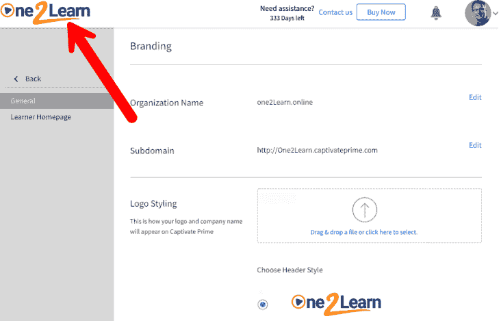

Figure 2.3 – 您的标志显示在 Captivate Prime 的左上角

### 自定义配色主题

标志显示在标题左上角后，您的 Captivate Prime 账户已经与几分钟前相比传达了截然不同的身份。话虽如此，在它看起来与您组织其他在线平台相似之前仍有一些工作要做。在本节中，您将向 Captivate Prime 账户引入品牌身份的另一个关键方面：您的企业配色方案。

为帮助您，Captivate Prime 提供了六个专业设计的配色主题。您将首先选择最接近您想要实现最终外观和感觉的配色主题。然后，您将进一步自定义所选主题，使其完全符合您的企业颜色：

- 1. 确保您已作为管理员登录，并且位于管理员主页。
- 2. 点击左侧列底部“Configure”部分中的品牌链接。这会将您带到管理员应用程序的品牌页面。
- 3. 点击与主题选项关联的编辑链接。

当您向下滚动页面一点时，您会看到随 Captivate Prime 提供的六个主题的列表。默认情况下，Prime 默认主题应用于任何新账户。

- 4. 选择其他可用主题。您可以在主题选择器正上方的主题预览部分预览所选主题。

请注意主题预览部分两侧的左右箭头。这些允许您在 Captivate Prime 的不同区域预览所选主题。在下面的屏幕截图中，应用了 Pebbles 主题，主题预览区域显示了第三个可用的预览图像。

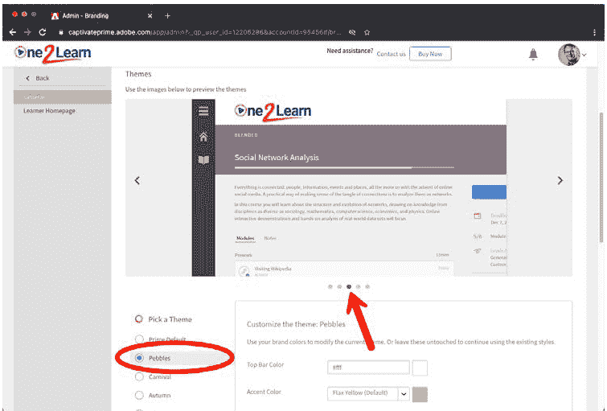

继续浏览和预览可用主题，直到找到您喜欢的一个。下一步是进一步自定义所选主题，使其完全符合您组织的颜色指南。

> **访问颜色指南**
> 如果您无法访问组织的颜色指南，或您的组织没有颜色指南，您可以使用随附文件中提供的示例颜色指南。查找 branding/colorGuide.pdf 文件。

Adobe Captivate Prime 允许您自定义每个主题的四个不同方面：**顶部栏颜色**、**强调颜色**、**主要颜色** 和 **侧边栏亮度。**

- 5. 要识别每个选项控制界面的哪个区域，请点击主题选项区域底部的 **显示提示** 链接。

这会在主题预览上切换提示，如下图所示。

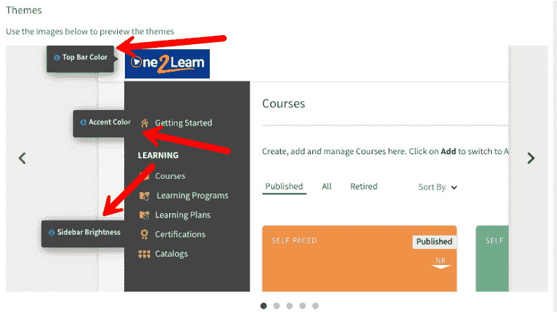

Figure 2.5 – 主题预览中已启用提示

现在您对每个选项控制的 **用户界面 (UI)** 方面有了更好的了解，让我们开始自定义顶部栏颜色。

- 6. 在所选主题的选项中，点击 **顶部栏颜色** 字段。默认情况下，每个主题的顶部栏颜色均为 #FFFFFF。（#FFFFFF 是 *白色* 的十六进制代码。）

- 7. 输入所需的颜色代码或在颜色选择器中选择颜色。完成后点击 **选择** 按钮。

**顶部栏颜色** 是跨越 Captivate Prime 界面顶部标题区域的背景颜色。您的更改会立即反映在主题预览区域。如果您不喜欢新颜色，只需使用其他颜色代码重复上述操作，直到找到您喜欢的颜色。

现在，让我们修改 **强调颜色**。强调色是左侧边栏中显示的图标的颜色。

- 8. 在所选主题的选项中，打开 **强调颜色** 下拉菜单。
- 9. 在列表中选择任意颜色。您的选择会立即反映在主题预览区域。
- 10. 如果您想使用自定义 **强调颜色**，您必须先在 **强调颜色** 下拉菜单末尾选择 **自定义**，然后必须输入自定义颜色的颜色代码或使用颜色选择器选择。

下一个可用选项是 **主要颜色**。与 **强调颜色** 一样，您可以在下拉列表中选择另一种颜色。如果您想要自定义颜色，首先需要在下拉列表末尾选择 **自定义**，然后必须输入您想要用作主要颜色的确切颜色代码。

与其他主题自定义不同，更改 **主要颜色** 不会在主题预览区域中反映。实际上，**主要颜色** 是 Captivate Prime 中的全新选项。它控制新 *沉浸式* 用户体验的一些 UI 元素。现在，请做好所选 **主要颜色** 的笔记。您将在下一节学习关于 *沉浸式* 和 *经典* 用户体验时参考它。

主题可用的最后一个自定义选项是 **侧边栏亮度**。这控制左侧边栏背景的深浅。

- 11. 将 **侧边栏亮度** 滑块向左和向右移动。操作时，请查看主题预览区域中的左侧边栏。

请注意，字体颜色会根据所选的 **侧边栏亮度** 在白色和黑色之间自动切换。

- 12. 继续调整 **侧边栏亮度**，直到左侧边栏在主题预览中看起来符合您的要求。
- 13. 最后，点击屏幕右下角的 **保存** 按钮保存您的更改。

Captivate Prime 重新加载后，您应该会看到新的自定义主题已应用。

- 14. 在继续下一节之前返回管理员主页。

在本节结束时，Captivate Prime 的图形方面已与您公司的品牌形象非常接近。您的标志可见于左上角，使用的是您公司的品牌颜色。

这就是 Captivate Prime 内置选项在自定义账户整体外观和感觉方面能带您走多远。如果这感觉有些受限，您可以通过将 Captivate Prime 用作 **无头 LMS** 将自定义提升到下一个层次。这需要您内部开发团队或专业承包商进行一些自定义开发。有关将 Captivate Prime 用作无头 LMS 的更详细讨论将在本章末尾进行。

## 其他视觉自定义

Adobe Captivate Prime 允许您自定义平台的其他图形方面，例如自定义进度图标、自定义鼠标指针图像、自定义字体等等。不幸的是，在撰写本文时，这些额外的自定义无法在管理员界面中完成。

如果您需要进行这些更改，您需要联系 Captivate Prime 支持团队。

阅读本节后，您的 Prime 账户看起来与本章开始时已大不相同。但到目前为止，您一直停留在管理员环境中。在下一节中，您将了解如何自定义学习者体验。

## 自定义学习者体验

只有一小部分用户需要访问 Prime 账户的管理员区域。您账户的大多数用户将是学习者。这些学习者将登录您的账户以浏览课程目录、自行报名课程、学习课程、与其他学习者互动等等。

这就是为什么做好学习者体验是设置 Captivate Prime 账户的关键方面。在本节中，您将迈出控制学习者体验的第一步。

### 了解经典和沉浸式体验

多年来，Captivate Prime 为学习者提供了一定的用户体验。这种用户体验在使 Captivate Prime 成为获奖 LMS 方面发挥了关键作用。但时代在变。无论是听音乐、观看电影或连续剧、在线购物还是访问公共服务，平台数量在近年激增，用户现在比以前更习惯于消费数字体验。他们的期望已经改变。

Today's digital citizen wants highly personalized experiences that can be consumed seamlessly on any device. Of course, the digital learning industry does not escape this fundamental trend observed everywhere on the internet. As a learner-centric LMS, Captivate Prime takes the learner experience very seriously and Adobe is committed to always providing the best possible training experience.

That's why, in the December 2020 update, the Captivate Prime team introduced a brand new learner experience. This new user experience is called the *Immersive* experience, while the original learner experience (the one that has been around since the beginning of Prime) is called the *Classic* experience.

The default experience used by any new Captivate Prime account is the *Immersive* experience. But, if you have been using Captivate Prime for a longer time, the older *Classic* experience is maintained until you explicitly make the switch to the new *Immersive* experience.

You will now review both of these experiences and have a high-level overview of the options available for each of them.

## Discovering the Classic learner experience

You will begin with the *Classic* experience. Remember that this is the older experience provided by the original version of Captivate Prime. If you just activated your Prime trial account, the default learner experience is the new *Immersive* experience, so in order to review the *Classic* experience, you must first activate it.

## Getting ready

The best way to experiment with the options discussed in this section is to log in to your Prime account twice:

- Once as an administrator
- Once as a learner

To be able to log in twice to the same platform, you can use two different browsers. You need to log in as an administrator using one browser and as a learner using the second browser. If you don't have access to multiple browsers, you can also open a *private* window (called an *Incognito* window in some browsers) and log in to your Prime account once in each private window of the same browser.

Remember that in order to log in as a learner, you first need to log in as an administrator, then switch to the learner role using the following procedure:

- 1. Use another browser or a new private window in the same browser to log in to your Captivate Prime account a second time.
- 2. Once logged in as an administrator, click the user icon in the top right corner of the screen.
- 3. Choose the Learner role.
- 4. When Captivate Prime reloads, you are logged in as a learner.

Make sure you have access to both the administrator and the learner experiences before moving on to the next section.

## Activating the Classic experience

To activate the Classic experience, use the browser window where you are logged in as an administrator and perform the following steps:

- 1. Make sure you are on the administrator homepage of your Prime account.
- 2. Click the Branding link located in the Configure section at the end of the left sidebar.
- 3. Scroll down the Branding page until you see the Homepage Experience option.

For new accounts, the default value of the Homepage Experience option is Immersive, as shown in the following screenshot.

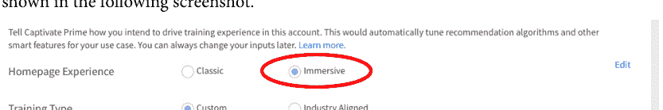

Figure 2.6 – 新账户的默认 Homepage Experience 是 Immersive 体验

If you use an older account, the Homepage Experience may already be set to Classic. In this case, you don’t have to perform the remaining actions of this section.

- 4. Click the Edit link associated with the Homepage Experience option. It is situated on the right-hand side of the screen.
- 5. Change the Homepage Experience from Immersive to Classic. Note that this immediately changes the options available further down the page.
- 6. Click the Save button located in the bottom right corner of the page.

Captivate Prime should display a quick message acknowledging that the new options have been successfully saved. You can now switch to the browser window where you are logged in as a learner.

- 7. Refresh the browser window where you are logged in as a learner.

After the window refreshes, the older Classic experience is displayed. It should be similar to the following screenshot.

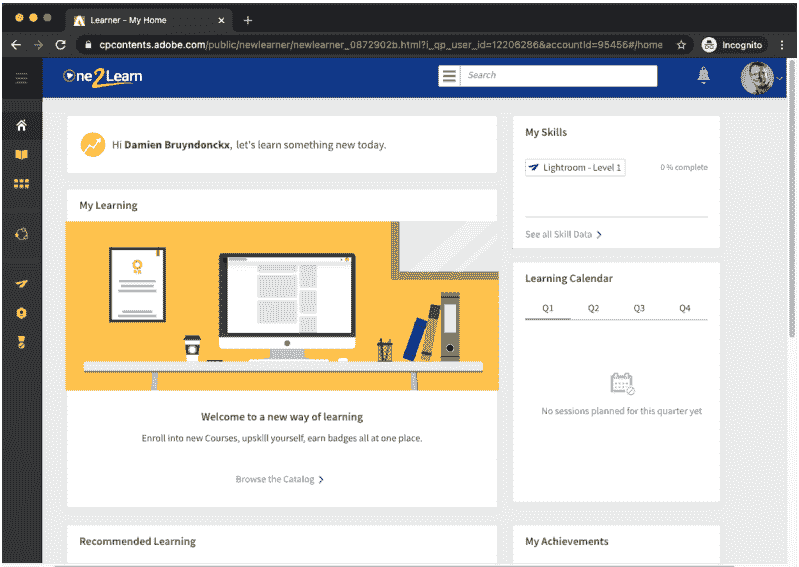

Figure 2.7 – 屏幕上显示较旧的 Classic 体验

Now that the Classic experience has been activated, let's take a closer look at it.

## Browsing the Classic experience as a learner

In this section, you will simply take a look at the Classic learner experience, so you need to use the browser window in which you are logged in as a learner. While browsing the Classic experience, keep in mind that your new Prime trial account is currently completely empty: no custom training material has been uploaded, no user has been defined, and no activity has taken place on your Prime account yet.

Just like the admin experience, the learner homepage is divided into three main parts. The header across the top of the page, a sidebar on the left of the interface and the main content area in the middle:

- 1. Before going any further, take some time to reduce the width of your browser window.

You should notice that the Classic user experience does not properly resize when the width of the browser window changes. The Classic user experience is *not* responsive. This means that it is designed for the wider screens of desktop/laptop computers, but not for the narrow screens of tablets and smartphones. A native mobile application (iOS and Android) is available for learners wanting to take their Prime-hosted courses on their mobile device. Using the mobile app is covered in more details in *Chapter 7, Reviewing the Learner Experience.*

- 2. Make sure you maximize your browser window before continuing.

- 3. Click the hamburger icon (the icon with the three horizontal bars) located in the top left corner of the screen.

This action extends the menu available in the left sidebar. Take a good note of the available items and their associated icons. Make sure you are on the **Home** page before moving on.

- 4. Scroll the learner's homepage from top to bottom. Pay close attention to the various sections available.

Each section is a widget that is designed to display specific information. Let's discuss the main widgets in more detail:

**Welcome and announcements** – This is the first visible widget at the very top of the page. It currently displays a nice welcome message. This widget is meant to display various types of announcements created by the platform administrator. You will learn more about messaging and announcements in *Chapter 15, Working With Messages and Announcements.*

**My Learning** - This widget displays some statistics and provides quick access to all pending activities of the logged-in learner. It is currently empty because the learner is not enrolled for any courses yet, but that will change very soon! There are several ways to enroll learners to courses. These will be discussed in detail in *Chapter 6, Enrolling Learners to Courses.*

**Recommended Learning** – This widget displays the courses that the system recommends to the learner. These recommendations are based on learner data such as skills achieved, profile information, or peers’ achievements, and is powered by the **Adobe Sensei** artificial intelligence. You will learn more about the AI-powered feature of Prime in *Chapter 13, AI-Powered Recommendations for Learners.*

**Learning Calendar** – This widget proposes a chronological view of all upcoming learning events such as submission deadlines, live or virtual classes in which the user is registered, and so on. Unfortunately, this calendar does not natively integrate with a learner's work/email calendar. Take some time to explore the other widgets present on the page.

- 5. When ready, click the **Browse the Catalog** link at the bottom of the **My Learning** widget. You can also use the **Catalog** icon of the left sidebar (it is the third icon from the top).

This action takes you to the default learning catalog. Notice that a handful of courses are already available in the catalog. These are the default courses available in any new Prime account. You can use them to test various aspects of the Prime platform without spending time creating and uploading your own content. Even though you can delete these default sample courses, make sure you keep them active for the remaining exercises of this book.

Click any course card in order to view that course's content. You can also hover over the bottom area of a course card and click the **View Course** link. This action takes you to that course's homepage.

- 6. Click the **Enroll** button located in the top right area of the page to enroll on that course.

This action opens the course-taking experience called **fluidic player**. The Fluidic player is where the course content is actually delivered. You will learn more about fluidic player and the overall learner experience in *Chapter 7, Reviewing the Learner Experience*, but, for now, let's close the fluidic player and return to the learner homepage.

- 7. Click the close icon located in the top right corner of the fluidic player. This takes you back to the course homepage.

- 8. From there, click the **Home** icon at the top of the left sidebar. You can also click the account name or the logo in the top left corner of the screen.

This action takes you back to the learner's homepage. Notice that the content of the My Learning widget has changed. Since you enrolled in a course, the widget shows some statistics about your progression in the course you are enrolled in, as well as a direct link to continue that course where you left off. Also, notice the My Skills widget in the top right corner of the screen, which should display the skills currently in progress.

This little experiment tells a lot about how these widgets actually work. The content they display depends on your actions as a learner. This makes the learner homepage different for each learner.

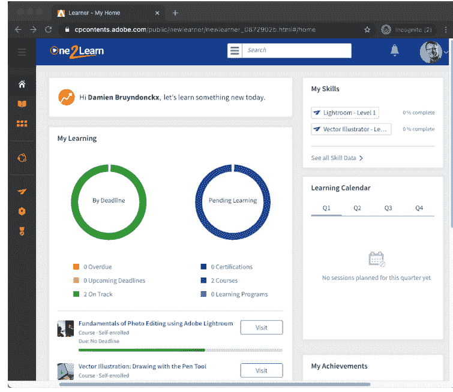

Figure 2.8 – My learner’s homepage after enrolling in two of the courses available by default

Now that you have a better idea of the learner homepage in the Classic layout, let's switch back to the admin area of Prime to examine how the administrator can customize the Classic experience.

## Customizing the Classic experience as an administrator

In this section, you will examine the options available to the administrator to customize the Classic learner experience:

- 1. Return to the browser window in which you are logged in as an administrator. Make sure you are on the administrator homepage.
- 2. Click the **Branding** link located in the **Configure** section at the bottom of the left sidebar.
- 3. Once on the **Branding** page, click the **Learner Homepage** link in the left sidebar.

This takes you to the **Learner Homepage Settings** page. This page is where you can customize both the older *Classic* and the newer *Immersive* layouts. In this section, you will inspect the options available to customize the Classic layout, so your first task is to make sure that you are seeing the options for the correct layout.

- 4. At the top of the **Learner Homepage Settings** page, make sure the **Immersive** switch is disabled as shown in the following screenshot.

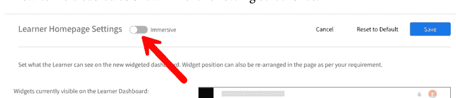

The rest of the page is divided into two columns. In the right column, you see a preview of the learner homepage. This should be very similar to the homepage you visited while logged in as a learner.

In the left column, you should see a list of all the widgets available on the learner homepage. Notice that you can enable or disable any widget with the exception of the **Welcome and Sticky Announcements** widget, which cannot be disabled.

- 5. Disable a few widgets per your liking. Notice that the preview on the right automatically updates as you enable and disable widgets.

You can also use the preview on the right to rearrange the enabled widgets.

- 6. Move the widgets around in the preview area using simple drag and drop actions.
- 7. Once the learner homepage looks the way you want, click the **Save** button located in the top right corner of the **Learner Homepage Settings** page.

Captivate Prime should display a quick **Settings Saved** message. When done, return to the browser window in which you are logged in as a learner to check on the changes you just saved.

- 8. Switch back to the browser window in which you are logged in as a learner.
- 9. Refresh the page and confirm that it complies with the new settings you have defined in the administrator area.

> **Tip**
> If you want to quickly return to the default settings of the Classic experience, switch back to the administrator role and click the **Reset to Default** link located next to the **Save** button in the top right corner of the **Learner Homepage Settings** page.

In this section, you have discovered the *Classic* learner experience and the options allowing you to customize it. In the next section, you will take a closer look at the newer *Immersive* experience.

## Discovering the Immersive learner experience

Now that you have a better idea of what the *Classic* learner experience looks like, let’s spend some time discovering the new *Immersive* experience and the options available to the administrator in order to customize it.

Before doing so, let’s reflect on the current situation of your Captivate Prime account. Currently, the older *Classic* experience is activated. The newer *Immersive* experience is available, but it is not enabled. Remember also that the new *Immersive* experience was introduced with the December 2020 update and that it is the default experience of any new Prime account. If you are using an older Prime account (one that was activated prior to December 2020) the current situation is probably similar to the one of your own Prime account.

In this section, you will pretend to be an older Prime customer that wants to switch from the old *Classic* experience to the new *Immersive* experience. In this case, you want to make sure that the new *Immersive* experience meets your requirements before making it available to your learners. So, you will leave the *Classic* experience enabled while discovering and setting up the *Immersive* experience behind the scenes. It is only when the new experience will be completely ready for production that you will make the switch for your learners.

## Getting ready

In order to work through the examples of this section, you have to find a way to experiment with the new *Immersive* experience as an administrator, while leaving the older *Classic* experience enabled for your learners until you are ready to make the switch. Fortunately, there is a way to achieve this in Captivate Prime using the following procedure:

- 1. Make sure you are logged in as an administrator to your Prime account.
- 2. Open a new tab or a new browser window.
- 3. In the new tab, browse to the following URL: `https://captivateprime.adobe.com/app/learner?learnerLayout=IMMERSIVE.`
- 4. Enter your email ID and/or your password if prompted to do so.

Thanks to this trick, you can experience the new *Immersive* learner experience while regular learners using your Prime account still use the older *Classic* experience.

## Browsing the immersive experience

Now that you have access to the new *Immersive* experience, let's take a closer look at it.

First, notice that the header (across the top of the screen) and the left sidebar are exactly the same as in the *Classic* experience. The most obvious visible difference is in the main content area. That being said, there is another very important (yet a little less obvious) change introduced by the *Immersive* experience:

- 1. Reduce the width of your browser window.

While doing so, notice that the *Immersive* experience perfectly fits whatever the screen width. Unlike the *Classic* experience, the *Immersive* experience is said to be *responsive*. It means that it is able to automatically adapt itself to a wide range of screen widths, making it possible to enjoy the new experience on virtually any device.

- 2. Maximize your browser window before continuing.

The *Immersive* experience proposes a Netflix-like interface, similar to the experience provided by a wide number of platforms we have grown accustomed to. The big area at the top is called the *Masthead*. It serves a similar purpose as the old **Welcome and Announcements** widget of the Classic experience: it allows the administrator to display special announcements to learners.

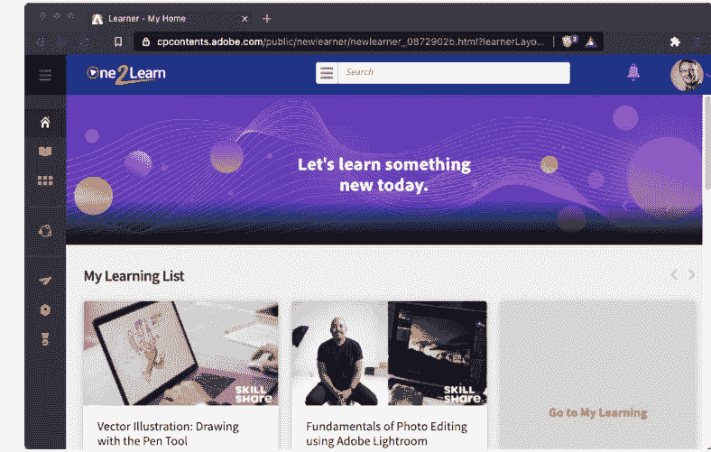

Figure 2.10 – The big announcement area at the top of the Immersive experience is called the Masthead

In *Chapter 15, Working With Messages and Announcements*, you will learn how to create such announcements and how to target them at various types of learners.

Just under the Masthead, in the **My Learning List** area, you should find the course you enrolled on in the previous section of this book.

- 3. Scroll down the *Immersive* experience to the very bottom of the page, taking the necessary time to identify each section.

You should recognize the old widgets from the *Classic* experience in the different sections of the *Immersive* experience, but with a fresh, modernized (and responsive) look.

在页面的底部，您还应注意到一些在旧版 Classic 体验的小部件中没有对应项的新部分。这些部分用于显示各种类型的个性化推荐。这些部分的内容对每个学习者来说都是独一无二的。它是由 Captivate Prime 的 AI 驱动推荐引擎自动生成的。

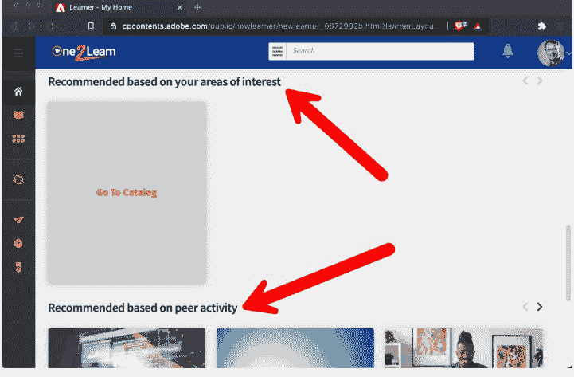

Figure 2.11 – 功能强大的 AI 驱动推荐引擎显示各种类型的推荐，这些推荐对每个学习者都是独一无二的

同时请注意“Go to My Learning”、“Continue”以及“Go to Catalog”链接和按钮的颜色。它对应于当前应用主题的主色（Primary Color）。如有需要，请随时返回主题选项以按您的喜好修改主色。

## 作为管理员自定义 Immersive 体验

现在您对 Immersive 体验的外观有了更好的了解，让我们返回管理应用程序，以检查平台管理员可用于自定义它的选项：

- 1. 返回您 Prime 账户的管理员主页。
- 2. 点击左侧边栏末尾 Configure 部分中的 Branding 链接。
- 3. 进入 **Branding** 页面后，在左侧边栏中点击 **Learner Homepage link** 以打开 **Learner Homepage Settings** 页面。
- 4. 在 **Learner Homepage Settings** 页面顶部，将 **Immersive** 开关切换为开启。

打开此开关会显示 *Immersive* 体验的选项。请记住，这些选项目前对您向学习者提供的体验没有影响，因为他们仍在使用旧的 *Classic* 体验。

页面的右侧会显示 *Immersive* 体验的预览。此预览应与您在上一节中查看的学习者主页相似。可用选项显示在左侧列中。

- 5. 花点时间检查可用选项。大多数选项都应不言自明。

请注意，主页的某些部分（**Recommended by <your account name>** 和 **Browse by Catalog**）默认未启用。这是因为这些部分在显示相关内容之前需要管理员提供一些额外输入。您将在 *Chapter 13, AI-Powered Recommendations for Learners.* 中更详细地回顾这些选项。

- 6. 使用右侧的预览通过简单的拖放操作重新排列 *Immersive* 主页的各部分。

与您自定义 *Classic* 体验时所做的一样，您可以使用简单的拖放操作重新组织 *Immersive* 体验的各部分。请注意，某些部分（如 **Masthead**、**My Learning** 部分和 **Footer**）无法以这种方式重新排列。

- 7. 按您认为合适的方式重新排列 *Immersive* 主页。
- 8. 完成后，点击屏幕右上角的 **Save** 按钮。
- 9. Prime 显示快速的 **Settings Saved** 消息后，返回显示 *Immersive* 体验的浏览器标签页/窗口（如果该标签页/窗口不再打开，请使用以下链接：https://captivateprime.adobe.com/app/learner?learnerLayout=IMMERSIVE）。
- 10. 刷新页面并确认其符合您在管理区域中设定的新设置。

您现在对 *Immersive* 体验以及管理员可用于自定义它的选项有了更好的了解。*In Chapter 13, AI-Powered Recommendations for Learners*，您将回顾管理员可用于影响 AI 推荐引擎提供的内容的选项。

## 切换到 Immersive 布局

在回顾本书的前几节后，您已能够让新的 *Immersive* 体验看起来符合您的期望。现在是时候将这种新体验带给您的学习者了。请记住，他们仍在使用旧的 *Classic* 体验。

在本节中，您将首先将 *Immersive* 体验恢复为默认设置（这是本书中所有后续示例所必需的）。然后，您将正式将整个 Captivate Prime 账户切换到新的 *Immersive* 体验。

- 1. 返回您 Prime 账户的管理员主页。
- 2. 点击左侧边栏末尾 **Configure** 部分中的 **Branding** 链接。
- 3. 进入 **Branding** 页面后，在左侧边栏中点击 **Learner Homepage link** 以打开 **Learner Homepage Settings** 页面。
- 4. 在 **Learner Homepage Settings** 页面顶部，确保 **Immersive** 开关已切换为开启。
- 5. 点击屏幕右上角 **Save** 按钮旁边的 **Reset to Default** 链接。

以下截图描绘了最后这两个操作。

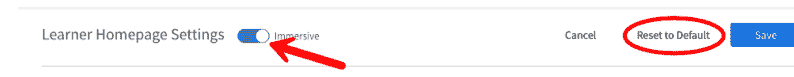

Figure 2.12 – 将 Immersive 体验的选项重置为默认值

您现在准备好保存 *Immersive* 体验的配置并使其可供学习者使用。

- 6. 点击页面右上角的 **Save** 按钮。Captivate Prime 会显示快速的 **Settings Saved** 消息以确认操作成功。
- 7. 点击左侧边栏顶部的 **General** 链接返回主 **Branding** 页面。
- 8. 进入 **Branding** 页面后，向下滚动直到看到 **Homepage Experience** 选项。确认其当前设置为 **Classic**。
- 9. 点击与 **Homepage Experience** 选项关联的 **Edit** 链接。
- 10. 将 **Homepage Experience** 切换为 **Immersive**。
- 11. 点击页面右下角的 **Save** 按钮。

请注意，此最后操作会修改页面下方可用的选项。您将在 *Chapter 13, AI-Powered Recommendations for Learners.* 中回顾这些选项。

此最后操作使 *Immersive* 体验的切换对使用您 Prime 账户的所有学习者生效。

> **重要**
> 对于本书的剩余示例，我们假设您的 Prime 账户中已启用默认的 *Immersive* 体验。

## 其他自定义

在本章中，您已回顾了 Prime 账户中可用的主要品牌和自定义选项。话虽如此，系统中还有许多其他方面可以自定义。您将在本书各章中回顾它们。尽管如此，让我们在此快速列出其他主要可能的自定义项：

- **徽章**：在 *Chapter 11, Badges and Gamification* 中，您将了解徽章。Captivate Prime 附带了一些现成的徽章，但您可以在 Prime 中开箱即用的徽章之外定义自己的自定义徽章。
- **课程卡片**：在 *Chapter 4, Creating Skills and Courses* 中，您可以通过为每门课程上传一组独特的封面和横幅图片来自定义每张课程卡片的外观和感觉。
- **电子邮件模板**：在 *Chapter 15, Working With Messages and Announcements* 中，您将自定义 Prime 平台发送给用户的各种电子邮件消息的外观和内容。

这些自定义项是在本章已讨论的自定义项之外的补充。这使得 Captivate Prime 成为一个高度可定制的基于云的 LMS，您可以使用它为学习者提供符合您公司品牌形象的企业级体验。

## 使用 Captivate Prime 实现 Headless

如果您想将自定义提升到下一个层次，并为学习者提供完全属于您自己的 eLearning 体验，Captivate Prime 提供了独特的 **headless** 能力。这在以下情况下非常有用：

- 您不想受限于 Captivate Prime 中可用的原生自定义选项。
- 您希望以更突出、自定义的方式展示某些学习资源/目录/项目。
- 您希望为现有的高度自定义的数字体验增加学习维度。
- 您希望将来自各种来源的内容（**内容管理系统 (CMS)**、**学习管理系统 (LMS)**、营销自动化、大数据等）组合成单一的在线体验。
- 等等...

首先，让我们尝试理解在 CMS 或 LMS 等 Web 应用程序的上下文中 *headless* 是什么意思。

通常，CMS 或 LMS 有两个不同的部分：

- **公开可用区域**，也称为 **frontend**。对于 CMS 来说，这通常是可在互联网上公开访问的网站。对于 LMS 来说，该区域通常是学习者在平台上学习课程时获得的体验。
- **管理区域**，也称为 **backend**。该区域仅供管理员使用。主要用于编辑向公众提供的可用内容。请注意，在 Captivate Prime 的情况下，管理区域进一步细分为 Administrator、Author 和 Integration Admin 等角色。

在经典的 CMS 或 LMS 平台中，这两个空间紧密耦合。这意味着它们托管在同一域名下并由同一平台管理。例如，部署在地址 www.mycompany.com 下的典型 WordPress 站点的管理区域通常可在 www.mycompany.com/wp-admin 访问。通过比较这两个 URL，您可以清楚地看到公共区域和管理区域都部署在同一个站点下的一个唯一域名下。

### WordPress
WordPress 是目前最流行的 CMS 之一。它驱动着互联网上约 40% 的网站。您可以在 https://wordpress.org/ 找到有关 WordPress 的更多信息。有关最广泛使用的 CMS 的列表，请参考维基百科 https://en.wikipedia.org/wiki/List_of_content_management_systems。

去头化意味着前端（面向公众的部分）和后端（管理区域）是 *解耦* 的。换句话说，它们可以是使用不同技术、托管在两个不同的 IT 基础设施上并使用两个完全不同的域名 的两个完全不同的系统。

换句话说，去 *无头* 意味着您可以设计和开发一个托管在任何域名上的自定义网站，但其 *内容*（部分）来自 Captivate Prime，并且完全通过 Prime 的各个管理区域进行管理。

在撰写本文时，Captivate Prime 是市场上为数不多的提供此类功能的 LMS 之一。为了实现这一点，Captivate Prime 提供了以下两个功能：

- 您可以使用与在网页上嵌入 YouTube 视频类似的技术将 fluid player 嵌入到您的网站中。
- Captivate Prime 提供全面的 **应用程序编程接口 (API)**。这意味着您的网站的开发人员可以远程查询 Captivate Prime 获取内容，然后在您的（现有）网站中显示该内容。您的网站还可以使用 Prime API 将数据（例如用户在课程中的进度、测验和调查结果、提交的作业等）发布到 Captivate Prime 后端。

如果这对您来说听起来相当技术性，请不要担心！实施 headless LMS 是开发人员的工作。许多 Captivate Prime 客户已成功完成了此操作。作为 Prime 用户或管理员，您不必担心实施 headless LMS 的细枝末节。

本节的主要要点是，由 Captivate Prime 管理的课程内容和所有学习互动都可以通过您自己的自定义网站传递给学习者。

## Summary
通过本章，您已通过自定义帐户名称及其可访问的 URL 使 Captivate Prime 成为您自己的。您还通过上传公司标志并使平台使用品牌标识的颜色来自定义了帐户的外观和感觉。这些是在使 Captivate Prime 成为贵组织旨在为其员工、合作伙伴、供应商、客户等提供的整体数字体验的一部分的关键方面。

您还讨论了将在本书各章节中回顾的其他可能的自定义。最后，您发现 Adobe Captivate Prime 可用作 headless LMS。这允许您将学习体验与 Captivate Prime 后端解耦，从而使几乎任何自定义成为可能。

您现在距离为学习者提供高度吸引人的体验又近了一步。话虽如此，在您能够欢迎第一批学习者进入新的 Prime 帐户之前，还有工作要做。事实上，您的帐户仍然完全是空的。它既缺少您将为学习者提供的自定义课程内容，也缺少学习者本人！

您将在接下来的两章中解决这两个问题中的一个，在其中您将学习如何将自定义学习模块上传到平台以及如何将这些模块组装成课程。

## 3 Uploading Learning Content and Managing the Content Library
在上一章中，您通过修改其图形外观，使其看起来像贵组织使用的任何其他系统，从而接管了您的 Captivate Prime 帐户。这是重要的一步，但您的 LMS 仍然缺少两个最关键的要素：内容和学习者。

在本章中，您将引入这两个缺失要素中的第一个：内容。首先，我们将讨论托管在您的 Prime 帐户中的内容来源。您会发现您有两种将内容添加到课程目录的选项：您可以订阅第三方现成的内容库，或将您自己的自定义课程内容上传到平台。

然后，您将切换到作者角色以将各种类型的学习内容上传到 Captivate Prime LMS。这包括上传常见文件类型，如视频、演示文稿、文档等。但电子学习行业也有自己的标准和格式，因此您将探索如何将 AICC、SCORM 和 xAPI 包上传到您的 **内容库**。您还将了解如何将 **工作辅助** 上传到您的帐户，并讨论常规 *模块* 与工作辅助之间的区别。

最后，您将探索如何长期管理您的内容库。这包括上传现有内容的新的版本、添加语言版本以及退役过期内容。

在本章结束时，您将全面了解内容库的功能及其在管理 Captivate Prime 帐户内内容中的关键作用。

为实现这一目标，本第三章将涵盖以下主题：

- 将内容导入 Captivate Prime
- 创建自定义课程模块
- 管理内容库
- 创建工作辅助

现在，是时候将一些内容导入云端，以便学习者最终可以访问它并使用您的 Prime 帐户提升技能。

## Technical requirements
执行本章所述任务，您需要满足以下技术要求：

- 您必须拥有正在运行的 Captivate Prime 帐户（可以是免费试用帐户）的管理员和作者访问权限。
- 您需要访问各种类型的学习内容（视频、文档、演示文稿、SCORM 包等），以便您可以将其上传到您的内容库。如果您无法访问此类内容，则在与本书关联的下载中的 `courseContent` 文件夹中提供了一些示例文件。
- 可选地，如果您想从 Adobe Captivate 上传交互式课程模块，则需要访问 Adobe Captivate（2019 版或更高版本）（Adobe Captivate 的免费 30 天试用版是可以的）。

## Getting content into Captivate Prime
Adobe Captivate Prime 是一个 LMS。定义 LMS 的基本方法就是说它是学习内容、学习者和讲师相遇的地方。换句话说，将学习内容导入 Captivate Prime 至关重要。

与许多其他 LMS（尤其是针对教育市场的 LMS）不同，Captivate Prime 没有任何内置的基于浏览器的内容创作功能。这意味着托管在您的 Captivate Prime 帐户上的所有内容都必须从系统外部引入。

基本上，可供学习者使用的内容可以来自两种类型的来源：

- 您可以将第三方现成的内容库集成到 Prime 中。
- 您可以将您自己的自定义学习内容上传到平台。

让我们更详细、更高层次地看看这两个选项。

## Integrating third-party, off-the-shelf content
有很多学习内容提供商，组织订阅外部学习内容库为其员工提供丰富的学习资源是很常见的。

一些最著名的提供商是 LinkedIn Learning（以前称为 Lynda.com）、Udemy、OpenClassrooms 和 Pluralsight。这些供应商提供数万门课程，涵盖多种语言和广泛的主题。从商业（领导力、管理、个人发展、沟通等）到技术（网络管理、数据科学、编程语言、网页开发等），从办公自动化（Microsoft Office、SharePoint、Open Office、Adobe Acrobat 等）到创意（3D 建模、动画、设计、视频编辑等），越来越多的员工通过其组织的订阅享受访问这一庞大学习材料的便利。越来越多的雇主将访问此类内容视为其提供的标准套餐的一部分。

但组织并不是为了它本身而提供此类内容的访问权限！他们想要投资回报，这意味着他们需要从这项培训工作中获得数据。例如，他们想知道哪些员工积极参与学习新技能，以便这些员工可以获得加薪或晋升到更高职位。组织还希望确保每位员工都花时间提升自己，以便每个人在各自的角色中保持最新，或确保每个员工都有效地、成功地完成了所需的认证和合规培训，等等。

这正是像 Captivate Prime 这样的平台发挥作用的地方。通过将这些外部内容集成到 LMS 中，Prime 可以追踪与学习材料的每次交互，并基于这些数据生成有意义的报告，从而使管理者能够做出明智的决策。Prime 还能够利用其 AI 驱动的推荐引擎挖掘这些庞大的培训内容库，然后提供一份高度相关的定制化推荐列表，以匹配每个学习者的当前行业标准和要求。

为了实现这种集成，Captivate Prime 开箱即提供一些连接器。许多这些提供商还提供 API，供您的开发团队使用，以便将内容作为课程目录在您的 Prime 账户中提供。

## Uploading your own custom content

除了上一节讨论的外部内容之外，大多数组织还需要对其员工进行与其特定业务、法规、工作流程和工具相关的特定主题的培训。另一个用例是当组织想要对其产品、工作流程、工具等对外部用户（如供应商、承包商甚至客户）进行培训时。因此，Captivate Prime 还为您提供上传自己的自定义课程材料的能力。

请记住，Captivate Prime 不包含任何内置的 authoring 工具，因此这些自定义内容必须在 Prime 之外制作。

## Conclusion

使用您的 Prime 账户的学习者可以访问第三方提供商提供的外部内容以及您内部教学设计师制作的自定义内容。这两种类型的内容都由系统追踪，并且这两种类型的内容都由 AI 驱动的推荐引擎用于为每个学习者生成定制推荐。这使得 Captivate Prime 能够适应日益广泛的组织和用例。

通过开箱即用的一些连接器以及 IT 和开发团队可以利用的 API 来集成该内容到 Prime 账户中，使得外部内容的集成成为可能。自定义内容必须在 Prime 之外制作，因为 Captivate Prime 没有任何内置的 authoring 工具。

在下一节中，您将以作者身份登录并开始向 Captivate Prime 上传自定义模块。

## Creating custom course modules

在本节中，您将通过向内容库上传自定义培训内容来了解 Author 角色。

## Logging in as an Author

上传自定义内容是 Captivate Prime Author 专属的任务。您现在将切换到 Author 角色以访问用于上传培训内容的特性。让我们开始吧：

- 1. 登录您的 Prime 账户。默认情况下，您应以管理员身份登录。
- 2. 单击屏幕右上角的用户图标。
- 3. 在打开的菜单中，选择 Author 角色。

当 Captivate Prime 重新加载时，您应该已以 Author 身份登录。您应该会立即注意到 Author 的主页与 Administrator 的主页不同，如以下屏幕截图所示：

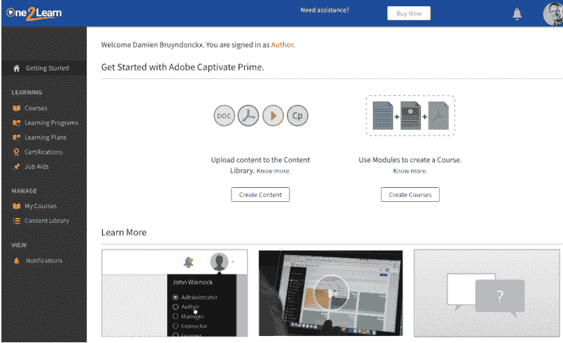

图 3.1 – 对 Author 主页的首次了解

专用于 Captivate Prime 作者的任务以及执行这些任务所需的工具可通过左侧边栏的链接访问。其中两个任务被认为是 Prime 作者的主要任务。这两个任务的链接可在主内容区域顶部获得。这两个任务如下：

- 上传内容到内容库
- 使用模块创建课程

查看左侧边栏的链接，您会发现诸如 **Modules**、**Courses**、**Learning Programs**、**Learning Plans**、**Job Aids** 等词汇。在继续之前，让我们花点时间了解这些词在 Captivate Prime 上下文中的含义。

## Modules, courses, and learning programs

当您向内容库上传文件时，您创建了 Captivate Prime 所称的 **Module**。该模块是 Prime 中可用的最小内容单元。换句话说，您上传到 Prime 的每个视频教程、Word 文档、PDF 文件、PowerPoint 演示文稿和 SCORM 包都被视为 **Module**。

请注意，您上传到 Prime 的模块都是 *异步* 学习活动。如 *第 1 章，Adobe Captivate Prime 简介* 中所述，异步学习活动是指学习者可以自行按自己的节奏和方便程度审阅的一些学习内容。*同步* 活动另一方面是指多个学习者同时连接的学习活动。典型的 *同步* 学习活动是虚拟课程以及传统的课堂教学。

这些模块可以被整理成 **Courses**。从这个角度来看，Captivate Prime 课程只是一系列捆绑在一起的模块。虽然这个课程定义足以让您入门，但在下一章，*创建技能和课程* 中，您会发现课程比这更复杂一些，因为它还可以包含未包含在内容库中的 *同步* 活动。

再往上一步，课程可以进一步整理成 **Learning Programs**。学习计划是一组相互补充的课程。下图总结了 Captivate Prime 中占主导地位的内容层级的基本要素：

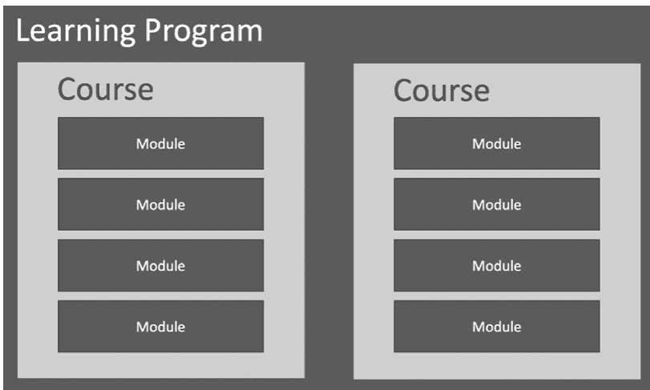

图 3.2 – Captivate Prime 的基本内容层级

在第 6 章，Enrolling Learners to Courses 中，您将发现额外的功能，例如学习路径和认证，这些功能允许您进一步整理 Prime 账户中可用的学习内容。但就目前而言，您已具备足够的见解来进入下一节，在那里您将首次了解内容库。

## A first look at the Content Library

内容库是所有异步课程模块在您的 Prime 账户中可用的位置。默认情况下，每个课程模块最终都会进入内容库，无论哪个作者上传了特定文件。换句话说，Author A 可以看到 Author B 上传的内容，反之亦然。可以将内容库分割成可以设为公开或私有的文件夹。此功能将在本章后面的 Using content folders 部分讨论。

要访问内容库，必须以 Author 身份登录：

- 1. 确保您已以 Author 身份登录并且位于 Author 主页上。
- 2. 单击左侧边栏 Manage 部分中的内容库链接。

此操作会带您进入内容库页面。请注意，默认情况下，您的试用账户的内容库中已有一组模块可用，如以下屏幕截图所示：

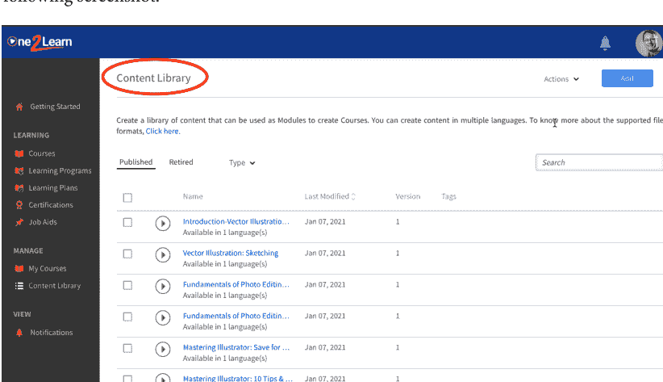

图 3.3 – 使用试用账户时，示例模块已在内容库中可用

您可以使用这些示例模块来测试 Captivate Prime 的功能，而无需承担创建和上传自己的内容的负担。

- 3. 要向内容库添加更多模块，请单击屏幕右上角的 Add 按钮。这会带您进入 Add New Content 表单。
- 4. 花点时间检查 Add New Content 表单。准备好后，单击屏幕左上角的 logo 返回 Author 主页。
- 5. 在 Author 主页上，单击主内容区域顶部位置的 Create Content 按钮。

此最后操作会带您返回 Add New Content 表单。请记住，主页主内容区域顶部可用的链接只是通往作者最常见任务的快捷方式。

- 6. 单击左侧边栏顶部位置的 Back 按钮。此操作会带您返回内容库页面。

从 MP4 视频文件到 Word 文档，从 PowerPoint 演示文稿到 PDF 文件，从静态文本到交互式测验和 SCORM 包，托管在您的 LMS 中的学习内容可以由各种类型的文件组成。在继续上传内容之前，让我们花点时间回顾一下 Captivate Prime LMS 支持的文件类型。

7. 内容库页面的最顶部可以找到内容库的简要定义。花点时间阅读此定义；然后，如以下屏幕截图所示，单击“在此处单击”链接：

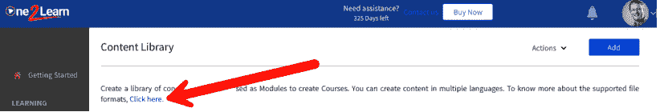

图 3.4 – 内容库定义末尾的“在此处单击”链接

这会带您进入官方 Captivate Prime 用户指南的内容库页面。当您将页面向下滚动一点时，您会找到支持的内容类型列表。

> Note
> 明智的做法是为 Prime 用户指南的此页面添加书签，以便您随时掌握支持的内容类型列表！ https://helpx.adobe.com/captivate-prime/user-guide.html/captivate-prime/authors/feature-summary/content-library.ug.html.

8. 花点时间回顾 Captivate Prime LMS 支持的内容类型列表。

请注意，在 Prime 中，交互式内容和静态内容之间存在区别：

- **静态内容** 是学习者大多处于被动状态的内容。典型的静态内容由 MP4 视频教程、音频播客和文本文档组成。
- **交互式内容** 另一方面，是使学习者处于主动状态的内容。典型的交互式学习内容包括测验、调查、交互式视频、基于场景的培训等等。此交互式内容由专门的电子学习 authoring 工具（如 Adobe Captivate、Articulate Storyline、iSpring 等）创建，并以 SCORM、AICC 或 xAPI 兼容的包形式上传到 Captivate Prime。

您现在应该对内容库是什么以及可以上传到 Captivate Prime 的不同类型文件有了更好的了解。在接下来的两个部分中，您将上传新的模块到内容库并查看可用选项。

## 上传静态内容

现在是时候将您的第一个自定义模块上传到内容库了。您将首先上传静态内容，形式为 Word 文档、PDF 文件、PowerPoint 演示文稿和 MP4 视频。

> **获取内容访问权限**
> 为完成本书本节中的练习，您可以随意使用您可用的任何文件。您也可以使用与本书关联的下载中 `courseContent` 文件夹提供的示例文件。请注意，这些示例文件大多只包含占位符文本。

让我们开始将 Word 文档上传到内容库：

1. 从作者主页，单击主内容区域最上部分位置的 **创建内容** 按钮。

请记住，此操作会带您进入 **添加新内容** 表单。请注意，只有两项信息是必需的：**名称** 和 **添加内容文件** 字段。

2. 在 **名称** 字段中输入新模块的名称。
3. 将 Word 文档拖放到 **添加内容文件** 字段中。（您可以使用 `.doc` 和 `.docx` 两种文件格式。）

> **提示**
> 如果您没有合适的 Word 文档可用，您可以使用与本书关联的下载中的 `courseContent/Theory of file extensions - Part 1.docx` 文件。

4. 作为最佳实践，请花点时间在 **描述** 字段（最多 400 个字符）中输入有意义的描述，并在 **时长** 字段中输入时长（以分钟为单位）。

请注意，**时长** 字段仅用于信息目的，以便学习者知道预期内容，但它对 Captivate Prime 的内容交付方式没有其他影响。

表单底部最后一个剩余字段是 **标签** 字段。目前，您不应能够添加任何标签，因为这些标签必须事先由管理员定义。

**添加新内容** 表单现在应如下所示：

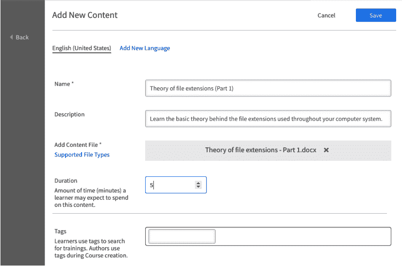

图 3.5 – 添加新内容表单

您现在可以准备将新模块保存到内容库了。

5. 单击屏幕右上角的 **保存** 按钮。

这会带您返回内容库，您应该在列表顶部看到新模块。请注意，您的新模块不会立即可用。Captivate Prime 需要在内容可用之前处理新内容。

6. 当 Captivate Prime 完成处理后，单击您的新模块。

处理时间因各种因素而异，例如文件类型、大小和复杂性。

此最后操作重新打开几分钟前用于上传模块的表单。请注意，如以下屏幕截图所示，页面底部已出现一个新部分：

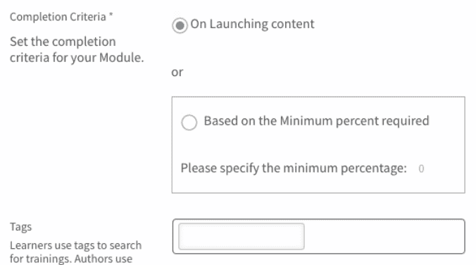

图 3.6 – Captivate Prime 完成内容处理后，新选项可用

此新部分包含取决于所上传内容类型的其他选项。这就是为什么只有在 Prime 完成内容处理后才能提供这些选项。

对于静态内容而言，这些附加选项允许您设置完成标准。完成标准指示 Captivate Prime 何时认为内容已完成。这非常重要，因为 Prime 可以设置为仅在前一个模块完成后才提供对课程下一个模块的访问。Captivate Prime 还使用构成课程的每个模块的完成标准属性来确定是否可以授予徽章、是否已获得技能、是否通过了认证等等：

- 如果您将完成标准保留为默认值 On Launching Content，这意味着只要学习者打开 Word 文档，模块即被视为已完成。
- 如果您想确保学习者花费时间阅读文档，您可以将完成标准更改为 Based on the Minimum percent required 并指定最低百分比。例如，如果您将最低百分比设置为 50%，则意味着当学习者至少查看了文档的 50% 时，该模块被视为已完成。

## 设置完成标准

作为一名讲师，您可能会想始终将完成标准设置为 100%，以确保每个学习者都查看了全部内容。但实际上，这可能并不总是好主意。例如，对于 Word 文档，学习者可以在不实际滚动到文档末尾的情况下阅读整个文档（尤其是文档非常短的情况下）。在这种情况下，即使学习者已查看文件中包含的 100% 相关信息，Captivate Prime 也不会报告该模块已完成。为规避此问题，一些作者将完成标准设置为约 90%，不过在我看来，静态文本为中心的文档的完成标准可以保留为默认值 On Launching Content。

7. 单击屏幕右上角的 **取消** 按钮以关闭表单而不进行任何更改。

您现在已完成将自定义静态模块上传到 Captivate Prime 内容库的过程。

在继续之前，请花点时间使用完全相同的程序上传几个额外的文件。

8. 通过上传 PDF 文件创建一个新模块。如果您无法访问合适的 PDF 文件，您可以使用随本书提供的下载中提供的 `courseContent/Theory of file extensions - Part 2.pdf` 文件。

9. 再创建一个模块，通过上传 PowerPoint 演示文稿。如果您无法访问合适的 PowerPoint 演示文稿，您可以使用随本书提供的下载中提供的 `courseContent/WelcomeToTheCourse.pptx` 文件。（您可以使用 .ppt 和 .pptx 两种文件格式。）

10. 在 Prime 完成处理 PowerPoint 演示文稿后，将基于 PowerPoint 的模块的 **完成标准** 属性更改为最低百分比 **100%**。

对于 PowerPoint 文件而言，100% 的完成标准更有意义，因为 Captivate Prime 非常容易跟踪学习者已查看的幻灯片。

11. 再创建一个模块，通过上传 MP4 视频文件。如果您无法访问合适的视频文件，您可以使用与本书关联的下载中提供的 `courseContent/phishing-address.mp4` 文件。

## 为视频文件上传闭路字幕

如果你在 Captivate Prime 完成处理视频模块后编辑该视频模块，你会发现一个仅适用于基于视频内容的额外字段。它允许你上传 WebVTT 格式的闭路字幕文件。WebVTT 文件是用于在互联网上观看的视频上方显示定时文本的文本文件。它是大多数视频编辑工具都能生成的行业标准。此类文件使用 .vtt 文件扩展名。

在本节结束时，你应该已基于上传到内容库的四种不同文件类型创建了四个额外的自定义课程模块，如以下屏幕截图所示：

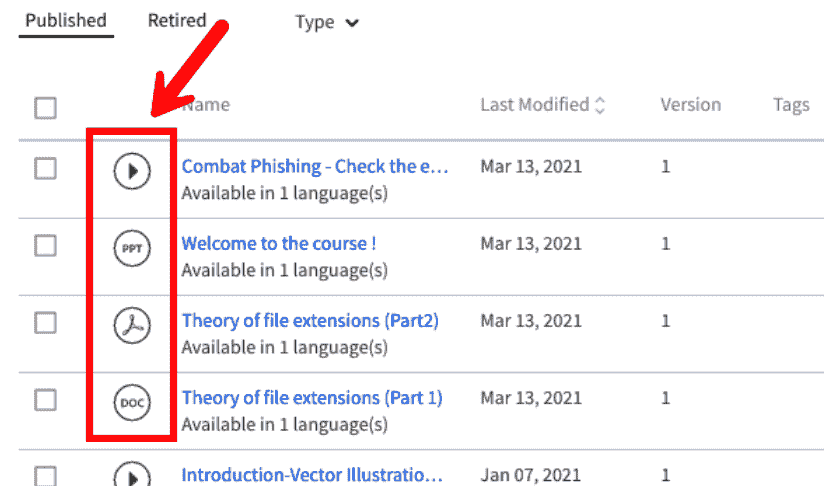

图 3.7 – 在你的内容库中可以看到四个新的自定义模块

请注意，每个模块的内容类型由相应的图标标识，如前一屏幕截图中矩形所示。

在本节中，你回顾了如何将静态内容上传到你的 Prime 账户以在内容库中创建自定义课程模块。在下一节中，你将通过上传交互式课程模块继续探索内容库。

## 上传交互式内容

作为讲师，我们知道学习者越积极，学习效果越好。因此，保持学习者在学习过程中的积极参与至关重要。电子学习提供了利用专用工具和广泛支持的行业标准创建交互式学习内容的丰富新机会。

典型的 *interactive* 学习内容包括以下内容：

- 测验和调查
- 基于场景的培训
- 严肃游戏
- 交互式软件演示和模拟
- 交互式视频
- 等等。

用于制作此类交互式内容的最受欢迎的创作工具是 Adobe Captivate、Articulate Storyline、iSpring 和 TechSmith Camtasia。这些创作工具有一个共同点：它们都可以生成符合 AICC、SCORM 或 xAPI 的包。

在继续之前，让我们花点时间了解 AICC、SCORM 和 xAPI 是什么。

## 了解 AICC、SCORM 和 xAPI

在使用测验、基于场景的培训、严肃游戏等交互式内容时，你希望收集学习者在内容中使用时的行为数据。例如，你希望检索测验结果、选择的场景、调查结果、游戏中收集的分数或给定模块的完成状态等。为了实现这种功能，交互式内容必须能够与托管它的 LMS 通信。

AICC、SCORM 和 xAPI 是电子学习行业中使用的三种标准，用于尝试解决此问题。它们通过描述内容和 LMS 如何通信并提供实现此通信的资源来实现这一点。

Adobe Captivate Prime 符合这三种标准中的所有标准。这意味着你可以将任何符合 AICC、SCORM 或 xAPI 标准的创作工具创建的内容上传到 Captivate Prime。换句话说，你可以将几乎任何创作工具生成的内容上传到 Captivate Prime，因为如今，不符合这些标准中的任何一个的创作工具都不应该再存在了。

现在，让我们花点时间定义这三种标准。

AICC 是 Aviation Industry Computer-Based Training Committee（航空业计算机化培训委员会）的缩写。AICC 委员会由主要飞机制造商于 1988 年成立，并在 1993 年提出了被视为 LMS 平台首个互操作性规范的规范。2014 年 12 月 11 日，AICC 委员会宣布 AICC 将被解散，并且 AICC 标准将不再维护。Captivate Prime 仍支持 AICC 以保持与旧创作工具的向后兼容性，但新内容不应再符合 AICC 标准。

> **更多信息**
> 有关 AICC 的更多信息可在维基百科上找到，网址为 https://en.wikipedia.org/wiki/Aviation_Industry_Computer-Based_Training_Committee。

SCORM 是 Sharable Content Object Reference Model（可共享内容对象参考模型）的缩写。SCORM 由美国国防部的高级分布式学习（ADL）项目维护。SCORM 标准的第一个版本于 2000 年 1 月发布。如今，行业中仍广泛使用 SCORM 的两个版本：

- SCORM 1.2，于 2001 年 10 月发布。
- SCORM 2004，其首版于 2004 年 1 月发布。

Adobe Captivate Prime 支持 SCORM 1.2 和 SCORM 2004 的所有版本。截至撰写本文时，尽管 SCORM 相对较老，但它仍然是电子学习行业中使用最广泛的标准。

> **更多信息**
> 有关 SCORM 标准的更多信息可在 https://scorm.com/ 找到。

**体验 API（xAPI）** 是最新标准。它旨在取代老化的 SCORM 规范。xAPI 的初步工作始于 2010 年 10 月，初步草案于 2011 年 9 月以 *Tin Can API* 的名称发布。第一个正式版本于 2013 年 4 月发布。这时项目名称从 *Tin Can* 改为 xAPI。

xAPI 的构建基于这样一个假设：人们总是在学习，但不一定局限于企业 LMS 的严格边界。这导致了 xAPI 最有趣和最具颠覆性的方面之一：xAPI 不再向 LMS 报告学习交互，而是向 **学习记录存储（LRS）** 报告。

LRS 是一个记录和存储学习体验的数据库。有趣的是，LRS 可以存在于 LMS 内部或外部。这允许游戏制造商、移动应用开发者、内容提供商等在其生态系统中实现 LRS，并记录其用户无数的学习体验，无论这些体验发生在 LMS 内部还是外部。

xAPI 的另一个有趣方面是多个 LRS 可以相互通信以交换数据。

截至撰写本文时，xAPI 正在迅速发展，主要在美国。在世界其他地区，尤其是欧洲，xAPI 在获得认可方面进展较慢，因为它引发了一些关于隐私的担忧，而欧洲人对此非常挑剔。话虽如此，毫无疑问，xAPI 将在不久的将来成为电子学习行业的新标准。

Captivate Prime 包含一个 LRS，并且完全兼容 xAPI，这使其成为面向未来的 LMS 解决方案。

**更多信息**
有关 xAPI 的更多信息可在 https://xapi.com/ 找到。

现在你对 AICC、SCORM 和 xAPI 有了高层次的了解，并且知道 Captivate Prime 支持这三种标准，是时候将这些新知识付诸实践，通过向内容库上传新的交互式模块了。

## 创建交互式模块

无论使用哪种标准，所有这些交互式模块都以 .zip 包的形式提供给我们。符合 AICC、SCORM 或 xAPI 的 LMS 应该能够接收该 ZIP 包，解压缩它并找到其方式。换句话说，在 LMS 上部署这些交互式模块就像上传一个 .zip 文件并观看 LMS 为你完成所有繁重的工作一样简单。

让我们亲手尝试将一个符合 SCORM 的 .zip 包上传到 Captivate Prime：

1. 确保你以作者身份登录，并且位于作者主页。
2. 点击主内容区域顶部位置的 **创建内容** 按钮。你将被带到 **添加新内容** 页面。
3. 在 **名称** 字段中输入新模块的名称。请记住此信息是必填项。
4. 将要上传的 SCORM 包的 .zip 文件拖放到 **添加内容文件** 字段上。你可以使用任何你有权访问的符合 SCORM 的包。如果你没有合适的包，可以使用本书下载中提供的课程 `Content/identifyingPhishing_scorm2004.zip` 文件。

> **注意**
> 下载中提供的 SCORM 包是用 Adobe Captivate 创建的，但请记住它可能由任何符合 SCORM 的创作工具创建。

5. 作为最佳实践，请花点时间也填写可选的 **描述** 和 **时长** 字段。
6. 填写完表单后，点击页面右上角的 **保存** 按钮。

点击 **保存** 按钮会带你返回内容库，在那里你可以看到 Captivate Prime 正在处理你的新课程模块。到目前为止，将交互式 SCORM 符合模块上传到内容库的过程与创建静态模块的过程相同。

7. 当 Captivate Prime 完成处理你的新模块后，点击其名称重新打开表单。

对于静态内容，表单底部现在提供了额外的选项，但这次选项不同，如以下屏幕截图所示：

Completion Criteria *
为您的模块设置完成标准。

☑ 启动内容时
或

☐ 基于最低所需百分比
请输入最低百分比：0

☐ 测验
请输入标准：
○ 测验通过    ○ 测验尝试    ○ 测验通过或达到限制（测验可进行的次数）

Success Criteria *
为您的模块设置成功标准。

☐ 启动内容时
或

☑ 基于最低所需百分比
请输入最低百分比：100

☐ 测验
请输入标准：
○ 测验通过    ○ 测验尝试    ○ 测验通过或达到限制（测验可进行的次数）

Tags
学员使用标签搜索培训。作者在课程创建期间使用标签。

## 图 3.8 – SCORM 2004 包可用的附加选项

请记住，您正在上传一个 *交互式* 模块。这意味着查看此模块的学习者将被要求在模块内执行操作。这些操作可以简单到单击按钮，但也可以是拖放交互、点击显示交互、游戏、测验等。模块作者还可以对这些交互进行评分，在学习者进入模块的过程中授予（或移除）学习者的分数（或从中移除）。此外，请记住，SCORM（或 AICC 或 xAPI）标准允许您的培训模块与 LMS 之间进行通信。此通信功能用于向 LMS 报告交互和分数。

这一交互层使得可以将 *完成标准* 与 *成功标准* 区分开来。完成标准决定了此课程模块何时可以被视为对特定学习者而言 *完成*，而成功标准则决定学习者是否 *通过* 或 *失败* 此特定课程模块。

通常，这些标准由模块作者在创建 SCORM 包时在创作工具中设置。Captivate Prime 仅从上传的 .zip 文件中读取此数据。但是，您可以在 Prime 中修改这些标准。

- 8. 单击页面右上角的 **编辑** 按钮。
- 9. 根据需要修改完成标准和/或成功标准。
- 10. 单击页面右上角的 **保存** 按钮以确认更改并返回内容库。

您现在应该在内容库中多了一个模块。请注意，在本节中，您上传的是 SCORM 2004 兼容包，但上传 SCORM 1.2 包、AICC 包或 xAPI 兼容包时的流程相同。

在下一节中，您将回顾直接从 Adobe Captivate 上传交互式模块的过程。

## 从 Adobe Captivate 上传交互式内容

Captivate Prime 支持由 *任何* 创作工具创建的交互式内容，前提是该创作工具能够生成 AICC、SCORM 或 xAPI 兼容包。Adobe Captivate 就是其中一种创作工具，但还有许多其他优秀的应用程序可供选择，例如 Articulate Storyline、TechSmith Camtasia、iSpring 等。

话虽如此，如果您使用 Adobe Captivate 作为首选创作工具，您将可以使用一项额外功能，允许您直接从 Adobe Captivate 将内容上传到 Captivate Prime。

**注意**
本练习的步骤指的是 Adobe Captivate 2019。因此，您必须在计算机上安装 Adobe Captivate 2019（或更高版本）才能执行本练习。如果您使用的是更新版本的 Adobe Captivate，此处概述的步骤很可能略有不同，但总体思路保持不变。Adobe Captivate 可在 Mac 和 Windows 上使用。免费 30 天试用版可从 https://www.adobe.com/products/captivate/download-trial/try.html 下载。试用版的功能与永久版相同，只有一个例外：试用版生成的内容将在试用期结束时过期。如果您无法访问 Adobe Captivate，只需阅读以下步骤以大致了解该流程。

让我们使用以下步骤亲手回顾从 Captivate 上传内容到 Captivate Prime 的流程：

- 1. 打开 Adobe Captivate 2019（或更高版本）。
- 2. 使用 **文件 – 打开** 菜单项打开 `courseContent/extensions_Quiz.cptx` 文件，该文件可在本书附带的下载中找到。

现在应该在 Adobe Captivate 应用程序中打开了一个文件。请注意，Captivate 文件的文件扩展名为 `.cptx`。

在将文件上传到 Prime 之前，让我们回顾一下此文件的内容及其一些设置。

- 3. 在 Captivate 界面的左侧，上下滚动 **胶片条** 以查看此文件的内容。请注意，在此 Captivate 模块的末尾插入了一个三题测验。
- 4. 使用 **项目 – 测验首选项** 菜单项打开 **测验首选项** 对话框。

即使您以前从未见过 Captivate，也请花点时间查看 **测验首选项** 对话框。框的顶部请注意，此特定项目的 *报告* 已启用（参见以下屏幕截图中的 1）。还请注意，此项目使用 *SCORM 2004* 标准（参见以下屏幕截图中的 2）。最后，**测验首选项** 对话框中可用的其他选项（参见以下屏幕截图中的 3）大致与 Captivate Prime 中可用的 **完成标准** 和 **成功标准** 选项相匹配：

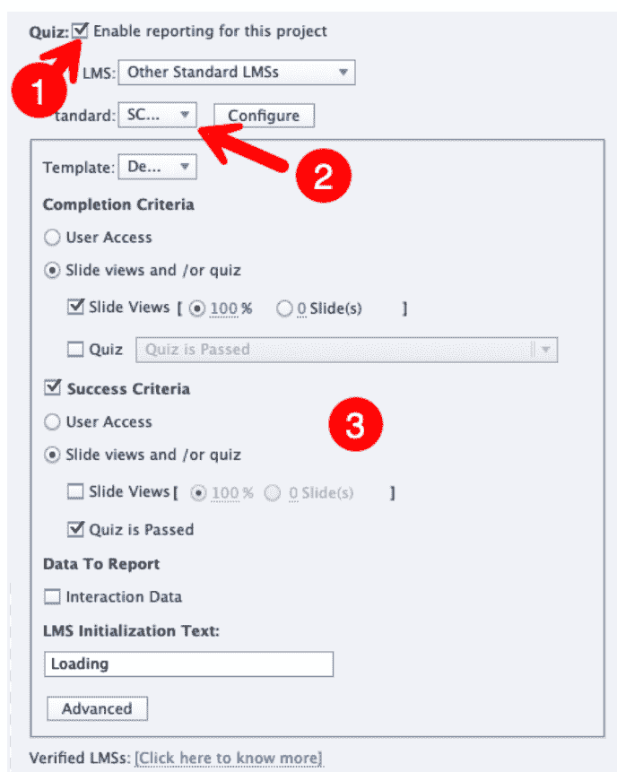

图 3.9 – Adobe Captivate 2019 的测验首选项对话框

现在，让我们关闭 **测验首选项** 对话框并将此课程模块上传到您的 Captivate Prime 内容库。

- 5. 单击 **测验首选项** 对话框右下角的 **取消** 按钮，以在不保存您可能所做的任何更改的情况下关闭该框。
- 6. 单击 Adobe Captivate 主工具栏中的 **发布** 图标。从打开的菜单中选择 **发布到 Adobe Captivate Prime**。
- 7. 查看 **发布到 Adobe Captivate Prime** 对话框中包含的信息。然后，单击该框右下角的 **发布** 按钮。
- 8. Captivate 完成发布内容后，单击 **继续发布** 按钮。
- 9. 输入与您的 Captivate Prime 账户关联的电子邮件地址，然后单击 **提交** 按钮。如果您的电子邮件地址关联了多个 Prime 账户，请选择要上传此模块的账户。
- 10. 输入您的密码并单击 **继续** 按钮。

登录您的 Prime 账户后，屏幕上会出现一个与 Prime 中用于上传交互式内容时使用的表单非常相似的表单。请注意，**完成标准** 和 **成功标准** 选项已经可用，并且已设置为与 Adobe Captivate 2019 的 **测验首选项** 对话框中提供的值相同的值。

- 11. 在 **内容名称** 字段中输入新的 Prime 模块名称。请注意，这是此表单中唯一必填的信息。
- 12. 作为最佳实践，请花点时间在 **简短描述** 字段中输入描述。
- 13. 准备就绪后，单击表单右上角的 **发布** 按钮。

单击 **发布** 按钮后，您的课程模块将直接从 Adobe Captivate 2019 上传到您的 Captivate Prime 账户的内容库。上传完成后，屏幕上会出现 **上传完成** 消息。

- 14. 单击 **上传完成** 消息末尾的 **访问 Captivate Prime** 按钮。

此操作会直接带您进入 Prime 账户的 **内容库** 页面，其中您的新交互式模块正在处理中，如以下屏幕截图所示：

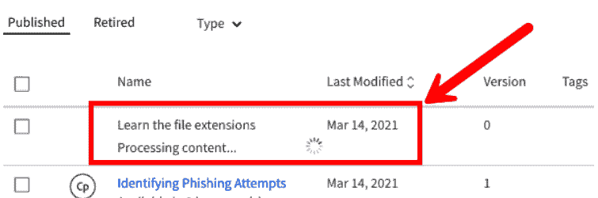

图 3.10 – 从 Captivate 上传的交互式模块正在内容库中处理

> **注意**
> 如果您无法访问 Adobe Captivate 2019，但仍想将此交互式模块上传到您的内容库，您可以从本书附带的下载中上传 `courseContent/extensions_quiz.zip` 文件。为此，请遵循本章前面 *上传交互式内容* 部分中概述的程序。

在本节中，您学习了如何直接从 Adobe Captivate 创作工具将交互式课程模块上传到您的内容库。使用 Adobe Captivate 与 Adobe Captivate Prime 结合使用还有一些额外的好处：

- - Adobe Captivate 目录与 Prime **Fluidic Player** 集成良好（Fluidic Player 是 Prime 交付课程的组件。它将在 *第 7 章，审阅学习者体验* 中更详细地讨论）。
- - Captivate Prime 尊重 Captivate 对显示/隐藏目录和播放栏的控制。
- - Adobe Captivate 中创建的封闭字幕与 Captivate Prime 的封闭字幕控件集成。
- - 能够在 Captivate Prime 中配置完成和成功标准，而无需在 Captivate 中重新发布内容。

除了这些额外的好处外，请记住 Captivate Prime 可以托管由 *任何* 工具创建的内容，并且 Adobe Captivate 生成的内容可以上传到 *任何* LMS。

阅读前几节后，您应该在内容库中拥有几个额外的自定义课程模块。在下一节中，您将回顾内容库的特性，这些特性可让您长期管理这些模块。

## 管理您的内容库

现在您的内容库中已有一些内容，是时候回顾一下可让您管理 Prime 账户中可用课程模块的特性了。

## 搜索内容

默认情况下，上传到您的 Prime 账户的所有内容都会进入内容库，无论内容类型或上传内容的作者是谁。随着各作者不断向您的 Prime 账户上传内容，内容库很快就会变成一个庞大的课程模块列表，难以管理。

幸运的是，内容库提供了一些非常有效的功能，可让您搜索和筛选内容。现在让我们回顾一下：

- 1. 确保您以作者身份登录并且位于作者主页。
- 2. 在左侧边栏的“管理”部分中单击“内容库”链接以访问内容库。

这将使您能够访问内容库中可用的课程模块长列表。默认情况下，内容按日期排序，最新的内容位于列表顶部。您可以单击“最后修改”列标题旁边的箭头来更改该顺序，如以下屏幕截图所示：

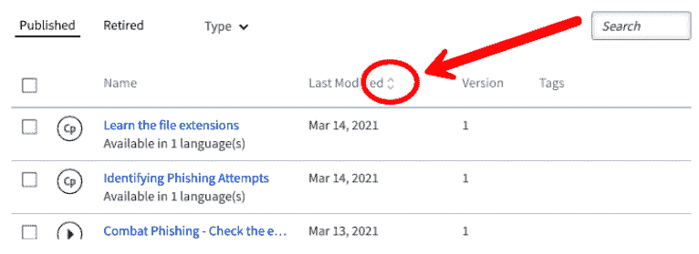

图 3.11 – 您可以更改内容库中课程模块的排序顺序

另一个功能是 **Search** 字段，它显示在屏幕右侧，模块列表上方。借助此字段，您可以搜索模块名称和相关标签。

现在，让我们使用 **Search** 字段进行一个快速实验。

- 3. 在模块列表上方的 **Search** 字段中输入关键字。查看 Captivate Prime 如何在下拉列表中列出可用的模块和标签。
- 4. 单击搜索下拉列表中显示的其中一个模块。如果没有可用模块，只需在 **Search** 字段中输入另一个关键字，直到获得积极结果为止。

执行此操作后，内容库将显示筛选后的模块列表，这使得更容易找到您要查找的内容。

- 5. 单击列表上方出现的 **Clear** 链接以清除筛选器并返回完整的模块列表。

下一个功能是 **Type** 下拉菜单，可让您按 *已使用* 或 *未使用* 模块筛选列表，如以下屏幕截图所示：

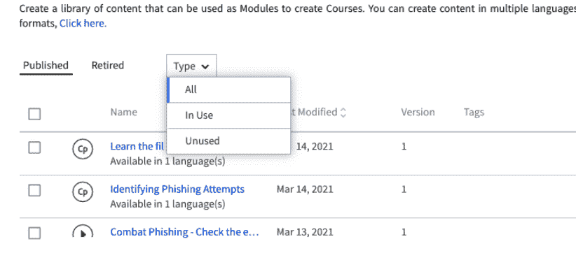

图 3.12 – 按类型筛选模块列表

*未使用* 的模块是指当前未包含在任何课程中的模块。这应该是本章上一节中您上传的所有课程模块的情况。让我们通过以下实验来检查。

- 6. 打开 **Type** 下拉列表并单击 **Unused** 选项。
- 7. 确认未使用模块列表包含您在上一节中上传的所有模块。
- 8. 准备就绪后，打开 **Unused** 下拉菜单并选择 **All** 选项以返回完整的可用模块列表。

此功能在创建新课程时使用刚上传的课程模块时特别有用。

这些是内容库中可用于排序和筛选模块的主要选项。在下一节中，您将了解如何进一步将内容库划分为文件夹。

## 使用内容文件夹

在上一节中，您发现默认情况下，内容库是一个包含 Prime 账户中每个模块的长列表。这种默认行为有一些优点：

- - 作为作者，您可以利用其他作者上传的模块来创建和更新课程。
- - 任何作者都可以为任何模块添加语言版本。这在不同团队负责编写同一课程模块的不同语言版本的大型组织中非常有用。上传翻译不需要是原始语言内容的作者。这使得管理课程模块的各种语言版本变得更加容易。
- - 每个作者还可以更新、退役和删除 *任何* 可用的课程模块，而不仅仅是他们上传的模块。这使得删除由不再为组织工作或已调任其他岗位的承包商或员工创建的内容变得容易。

如果您觉得将这种默认行为视为优势感到奇怪，请记住 Captivate Prime 被设计为企业学习管理系统。因此，假定内容库中可用的内容属于组织，而不属于任何特定内容作者或教师。这与大多数学校和大学盛行的思维方式非常不同。

话虽如此，即使对于公司而言，这种默认行为在某些情况下也存在一定的局限性：

- - 作为一家公司，您可能与提供课程内容的许多机构签约。您可能不希望机构 A 访问机构 B 提供的课程模块列表。
- - 您可能拥有机密课程内容，只能由具有适当资质的特定用户团队访问。
- - 也许您只是想以适合您的方式组织内容库。
- - 随着作者向 Captivate Prime 添加内容，内容库可能会变得非常繁忙，导致内容库主页需要长时间滚动。当然，搜索功能可用，但对于某些用户来说，使用文件夹系统搜索和编辑模块有时会更容易、更熟悉。

出于所有这些原因，以及此处未列出的原因，可以创建内容文件夹来细分内容库，并确保只有授权人员才能访问内容。

## 创建内容文件夹

文件夹必须由管理员事先创建。因此，您现在将返回管理员角色并创建几个内容文件夹。然后，您将返回作者角色并将内容放入这些文件夹中：

- 1. 确保您以管理员身份登录并且位于管理员主页。
- 2. 单击左侧边栏末尾“配置”部分中的“设置”链接。这将带您进入“基本信息”页面。
- 3. 单击左侧边栏“高级”部分中的“内容文件夹”链接。

这将带您进入内容文件夹页面。默认情况下，您的 Prime 账户中没有可用的内容文件夹，但这并不意味着此页面上没有重要信息。花点时间阅读页面顶部的说明。它提供了大量关于内容文件夹是什么以及如何工作的非常有用的信息：

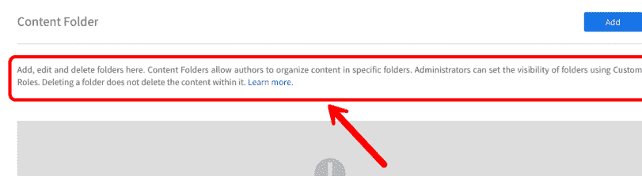

图 3.13 – 内容文件夹页面顶部的说明包含大量有用的信息

首先，请注意管理员需要创建 *自定义角色* 来定义谁可以访问哪个文件夹。创建自定义角色将在 *第 5 章，管理用户* 中介绍。在此之前，所有文件夹对所有用户都可见（这在一定程度上违背了创建文件夹的初衷，但请耐心等待——更多答案将在 *第 5 章，管理用户！* 中提供）。

另一个有趣的方面是，删除文件夹 *不* 删除该文件夹的内容。这是因为 Captivate Prime 的文件夹只是存储在 Prime 数据库中的逻辑容器。它们用于细分内容库和/或增加额外的安全层，但它们 *不* 是您在计算机上创建的用于组织文件的实际文件夹。

- 4. 单击页面右上角的 **Add** 按钮以创建新的 **Content Folder**。
- 5. 在 **Name** 字段中输入新文件夹的名称。作为最佳实践，还请在 **Description** 字段中提供简短描述。
- 6. 单击 **Save** 按钮以创建您的第一个内容文件夹。
- 7. 重复上述过程以创建几个更多的内容文件夹。

您现在应该在 Prime 账户中拥有几个 **Content Folders**，如下图所示：

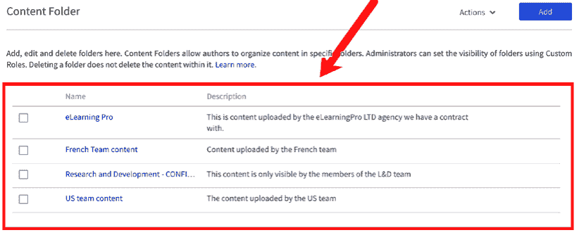

图 3.14 – 内容文件夹列表可在您的 Prime 账户中使用

现在您已有几个内容文件夹可用，让我们返回作者角色来使用这些文件夹。

## 将内容模块添加到文件夹

创建内容文件夹是 Prime 管理员专属的任务，但将模块放入文件夹则是作者角色的一部分：

- 1. 返回作者角色并点击左侧边栏 管理 部分中的 内容库 链接。
- 2. 点击 Add 按钮，就像你要向 内容库 添加新模块一样。

如以下截图所示，Add New Content 表单中出现了一个新的字段：

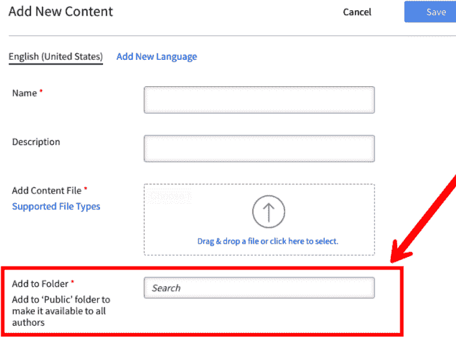

图 3.15 – 在 Prime 账户中定义内容文件夹后，Add to Folder 字段可用

现在，让我们更仔细地查看此字段，了解如何将新模块附加到内容文件夹。

- 3. 点击 Add to Folder 字段关联的搜索区域。

这将显示所有可用的内容文件夹列表。你应该能认出在以管理员身份登录时创建的文件夹。如果不想将此新课程模块添加到特定文件夹，请选择 Public 文件夹，这是对 Prime 账户所有用户可见的默认文件夹。

现在，让我们回顾如何将现有课程模块添加到内容文件夹。为此，你需要返回到主 内容库 页面。

- 4. 点击表单右上角的 Cancel 按钮返回 内容库 页面。

返回主 内容库 页面后，你应该会在可用模块列表中看到一个新的 Folders 列。目前，所有模块默认都应位于 Public 文件夹中。在模块列表上方，还有两个额外的筛选器（Folders 和 All Authors），它们是在你以管理员身份登录时创建内容文件夹后出现的。

你现在将尝试将其中一个自定义模块移动到之前创建的文件夹之一中。

- 5. 使用复选框列选择其中一个可用模块。
- 6. 在选择一个模块后，点击页面右上角位于 Add 按钮旁边的 Actions 按钮。

如以下截图所示，Actions 菜单中显示了包含额外子选项的 Organise Content 选项。不幸的是，即使已选择模块，这些选项也不可用：

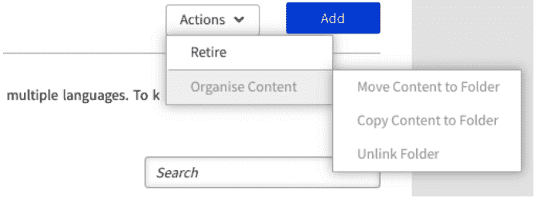

图 3.16 – 默认情况下，Actions 菜单中不可用 Organise Content 选项

要启用 **Actions** 菜单的 **Organise Content** 选项，必须使用位于模块列表上方的 **Folders** 筛选器。

- 7. 打开 **Folders** 筛选器并从下拉列表中选择 **Public** 文件夹。

此操作会筛选模块列表，仅显示 **Public** 文件夹中的模块。由于此时所有模块都在 **Public** 文件夹中，屏幕上不会有任何变化。

- 8. 如有需要，你还可以添加 **Type** 筛选器以仅显示 **Unused** 内容，或添加 **All Authors** 筛选器以仅显示 *你* 上传的模块。

- 9. 使用复选框选择本章前面上传的所有模块。

- 10. 返回屏幕右上角的 **Actions** 按钮。由于 **Folder** 筛选器处于活动状态，**Organise Content** 选项现在可用。

- 11. 选择 **Organise Content – Move Contents to Folder** 以打开 **Move Content** 对话框。

- 12. 使用 **Search** 字段搜索目标文件夹的名称。找到后，点击下拉列表中的文件夹名称。

请注意，如有需要，你可以将所选模块添加到多个目标文件夹中。

- 13. 准备就绪后，点击 **Move Content** 对话框右下角的 **Confirm** 按钮。应会出现一条快速消息确认移动操作已成功。

- 14. 完成后，点击 **Clear** 链接以移除所有活动筛选器并返回 内容库 中可用的模块完整列表。

如以下截图所示，部分模块现在属于另一个内容文件夹：

## 内容库

创建一个内容库，可用作模块来创建课程。你可以用多种语言创建内容。了解更多支持的文件格式，请点击这里。

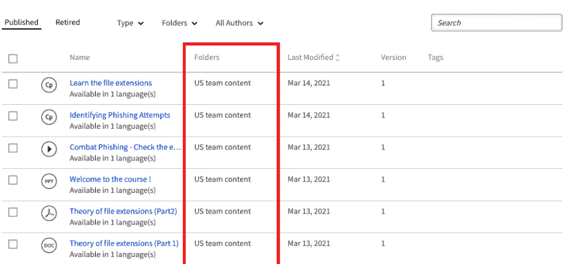

图 3.17 – 部分模块现在位于美国团队内容文件夹中

这就是将新模块和现有模块移动到文件夹的方法。如果返回屏幕右上角 Actions 按钮中的 Organise Content 项目，你会看到还有两个操作可用：

- **Copy Content to Folder** 这个标签有点误导性。请记住，内容文件夹只是逻辑容器。模块在系统上仅存储一次，然后链接到一个或多个这些文件夹。将内容复制到文件夹实际上只是将模块链接到至少一个额外文件夹，并不涉及实际的内容复制。换句话说，此“复制”操作后你不会消耗更多磁盘空间。
- **Unlink Folder** 用于移除内容模块与一个或多个文件夹之间的链接。请注意，内容必须存在于至少一个文件夹中，因此你不能对仅链接到一个文件夹的模块使用 Unlink Folder 操作。

随着 Captivate Prime 作者和使用的增长，将现有模块移动到文件夹中对于组织内容非常有帮助！

在本节中，你学习了如何作为管理员创建内容文件夹以及如何作为作者使用它们。在第 5 章《管理用户》中，你将学习如何通过定义自定义角色来限制对这些文件夹的访问。

但现在，让我们继续探索 内容库 功能的旅程。在下一节中，你将学习如何上传现有课程模块的新版本。

## 创建内容的新版本

有许多情况需要更新一个或多个模块：

- 有人在你的某个模块中发现了错误（例如拼写错误、内容问题等）。
- 你的组织更新了品牌形象（标志、色彩指南等），这会触发旧课程模块的更新。
- 需要在合规课程或认证中实施新政策或法律变更。
- 第三方供应商对热门内容进行了增强或改进，并将更新提供给你。
- 等等。

Captivate Prime 具有内置的版本控制系统，使上传模块的新版本变得轻松。让我们来看看：

> **提示**
> 如果你想跟随操作但没有合适的可用文件，可以使用本书下载中提供的 `courseContent/Theory of file extensions - Part 1 - Version 2.docx` 文件。如果使用该文件，你将更新本章前面创建的 Word 文档关联的课程模块。

- 1. 确保你已作为作者登录并且位于作者主页。
- 2. 点击左侧边栏 **Manage** 部分中的 **Content Library** 链接以打开你的 **内容库**。
- 3. 在 **内容库** 页面上，点击你想要更新的模块。
- 4. 点击页面右上角的 **Edit** 按钮。

要更新模块，你需要移除与模块关联的当前文件并用该文件的新版本替换它。

- 5. 点击 **Add Content File** 字段中当前加载的文件关联的 *delete* 图标，以从模块中移除当前文件，如以下截图所示：

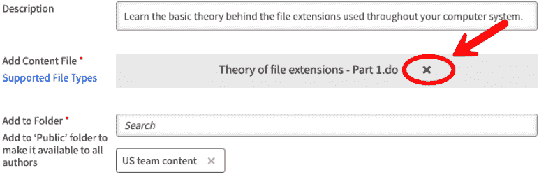

图 3.18 – 移除与你要更新的模块当前关联的文件

下一步操作是上传新文件。

- 6. 将文件的新版本拖放到 **Add Content File** 字段中。你也可以借此机会对该课程模块进行进一步的更改（如有必要）。

- 7. 准备就绪后，点击屏幕右上角的 **Save** 按钮。

此操作会带你返回 内容库，在那里你可以看到 Captivate Prime 正在处理模块的新版本。当 Prime 完成对更新模块的处理后，你的课程模块的版本 2 将在 内容库 中提供，如以下截图所示：

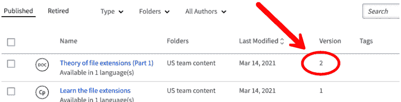

图 3.19 – 你的课程模块的版本 2 已在 内容库 中提供

在本示例中，您更新了一个尚未属于任何课程的模块。因此，该更新对您 Prime 账户中当前活跃的课程或学习者没有任何影响。如果您更新的模块已属于某个课程，则在更新后模块旁边会出现一个小图标，如以下屏幕截图所示：

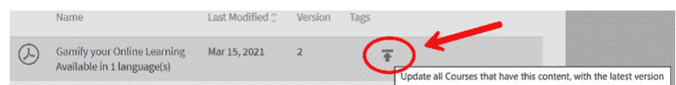

图 3.20 – 单击此图标以在所有使用此内容的课程中更新模块

您必须单击此图标以更新所有使用此内容的课程。只要您尚未单击此图标，模块的旧版本仍将被使用。

当以这种方式更新课程模块时出现的另一个问题是，在更新之前已查看旧版内容的学习者的完成和成功标准会发生什么。Captivate Prime 处理此类情况的方式如下：

- 已查看旧版内容的当前学习者的完成和成功标准会得到保留。这意味着即使这些标准因更新而被修改，学习者也不必再次查看该课程模块。请注意，如果此类学习者仍决定查看课程模块，则会显示新版本。
- 默认情况下，更新适用于所有学习者，这意味着已开始课程的当前在读学习者、尚未开始的学习者以及未来的学习者。您可以通过使用管理员应用程序的 Settings – General 页面并编辑 Module Version Update 选项来更改该默认行为，如以下屏幕截图所示：

图 3.21 – 管理员应用程序的 Settings – General 页面中的 Module Version Update 选项

得益于此内置版本控制系统，跟踪模块的每个版本非常容易。但这并不是更新模块的唯一方式。在下一节中，您将为内容库中的模块添加额外的语言版本。

## 添加语言版本

使用 Captivate Prime 的许多组织在全球范围内设有分支机构，员工团队分布在世界各地。对于这些组织而言，有时有必要以不同的语言提供相同的课程内容，以确保每位员工都能平等访问内容。在某些国家/地区，当地法规要求内容必须以该国的官方语言提供。

出于这些原因（以及此处未列出的所有原因），Captivate Prime 支持以多种语言提供相同的课程内容。让我们亲手探索此功能：

> 提示
> 如果您想跟随操作但没有可用的翻译文件，可以使用本书下载中提供的 courseContent/Théorie des extensions fichiers (Part1)_FR.docx 文件（它是我们在前面使用过的 Word 文档的法语翻译）。如果您使用该文件，您将为本章前面创建的与 Word 文档关联的课程添加法语版本。

- 1. 确保您以 Author 身份登录，并且位于 Content Library 的主页面。
- 2. 打开您想要添加语言版本的模块。
- 3. 单击屏幕右上角的 Edit 按钮。

目前，该模块的唯一语言版本是 **English (United States)** 版本，如以下屏幕截图所示：

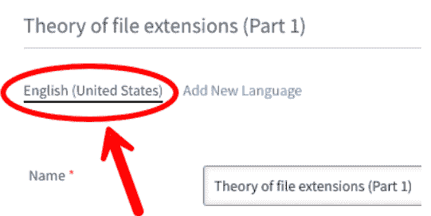

图 3.22 – 模块的默认版本对应于您的账户的默认语言

这是因为在 *Chapter 1, Introduction to Adobe Captivate Prime* 的 *Changing the default language of your Prime account* 部分，您选择了 **English (United States)** 作为此账户的默认语言。

- 4. 单击表单左上角的 **Add New Language** 链接。
- 5. 选择您希望该模块支持的语言（们）。请注意，您可以根据需要选择任意数量的语言。
- 6. 单击 **Select Languages** 对话框右下角的 **Save** 按钮。此操作会在表单顶部为每个所选语言添加一个新标签页。
- 7. 切换到另一种语言的标签页，并使用该特定语言的信息填写表单。
- 8. 单击屏幕右上角的 **Save** 按钮以保存您的更改。

此操作会将您带回 Content Library。Captivate Prime 处理完您的文件后，多语言课程模块即可使用。

如 *Chapter 1, Introduction to Adobe Captivate Prime* 中 *Modifying your account settings* 部分所述，每个用户都可以在其个人资料设置中选择 *interface language* 和他/她首选的 *content language*。

Captivate Prime 会自动提供与用户在其个人资料设置中选择的首选内容语言相匹配的模块语言版本（如果有）。如果没有对应的内容语言，Prime 会自动回退到账户的默认语言（在本示例中为 English (United States)）。

在本节中，您学习了如何上传模块的额外语言版本，以及这与账户的默认语言和每个用户可在其 *Profile Settings* 页面选择的首选 *content language* 有何关系。

在下一节中，您将学习如何退役和删除过时的模块。

## 退役和删除内容

当模块不再相关或进行完全修订（可能由创建原始版本的承包商以外的人员进行）时，有必要将其从内容库中移除。随着作者数量的增加，因此内容也会随时间增长，退役和删除内容也可能有所帮助。

Captivate Prime 不允许您直接 *remove* 已发布的内容。您必须先 *retire* 内容，然后才能将其移除。请执行以下步骤退役现有课程模块：

- 1. 确保您以 Author 身份登录，并且位于 **Content Library** 页面。
- 2. 使用复选框选择您想要退役的课程模块（们）。
- 3. 单击屏幕右上角的 **Actions** 按钮并选择 **Retire** 操作。

此操作会将所选模块（们）从 *Published* 模块列表移动到 *Retired* 模块列表。

- 4. 单击模块列表上方显示的 **Retired** 标签，如以下屏幕截图所示：

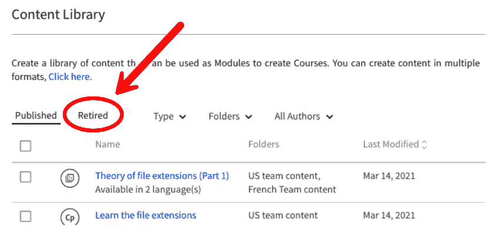

图 3.23 – 单击模块列表上方的 Retired 标签

退役的模块在创建新课程时对作者不可见。但是，当前使用该退役模块的现有课程 *不受影响*。

您现在将 *实际* 删除之前退役的模块（们）。

- 5. 在退役模块列表中，使用复选框选择您想要删除的模块。
- 6. 单击屏幕右上角的 **Actions** 按钮。

请注意可用的两个操作。**Republish** 允许您将所选模块（们）移回 **Published** 列表。这使得在创建新课程时模块（们）再次可用。

- 7. 单击 **Delete** 操作以删除所选的退役模块。

花点时间阅读 Captivate Prime 在屏幕上显示的消息。该消息警告您内容将被永久删除。但与此同时，被删除的模块仍继续存在于当前使用它的课程中。因此，它实际上并未从系统中删除。已删除的模块在创建新课程时不再可用，也无法重新发布。只有当使用这些模块的所有课程本身被删除时，该模块才会彻底消失。

得益于此系统，您可以安全地退役和删除模块，而不会危及当前注册使用您退役/删除的模块的课程的学习者的学习体验。

## 使用标签

如本章前面 Searching for content 部分所述，标签是用于帮助 Captivate Prime 内部搜索引擎索引内容的关键字，从而使在整个系统中搜索对象变得更容易。

标签可以与各种学习对象关联，包括本章讨论的课程模块。默认情况下，管理员必须先创建标签，然后作者才能将其与系统中的各种学习对象关联。这确保了您 Prime 账户中可用的标签保持一致（无拼写错误、无重复、符合命名规范等）。

您现在将返回 Captivate Prime 的管理员区域并创建一些标签。然后，您将返回 Author 角色并查看标签如何链接到课程模块：

- 1. 单击屏幕右上角的用户图标以显示可用角色列表并返回 Administrator 角色。
- 当 Captivate Prime 重新加载时，您应该回到 Administrator 主页。
- 2. 从 Admin 主页，单击左侧边栏 Manage 部分中的 Tags 链接。
- 这将打开管理员的 Tag Management 页面。
- 3. 单击屏幕右上角的 Add 按钮以打开 Add a Tag 对话框。
- 4. 输入您想要创建的标签的名称。您也可以通过用逗号、分号或换行符分隔标签来一次创建多个标签。

- 5. 当屏幕如下所示时，点击 **添加标签** 对话框右下角的 **创建** 按钮以创建新的标签：

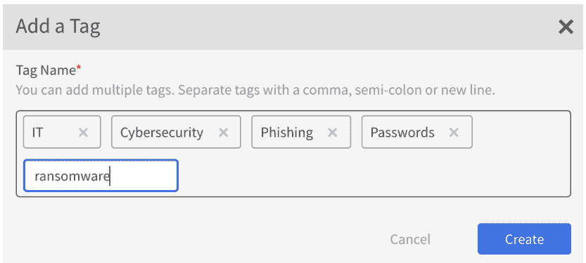

图 3.24 – 可以一次创建多个标签

确认新创建的标签是否出现在管理员的 **标签管理** 页面上。

- 6. 花点时间查看 **标签管理** 页面上可用的功能；其中大部分都是自解释的。请特别注意 **操作** 菜单中可用的选项。

现在你的 Prime 账户中已有一些标签，你可以返回作者角色，并将其中一些标签与本章前面创建的模块之一关联起来。

- 7. 点击屏幕右上角的用户图标以显示可用角色列表并返回到 **作者** 角色。

- 8. 当 Captivate Prime 重新加载后，你应该已回到作者主页。

- 9. 点击左侧边栏 **管理** 部分中的 **内容库** 链接，以打开你的 Prime 账户的内容库。

- 10. 点击本章前面创建的任意一个模块。

- 11. 模块打开后，点击屏幕右上角的 **编辑** 按钮。

- 12. 向下滚动页面，直到看到 **标签** 字段。

- 13. 在 **标签** 字段中输入标签名称。当你要查找的标签出现在列表中时，点击它将其与正在编辑的模块关联起来。请注意，你可以向同一模块添加多个标签。

- 14. 完成后，点击屏幕右上角的 **保存** 按钮。

这些标签现在可以用作 Captivate Prime **搜索** 字段中的关键字来搜索该特定模块，使作者更容易在你的 Prime 账户的内容库中查找。

## 允许用户创建标签

默认情况下，只有管理员可以创建标签。这是推荐的做法，因为它能保持标签集的一致性并避免重复。如果你愿意，也可以允许作者创建新标签。要这样做，请使用 Captivate Prime 管理员的 **标签管理** 页面上的 **设置** 选项卡，并点击与 **标签创建访问权限** 选项关联的 **编辑** 链接。

到目前为止，你应该对 Captivate Prime 的内容库的工作方式以及创建、更新、退役和删除自定义模块的可用功能有很好的了解。你也看到了管理员如何创建标签，以及这些标签如何与内容库中的模块关联。在下一节中，你将回顾 **作业辅助** 的创建，并讨论常规模块与作业辅助之间的差异。

## 创建作业辅助

作业辅助与内容库中的模块类似，但有一些关键区别，如下所述：

- 学员可以在不注册课程的情况下访问作业辅助。
- 然而，你也可以将作业辅助链接到课程，但访问作业辅助不依赖于任何完成或成功标准。
- 作业辅助只能是静态内容（文档、演示文稿、视频等）和网页链接。交互式内容不能用作作业辅助。

你可以将作业辅助视为备忘单或讲义，类似于你在会议、简报或现场课程结束时收到的材料。学员在执行任何活动或任务时可以参考作业辅助以快速查阅。

创建作业辅助的过程与在内容库中创建模块的过程非常相似，如以下步骤所述：

- 1. 确保你以作者身份登录，并且位于作者主页上。
- 2. 点击左侧边栏 **学习** 部分末尾的 **作业辅助** 链接。

此操作会带你进入 **作业辅助** 页面。默认情况下，你的 Prime 账户中没有可用的作业辅助。花点时间阅读页面顶部的说明，它提供了关于作业辅助的良好定义。

- 3. 要创建新的作业辅助，请点击 **作业辅助** 页面右上角的 **创建** 按钮。
- 4. 在 **名称** 字段中输入新作业辅助的名称。请注意，此信息为必填项。
- 5. 唯一其他必填信息是 **内容** 字段，你可以在其中选择提供文件或网页链接。
- 6. 复制/粘贴链接或拖放构成新作业辅助内容的文件。
- 7. 作为最佳实践，花点时间在 **描述** 字段中提供有意义的描述。

其他字段都是可选的，但其中一些需要进一步解释。

**共享** 作业辅助在创建课程时对任何作者都可见。**私有** 作业辅助仅对上传它们的作者可见。请注意，此选项仅修改作者在创建课程时对作业辅助的可见性；它对学员访问作业辅助没有影响。

**标签** 是用于帮助 Captivate Prime 在其内部搜索引擎中索引内容的关键字，使学员更容易搜索目录。如前所述，标签必须事先由管理员创建。

**技能** 和 **级别** 将在 *第 4 章，创建技能和课程* 中讨论。

- 8. 在作业辅助创建表单中添加所需信息，如以下屏幕截图所示：

## 作业辅助

取消

保存

英语（美国）

添加新语言

名称 *

开源许可证列表

描述

描述此作业辅助的内容和用途。

来自 choosealicense.com 网站的开源许可证快速列表。

剩余 7927 个字符

类型

共享

私有

内容 *

https://choosealicense.com/appendix/

时长

输入分钟数

图 3.25 – 在作业辅助创建表单中添加所需信息

- 9. 点击屏幕右上角的 保存 按钮以保存更改并创建新的作业辅助。

此操作会带你返回作业辅助页面，新作业辅助在列表中可见。与内容库页面类似，作业辅助页面包含长期管理作业辅助所需的所有功能。

- 10. 点击与你的作业辅助关联的齿轮图标以显示可用选项，如以下屏幕截图所示：

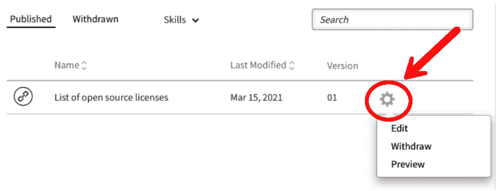

图 3.26 – 管理作业辅助的可用选项

使用 编辑 选项修改作业辅助。这包括使用与向内容库中的模块添加语言版本非常相似的过程添加作业辅助的替代语言版本。

作业辅助的 撤回 选项类似于模块的 退役 选项。将其用于从列表中移除作业辅助，而不会将其从它们所链接的课程中移除。

在进入下一章之前，花点时间亲手尝试这些功能。你会发现使用作业辅助与使用模块非常相似。

在本节中，你了解了作业辅助。你回顾了系统中可用的创建、编辑、撤回和删除作业辅助的选项。你还了解了使这些作业辅助与常规内容模块不同的要素。

## 总结

到目前为止，你对内容库的工作方式有了深入的了解，并且已向你的 Prime 账户上传了许多不同类型的模块。

我们首先讨论了 Prime 中可用课程的内容来源。你发现这些内容可以由第三方供应商提供，也可以直接作为自定义模块上传到内容库。你还发现了 Captivate Prime 支持的广泛文件类型以及 *静态* 与 *交互式* 内容的区别。

说到交互式内容，你了解了 AICC、SCORM 和 xAPI 标准，这些标准在 eLearning 行业中被广泛使用，以实现内容与 LMS 之间的通信。请记住，此类交互式内容以 .zip 文件的形式提供，并且符合标准的 LMS 应该能够解压这些包、读取内容并自动部署课程模块。

将内容上传到内容库只是第一步。内容必须能够长期发展并保持对学员的相关性。这就是为什么 Captivate Prime 配备了内置的版本控制系统，并且可以提供同一内容的多个语言版本。

你还发现了作业辅助并讨论了作业辅助与常规课程模块之间的关键区别。

但你的学员并不是注册 *模块*，他们注册的是 *课程*。本章中你创建的模块只是尚未创建的课程的基础构建块。

将模块组装成课程并回顾与课程创建相关的选项，是你在下一章将要学习的内容。

