## 4 创建技能和课程

在上一章中，您已将自定义内容模块上传到 Prime 账户的内容库。但这些内容对学习者来说仍不可用。请记住，内容模块只是用于创建课程的基本构建块。

课程是学习者报名参加的内容。因此，要使我们在上一章中上传的内容开始 *实际上* 发挥作用，您需要开始使用这些内容构建课程。这就是本章要做的事情。

但在创建课程之前，让我们先思考一下学习者为什么要参加课程，以及组织为什么要投入大量时间和精力为其员工提供课程。这两个问题的答案可以用一个词来概括：**技能**。

学习者参加课程是因为它能让他们获得新技能或更新现有技能。对于组织而言，他们知道在竞争环境中，熟练的员工是成功和盈利的关键之一。因此，对于学习者和组织而言，将课程与技能保持一致至关重要。这使学习者能够选择自己想要参加的课程。它还有助于组织跟踪每位员工获得的技能，以确保其员工队伍保持最新，并且组织中可用的技能仍然与不断变化的市场相关。技能还可能指组织中（例如政府机构）的特定合规或强制性培训，在这种情况下，参加课程被视为职位职能的一部分。

在本章中，您将通过创建新的自定义技能，首次了解 Captivate Prime 的技能管理器。然后，您将把内容模块组装成课程，并查看创建各种类型课程时可用的广泛选项。

到本章结束时，您将拥有一个可供报名的自定义课程，并且您的 Prime 账户将准备好迎接首批学习者。为实现这一目标，本章将涵盖以下主题：

- 使用技能管理器创建自定义技能
- 创建课程
- 向课程添加不同类型的模块和内容
- 将课程链接到技能
- 更新、退役和删除课程

这些主题使本章充满了精彩的功能和令人兴奋的发现

### 技术要求

为了执行本章中提出的操作和练习，您需要满足以下技术要求：

- 您需要拥有一个正在运行的 Captivate Prime 账户（可以是免费试用账户）的管理员和作者访问权限。
- 您需要在内容库中拥有一些内容模块。

如果您已完成前几章的练习，您就可以开始了！如果没有，您可以使用可用的任何课程模块来完成本章的练习。只需记住，所提供的说明基于前几章的练习，因此请随意根据自己的情况进行调整。

### 管理技能

获得技能是任何（在线或现场）学习活动的预期成果。
获得新技能是学习者参加课程的首要原因。这也是组织决定投入时间和金钱为员工提供培训材料的原因。

但组织提供这些课程不仅仅是为了让人们获得新技能。对他们来说，确保组织中可用的技能既符合组织业务目标，也符合不断变化的市场需求至关重要。

作为首选的企业 LMS，Captivate Prime 配备了功能齐全的技能管理器。该功能的主要目的是为组织提供一个工具，帮助他们将学习与业务目标保持一致。

让我们看一个例子来了解技能管理器的主要思想。

随着在家办公的员工数量突然增加，某组织观察到网络攻击和其他恶意活动显著增加，这些活动威胁到组织 IT 基础设施的安全。经分析后发现，这一增长部分是由于员工缺乏网络安全意识，导致许多最佳实践未得到遵循。由于一次成功的攻击（例如勒索软件攻击）可能会对组织的形象造成灾难性后果，并可能产生高昂的成本，因此决定对所有员工进行网络安全技能提升。还决定让 IT 部门的成员接受额外培训，以便他们使 IT 基础设施更安全并适应远程工作。

使用 Captivate Prime 实现这一策略的一种方法是使用技能管理器定义自定义 *网络安全* 技能。此新技能应具有以下属性：

- 您将为此技能定义两个级别。级别 1 代表基础网络安全意识和最佳实践培训，而级别 2 代表该主题的更高级技术知识。
- 您将把课程分配给 *网络安全* 技能的这两个级别。参加这些课程的员工将获得学分，当他们达到一定数量的学分时，将被授予级别 1 或级别 2 网络安全技能。这些可以是学习目录中已有的课程和/或您为此目的开发的课程。
- 最后，您将把 *网络安全 – 第 1 级* 技能分配给每位员工，并将 *网络安全 – 第 2 级* 技能分配给 IT 部门的成员。

这种方法使您可以精确定义哪些课程材料属于网络安全 – 第 1 级和网络安全 – 第 2 级。它还使您可以跟踪每个学习者在获得技能方面的进展。这些信息使您可以记录学习的成效（在一定数量的员工获得网络安全技能后，IT 安全是否实际提高？），向尚未获得技能的学习者发送提醒，等等。

### 创建自定义技能

现在您已经对技能是什么以及它们在 Prime LMS 中能让您做什么有了高层次的了解，是时候以管理员身份登录并通过执行以下步骤定义新的网络安全技能了：

- 1. 以管理员身份登录您的 Captivate Prime 账户，并确保您位于管理员主页上。
- 2. 单击左侧边栏“管理”部分中的技能按钮。

这将使您能够访问现有技能的列表。请注意，默认情况下，您的 Captivate Prime 试用账户已预先定义了一些技能，如以下屏幕截图所示：

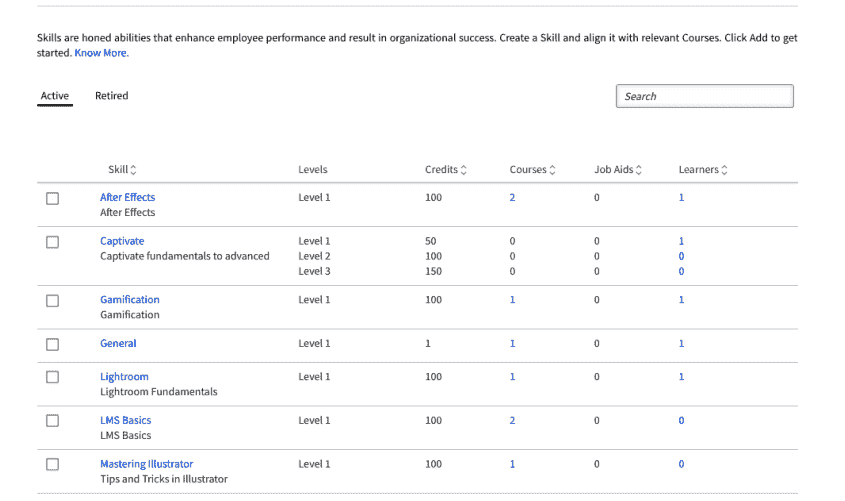

Figure 4.1 – 您的 Prime 试用账户中有一组技能可用

您现在将通过执行以下步骤向列表中添加一个新技能：

- 3. 单击屏幕右上角的 **添加** 按钮。这将打开 **添加技能** 表单。
- 4. 在 **技能名称** 字段中输入新技能的名称（例如 `Cybersecurity`）。请注意，**技能名称** 为必填项。
- 5. 作为最佳实践，请在 **描述** 字段中输入简短描述。

现在，将注意力转向表单底部。这里您可以为每个技能定义最多三个级别。

- 6. 将达到级别 1 所需的学分数增加到 50 学分。
- 7. 单击 **级别** 标题右侧的 + 添加链接，为此技能添加第二个级别。
- 8. 将达到级别 2 所需的学分数增加到 50 学分。
- 9. 将所有其他字段（**徽章**、**技能领域** 等）保留为默认值。
- 10. 完成后，单击 **添加技能** 表单右下角的 **保存** 按钮。

单击 **保存** 按钮后，Captivate Prime 将显示一条简短消息，说明技能已成功创建。可以通过新 **网络安全** 技能出现在列表中来确认此成功，如以下屏幕截图所示：

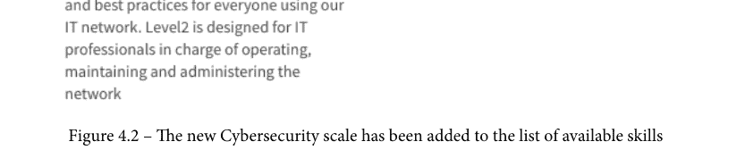

Figure 4.2 – 新的网络安全等级已添加到可用技能列表中

在当前设置下，当学习者通过参加与该特定技能和级别关联的课程累计获得 50 学分时，将被授予 *网络安全 – 第 1 级* 技能。他们在通过参加与网络安全技能级别 2 关联的课程累计获得另外 50 学分后将被授予 *网络安全 – 第 2 级*。您将在本章后面的 *将课程链接到技能* 部分学习如何将课程链接到技能。

## 徽章和技能领域

在定义网络安全技能时，您可能注意到您有能力为每个级别分配一个 **徽章**。徽章是学习者展示其所获得技能和认证的绝佳方式。您将在 *第 11 章，徽章与游戏化* 中了解有关定义和使用徽章的更多信息。您还可以将技能链接到 **技能领域**。这由 Captivate Prime 的 AI 驱动推荐和策展引擎使用。该功能将在 *第 13 章，面向学习者的 AI 驱动推荐* 中更详细地讨论。

现在您已经创建了一个新的自定义技能，让我们回顾一下如何长期管理它。

## 修改现有技能

如果需要，您可以通过执行以下步骤轻松修改现有技能：

- 1. 确保您已作为管理员登录并且位于 **技能** 页面。
- 2. 在技能列表的第一列中，单击您要修改的技能名称。
- 3. 根据您的要求修改技能（请注意无法删除现有级别），完成后单击表单右下角的 **保存** 按钮。

如果您更改获取技能所需的学分数，请注意学习者保留他们已获得的技能，即使在新规则下他们不再拥有足够的学分。

## 一般规则

作为一般规则，请记住学习者始终保留已授予的内容（技能、认证、学分、徽章等）。

在本节中，您学习了如何修改现有技能。现在，让我们回顾一下技能如何被退役和删除。

## 退役和删除技能

技能可以与来来去去的项目或业务目标保持一致。维护与旧项目或产品相关的技能，或因任何原因不再相关的技能，可能会让学习者感到困惑。这些是您可能想要从 Prime 帐户中删除技能的原因。

在删除技能方面，您必须先 *退役* 技能，然后才能 *移除* 它。执行以下步骤以退役技能：

- 1. 确保您已作为管理员登录并且位于 **技能** 页面。
- 2. 使用第一列中的复选框选择一个或多个技能。
- 3. 打开位于表单右上角 **添加** 按钮旁边的 **操作** 菜单并选择 **退役** 操作。

已退役的技能仍可在 **技能** 页面的 **已退役** 标签中获得，如以下屏幕截图所示：

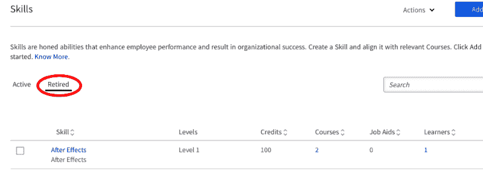

图 4.3 – 已退役的技能可在技能页面的已退役标签中查看

一旦进入 **已退役** 标签，您可以决定是 *重新发布* 已退役的技能还是完全 *删除* 它们。

- 4. 从 **技能** 页面的 **已退役** 标签中，使用第一列中的复选框选择一个或多个已退役技能。
- 5. 打开位于表单右上角 **添加** 按钮旁边的 **操作** 菜单并选择 **重新发布** 或 **删除** 操作。

在本节中，您学习了如何使用 Captivate Prime 的技能管理器创建、编辑、退役和删除自定义技能。作为示例，您创建了一个名为 *网络安全* 的新自定义技能，并为该特定技能定义了两个级别。

创建技能是创建课程的重要初步步骤，这将在下一节中讨论。

## 将模块组装成课程

在 *第 3 章，上传学习内容和管理内容库* 中，您已将各种类型的模块上传到内容库。在上一节中，您使用 Captivate Prime 的技能管理器创建了一个自定义技能。现在一切就绪，您可以开始创建第一个自定义课程。

课程是一份内容模块列表。在本节中，您将使用上一章上传的模块创建一个关于网络安全的课程。您还将向此课程添加几个额外的模块：一个由讲师主讲的现场课程、一个供观看的 YouTube 视频、学习者在课程结束时上传到平台的作业，以及一个直接在工作中测试学习者的清单活动。

创建课程是 Captivate Prime 作者的任务，因此您的第一个任务是以作者身份登录平台：

- 1. 登录您的 Prime 帐户。默认情况下，您应作为管理员登录。
- 2. 单击屏幕右上角的用户图标。
- 3. 在打开的菜单中选择 **作者** 角色。
- 4. Captivate Prime 重新加载后，您应作为作者登录。

创建课程是 Captivate Prime 作者的两个主要任务之一。这就是为什么作者主页主内容区域的上部会有 **创建课程** 链接，如以下屏幕截图所示：

欢迎 Damien Bruyndonckx。您已作为作者登录。

## 开始使用 Adobe Captivate Prime。

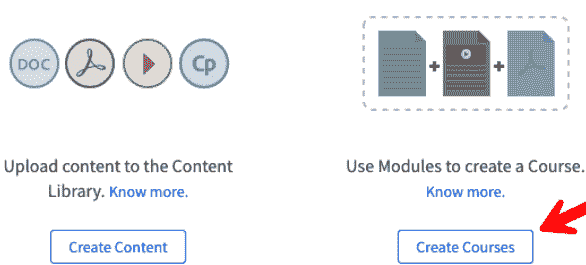

图 4.4 – 创建课程是 Captivate Prime 作者的两项主要任务之一

请记住，主页主内容区域中可用的链接只是每个角色最常用的任务的快捷方式。您也可以使用左侧边栏学习部分中的课程链接访问创建课程功能，然后单击屏幕右上角的添加按钮。

现在您已作为作者登录，是时候开始创建新课程了。

## 创建新课程

在本节中，您将通过提供必要的信息来创建课程的基本结构。稍后，您将学习如何通过提供附加信息并修改课程的培训内容来修改现有课程：

- 1. 确保您已作为作者登录。
- 2. 从作者主页，单击左侧边栏学习部分中的课程链接。这将带您进入作者课程目录页面。
- 3. 单击屏幕右上角的添加按钮。

此最后操作将带您进入一个表单，您可以在其中输入有关新课程的基本信息。请注意，您也可以通过单击作者主页上的创建课程链接到达此位置。

- 4. 在课程名称字段中输入新课程的名称。请注意这是必填信息。

下一个必填信息是构成此课程的内容模块列表。

- 5. 单击表单 **模块** 部分的 **内容** 选项中的 **添加模块** 链接。此操作将打开 **选择模块类型** 对话框，如以下屏幕截图所示：

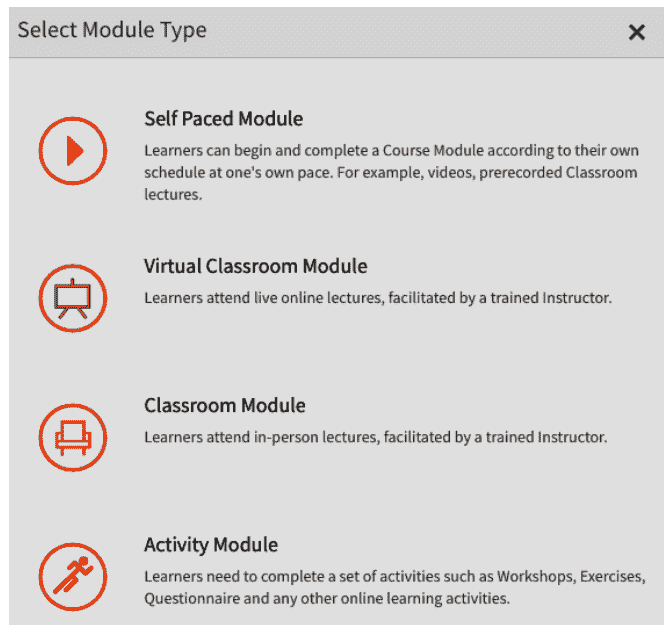

图 4.5 – 您可以向 Prime 课程添加四种不同类型的模块

您可以向 Captivate Prime 课程添加四种类型的模块。在此第一个示例中，您将只添加几个自定进度模块。这些模块是您在上一章上传到 Captivate Prime 内容库的 *异步* 学习活动。

- 6. 单击 **自定进度模块** 选项。此操作将打开 **自定进度模块** 对话框。

**自定进度模块** 对话框提供您 Prime 帐户内容库中所有可用课程模块的列表。请注意，您可以使用框顶部的搜索字段搜索要查找的模块。

- 7. 使用第一列中的复选框选择要添加到课程的模块。在此示例中，选择您在上一章上传到内容库的所有模块。
- 8. 准备就绪后，单击 **自定进度模块** 对话框右下角的 **添加** 按钮。

此最后操作将带您返回主表单，所选模块在 **内容模块** 部分可见，如以下屏幕截图所示。请注意，除了模块标题外，还会显示取决于内容类型的图标。这有助于作者直观地了解哪些模块已添加到课程中：

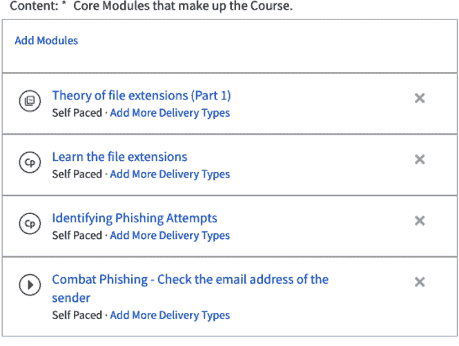

图 4.6 – 所选模块在表单的内容模块部分可见

如有需要，您可以拖动模块上下重新排序。完成上述步骤后，您已提供了继续创建本课程所需的仅有的两条信息。

- 9. 点击页面右上角的 **保存** 按钮。

此操作会带您进入该课程的 **设置** 页面，在 Prime 允许您发布此课程之前，还需要一项额外信息。但现在，您将简单地返回课程目录。

- 10. 点击左侧边栏顶部的 **返回** 按钮，返回作者角色的 **课程目录** 页面。

**课程目录** 页面提供了您 Captivate Prime 账户中学习者可用的所有培训材料的列表。不幸的是，您的新课程目前还未在此列表中显示。请记住，在课程可以发布之前，您仍需提供一项信息，因此此时您的课程处于 *草稿* 状态。

在本节中，您提供了创建课程所需的基本信息：您为课程命名，并选择了构成课程的模块。但对于 Captivate Prime 而言，这不足以让您发布课程。在下一节中，您将把课程链接到一个或多个 *技能*。这是课程可在学习者中提供之前所缺少的信息。

## 将课程链接到技能

此时，您的新课程处于 *草稿* 状态。在发布之前，您必须通过执行以下步骤将课程链接到一个或多个技能：

- 1. 确保您以作者身份登录。
- 2. 从作者主页，单击左侧边栏 **学习** 部分中的课程链接。
- 3. 在列表顶部，单击 **草稿** 选项卡以访问当前处于 *草稿* 状态的课程列表。从此列表中，您应该能找到在上一节中开始创建的课程。
- 4. 将鼠标悬停在课程卡片的下部区域（可见三个小点的地方）并单击 **查看课程** 链接。此操作会带您返回上一节中用于创建课程的表单。
- 5. 单击左侧边栏中的 **设置** 链接。此操作会带您进入课程的 **设置** 页面。在此您可以选择此课程链接的 *技能*。
- 6. 在表单顶部，打开 **选择技能** 下拉列表。

- 7. 选择本章前面创建的 **网络安全** 技能。
- 8. 打开 **级别** 下拉列表并选择级别 **1**。
- 9. 最后，在 **学分** 字段中输入 30。
- 10. 单击页面右上角的 **保存** 按钮。

**设置** 页面的上部现在应如下所示：

| 课程技能 * | 技能 | 级别 | 学分 ⓘ | 最大学分 |  |
|---|---|---|---|---|---|
|  | 网络安全 | 1 | 30 | 50 | X |
|  | 添加更多 |  |  |  |  |

图 4.7 – 您的课程为网络安全等级 1 技能授予 30 学分

在当前设置下，您的课程为 *网络安全 – 1 级技能* 授予 30 学分。请记住，学习者需要在达到 *网络安全 – 1 级* 之前累积 50 学分。换句话说，此课程不足以获得该特定技能。

这是在 Captivate Prime 技能管理中非常常见的模式。假设有三门不同的课程链接到网络安全 – 1 级技能：

- *网络安全基础* 课程（即您在本节中构建的课程）授予 30 学分。
- *如何想出强密码* 课程（尚未创建）将授予 20 学分。
- 最后，*如何备份您的计算机* 课程（也尚未创建）也将授予 20 学分。

根据上述参数，*网络安全 – 1 级* 技能将授予任何修读了这三门课程中至少两门的学习者，其中一门是 *网络安全基础*。这说明了技能如何被用来使课程成为必修，同时为学习者提供实现特定技能的一些选择。

从技术上讲，您的课程现在已准备好发布。话虽如此，您希望为学习者提供最佳体验，因此在下一节中，您将添加一些额外数据以使课程更具吸引力并提高课程的可发现性。

## 自定义课程并使其可发现

课程只有在用户可以注册时才有用。在 *第 6 章，注册学习者参加课程* 中，您会发现，虽然管理员和经理可以为学习者注册课程，但 Captivate Prime 建立在 *自助学习平台* 的理念之上，其中课程目录可供学习者使用，以便他们自行注册感兴趣的课程。Prime 课程目录可能包含数千门课程，因此使课程对可能感兴趣的学习者可发现至关重要。

作为作者，您可以做一些事情来提高平台内的课程可发现性：

- 您可以提供课程的 **简短描述** 和 **详细概述**。这使学习者能更好地了解课程内容，并增加单纯兴趣转化为实际注册的机会。Captivate Prime 的内部搜索引擎也使用此内容来索引您的课程并将其与适当的关键词关联。
- 您可以将课程链接到标签。标签在 *第 3 章，上传学习内容和管理内容库* 的 *使用标签* 部分中进行了讨论。
- 您可以告诉 Captivate Prime 课程的目标受众。这增加了目标受众在目录中找到课程并注册的机会。这要求用户和用户组存在于您的 Prime 账户中，这将在 *第 5 章，管理用户* 中介绍。
- 最后，您可以通过提供 **横幅图片** 和 **封面图片** 使课程在视觉上更具吸引力。

在本节中，您将为课程添加此额外元数据并提供 **封面图片** 和 **横幅图片**：

- 1. 从 **作者** 主页，单击左侧边栏 **学习** 部分中的 **课程** 链接。
- 2. 在列表顶部，单击 **草稿** 选项卡以访问当前所有处于 *草稿* 状态的课程列表。在此列表中，您应该能找到本章前面开始创建的课程。
- 3. 将鼠标悬停在您课程卡片的下部区域（可见三个小点的地方）并单击 **查看课程** 链接。此操作会带您返回首次创建课程时使用的表单。
- 4. 提供课程的 **简短描述** 和 **详细概述**。

**简短描述** 出现在课程卡片上，该卡片在目录本身以及学习者在寻找课程的搜索结果页面中可见。它应非常简短（最多 140 个字符）并包含与您的课程相关的关键词。将其视为诱使学习者点击您的课程而非目录中其他课程的诱饵。

**详细概述** 是课程的较长描述（最多 1,500 个字符）。它出现在学习者点击目录或搜索结果页面中的课程卡片后。换句话说，达到 **详细描述** 的学习者已表达了参加课程的兴趣。这就是为什么 **详细描述** 可以比 **简短描述** 长得多。详细概述应包含有关课程内容、学习成果、课程中使用的教学方法等的高层信息。

**示例描述**
为了帮助撰写有意义的 **简短描述** 和 **详细概述**，示例可在本书随附的下载提供的 `cybersecurity/description_EN.pdf` 文件中找到。

在点击 **保存** 按钮之前，您必须为课程上传 **封面图片** 和 **横幅图片**。

**示例图片**
您可以使用任何可用图片来完成此过程中的步骤。如有需要，示例图片在本书相关下载的 `/cybersecurity` 文件夹中提供。如果您使用自己的图片，封面图片的推荐尺寸为 300 像素乘 300 像素，横幅图片的推荐尺寸为 1,600 像素乘 140 像素，如官方 Captivate Prime 用户指南中所述 https://helpx.adobe.com/be_en/captivate-prime/system-requirements.html。

让我们上传必要的图片。

- 5. 将合适的封面图片拖到课程 **概述** 表单的 **封面图片** 字段。

**选择课程图片**
这些课程图片代表了品牌化您的 Prime 账户的又一次机会。这可以是品牌图片，或为内部品牌而编辑的库存图片，以便您的账户外观保持一致且课程易于识别。

- 6. 此外，将合适的横幅图片拖到 **Banner Image** 字段中。
- 7. 点击屏幕右上角的 **Save** 按钮。
- 8. 完成后，点击左侧边栏 **Preview** 部分中的 **Preview as learner** 链接。

此操作会以学习者视角打开课程页面，即课程发布后学习者所见的样子。请注意横幅图片，它显示在页面顶部，以及详细概述和构成课程的模块列表。

- 9. 花点时间检查课程页面的其他元素。准备好后，点击左侧边栏顶部的 **Back** 按钮返回到 **Course Catalog** 页面。
- 10. 点击页面顶部的 **Draft** 选项卡，以访问当前处于 *草稿* 状态的课程列表。

您应该已经能在 **Draft** 课程列表中看到封面图片的效果，如以下屏幕截图所示：

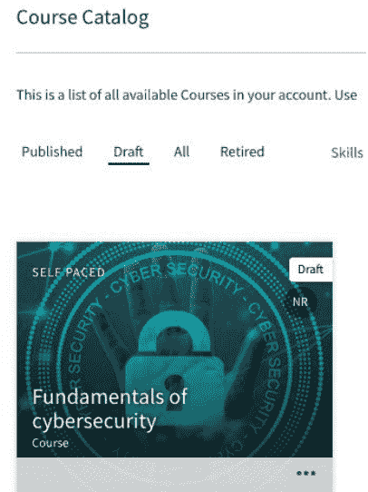

图 4.8 – 封面图片用于在学习目录中显示的课程卡片

在本节中，您通过添加 **Brief Description** 和 **Detailed Overview** 使课程更易被发现。您还自定义了课程的外观和风格，使其在课程目录中脱颖而出，从而增加了学习者点击此课程卡片并注册的可能性。

在下一节中，您将向课程添加一个由讲师主导的学习活动。

## 向课程添加讲师主导的活动

到目前为止，您添加到课程中的活动模块都是自学型学习活动。这些自学活动（也称为 *异步* 活动）在用于构建课程之前已上传到内容库。这没什么问题！许多优秀的在线课程只是异步自学学习模块的简单集合。

尽管如此，您也可以向 Captivate Prime 课程添加 *同步* 学习活动。*同步* 学习活动是由讲师主导的现场培训，要么在实际的教室或讲堂中进行，要么使用 Adobe Connect、Zoom 或 Microsoft Teams 等虚拟课堂环境进行。

此功能使 Captivate Prime 能够满足以下用例：

- 您可以创建仅包含 *同步* 学习活动（现场或虚拟）的课程。在 *第 8 章，探索讲师角色* 中，您将了解到 Captivate Prime 具有帮助您管理课堂出勤、候补名单、提醒、现场或虚拟课堂中获得的技能等的功能。
- 您可以创建包含自学异步活动和同步现场或虚拟课程混合的课程。例如，您可以在学习者复习了几个自学模块后安排现场课程，这些模块随后被视为现场课程的先决条件。这种 **blended learning** 方法在学习者、培训师和人力资源部门中非常受欢迎，因为它允许您结合异步和同步学习方法的优势。

这是可供教学设计师创建引人入胜且有效的学习体验的各种工具的又一例证。

让我们向您当前正在构建的课程添加一个 *同步* 学习活动：

- 1. 确保您以 作者 身份登录。
- 2. 从 作者 主页，点击左侧边栏 **Learning** 部分中的 **Courses** 链接。
- 3. 点击 **Draft** 选项卡以访问当前处于 *草稿* 状态的课程列表。

4. 将鼠标悬停在课程卡片的底部，然后点击 **View Course** 链接。

此操作会带您返回课程 **Overview** 页面，您可以在此定义课程的主要属性，包括构成其内容的模块。

5. 向下滚动页面直到看到 **Modules** 部分。已属于此课程的模块列表应显示在 **Content** 部分中。

6. 点击 **Content** 部分顶部的 **Add Modules** 链接。

7. 这次，选择 **Classroom Module** 选项以向您的课程添加现场讲师主导的课程。

8. 使用所需信息填写表单，如以下屏幕截图所示。

9. 准备好后，点击表单右下角的 **Done** 按钮。

10. 最后，点击页面右上角的 **Save** 按钮以保存对课程的更改：

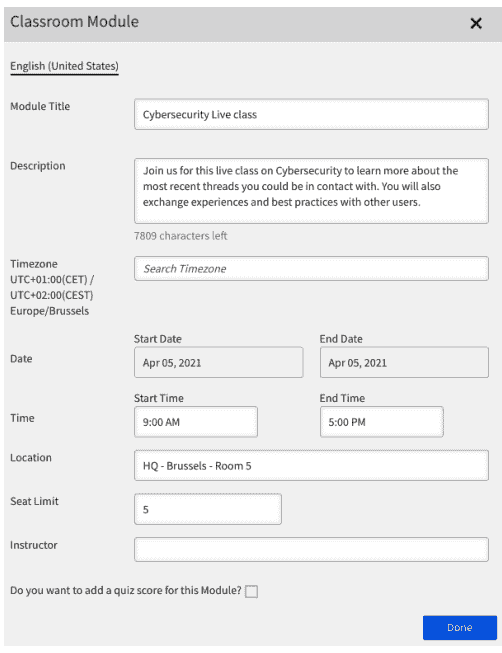

图 4.9 – 向您的课程添加 Classroom Module

自学 *异步* 模块与 *同步* 模块（现场或虚拟）之间的主要区别之一是 *同步* 模块具有时间依赖性：
您刚刚创建的 **Classroom Module** 具有 **Start Date** 和 **Time**，以及 **End Date** 和 **Time**。

这就提出了学习者注册的问题。当学习者在同步课程活动开始/结束日期 *之后* 注册课程时会发生什么？这就是课程 **instances** 的目的，您将在 *第 6 章，注册学习者到课程* 中学习它。

**Seat Limit** 字段对于班级注册和候补名单管理很重要。
在此示例中，请确保您选择一个相对较低的座位限制（在前面的屏幕截图中为 5）。

此外，请注意 **Instructor** 字段。创建活动时，您可能尝试在 **Instructor** 字段中输入自己的姓名。不幸的是，默认情况下 Prime 不允许您这样做！这是因为您未在系统中注册为潜在讲师。分配用户角色将在 *第 5 章，管理用户* 中介绍。在此之前，您可以安全地将此字段留空。

最后，**Do you want to add a quiz score for this Module** 复选框允许您决定是否向参加此现场课程的学习者授予成绩。为班级参与者分配成绩是讲师的职责之一。您将在 *第 8 章，探索讲师角色* 中探索讲师角色。在此之前，请确保保持此框未选中。

> **Authors versus instructors**
> 来自教育行业，我花了一些时间才理解区分作者和讲师的原因。毕竟，在大多数学校和大学中，教师是既 *创建* 课程又 *教授* 课程的人。但 Captivate Prime 是一个企业 LMS，而在教育中似乎显而易见的事情在企业环境中有时变得没那么明显。
> 在大型组织中，单个 L&D 部门可能负责 *设计* 在世界各地各个分支机构向各种学习者提供的课程。在这种情况下，课程的 *作者* 是组织的学习与发展部门，而 *讲师* 是负责在地区办公室提供该培训的个人。当然，同一个人可以既是 Author *和* Instructor，但并非总是如此。

## 添加虚拟课堂模块

*同步* 活动可以是现场或虚拟的。在上一节中，您向课程添加了一个现场讲师主导的模块。添加虚拟课堂的过程非常相似，但有一个关键区别。这就是本节将探讨的内容。让我们开始吧：

- 1. 返回课程的 **Overview** 页面。在这里您可以编辑基本课程信息，例如 **Course Name**、**Brief Description**、**Content** 等。
- 2. 向下滚动页面直到看到 **Modules** 部分。
- 3. 点击 **Content** 部分顶部的 **Add Modules** 链接。
- 4. 点击 **Virtual Classroom Module** 选项以打开 **Virtual Classroom** 表单。
- 5. 花点时间查看 **Virtual Classroom** 表单的内容。
- 6. 完成后，点击表单右下角的 **Cancel** 按钮返回课程 **Overview** 页面，而不实际添加任何模块。

在大多数情况下，**Virtual Classroom** 表单与您在上一节中完成的 **Classroom Module** 表单相同。这不足为奇，因为虚拟课堂模块也是 *时间依赖*（它具有开始和结束日期/时间）。

唯一的区别是位于表单中间的 **Details** 部分，如以下屏幕截图所示：

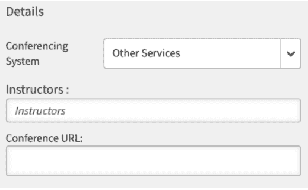

图 4.10 – Virtual Classroom 表单的 Details 部分

在这里您可以指定 **Conference URL**。此 URL 可以将用户重定向到 *任何* 虚拟课堂或视频会议解决方案（即使所选解决方案不是来自 Adobe）。例如，如果您的组织使用 Zoom，只需在 Zoom 中安排课程并将 Zoom 链接复制/粘贴到此处即可。

The **Conferencing System** dropdown lists the conferencing systems that have been integrated with your Prime account. Integrating such an external solution with Captivate Prime is a task devoted to the Integration Admin. You will explore the Integration Admin role in more detail in *第16章，探索集成管理员角色*. Note that, by default, only the **Other Services** option is available in the list. This is because you have not configured any integration in your Prime account yet.

In this section, you added an instructor-led synchronous class activity to your course and reviewed the process of adding a virtual class to the course. You discovered that the main difference between an *asynchronous self-paced* module and an instructor-led *synchronous* module is that a *synchronous* module is *time-dependent*. In the next section, you will add a few more **activity modules** to your course.

## 添加活动模块

The last type of module that you can add to a course is the activity module. You can use this module type when learners need to complete some kind of activity, such as an assignment, a workshop, and viewing a YouTube video.

There are four types of activity modules available:

- **External URL**: Use this activity to add external resources, such as blog posts, YouTube videos, and more to your course. Learners must visit the external URL before they can mark the activity module as completed.
- **File Submission**: Use this activity when you want learners to submit an assignment to the platform. When using this type of activity, you must also assign an instructor to review and grade the submitted files.
- **xAPI-Based Module**: xAPI is the new communication standard of the eLearning industry. As we discussed in *第3章，上传学习内容和管理内容库*, xAPI was designed under the assumption that learners always learn, but not necessarily within your LMS. This type of activity module allows you to grab learning data generated by an external system and make it part of the **Learner** track record. It allows learners to take course modules outside of Captivate Prime while still being tracked by the system.
- **Checklist**: It is sometimes necessary to assess someone's ability directly on the job by observing the person carry out his/her daily tasks. This is the purpose of the checklist activity. It allows you to define up to 150 criteria that an instructor will have to check while monitoring the person in the workplace. To define this type of activity, you need to assign an instructor and supply the criteria that the learners will be evaluated on.

You will now add three activity modules to your course: an **External URL** activity, a **File Submission** activity, and a **Checklist.**

### 创建外部 URL 活动

In today's interconnected world, a plethora of learning content is available all over the internet. From blog posts to YouTube videos, the content you need is sometimes just a Google search away. Therefore, it may not be necessary to reinvent the wheel when creating your courses. Sometimes, redirecting the learner to these external pieces of content is the most effective way to go, both from an instructional design and cost control perspective. External URL activity can also be learning content contracted to a third-party provider that does not allow any files to be uploaded to the LMS. In such a case, you need to add an **External URL** activity to your course:

+   1. Return to the **Overview** page of your course. This is where you can edit basic course information, such as **Course Name**, **Brief Description**, **Content**, and more.
+   2. Scroll down the page until you see the **Modules** section.
+   3. Click the **Add Modules** link located at the top of the **Content** section.
+   4. Click the **Activity Module** option to open the **Activity Module** form.
+   5. Enter the title of your **Activity Module** in the **Title** field. As a best practice, also supply a short description in the **Description** field.
+   6. Choose **External URL** in the **Type** field.
+   7. Copy/paste the URL of the activity in the **URL** field. This is the most important piece of information on the form.
+   8. Finally, enter the approximate duration (in minutes) of the activity in the **Duration** field.
+   9. Make sure the **Activity Module** form looks as follows before clicking the **Add** button located in the lower-right corner of the form:

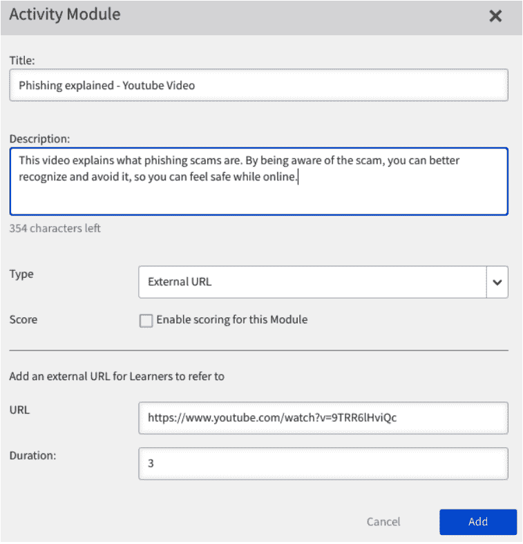

Figure 4.11 – The Activity Module form when adding an External URL

After clicking the Add button, the new activity will be added to the course content. Feel free to reorder the modules before you save the changes by clicking the Save button located in the upper-right corner of the page.

### 创建文件提交活动

Asking learners to upload individual assignments is an effective way to assess their new skills. Adobe Captivate Prime makes it easy to set up such an activity thanks to the File Submission activity module. Once the learner has uploaded his/her work, a designated instructor must review the submitted file to accept or reject it and eventually grade it.

Perform the following steps to add a File Submission activity to the course:

+   1. Return to the Overview page of your course. This is where you can edit basic course information such as Course Name, Brief Description, Content, and more.
+   2. Scroll down the page until you see the Modules section.
+   3. Click the Add Modules link located at the top of the Content section.
+   4. Click the Activity Module option to open the Activity Module form.
+   5. Enter the title of your Activity Module in the Title field. As a best practice, also supply a short description in the Description field.
+   6. Choose File Submission in the Type field.
+   7. As you are yet to define potential instructors in your account, leave the Submission Instructor(s) field empty for now.
+   8. Optionally, enter the estimated duration (in minutes) in the Duration field.
+   9. When you're ready, click the Add button located in the lower-right corner of the form.
+   10. Finally, click the Save button in the upper-right corner of the page to save the changes you made to the course.

The File Submission activity is a great addition to your Author's toolbox. It also demonstrates the wide range of instructional design use cases Captivate Prime can address.

### 创建清单活动

In addition to the assessment activities (quizzes, file submissions, virtual and live classes, and so on) already included in the course, it is sometimes necessary to visit learners directly in their workplace to assess their new skills on the job. This is particularly useful in production plants, logistics, first aid, safety training, and so on, where the practical aspect is of great importance.

This is what a Checklist activity is used for. It is a list of items that the designated instructor will be asked to rate as he/she monitors the learner in the course of his/her daily work.

Simply perform the following steps to add a Checklist activity to the course:

+   1. Return to the Overview page of your course. This is where you can edit basic course information such as Course Name, Brief Description, Content, and more.
+   2. Scroll down the page until you see the Modules section.
+   3. Click the **Add Modules** link located at the top of the **Content** section.
+   4. Click the **Activity Module** option to open the **Activity Module** form.
+   5. Enter the title of your **Activity Module** in the **Title** field. As a best practice, also supply a short description in the **Description** field.
+   6. Choose **Checklist** in the **Type** field.

There are two checklist types available: the **Yes/No** checklist and the **1-5** checklist. If choosing **Yes/No**, the instructor will be asked to answer *Yes* or *No* to each item on the checklist. If choosing **1-5**, the instructor will be asked to rate each item of the checklist on a scale of 1 to 5.

+   7. Choose **Yes/No** in the **Checklist Type** field.
+   8. Type 3 in the **Pass Criteria** field. This means that the checklist is considered *passed* when three items or more have *Yes* as an answer.
+   9. Click the **Add** link in the **Checklist Questions** field to add a minimum of three questions to your checklist.

This last action is shown in the following screenshot:

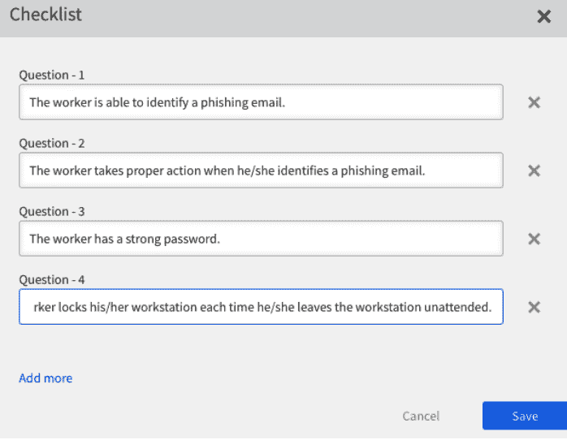

Figure 4.12 – Enter a minimum of three questions in your checklist

在输入问题时，请记住讲师应能用“是”或“否”来回答每个问题。

- 10. 完成后，点击 **保存** 按钮保存问题。
- 11. 由于您尚未在账户中定义潜在讲师，请暂时将 **提交讲师** 字段留空。
- 12. 可选地，您可以在 **给讲师的备注** 字段中为讲师输入备注。
- 13. 准备就绪后，点击表单右下角的 **添加** 按钮，将新活动保存到课程内容中。
- 14. 最后，点击页面右上角的 **保存** 按钮，保存您对课程所做的更改。

**核对清单** 活动是 Captivate Prime 中提供的又一个评估工具。将其用于补充课程中使用的其他评估活动，并为组织提供有意义的数据以衡量课程的有效性。

在本节中，您已通过向课程添加三种不同类型的活动来回顾 **活动模块**。在下一节中，您将为部分模块添加替代交付方式。

## 为模块添加替代交付类型

在许多情况下，能够使用不同的交付类型交付相同的模块是有帮助的，如以下示例所示：

- - 特定讲师因病休假数月，因此其讲师主导的课程已暂时被自学模块（例如以往课程的录像）取代。
- - 您可能没有能用每种语言进行现场或虚拟授课的讲师，因此对于某些语言，您必须提供自学模块（例如带有不同语言字幕的现场课程录像），而不是讲师主导的课程本身。
- - 在大型组织中，学习者可能分布在世界各地，因此在设计课程时需要考虑文化差异。例如，在我的国家（比利时），学习者倾向于选择讲师主导的课程而非自学模块（这部分是因为比利时是一个很小的国家——比利时比马里兰州略 *更小* ——因此参加现场培训，即使在国家的另一侧，通常也不是问题）。在美国等更大的国家则大不相同。
- - 各种当地法规可能要求课程的某些模块在世界某些地区扩展，而在其他地区不扩展。适合一个国家 3 分钟自学模块的内容在另一个国家可能需要 3 小时网络研讨会。
- - 您可能只是想为所有学习者提供最佳的学习体验，无论他们的学习风格如何。
- - 等等。

出于所有这些原因，以及此处未列出的原因，Captivate Prime 允许您为模块定义替代交付类型。在 *第 6 章，将学习者注册到课程* 中，您将了解 **课程实例**，在那里您可以决定为课程的哪个实例使用哪种交付类型。

现在，让我们只指定当前正在构建的课程的模块可以使用哪些交付类型：

- 1. 返回课程的 **概览** 页面。在这里您可以编辑基本课程信息，例如 **课程名称、简要说明、内容** 等。
- 2. 向下滚动页面，直到看到 **模块** 部分。
- 3. 从内容模块列表中，点击您想要为其定义其他交付类型的模块的 **添加更多交付类型** 链接。
- 4. 选择一个或多个额外的交付类型，并在完成后点击 **完成** 按钮。此操作在以下屏幕截图中进行了说明。

- 5. 不要忘记点击屏幕右上角的 **保存** 按钮来保存您对课程所做的更改：

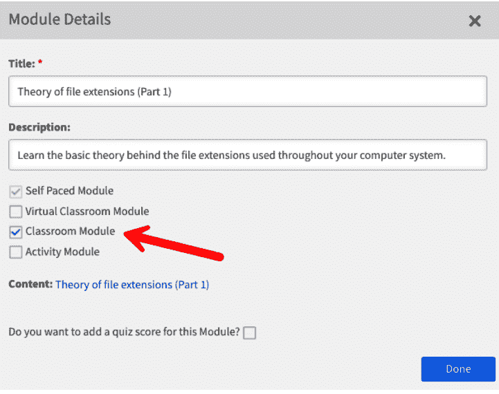

图 4.13 – 您可以为每个模块添加替代交付类型

在前面的屏幕截图中，**课堂模块** 交付类型已被添加为对最初定义为 **自定进度模块** 的替代方案。当您在 *第 6 章，将学习者注册到课程* 中创建课程实例时，您将看到此操作的效果。

完成前几节后，课程的主要内容现已就位。但 Captivate Prime 允许您指定其他类型的内容，例如 **预习**、**工作辅助** 和其他额外的 **资源**。这就是您将在下一节中查看的内容。

## 其他类型的学习材料

到目前为止，您添加到课程中的模块构成了课程的主要内容。正是这些内容，每个学习者必须复习以通过课程、完成课程并获得课程授予的学分。

但 Captivate Prime 允许向课程添加其他类型的学习材料。这就是您将在本节中回顾的内容：

- 1. 返回课程的 **概览** 页面。在这里您可以编辑基本课程信息，例如 **课程名称**、**简要说明**、**内容** 等。
- 2. 向下滚动页面，直到看到 **模块** 部分。

您应该在 **内容** 部分已有十几个模块，如以下屏幕截图所示：

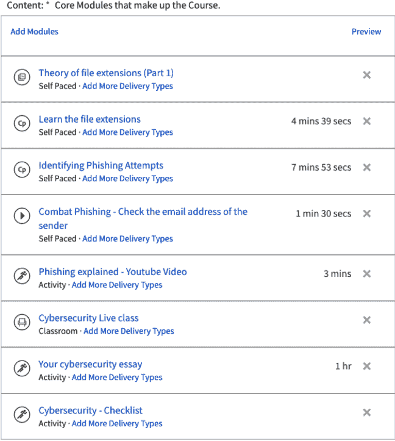

图 4.14 – 课程中目前存在的 content modules

再向下滚动页面一点，您将找到两个额外的部分，允许您添加 **预习** 模块和 **免修** 模块。

### 使用预习模块

预习模块是旨在帮助学习者为课程做准备的模块。这种类型的学习内容通常用于以下情况：

- - 添加自学模块，从学习者角度解释 Captivate Prime 的工作原理。
- - 添加视频介绍课程作者和/或讲师。
- - 提供可选的现场或虚拟课程来介绍课程。
- - 提供一些材料帮助学习者在接受培训前确定是否满足课程先决条件或是否具备正确的技能或工作经验。

在向课程添加预习模块时，请记住学习者无需观看这些模块即可完成课程并获得学分。这是常规内容模块与预习模块之间的主要区别：内容模块是完成课程所必需的，而预习模块不是完成课程所必需的。

添加预习模块的过程与添加常规内容模块的过程相同：点击 添加模块 链接并选择要添加的模块。请注意，您可以添加与常规内容模块相同的模块类型：自定进度模块、虚拟课堂模块、课堂模块 和 活动模块。

在进入下一节之前，请随意向您的课程添加一个或多个预习模块。

### 使用免修模块

员工培训花费时间和金钱，因此组织希望确保为需要培训的人员提供适当的培训。在大型组织中，将大量人员注册培训并不罕见。虽然这种做法使 LMS 管理更轻松，但也增加了将已经了解该主题的人注册到课程中的风险，从而浪费该人员的时间和组织的资金。

免修模块的另一个用例是在政府领域，许多课程即使材料未更改也要求每年参加。帮助学习者和 LMS 所有者的一种可能方法是提供免修。这有助于节省学习者的时间，并提供证明主题掌握的数据。

学习者可能还希望验证他们在其他地方获得的企业 LMS 技能（在以前的工作中、在学校、在旅行中、在他们的爱好中等等）。

这是 **Testout** 模块的目的。成功通过可选 **Testout** 模块的学习者可以在仍获得学分并达成合规的情况下跳过课程。

你可以像往常一样添加相同的模块类型（**Self Paced Modules**、**Virtual Classroom Modules**、**Classroom Modules** 和 **Activity Modules**），但大多数情况下，**Testout** 模块是测验或其他评估活动，例如 **File Submission** 或 **Checklist** 活动。

在进入下一节之前，请随意向你的课程添加一个或多个 **Testout** 模块。

## 将作业辅助材料链接到课程

正如我们在 *第 3 章，上传学习内容和管理内容库* 的 *创建作业辅助材料* 部分所讨论的，作业辅助材料是学习者无需注册课程即可访问的培训内容。可以将其视为备忘单或讲义，类似于你在会议或现场课程结束时收到的材料。

虽然访问作业辅助材料不需要注册课程，但你仍可以通过执行以下步骤将相关的作业辅助材料与你的课程关联起来：

- 1. 确保你以 作者 身份登录并返回课程的 **概览** 页面。这里可以编辑诸如 **课程名称**、**简要描述**、**内容** 等基本课程信息。
- 2. 点击左侧边栏顶部位置的 **设置** 链接。这是你可以将 **技能** 与课程关联的页面，等等。
- 3. 向下滚动页面，直到看到 **作业辅助材料** 字段。
- 4. 点击 **添加作业辅助材料** 链接并开始输入你要查找的作业辅助材料的名称。
- 5. 当它出现在列表中时，点击作业辅助材料的名称。
- 6. 对你想要链接到此课程的其他作业辅助材料重复此过程。
- 7. 完成后，点击页面右上角的 **保存** 按钮保存更改。
- 8. 点击左侧边栏 **预览** 部分中的 **以学习者身份预览** 链接以测试你的更改。

如以下屏幕截图所示，作业辅助材料可通过课程的右侧边栏供学习者使用：

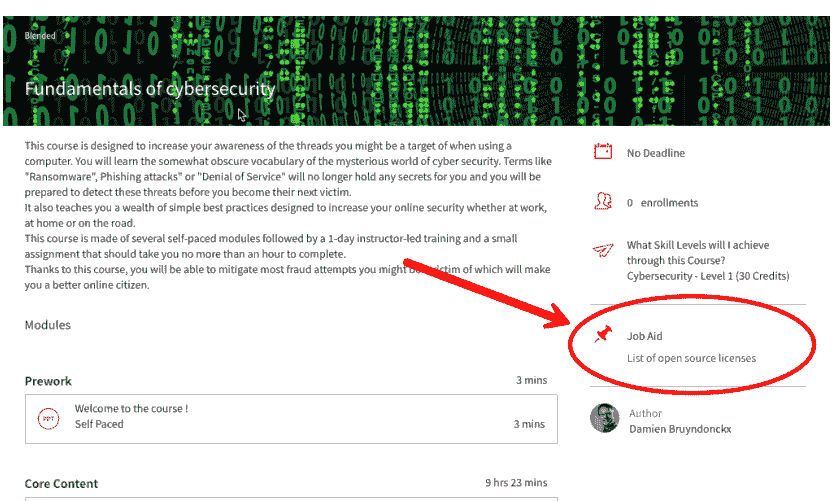

在本节中，你回顾了将作业辅助材料链接到课程的过程，并通过以学习者身份预览课程见证了结果。在下一节中，你将向课程添加其他资源。

## 向课程添加资源

除了模块（内容、预习和 Testout）和作业辅助材料之外，Captivate Prime 还允许你向课程上传其他资源。请注意，上传其他资源不是发布课程的必需条件。

通常，此额外课程材料用于以下情况：

- 使完成作业所需的资产可供学习者使用。
- 为视频编辑课程提供示例文件。

这些资源与上一节讨论的作业辅助材料之间的主要区别在于，作业辅助材料可以在不注册课程的情况下访问，而资源链接到特定课程，只能由已注册的学习者访问。此外，同一个作业辅助材料可以链接到多个课程，而特定资源链接到特定课程（如果你想在多个课程中使用同一资源，则需要多次重新上传同一文件）。

资源可以是你上传到系统中的文件或指向其他站点的链接。请执行以下步骤向课程添加资源：

- 1. 确保你以 作者 身份登录并返回课程的 **概览** 页面。这里可以编辑诸如 **课程名称**、**简要描述**、**内容** 等基本课程信息。
- 2. 点击左侧边栏顶部位置的 **设置** 链接。这是你可以将技能和作业辅助材料与课程关联的页面，等等。
- 3. **资源** 字段位于此表单的最后。

从这里，你可以上传文件和/或输入将用作本课程 **资源** 的其他站点链接。不要忘记点击页面右上角的 **保存** 按钮保存你的更改。

在阅读了前面几节之后，你课程的所有内容现已就位。在下一节中，你将学习如何为课程指定 **先决条件**。

## 定义课程先决条件

每位讲师都知道学习是一段旅程，就像任何旅程一样，它由有时必须按正确顺序进行的步骤组成。当某人没有基本知识时让其注册高级课程既浪费时间又浪费金钱。这就是你想要为课程定义先决条件的主要原因。

在 Captivate Prime 中，先决条件是你建议学习者在注册本课程之前先修的其他课程。默认情况下，先决条件仅为建议，这意味着 Prime *不* 强制你在注册课程前满足这些先决条件。然而，你也可以使先决条件成为强制性的。在这种情况下，学习者必须满足先决条件后才能注册。

执行以下步骤为你的课程定义先决条件：

- 1. 确保你以 作者 身份登录并返回你要添加先决条件的课程的 **概览** 页面。
- 2. 点击左侧边栏顶部位置的 **设置** 链接。
- 3. 向下滚动页面，直到看到 **先决条件** 部分。
- 4. 点击 **添加先决条件** 链接并开始输入你认为是对本课程的先决条件的课程名称。
- 5. 当它出现在列表中时，点击所选课程的名称。
- 你可以通过重复最后两个步骤多次来添加多个先决条件。如果有多个先决条件，你可以通过简单的拖放操作轻松重新排序它们。
- 6. 如有需要，选中 **强制先决条件** 复选框以使先决条件成为强制性。
- 7. 不要忘记点击页面右上角的 **保存** 按钮保存你的更改。
- 8. 点击左侧边栏 **预览** 部分中的 **以学习者身份预览** 链接以测试你最近更改的效果。

如以下屏幕截图所示，**先决条件课程**（如果有）会显示在课程页面的课程内容上方：

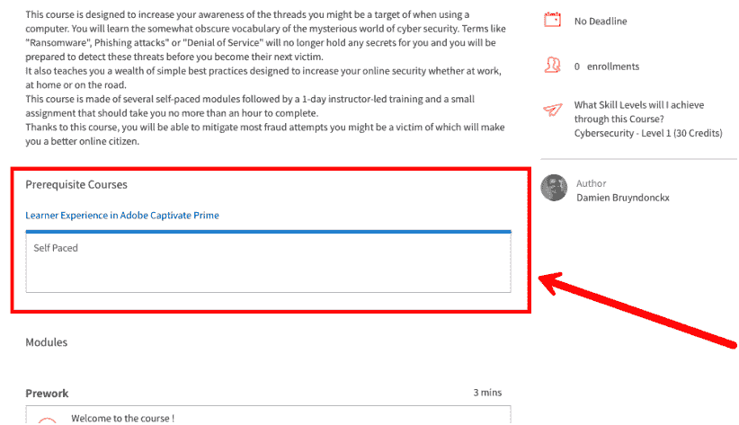

图 4.16 – 先决条件课程显示在课程内容上方

先决条件的常见用例是创建一个简短的课程来解释 Captivate Prime 学习者体验，并将其设为平台上所有其他课程的先决条件。这确保了每个新用户必须先完成关于 Captivate Prime 本身的课程后才能注册其他任何课程。此用例还说明了将同一课程用作多个其他课程的先决条件的可能性。

在本节中，你学习了如何向课程添加先决条件。在下一节中，你将讨论并设置课程完成标准。

## 设置课程完成标准

你的课程几乎准备好发布了。在最终向学习者开放之前，还有一个重要的方面需要讨论：课程完成标准。

在第 3 章《上传学习内容和管理内容库》中，你上传了单个内容模块并设置了每个模块的成功和完成标准。这是使 Captivate Prime 能够跟踪课程内学习者进度的一个重要步骤。

但课程本身也有完成和成功标准。这一步也很重要，因为完成课程会为学习者提供完成技能、徽章和其他目标的学分。此外，请记住课程可以是其他课程的先决条件。因此，将课程标记为已完成可能是注册其他课程的要求。

让我们通过执行以下步骤来查看这些选项：

- 1. 确保你以 作者 身份登录并返回你要更新的课程的 概览 页面。
- 2. 向下滚动页面，直到看到 模块排序 和 强制模块 部分。

以下屏幕截图显示了这两个部分的默认配置：

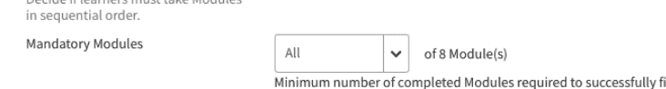

图 4.17 – 模块排序 和 强制模块 部分的默认配置

在此默认配置下，学习者可以按任意顺序查看课程模块，但必须将所有模块标记为 *completed*，课程才会被视为 *complete*。

- 3. 将 **Sequencing of Modules** 选项更改为 **Ordered**。
- 4. 打开 **Mandatory Modules** 下拉列表并选择 6。
- 5. 完成后，点击页面右上角的 **Save** 按钮。

使用此新配置，学习者必须按课程中出现的顺序查看模块。请记住，当您以 Author 身份登录时，可以在此处在课程的 **Overview** 页面上拖放模块以按正确顺序排列。

您还决定当学习者至少查看了六个模块时，课程即被视为 *complete*。在此示例中，课程包含八个模块，因此前六个模块为必填项，而最后两个模块被视为可选附加项。这两个选项（**Sequencing of Modules** 和 **Mandatory Modules**）非常强大，可实现多种变体。

在继续之前，请记住 *completion* 标准与 *success* 标准不同。换句话说，您可以 *complete* 一门课程，但仍 *fail* 其中的部分或全部交互式模块。在这种情况下，您需要定义 Captivate Prime 如何管理多次尝试。

## 允许多次尝试

不幸的是，**Multiple Attempts** 选项默认情况下未 *enabled*。因此，您首先需要返回到 Administrator 角色以为您的账户启用此选项。然后，您必须返回到 Author 角色以详细查看它。让我们来看一下：

- 1. 点击屏幕右上角的用户图标。
- 2. 选择 **Administrator** 角色。Captivate Prime 重新加载后，您将以 Administrator 身份登录。
- 3. 在 Administrator 主页上，点击左侧边栏 **Configure** 部分末尾的 **Settings** 链接。
- 4. 然后，点击左侧边栏中的 **General** 链接。此操作将打开 **General** 设置页面。
- 5. 找到 **Multiple Attempts** 选项并选中 **Enable** 复选框。这是启用为创建课程的 Authors 提供高级 *success* 和 *completion* 选项的操作。
- 6. 点击屏幕右上角的用户图标并返回到 **Author** 角色。

- 7. 在 Author 主页上，点击左侧边栏 **Learning** 部分中的 **courses** 链接。
- 8. 点击 **Draft** 选项卡以访问当前处于草稿状态的课程。
- 9. 将鼠标悬停在您的课程卡片上并点击 **View Course** 链接。
- 10. 请注意课程 **Overview** 页面 **Modules** 部分顶部的新 **Allow multiple attempts** 选项，如以下屏幕截图所示：

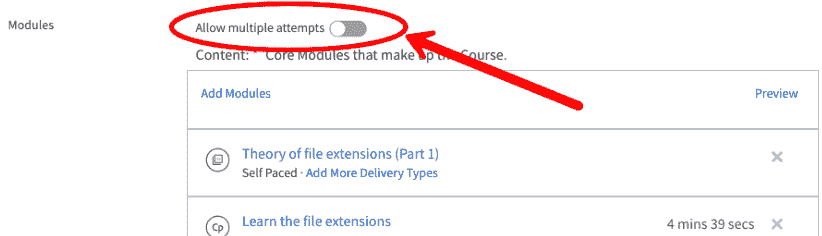

Figure 4.18 – **Allow multiple attempts** 选项出现在表单的 Modules 部分顶部

- 11. 打开 **Allow multiple attempts** 选项（这会在学习者失败交互式模块时，在学习者体验中启用 **Retake** 按钮）。
- 12. 花点时间查看可用选项。完成后，请确保 *not* 保存您的更改。

在检查这些选项时，请记住它们仅适用于课程的 *interactive* 模块。如 *Chapter 3, Uploading Learning Content and Managing the Content Library* 中所述，交互式内容模块是使用专用 eLearning 作者工具（例如 Adobe Captivate、Articulate Storyline、Lectora 和 iSpring）创建并作为符合 AICC-、SCORM- 或 xAPI 标准的包上传到 Prime 的模块：

- - **Set Attempts at** 下拉列表允许您在 *course* 级别或 *module* 级别调整这些选项。如果您选择在课程级别设置这些选项，这意味着您将对课程的所有交互式模块应用相同的值。如果您选择在模块级别设置这些选项，您可以分别针对每个交互式模块调整这些选项。
- - **Stop new attempt once module is completed & passed** 选项会在学习者同时 *completed* 且 *passed* 交互式课程模块后立即隐藏 **Retake** 按钮。

- - **Lock module between attempts** 选项允许您在一定时间内阻止访问模块。锁定时间尚未过去时，学习者无法开始下一次尝试。
- - **Set time limit to complete module** 选项允许您为完成模块指定时间限制。如果学习者在该时间限制内未完成模块，尝试将自动以 *Incomplete* 状态结束。

这些高级选项允许您实施非常广泛的教学设计策略。当然，您每次创建课程时都不需要浏览所有这些选项。有时，默认选项就足够了。

在本节中，您学习了如何指定课程的成功和完成标准。在继续发布课程之前，您将学习如何定义同一课程的多个语言版本。

## 定义课程的多个语言版本

在 *Chapter 1, Introduction to Adobe Captivate Prime* 中，您了解到 LMS 可用多种语言，并且它区分了交付给学习者的 *interface language* 和 *content language*。

在 *Chapter 3, Uploading Learning Content and Managing the Content Library* 中，您学习了如何上传同一模块的多个语言版本以及 Captivate Prime 如何为每个学习者选择要交付的语言版本。

同样的基本原理也适用于课程。课程的原始语言与平台的默认语言相同（在此示例中为 English (United States)），但您可以使用与我们用于定义模块的多个语言版本非常相似的过程，以不同语言指定各种信息，例如 **Course Name**、**Short Description**、**Detailed Overview** 等。让我们来看一下：

- 1. 确保您以 Author 身份登录并返回到要添加语言版本的课程的 **Overview** 页面。
- 2. 点击表单最顶部 **English (United States)** 选项卡旁边的 **Add New Language** 链接：

网络安全基础

填写基本信息以创建课程概述。点击“Save”。继续修改 Settings 并发布课程

English (United States) 添加新语言

课程名称 *
网络安全基础

简要描述
这显示在课程卡片上。
学习网络安全基础知识以及工作场所和家庭中的最佳实践。
剩余 0 个字符

详细概述
这显示在您的课程页面上。
本课程旨在提高您对计算机威胁的认识。您将学习一些晦涩的词汇，如“Ransomware”、“Phishing attacks”或“Denial of Service”，并在您成为之前做好准备检测这些威胁

Figure 4.19 – 添加新语言链接

- 3. 从列表中选择一种或多种附加语言，然后点击 Select Languages 框右下角的 Save 按钮。这将在课程的 Overview 页面顶部添加额外的语言选项卡，位于默认存在的 English (United States) 选项卡旁边。

- 4. 在每个语言选项卡中填写本地化的 Course Name、Brief Description 和 Detailed Overview 详细信息。

- 5. 完成后，请不要忘记点击 Overview 页面右上角的 Save 按钮。

有了这些额外的语言版本，每个学习者都可以用自己的语言浏览课程目录。请记住，每个学习者可以在其个人 **Profile Settings** 中选择其首选内容语言（请参阅 *Chapter 1, Introduction to Adobe Captivate Prime* 中的 *Modifying your account settings* 部分）。考虑到这一点，假设学习者选择了 French 作为其首选内容语言。在这种情况下，可能会出现以下情况之一：

- - 如果有法语版本的课程可用，则在浏览课程目录时，将向该学习者展示法语 **Course Name, Short Description,** 和 **Detailed Overview** 信息。在学习课程时，默认情况下会向该学习者提供课程模块的法语版本。如果某个模块没有法语版本，备选方案是在平台的默认语言（在此示例中为 English (United States)）中提供内容。换句话说，要让该学习者获得完全本地化的体验，您需要翻译课程本身的信息 *and* 课程中包含的所有模块。
- - 如果没有法语版本的课程，Captivate Prime 将回退到提供与平台默认语言相对应的语言版本（在此示例中为 English (United States)），因此学习者将以默认语言看到 **Course Name, Short Description, Detailed Overview,** 等。也就是说，如果课程中包含的一个或多个模块有法语版本，则会向学习者展示该模块的版本。

阅读完本节后，您的课程终于可以发布了，这将在下一节中进行回顾。

## 发布课程

通常，您的课程仍应处于 *Draft* 状态。这意味着它目前对搜索课程目录的学习者不可见，因此尚未开放注册。要使其成为课程目录的正式组成部分并开始接受注册，您必须通过执行以下步骤 *publish* 课程：

- 1. 在 **Author** 主页上，点击左侧边栏 **Learning** 部分中的 **Courses** 链接。
- 2. 点击 **Draft** 选项卡以访问当前处于草稿状态的课程。
- 3. 将鼠标悬停在您的课程卡片上并点击 **Publish Course** 链接。

好了！您的课程现已正式成为课程目录的一部分，并且现已开放报名。发布课程还会为作者提供新的选项。让我们快速回顾一下这些新选项。

-   4. 点击 **已发布** 选项卡，以访问课程目录中当前正在发布的课程列表。
-   5. 将鼠标悬停在您的课程卡片上并点击 **查看课程** 链接。这将带您进入该课程的 **概览** 页面。

在课程的 **概览** 页面上，花点时间查看左侧边栏。请注意新的可用选项。这些选项仅在课程发布后可用，并在以下屏幕截图中显示：

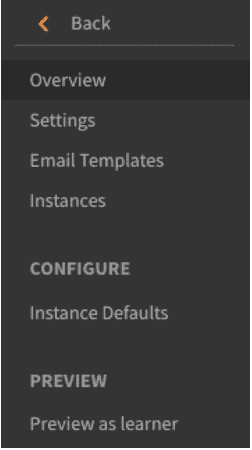

图 4.20 – 课程发布后，左侧边栏中会出现新的选项

**电子邮件模板** 选项将在 *第 15 章，使用消息和公告* 中介绍，而 **实例** 选项将在 *第 6 章，将学习者注册到课程* 中介绍。

阅读完本节后，您已基本了解了创建课程时可用的所有选项，并且在课程目录中拥有一个全新的自定义课程。请记住，课程只是内容模块的集合。在接下来的两个部分中，您将回顾长期管理课程可用的选项，其中包括编辑已发布的课程以及退役和删除课程。

## 编辑已发布的课程

编辑已发布的课程可能有几个原因。例如，新法规、政策变更、新软件版本等都需要更新课程。编辑已发布的课程与创建课程非常相似。让我们看一下：

-   1. 从作者主页，在左侧边栏的 **学习** 部分点击 **课程** 链接以访问课程目录。
-   2. 将鼠标悬停在您的课程卡片上并点击 **查看课程** 链接。这将带您返回课程 **概览** 页面，其中 *所有字段默认处于禁用状态*。
-   3. 点击页面右上角的 **编辑** 按钮以解锁表单。
-   4. 进行必要的更改。
-   5. 准备就绪后，点击 **重新发布** 按钮查看您的更改。

默认情况下，重新发布课程会向当前注册该课程的所有学习者发送电子邮件以通知他们更新。在 *第 15 章，使用消息和公告* 中，您将学习如何启用/禁用并自定义 Prime 中提供的此消息和其他消息。

此外，请注意，以这种方式更新课程 *不会* 更改当前注册学习者已达到的完成和成功标准。

> **更新内容**
> 作为一般规则，请记住，在修改平台上可用的任何类型内容时，Captivate Prime 从不会收回已授予学习者的内容。

在下一节中，我们将简要讨论退役和删除课程。

## 退役和删除课程

有时可能需要完全删除一门课程。这可能发生在您的某个产品达到生命周期结束时，当您决定不再与某个提供商合作时，当某个软件解决方案被放弃时，当从头开始创建课程的新版本时，等等。

与 Prime 中可用的模块、技能和其他类型内容类似，您不能直接 *删除* 课程。您必须先 *退役* 它；只有这样才能删除它：

-   *已发布* 的课程接受新的注册。
-   当课程被 *退役* 时，它将被从课程目录中移除并且不再接受新的注册。目前，已注册的用户仍可正常查看课程，并且仍能够复习模块以完成课程。此外，*已退役* 的课程仍可重新发布，在这种情况下它将返回课程目录并重新开始接受新的注册。
-   当课程被 *删除* 时，它将完全从您的 Prime 账户中移除。有关课程的所有数据都会丢失，学习者将无法访问它。这就是为什么在删除课程时需要格外谨慎的原因。请注意，课程必须处于 *已退役* 状态后才能被删除。

执行以下步骤以退役然后删除课程：

-   1. 从作者主页，在左侧边栏的 **学习** 部分点击 **课程** 链接以访问课程目录。
-   2. 将鼠标悬停在您想要退役的课程卡片上。
-   3. 点击 **退役** 链接。花点时间阅读消息并点击 **是** 按钮以确认这是您想要执行的操作。
-   4. 点击课程目录中课程列表上方位于的 **已退役** 选项卡。
-   5. 将鼠标悬停在您想要重新发布/删除的课程卡片上。
-   6. 点击 **发布课程** 或 **删除课程** 链接中的任意一个。

在此示例中，请确保 *不要* 删除任何课程。只需点击 **发布课程** 链接即可在课程目录中重新建立该课程。

在本节中，您学习了如何退役、重新发布和删除课程。课程在 *已退役* 状态下保留数月甚至数年以允许学习者完成课程，然后再永久删除，这并不罕见。一些组织还决定将旧课程保留在 *已退役* 状态而不 ever 删除它们，以将其保存在档案中。

## 摘要

退一步，从宏观角度来看，我们可以说课程是学习者注册以获取新技能或更新现有技能的内容。对于组织而言，保持熟练的劳动力对于取得成功和盈利至关重要。

在本章中，您了解到 Captivate Prime 具有功能齐全的技能管理器，允许组织将技能与课程对齐。这使学习者能够选择注册的课程并跟踪组织中可用的技能。Prime 默认已提供一些技能，但您也可以使用技能管理器定义自己的自定义技能并将其分配给课程。

您还回顾了与课程创建相关的所有选项。课程可以被视为模块列表。这些可以是内容库中提供的异步、自主学习模块、同步的讲师主导的现场或虚拟课程，以及各种类型的活动模块，例如外部 URL、文件提交和核对清单。预习和结业模块，以及工作辅助工具和其他资源，也可以添加到课程中。所有这些选项都使得使用 Adobe Captivate Prime 实施广泛的教学设计策略成为可能。

不过，在这一点上，您的 LMS 在学习最终发生之前仍缺少最后一个要素。这个最后的要素是那些将使用该平台来学习课程、教授课程和管理系统的用户。管理用户是您将在下一章学习的内容。
