## 5 管理用户

阅读完上一章后，您的 Prime 账户中托管了学习内容。此内容已准备好交付给您的学习者。除了... 您还没有任何学习者！在本章中，您将回顾 Captivate Prime 的工具和功能，这些工具和功能允许您管理将被授予 Prime 账户访问权限的用户。

在用户管理方面，有两个重要方面需要牢记：**身份验证** 和 **授权**。*身份验证* 回答了“您是谁？”这个问题，而 *授权* 回答了“您可以做什么？”这个问题。

对于身份验证，您当然可以直接在 Captivate Prime 中定义用户。但作为首选的企业 LMS，Captivate Prime 了解用户可能已在企业目录、**企业资源规划 (ERP)** 或 **客户关系管理 (CRM)** 系统等中定义。这就是为什么 Captivate Prime 可以通过专用连接器或通过 FTP 连接自动导入 CSV 文件的方式，从几乎任何第三方系统检索用户数据。

您还可以决定将 Captivate Prime 集成到您的 **单点登录 (SSO)** 基础设施中，前提是您的组织拥有符合 SAML 2.0 的 SSO 提供商。这允许您的用户只需一次身份验证即可访问多个企业应用程序，包括 Captivate Prime。

在授权方面，Captivate Prime 采用基于角色的方法。您已经查看了系统的主要默认角色（*管理员、作者、集成管理员和学习者*），但您也可以定义自定义角色以满足组织的特定需求。

最后，Captivate Prime 区分内部用户和外部用户。内部用户是您组织的员工，而外部用户是客户、合作伙伴、供应商、承包商以及需要访问您 LMS 的其他人员。

本章描述的功能比前几章的技术性稍强。在大多数组织中，用户管理是 IT 部门的任务，他们使用专用的服务器端工具和网络管理应用程序。话虽如此，用户管理是一个如此重要的主题，我们建议每个人都阅读本章。此外，本章中的练习对于本书即将到来的章节非常重要。

到本章结束时，来自不同来源的各种类型的用户将能够登录您的 Captivate Prime 账户以参加课程、创建课程、授课等。为了实现这一目标，本章将涵盖以下主题：

- 创建内部和外部用户
- 配置数据源和登录方法
- 使用用户组
- 管理角色

可用的广泛选项使 Captivate Prime 能够适应几乎任何企业环境。这也意味着前方有一个令人兴奋的新章节！那么，让我们开始吧！

## 技术要求

为执行本章提出的练习，您需要满足以下技术要求：

- 您需要拥有一个正在运行的 Captivate Prime 账户（可以是免费试用账户）的管理员访问权限。
- 需要时提供示例文件，但您也可以选择使用自己的文件。
- 您需要访问电子表格编辑器（如 Microsoft Excel 或 Apple Numbers）来编辑 CSV 文件。

在本章中，您将创建五个新用户：三个学习者、一个讲师和一个经理。因此，除了上述要求之外，您还需要创建五个电子邮件地址：每个未来用户一个。您可以使用任何电子邮件提供商，例如 Gmail、Yahoo Mail、Outlook 等。其中四个电子邮件地址将用于创建四个不同的 Adobe ID。

在继续下一节之前，请花必要的时间创建这五个电子邮件地址。

## 创建内部和外部用户

组织使用 Captivate Prime 来培训其员工，同时也培训其客户、合作伙伴、供应商、承包商、特许经营商等。这就是 Prime 识别两种主要用户类型的原因：内部用户和外部用户：

- **内部用户**是组织的员工。根据其角色，这些用户可以利用 Captivate Prime 提供的所有功能。
- **外部用户**不属于组织，但需要访问您的 LMS。这些用户对您的账户访问权限有限。

内部用户和外部用户之间存在一些关键差异。它们都与外部用户对您的账户访问权限有限这一事实有关：

- 外部用户可以被分配 Author 和 Manager 角色，但不能是管理员或集成管理员。
- 外部用户不可用游戏化。游戏化将在 *第 11 章、徽章和游戏化* 中讨论。

除了这几个差异外，Captivate Prime 为内部和外部用户提供相同的学习体验。

可以使用不同的学习目录为内部和外部用户提供不同的学习内容。例如，专门针对合作伙伴或承包商入职的课程应仅对外部用户可见，而专门针对组织内部工具和应用程序的课程应仅对内部用户可见。这将在 *第 14 章、使用目录和同行账户* 中介绍。

在接下来的几个部分中，您将回顾创建内部和外部用户的各种方法。

## 创建内部用户

您将首先回顾创建内部用户的机制。为此，您需要以管理员身份登录并执行以下步骤：

1. 从管理员主页，单击主内容区域顶部部分中的 Add Users 链接。您也可以单击左侧边栏 Manage 部分中的 Users 链接。

这会将您带到内部用户页面，如以下屏幕截图所示：

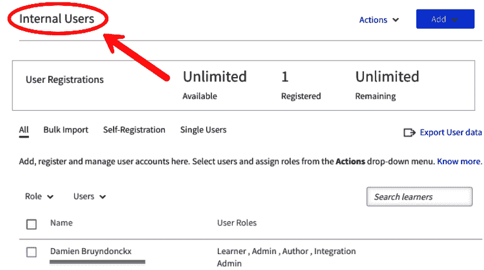

Figure 5.1 – 此操作会将您带到管理员应用程序的内部用户页面

在这一点上，如果您使用的是 Prime 试用账户，可用的唯一内部用户应该是您！

2. 单击屏幕右上角的 Add 按钮。

3. 花点时间检查可用选项。

如以下屏幕截图所示，添加内部用户到系统有三种主要选项：

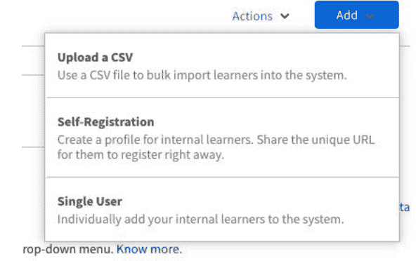

Figure 5.2 – 添加内部用户到系统有三种主要选项

在接下来的几个部分中，您将逐一回顾这三个选项。

## 创建单个用户

创建内部用户的第一种方法是使用 Single User 选项，该选项允许您一次创建一个用户。您将使用此选项通过执行以下步骤创建一个名为 Learner 01 的新学习者：

1. 从 Admin 应用程序的内部用户页面，单击屏幕右上角的 Add 按钮。
2. 在打开的菜单中，单击 Single User 选项。这将打开 Add User 表单。
3. 在 Name 字段中输入 Learner 01。
4. 在 E-Mail 字段中输入您为 Learner 01 创建的电子邮件地址。请注意，Name 和 E-mail 是仅有的两个必填信息。
5. 在 Profile 字段中输入 Marketing Specialist。
6. 目前将 Manager's Name 字段留空。
7. 准备就绪后，单击表单右下角的 Add 按钮。

花点时间阅读屏幕上出现的消息。它告诉您用户已成功添加，并且 Captivate Prime 已发送验证邮件。

8. 单击 Close 按钮关闭消息并返回内部用户页面。

一个名为 Learner 01 的新内部用户已添加到列表中。请注意，此新用户已被自动分配 Learner 角色，如以下屏幕截图所示：

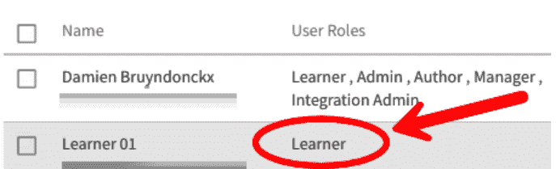

Figure 5.3 – Learner 01 已自动分配 Learner 角色

非常重要的一点是，在创建用户时，您没有提供任何密码，那么这个新用户如何登录您的 Prime 账户呢？答案在于用户从 Captivate Prime 收到的验证邮件。为了更好地了解其工作原理，让我们检查默认的用户入职体验。

## 检查默认用户入职体验

在上一节中，您使用本章开头创建的电子邮件地址之一创建了一个名为 Learner 01 的新内部用户。

在这一点上，Learner 01 应该已收到来自 Adobe Captivate Prime 的电子邮件。现在您将登录 Learner 01 的电子邮件账户并通过执行以下步骤查看验证邮件：

1. 登录 Learner 01 的电子邮件账户。
2. 确认 Learner 01 已收到来自 Adobe Captivate Prime 的欢迎邮件。花点时间阅读此消息。

如以下屏幕截图所示，验证邮件解释说用户必须使用其 Adobe ID 登录您的 Prime 账户。如果用户尚未拥有 Adobe ID，欢迎邮件会提供一个链接到新用户可以在其中创建免费 Adobe ID 的页面：

## 欢迎使用 Adobe Captivate Prime

你好 Learner 01，

恭喜！

您已被注册为 one2Learn.online 的新 LMS Adobe Captivate Prime 的学习者。

请按照以下步骤验证并访问您的账户。

步骤 1) 如果您已有 Adobe ID，请点击此处进行身份验证并登录您的账户。如果您没有 Adobe ID，请点击此处创建并开始使用。

步骤 2) 为后续登录，请将下面提到的账户 URL 添加书签。

注意：请勿转发，因为此邮件中的链接是唯一的并且包含您的登录信息。

账户 URL：https://captivateprime.adobe.com/One2Learn

谢谢，
Captivate Prime 团队

Figure 5.4 – Learner 01 收到的欢迎邮件

换句话说，Captivate Prime 使用的默认身份验证机制是 Adobe ID，而不是您组织的内部身份验证服务。本章后面，在 Configuring login methods 部分，您将学习如何为您的账户启用单点登录（SSO）。这将允许内部用户使用其组织的内部凭据而不是 Adobe ID 访问 Captivate Prime，但现在，让我们坚持使用默认身份验证机制。

## 自定义欢迎邮件

在 *第15章，使用消息和公告* 中，您将学习如何自定义此欢迎邮件的外观和感觉，以及平台发送的其他邮件。

现在您已将 *学习者 01* 定义为新的内部用户，您将换个角色，暂时成为该用户。

## 作为新用户连接

要以新用户身份登录您的 Prime 账户，而无需退出管理员账户，请使用不同的浏览器或同一浏览器的新隐私窗口进行登录。

- 3. 如果新用户的电子邮件地址已关联 Adobe ID，您可以使用邮件中提供的第一个链接直接登录您的 Prime 账户。如果该电子邮件地址尚未关联 Adobe ID，请点击第二个链接并通过流程使用该电子邮件地址创建免费的 Adobe ID。

登录 Prime 账户时作为 *学习者 01*，您会自动重定向到学习者体验。如果您点击屏幕右上角的用户图标，您不应有访问其他角色的能力：

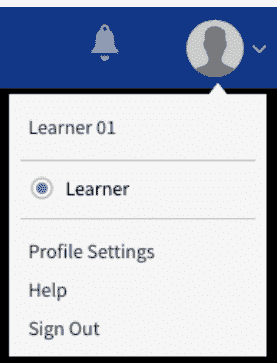

图 5.5 – 新用户只能访问学习者体验

在本节中，您创建了一个名为 *学习者 01* 的新内部用户。您发现，默认情况下，每个内部用户必须拥有 Adobe ID 才能访问您的 Prime 账户。您还经历了新学习者的默认入职体验。

本节中描述的工作流程在向 Prime 账户添加有限数量的学习者时很有用。但如果您有大量用户需要定义，则需要能够使用 CSV 文件批量导入大量新用户。这就是我们在下一节中将讨论的内容。

## 从 CSV 文件导入用户

您现在将创建另外两个用户：学习者 02 和讲师 01。但不是使用上一节中描述的单用户选项逐个创建这两个用户，而是通过导入包含所需信息的 CSV 文件来创建这两个用户。当然，在现实生活中，您会使用 CSV 导入一次创建远不止两个用户，因此为了本演示的目的，我们假设 CSV 文件包含数百个用户。

> CSV
> CSV 代表逗号分隔值。CSV 文件是包含由逗号分隔的数据项的文本文件。此类文件可由任何电子表格应用程序编辑，例如 Microsoft Excel、Open Office Calc、Apple Numbers 等。在读取文件时，电子表格软件每次遇到逗号时就会移动到下一列，每次遇到换行符时就会移动到下一行。非常广泛的应用程序支持以 CSV 格式导出和导入数据，这使得 CSV 成为在几乎任何系统之间交换信息的首选方式之一。

您现在将使用系统上可用的任何电子表格应用程序检查与本书下载关联提供的 CSV 文件。请按照以下步骤操作：

- 1. 双击与本书下载关联的 users/internalUsers.csv 文件，以在系统上安装的默认电子表格应用程序中打开文件。

- 2. 花点时间检查文件的内容。您应该会发现四行六列，如以下屏幕截图所示：

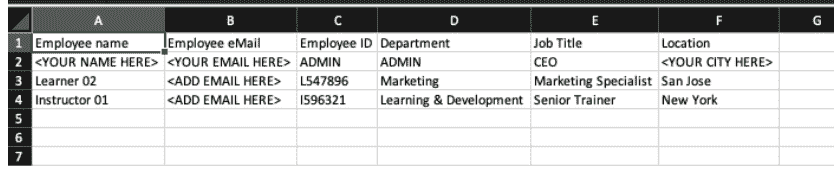

图 5.6 – 在 Microsoft Excel 中显示的 internalUsers.csv 文件

- 3. 在单元格 A2 中输入您的全名（与 Captivate Prime 中现有用户配置文件中显示的一致），并在单元格 B2 中输入您的 Prime 管理员电子邮件地址。*这是非常重要的一步！* 导入完成后不久会详细介绍。

- 4. 在单元格 B3 中输入您为 *学习者 02* 创建的电子邮件地址，并在单元格 B4 中输入您为 *讲师 01* 创建的电子邮件地址。

- 5. 完成后，保存 CSV 文件并关闭电子表格应用程序。CSV 文件现在已准备好导入到 Captivate Prime。

- 6. 返回您 Prime 账户管理员应用程序的 **内部用户** 页面。

- 7. 点击屏幕右上角的 **添加** 按钮。

- 8. 在打开的菜单中，点击 **上传 CSV** 选项。这将打开 **上传 CSV** 窗口。

- 9. 将 `internalUsers.csv` 文件拖放到 **上传 CSV** 窗口中。

- 10. 现在，您需要使用屏幕上出现的下拉列表将 CSV 文件的列映射到 **添加用户** 表单的字段。

将 **姓名** 字段与 CSV 文件的 **员工姓名** 列映射，将 **电子邮件** 字段与 **员工电子邮件** 列映射，并将 **个人资料** 字段与 **职位** 列映射。现在暂时将 **经理 ID** 字段留空。

继续之前，请注意 **员工 ID**、**部门** 和 **位置** 列未映射到任何字段。这并不意味着这些额外列没有影响，正如您将在本章后面 *自定义用户表单* 部分中发现的那样。

> **故障排除列映射**
> 如果列映射未按预期工作，请确保 CSV 文件中使用的分隔符是逗号 (,)。根据系统的区域设置，分隔符可能已改为分号 (;)。要修复此问题，请在文本编辑器（例如 Windows 上的 Notepad 或 Mac 上的 TextEdit）中打开 CSV 文件，并使用文本编辑器的 **查找和替换** 功能将所有分号 (;) 字符替换为逗号 (，)。

- 11. 准备就绪后，点击 **上传 CSV** 窗口右下角的 **保存** 按钮。

- 12. 应显示一条消息，告知您 CSV 上传成功，并且 CSV 文件当前正在由 Captivate Prime 处理。花点时间阅读此消息。然后，点击 **关闭** 按钮返回 **内部用户** 页面。

过了一会儿，您应该会在内部用户列表中看到另外两个用户。请注意，这两个用户目前未注册，如以下屏幕截图所示：

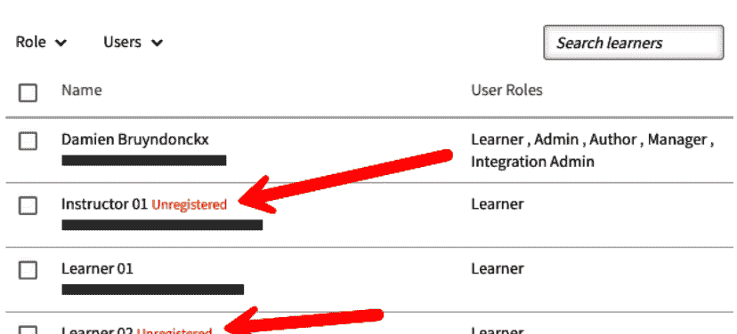

图 5.7 – 讲师 01 和学习者 02 目前被标记为未注册用户

关于这两个新用户，还有一件重要的事情需要注意。

- 13. 点击其中一个未注册用户。这将打开您点击的用户的详细信息。
- 14. 请注意，您被定义为该用户的经理。

当您使用 CSV 文件导入用户时，导入的用户始终会被定义经理。如果您未在 CSV 文件的专用列中提供此信息，则经理字段的值会自动设置为平台管理员之一。为此，必须选择的管理员是 CSV 文件的一部分，并且在要创建的用户之前定义。这就是为什么您必须在 CSV 文件的第一行添加自己的原因。

讲师 01 和学习者 02 现在已成为内部用户列表的一部分，但它们尚未正确注册到平台。您将在下一节中注册这两个用户。

## 注册导入的用户

在上一节中，您使用 CSV 导入创建了讲师 01 和学习者 02。这些用户已正确导入到内部用户列表中，但目前被标记为未注册用户。

**未注册** 用户尚未收到包含如何访问您的 Captivate Prime 账户说明的欢迎邮件。通过执行以下步骤注册这些用户：

- 1. 确保您以管理员身份登录，并且位于 **内部用户** 页面上。
- 2. 使用第一列中的复选框选择两个 **未注册** 用户。如果您有大量 **未注册** 用户需要选择，可以使用位于用户列表上方的 **用户** 过滤器。
- 3. 点击屏幕右上角的 **操作** 链接。
- 4. 在打开的菜单中选择 **注册** 选项，如以下屏幕截图所示：

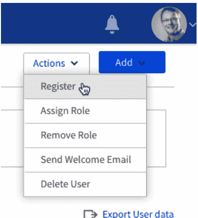

图 5.8 – 点击注册操作

- 5. 点击 **是** 进行确认。

在此过程结束时，您应该会看到 **用户注册成功** 消息，这表明欢迎邮件已发送给 *讲师 01* 和 *学习者 02*。

- 6. 点击 **关闭** 按钮以清除 **用户注册成功** 消息。

现在请花必要的时间登录 Instructor 01 和 Learner 02 的电子邮件账号，为他们创建 Adobe ID。这将使他们能够访问您的 Captivate Prime 账号。在进入下一节之前，请确保您可以用这两个新用户登录 Prime 账号。

请注意，目前 Instructor 01 用户被定义为普通 Learner，因此以 Instructor 01 登录时，您将被自动重定向到 Learner 体验。您将在本章后面的 Managing roles 部分为该用户分配 Instructor 角色。

### 您新的 Manager 角色
由于您已被定义为 Instructor 01 和 Learner 02 的 Manager，您现在应该能够以 Manager 身份登录。要查看新的 manager 角色，需要退出管理员账号并重新登录。然后，点击屏幕右上角的用户图标时，您应该能看到新的 Manager 角色。您将在第 6 章 Enrolling Learners to Courses 中更详细地探索 manager 角色。

在本节结束时，您的 Prime 账号中应共有四个已注册用户：您本人作为平台管理员，以及目前注册为 Learners 的 Learner 01、Learner 02 和 Instructor 01。

在下一节中，您将使用自注册链接创建一个新的内部用户。

## 创建自注册链接

在过去两节中，您作为 Prime 管理员，已通过逐个创建或批量上传 CSV 文件的方式创建新用户。在这两种情况下，创建新用户都需要您采取行动。在本节中，您将允许用户自行注册到您的 Prime 账号，这是一种几乎不需要您干预的技术。

其思路是生成一个自注册链接并与可能有兴趣加入您 Captivate Prime 账号的用户分享。用户随后可以点击链接并填写表单，在平台上为自己注册。让我们开始吧：

- 1. 确保您已以管理员身份登录，并且位于 **Internal Users** 页面。
- 2. 点击位于右上角的 **Add** 按钮。
- 3. 在打开的菜单中点击 **Self-Registration** 选项。这将打开 **Add Self-Registration** 配置文件表单。
- 4. 在 **Profile Name** 字段中输入配置文件名称。
- 5. 在 **Manager's Name** 字段中输入您的姓名。需要注意的是，经理必须是已在 Prime 账号上注册的用户。您可以选择任何学习者作为经理；该用户不必是管理员。

请注意，**Profile Name** 和 **Manager's Name** 字段是此表单的唯一两个必填信息。

- 6. 作为最佳实践，还请为此自注册配置文件提供简短的 **Description**。
- 7. 您还可以使用 **Add Image** 字段提供可选图片。（本书关联的下载中提供了示例图片。请查找 `branding/o21DevTeam.png` 图片。）
- 8. 当 **Add Self-Registration Profile** 表单如下所示时，点击表单右下角的 **Save** 按钮：

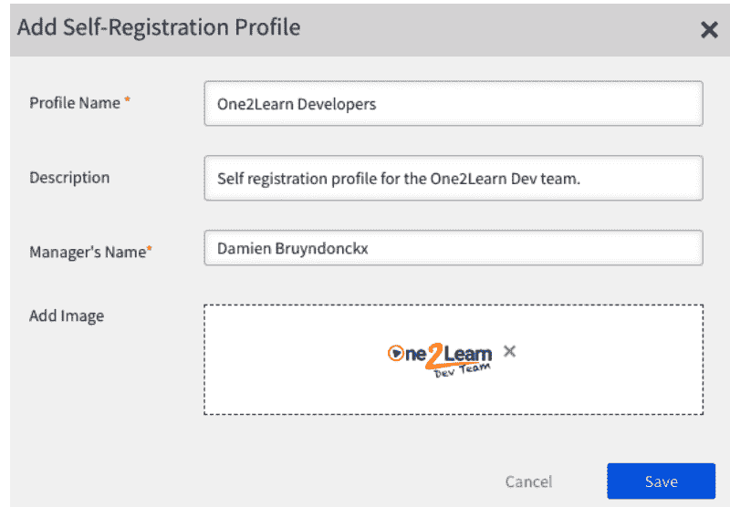

Figure 5.9 – 填写 Add Self-Registration Profile 表单

保存新的自注册配置文件后，Captivate Prime 会生成一个唯一的 URL，您必须与潜在的 Prime 用户分享。该唯一 URL 会显示在屏幕上，并通过电子邮件发送给您，以确认新自注册配置文件的创建。

您可以根据需要创建任意数量的自注册配置文件（请注意您已购买的用户许可证数量！）。例如，组织的每个部门都可以拥有自己的自注册配置文件，并为每个配置文件分配不同的经理。这使您可以在无需管理员操作的情况下将用户添加到 Prime 账号，同时尊重组织[content]
现在请花必要的时间登录 Instructor 01 和 Learner 02 的电子邮件账号，为他们创建 Adobe ID。这将使他们能够访问您的 Captivate Prime 账号。在进入下一节之前，请确保您可以用这两个新用户登录 Prime 账号。

请注意，目前 Instructor 01 用户被定义为普通 Learner，因此以 Instructor 01 登录时，您将被自动重定向到 Learner 体验。您将在本章后面的 Managing roles 部分为该用户分配 Instructor 角色。

### 您新的 Manager 角色
由于您已被定义为 Instructor 01 和 Learner 02 的 Manager，您现在应该能够以 Manager 身份登录。要查看新的 manager 角色，需要退出管理员账号并重新登录。然后，点击屏幕右上角的用户图标时，您应该能看到新的 Manager 角色。您将在第 6 章 Enrolling Learners to Courses 中更详细地探索 manager 角色。

在本节结束时，您的 Prime 账号中应共有四个已注册用户：您本人作为平台管理员，以及目前注册为 Learners 的 Learner 01、Learner 02 和 Instructor 01。

在下一节中，您将使用自注册链接创建一个新的内部用户。

## 创建自注册链接

在过去两节中，您作为 Prime 管理员，已通过逐个创建或批量上传 CSV 文件的方式创建新用户。在这两种情况下，创建新用户都需要您采取行动。在本节中，您将允许用户自行注册到您的 Prime 账号，这是一种几乎不需要您干预的技术。

其思路是生成一个自注册链接并与可能有兴趣加入您 Captivate Prime 账号的用户分享。用户随后可以点击链接并填写表单，在平台上为自己注册。让我们开始吧：

- 1. 确保您已以管理员身份登录，并且位于 **Internal Users** 页面。
- 2. 点击位于右上角的 **Add** 按钮。
- 3. 在打开的菜单中点击 **Self-Registration** 选项。这将打开 **Add Self-Registration** 配置文件表单。
- 4. 在 **Profile Name** 字段中输入配置文件名称。
- 5. 在 **Manager's Name** 字段中输入您的姓名。需要注意的是，经理必须是已在 Prime 账号上注册的用户。您可以选择任何学习者作为经理；该用户不必是管理员。

请注意，**Profile Name** 和 **Manager's Name** 字段是此表单的唯一两个必填信息。

- 6. 作为最佳实践，还请为此自注册配置文件提供简短的 **Description**。
- 7. 您还可以使用 **Add Image** 字段提供可选图片。（本书关联的下载中提供了示例图片。请查找 `branding/o21DevTeam.png` 图片。）
- 8. 当 **Add Self-Registration Profile** 表单如下所示时，点击表单右下角的 **Save** 按钮：

Figure 5.9 – 填写 Add Self-Registration Profile 表单

保存新的自注册配置文件后，Captivate Prime 会生成一个唯一的 URL，您必须与潜在的 Prime 用户分享。该唯一 URL 会显示在屏幕上，并通过电子邮件发送给您，以确认新自注册配置文件的创建。

您可以根据需要创建任意数量的自注册配置文件（请注意您已购买的用户许可证数量！）。例如，组织的每个部门都可以拥有自己的自注册配置文件，并为每个配置文件分配不同的经理。这使您可以在无需管理员操作的情况下将用户添加到 Prime 账号，同时尊重组织的层级结构。

## 使用自注册配置文件自动注册为 Prime 学习者

现在自注册配置文件已激活，您将再次转换角色，把自己置于想要注册到您的 Prime 账号的用户角度。

您将使用自注册链接创建 *Manager 01*。本章后面您将把这个新用户定义为其他学习者的经理。此外，请记住，使用此自注册链接注册到平台的任何用户，您都将被定义为其经理。这将使您能够创建一个三级层级结构，您将是总经理，而 *Manager 01* 将管理一个小型用户团队。

最后，请记住，默认情况下，所有内部用户都必须拥有 Adobe ID。因此，自注册过程中的一个步骤是用户创建自己的 Adobe ID。让我们通过以下步骤来尝试一下：

- 1. 在网络浏览器中打开一个新私密窗口（或完全使用另一个浏览器）。
- 2. 将上一节中 Captivate Prime 生成的自动注册 URL 粘贴到地址栏。这将带您进入 Adobe **Sign in** 页面。该链接也可在您从 Captivate Prime 收到的电子邮件中找到。
- 3. 点击 **Create an account** 链接为 *Manager 01* 创建新的 Adobe ID。
- 4. 填写 **Create an account** 表单，完成后点击 **Create account** 按钮。
- 5. 您应该会被自动重定向到 Prime 账号的 Learner 体验并以 *Manager 01* 身份登录。

查看屏幕右上角。您应该能认出在上一节中定义自注册链接时上传的图片：

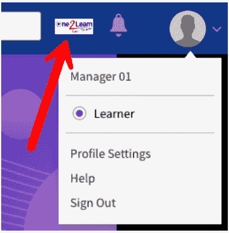

Figure 5.10 – 自注册图片可见于屏幕右上角

完成此过程后，一个新用户将被添加到您的 Prime 账号中。目前，此新用户只是另一个学习者。在本章后面的 Managing roles 部分，您将把这个新用户设为经理，但现在，您将返回管理员角色，以检查自注册链接的长期管理方式。

## 管理自注册链接

在本节中，您将返回管理员应用程序，以检查管理新自注册链接的可用选项。这包括修改、暂停、恢复和删除自注册配置文件。请按照以下步骤尝试操作：

- 1. 返回管理员应用程序的 Internal Users 页面。确认 Manager 01 已作为 Learner 包含在 Internal Users 列表中。
- 2. 在用户列表上方，点击 Self-Registration 选项卡，如以下屏幕截图所示：

Figure 5.11 – 点击用户列表上方的 Self-Registration 选项卡

这会带您进入 Self-Registration 配置文件列表，您可以在其中查看有多少人使用每个链接注册到您的 Prime 账号。目前，只有本节中创建的配置文件应显示在列表中。

- 3. 将鼠标悬停在之前创建的配置文件上。这将显示一个链接图标，您可以使用它将自注册链接复制到剪贴板。
- 4. 点击配置文件的名称以打开 Edit Self-Registration Profile 表单，您可以在其中修改配置文件的 Description 和图片。请注意，您无法修改 Profile Name 或 Manager's Name。
- 5. 点击 Cancel 按钮返回自注册配置文件列表。
- 6. 点击您注册配置文件 No. of People 列中出现的数字。这将带您进入使用此自注册配置文件注册到平台的学习者列表。
- 7. 点击左侧边栏 Users 部分中的 Internal 链接返回 Internal Users 列表。
- 8. 现在，点击用户列表上方 स्थित 的 Self-Registration 选项卡返回自注册配置文件列表。
- 9. 使用列表第一列的复选框选择之前创建的自注册配置文件。
- 10. 点击屏幕右上角的 Actions 按钮以检查可用的操作。

本列表中共有三个操作可用：

- **删除** 操作会删除此自助注册配置文件。使用此操作时请务必小心，因为它还会删除所有使用这些自助注册配置文件向您的 Prime 账号注册的用户。
- **暂停** 操作允许您暂时禁用此特定注册配置文件。这会阻止其他用户使用该链接注册，但*不*会移除或禁用已注册的用户。这就是为什么通常更倾向于使用 **暂停** 操作而不是前面描述的 **删除** 操作。
- **恢复** 操作会恢复使用该链接进行自助注册的可能性。

得益于这些选项，您作为 Prime 管理员，拥有创建和管理内部用户所需的所有工具。

在下一节中，您将学习如何向您的 Prime 账号添加外部用户。

## 创建外部用户

到目前为止，本章中您已创建了内部用户。内部用户是贵组织的人员。典型的内部用户是贵组织的员工。

但您可能还需要向组织外部的人员授予访问 Prime 账号的权限。此功能可帮助您满足以下使用场景：

- 您的组织销售培训，您需要为从您处购买培训的客户提供访问权限。
- 您需要为外部合作伙伴、供应商、特许经营商或承包商提供培训。
- 您必须向贵组织签约以交付现场课程（教室或虚拟）的外部提供商提供讲师访问权限。
- 您的组织已将培训材料的创建外包给外部 eLearning 机构，并且您希望为这些机构的工作人员提供作者访问权限，以便他们可以直接将创建的内容上传到您的 Prime 账号。
- 等等。

不属于您组织的 Prime 用户被视为外部用户。他们享有的体验与内部用户相同，但有一些细微差别：

- 默认情况下，外部用户无法访问游戏化（您将在*第 11 章、徽章和游戏化*中探索游戏化）。

- 外部用户可以是学习者、作者、讲师或经理，但不能被设为管理员或集成管理员。

外部用户只能通过 **外部注册配置文件** 创建，与内部用户的自助注册配置文件类似。请执行以下步骤创建外部注册配置文件：

1. 确保您已以管理员身份登录。
2. 从管理员主页，单击左侧边栏 **管理** 部分中的 **用户** 链接。
3. 然后，单击左侧边栏 **用户** 部分中的 **外部** 链接。这将带您进入 **外部用户** 页面。
4. 单击告诉您目前尚无可用配置文件的灰色大区域中的 **添加配置文件** 链接。如果您已有可用配置文件，则此链接将不可见。在这种情况下，您可以单击屏幕右上角的 **添加** 按钮。在这两种情况下，这都将打开 **添加外部注册配置文件** 表单。
5. 在 **配置文件名称** 字段中输入配置文件名称。
6. 在 **管理员电子邮件** 字段中输入电子邮件 ID。这是外部组织中联系人的电子邮件 ID。有关此注册配置文件的详细信息以及使用说明将在配置文件创建后发送到此电子邮件地址。请勿将其与 Prime 平台内某人的经理混淆。

> **提示**
> 在 **管理员电子邮件** 字段中输入您有权访问的有效电子邮件地址，以便您可以查看 Captivate Prime 发送给外部经理的默认电子邮件消息。

7. 在 **分配席位** 字段中输入一个数字。这表示可通过此特定注册配置文件自行注册的最大学习者数量。请记住，Captivate Prime 是一款按席位收费的付费产品，因此这对于控制您的成本非常重要。
8. 在 **到期** 字段中选择到期日期。这是使用此配置文件注册不再可能的截止日期。但是，现有用户在 **到期** 日期之后仍可继续访问平台。

到此为止必填字段已完成，但在点击 **保存** 按钮并创建外部注册配置文件之前，让我们回顾一下表单的其他字段。

9. 作为最佳实践，请在 **描述** 字段中输入简短描述。您还可以使用 **添加图片** 字段提供图片。（本书附带的下载中提供了示例图片。请查找 `branding/xTernalCo.png` 图片。）
10. 单击表单左下角的 **高级设置** 链接。
11. 在 **登录要求** 字段中输入一个数字。自行注册但在指定天数内未登录您 Prime 账号的用户将被删除。这可确保您不会为未被学习者*实际*使用的席位付费。
12. 您还可以在 **允许的域名** 字段中指定以逗号分隔的域名列表。通常，您会在此字段中输入外部组织的电子邮件域名。这可防止电子邮件地址不在给定域名中的用户使用该链接注册到您的 Prime 账号。
13. 最后，如果您希望 Captivate Prime 在正式注册用户之前验证外部用户的电子邮件地址，可以选择 **需要电子邮件验证** 复选框。
14. 当 **添加外部注册配置文件** 页面看起来像以下屏幕截图时，单击表单右下角的 **保存** 按钮。这将打开一条消息，显示该注册配置文件的唯一 URL：

### 添加外部注册配置文件

配置文件名称 *
xTernal Company profile

描述
xTernal Company provides shipping services for us in the EMEA region

管理员电子邮件 *

分配席位 *
5

到期 *
May 01, 2021

添加图片

登录要求
30
天数（留空则无限制）
如果学习者在上述时间内未登录，将被删除

允许的域名
@xternalco.com,@xternalco.eu

需要电子邮件验证

基本设置

取消

保存

图 5.12 – 已完成的添加外部注册配置文件表单

15. 单击关闭按钮关闭消息并返回管理员应用程序的外部用户页面，在该页面中新的外部注册配置文件可见于列表中。

16. 最后一步是通过将列表最后一列中的 **状态** 按钮切换到 *开启* 来使此配置文件处于活动状态。

新的外部注册配置文件现已运行。包含此注册配置文件唯一链接的电子邮件已发送到您在定义此注册配置文件时提供的 **管理员电子邮件** 地址。请不要犹豫登录该电子邮件地址以查看此电子邮件消息，其在以下屏幕截图中进行了说明：

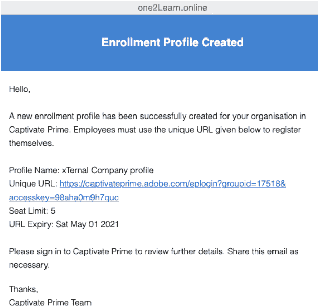

图 5.13 – 创建外部注册配置文件时发送给外部经理的默认消息

在下一节中，您将假装是需要使用您刚刚创建的注册配置文件注册到您的 Captivate Prime 账号的该外部组织的一名员工。

## 作为外部用户注册

现在您已拥有可用的外部注册配置文件，让我们再次换个角色，片刻成为需要注册到您的 Captivate Prime 账号的该外部员工。您将使用此技术创建一个名为 Learner 03 的用户。请按照以下步骤操作：

1. 在网络浏览器中打开一个新私密窗口。
2. 导航到您在上一节中创建的外部配置文件的唯一链接。

> 提示
> 如果您不再有权访问外部注册配置文件的唯一链接，请转到您 Prime 账号管理员应用程序的外部用户页面并将鼠标悬停在列表中的外部注册配置文件上以显示两个图标。信封图标允许您重新发送经理电子邮件，而链条图标允许您将外部注册配置文件的链接复制到剪贴板。

3. 填写注册表单以创建一个名为 Learner 03 的新用户，该用户使用您在本章开头为 Learner 03 创建的电子邮件地址。
4. 完成后单击注册按钮。

此最后操作将在 Captivate Prime 中创建新的外部用户。它还会将该用户重定向到您 Prime 账号的学习者体验。如果您查看屏幕右上角，您应该会看到您在定义外部注册配置文件时上传的外部组织的自定义徽标，如以下屏幕截图所示：

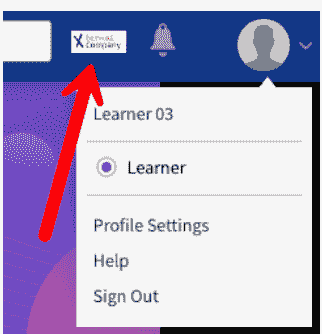

图 5.14 – 新外部用户被重定向到您 Prime 账号的学习体验

请注意，默认情况下，外部用户无需创建 Adobe ID 即可访问您的 Prime 账户。他们还必须使用在注册时通过电子邮件发送给他们的特殊登录页面登录 Captivate Prime。这些是内部用户和外部用户之间的一些其他重要区别。在本章稍后的“配置登录方法”部分，您将回顾可用的选项，以决定内部用户和外部用户的登录方法。

为了结束本节，让我们返回到 Prime 账户的管理区域，查看允许您管理外部用户的选项。

## 管理外部用户

现在您已启用外部用户配置文件，并且有用户使用该配置文件注册到您的 Prime 账户，您将返回管理区域并查看允许您管理外部用户的选项：

- 1. 返回您的 Prime 账户的管理员应用程序。
- 2. 从管理员主页，单击左侧边栏“管理”部分中位于的 Users 链接。
- 3. 接下来，单击左侧边栏“Users”部分中的 External 链接。这将带您进入 External Users 页面，其中您之前创建的外部注册配置文件在列表中可见。

从这里，可以一目了然地查看外部用户配置文件的一些关键信息。如以下屏幕截图所示，您可以看到使用的席位数、到期日期、登录要求以及状态：

图 5.15 – 外部用户配置文件的关键信息一目了然

- 4. 单击列表第一列中可见的外部用户配置文件名称。这将打开 Edit External Registration Profile 表单，您可以使用它修改外部注册配置文件的相关信息。
- 5. 单击 Cancel 按钮关闭 Edit External Registration Profile 表单并返回管理员应用程序的 External Users 页面。
- 6. 单击 Seats Used 以访问使用此外部注册链接自行注册的用户列表。

- 7. 单击左侧边栏 **Users** 部分中位于的 **External** 链接返回到 **External Users** 页面。
- 8. 使用 **External Users** 页面第一列中的复选框选择您之前创建的注册配置文件。
- 9. 单击屏幕右上角的 **Actions** 按钮以查看可用的操作。

打开的列表中应有两个操作可用：**Pause** 操作和 **Resume** 操作。使用 **Pause** 操作可暂时禁用通过此外部注册配置文件创建新用户的功能。请注意，即使外部注册配置文件已暂停，现有用户仍保留登录 Prime 账户的能力。**Resume** 操作用于恢复外部用户使用此外部注册配置文件自行注册的能力。此功能适用于需要在特定期间注册的季节性员工。

- 10. 单击 **Status** 切换按钮以关闭外部注册配置文件。

当外部注册配置文件关闭时，会发生两件事。首先，不再可能通过该外部注册配置文件创建新用户，其次，通过该外部注册配置文件创建的现有用户将失去登录 Prime 账户的能力。这就是停用外部注册配置文件与暂停其不同的细微差别。关闭外部注册配置文件在合作伙伴关系结束、培训协议结束、外部合作伙伴被收购或关闭等情况下很有用，等等。

- 11. 在继续下一节之前，请确保通过将 **Status** 重新打开来重新激活外部注册配置文件。

至此，您已创建了继续本书练习所需的所有用户。在继续之前，我们将快速总结您在前几节中创建的用户：

- 您应拥有五个用户，除原始 Administrator 配置文件外。
- 这四个用户是内部用户，第五个是外部用户。
- 内部用户的名称为 Instructor 01、Learner 01、Learner 02 和 Manager 01。外部用户的名称为 Learner 03。
- 目前，所有这些附加用户都是学习者。您尚未为他们分配任何特殊角色。
- 您也已成功测试了以这些用户身份登录的能力。

创建这些用户使您全面了解了在 Captivate Prime 中创建用户的各种方式。您已使用 **Single User** 选项手动创建了一个用户，已使用 **CSV Import** 选项导入用户，并为内部用户创建了 **Self-Registration** 链接，以及为外部用户创建了 **External Registration Profile**。

如果您满足这些要求，那么您现在就可以继续下一节，在下一节中您将学习如何自定义用户表单以获取有关 Prime 账户用户的自定义数据。

## 自定义用户表单

在前几节中创建用户时，您只需提供非常基本的用户信息。用户名、电子邮件地址和密码足以让 Captivate Prime 授予用户访问平台的权限。

这与大多数企业目录形成对比，后者包含有关员工的更多信息。部门、员工 ID、工作地点等数据非常常见。此类附加数据通常在组织的日常活动中发挥着至关重要的作用。根据组织的规模、业务模式、复杂性等因素，业务报告、人力资源管理、资产管理、服务本地化等基本要素在很大程度上都基于这些附加信息。此外，这些信息的组织方式及其内容对每个组织都是特定的。

作为企业 LMS，Captivate Prime 理解这些附加元数据对您组织的重要性。因此，它使您能够捕获这些数据并在系统的不同区域中使用，例如用户管理、技能管理、学习者注册、报告等。

在本节中，您将查看 **Active Fields**，它允许您为每个用户定义额外的自定义元数据。您还将了解这如何影响用户创建过程和学习者体验：

- 1. 确保您以 Administrator 身份登录。
- 2. 从管理员主页，单击左侧边栏 **Manage** 部分中位于的 **Users** 链接。这将带您进入 **Internal Users** 页面。
- 3. 从那里，单击左侧边栏 **Advanced** 部分中位于的 **Active Fields** 链接。

此最后操作将带您进入 **Active Fields** 页面，您可以在其中为内部用户和外部用户定义附加字段，如以下屏幕截图所示：

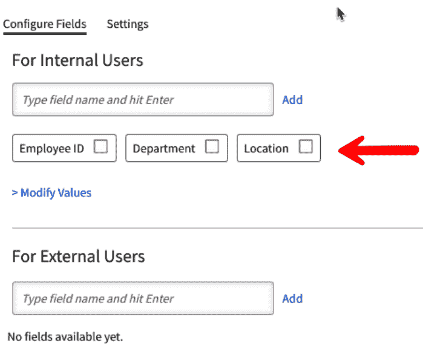

图 5.16 – Active Fields 页面是您可以为内部用户和外部用户定义附加字段的地方

请注意，对于内部用户，三个附加字段（**Employee ID**、**Department** 和 **Location** 字段）已定义（请参阅前一屏幕截图中的箭头）。

## 激活和自定义 CSV 字段

这三个额外字段对应于您在本章前面 *Importing users from a CSV file* 部分导入的 CSV 文件中的三个未映射列。默认情况下，这三个额外字段均未激活。通过执行以下步骤激活并自定义其中两个字段：

- 1. 选择与 **Department** 和 **Location** 字段关联的复选框以激活它们。
- 2. 单击 **Modify Values** 链接以打开 **Values in Custom Fields** 表单。
- 3. 打开 **Select Field** 下拉列表并选择 **Department** 字段。
- 4. 选择 **Restrict Selection** 复选框。
- 5. 再次打开 **Select Field** 下拉列表并选择 **Location** 字段。
- 6. 同时为 **Location** 字段选择 **Restrict Selection** 复选框。
- 7. 单击表单右下角的 **Done** 按钮返回到 **Active Fields** 页面。
- 8. 同时单击 **Active Fields** 页面右上角的 **Save** 按钮。

多亏了这些步骤，您已激活 **Department** 和 **Location** 字段。这意味着 Captivate Prime 现在可以收集这两项数据并将其与每个用户关联。要查看这一点，让我们返回到 **Internal Users** 页面以修改现有用户。

- 9. 单击左侧边栏 **Users** 部分中位于的 **Internal** 链接。
- 10. 在内部用户列表中单击您的姓名以打开您用户账户的详细信息。
- 11. 单击您用户详细信息右上角的铅笔图标以打开 **Edit User** 表单。

如以下屏幕截图所示，**Department** 和 **Location** 字段已添加到标准 Captivate Prime 用户表单底部：

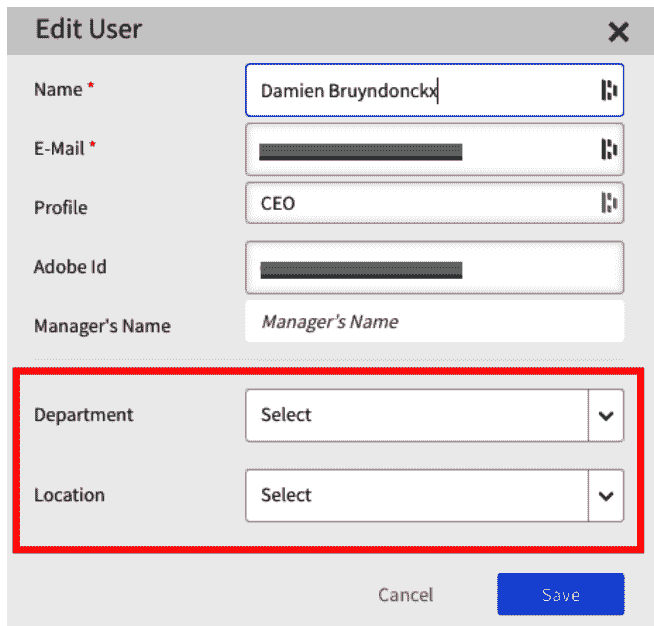

图 5.17 – 部门和位置字段已添加到标准 Prime 用户表单下方

因为您已为这两个字段选择了限制选择复选框，所以它们显示为可供选择的下拉列表，这会阻止您添加不在本章前面“从 CSV 文件导入用户”部分中导入的 CSV 文件中的值。

- 12. 为您的个人资料选择一个部门和一个位置，然后点击“编辑用户”表单右下角的保存按钮。

这两个额外的数据元素现在已与您的用户个人资料关联。请记住，部门和位置字段是您在本章前面导入的 CSV 文件的一部分。在下一节中，您将创建一个额外的字段，该字段与之前导入的 CSV 文件的任何列都不匹配。

## 创建自定义字段

Captivate Prime 还允许您从头创建额外的自定义字段。在本节中，您将创建 *爱好* 字段，以便用户在其用户个人资料中输入他们的爱好。毕竟，这对于技能管理来说可能是一项重要数据，因为您从爱好中获得的技能在工作场所可能很有价值。让我们开始吧：

- 1. 确保您以管理员身份登录。
- 2. 在管理员主页上，点击左侧边栏 **管理** 部分中的 **用户** 链接。
- 3. 在 **内部用户** 页面上，点击左侧边栏 **高级** 部分中的 **活动字段** 链接。
- 4. 在 **内部用户** 的 **输入字段名称并按 Enter** 字段中输入 `Hobbies`。
- 5. 完成后，按下 *Enter* 键或点击 **添加** 链接。
- 6. 接下来，点击页面 **内部用户** 部分中的 **修改值** 链接。
- 7. 打开 **选择字段** 下拉列表并选择 **爱好** 字段。
- 8. 查看可用选项，但此时不要修改任何内容。
- 9. 准备就绪后，点击表单右下角的 **完成** 按钮。
- 10. 此外，点击 **活动字段** 页面右上角的 **保存** 按钮。

通过这些步骤，您又创建了一个自定义字段。这是一个自由文本字段，用户可以在其中输入他们想要的任何内容：他们不受预定义元素的下拉列表限制。让我们来看看它。

- 11. 通过点击左侧边栏 **用户** 部分中的 **内部** 链接返回到 **内部用户** 页面。
- 12. 在列表中点击您的姓名以打开您用户账户的详细信息。
- 13. 点击您用户详细信息右上角的铅笔图标以打开 **编辑用户** 表单。

确认 **爱好** 字段现在可在 **编辑用户** 表单末尾使用。不要犹豫在点击 **保存** 按钮之前输入您的爱好：

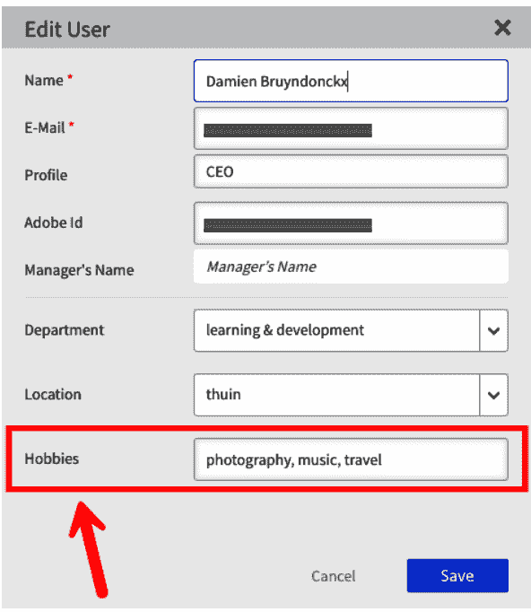

图 5.18 – 爱好字段现在可在编辑用户表单末尾使用

在阅读了前面几节后，您已向用户表单添加了三个额外的字段。现在您将回顾 Captivate Prime 如何确保每个用户在这些额外字段中输入一些数据。

## 在额外的自定义字段中输入数据

在前面的章节中，您创建了三个额外的字段：部门和位置字段，它们来自您在本章前面导入的 CSV 文件，以及您从头创建的爱好字段。

您还使用管理员应用程序的 **内部用户** 页面为您的用户账户在这三个字段中输入了值。当然，作为管理员，您可以逐一为每个用户输入这三条数据，但这很快就会变得乏味。更好的方法是让用户在下次登录时自行输入这些数据。事实证明，这正是 Captivate Prime 的默认行为！让我们通过执行以下步骤来检查一下：

- 1. 打开另一个浏览器或在网络浏览器中打开一个新私密窗口。
- 2. 在这个新私密窗口中，浏览到您的 Prime 账户 URL 并以 *学员 01* 身份登录。
- 3. 以 *学员 01* 身份登录后，您会立即被提示完成您的个人资料。
- 4. 在 **部门**、**位置** 和 **爱好** 字段中输入一些数据，然后点击 **继续** 按钮提交新数据。
- 5. 此最后操作将 *学员 01* 重定向到您 Prime 账户的学习者体验。
- 6. 点击屏幕右上角的用户图标以注销 *学员 01*。
- 7. 注销后，浏览 *学员 03* 在注册到 Prime 账户时通过电子邮件收到的 URL。

### 访问自定义登录页面

如果您不记得自定义登录 URL 或不再有权访问此电子邮件，请转到管理员应用程序的 **外部用户** 页面并将鼠标悬停在您之前创建的外部注册配置文件上。点击出现的 *链* 图标以复制自定义链接到剪贴板。然后返回到私密浏览器窗口并将链接粘贴到地址栏。当页面加载后，点击 **已注册** 链接以访问自定义登录页面。

以 *学员 03* 身份登录时，请注意 **完成个人资料** 表单 *不* 出现。这是因为 *学员 03* 是外部用户，而您仅为内部用户创建了自定义字段。

- 8. 在继续进行其余练习之前，请确保以 *学员 03* 身份注销。

得益于 Captivate Prime 的这种默认行为，每次用户登录时都会被提示在新的自定义字段中输入数据。

在下一节中，您将返回管理员应用程序以检查一些额外的 **活动字段** 选项。

## 额外的活动字段选项

仅仅因为用户登录时弹出表单并不意味着他们会向表单中输入信息。当用户不花时间填写所有额外字段或完全跳过表单时，Captivate Prime 应该如何反应？在本节中，您将通过执行以下步骤来检查这个问题：

- 1. 返回您 Prime 账户的管理员应用程序。
- 2. 从管理员主页，点击左侧边栏 **管理** 部分中的 **用户** 链接。
- 3. 然后，点击左侧边栏 **高级** 部分中的 **活动字段** 链接。
- 4. 最后，如以下屏幕截图所示，切换到 **设置** 选项卡：

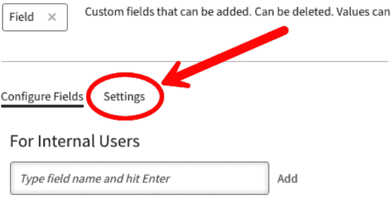

图 5.19 – 切换到活动字段页面的设置选项卡

- 5. 向下滚动页面直到看到 **用户显示** 部分。
- 6. 选择 **学习者登录时仅显示未填写的字段** 复选框。
- 7. 向上滚动页面并点击右上角的 **保存** 按钮。

使用此配置，Captivate Prime 会在用户登录时每次显示 **完成您的个人资料** 表单，直到所有额外字段都已完成。

在本节中，您检查了 Adobe Captivate Prime 的 **活动字段** 功能，该功能允许您自定义用户表单并捕获额外数据。在后续章节中，您将看到这些额外元数据如何增强平台的报告功能。但现在，让我们继续下一节，您将在其中看到如何自动化用户创建和更新流程。

## 自动化用户创建和更新

在 *创建内部和外部用户* 部分，本章前面，您回顾了向 Captivate Prime 账户添加内部和外部用户的不同方法。这些方法效果良好，可能就是您所需的一切，但它们存在一些严重的局限性，尤其对于大型组织和跨国公司而言。

- 首先，许多组织已经拥有目录，其中包含 Captivate Prime 所需的所有用户数据。因此，在 Captivate Prime 账户中重复这些数据意义不大。对于许多组织而言，从组织中使用的任何系统中导入现有数据可能是更好的方法。
- 创建用户是一回事，但随着时间的推移维护用户列表则是完全不同的挑战。员工不断加入和离开组织，人们更换角色、部门或位置，经理更换职位，随着业务发展会创建新团队并解散旧团队。当然，组织越大，保持最新用户列表的挑战就越大。这又是重复用户数据意义不大的另一个例子。Captivate Prime 应该能够在中央企业目录更新时更新其用户列表。
- 此外，在大型公司、政府机构和其他组织中，有全职员工密切管理用户和组，那么为什么不利用他们的工作并对他们对组织的日常承诺给予应有的尊重呢？

作为企业级 LMS，Captivate Prime 理解它需要在您当前的解决方案中运行。它还理解它需要随着您的组织扩展，无论您的业务可能增长多大。

您现在将回顾 Captivate Prime 如何与其现有系统集成以自动化用户创建和更新。

## 查看可用的连接器

在查看组织如何管理其用户目录时，很快就会发现有些解决方案比其他方案更受欢迎。例如，许多组织使用 LDAP 目录（如 Microsoft Active Directory）或基于云的解决方案，如 Salesforce 或 Workday。因此，Captivate Prime 配备了特殊连接器，可让您与市场上日益增多的最受欢迎的解决方案集成。让我们在本节中检查可用的连接器：

- 1. 确保您以管理员身份登录。
- 2. 登录后，点击屏幕右上角的用户图标。
- 3. 在打开的菜单中点击 **Integration Admin** 角色。

页面重新加载后，您应已以 Integration Admin 身份登录，屏幕上会显示可用的 **Connectors** 列表。

> **Integration Admins**
> 在 Captivate Prime 环境中，*Integration Admins* 负责配置和维护将 Captivate Prime 与组织中使用的其他系统集成的连接器。您将在 *第 16 章，探索 Integration Admin 角色* 中了解更多关于 Integration Admin 角色的信息。

花点时间检查可用连接器的列表。您应该能认出 **Salesforce, Workday, Power BI, LinkedIn Learning** 等知名名称。其中一些连接器可以自动获取用户数据。

- 4. 将鼠标悬停在 **Salesforce** 连接器上以显示可用选项。
- 5. 点击 **Getting started** 链接以打开描述 **Salesforce** 连接器功能的页面。

请注意，Salesforce 连接器的核心功能之一是 *从 Salesforce 自动获取员工详细信息并将其导入 Captivate Prime*。如果您的组织使用 Salesforce，您可以点击屏幕右上角的 **Next** 按钮开始将 Captivate Prime 连接到 Salesforce 的过程。

有关如何将 Captivate Prime 连接到 Salesforce 的详细信息超出了本书的范围，因此您将返回到可用连接器列表以继续检查。

- 6. 点击左侧边栏中位于的 **Back to Connectors** 链接返回到可用连接器列表。
- 7. 将鼠标悬停在 **Workday** 连接器上以显示可用选项。
- 8. 点击 **Getting started** 链接以打开描述 **Workday** 连接器功能的页面。

请注意，Workday 连接器也可以 *从 Workday 获取员工详细信息并自动将其导入 Captivate Prime*。同样，您可以点击屏幕右上角的 **Next** 按钮开始将您的 Prime 账户连接到 Workday。

- 9. 点击左侧边栏中位于的 **Back to Connectors** 链接返回到可用连接器列表。
- 10. 对其他连接器重复这些步骤，以识别允许您自动将用户数据导入 Captivate Prime 的连接器。

在检查所有这些连接器时，请注意其核心功能。如本节前面所述，其中一些可以导入用户数据。其他连接器用于向内容库提供额外内容、将数据导出到外部分析工具、与第三方视频会议系统集成等。

如果您的组织使用一个或多个有连接器可用的解决方案，那么您很幸运：Prime 已为您提供支持！但如果您组织中使用的解决方案不在此列表中，请不要失望——还有其他方法可以将 Captivate Prime 连接到几乎任何外部系统。这就是下一节要介绍的内容。

## 连接到通用第三方系统

几乎所有用于维护用户账户的企业解决方案都可以将数据导出为 CSV 文件。然后 Captivate Prime 能够使用 FTP 连接或 Box.com 等基于云的文件共享服务自动导入此类 CSV 文件。

在本节中，您将使用 Captivate Prime FTP 自动上传包含用户数据的 CSV 文件。此 FTP 连接将定期触发，因此对 CSV 文件的任何更改都将在下一次 FTP 连接运行时自动反映在您的 Prime 账户中。如果您设置现有系统将此类 CSV 导出到 Prime 可以获取的位置，您可以创建一个工作流，自动将您对用户数据所做的每项更改与您的 Prime 账户同步。

## 配置 Prime FTP 连接器

设置此类工作流的第一步是配置您将用于自动将用户数据上传到 Captivate Prime 的 FTP 服务器。如果您的组织已有可用的 FTP 服务器，您可以使用 Custom FTP 连接器将 Captivate Prime 连接到您组织现有的 FTP 服务器。如果您没有可用的 FTP 服务器，Adobe 已与名为 Extra vault 的外部组织合作，为您提供必要的 FTP 服务。此服务可通过内置的 Captivate Prime FTP 连接器使用，您现在将通过执行以下步骤进行配置：

- 1. 确保您以 Integration Admin 身份登录，并且可以看到可用连接器的列表。
- 2. 将鼠标悬停在 Captivate Prime FTP 连接器上以显示可用选项。
- 3. 点击 Connect 链接。
- 4. 输入您的电子邮件地址，然后点击屏幕右上角的 Connect 按钮。

片刻之后，您应该会收到来自名为 Extra vault 的公司的电子邮件，要求您设置 FTP 密码。

> **Extra vault**
> *Extra vault* 是 Adobe 合作的公司，为您提供 Captivate Prime FTP 服务。该服务是您 Captivate Prime 订阅的一部分，且不收取额外费用。它也可在试用期内提供给 Prime 试用账户。请注意，每个 Prime 账户仅有一个 Extra vault 账户可用。

- 5. 点击电子邮件中的链接并按照屏幕上的说明创建您的 Extra vault 密码。

请注意 FTP 服务器 URL（https://primedev.extravault.com/）和您的用户名（primeuser-XXXXXX）。两者均可在您从 Extra vault 收到的欢迎电子邮件中找到。除了您刚刚设置的密码外，这些是您需要上传从内部用户目录导出的 CSV 文件所需的凭据。

完成这些步骤后，您将可以访问 FTP 服务器。下一步是配置 Captivate Prime 如何通过将 CSV 文件的列映射到 Captivate Prime 的字段来自动导入用户。

## 映射导入字段

每个目录解决方案都有其自己的命名字段和导出 CSV 文件的方式。因此，将导出的 CSV 文件的列映射到 Captivate Prime 的字段非常重要。为此，您需要返回到 Integration Admin 角色并执行以下步骤：

- 1. 确保您以 Integration Admin 身份登录。
- 2. 在可用连接器列表中，将鼠标悬停在 Captivate Prime FTP 连接器上以显示可用选项。
- 3. 点击 Manage Connections 链接。这将带您进入 Manage Connections 页面，您应该在其中看到上一节中创建的 FTP 连接。
- 4. 点击您的 FTP 连接名称（默认情况下，它应类似于 CaptivatePrimeFTP-Connection-XXXX）。
- 5. 如有需要，您可以通过在 Connection Name 字段中输入新名称来重命名此 FTP 连接。请确保点击屏幕右上角的 Save 按钮保存此更改。
- 6. 点击 Capabilities 部分中位于的 Import Internal Users 链接。这将带您进入 Import Users – Map Attributes 页面。
- 7. 点击页面顶部出现的描述消息末尾的 Choose CSV 链接。
- 8. 浏览到与本书关联的下载中的 users/importUsers.csv 文件。此 CSV 文件包含七列和五行。
- 9. 将 Adobe Captivate Prime 字段（在左侧列中）映射到 CSV 文件的列。
- 请注意，Name、Email、Profile 和 Manager 字段是必需的。请确保至少映射这些字段。
- 10. 当您的屏幕如下所示时，点击屏幕右上角的 Save 按钮：

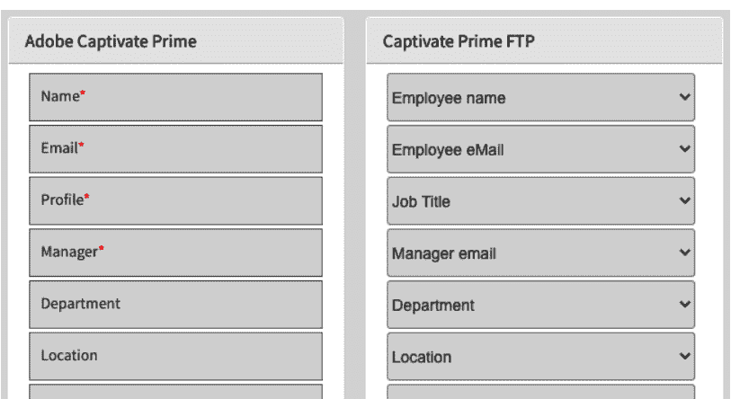

图 5.20 – 将 Adobe Captivate Prime 字段映射到 CSV 文件的列

完成这些步骤后，Captivate Prime 就知道在哪里查找其在从贵组织用户目录导出的 CSV 文件中所需的信息。必须确保导出的文件始终包含您映射到相应 Captivate Prime 字段的列。

在下一节中，您将检查 CSV 文件，为其上传做准备，并使用 Extra vault FTP 将 CSV 文件中包含的用户信息与 Captivate Prime 同步。

## 使用 Prime FTP 连接器上传用户数据

Captivate Prime 现在已准备好接受贵组织目录导出的 CSV 文件以创建和同步内部用户。在本节中，您将探索要上传的 CSV 文件，对其进行准备，并通过执行以下步骤将其上传到 Extra vault FTP：

- 1. 使用系统上安装的电子表格应用程序打开 users/importUsers.csv 文件。

如以下屏幕截图所示，CSV 文件包含七列和五行用户数据（除文件顶部的文件头行外）。通常，这些用户都已存在于您的 Prime 账户中：

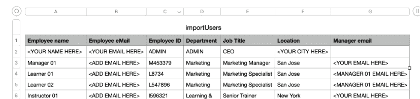

图 5.21 – 在电子表格应用程序中查看的 users/importUsers.csv 文件
（本例中为 Apple Numbers）

在将此 CSV 文件上传到 ExtraVault 的 FTP 之前，有必要调整其中包含的一些数据。请注意，这些调整仅因本书将您置于的教育情境而必要。在生产环境中使用此工作流时，无需此类调整。

- 2. 在单元格 A2 中输入您的姓名，在单元格 B2 中输入您的 Prime 管理员电子邮件地址，并在单元格 F2 中输入您的城市。
- 3. 在 Employee eMail 列中添加其余四个用户的电子邮件地址。
- 请确保您使用的是在本章前面创建这些用户时使用的相同电子邮件地址。
- 4. 在单元格 G3 和 G6 中输入您的 Prime 管理员电子邮件地址。这意味着您被定义为 Manager 01 和 Instructor 01 的经理。
- 5. 在单元格 G4 和 G5 中输入 Manager 01 的电子邮件地址。这将 Manager 01 定义为 Learner 01 和 Learner 02 的经理。

此配置定义了一个三级层级结构，其中您是总经理，而 Manager 01 管理一个由两名员工组成的小团队。

> **定义经理**
> 导入文件时，Captivate Prime 从上到下读取。
> 因此，在定义其团队成员之前，必须先在文件的顶部定义经理：用户必须先存在于 Captivate Prime 中，然后才能被定义为他人的经理。

- 6. 完成后保存 CSV 文件。

> **在上传前仔细检查 CSV 文件**
> 请记住，根据系统的区域设置，CSV 文件中使用的分隔符可能已从逗号（,）切换为分号（;）。为解决此潜在问题，请在文本编辑器（例如 Windows 上的 Notepad 或 Mac 上的 TextEdit）中打开 CSV 文件，并使用文本编辑器的 *Find and Replace* 功能将所有分号（;）替换为逗号（,）。

- 7. 打开一个新浏览器窗口并浏览至 https://primedev.extravault.com/。
- 8. 使用通过电子邮件收到的用户名和之前创建的密码登录您的 Extravault 账户。
- 9. 登录后，浏览至您 Extravault 账户的 import/user/internal 文件夹。
- 10. 使用拖放或 Extravault 界面右上角的 Upload 按钮上传 users/internalUsers.csv 文件。

> **注意**
> 在生产环境中使用此工作流时，您可能会使用 FileZilla 等 FTP 客户端将 CSV 文件上传到 Extravault。

完成本节后，CSV 文件已正确上传到您的 Extravault 账户。最后一步是要求 Captivate Prime 连接到您的 Extravault 账户并定期获取此 CSV 文件。这就是您将在下一节中执行的操作。

## 配置数据源

还有最后一项需要配置才能使此工作流运行。在本节中，您将返回管理员应用程序并配置 Captivate Prime 从您的 Extravault FTP 账户定期导入数据。开始吧：

- 1. 确保您以管理员身份连接到您的 Prime 账户，并且位于管理员主页。
- 2. 从管理员主页，单击左侧边栏 Configure 部分中的 Settings 链接。然后，单击左侧边栏 Integrations 部分中的 Data Sources 链接。

进入 **Data Sources** 页面后，您应该会看到在前面各节中配置的 Extravault FTP 连接被列为数据源，如以下屏幕截图所示：

### 来源

来源：One2Learn Extravault Connection
导入未启用
编辑

### 同步设置

启用自动同步

同步时间 (UTC+00:00)
每天（立即同步）

图 5.22 – 我们在前面配置的 Extravault FTP 连接被列为数据源

请注意，如果您配置了其他连接器，例如 **Custom FTP** 连接、**Salesforce** 连接、**Workday** 连接等，它们将作为额外的 数据源出现在 **Data Sources** 页面上。

- 3. 单击与您的 Extravault 数据源关联的 **Edit** 链接。
- 4. 选择 **Enable Import** 复选框。
- 5. 同时，选择页面底部 **Sync Settings** 部分中的 **Enable Auto Sync** 复选框。
- 6. 单击 **Sync Time** 字段并选择合适的同步时间。
- 通常，您会选择午夜时段的时间，此时您知道很少有人会登录您的 Prime 账户。
- 7. 最后，单击 **Sync Now** 链接立即触发同步过程。这使您可以测试一切是否正常工作，并且每日自动同步很可能成功。
- 8. 不要忘记单击屏幕右上角的 **Save** 按钮以保存更改。

片刻之后，您应该会收到一条通知，告知 CSV 处理成功，如以下屏幕截图所示：

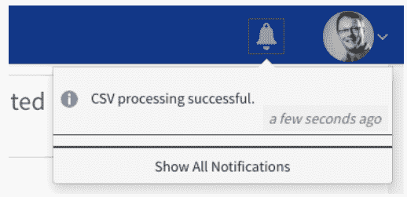

图 5.23 – CSV 处理成功的通知出现在屏幕右上角

让我们通过返回管理员应用程序的内部用户页面来检查这一点。

- 9. 单击左侧边栏顶部的 **Back** 按钮返回管理员主页。
- 10. 单击左侧边栏 **Manage** 部分中的 **Users** 链接。
- 11. 单击 **Learner 01** 打开此用户的详细信息。确认 **Manager 01** 现在是 **Learner 01** 的经理。**Learners 02** 也应如此。
- 12. 单击 **Instructor 01** 打开此用户的详细信息并确认您是此用户的经理。

在本节中，您配置了一个工作流，该工作流每天从上传到 Extravault FTP 服务的 CSV 文件中自动将新的和更新的用户导入到您的 Prime 账户。您现在需要做的就是配置内部用户目录，以便在 Captivate Prime 计划导入数据前几分钟，每天将 CSV 文件导出到 Extravault 账户。

这说明了将 Captivate Prime 与贵组织中使用的几乎任何用户目录解决方案集成的一种可能方法。

> **自动和手动 CSV 上传不兼容**
> 由于您已配置了数据源，因此使用本章前面 *Importing users from a CSV file* 部分所述的过程手动导入 CSV 文件不再可能。

您现在对在 Captivate Prime 中创建新用户以及保持用户列表始终最新的所有可用方法有了相当全面的了解。在下一节中，您将学习如何配置内部和外部用户用于验证到您的 Prime 账户的登录方法。

## 配置登录方法

在前面的章节中创建用户时，您可能注意到 Captivate Prime 在创建时不会要求输入用户的密码。这是因为 Captivate Prime 本身没有身份验证机制（除了对外部用户进行身份验证）。

当内部用户尝试登录 Captivate Prime 时，系统依赖外部身份验证机制来验证该用户。默认情况下，Prime 的内部用户使用的身份验证机制是 Adobe ID。

依赖外部身份验证服务来验证用户有几个优点：

- 作为组织，您可以使用相同的外部身份验证服务为用户授予访问无限数量应用程序的权限。这种技术称为 SSO。其理念是对中央身份验证服务进行一次身份验证，然后该服务反过来为用户提供对其有权访问的所有服务的访问权限。这节省了用户必须分别对每个服务进行身份验证的麻烦。
- 当用户更改其密码时，更改是在中央身份验证服务处进行的。因此，新密码会立即对身份验证服务提供访问权限的所有应用程序可用。用户无需为每个服务更改密码。
- 当员工离开组织时，在中央身份验证服务中删除用户账户会立即撤销该用户对组织所有应用程序的访问权限。
- 中央身份验证服务促进了用户的日常管理：在中央身份验证服务中更新用户会自动调整其对组织所有工具和应用程序的访问权限。

对于组织而言，SSO 有如此多的好处，以至于作为企业学习管理系统，Captivate Prime 没有费心开发自己的身份验证机制。相反，它旨在与组织中可用的身份验证机制无缝集成。

如果您的组织没有集中的身份验证机制，那么 Adobe 提供了自己的机制：Adobe ID。Adobe ID 只不过是一个中央身份验证服务，可让您访问 Adobe 提供的所有在线服务。您用于访问 Captivate Prime 的 Adobe ID 也可用于访问您的 Creative Cloud 账户或在线服务，例如 Adobe Spark、Adobe Colors、Adobe eLearning 社区等。因此，Adobe ID 与世界各地日益增多的组织使用的其他 SSO 提供商并无不同。

由于 Captivate Prime 设计为使用外部 SSO 提供商，因此将其配置为使用您组织的 SSO 提供商而不是 Adobe ID 非常容易。这就是本节将要探讨的内容。让我们开始吧：

- 1. 确保您以管理员身份登录。
- 2. 从管理员主页，单击左侧边栏 **Configure** 部分中的 **Settings** 链接。
- 3. 然后，单击左侧边栏 **Integrations** 部分中的 **Login Methods** 链接。这将带您进入 **Login Methods** 页面，您可以在此定义内部用户和外部用户如何对 Captivate Prime 进行身份验证。

如以下屏幕截图所示，内部用户的默认 **Login Method** 为 **Adobe ID**，而外部用户的默认登录方法为 **Captivate Prime ID**：

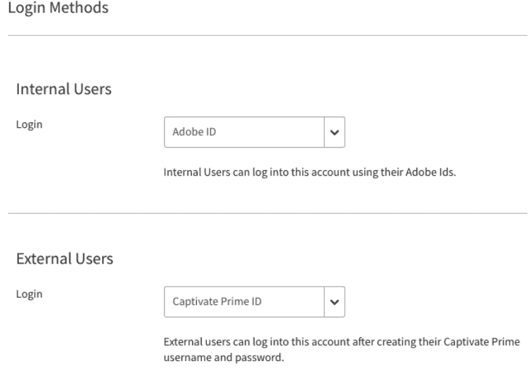

图 5.24 – 登录方法页面上内部用户和外部用户的默认登录方法

有趣的是，**Captivate Prime ID** 是 Captivate Prime 特有的唯一身份验证机制。它是平台对内部用户采用的全部外部身份验证策略的一个例外。

- 4. 在 **Internal Users** 下打开 **Login** 下拉列表以查看可用选项。

对于内部用户，您可以在 **Adobe ID** 和 **Single Sign-On** 之间进行选择。请记住 Adobe ID *是* 一个 SSO 机制，因此 **Single Sign-On** 选项只是允许您从一个 SSO 提供商（Adobe ID）切换到另一个（您自己的）！

如果您选择 **Single Sign-On** 选项，您可能会收到一条消息，提示您联系 Adobe Captivate Prime 支持以启用此功能。以下屏幕截图取自已启用 **Single Sign-On** 功能的账户：

### 内部用户

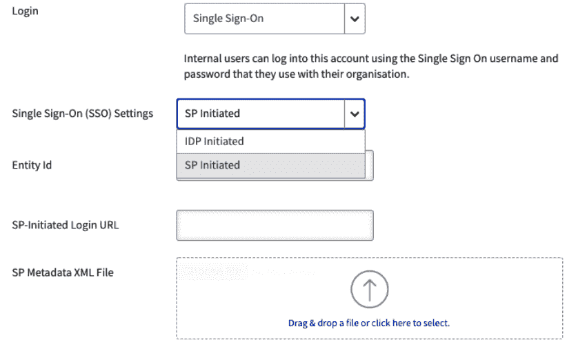

图 5.25 – 已启用 SSO 的账户的单点登录选项

前面的屏幕截图显示了 **Single Sign-On** 可用的选项。详细介绍这些选项超出了本书的范围，并且配置 SSO 需要在 Captivate Prime 和您组织的信息技术部门中进行配置步骤。只需注意，您希望与 Captivate Prime 一起使用的 SSO 提供商必须符合 SAML 2.0 规范。请随时联系 Prime 支持团队以获取有关如何将 Captivate Prime 与内部 SSO 提供商集成的更多说明。

**SAML 2.0**
**Security Assertion Markup Language (SAML)** 2.0 标准是一种基于 XML 的协议，使用安全令牌在中央身份验证服务和用户想要访问的资源之间交换信息。您可以在 https://en.wikipedia.org/wiki/SAML_2.0 的 SAML 2.0 Wikipedia 页面上找到更多信息。

现在，让我们回顾一下可用于外部用户的登录方法。

- 5. 确保您将 **Internal Users** 的登录方法恢复为 Adobe ID。
- 6. 打开 **External Users** 的 **Login** 下拉列表以查看可用选项。
- 7. 准备就绪后，将 **External Users** 的登录方法恢复为 **Captivate Prime ID**。
- 8. 单击 **Login Methods** 页面右上角的 **Cancel** 按钮以取消您可能做出的任何修改。

对于外部用户，可用的登录方法有三种：**Adobe ID**、**Single Sign-On** 和默认的 **Captivate Prime ID**。

对于本书中的示例，请确保您坚持使用默认的登录方法，即 **Internal Users** 使用 **Adobe ID**，**External Users** 使用 **Captivate Prime ID**。

在本节中，我们讨论了 **Single Sign-On** 并发现了 Captivate Prime 中用于对内部用户和外部用户进行身份验证的登录方法。对于外部用户，请注意，所选择的 **Login Method** 适用于所有用户，而与用户注册时使用的外部注册配置文件无关。

在下一节中，您将回顾 Captivate Prime 如何处理创建和管理用户组。

## 使用用户组

随着 Prime 账户中的用户列表不断增长，逐个管理用户很快变得困难。这就是管理员通常更喜欢管理用户组的原因之一。

创建用户组时，您希望将具有共同特征的用户归为一组。这可以是团队成员、在特定地点工作的用户、讲某种语言的用户、具有相同经理的用户、具有相同角色的用户等等。以这种方式对人员进行分组有几个优点：

- 首先，它促进了用户和技能管理。例如，您可以让一组用户注册课程，而不是逐个为每个组成员注册。您还可以将技能分配给用户组，而不是为每个用户分配技能。
- 它还允许某些任务自动化。例如，当用户成为经理（即成为经理组成员时），他/她会自动注册管理入职课程。
- 组对于报告目的也很有用。例如，它们允许您根据用户的地点、语言、角色、技能等生成报告。

在 Captivate Prime 中，每个用户可以是无限数量组的成员，并且一个组可以是另一个组的成员。换句话说，Captivate Prime 支持嵌套分组。

### 检查自动生成的组

Captivate Prime 了解创建组并手动将用户分配给组是一项艰巨、耗时且容易出错的任务。Captivate Prime 团队还注意到一些组在许多组织中都很常见。因此，系统会根据角色、用户层级、活动字段等各种方面自动生成大量组。让我们回顾这些自动生成的组：

- 1. 确保您以管理员身份登录。
- 2. 从管理员主页，单击左侧边栏 Manage 部分中的 Users 链接。这将带您进入 Internal Users 页面。
- 3. 从那里，单击左侧边栏 User Groups 部分中的 User Groups 链接。

此操作将带您进入 **用户组** 页面。请注意，已有大量组可用。此外，在组列表上方，有 **全部**、**自动生成** 和 **自定义** 选项卡，以及一个搜索字段，可用于在列表中搜索组。以下截图中说明了这些元素：

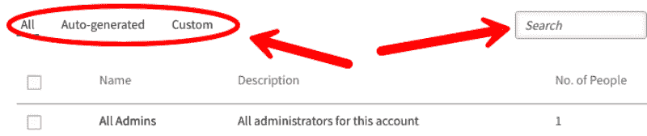

图 5.26 – 用户组页面上的全部、自动生成和自定义选项卡，以及搜索字段

此时，您的 Prime 账户中应仅包含自动生成的组。查看自动生成的组列表，您应会看到以下内容：

- 部分组，例如 **所有管理员**、**所有作者**、**所有学习者** 等，均基于 Prime 账户中的用户角色。
- **所有外部用户** 组列出所有外部用户，不论用于注册到您的 Prime 账户的外部注册配置文件为何。此外，针对账户中定义的每个外部注册配置文件，还会自动生成其他组。
- 例如 **经理 01 的团队** 之类的组，是根据用户配置文件中 **经理电子邮件** 字段定义的用户层级自动生成的。
- 为每个配置文件创建一个组。请记住，**配置文件** 是用户创建表单中存在的另一个字段。大多数情况下，**配置文件** 对应于个人在组织内的职位或部门。这种类型的自动生成组非常有用，因为它或多或少代表了组织的组织方式。
- 默认情况下，针对您在 **活动字段** 页面上定义的每个自定义字段，都会自动生成组。这就是为什么您会找到基于用户 **位置**、**部门** 和 **爱好** 的组。这些是您在本章前面 *自定义用户表单* 部分中创建的三个自定义字段。

您可以点击 **人数** 列中的数字来查看每个组中的用户列表。花点时间检查这些 **自动生成** 组及其包含的用户。这些组是动态的——它们由 Adobe Captivate Prime 自动 *生成* 并 *维护*。您无需采取任何操作来创建这些组或将用户放入其中。

也许这些自动生成的组已足以有效管理您的 Prime 账户用户，但您的组织可能还需要创建其他组。因此，除了本节讨论的自动生成组之外，Captivate Prime 还允许您创建自定义组。这将在下一节中讨论。

## 创建自定义组

本节中，您将创建 *顾问委员会* 组。该组包括 CEO、一些经理和一些员工。它与组织中的任何部门、位置、角色、层级关系等无关，因此无法由 Captivate Prime 自动生成。

执行以下步骤创建新的自定义用户组：

- 1. 在 **用户组** 页面上，点击屏幕右上角的 **添加** 按钮。这将打开 **添加用户组** 表单。
- 2. 在 **名称** 字段中输入 `Advisory Boards`。
- 3. 作为最佳实践，请花必要的时间为新组提供简短的 **描述**。
- 4. 最后，您必须提供组成员列表。您可以使用用户的用户名或电子邮件 ID 来执行此操作。
  在 **添加学习者 – 名称** 字段中输入用户的名称，并在列表中出现时选择所需用户。请注意，您也可以选择其他组而不是单个用户。这就是创建嵌套组的方法。
  如果您使用 **电子邮件 ID**，则必须提供现有用户的以逗号分隔的电子邮件地址列表。
- 5. 完成后，点击 **添加用户组** 表单右下角的 **保存** 按钮。

您的新自定义用户组现在将出现在 **用户组** 列表中，如以下屏幕截图所示：

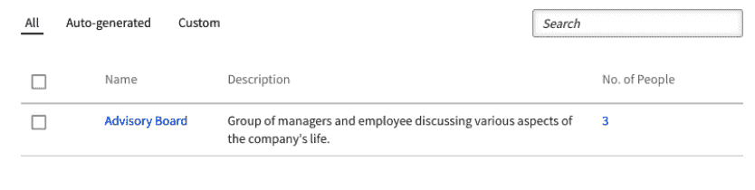

图 5.27 – 您的新自定义用户组出现在用户组列表中

要编辑组，请在列表中点击组名称。您也可以使用第一列中的复选框选择一个或多个组，然后点击页面右上角的 操作 按钮删除所选组（们）。请注意，自动生成的组无法删除，并且删除组不会删除该组中包含的用户。最后，您可以使用 全部、自动生成 和 自定义 选项卡，以及位于可用用户组列表上方的 搜索 字段来筛选屏幕上显示的组列表。

本节中，您创建了一个自定义组并向该组添加了用户。在下一节中，我们将讨论如何为您的 Prime 账户用户分配角色。

## 管理用户角色

在 Captivate Prime 等平台中，身份验证和授权是用户管理的两个基本方面。到目前为止，本章仅关注身份验证。身份验证回答“您是谁？”这个问题，您已看到内部用户和外部用户以及登录方法如何让 Captivate Prime 回答这个问题。

本节中，您将关注用户管理的授权方面。授权回答“您可以做什么？”这个问题。确实，仅凭您可以在平台上进行身份验证，并不意味着您被允许使用其所有功能。例如，学习者不能创建课程，作者不能删除用户，等等。只有管理员才被允许访问平台的每个角落。

在 Captivate Prime 中，授权基于角色。这意味着您需要创建角色并定义每个角色在平台上可以做什么。然后，您需要将一个或多个角色分配给用户。

Captivate Prime 中已预定义了五个基本角色：**学习者**、**作者**、**讲师**、**集成管理员** 和 **管理员**。让我们来看看它们：

- **学习者** 角色是分配给每个新用户（内部或外部）的默认角色。学习者可以浏览课程目录、注册课程、参加课程等。
- **作者** 是教学设计师和内容创建者。他们可以是内部或外部用户，并且可以访问内容库以上传教学内容并创建新的课程模块。他们还可以将这些模块组合成课程和学习计划。
- **讲师** 是进行现场和虚拟课堂活动的教师。他们还审查学习者通过文件提交活动上传的作业，并填写清单活动中定义的清单。所有这些活动都在 *第 4 章，创建技能和课程* 中讨论过。
- **集成管理员** 通常是 IT 专业人员或开发人员，其工作是配置将 Captivate Prime 与组织中其他系统集成的连接器，并开发使用 Captivate Prime 作为后端的应用程序。请注意，外部用户不能设为集成管理员。
- 最后，**管理员** 负责您 Prime 账户的日常管理。他们可以添加和删除用户、为用户分配角色、创建技能、将用户注册到课程等。他们还负责 Captivate Prime 的总体设置和平台的日常运营。

> **讲师与作者**
> 来自教育行业，我花了一段时间才理解将 *讲师* 和 *作者* 角色分开的理由。毕竟，在大多数学校和大学里，教师既是其课程的作者也是讲师。但在企业世界中并非总是如此，教学设计师团队可能负责创建课程，然后由一批讲师授课。这使得同一门课程可以在许多不同的地点（例如不同分支机构）以及不同语言中授课，这在大型跨国组织中经常出现。这是 Captivate Prime 似乎被设计为企业 LMS 的另一个例子。

这些角色被视为 *显式* 角色，因为管理员必须明确将它们分配给用户，Captivate Prime 才会授权用户访问相应的功能。

除此之外，Captivate Prime 还包含一个 *隐式* 角色：**经理**。该角色被视为隐式，因为当另一个用户的 **经理电子邮件** 字段中填入其电子邮件地址时，该角色会被自动分配给该用户。在 Captivate Prime 中，经理可以管理其团队成员的学习。例如，经理可以为团队成员注册课程、批准或拒绝注册请求、生成报告、跟踪绩效等。

你将在 *第 6 章，注册学习者到课程* 中以及 *第 9 章，配置和使用反馈* 中更详细地了解 **经理** 角色。

在下一节中，你将返回 Captivate Prime 并开始为之前定义的用户分配角色。

## 为用户分配角色

现在你对 Captivate Prime 中可用的默认角色有了更好的了解，让我们返回用户列表并为用户分配角色：

-   1. 确保你以 **管理员** 身份登录。
-   2. 从管理员主页，单击左侧边栏 **管理** 部分中的 **用户** 链接。这将带你进入 **内部用户** 页面。
-   3. 使用第一列中的复选框选择 **Instructor 01** 用户。
-   4. 单击屏幕右上角的 **操作** 按钮，并在打开的列表中选择 **分配角色** 操作。
-   5. 单击 **设为讲师** 为 **Instructor 01** 用户分配讲师角色。
-   6. 重复这些步骤，也为 **Instructor 01** 用户分配 **作者** 角色。

在操作过程中，同时注意可用操作列表中的 **移除角色** 选项。仔细查看，你会发现学习者角色无法从用户中移除。换句话说，Captivate Prime 中的每个人都是学习者！

在进入下一节之前，让我们快速回顾一下可以分配给外部用户的角色。

-   7. 从 **内部用户** 页面，单击左侧边栏 **用户** 部分中的 **外部** 链接。
-   8. 单击与你在本章前面 *创建外部用户* 部分中创建的外部注册配置文件关联的 **已用席位** 链接。
-   9. 使用复选框选择 **Learner 03** 用户。
-   10. 单击屏幕右上角的 **操作** 链接。
-   11. 将鼠标悬停在 **分配角色** 操作上，注意到外部用户只能被设为 **作者** 或 **经理**。

通过以上内容，你已了解到外部用户不能成为 **管理员** 或 **集成管理员**。你还了解到，对于外部用户，**经理** 角色是显式的，这又是内部用户和外部用户之间的另一个区别。这很有道理，因为外部用户在你的组织之外，因此你无法访问外部用户在其各自组织内的角色和层级信息。

一旦被指定为 **经理**，该外部用户将自动成为使用相同外部注册配置文件的其他所有 *现有和未来* 外部用户的经理。此外，请注意你无法从外部用户中移除经理角色。

Adobe Captivate Prime 的内置角色应能满足你的基本需求，但有很多场景并不完全适用。因此 Captivate Prime 允许你创建自定义角色，这将在下一节中介绍。

## 创建自定义角色

作为企业级 LMS，Adobe Captivate Prime 应允许你实现大量业务需求。例如，你的组织可能会聘请外部 eLearning 机构创建必须上传到你的 Prime 账户的 eLearning 内容。因此这些外部承包商需要访问你账户的作者权限，但你可能希望防止这些外部机构相互查看彼此的内容。问题是，默认情况下，每个作者都可以访问整个内容库。这就是创建自定义角色至关重要的情况之一。

为了解决此示例，你需要使用 *第 3 章，上传学习内容和管理内容库* 中 *使用内容文件夹* 部分概述的步骤创建内容文件夹。

创建自定义角色在许多其他情况下也很有用：

-   默认情况下，Prime 管理员负责你的 Prime 账户的日常运营以及实施组织的培训策略。使用自定义角色，你可以将管理员角色拆分为 *平台管理员* 角色（账户的主要配置、创建内部和外部用户、品牌化你的账户等）和 *培训管理员* 角色（为用户注册课程、管理技能、徽章和认证、生成报告等）。
-   你可能希望初级作者只能将新内容上传到内容库，以便将这些内容组装成课程仍是高级作者的特权。这可以通过创建 *初级作者* 自定义角色来实现。
-   等等。

现在你对自定义角色的重要性有了更好的了解，让我们回顾一下创建自定义角色所需的步骤：

-   1. 确保你以 **管理员** 身份登录。
-   2. 从管理员主页，单击左侧边栏 **管理** 部分中的 **用户** 链接以访问 **内部用户** 页面。
-   3. 然后，单击左侧边栏 **高级** 部分末尾的 **自定义角色** 链接以访问 **自定义角色** 页面。
-   4. 单击 **角色** 列末尾的 **创建角色** 链接。
-   5. 在 **角色名称** 字段中输入新角色的名称（在本例中为 *初级作者*）。
-   6. 接下来，你需要为新角色指定 **权限**。对于 *初级作者* 示例，你将在 **账户权限** 部分允许 **完全控制** 或访问内容库的 **选定文件夹**。
-   7. 最后，使用表单最底部的 **用户** 部分中的 **搜索用户** 字段选择你希望分配此自定义角色的用户。
-   8. 准备就绪后，单击屏幕右上角的 **保存** 按钮。

花点时间浏览可以包含在 **自定义角色** 中的所有权限，并尝试想象 *你的* 组织如何利用此功能提供的所有可能性。

此外，注意 **功能权限范围** 部分，它允许你将分配给此角色的权限限制为特定的目录和/或用户组（*目录将在第 14 章，使用目录和对等账户中讨论*）。

请注意，只有内部用户才能被分配此类自定义角色。

这种广泛的组合范围使自定义角色成为 Captivate Prime 的一项非常强大的功能。当然，许多复杂的场景都是可能的，这使得不可能在本書中全部涵盖。

有关自定义角色和权限管理的更多信息，请参阅以下页面，该页面来自官方 Captivate Prime 用户指南：https://helpx.adobe.com/captivate-prime/user-guide.html/captivate-prime/administrators/feature-summary/custom-role.ug.html.

## 摘要

在本章结束时，学习活动终于可以在你的 Prime 账户上开始，因为所有所需的 成分 现在都已妥善就位：

-   在 *第 3 章，上传学习内容和管理内容库* 中，你通过上传各种类型的学习活动到你的 Prime 账户创建了模块。
-   在 *第 4 章，创建技能和课程* 中，你将这些学习模块组装成课程，并为课程分配了技能。
-   最后，在本章中，你添加了将使你的 Prime 账户活跃起来的用户。

你已了解到 Captivate Prime 区分内部用户和外部用户。通常，内部用户来自组织内部，而外部用户是需要访问你的 Prime 账户的第三方组织个人。当然，请随意调整这种典型区别以满足你的特定业务需求。

你还回顾了创建新内部用户和外部用户的几种方法。内部用户可以使用 **单个用户** 选项逐个创建，使用 **上传 CSV** 选项批量创建，或通过管理员可以定义的自助注册链接创建。对于外部用户，有必要创建外部注册配置文件以允许这些用户自行注册到平台。

维护最新的用户列表是一个真正的挑战，组织越大，挑战越大！员工不断加入和离开组织，人们更换角色，随着业务发展团队不断创建和解散，进行收购，开设、合并和关闭分支机构等等。这就是为什么大多数组织使用 LDAP（Microsoft Active Directory、OpenLDAP 等）、Salesforce、Workday 或任何类型的 **客户关系管理 (CRM)** 或 **企业资源规划 (ERP)** 解决方案维护某种内部用户目录的原因。

鉴于维护最新用户目录的复杂性，将所有这些数据复制到 Captivate Prime 中意义不大。因此，Captivate Prime 提供了大量连接器，可让您将 LMS 与组织使用的任何目录解决方案集成。

Captivate Prime 设计为通过外部 **Single Sign-On (SSO)** 提供商对用户进行身份验证。这可以是您组织的 SSO 提供商，也可以是 Adobe 自有的 SSO 解决方案，也称为 Adobe ID。这一通用规则的唯一例外是外部用户可以使用 Captivate Prime ID 对平台进行身份验证的可能性。

最后，Captivate Prime 采用基于角色的授权方法。Captivate Prime 自动定义了六个角色：**Administrator**、**Author**、**Integration Admin**、**Instructor**、**Manager** 和 **Learner**。不过，您可以创建自己的自定义角色来满足各种复杂的用例。

现在所有这些配料都已就位，可以开始将学习者注册到课程中了。Captivate Prime 为此提供了许多选项，涵盖了众多教学设计策略和业务需求。这就是您将在下一章中回顾的内容。
