## 6 将学习者注册到课程

通常，一份食谱有两个主要部分：*配料* 和第二部分称为 *说明或方法*。在阅读了前几章后，您数字学习食谱的配料部分已完成。在本章中，是时候进入 *方法* 部分，看看这些配料如何组合以实现学习。

本章中您将探讨的第一个问题是，*学习者实际注册的是什么？*乍一看，这个问题的答案似乎显而易见：学习者注册课程。但仔细检查后，Captivate Prime 提供了许多细微差别和变化，例如 **course instances**、**Learning Programs**、**Learning Plans** 和 **certifications**，这些都将在本章中讨论。

需要考虑的第二个问题是，*谁可以将学习者注册到课程？*同样，有一个显而易见的答案：正如我们之前讨论的，Captivate Prime 被设计为以学习者为中心的 LMS，因此学习者通常自行注册。因此，在本章中，您将从学习者的角度审视注册体验。话虽如此，组织还需遵守要求学习者参加合规课程的法规；某些职业需要不断重新认证，更不用说每个组织的培训和发展战略也在决定谁应该学习什么方面发挥作用。

我喜欢说，成功的学习和发展战略是学习者的愿望与组织的需求相遇的地方。这就是为什么在为用户注册课程时，管理员和经理也发挥作用的原因。在本章中，您将回顾几种注册工作流程，例如管理员注册和管理者审批。当然，这些不同的注册方法可以组合使用，为学习者、经理和组织提供无与伦比的灵活性。

到本章结束时，您将对学习者与学习内容如何结合以及这如何帮助组织实施整体学习和发展战略有坚实的理解。为实现这一目标，本章将涵盖以下主题：

- 查看影响注册的课程选项
- 创建课程实例
- 利用学习计划和认证
- 作为学习者自行注册课程
- 管理员和经理的注册
- 使用学习路径自动注册

这些令人兴奋的新功能有很多，让我们直接开始吧！

### 技术要求

为了完成本章中的练习，您需要满足以下技术要求：

- 您需要对正在运行的 Captivate Prime 账户（可以是试用账户）拥有管理员和作者访问权限。
- 除了前面提到的管理员账户外，您还需要访问至少三个不同的学习者账户和一个经理账户。
- 您的账户上必须至少有一个包含同步（直播）和异步（按需）活动的课程。至少其中一个活动必须启用了多种交付方式。

如果您已完成前几章的练习，您应该可以立即开始本章。如果您尚未阅读前几章，请在继续之前确保满足上述要求。您也可以在不进行实际练习的情况下阅读步骤。

本章练习中描述的步骤基于本书前几章中定义的学习内容和用户配置文件。如果您尚未阅读前几章，请随意根据自己的情况调整步骤。

### 查看影响注册的课程选项

回到第 4 章《创建技能和课程》，您在 Captivate Prime 账户中创建了一个自定义课程。当时，您几乎浏览了所有与课程创建相关的选项，除了与定义课程的首选目标受众以及学习者如何注册课程相关的几个属性。让我们回到作者角色，使用以下步骤探索这些剩余选项：

1. 确保您已使用 Captivate Prime 账户以作者身份登录。
2. 从作者主页，单击左侧边栏学习部分顶部位置的课程链接。
3. 将鼠标悬停在第 4 章《创建技能和课程》中您创建的课程卡片上。
4. 单击查看课程链接以打开课程详细信息。

> **注意**
> 如果您未执行第 4 章《创建技能和课程》中的练习，您可以使用任何可用的自定义课程，前提是所选课程包含同步和异步活动，并且至少有一个课程活动启用了多种交付方式。

5. 单击左侧边栏中的设置链接。

这会带您进入课程的设置页面，其中包含注册类型、取消注册和谁应参加此课程字段。这些是第 4 章《创建技能和课程》中未讨论的三个字段。现在是时候更详细地讨论它们了。

6. 单击屏幕右上角的编辑链接。
7. 打开注册类型下拉列表并检查可用选项。

注册类型下拉列表中有三个选项可用。Self Enrolled 是默认值。使用此选项，学习者可以浏览课程目录并自行注册课程。作为以学习者为中心的 LMS，这正是 Captivate Prime 旨在推广的体验，因此这成为默认值也就不足为奇了。

使用 **Manager Nominated** 选项时，学习者无法自行注册，因为只有经理可以将其团队成员注册到课程中。

最后，使用 **Manager Approved** 选项时，学习者可以浏览课程目录向其经理发送注册请求以供批准。

8. 从 **Enrollment Type** 下拉菜单中选择 **Self-enrolled**。

### 更改注册类型

更改 **Enrollment Type** 时，您不能更改为更严格的选项。例如，从 **Self Enrolled** 更改为 **Manager Approved** 是不可能的。遇到疑问时，请在创建课程时选择严格的 **Enrollment Type**，这样以后就可以切换到更宽松的选项。作为变通方法，您也可以复制课程，为副本选择更严格的 **Enrollment Type**，然后停用原课程。

9. 保持 **Unenrollment** 复选框未选中。

10. 向下滚动页面底部，直到看到 **Tags** 和 **Who should take this Course?** 选项。

正如在 *第 3 章，上传学习内容和管理内容库* 的 *使用标签* 部分所讨论的，标签是帮助 Captivate Prime 搜索引擎索引课程内容以使其更易发现的关键词。就像您可以将标签与模块关联一样，您也可以将标签与课程关联。

在 **Who should take this course** 字段中，您可以通过提供一个或多个配置文件来定义课程的首选目标受众。正如在 *第 5 章，管理用户* 中所讨论的，此配置文件是可在 **Add User** 表单中找到的字段之一。大多数情况下，配置文件对应于学习者的 *职位*。

11. 在 **Who should take this Course?** 字段中开始输入现有配置文件的名称。当配置文件在列表中可见时，单击所需配置文件。您可以重复此操作并添加多个配置文件。您也可以轻松删除所选配置文件。

对于此示例，请确保将 **Who should take this Course?** 字段留空。

12. 最后，单击屏幕右上角的 **Republish** 按钮以保存更改。

课程 **Settings** 页面现在应如下所示：

Author(s)
作者姓名和个人资料图片会显示给访问此学习的全部学员。请确保您已获得作者的同意。
Damien Bruyndonckx

Enrollment Type *
自行报名

Unenrollment
学员可以自行取消报名

Prerequisites
推荐课程。非强制性。
Adobe Captivate Prime 学习者体验

Job Aids
快速参考资料，用于在课程期间和之后补充学习
未添加任何工作辅助

Tags
学员可以使用标签查找相关课程。
未添加任何标签

Who should take this Course?
指定个人资料/目标受众。
Profile

Figure 6.1 – 课程的报名相关选项在课程设置页面可见

Thanks to the above steps, you should have a better understanding of the enrollment options available. You also learned how to define a preferred target audience for each course. By doing so, Captivate Prime gives courses a more prominent place that matches the learner's profile when the learner browses the course catalog.

In the next section, we will discuss course instances and define the needed course instances for your custom course.

## Creating course instances

To understand course instances, it is necessary to remember that a Captivate Prime course can include both synchronous and asynchronous modules. As a reminder, asynchronous activities are self-paced modules such as videos, online quizzes, PowerPoint presentations, PDF files, and others that learners can review at their convenience, while synchronous activities require learners and instructors to be present together at the same time, either physically in a classroom or lecture hall or online using a video conferencing system.

But there is another major difference between *synchronous* and *asynchronous* activities: *synchronous* activities are time-bound, while *asynchronous* activities are not.

Let's look at a quick example. Imagine it's early April and you're creating a course that includes a virtual classroom activity scheduled for, say, mid-May. If learners register for the course before the end of April, all is well. But if they register later, they may not have enough time to complete the required prework before attending the mid-May class. Even worse: what happens if learners enroll in the course *after* the scheduled class date?

Another example is when your organization wants to offer the same synchronous activity in various countries and/or in different languages. In such a case, you need to schedule several instances of the same (live or virtual) class in different locations, time zones, languages, and, possibly, with different instructors. In the case of a virtual class, each instance can use a different (Zoom, Connect, Teams) URL and/or different instructor(s).

You can also use course instances with courses that consist of self-paced modules only. This can be very useful for reporting and feedback purposes. Feedback and reporting will be covered in *Chapter 9, Configuring and Using Feedback*, and *Chapter 10, Reporting in Captivate Prime*.

To address these use cases, you need to define **course instances**. Learners enroll in a course instance rather than the course itself.

In this section, you will create two instances for the custom course you defined in *Chapter 4, Creating Skills and Courses*, but first, let's remember what modules this course is made up of by performing the following steps:

- 1. Make sure you are logged in as an Author in your Captivate Prime account.
- 2. From the Author home page, click the **Courses** link located at the top of the **Learning** section in the left sidebar.
- 3. Hover over the card of the course you created *Chapter 4, Creating Skills and Courses*.
- 4. Click the **View Course** link to open the course's details.
- 5. Scroll down the **Overview** page until you see the **Modules** section.

As depicted in the following screenshot, the course is made up of several modules, one of which (identified by the arrow in the following screenshot) is a classroom module. Remember that classroom modules are *synchronous* activities. The other modules included in this course are all *asynchronous* (self-paced) activities:

Content: * Core Modules that make up the Course.

|  |  |  |
|---|---|---|
| Theory of file extensions (Part 1) Multiple Delivery Types |  |  |
| Learn the file extensions Self Paced | 4 mins 39 secs |  |
| Identifying Phishing Attempts Self Paced | 7 mins 53 secs |  |
| Combat Phishing - Check the email address of the sender Self Paced | 1 min 30 secs |  |
| Phishing explained - Youtube Video Activity | 3 mins |  |
| Cybersecurity Live class Classroom |  |  |
| Your cybersecurity essay Activity | 1 hr |  |
| Cybersecurity - Checklist Activity |  |  |

Figure 6.2 – 课程中包含的一个模块是同步课堂模块

Also, note the two activity modules included at the end of the course. Both of these activity modules require an instructor to either assess the assignment that's submitted by the learner or to fill out the checklist.

> **Note**
> File submissions and checklist activities were discussed in *Chapter 4, Creating Skills and Courses.*

Finally, the first course module in the preceding screenshot (identified by the oval shape) has **Multiple Delivery Types** assigned. To review which delivery types have been assigned to this particular module, it is necessary to perform the following steps:

- 6. Click the **Edit** button located in the top-right corner of the page.
- 7. Click the **Modify Delivery Types** link associated with the **Theory of file extensions (Part 1)** module.

As shown in the following screenshot, this module can be a **Self Paced Module** or a **Classroom Module**:

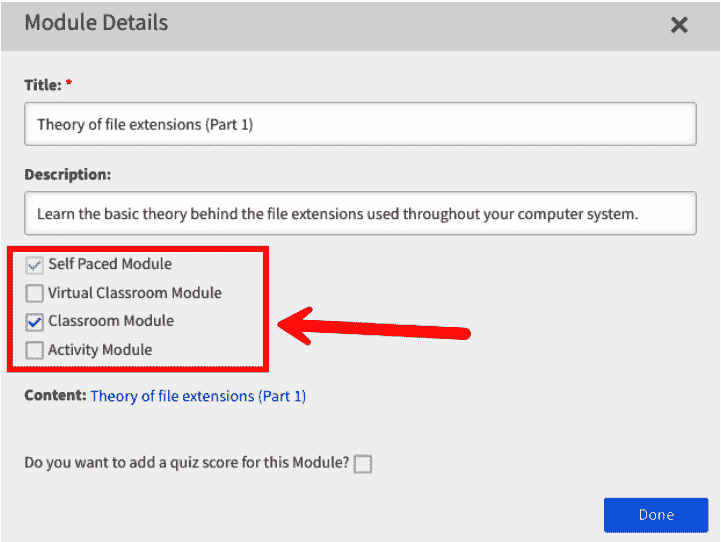

Figure 6.3 – 该模块可以是自定进度模块或课堂模块

To relate this situation to a real-world use case, imagine that you have only English-speaking instructors who can teach this particular class. English-speaking learners can therefore enjoy an instructor-led course module, while learners speaking other languages must watch a self-paced recording of the course with subtitles in their language. Or let’s imagine the instructor who used to teach the course no longer works for the organization, so what used to be an instructor-led module is now a self-paced module using a recording of an earlier lecture.

Whatever the actual reason, the point is that the same course module can be assigned multiple delivery types.

- 8. Before moving on to the next section, make sure you close the **Module Details** dialog and **Cancel** any changes you may have made to the course.

Now that you have the details of this course back in mind, it is time to turn your attention to creating course instances.

## Creating course instances

Creating course instances is something both administrators and authors can do. For this example, let's do this as an administrator by performing the following steps:

- 1. Make sure you are logged in as an Administrator.
- 2. From the Administrator home page, click the **Courses** link located in the **Learning** section of the left sidebar.
- 3. Hover over the card of the course you created *Chapter 4, Creating Skills and Courses*, and click the **View Course** link to open the course's page.
- 4. Click the **Instances** link located at the top of the **Manage** section of the left sidebar.

As shown in the following screenshot, a **Default instance** should already be defined. Depending on the situation, this default instance may already be *retired* (see the arrow in the following screenshot). This means that the date you chose for the classroom activity when creating the course has already passed, which is the case in the following screenshot:

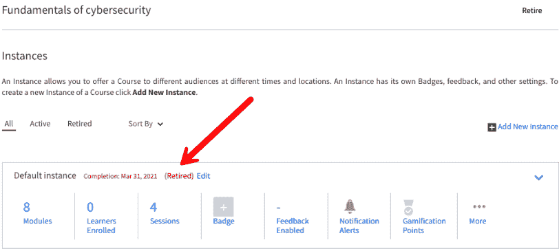

Figure 6.4 – 应已定义默认实例

If the course only contains *asynchronous* self-paced modules, this **Default instance** is probably all you need. But since this course contains a time-bound *synchronous* classroom activity, it is necessary to create course instances before accepting enrollments.

You will now create two additional instances for this course: one for the North American region and one for the Europe Middle East Africa (EMEA) region. Perform the following steps:

- 5. Click the **Add New Instance** link located in the top-right corner of the **Instances** page.

- 6. 在 **Instance Name** 字段中输入所需名称。请注意，此时这是唯一必填信息。
- 7. 如有需要，您可以输入 **Completion Deadline**。学员必须在所选日期前完成课程才能获得课程学分。
- 8. 点击 **Show More Options** 链接以显示更多选项。
- 9. 如有需要，您可以输入 **Enrollment Deadline**。在此日期之后，此课程实例将不再接受报名。学员仍可报名参加课程，但需使用其他课程实例。
- 10. 如有需要，您可以输入 **Unenrollment Deadline**。在此日期之后，已报名的学员将无法自行取消报名。
- 11. 最后，您可以输入 **Timezone**。请注意，这是必填信息，默认值为您为 Prime 账户指定的主 **Timezone**。

设置账户默认时区的相关内容已在 *第 1 章，Adobe Captivate Prime 简介* 的 *修改您的账户设置* 部分进行讨论。
- 12. 新建课程实例的主要设置到此为止。在点击 **Save** 按钮之前，请确保您的屏幕与以下截图类似：

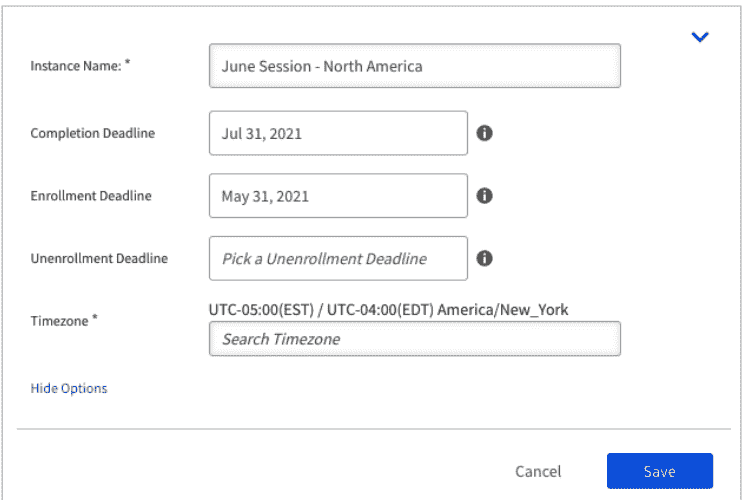

Figure 6.5 – 您新建课程实例的主要设置

创建新课程实例流程的第一步现已完成。在下一节中，您将继续根据需要指定所需的会话详细信息。

## 提供必要的会话详细信息

在本节中，您将通过提供不同会话所需的详细信息，继续创建上一节中开始的课程实例。以下练习承接上一节的内容。请按照以下步骤提供必要的会话详细信息：

- 1. 在课程的 Instances 页面中，找到您在上一节开始创建的课程实例。

注意一目了然的实例属性。这包括课程中的模块数量、本课程实例中已报名学员的数量、您需要提供详细信息的会话数量、与此课程实例关联的徽章等。

- 2. 在课程实例属性中点击 Modules 链接以打开模块列表。此操作在以下截图中有所说明：

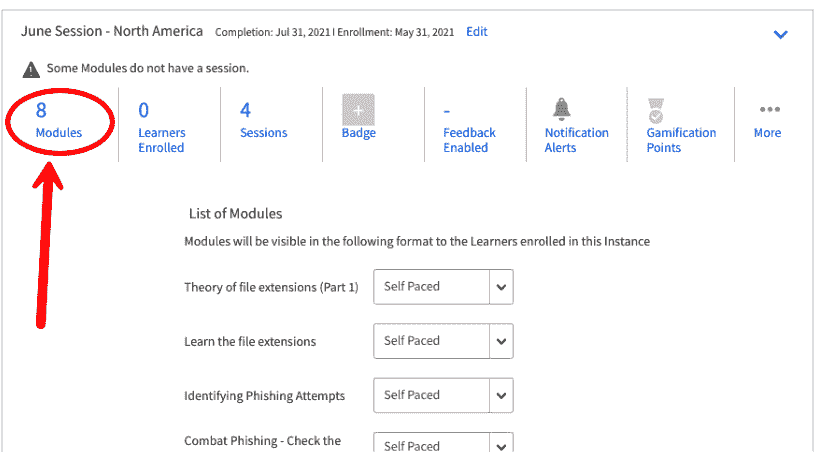

- 3. 如果该课程的模块具有多种交付类型，您可以在此处为每个模块选择在此课程实例中使用的交付类型。

- 4. 完成后，点击 **List of Modules** 底部的蓝色复选标记以保存更改。
- 5. 现在，点击课程实例属性中的 **Session** 链接以打开 **Session Details** 面板。

在此处您可以为所有需要此信息的课程活动提供特定于实例的详细信息。这通常适用于同步的现场或虚拟课堂活动，您必须为其提供详细信息，例如开始和结束日期、讲师、场地和座位限制。然而，其他类型的活动也需要特定于实例的详细信息：

- 对于 **URL** 活动，您可以提供特定于实例的 URL。
- 您还可以为 **File Submission** 和 **Checklist** 活动指定讲师。

以下截图说明了您可以为现场 Classroom 活动提供的所有详细信息：

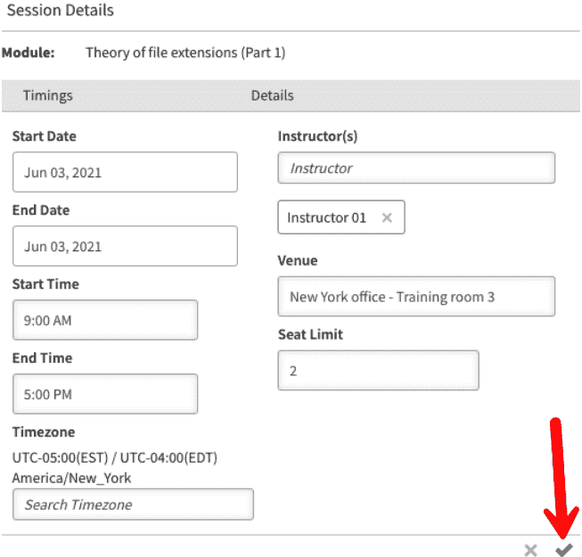

Figure 6.7 – 课程实例的 Session Details 表单

请注意，我们在 *第 5 章，管理用户* 中定义的 *Instructor 01* 用户已被指定为该班级的 **Instructor**。此外，请注意如果需要，您可以分配多个讲师。

> **The Seats Limit field**
> **Seats Limit** 字段对于 **waitlist** 管理非常重要。在前面的截图中，我故意选择了一个极低的座位限制为 2。这是因为我在 *第 5 章，管理用户* 中只定义了三名学员（Learner01、Learner02 和 Learner 03）。本章后面，您将把这三名学员全部报名到同一个课程实例中，这将使您了解讲师如何在 *第 8 章，探索讲师角色* 中管理候补名单。

- 6. 根据前面的截图，为课程中每个现场或虚拟课堂模块输入所需的 **Session Details**。

对于每个模块，点击 **Session Details** 表单右下角的蓝色复选标记以验证您的更改（请参阅前一截图中的箭头）。

- 7. 此外，为每个 **File Submission** 和 **Checklist** 活动模块输入一个或多个讲师。

> **Choosing an instructor**
> 为了本演示的目的，我总是选择上一章中创建的 *Instructor 01* 用户。如果您尚未定义该用户，请选择 Prime 账户上任何可用的讲师。只需确保在本书的所有练习中始终使用相同的讲师即可。

请确保在适当的地方提供所有必要的信息；否则，报名参加此课程实例的学员可能无法按预期完成课程。

- 8. 重复上述过程创建第二个课程实例。

此第二个课程实例应尽可能使用多种变化，例如选择不同的交付类型或不同的时区。

完成后，您应该为自定义课程提供两个额外的课程实例，如以下截图所示：

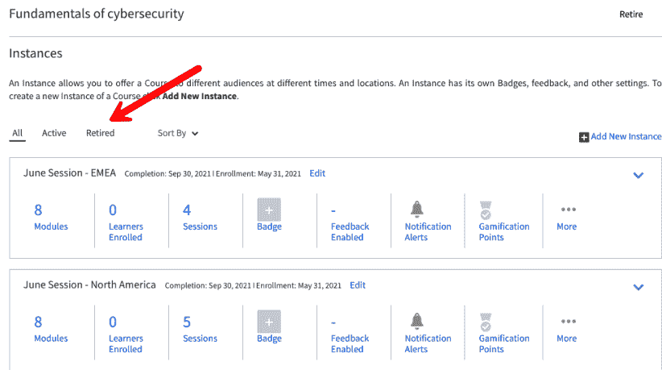

Figure 6.8 – 您的自定义课程有另外两个课程实例可用

此外，请注意您可以使用列表上方提供的 All、Active 和 Retired 标签筛选课程实例列表（请参阅前一截图中的箭头）。

> Note
> 其余的课程实例属性，例如 Badge、Feedback 和 Notifications，将在后续章节中讨论。

现在您对课程实例有了更好的理解，您会明白学员报名的是课程实例，而非课程本身。

> The default course instance
> 即使您没有显式创建课程实例，请记住，在创建新课程时，会自动创建一个默认课程实例。如果课程仅包含自定进度模块，此默认实例可能就是课程按预期运行所需的一切。在这种情况下，学员将报名参加该默认课程实例。

在下一节中，您将探讨课程实例如何被退役和重新开放。

## 退役课程实例

当课程有多个课程实例时，学员可以选择想要报名的实例。这很快就会揭示所有活动组织者不可避免会面临的最大谜团之一：某些课程实例需求量很大，而其他实例则完全没有需求。如果课程包含座位有限的现场课堂活动，这尤其成问题。候补名单可能会迅速填满，这可能导致后勤噩梦和不满意的学员。

这是退役课程实例非常有用的情况之一。已退役的实例不再出现在课程目录中，使得无法接受新的报名。同时，已报名的学员保留其状态，并像课程实例未发生任何变化一样继续学习！

使用以下步骤退役课程实例：

- 1. 从管理员主页点击左侧边栏 **Learning** 部分中的 **Courses** 链接。
- 2. 将鼠标悬停在您在 *第 4 章，创建技能和课程* 中创建的课程卡片上，然后点击 **View Course** 链接以打开课程页面。
- 3. 点击左侧边栏 **Manage** 部分顶部的 **Instances** 链接。
- 4. 点击您希望退役的课程实例右上角的向下箭头。
- 5. 在打开的菜单中点击 **Retire Instance** 选项，如以下截图所示：

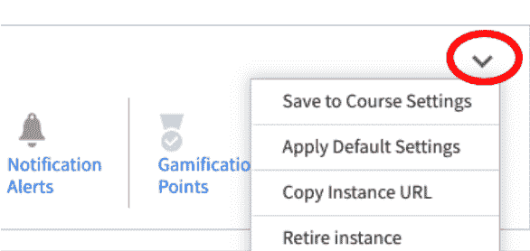

Figure 6.9 – 在打开的菜单中点击退役实例选项

现在，假设随着学习者需求的增加，你决定将直播课程搬到更大的场地，并指定一名额外的讲师，以便能够容纳比创建课程实例时计划的更多学习者。在这种情况下，你希望重新打开课程实例，以便再次接受新的报名。

让我们重新打开已退役的实例。

- 6. 找到你希望重新打开的已退役实例。如有必要，可以使用位于实例列表上方的 **Retired** 标签。
- 7. 点击你希望重新打开的课程实例右上角的向下箭头。
- 8. 在打开的菜单中点击 **Reopen Instance** 选项。

请注意，当报名截止日期或第一次同步活动已通过时，课程实例会被 Captivate Prime 自动退役。

阅读完本节后，你已足够了解课程实例以完成本章剩余内容。需要记住的主要点是，学习者报名的是 *course instances* 而不是 *courses*。在下一节中，你将学习如何对课程进行分组，以便学习者可以一次报名（或被报名）多个课程。

## 利用学习计划和认证

到目前为止，在本书中你一直默认学习者报名课程。在本节中，你会发现，虽然这种情况经常发生，但这一说法并不总是成立。有很多情况将课程分组并让学习者报名一组课程而不是单个课程是有意义的：

- 你提供同一主题的不同级别课程（例如，摄影 level 1、摄影 level 2），并且希望允许学习者一次性报名完整课程体系。
- 你希望将较长的课程拆分为章节，但 Captivate Prime 不允许你在单个课程内将模块组织成章节。在这种情况下，你可以将课程分组，并将每个课程视为更大计划的一个章节。
- 出于组织发展的需要，或让学习者成为培训师/经理/SME，你希望允许学习者获得认证，但某些认证要求学习者修读多门课程。
- 许多职业（会计、人力资源、项目经理等）需要持续培训，你希望定义构成此持续认证计划的课程系列。

前述示例只是此类课程捆绑相关的众多情况中的几个。因此，Captivate Prime 提供了许多功能来解决此类用例。这就是本节将回顾的内容。

## 创建学习计划

让我们从这些功能中最简单的开始：**Learning Program**。在 Captivate Prime 中，学习计划是一个简单的课程集合。你可以用它来对一组相关课程进行分组，或创建更长的课程体系，其中每门课程被视为一个章节。

> **学习计划与学习方案**
> 本节讨论的学习计划不应与 Captivate Prime 中使用的另一个概念混淆，即学习方案。学习方案允许系统在事件发生时自动为学习者报名。该功能将在本章稍后的 *Automatic enrollment using learning plans* 部分进行更详细的讨论。

为了说明此功能，你将使用随 Prime 试用账户自动提供的一些课程，创建一个专门使用 Adobe Lightroom 和 Adobe Photoshop 进行照片编辑的学习计划。创建学习计划可以由管理员和作者完成。让我们通过执行以下步骤创建一个新的学习计划：

- 1. 从管理员主页，点击左侧边栏 **Learning** 类别中位于的 **Learning Programs** 链接。

这会带你进入管理员应用程序的 **Learning Programs** 页面，在此你可以查看当前可用的 **Learning Programs** 列表（如有）。

- 2. 点击 **Learning Programs** 页面右上角的 **Add** 按钮。
- 3. 在 **Learning Program Name** 字段中输入 `Mastering Photo Editing`。请注意，此时这是表单中唯一的必填字段。
- 4. 作为最佳实践，还请在相应字段中输入 **Learning Program Overview** 和 **Benefits of this Learning Program**。

这两个字段的示例文本可在本书相关下载中的 `masteringPhoto/masteringPhoto_desc.pdf` 文件中找到。

- 5. 你还可以提供 **Cover image** 和 **Banner Image**，以使该 **Learning Program** 在课程目录中更具吸引力。

如有需要，示例图片可在本书相关下载中找到。请查找 `masteringPhoto/masteringPhoto_Banner.png` 和 `masteringPhoto/masteringPhoto_Cover.png` 文件。

其他字段与创建课程时找到的字段非常相似。它们已在 *Chapter 4, Creating Skills and Courses* 中详细讨论，应不言自明。

- 6. 花点时间检查可用选项，并在准备好时点击页面右上角的 **Save** 按钮。

这完成了创建新学习计划的第一步。页面重新加载后，你应该会在左侧列中看到大量额外的链接，如以下屏幕截图所示：

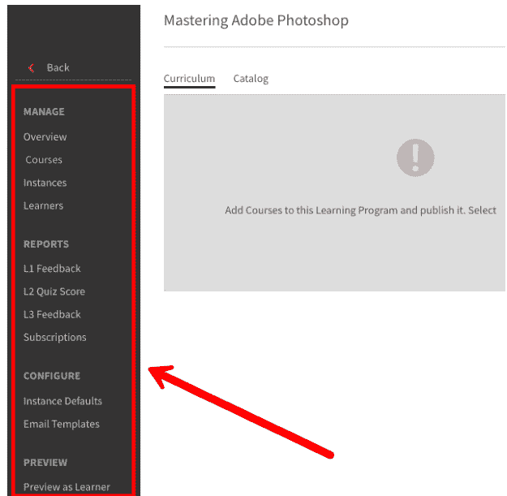

图 6.10 – 页面重新加载后，左侧边栏会出现新的链接

这些链接中的大多数与课程可用链接相同。例如，请注意 **Instances** 链接，它允许你创建学习计划的实例并将其映射到课程实例。这将在本章稍后的 *Creating flexible learning programs* 部分讨论。

说到构成学习计划的课程，这正是创建学习计划的下一步，将在下一节中讨论。

## 向学习计划添加课程

学习计划是一个课程捆绑包，创建它的最重要步骤是选择其组成部分的课程。本节从上一节结束的地方继续：你应该位于上一节开始创建的学习计划的 **Courses** 页面，如以下屏幕截图所示：

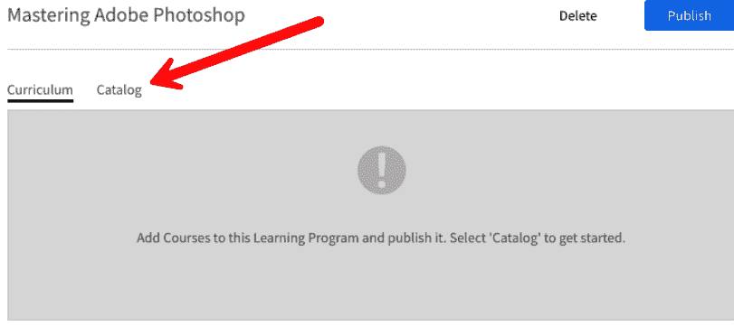

图 6.11 – Mastering Adobe Photoshop 学习计划的 Courses 页面

执行以下步骤向你的学习计划添加课程：

- 1. 切换到学习计划 **Courses** 页面的 **Catalog** 选项卡（参见前一屏幕截图中的箭头）。
- 2. 如有需要，使用屏幕右上角的 **Search** 字段和/或屏幕左上角可用的 **Skills** 和 **Sort By** 过滤器搜索所需课程。
- 3. 当你找到想要添加到学习计划的课程时，将鼠标悬停在课程卡的下部区域并点击 **Add** 链接。

对应要添加到学习计划的所有课程重复此操作。

在本示例中，添加 **Learn Photoshop: Fundamentals for Getting Started** 和 **Fundamentals of Photo Editing using Adobe Lightroom** 课程，两者都应可在随 Prime 试用账户提供的默认课程目录中找到。

- 4. 完成后，返回学习计划 **Courses** 页面的 **Curriculum** 选项卡。
- 5. 如有需要，你可以使用拖放操作重新排序课程。

你还可以使用位于 **Curriculum** 部分课程列表上方的下拉列表调整你的 **Completion Requirements**。默认情况下，**Completion Requirements** 设置为 **All** 课程。

- 6. 准备好后，点击页面右上角的 **Publish** 按钮。

在点击 **Publish** 按钮之前，你的学习计划处于 *draft* 状态。点击 **Publish** 按钮是创建新学习计划的操作。从现在起，该学习计划可在课程目录中使用并开放报名。

在下一节中，你将回顾维护学习计划可用的选项，包括修改、退役和删除 Prime 账户中可用的学习计划。

## 维护学习计划

维护学习计划与维护单个课程非常相似，是管理员和作者都可以完成的任务。让我们通过执行以下步骤快速查看可用选项：

- 1. 从管理员或作者主页，点击左侧边栏 **Learning** 部分中的 **Learning Programs** 链接。

这会带你进入 **Learning Programs** 页面，默认情况下显示所有 **Published** 学习计划的列表。

- 2. 将鼠标悬停在任何已发布学习计划卡的下部区域以显示可用选项。

大多数可用选项你应该很熟悉，因为它们与单个课程的选项相同，如以下屏幕截图所示。请注意，就像课程一样，你不能在不先退役的情况下删除学习计划：

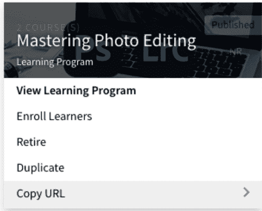

Figure 6.12 – 将鼠标悬停在学习计划卡片上时可用的选项

然而，学习计划特有的一项选项需要进一步讨论。它涉及学习计划实例和课程实例如何协同工作以创建灵活的学习计划。这是下一节的主题。

## 创建灵活的学习计划

如本章前面 Creating course instances 部分所述，学员报名参加的不是课程，而是课程实例。学习计划也是如此。您可以为学习计划定义实例，这在学习计划中包含的一个或多个课程包含同步模块时尤其有用。

在本节中，您将了解课程实例和学习计划实例如何协同工作，为学员提供顺畅的学习体验。总体工作流程如下：

- 创建多个具有多个实例的课程。
- 创建一个学习计划并向其中添加一些课程。
- 创建学习计划的实例并将学习计划实例映射到课程实例。
- 将学员注册到所需的学习计划实例。

这只是总体工作流程。还有一些有趣的细微差别和变化，您可以通过执行以下步骤来查看：

- 1. 在管理员或作者体验的默认 **学习计划** 页面上，将鼠标悬停在您在本章前面创建的学习计划卡片的下部区域。
- 2. 从可用选项列表中点击 **查看学习计划**。这将打开所选学习计划的 **概览** 页面。
- 3. 点击左侧边栏 **管理** 部分中位于的 **实例** 链接。

与课程一样，**Captivate Prime** 已为您的学习计划创建了 **默认实例**：

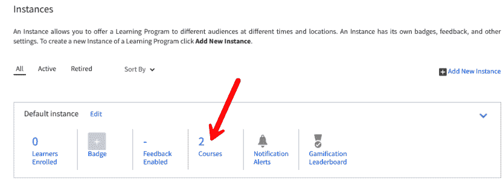

Figure 6.13 – Captivate Prime 已为您的学习计划创建了默认实例

在此示例中，由于学习计划中的课程仅包含自定进度模块，因此此默认实例可能已足以让您的学习计划提供预期的学习体验。但这并不总是如此，因此让我们检查一下可用选项。

- 4. 点击默认学习计划实例的 **课程** 属性（在前一张截图中用箭头标识），以打开学习计划中包含的 **课程列表** 部分。

从这里，您可以选择以下两种方式之一：

- 您可以使用每个课程旁边可用的下拉列表为学习计划中包含的每个课程选择特定的课程实例。使用此选项，注册到此学习计划实例的学员将被自动注册到每个课程所选的实例。换句话说，您可以将每个学习计划实例映射到所需的课程实例。
- 您还可以点击 **启用学员选择实例（灵活学习计划）** 按钮，这允许学员为学习计划中包含的每个课程选择他们希望参加的课程实例。在这种情况下，前一点提到的下拉列表将从屏幕上消失。

在此示例中，这些选项不相关，因为您在本章中创建的学习计划仅包含自定进度模块且未定义多个课程实例的课程。

阅读完本节后，您应该对学习计划以及 Captivate Prime 中创建和维护它们的不同选项有相当好的了解。因此，是时候进入下一节了，在那里您将学习有关认证的内容。

## 创建认证

**认证** 与我们在上一节讨论的学习计划类似，因为它们也允许您将学员注册到一系列课程而不是单一课程（尽管认证可能只包含一门课程）。但认证增加了一些额外内容：*完成天数* 选项以及创建具有自动学员重新注册功能的 *循环* 认证的可能性。

创建认证的过程与创建学习计划的过程非常相似，管理员和作者都可以完成此任务。让我们通过创建 *Certified Prime Learner* 认证来实际操作一下：

- 1. 从管理员或作者主页，点击左侧边栏 **学习** 部分中位于的 **认证** 链接。

这会带您进入 **认证** 页面，其中将显示已 **发布** 的认证列表（如果有）。默认情况下，新的 Prime 账户中不应定义任何认证。

- 2. 点击屏幕右上角的 **添加** 按钮。
- 3. 在 **认证名称** 字段中输入 `Certified Prime Learner`。
- 4. 在页面下方找到的 **完成天数** 字段中输入 `30`。这意味着注册此认证的学员有 30 天时间完成它。如果在此时间范围内未完成认证，学员将 *不会* 获得认证。

请注意，此时 **认证名称** 和 **完成天数** 字段是仅有的两个必填字段。

- 5. 作为最佳实践，请花必要的时间在相应字段中输入 **描述** 和 **认证概述**。

您还可以提供 **封面图片** 和 **横幅图片**，以使认证在课程目录中脱颖而出。

样本文件提供在本书相关下载的 `/certification` 文件夹中。

- 6. 向下滚动页面，直到看到 **类型** 字段。

在这里，您可以选择 **循环** 或 **永久** 认证。**循环** 认证在一定的 **有效期** 后到期，要求学员不断重新认证以维持其状态。另一方面，**永久** 认证一次性授予且永不过期。例如，您可以使用 **永久** 认证来认证人员在特定版本的软件应用程序上的资格。

- 7. 对于此示例，选择 **永久** 认证。

请注意，此操作会隐藏 **重新分配** 和 **有效期** 字段。

- 8. 稍下方，注意 **认证颁发者** 字段。

**认证颁发者** 字段的默认值是 **内部**。这意味着此认证完全由您的组织组织，仅在内部认可。**外部** 认证由第三方提供商组织，可能被各行各业的大量组织认可。选择 **外部** 时，**认证完成日期** 选项会出现。这允许您定义认证的完成情况如何报告给 Captivate Prime。这可以是经理或管理员的正式批准，也可以是学员在认证结束时的直接提交。

请注意，认证发布后 **认证颁发者** 不能更改。

- 9. 快速查看其他可用选项。它们在很大程度上应该是自解释的。
- 10. 准备就绪后，点击屏幕右上角的 **保存** 按钮。

这完成了创建认证的第一步。此操作以 *草稿* 状态创建新认证。页面重新加载后，您应该在左侧列中看到额外的链接，并被重定向到新认证的 **课程** 页面。

- 11. 确保您位于新认证的 **课程** 页面。如果没有，请点击左侧边栏 **管理** 部分中的 **课程** 链接。从这里，您将决定应包含在此认证中的课程。

- 12. 点击页面左上角的 **Catalog** 选项卡。
- 13. 搜索 **Learner Experience in Adobe Captivate Prime** 课程（这是创建 Prime 试用账户时自动添加到你的课程目录的课程之一）。
- 14. 找到后，将鼠标悬停在课程卡片的下方区域并点击 **Add** 链接。
你必须对想要添加到此认证的所有课程重复此过程。在本示例中，**Learning Experience in Adobe Captivate Prime** 课程是唯一需要的课程。
- 15. 返回屏幕左上角的 **Curriculum** 选项卡。
- 16. 确认所选课程是认证中唯一的课程，并花一些时间检查可用选项。注意课程列表上方位于的 **Completion Requirements** 下拉列表。
- 17. 准备就绪后，点击页面右上角的 **Publish** 按钮。

就像课程和学习计划一样，点击 **Publish** 按钮会使认证正式成为你课程目录的一部分。从现在开始，认证可在课程目录中使用并开放注册。

> **Note**
> 在发布 *内部* 认证之前，你必须提供至少一门课程。*外部* 认证可以在不提及任何课程的情况下发布。

维护认证的选项与用于维护学习计划和课程的选项大多相同，此处不再进一步讨论。

阅读这些章节后，你已经看到课程 *不是* 学习者可以注册的唯一内容：

- 首先，你发现了 *课程实例* 并且学习者注册的是课程实例，而非严格意义上的课程。
- 你还将多个课程分组为 *学习计划*。注册此类学习计划的学习者会同时注册该学习计划中的所有课程。
- 最后，你创建了一个认证。认证与学习计划类似，但增加了完成时限，以及创建可重复认证并自动重新注册学习者的能力。

现在你的课程目录中包含各种供学习者注册的学习对象，是时候进入下一节了，在那里你将开始 *实际* 将学习者注册到这些学习对象中。

## 学习者自助注册

由于 Captivate Prime 是一款以学习者为中心的 LMS，学习者自助注册被视为注册课程的首选方式。事实上，新的沉浸式学习者主页设计为类似 Netflix 的界面，人们可以在其中浏览目录并注册课程，类似于浏览 Netflix 庞大的目录以找到下一个想要观看的电影或系列。

> **Customizing the learner home page**
> 自定义学习者主页以及经典主页与沉浸式布局之间的差异已在 *第 2 章，Customize the Look and Feel of Captivate Prime.* 中讨论过。

在本节中，你将通过以 *Learner 03* 身份登录平台并亲身体验注册本章前面创建的其中一个课程实例，来回顾这种自助学习方法。

> **Logging in as Learner 03**
> 请记住，Learner 03 是你在 *第 5 章，Managing Users* 中定义的唯一 *外部* 学习者，因此该用户必须使用自定义登录页面登录你的 Captivate Prime 账户。此登录页面的 URL 可在你创建 *Learner 03* 用于注册到你的 Prime 账户的外部注册配置文件时发送给你的电子邮件消息中找到。如果不再有权访问此电子邮件消息，请浏览到管理员应用程序的 **External Users** 页面并将鼠标悬停在外部注册配置文件上。这将显示一个链条图标，以便你可以将链接复制到剪贴板。

让我们通过执行以下步骤来回顾 *Learner 03* 的默认注册体验：

- 1. 打开另一个浏览器或在你的网络浏览器中打开一个新的隐私窗口，并使用它以 *Learner 03* 身份登录你的 Prime 账户。
- 2. 根据分配给 *Learner 03* 的角色，你可能不会默认被重定向到学习者体验。在这种情况下，点击屏幕右上角的用户图标以切换到学习者体验。

- 3. 以学习者身份登录后，花一些时间检查学习者主页。注意屏幕右上角的 **Search** 字段以及 **My Learning List** 部分中的 **Go To Catalog** 链接。

- 4. 点击屏幕左上角的汉堡按钮（三条水平线的图标）以显示左侧边栏中可见图标的含义，如以下屏幕截图所示：

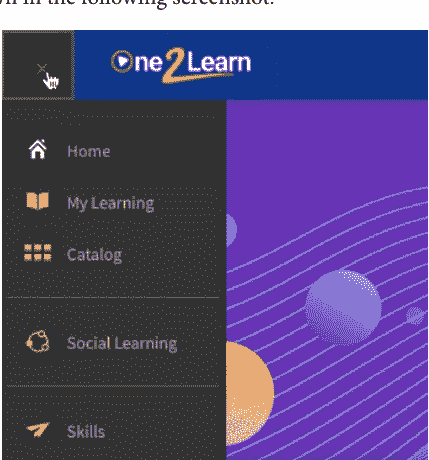

Figure 6.14 – 点击汉堡按钮会显示左侧边栏中可见图标的含义

- 5. 点击左侧边栏中的 **Catalog** 链接以打开学习者看到的课程目录。

默认情况下，所有可注册的活动学习对象都可见于课程目录中。这包括 *课程* 本身，但也包括 *学习计划* 和 *认证*。

- 6. 通过浏览课程目录，花一些时间检查学习者可用的选项。例如，注意页面右上角的 **Sort By** 下拉菜单以及左侧边栏中各种复选框。

- 7. 点击位于 **Sort By** 下拉菜单旁边的汉堡图标以切换到 **List View**。再次点击同一图标即可返回默认的 **Grid View**。

- 8. 将鼠标悬停在你在 *第 4 章，Creating Skills and Courses* 中创建的 **Fundamentals of Cybersecurity** 课程的下方区域。

这会显示课程的简要描述、该课程关联的技能以及 View Course 链接。

- 9. 点击 View Course 链接。
- 10. 由于该课程定义了多个实例，你将被带到可用实例列表。
- 11. 点击你想要注册的实例。此操作会带你进入课程详情页面。

花一些时间检查此页面上的所有信息。你应该能认出在第 4 章 Creating Skills and Courses 中创建课程时输入的信息，以及在本章前面创建课程实例时输入的班级信息。此外，注意右侧列中有关技能、可用席位、注册和完成截止日期、语言等的信息。这是课程的全面概述，旨在让学习者在决定是否注册课程之前获得所需的所有信息。

- 12. 点击课程页面右上角的 Enroll 按钮。这就是学习者自助注册课程的简单程度。
- 13. 返回学习者主页并确认 Fundamentals of cybersecurity 课程现在出现在 My Learning List 部分，如以下屏幕截图所示：

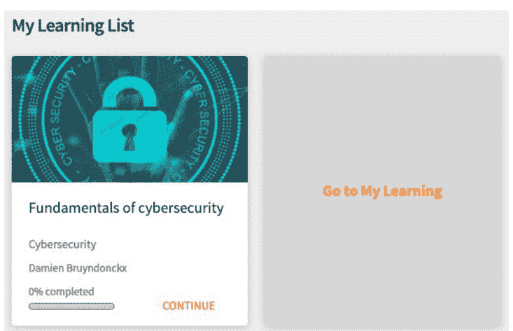

Figure 6.15 – 主页上的 Fundamentals of cybersecurity 课程

在本节中，你回顾了默认的学习者注册体验。请记住，这是 Captivate Prime 主要设计的目标体验，因为这种自助学习方法正是导致创建 Captivate Prime 的核心思想。

尽管如此，用户在 Captivate Prime 中学习课程还有其他方式。在下一节中，你将学习经理和管理员如何为学习者注册课程。

## 为用户注册课程

允许用户自助注册课程无疑是一个好主意，其前提是许多学习者会利用此机会 *实际* 学习课程并不断提升技能。

不幸的是，我们都知道，尽管一些用户喜欢自学和注册课程，但这一原则有时更像是乌托邦而非现实。此外，学习者选择注册的课程不可能自动匹配组织的需求。

这就是为什么管理员和经理也可以为学习者注册课程。这就是本节将回顾的内容。

### 管理员注册

第一个可以为学习者注册课程的角色是 *管理员* 角色。在本节中，你将以管理员身份登录并为你在 *第 4 章，Creating Skills and Courses* 中创建的课程注册 *Learner 01*。你将使用上一节中为 *Learner 03* 注册的同一课程实例。让我们开始吧：

- 1. 确保你以 Administrator 身份登录。
- 2. 从管理员主页，点击左侧边栏 **Learning** 部分中的 **Courses** 链接。
- 3. 将鼠标悬停在代表你在 *第 4 章，Creating Skills and Courses* 中创建的课程的课程卡片的底部区域。
- 4. 点击 **Enroll Learners** 选项以打开 **Enroll Learners** 对话框。
- 5. 使用 **Select Instance** 下拉菜单选择你想要为其注册用户的课程实例。

在本示例中，请确保选择你在上一节中为 Learner 03 报名时所使用的相同课程实例。

- 6. 在 **包含学员** 部分的 **搜索** 字段中开始输入 Learner 01。当目标学员出现在列表中时，点击将其添加到 **包含学员** 列表中。

对你想要在所选课程实例中报名的所有用户重复此操作。注意，你可以通过选择学员组而不是单个学员来简化此操作。用户组在 *第 5 章《管理用户》* 的 *使用用户组* 部分中进行了讨论。

## 使用包含和排除集合

使用学员组时，你可以创建被称为 **包含集合** 的集合。一个包含集合是组的列表。报名该课程的学员是那些属于包含集合中列出的 *全部* 组的学员。例如，包含 **所有管理员** 和 **所有经理** 组的包含集合会报名那些 *既是管理员又是* 经理的学员。仅是管理员或仅是经理的学员则 *不* 会被报名。同样，你可以使用 **排除集合** 从对话框的 **包含学员** 部分中定义的包含集合里排除单个学员或组。

- 7. 花点时间查看 **报名学员** 对话框中可用的其他选项。注意，你也可以使用学员的 **电子邮件 ID** 属性而不是他们的用户名。

- 8. 当 **报名学员** 对话框如下所示时，点击位于框体右下角的 **继续** 按钮：

### 报名学员

选择实例：

June Session - North America

用户

电子邮件 ID

### 包含学员

集合中的多个用户组只会添加这些组中共有的用户。

用户： Learner 01

1 名学员

搜索

新建包含集合

### 排除学员

在下方选择要从上述集合中排除的特定用户或用户组。

搜索

新建排除集合

取消

继续

图 6.16 – 准备就绪时点击继续按钮

9. 花点时间阅读摘要区域并确认其反映了你的意图。如有需要，点击高级选项链接以输入记录此次报名的附加评论。

10. 准备就绪后，点击报名按钮。

注意，你也可以使用此流程为学员报名学习项目和认证。

完成本节后，两个学员已报名你在 *第 4 章《创建技能和课程》* 中创建的课程的同一课程实例：

- *Learner 03* 在上一节中自行报名了该课程。
- 在本节中，你担任管理员角色为 *Learner 01* 报名。

在下一节中，你将了解经理如何为其团队成员报名课程。

## 由经理进行报名

可以为学员报名课程的另一个角色是 *经理* 角色。唯一的区别是，经理只能为团队成员报名课程，而管理员可以为 Prime 账户中注册的任何学员报名。

当你在 *第 5 章《管理用户》* 中创建用户时，你将 *Manager 01* 定义为 *Learner 01* 和 *Learner 02* 的经理。现在你将以 *Manager 01* 的身份登录你的 Prime 账户，并按照为 *Learner 01* 和 *Learner 03* 报名时在前两节中使用的相同课程实例，为 *Learner 02* 报名。执行以下步骤以实现此操作：

- 1. 打开一个新的浏览器或另一个隐私浏览器窗口，并使用它以 *Manager 01* 的身份登录你的 Prime 账户。
- 2. 默认情况下，*Manager 01* 以普通学员身份登录，因此你必须点击屏幕右上角的用户图标以切换到 **经理** 角色。

这是你首次访问经理主页，因此花时间检查页面各个组件以及左侧列中可用的链接。

- 3. 准备就绪后，点击左侧边栏 **学习** 部分中的 **课程** 链接。
- 4. 在可用课程列表中，找到你在 *第 4 章《创建技能和课程》* 中创建的课程。
- 5. 将鼠标悬停在课程卡片的下部区域并选择 **报名学员** 选项。这会打开与管理员相同的 **报名学员** 对话框。
- 6. 使用 **选择实例** 下拉菜单选择与前两节相同的课程实例。

- 7. 在 **包含学员** 部分的 **搜索** 字段中开始输入 `Learner 02`。当目标学员出现在列表中时，点击将其添加到 **包含学员** 列表中。

注意，只有 *Manager 01* 团队中的学员才会出现在列表中。这是经理报名用户与管理员报名用户之间的唯一区别。

- 8. 点击 **报名学员** 对话框左下角的 **继续** 按钮。
- 9. 确认 **摘要** 反映了你的意图并点击 **报名** 按钮。

这会带你进入所选课程的 **学员** 页面。从这里，你可以看到每个课程实例中已报名的学员列表。

- 10. 使用 **选择实例** 下拉菜单选择你为其报名学员的实例。
- 11. 展开 **个人** 和 **自行报名** 部分以显示每个类别的学员。

如以下屏幕截图所示，在所选实例的 **个人** 部分中只有 **Learner 01** 可见，即使 *Learner 02* 和 *Learner 03* 也报名了同一课程实例：

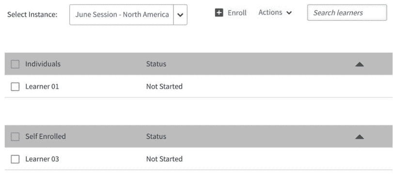

图 6.17 – 只有 Learner 01 出现在已报名学员列表中

不用担心！这种情况完全正常，可以通过以下几点轻松解释：

- 由于你当前以经理身份登录，你只能看到团队成员的数据。这就解释了为什么 *Learner 03* 没有出现在列表中：该学员不是你的团队成员。
- 至于 *Learner 02*，请记住，在创建课程实例时，你指定了 **座位限制** 为两个。随着 *Learner 01* 和 *Learner 03* 的报名，座位限制已达到，课程实例目前已满！

因此，*Learner 02* 已被添加到候补名单中。不幸的是，作为经理，你无法访问候补名单。只有管理员和讲师可以访问。你将在本章稍后的 *查看已报名学员* 部分中了解此内容。

但现在，让我们了解一下另一个工作流程，即学员需要经理批准才能报名课程。

## 经理批准

回到本章早些时候的 *审查影响报名的课程选项* 部分，你检查了课程的 **报名类型** 选项，并发现其中一个可用选项是 **经理批准**。

使用此选项，学员无法自行报名课程。相反，他们会向经理发送批准请求，经理必须批准或拒绝报名请求。虽然你在这些示例中使用的课程并未使用此工作流程，但让我们利用你当前以 *Manager 01* 身份登录的事实，快速了解一下经理如何批准或拒绝此类报名请求：

- 1. 从经理主页，点击左侧边栏 **查看** 部分中的 **通知** 链接。

这会带你进入 **通知** 页面，其中默认显示所有最近的通知。这包括团队成员发送的待处理报名请求。

- 2. 点击 **通知** 页面左上角的 **待处理任务** 选项卡。

如以下屏幕截图所示，屏幕上会出现所有可能的通知类型列表。目前，*Manager 01* 没有待处理任务，但请注意 **批准学员** 和 **认证批准** 任务：

所有通知   待处理任务

## 批准学习者

无此类通知。

## 提名学习者

无此类通知。

## 提供反馈

无此类通知。

## 认证审批

无此类通知。

Figure 6.18 – 管理员的可能任务

**批准学习者** 任务是经理批准或拒绝其团队成员报名请求的地方。

**认证审批** 任务与该经理团队成员参加的外部认证相关。由于外部认证在 Captivate Prime LMS 之外进行，需要经理（或直接由学习者）正式批准。这在本书本章早些时候的 *创建认证* 部分中进行了讨论。

在下一节中，您将发现 Captivate Prime 允许您将用户注册到课程的又一种方式。

## 使用学习计划进行自动注册

**学习计划** 是注册用户的又一种方式。其特别之处在于，一旦定义了学习计划，学习者的注册就会自动进行，无需管理员或经理再采取任何操作。

您可以使用学习计划自动将学习者注册到 *课程*、*学习项目* 和 *认证* 中。学习者的自动注册由在创建学习计划时选择的事件触发。学习计划在许多情况下非常有用，包括以下情况：

- 您希望自动将新学习者注册到入职课程中。
- 您希望在学习者加入或离开某个群组时自动将其注册到课程中。例如，当某人成为经理（即当他/她加入自生成的 **所有经理** 群组时），该人将被自动注册到 *管理最佳实践* 课程。您可以使用相同的技术在学习者更改职位、调到新部门等时自动注册学习者。
- 您希望确保用户只有在完成先前课程后才会被注册到特定课程中。这是确保先决条件得到满足的方式之一。
- 您希望在特定日期自动将学习者注册到课程中。例如，在新产品发布后、组织收购正式完成之后或新分支机构开设时，您需要对人员进行培训。

这些只是学习计划非常有用的一些情况。在本节中，您将使用学习计划自动将每个新学习者注册到您在本章早些时候 *创建认证* 部分中创建的 **Certified Prime Learner** 认证中。

请记住，认证有完成时限。在此示例中，您已给予学习者 30 天时间完成此特定认证。加入培训计划可以确保每个新学习者在注册后 30 天内完成有关如何使用 Captivate Prime 的基础课程。其目的是最大化学习者对平台的使用并为他们提供最具吸引力的学习体验。

现在，让我们通过执行以下步骤创建学习计划：

- 1. 确保您以管理员身份登录。
- 2. 从管理员主页，单击左侧边栏 **学习** 部分中位于的 **学习计划** 链接。这会带您进入 **学习计划** 页面，其中显示所有可用学习计划的列表（如有）。
- 3. 单击页面右上角的 **添加** 按钮开始创建新的学习计划。
- 4. 在 **学习计划名称** 字段中输入 `New Learner Prime Certification`。
- 5. 打开 **发生时** 下拉菜单并查看可用事件的列表。

请注意，可用选项的列表取决于所选事件。花点时间查看所有可用事件及其相关选项。

- 6. 准备就绪后，选择 **添加了新学习者** 事件。
- 7. 在 **培训** 字段中开始输入 `Certified Prime Learner`。当认证名称出现在列表中时，单击其名称。
- 8. 当页面如下所示时，单击页面右上角的 **保存** 按钮。

此操作将关闭 **添加学习计划** 页面并带您返回 **学习计划** 页面：

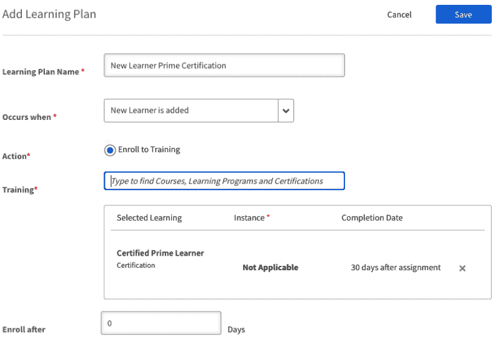

Figure 6.19 – 创建新的学习计划

- 9. 最后一步是启用新的学习计划。
- 返回 **学习计划** 页面，使用复选框选择您刚刚创建的学习计划。
- 10. 单击屏幕右上角的 **操作** 按钮。
- 11. 在打开的菜单中选择 **启用** 选项。

从现在开始，每个添加到平台的新用户都会自动注册到 *Certified Prime User* 认证，并有 30 天时间完成 *Learner Experience in Adobe Captivate Prime* 课程。

这为注册学习者提供了许多选项。因此，在下一节中，您将查看 Captivate Prime 的工具，这些工具允许您检查已注册学习者的列表。

## 查看已注册学习者

在本章早些时候的 *由经理进行的注册* 部分中，您看到了经理如何访问已注册课程的学习者列表。但经理只能查看其团队成员的数据。此外，他们无法访问等待列表。只有管理员和讲师才能全面了解特定课程中所有已注册学习者的情况。

在本节中，您将从管理员的角度查看已注册学习者的列表。讲师角色将在 *第 8 章，探索讲师角色* 中更详细地介绍。

执行以下步骤以以管理员身份登录并查看您在 *第 4 章，创建技能和课程* 中创建的自定义课程中已注册的学习者列表：

- 1. 确保您以管理员身份登录。
- 2. 从管理员主页，单击左侧边栏 **学习** 部分中位于的 **课程** 链接。
- 3. 在 **已发布** 课程列表中找到您之前创建的自定义课程。
- 4. 将鼠标悬停在课程卡片的下部区域并单击 **查看课程** 选项。
- 5. 单击左侧边栏 **管理** 部分中位于的 **学习者** 链接。
- 6. 使用 **选择实例** 下拉菜单选择您在本章中注册学习者的实例。
- 7. 展开 **个人** 和 **自行注册** 部分以显示已注册课程的学习者列表。

这使您能够访问所选实例当前已注册学习者的列表。这与 *经理 01* 可访问的列表相同，只是 *学习者 03* 在 **自行注册** 类别中可见。

- 8. 花点时间检查可用工具。

请注意列表右上角的 **搜索学习者** 字段、紧邻其后的 **操作** 链接以及 **注册** 链接，后者允许您将更多学习者注册到所选课程实例中。

以下屏幕截图显示了这些工具：

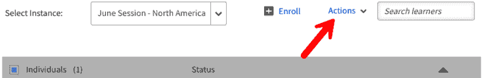

Figure 6.20 – 管理员管理已注册课程学习者可用的工具

- 9. 使用复选框选择列表中的任何学习者。
- 10. 单击前一屏幕截图中箭头标识的 **操作** 链接。
- 11. 花点时间检查可用操作，确保不要单击任何操作。

这为您提供了管理员管理已注册课程学习者可用操作的概览。请注意，完全相同的操作也适用于经理，但仅限于其团队成员。

还有一种情况需要检查。请记住，在本章早些时候的 *由经理进行的注册* 部分中，*经理 01* 已将 *学习者 02* 注册到课程中，但不幸的是，所选课程实例已满，*学习者 02* 已被添加到等待列表。是时候检查一下了！

- 12. 如以下屏幕截图所示，单击左侧边栏 **管理** 部分中位于的 **等待列表** 链接：

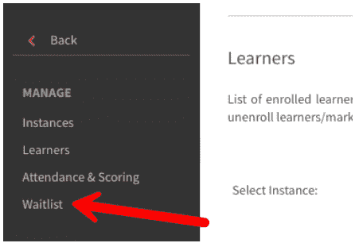

Figure 6.21 – 左侧边栏中的等待列表链接

-   13. 使用 **Select Instance** 下拉菜单选择本章中您已为学习者注册的实例。

-   而且.... 这里是 *Learner 02*！

-   14. 使用复选框从列表中选择 *Learner 02*。

请注意屏幕右上角出现的 **Allocate Seats** 按钮。这允许管理员覆盖课程实例的 **Seat Limit** 属性并仍然注册学习者（请确保在此示例中*不要*点击此按钮）。

此外，请注意 **Actions** 按钮，它允许您取消注册所选用户。

有了这些工具，管理员和经理就可以管理已注册到特定课程实例的用户列表，并处理等待名单上的学习者。

## 摘要

现在您已完成本章，学习者终于可以注册课程了，您的 Prime 账户也开始活跃起来。

在本章中，您对“学习者注册课程”这一普遍信念给予了致命一击，而在 Captivate Prime 中这种情况从未发生。学习者注册的是 *course instances*、*learning programs* 和 *certifications*，而不是课程本身。

您已创建课程实例来应对许多课程中包含的同步活动的时效性，将课程分组为学习计划，并创建了学习者在注册后 30 天内必须获得的内部认证。

在课程目录中提供这些学习对象后，您已回顾了许多允许用户自行注册的工作流程。在 Captivate Prime 中，学习者自助注册是最终参加课程的首选方式，但管理员和经理也可以在学习者未请求的情况下为其注册课程。平台本身也可以在学习计划中定义的触发事件发生时自动注册学习者。

学习奇迹终于发生的条件已经具备。在下一章中，您将扮演学习者角色，体验 Captivate Prime 提供的独特学习体验。
