## 7 审阅学习者体验

在本章中，学习终于将在您的 Prime 账户上进行。请记住，这是 Captivate Prime 的主要目的，也是贵组织首先实施 LMS 的主要原因。对于您作为 Prime 管理员来说，这也是您在前几章中所做工作的回报。

作为以学习者为中心的 LMS，Captivate Prime 特别注重为平台上参加课程的任何人提供卓越的学习体验。事实上，学习者体验是 Adobe Captivate Prime 的标志性功能之一。它围绕一个名为 fluidic player 的关键组件展开。fluidic player 是实际向学习者提供学习内容的组件。它旨在支持多种内容类型，包括视频、PDF 和 Word 文档、PowerPoint 演示文稿，当然还有 AICC、SCORM 或 xAPI 格式的交互式学习内容。

学习者还可以下载适用于 iOS 和 Android 的 Adobe Captivate Prime 移动应用，以便使用移动设备参加课程。移动应用的关键功能之一是可以下载课程内容并离线查看。课程跟踪数据将在移动设备下次连接到互联网时上传到服务器。

这些就是本章您将探索的功能。为此，您将以学习者身份登录您的 Prime 账户并参加您在 *Chapter 4, Creating Skills and Courses* 中创建的课程。您还将使用移动应用在线和离线参加课程。到本章结束时，您将使用计算机和移动设备回顾基本学习者体验。

为实现此目标，本章包含以下部分：

-   Touring the default learner experience
-   Discovering the fluidic player
-   Using the Captivate Prime mobile app

在阅读本章时，请记住，这里讨论的功能是大多数 Captivate Prime 用户使用的功能。这就是您作为 Prime 管理员或作者的努力所针对的体验，也是组织旨在向其员工、合作伙伴、客户等提供的体验。

同时请记住，您正在一个只有少数用户和少数课程可用的试用 Prime 账户上工作。本章讨论的一些功能需要更多用户产生更多操作才能真正发挥作用。如果您有访问权限，请随时在历史记录更丰富的旧 Prime 账户上尝试这些功能。

## 技术要求

为了执行本章所述的练习，您需要满足以下要求：

-   您必须能够使用至少两个不同的学习者配置文件访问您的 Prime 账户。
-   这两个学习者必须都注册了同一门课程。
-   课程必须包含至少一个现场或虚拟课堂活动、一个文件提交活动和一个核对清单活动。这些活动都应由同一位讲师授课。
-   您应拥有安装了 Adobe Captivate Prime 应用的移动设备（平板电脑或智能手机）。该应用可在 iOS 上从 Apple App Store 获取，在 Android 上从 Google Play Store 获取。

如果您已完成前几章的练习，您就可以开始了！如果没有，您可以使用自己的课程内容和用户完成本章练习。但是说明基于前几章的练习，因此请随意根据个人情况进行调整。

## 浏览默认学习者体验

学习者体验可能是 Captivate Prime 中制作最精细的区域。原因在于只有少数用户会访问 Prime 账户的某个管理区域，而大多数访问账户的用户都是学习者。因此，在添加新功能时，Prime 团队总是会根据其如何增强学习者体验来评估它们。这只是将学习者置于平台核心的另一种方式。

在本节中，您将以 Learner 01 身份登录您的 Prime 账户。这是您在 Chapter 5, Managing Users 中创建的内部学习者之一。在上一章中，当您以管理员身份登录时，您已将此学习者注册到您在 Chapter 4, Creating Skills and Courses 中创建的课程。

使用以下步骤以 Learner 01 身份登录并浏览默认学习者体验：

-   1. 以 Learner 01 身份登录您的 Prime 账户。由于您未为此用户分配特定角色，您应自动重定向到学习者体验。

-   2. 点击屏幕右上角的通知图标。如以下屏幕截图所示，您应该会看到一条通知，告知您管理员已将您注册到一门课程：

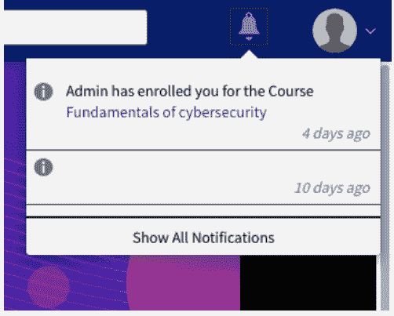

Figure 7.1 – An admin has enrolled you in a course

3. 使用鼠标减小浏览器窗口的宽度。在此过程中，注意学习者主页如何适应新的尺寸。如 *Chapter 2, Customize the Look and Feel of Captivate Prime* 中所述，默认学习者主页是 *responsive*。

> **响应式设计**
> *Responsive design* 是在整个网络行业中使用的设计和开发技术，用于创建可适应任何屏幕尺寸的页面，使网站几乎可以在任何设备上访问。有关 **responsive web design (RWD)** 的更多信息，请参阅 https://en.wikipedia.org/wiki/Responsive_web_design 上的维基百科页面。

现在您已作为学习者连接，您将在下一节更详细地回顾学习者主页。

## 回顾学习者主页

您已在 *Chapter 2, Customize the Look and Feel of Captivate Prime* 中从管理员角度回顾了与学习者主页相关的选项。请记住，主页有两种布局可用：*classic* 布局和 *immersive* 布局。immersive 布局是在 2020 年 12 月更新中引入的，是新 Captivate Prime 账户使用的默认布局。旧账户（2020 年 12 月之前）默认使用 classic 布局。这些账户可能仍在使用旧的 classic 布局，因为从 classic 切换到 immersive 必须由管理员手动完成。

这些选项可在管理应用程序的 **Branding/Learner Homepage** 页面中使用。

> **注意**
> 本章提供的屏幕截图和说明假定使用新的默认 immersive 体验。

现在是时候更详细地回顾学习者主页的各个部分了：

-   在最顶部，**masthead** 横跨整个页面。masthead 是学习者的欢迎横幅。它目前应邀请您 **Learn something new today**。该区域显示各种消息和推荐。您将在 *Chapter 15, Working with Messages and Announcements* 中学习如何配置消息以在 masthead 中显示。

- 在 masthead 下方，您会找到 **我的学习列表** 部分。这里显示您当前正在学习的课程。主页的这一部分只是 **我的学习** 页面的摘要，您将在本章后面回顾该页面。
- 在 **我的学习列表** 部分下方，您会找到包含各种项目的行。**LEVELS** 项目与 Captivate Prime 的 **游戏化** 功能相关。您将在 *第11章，徽章与游戏化。* 中了解更多关于游戏化的内容。
- 下一个项目是一个日历，用于显示当天的活动。如果您选择已报名参加的计划直播课程的日期，您将在日历中看到该课程活动，并附有直接访问的链接。以下屏幕截图对此进行了说明：

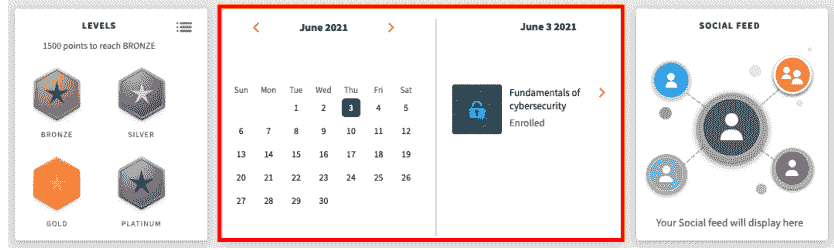

Figure 7.2 – 默认学习者主页上的日历部分

- **社交动态** 项目与 Adobe Captivate Prime 的 **社交学习** 功能相关。您将在 *第12章，启用和管理社交学习。* 中回顾这些功能。
- 向下滚动页面，您会找到 **基于您的兴趣领域推荐** 部分。这一部分基于 Captivate Prime 中定义的 **技能**。在 *第4章，创建技能和课程* 中，您学习了如何创建技能以及如何将它们与课程关联。您的 *兴趣领域* 基于这些技能。它可以是您已报名（或曾报名）课程所涵盖的技能、管理员分配给您的技能，或您可以使用学习者体验中的 **技能** 页面自行选择的技能，您将在本章后面回顾该页面。
- 最后，在页面底部，最后一个部分称为 **基于同伴活动的推荐**。这里就是 Captivate Prime 人工智能发挥作用的地方！该部分因用户而异，并取决于您将在 *第13章，面向学习者的 AI 驱动推荐。* 中更详细检查的各种因素。

正如您所见，学习者主页的设计考虑了三个主要目标。首先，它允许您一目了然地访问重要信息；其次，它提供高度个性化的推荐；第三，它提供快速访问学习者体验其他区域的功能。

如 *第2章，自定义 Captivate Prime 的外观和风格* 中所述，请记住作为管理员，您可以向学习者主页添加和删除部分，并在一定程度上重新排列这些部分。

您现在将逐一回顾学习者体验的每个页面，从下一节的 **我的学习** 页面开始。

## 探索我的学习页面

**我的学习** 页面列出了学习者所报名的所有课程、学习项目和认证。从此页面，学习者可以完整了解其正在学习或已学习的全部学习资源。

使用以下步骤访问 **我的学习** 页面：

- 1. 单击屏幕左上角的汉堡菜单图标（带有三条水平线的图标）。此操作会显示左侧边栏中每个图标关联的标签。
- 2. 花点时间阅读这些标签并记住每个图标的含义。
- 3. 要访问 **我的学习** 页面，您可以使用顶部第二个图标。如果您在学习者主页上，也可以单击主页 **我的学习列表** 部分中的 **转到我的学习** 链接。

进入 **我的学习** 页面后，您应该会看到 *Learner 01* 所报名参加的所有课程、学习项目和认证的列表。此学习者访问的 **工作辅助工具**（如果有）也在这里显示。请注意屏幕右上角的 **排序方式** 下拉菜单，以及左侧列中用于过滤页面上显示的学习内容列表的复选框。

Figure 7.3 – 学习者体验的我的学习页面

请注意，默认情况下，此页面上显示的课程按截止日期排序。这使学习者能够立即关注截止日期最近的课程。另请注意左侧列末尾的状态复选框（未在前面的屏幕截图中显示）。这些允许学习者过滤列表，以便仅查看已完成的课程、进行中的课程或尚未开始的课程。

我的学习页面是一个很棒的工具，尤其是对于拥有大量过去、现在和未来学习活动需要展示的长期学习者而言。在下一节中，您将简要回顾学习体验的目录页面。

## 探索目录页面

目录页面的主要目的是允许学习者自行报名课程。事实上，正如第6章，Enrolling Users to Courses 中已讨论的那样，学习者注册课程的主要方式是通过自助注册。

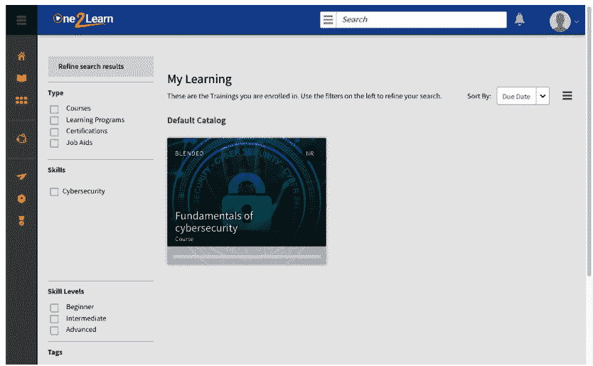

要访问目录页面，请使用以下两种方法之一：

- 您可以单击目录图标，它是左侧边栏中从顶部数起的第三个图标。
- 如果您在学习者主页上，也可以使用位于基于您的兴趣领域推荐部分中的 Go To Catalog 链接。

初看之下，目录页面看起来与上一节讨论的我的学习页面非常相似。事实上，目录页面上可用的工具大多与我的学习页面上可用的工具相同：

- 左侧有复选框，可让您过滤可见学习对象的列表。
- 在列表右上角，排序方式下拉菜单可让您对页面上可见的项目进行排序。请注意，默认情况下，排序顺序设置为最近发布，这会将目录的最新添加项显示在列表顶部。

我的学习页面与目录页面的主要区别在于，目录页面列出了目录中所有可用的课程、学习项目、认证和工作辅助工具，而我的学习页面仅列出学习者已报名的学习对象。另一种解释方法是说，我的学习是必须参加的培训列表，因为学习者已报名参加该页面上列出的培训，而目录页面是可选择的培训列表，因为它提供自助注册菜单。

从目录页面，学习者可以获取其有权访问的学习对象的相关信息。他们还可以根据课程的注册选项报名参加课程或向其经理发送审批请求。

### 使用多个目录
您目前在 Prime 账户中只有一个目录。因此，所有学习对象都在同一个目录中，所有学习者都可以访问。
在第14章，Working with Catalogs and Peer Accounts 中，您将学习如何创建其他目录、如何将学习对象放置在其中，以及如何定义哪些学习者有权访问特定目录。这将使您能够控制每个学习者有权访问的学习对象。

使用目录自助注册课程已在第6章，Enrolling Users to Courses 中讨论过，因此您将在下一节继续回顾学习者体验的社交学习页面。

## 回顾社交学习页面

学习体验的下一个页面是 **社交学习** 页面。要访问此页面，必须单击左侧边栏中从顶部数起的第四个图标，即 **社交学习** 图标。

此页面是学习者可以以类似于社交网络的方式非正式地与同伴互动的地方。Captivate Prime 的社交学习功能将在 *第12章，启用和管理社交学习。* 中讨论。请注意，管理员可以决定完全关闭 Captivate Prime 的社交学习功能。在这种情况下，**社交学习** 图标不会出现在左侧边栏中，学习者也无法访问该页面。

## 回顾技能页面

继续浏览左侧边栏中的图标列表，下一个图标会带您进入 **技能** 页面。如以下屏幕截图所示，**技能** 页面（也称为 **我的兴趣领域** 页面）列出了您所报名课程相关的技能：

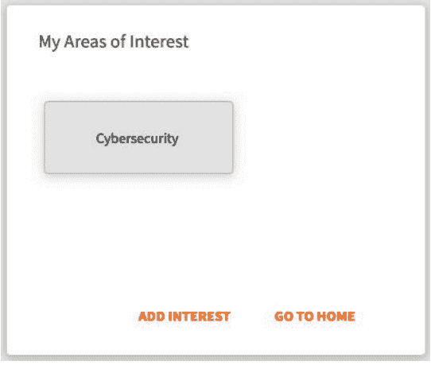

Figure 7.4 – 技能页面，也称为我的兴趣领域页面

在前面的屏幕截图中，**网络安全** 技能是为 *学习者 01* 列出的唯一一项。这是因为 *学习者 01* 已注册 *网络安全基础* 课程，该课程与此技能相关。每位学习者都可以使用以下步骤将自己的兴趣领域添加到列表中：

- 1. 点击 **添加兴趣** 链接。这将打开 **添加到我的兴趣领域** 页面，其中列出了您 Prime 账户中所有可用的技能。您也可以从学习者主页访问此页面，使用位于 **基于您的兴趣领域推荐** 标题旁边的 **查看/更新** 链接。
- 2. 点击几项技能将其添加到选择中。您也可以点击已选择的技能将其从选择中移除。
- 3. 准备好后，点击 **添加** 按钮返回到上一页。

返回到 **我的兴趣领域** 页面，您现在应该在列表中看到更多技能。请记住，这会影响 Captivate Prime 在学习者主页上推荐的课程，因此下次以 *学习者 01* 身份登录时，您应该在主页的 **基于您的兴趣领域推荐** 部分看到额外的课程。

还请记住，管理员可以分配技能给学习者，如 *第 4 章，创建技能和课程* 中所述。以这种方式分配给学习者的技能也会出现在 **我的兴趣领域** 页面上。

## 要求用户手动挑选兴趣领域

由于技能管理和主页个性化是 Captivate Prime 中如此重要的概念，管理员可以要求学习者在首次登录 Prime 账户时手动挑选他们的兴趣领域。让我们使用以下步骤回顾此功能：

- 1. 点击屏幕右上角的用户图标，然后点击 **退出登录** 按钮以 *学习者 01* 身份退出登录。
- 2. 接下来，点击 **登录** 按钮并以管理员身份重新登录。
- 3. 从管理员主页，点击左侧边栏 **配置** 部分中位于的 **品牌** 链接。这会带您进入管理员账户的 **品牌** 页面。
- 4. 向下滚动页面，直到看到以下屏幕截图中显示的部分：

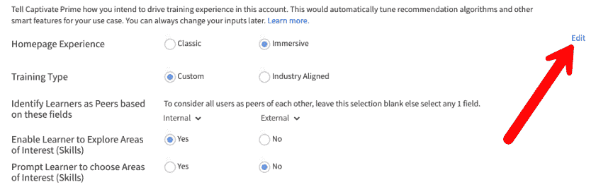

图 7.5 – 管理员账户品牌页面的底部部分

在前面的屏幕截图中，请注意 启用学习者探索兴趣领域（技能） 选项，目前设置为 是。将此选项设置为 否 将从学习者体验的左侧边栏中移除技能图标，并使相应页面对学习者不可用。在这种情况下，重要的是要理解这些技能仍然存在，并且仍会被考虑用于填充学习者体验的其他区域（如 基于您的兴趣领域推荐 部分）。隐藏此页面只是移除了学习者自行修改其技能列表的能力。

就在下方， 提示学习者选择兴趣领域（技能） 选项目前设置为 否。让我们使用以下步骤更改它：

- 5. 点击前一屏幕截图中箭头标识的 编辑 链接。
- 6. 将 提示学习者选择兴趣领域（技能） 选项切换为 是。
- 7. 点击页面右下角出现的 保存 按钮。

您现在将退出管理员账户并以学习者身份重新登录以查看此特定选项的效果。由于 学习者 01 已选择其兴趣领域，您将以 学习者 02 身份登录以测试此功能：

- 8. 点击页面右上角的用户图标，然后点击 退出登录 链接以退出您的管理员账户。
- 9. 接下来，点击 登录 按钮并以 学习者 02 身份登录。

如以下屏幕截图所示，只要 学习者 02 登录（并且前提是该学习者尚未选择其兴趣领域），系统就会自动将学习者重定向到可选择其感兴趣技能的页面：

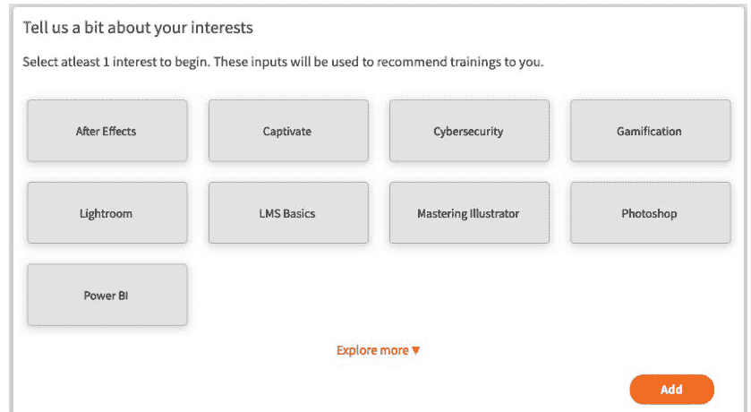

图 7.6 – 系统提示用户其兴趣领域

Captivate Prime 会在学习者做出选择之前，在每次登录时都将用户重定向到此页面。

- 10. 选择 学习者 02 感兴趣的技能并点击 添加 按钮。
- 11. 以 学习者 02 身份登录时，向下滚动主页直到看到 基于您的兴趣领域推荐 部分。

确认此部分显示的课程与 学习者 01 登录时不同。这是因为这两位学习者具有不同的兴趣领域（技能）。

在本节中，您已回顾了学习者体验的技能页面。您已了解学习者如何选择感兴趣的技能，以及这如何影响 Captivate Prime 在主页上推荐的课程。作为管理员，您还激活了一个选项，该选项提示学习者在首次登录 Prime 时选择其兴趣领域。

您可以在下一节中继续以 学习者 02 身份连接，在该节中您将回顾学习者体验的徽章页面。

## 回顾徽章页面

左侧边栏中下一个可用的图标是 **徽章** 图标，它会带您进入 **徽章** 页面。

通过完成课程、学习计划、认证等，学习者可以获得 **徽章**。**徽章** 页面显示已登录学习者获得的所有徽章。从这里，学习者可以以 PDF 和/或图像格式下载其徽章。请注意，目前 *学习者 02* 不应有任何徽章显示。

Captivate Prime 2021 年 8 月的更新引入了学习者将 Captivate Prime 与其 Badgr 账户连接的能力。在这种情况下，**徽章** 页面上会出现一个额外的图标，允许用户将他们在 Captivate Prime 上获得的徽章上传到其 Badgr 账户。请注意，此新选项默认情况下处于禁用状态。管理员可以使用位于管理员应用程序 **设置 | 通用** 页面上的新的 **Badgr 集成** 选项启用此功能。

**Badgr**
Badgr 是一项开放的在线服务，实现了开放徽章标准。其理念是允许学习者集中存储他们在各种兼容学习平台（包括 Captivate Prime）上获得的所有数字徽章，并将其分享到社交网络和其他兼容平台。您可以在 https://badgr.org/ 找到有关 Badgr 的更多信息，以及在 https://en.wikipedia.org/wiki/Digital_badge 找到有关数字徽章的一般信息。

徽章将在 *第 11 章，徽章和游戏化* 中进一步讨论。

## 回顾排行榜页面

左侧边栏的最后一个图标会带您进入 **排行榜** 页面。请注意，此页面也可以通过点击学习者主页上的 **等级** 卡片访问。

此页面与 Adobe Captivate Prime 的 **游戏化** 功能相关，这将在 *第 11 章，徽章和游戏化* 中更详细地讨论。请注意，管理员可以决定在 Prime 账户中完全禁用游戏化。在这种情况下，**排行榜** 图标 *不* 会出现在左侧边栏中，相应页面对学习者不可用。

在前几节中，您逐一浏览了学习者体验的所有页面。以下是总结：

- 学习者主页既作为个人摘要，也作为个性化推荐区域。
- **我的学习** 页面是学习者可以访问其与平台托管的学习资源交互的完整概览的地方。
- **目录** 页面是学习者体验中非常重要的一部分。在这里，学习者可以浏览可用的学习资源并注册课程（或向其经理发送注册请求）。
- **技能** 页面允许学习者添加或删除自己的兴趣领域。这些会影响主页上显示的个性化推荐。
- 用户还可以查看其徽章，与同行参与社交学习互动，并使用排行榜查看自己与同事的比较情况。

希望这能让您更好地了解学习者可用的功能以及相应的管理选项。

在下一节中，您将通过实际学习一门课程更深入地了解学习者体验。

## 学习课程

现在您对默认学习者体验的工作方式有了更好的了解，是时候通过使用 Captivate Prime 实际学习一门课程来体现学习者角色了。为此，您将以 *学习者 01* 身份登录您的 Prime 账户，并使用以下步骤开始学习您在 *第 4 章，创建技能和课程* 中创建的 *网络安全基础* 课程：

- 1. 以 *学习者 01* 身份登录您的 Prime 账户。
- 2. 登录后，点击主页 **我的学习列表** 部分中与 *网络安全基础* 课程关联的 **继续** 链接。

此操作将 *学习者 01* 带到流体播放器，这是实际向学习者提供课程的组件。执行此操作时，屏幕上会出现一条要求您 **请先完成先决条件培训** 的消息。这是因为您在 *第 4 章，创建技能和课程* 中创建此课程时选择了 **强制执行先决条件** 复选框。问题是：*学习者 01* 如何知道在开始 *网络安全基础* 课程之前应参加哪些先决条件课程？您将使用以下步骤找出答案：

- 3. 点击 **退出** 按钮清除消息并返回学习者主页。
- 4. 返回主页后，点击 **网络安全基础** 课程卡片（但 *不* 点击右下角的 **继续** 链接）以打开课程概览页面。

如以下屏幕截图所示，**Adobe Captivate Prime 学习者体验** 课程已被定义为 *网络安全基础* 课程的先修课程：

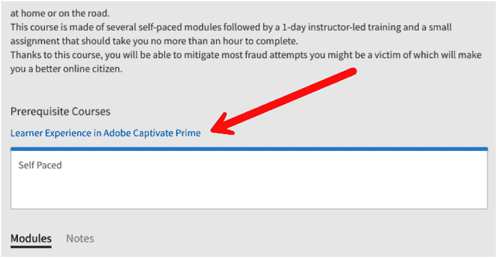

图 7.7 – 课程概览页面的先修课程部分

希望这是一个自定进度的课程，*Learner 01* 可以立即使用以下步骤开始：

- 5. 点击前一屏幕截图中箭头标识的 **Adobe Captivate Prime 学习者体验** 链接。
- 6. 点击课程概览页面右侧列顶部位置的 **注册** 按钮。此操作将 *Learner 01* 注册到 **Adobe Captivate Prime 学习者体验** 课程中。

由于这是一个自定进度课程，流体播放器会打开并且课程立即开始。该课程非常简短，仅包含一个视频。

> **注意**
> 在撰写本文时，该课程中包含的视频仍展示旧的 *经典* 学习者主页，与本章前面介绍的 *沉浸式* 体验略有不同。

- 7. 观看视频至结束。完成后，点击流体播放器右上角的关闭图标。此操作会带您返回课程概览页面。

如以下屏幕截图所示，您应该在横跨页面顶部的横幅中看到 **进度** 为 100%。这意味着 *Learner 01* 已完成本课程。还请注意页面 **核心内容** 部分中视频名称旁边的绿色复选标记。最后，**注册** 按钮已被 **重新访问** 按钮替换，*Learner 01* 如有必要可以使用它再次复习课程：

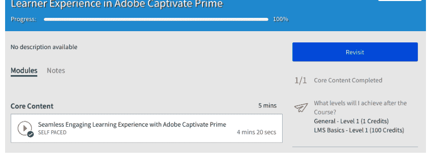

图 7.8 – Learner 01 已完成课程

- 8. 使用左侧边栏顶部的 home 图标返回学习者主页。
- 9. 花点时间重新访问学习体验中的 **我的学习** 和 **排行榜** 页面，以了解完成本课程如何影响这些页面上显示的信息。

在本节中，您已使用 Adobe Captivate Prime 进行了第一次培训体验。这是一个非常简短的课程，但在下一节中，您将查看一个更复杂的课程，让您更深入地了解流体播放器。

## 探索流体播放器

**流体播放器** 是 Adobe Captivate Prime 的关键组件和标志性功能。其独特之处在于能够提供各种学习内容。这使得学习者无论查看的模块是视频、文档、SCORM 包还是 Captivate Prime 支持的任何其他内容，都可以保持在相同的学习环境中。

这与许多其他 LMS 解决方案不同，在这些解决方案中，学习者在完成模块后会被系统地带回课程主页，并且每种类型的内容都会在特定于所查看内容类型的环境中显示。

您现在将使用以下步骤更详细地查看流体播放器的功能：

- 1. 确保您仍以 *Learner 01* 身份登录。
- 2. 从学习者主页点击 **网络安全基础** 课程卡（确保您 *不要* 点击 **继续** 链接）。此操作会带您进入课程概览页面。
- 3. 点击课程 **预习** 部分中的 **欢迎来到课程！** 链接。

此操作打开流体播放器以显示此课程模块。如果您使用了与本书关联的下载中包含的文件，此模块是 PowerPoint 演示文稿。请注意流体播放器中心区域的图标，如以下屏幕截图所示：

图 7.9 – 流体播放器显示 PowerPoint 演示文稿时的情况

这些图标允许您更改缩放级别并在 PowerPoint 演示文稿中从一张幻灯片移动到下一张。这些控件 *专门用于 PowerPoint 演示文稿和文档*。

- 4. 使用这些控件查看 PowerPoint 演示文稿。
- 5. 完成后，点击屏幕右上角的关闭图标。

此操作会带您返回课程概览页面，其中在 *Learner 01* 刚刚访问的 **预习** 模块旁边会出现一个绿色复选标记。请记住，查阅预习活动 *不是强制性的*。这就是为什么课程横幅中尚未显示进度条，并且右侧列中的按钮仍显示为 **开始** 而不是 **继续** 的原因。

- 6. 点击右侧列顶部的 **开始** 按钮。

此操作重新打开流体播放器以显示此课程核心内容的第一模块。在此特定示例中，第一模块是课堂模块。该模块的完成必须由讲师确认，这将在第 8 章《探索讲师角色》中介绍。目前，您只需跳过此课堂模块并查看课程中的其他自定进度模块。

- 7. 点击流体播放器下部中心区域的右箭头。这将在同一流体播放器中打开第二个课程模块。在此示例中，第二个模块是由 Adobe Captivate 创建的 SCORM 包。
- 8. 像学习者一样查看整个 SCORM 包：完成课程模块中定义的交互并尽力回答测验问题。

在此过程中，请注意流体播放器下部中心区域可用的图标与本节前面查看 PowerPoint 演示文稿时并不完全相同。

- 9. 完成后，流体播放器会自动加载下一个课程模块。在此示例中，下一个课程模块也是由 Adobe Captivate 创建的交互式 SCORM 包。
- 10. 像学习者一样查看 Identifying Phishing Attempts 模块。
- 11. 在此过程中，请注意流体播放器左下角的两个图标，如以下屏幕截图所示。

第一个图标打开课程目录。您可以使用它访问课程的其他模块。

第二个图标允许您添加个人笔记：

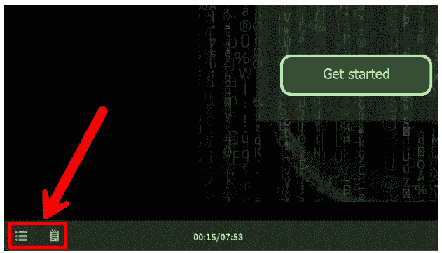

- 12. 点击笔记图标，添加新笔记，然后点击 **添加** 按钮。请注意，您添加的笔记与学习者在课程中的当前位置相关联。
- 13. 当第二个交互式 SCORM 模块完成后，流体播放器会自动加载下一个模块，在此示例中为 MP4 视频文件。
- 14. 在视频播放时，更仔细地查看流体播放器下部中心区域可用的项目。这些特定于视频文件，与查看 PowerPoint 演示文稿或交互式 SCORM 包时可用的图标不同。

这展示了流体播放器的真正魔力！当一个模块完成后，下一个模块会自动加载到流体播放器中。然后流体播放器检查新模块，根据内容类型（视频、SCORM、文档等）调整其图标并开始播放模块，所有操作都在不离开学习环境的情况下完成。这使学习者能够保持专注，同时无论提供的内容类型如何，都能无缝地从一个模块移动到下一个模块。

- 15. 视频完成后，点击流体播放器右上角的关闭图标。这会带您返回课程概览页面，您可以在课程横幅中可见的进度条以及 **核心内容** 部分中可见的绿色复选标记中看到您的进度。
- 16. 点击左侧边栏顶部的 home 按钮或屏幕左上角的公司 logo 返回学习者主页。
- 17. 确认您的进度在主页 **我的学习列表** 部分的课程卡中可见。
- 18. 点击 **继续** 按钮重新打开流体播放器并从上次离开的地方继续课程。
- 19. 在此示例中，下一个模块是外部 URL 活动。点击 **前往活动 URL** 按钮访问外部链接。完成后返回 Captivate Prime 并点击 **标记为完成** 按钮。

逐一继续复习其他课程模块。有些模块可以立即完成，而其他模块需要管理员或讲师的操作才能标记为已完成。

- 20. 完成后，返回课程概览页面。
- 21. 点击页面顶部的 Notes 选项卡，如以下屏幕截图所示：

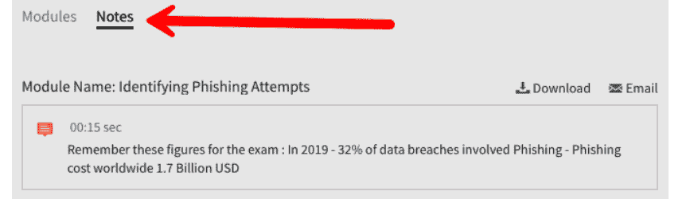

图 7.11 – 课程概览页面的 Notes 选项卡

从这里，你可以查看在学习课程时在 fluidic player 中所做的笔记。点击某条笔记会带你回到创建该笔记时的确切位置。还请注意 Notes 列表右上角的 Download 和 Email 图标。这些都是很实用的功能，允许学习者保留课程中留下的笔记的离线副本，以便在备考、归档或学习者各自特有的其他原因时使用！

在本节中，你已经发现了 fluidic player。它是 Captivate Prime 的关键组件，因为学习者将在此花费大部分时间学习他们注册的课程。fluidic player 支持各种内容类型，并且能够在不离开或重新加载学习环境的情况下无缝从一个模块移动到下一个模块，这使学习者能够保持学习专注。

作为学习者，你必须能够执行的另一项操作是将作业上传到 Captivate Prime。这就是你在下一节中将要回顾的内容。

## 上传作业

当你在第 4 章《创建技能和课程》中创建《网络安全基础》课程时，你在课程的核心内容中加入了一个文件提交活动。需要提醒的是，此活动允许学习者将作业上传到 Captivate Prime。然后该作业必须由指定的讲师审阅，讲师会批准或拒绝它。

在本节中，*Learner 01* 将把作业上传到平台。作业的讲师审阅将在 *第 8 章，探索讲师角色* 中讨论。

使用以下步骤将作业上传到 Captivate Prime：

- 1. 确保你已使用 *Learner 01* 身份登录你的 Prime 账户。
- 2. 从学习者主页点击 **我的学习列表** 部分中的 **网络安全基础** 课程卡片。这会带你进入课程概览页面。
- 3. 向下滚动页面，直到在 **核心内容** 部分看到 **你的网络安全论文** 活动，如以下屏幕截图所示：

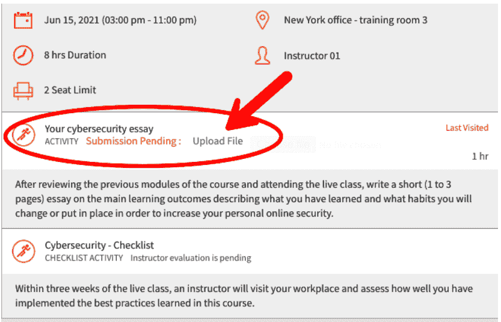

图 7.12 – 课程概览页面上的“你的网络安全论文”活动

- 4. 点击前一屏幕截图中箭头标识的 **Upload File** 链接。
- 5. 浏览到计算机上要上传的文件所在位置。在此示例中，你可以使用与本书下载关联的 `courseContent/myAssignment.docx` 文件。

上传作业后，消息会更改为 **Submission Awaiting Approval**。你仍可使用 **Change** 链接更改已提交的文件，如以下屏幕截图所示：

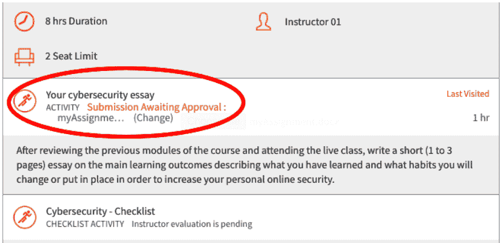

图 7.13 – 已上传作业

在此示例中，课程的其他模块要么是现场课程模块，要么是需要讲师操作才能完成的模块（如你刚刚上传的作业和课程末尾的 **Checklist** 活动）。你将在下一章回顾讲师角色，但现在，*Learner 01* 已完成所有自学活动，值得好好休息一下！

在本节中，你学习了学习者如何将作业上传到 Captivate Prime。在下一节中，你将使用 Adobe Captivate Prime 移动应用以 *Learner 03* 身份登录，并在移动设备上学习同一门课程。

## 使用 Captivate Prime 移动应用

在上一节中，你使用网络浏览器以 *Learner 01* 身份登录了你的 Captivate Prime 账户。然而，越来越多的学习者希望使用移动设备学习课程。这使他们能够随时复习课程，即使在出差途中。

但移动场景带来了全新的挑战：

- 移动设备的屏幕通常比笔记本电脑或台式电脑的屏幕小得多。因此，学习体验必须重新设计以适应移动场景。
- 用手指在触摸屏上交互与在台式机或笔记本电脑上使用鼠标指针完全不同。这意味着交互必须为触控重新设计。
- 移动设备上的网络连接质量和稳定性以及可用带宽无法保证。用户可能连接到快速可靠的 Wi-Fi 网络，也可能连接到缓慢且不可预测的 3G 连接。
- 你的 HR 或 IT 部门如何支持移动设备学习？

为克服这些挑战，Adobe Captivate Prime 团队开发了适用于 iOS 和 Android 的专用移动应用。甚至可以在台式机或笔记本电脑上开始学习课程，然后使用移动应用在设备上继续同一课程，反之亦然。移动应用适用于智能手机和平板电脑。 使用 Apple App Store 或 Google Play Store 在你的移动设备上下载并安装 Captivate Prime 应用。

请注意，在撰写本文时，Captivate Prime 移动应用仅适用于学习者角色。其他角色（管理员、讲师、经理、作者和集成管理员）必须使用传统网络浏览器访问 Captivate Prime。

在本节中，你将使用 Captivate Prime 移动应用以 Learner 03 身份登录你的 Prime 账户，查看移动应用提供的学习者体验，并使用移动设备学习《网络安全基础》课程。

## 使用移动应用连接 Prime

首先，你将使用以下步骤使用 Captivate Prime 移动应用登录你的 Prime 账户：

- 1. 使用你的移动设备（智能手机或平板电脑）通过 Apple App Store（iOS）或 Google Play Store（Android）安装 Adobe Captivate Prime 应用。
- 2. 安装完成后，点按 Captivate Prime 图标以运行应用。
- 3. 输入 Learner 03 的电子邮件地址并点击 Proceed 按钮。

如果该电子邮件地址在多个 Prime 账户中使用，你必须使用屏幕上出现的关联账户页面选择要连接的账户。

- 4. 由于 *Learner 03* 是 *external* 用户，你将被重定向到一个特殊的登录页面，在那里你必须输入此学习者资料的电子邮件 ID 和密码。请注意，使用其 Adobe ID 的 *internal* 用户会经过略有不同的身份验证流程。

*internal* 和 *external* 用户之间的差异已在 *第 5 章，管理用户* 中讨论过。

登录后，你应该会看到一个与本章前面回顾的沉浸式学习者主页类似的屏幕。以下屏幕截图使用 iPhone 上的 Captivate Prime for iOS 拍摄：

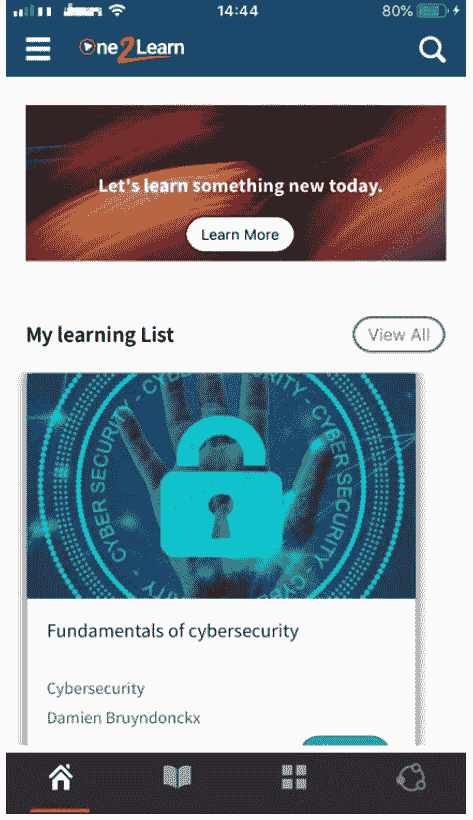

图 7.14 – iPhone 上的 Captivate Prime 移动应用

现在你已通过移动应用连接，让我们花点时间回顾一下应用提供的学习者体验。

## 使用移动应用探索学习者体验

移动应用提供的学习者体验与本章前面使用网络浏览器在 *Touring the default learner experience* 部分回顾的体验非常相似。让我们使用以下步骤来查看：

- 1. 确保你已使用移动应用以 *Learner 03* 身份连接到你的 Prime 账户。
- 2. 向上向下滚动主页，并花必要的时间识别所有部分。你应该能认出本章前面 *Touring the default learner experience* 部分中讨论的部分。
- 3. 在屏幕底部点按 **My Learning** 图标。这会带你进入 **My Learning** 页面，在那里你可以查看 *Learner 03* 目前注册的所有课程、学习计划和认证。

还请注意页面顶部的 **My Learning** 和 **My Job Aids** 选项卡。*Job aids* 已在 *第 4 章，创建技能和课程* 中讨论过。
- 4. 屏幕底部下一个可用的项目是 **Catalog** 图标。点按此图标会带你进入课程目录，在那里显示平台上所有可用的课程。
- 5. 屏幕底部第四个也是最后一个可用的项目是 **Social Learning** 图标。请注意，管理员必须已在账户上启用社交学习才会显示此图标。社交学习将在 *第 12 章，启用和管理社交学习* 中进一步讨论。
- 6. 点按位于屏幕左上角的汉堡图标（带三个水平条的图标）以显示包含其他选项的侧面板。

如以下屏幕截图所示，侧面板允许您查看个人资料、查看通知、访问应用程序的常规设置、获取帮助以及退出 Adobe Captivate Prime 移动应用：

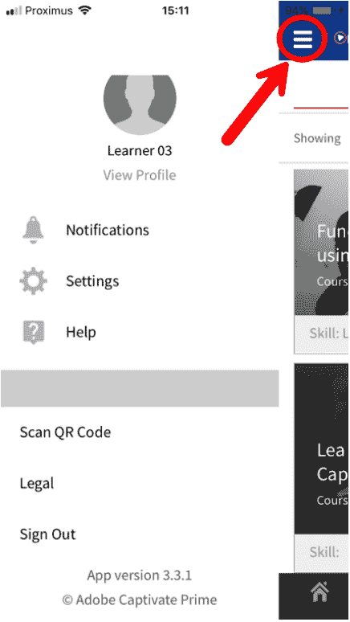

图 7.15 – Captivate Prime 移动应用的侧面板

这为您提供了 Adobe Captivate 移动应用中可用功能的快速概览。请注意，使用传统网页浏览器时可用的一些页面（如技能页面和排行榜）在使用移动应用时（目前）尚不可用。

在下一节中，您将使用移动应用搜索课程目录并让学习者 03 注册 *Learner Experience in Adobe Captivate Prime* 课程。

## 使用移动应用注册课程

请记住，*Learner Experience in Adobe Captivate Prime* 课程是在学习 *Fundamentals of cybersecurity* 课程之前必须完成的先修课程。此时，*Learner 03* 尚未注册 *Learner Experience in Adobe Captivate Prime* 课程，因此该用户尚无法开始 *Fundamentals of cybersecurity* 课程。

在本节中，您将使用移动应用搜索课程目录，将 *Learner 03* 注册到 *Learner Experience in Adobe Captivate Prime* 课程，并查看该课程中包含的视频，以便该学习者满足 *Fundamentals of cybersecurity* 课程的先修要求：

- 1. 确保您使用 Captivate Prime 移动应用以 *Learner 03* 身份登录。
- 2. 点击屏幕底部位置的 **Course Catalog** 图标。
- 3. 点击屏幕右上角的 **Search** 图标搜索 *Learner Experience in Adobe Captivate Prime* 课程。
- 4. 当课程出现在列表中时点击该课程。这会带您进入课程概览页面。
- 5. 花点时间查看课程概览页面上的可用信息。准备好后，点击 **Enroll** 按钮。**Enroll** 按钮会变成 **Start** 按钮。
- 6. 点击 **Start** 按钮开始课程。此操作会打开嵌入在移动应用中的 fluidic player。
- 7. 在观看视频时，花点时间检查 fluidic player 的功能。您会发现与本章前面在桌面或笔记本电脑上查看课程时完全相同的图标。
- 8. 完成后，点击 fluidic player 右上角的关闭图标返回课程概览页面。

如您所见，移动应用提供的学习体验与您使用网页浏览器时的体验非常相似。这也是 fluidic player 的另一个亮点：它可以嵌入到移动应用中，甚至可以嵌入到您自己的网站中。此功能将在 *Chapter 16, Exploring the Integration Admin Role.* 中进一步讨论。

> **使用 QR 码注册**
> 
> 使用移动应用注册课程的另一种方式是通过扫描 QR 码。管理员必须使用管理区域中的课程 **Instances** 页面打印 QR 码。然后他们可以将这些 QR 码张贴在组织的场所周围。学习者随后可以使用 Captivate Prime 移动应用扫描 QR 码以注册相应的课程。**Scan QR Code** 功能可以通过位于移动应用左上角的汉堡图标访问。

现在 *Learner 03* 已满足先修要求，他们可以在下一节开始 *Fundamentals of cybersecurity* 课程。

## 使用移动应用离线学习课程

在上一节中，您首次了解了使用移动应用学习课程的过程。在本节中，您将使用应用的另一项功能，即下载课程并离线查看的能力。课程跟踪数据将在您下次连接互联网时传输到 Captivate Prime：

- 1. 确保您使用 Captivate Prime 移动应用以 *Learner 03* 身份登录。
- 2. 从主页点击 **Fundamentals of cybersecurity** 课程的课程卡片（确保不要点击课程卡片右下角的 **Start** 按钮）。
  此操作会带您进入课程概览页面。
- 3. 点击以下屏幕截图中由箭头标识的下载图标：

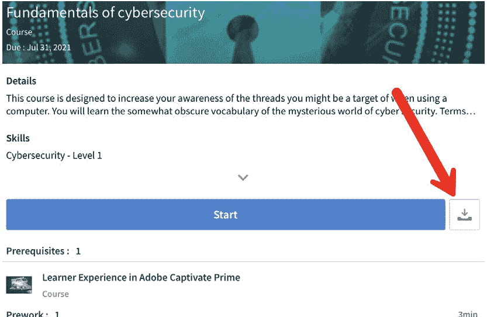

图 7.16 – 点击下载图标（此屏幕截图是在 iPad 上拍摄的）

- 4. 确认您下载整个课程的意图并等待下载完成。
- 5. 将移动设备置于飞行模式以模拟离线情况。
- 6. 返回 Captivate Prime 应用并学习课程。请注意，即使您处于离线状态，您仍可以像连接状态一样查看所有自定进度模块。这是因为您使用的是在步骤 4 中下载的内容的离线副本。

> **注意**
> 由 Adobe Captivate 创建的 SCORM 内容尚未实现响应式。因此，在移动设备上查看时，此内容可能会生成水平和/或垂直滚动条。这里应归咎于 eLearning 开发人员（本例中是我本人），而不是 Captivate Prime 本身！这说明了虽然 Captivate Prime 是响应式的，但托管在平台上的内容也必须实现响应式，才能提供完全响应式的移动体验。

- 7. 在查看了几个自定进度模块后，关闭飞行模式并重新连接互联网。返回 Captivate Prime 应用并等待片刻，以便课程跟踪数据上传到 Captivate Prime 服务器。

请注意，此过程在后台进行，屏幕上不会出现该过程已完成的任何视觉提示。

现在您已使用移动应用完成了几个课程模块，您将返回桌面或笔记本电脑并以 Learner 03 身份登录，以演示您可以使用桌面或笔记本电脑继续在移动设备上中断的课程：

- 8. 返回您的桌面或笔记本电脑并以 Learner 03 身份登录您的 Prime 账户。

> **以 Learner 03 身份登录**
> 请记住，Learner 03 是您在第 5 章《Managing Users》中定义的唯一外部学习者，因此该用户必须使用自定义登录页面。此登录页面的 URL 可在您创建 Learner 03 用于注册 Prime 账户的外部注册配置文件时发送给您的电子邮件消息中找到。如果您不再有权访问该电子邮件消息，请浏览到管理员的 External Users 页面并将鼠标悬停在外部注册配置文件上以显示链式图标并将链接复制到剪贴板。

- 9. 确认学习者主页上的课程卡片反映了您在使用移动应用时所取得的进度。

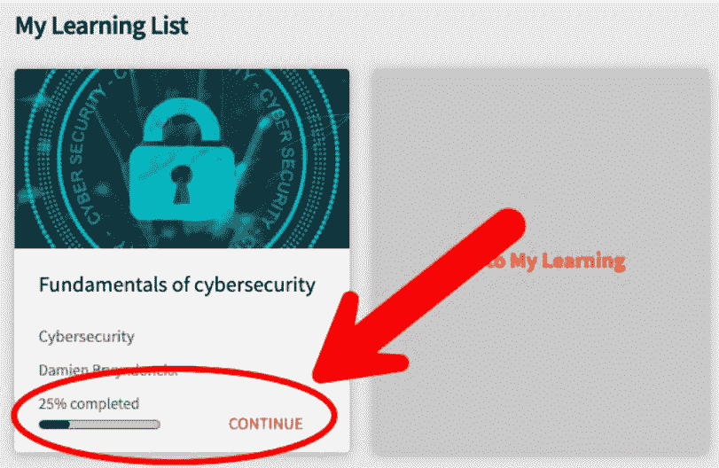

图 7.17 – 移动应用上取得的进度在网页浏览器中得到反映

在本节中，您已查看了 Captivate Prime 移动应用的主要功能。您已使用它浏览课程目录、注册课程并查看几种类型的模块。您还下载了一些内容以供离线查看，并知道课程跟踪数据将在设备下次连接互联网时发送到 Captivate Prime。

## 总结

恭喜！随着学习者开始学习课程，您的 Prime 账户终于活跃起来。

在本章中，您已查看了默认的学习者体验。您已使用网页浏览器访问了学习者应用的所有页面。在学习课程时，您体验了 fluidic player 的功能，该功能允许学习者无论提供何种类型的教学内容都能无缝地完成课程。您已查看了 PowerPoint 文件、由 Adobe Captivate 创建的 SCORM 包以及外部链接活动。您还使用文件提交活动向 Captivate Prime 提交了作业。最后，您使用 Adobe Captivate Prime 移动应用注册了课程并访问了几个课程模块。您甚至下载了课程内容，以便即使移动设备未连接到互联网也能访问。

现在您的 Prime 账户上有活跃的学习者，一个新的挑战出现了：每天跟进学习者的进度。这包括准备讲师主导的课程、管理候补名单、查看学习者作业以及填写清单。这些是讲师角色的主要任务，您将在下一章中查看。

## 8 探索讲师角色

## 探索讲师角色

在上一章中，您已达成一个重要里程碑：学习者现在正在您的 Prime 账户上学习课程。虽然其中一些课程仅涉及可由系统完全管理的自学异步活动，但其他类型的活动需要人工干预。

首先，有（面对面或虚拟的）讲师主导的课程。显然，您需要一名讲师来授课。但这还不是全部。讲师主导的课程还要求进行出勤和候补名单管理，以及向参与者发送提醒和附加资源（例如预习作业、地图、通行证等）。

还有需要讲师审阅提交文件的作业提交活动，以及需要人工干预才能标记为完成和成功的清单活动。

讲师角色的主要任务是跟进这些活动。如《第 5 章、用户管理》中所述，必须由管理员将讲师角色分配给用户配置文件，该用户才能成为讲师。此外，该人员还必须被指定为（面对面或虚拟的）讲师主导课程、文件提交活动或清单活动的讲师。被分配讲师角色的用户的常见示例包括内部员工培训师、针对特定内容进行培训的外部供应商，或提供只能现场进行管理和评分的培训的讲师（心肺复苏认证、角色扮演培训等）。

在本章中，您将以讲师身份登录您的 Prime 账户，并查看使讲师能够完成其分配任务的工具和功能。为实现这一目标，本章将引导您完成以下部分：

- 管理讲师主导的（面对面和虚拟）课程
- 审阅文件提交作业
- 填写清单活动

讲师的角色对您 Captivate Prime 账户的日常运营以及学习者体验的质量非常重要，尤其是在面对面学习和远程学习注定会日益融合的时代。借助 Captivate Prime，培训师拥有构建混合课程所需的所有工具，而混合课程在越来越多的组织中变得越来越受欢迎。那么，让我们直接深入讲师角色吧！

## 技术要求

为了执行本章所述的练习，您需要满足以下要求：

- 您必须拥有可用的 Captivate Prime 账户的讲师访问权限，可以是试用账户。
- 讲师账户必须被定义为至少一个（现场或虚拟）课程活动、一个文件提交活动和一个清单活动的讲师。
- 学生必须已注册讲师主导的课程，并且您必须在候补名单上至少有一名额外学生。
- 必须已为文件提交活动提交了至少一个文件。

如果您已完成上一章的练习，您肯定满足上述要求！如果没有，您可以使用自己的课程内容和用户来完成本章的练习。但是，说明基于上一章的练习，因此请随意将其调整到您的个人情况。

## 管理讲师主导的面对面或虚拟课程

当自学模块，例如视频文件、PDF 文档、SCORM 包等，用于 Prime 课程时，它们几乎不需要进一步的人工干预。学习者可以自行方便地查看这些模块，测验会自动评分，其结果会自动报告回 Prime，系统会评估成功和完成标准。总的来说，Captivate Prime 几乎可以完全自行交付和跟踪这些课程模块。

另一方面，讲师主导的课程则需要更多的后勤工作。无论是面对面还是虚拟，这些类型的活动都被称为同步活动。这意味着讲师和学习者在同一时间出现在教室或讲堂中，或连接到同一会议电话或虚拟课堂环境。显然，这会引发日程安排问题，但这还不是全部：

- 典型的教室和讲堂座位有限。如果报名人数过多，您必须准备好管理候补名单，将课程移至更大的场地，或创建另一个课程实例以容纳所有人。当然，您的决定必须以专业和及时的方式传达给学习者。这种跟进是优质学习体验不可或缺的一部分。
- 已注册的学生可能无法出席并决定退出。在这种情况下，座位将为候补名单上的下一位人员腾出，该人员必须得到妥善联系并注册该课程。
- 教室或讲堂可能需要安全访问，因此您需要确保每位学习者在课程当天能够进入该设施。这可能需要向参与者发送他们的个人通行证、场地地图、访问计划、安全程序等。如果课程是虚拟的，您必须向参与者发送课程链接，确保他们满足技术要求，已安装所需软件等。
- 在课程开始前可能需要先决条件作业。这意味着有人必须收集作业，向未按时提交预习作业的学生发送提醒，评估和评分学习者提交的预习作业等。
- 在上课当天，必须正确点名并向 LMS 报告。
- 出席课程可能不足以使其成功。在许多情况下，成功出席课程意味着参与活动、回答讲师的问题、参与讨论、在当天结束时提交作业等。这种活动的同步性质使得计算机系统无法衡量每位学习者的参与度。这是人工干预仍然必不可少的一个实例。
- 必须提前向学生发送提醒，以便每个人在课程日期最终到来时保持一致，等等。

在 Captivate Prime 中，这些是讲师角色的主要任务。它们必须以及时和专业的方式完成，因为它们对整体学习者体验至关重要。这就是您将在本节中回顾的内容。

现在您已经对 Prime 讲师的职责有了高层次的了解，让我们登录 Captivate Prime 并使用以下步骤亲手查看此角色：

1. 以 Instructor 01 的身份登录您的 Prime 账户。

请记住，每位 Prime 用户首先是一名学习者。因此，当 Instructor 01 登录时，他们会自动重定向到学习者体验。

2. 单击屏幕右上角的用户图标并切换到讲师角色。

当 Captivate Prime 重新加载时，您应该已作为讲师登录并位于讲师主页，如以下屏幕截图所示：

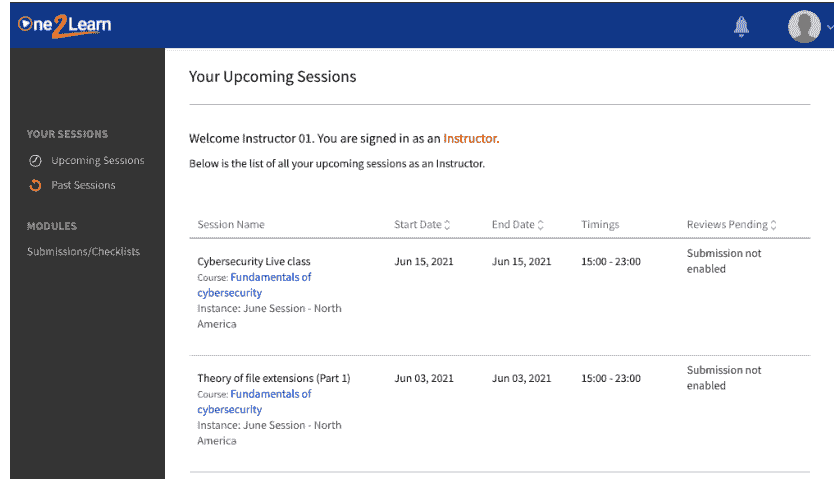

图 8.1 – 讲师主页

> **Note**
> *Instructor 01* 用户是在 *第 5 章、管理用户* 中创建的。如果您没有创建该用户，请随意使用任何合适的用户账户。

讲师的主页列出了分配给该特定讲师的所有即将举行的课程。在前面的屏幕截图中，登录的用户已被指定为在 *第 4 章、创建技能和课程* 中创建的课程相关的两个现场课程的讲师。还请注意左侧边栏中的 **Past Sessions** 链接。此链接会带您进入一个类似的列表，其中包含 *Instructor 01* 担任讲师的过去课程。

现在您已作为讲师登录，让我们更详细地回顾讲师角色。在下一节中，您将检查课程详情并根据需要进行调整。

## 查看课程详情

当为课程指定讲师时，他们可能最想查看的就是课程的详情，例如地点、主题、已注册的与会者人数等。在 Captivate Prime 中，这些详情距离讲师主页仅一步之遥。让我们通过以下步骤来回顾：

1. 确保您已作为讲师登录并且当前位于讲师主页。
2. 单击您即将举行的任何课程以查看课程详情。

As shown in the following screenshot, this action opens the **Session Overview** page where you can review information such as **Session Name**, **Session Timings**, **Duration**, **Venue**, and so on.

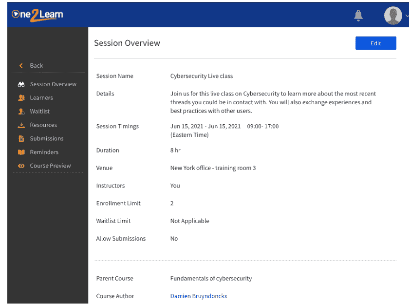

Figure 8.2 – The Session Overview page

Take some time to review the other session details available on the page. Also notice the links displayed in the left sidebar. These will be reviewed one by one in the coming sections.

As an instructor, you have the ability to change some of these session details. For example, you can change the date of the session (if it conflicts with another session, if you are unavailable for the session, and so on), modify the venue, change the enrollment limit, and so on:

- 3. Click the **Edit** button located in the upper-right corner of the screen.
- 4. Type 5 in the **Waitlist Limit** field. This represents the maximum number of students that can be on the waitlist. When the waitlist is full, no additional registration can be taken for that class.
- 5. Switch the **Allow Submissions** field to **Yes**.

This allows class participants to upload files such as assignments, reports, assessments, or any other material to the session. Instructors can then use the submitted file for grading.

Note that the ability for participants to upload a file to the session begins to take effect on the day the session starts. In other words, if the session starts on June 15, students cannot upload their session work before June 15.

For learners, the process of uploading a file to a session is exactly the same as the process of uploading to a file submission activity. This was discussed in the *Uploading an assignment* section of *Chapter 7, Reviewing the Learner Experience.*

- 6. Take some time to examine the other details that can be modified by an instructor.
- 7. When done, click the **Save** button located in the upper-right corner of the screen.

When modifying details in such a way, every attendee gets an email notification similar to what is shown in the following screenshot:

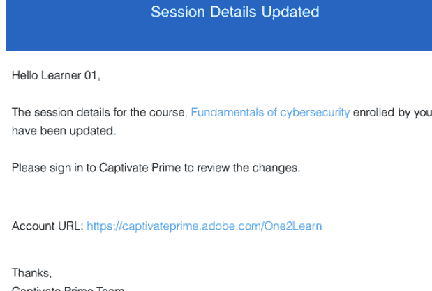

Figure 8.3 – The email notification received by the attendees upon class update

### Customizing the Email Messages
The preceding screenshot shows the default email message sent by Captivate Prime. In *Chapter 15, Working with Messages and Announcements*, you will learn how to modify the look, the feel, and the content of these email messages.

Another aspect of the session that you want to look into as an instructor is whether or not students have registered for the class. Let's review that in the next section.

## Reviewing the participants list

In Captivate Prime, the attendee list serves many purposes. Let's discover it hands-on using the following steps:

- 1. Make sure you are logged in as an instructor.
- 2. From the instructor home page, click any session available in the **Your Upcoming Sessions** list. This action takes you to the **Session Overview** page of the chosen session.
- 3. Click the **Learners** link located in the left sidebar of the **Session Overview** page.

As shown in the following screenshot, this action takes you to the **Learners** page where you can see basic information about your session at the top of the page as well as the list of currently registered learners.

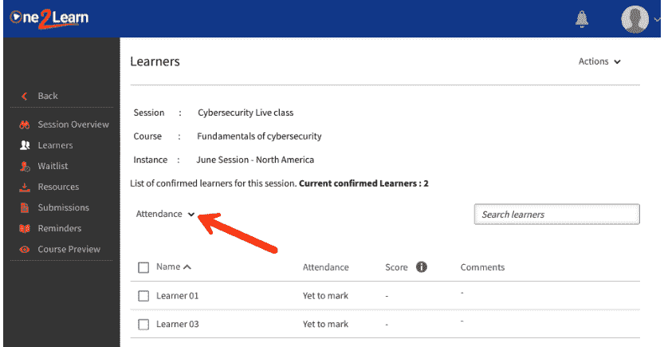

Figure 8.4 – The Learners page of a session as seen by an instructor

In the preceding screenshot, two learners are currently confirmed for the class: **Learner 01** and **Learner 03**. Since the session has not yet started, their attendance status shows **Yet to mark**. This will change after the session date, as the instructor will need to change this status to either **Attended** or **Not Attended.**

Before going any further, notice the **Attendance** dropdown (identified by the arrow in the preceding screenshot), which allows you to filter the list by attendance status. Also notice the **Search learners** field at the top right of the list, which you can use to search for learners when the list is longer.

- 4. Make sure no learners are selected and click the **Actions** button located in the upper-right corner of the screen.
- 5. Take some time to inspect the available options.

As shown in the following screenshot, some of these actions are currently unavailable as they require learners to be selected.

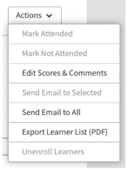

Figure 8.5 – The Actions menu of the session's Learners page

Most of these actions should be self-explanatory, but let’s do some experiments to completely understand how the feature works:

- 6. Click the **Edit Scores & Comments** action. When the page reloads, notice that the buttons available in the upper-right corner of the screen have slightly changed.
- 7. Try to select any learner in order to enter a score and a comment.

Because the **Attendance** status of these learners is still set to **Yet to mark**, it is currently impossible to enter a score or comments for these learners. You will therefore return to this particular page after the attendance status of these learners has changed.

- 8. Click the **Cancel** button located in the upper-right corner of the screen.
- 9. Make sure no learners are selected and click the **Actions** button again.
- 10. Click the **Send Email to All** action.

This opens the box with a comma-separated list of email addresses of all currently confirmed learners. You need to copy and paste this list into your preferred email client to send an email to these learners.

- 11. Click the **Close** button to close the **Copy Learners List** box.
- 12. Make sure no learners are selected and click the **Actions** button one more time.
- 13. Click the **Export Learner List (PDF)** action.

You should then be prompted to save the generated PDF file on your computer. When done, open the PDF file using your preferred PDF reader.

This is an important document the instructor should print before going to the session. It serves as the attendance list that the instructor can use during the session to mark attendance. A very interesting and highly popular feature of this document is the QR code in the upper-right corner. Attendees can use the Captivate Prime mobile app to scan the QR code in order to automatically report their attendance to the platform.

> **The Captivate Prime mobile app**
> The Captivate Prime mobile app is available for both iOS and Android. It can be downloaded either from the Apple App Store (iOS) or from the Google Play Store (Android). The Captivate Prime mobile app was discussed in more detail in the *Using the Captivate Prime mobile app* section of *Chapter 7, Reviewing the Learner Experience.*

It is possible that the generated PDF file contains two pages: one page with the list of confirmed learners and a second page with learners who are currently on the waitlist. This can be useful when a confirmed student does not show up for the session. Their place can be given to a student on the waitlist who would have tried their luck by coming at the beginning of the session.

Speaking of the waitlist, this is another area of interest for a Captivate Prime instructor. Let's review it in the next section.

## Managing the waitlist

When you created the course instance back in *Chapter 6, Enrolling Users to Courses*, you had to define the session's **Seat Limit**. The seat limit of a session depends on a number of factors:

- The capacity of the classroom or lecture hall where the session is to take place.
- The nature of the topic taught (some practical courses, for example, require a smaller audience to be delivered efficiently).
- In the case of a virtual classroom, the licensing model of your preferred video conferencing solution may also be a factor in determining the Seat Limit.
- Etc.

By limiting the audience in this way, you will inevitably run into the problem of having more registrations than seats available. This is where establishing a Waitlist becomes very useful. In this section, you will review the tools and features available in Captivate Prime in order to maintain and manage your sessions' waitlists. Before doing so, remember the following:

- You purposely defined a ridiculously low Seat Limit when creating your course instance back in Chapter 6, Enrolling Users to Courses.
- In the same chapter, you tried to enroll Learner 02 in the course, but because the Seat Limit had already been reached, Learner 02 was added to the waitlist.
- In the Reviewing session details section earlier in this chapter, you added a Waitlist Limit to one of your sessions to prevent the waitlist from growing too large and giving false hope to too many learners.

With that in mind, it is time to head back to the Instructor role of Captivate Prime and experiment with waitlist management using the following steps:

- 1. Make sure you are logged in as an instructor to your Captivate Prime account.
- 2. From the instructor home page, click any of the available upcoming sessions. This opens the Session Overview page of the chosen session.
- 3. Click the Waitlist link located in the left sidebar of the Session Overview page.

This opens the Waitlist page of the current session where you can see a list of learners currently on the waitlist along with their Waitlist Number.

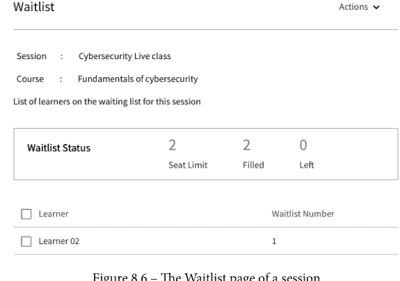

在前面的截图中，您可以看到此特定会话的 **Seat Limit** 为 **2**，并且两个座位都已 **Filled**。您还可以看到 **Learner 02** 目前是候补名单上唯一的学员。

- 4. 使用复选框在列表中选择 **Learner 02**。
- 5. 点击屏幕右上角的 **Actions** 按钮，并花一些时间查看可用的操作。

**Send Email to All** 操作是在未选择学员时唯一可用的操作。

**Unenroll Learners** 操作会将所选学员从候补名单中移除，而不会将其注册为课程。相反，**Confirm Learners** 操作会将所选学员从候补名单移至已确认学员列表。在这两种情况下，Captivate Prime 都会自动向受影响的学员发送电子邮件通知。

- 6. 在本示例中，点击 **Confirm Learners** 操作，将 **Learner 02** 从候补名单移至已确认学员列表。
- 7. 点击 **Yes** 确认您的意图。页面重新加载后，**Learner 02** 不应再出现在候补名单上。
- 8. 点击左侧边栏中的 **Learners** 链接。

当 **Learners** 页面重新打开时，请确保 *Learner 02* 已被添加到已确认学员列表中。这说明了即使 **Seat Limit** 已达到，仍可以将座位分配给候补名单上的某人的能力。换句话说，讲师可以覆盖会话的 **Seat Limit**。

这是学员从候补名单中清除并添加到已确认学员列表的两种方式之一。另一种方式是取消注册当前在已确认学员列表中的学员。在这种情况下，候补名单上的下一位学员将被 *automatically* 确认为该会话。

这结束了对 **Waitlist** 页面上可用工具和功能的介绍。在下一个会话中，您将了解讲师如何向其会话上传资源。

## 向会话上传资源

讲师还可以为会话上传额外的资源。这些资源可以包括教育材料，以及任何有助于活动实际组织的文档，例如地图、停车预订表、当天的日程安排等等。

让我们使用以下步骤回顾向会话上传资源的过程：

- 1. 确保您已以讲师身份登录到您的 Captivate Prime 账户。
- 2. 从讲师主页点击任何可用的即将举行的会话。这将打开所选会话的 **Session Overview** 页面。
- 3. 点击 **Session Overview** 页面左侧边栏中的 **Resources** 链接，以打开所选会话的 **Resources** 页面。
- 4. 点击屏幕右上角的 **Add** 按钮。
- 5. 在计算机上浏览要上传的文件。您可以上传各种类型的文件，例如文本文件、电子表格、演示文稿、视频文件、音频文件等等。

如果您没有合适的可用文件，可以使用本书下载中提供的 `courseContent/liveClass_practicalDetails.pdf` 文件。

完成后，上传的文件会出现在可用 **Resources** 列表中，如以下截图所示：

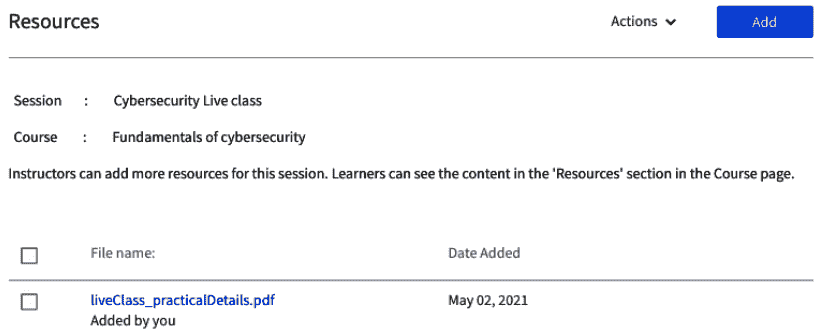

图 8.7 – 文件上传后 Resources 页面

您可以使用此流程添加所需数量的文件。另一方面，学员可以通过课程概览页面的 **Resources** 部分访问文件。让我们在下一节中查看它。

## 作为学员访问会话资源

学员可以使用以下步骤访问讲师上传的会话资源：

- 1. 打开网络浏览器的新隐私窗口，并以 *Learner 01* 身份登录您的 Prime 账户。这是您在上一节中上传了资源的会话的已确认学员之一。

- 2. 登录后，点击主页 **My Learning List** 部分中的 **Fundamentals of cybersecurity** 课程卡（只需确保您 *不要* 点击 **Continue** 按钮）。

此操作打开课程概览页面。

- 3. 如以下截图所示，课程 **Resources** 可在右侧列底部使用：

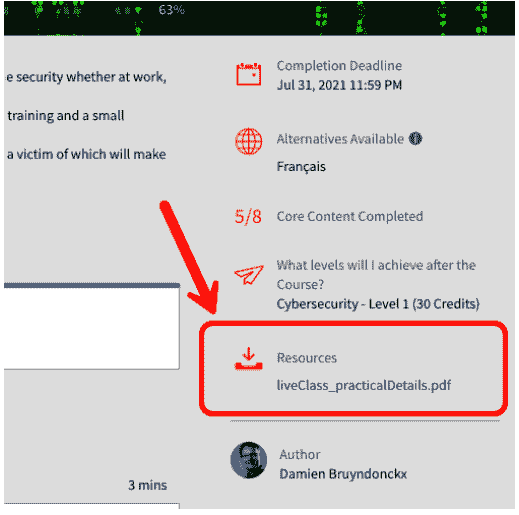

图 8.8 – Resources 可在课程概览页面的右列中使用

**注意**
课程侧边栏包含对学员获得最佳学习体验非常重要的信息。不幸的是，许多学员很容易忽略它。为了解决这个问题，请务必在您为新学员提供的入职体验中突出显示侧边栏。此外，通过电子邮件发送此信息除了在侧边栏上显示之外也是一个好主意。

这是一种使这些资源可供学员使用的工作流程。另一种方法是简单地将它们作为电子邮件附件发送给所有班级参与者。

## 配置会话提醒

默认情况下，Captivate Prime 会在课程当天向班级参与者发送提醒。作为讲师，您无法更改此提醒的内容或外观，但您可以决定 Captivate Prime 是否发送此提醒，以及何时以及多频繁发送。让我们使用以下步骤查看此功能：

- 1. 确保您已以讲师身份登录到您的 Captivate Prime 账户。
- 2. 从讲师主页点击任何可用的即将举行的会话。这将打开所选会话的 Session Overview 页面。
- 3. 点击 Session Overview 页面左侧边栏中的 Reminders 链接，以打开所选会话的 Reminders 页面。

如以下截图所示，默认情况下已定义了一个提醒：

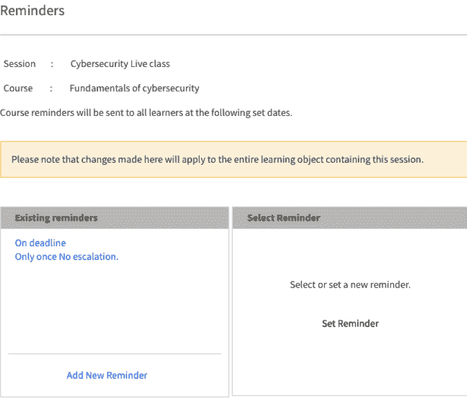

此提醒在 **On deadline** 发送，这意味着在培训当天，并且发送 **Only once**。您现在将更改这些设置，以便在课程计划开始前 2 天发送提醒。

- 4. 点击左侧列中的 **On deadline** 链接以选择现有提醒。提醒设置会出现在右侧列中。

如果您的会话没有可用的提醒，您可以点击左侧列底部的 **Add New Reminder** 链接。

- 5. 打开 **When to send** 下拉菜单并选择 **Before deadline** 选项。
- 6. 在 **days before deadline** 字段中输入 2。
- 7. 确保 **Recurrence** 字段设置为 **Only once**。
- 8. 当 **Reminders Settings** 如以下截图所示时，点击右下角的蓝色复选标记（请参阅以下截图中的箭头）。

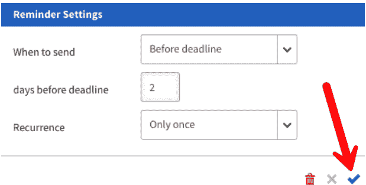

图 8.10 – 讲师角色可用的 Reminders Settings

请注意，您还可以使用位于蓝色复选标记旁边的红色 *trash bin* 图标删除提醒。您还可以使用位于 **Existing reminders** 列底部的 **Add New Reminder** 按钮添加额外的提醒。

这些是讲师角色可用的提醒选项。至于提醒的内容，则由您的 Prime 账户管理员或课程作者决定。您将在 *Chapter 15, Working with Messages and Announcements* 中回顾 Captivate Prime 中有关公告和消息的选项。

到目前为止，在本章中，我们回顾了讲师在会话进行 *before* 管理会话可用的工具。在下一节中，我们将讨论讲师在会话进行 *during* 和 *after* 应执行的任务。

## 标记学员出勤

显然，讲师的主要任务是进行教学活动（面对面或虚拟）。但是，除了教学角色外，讲师还必须花一些时间将学员出勤情况报告回 LMS。作为一名讲师，我必须承认这几乎是我总是忘记做的一部分，尽管从培训管理角度来看这是一项非常重要的任务。幸运的是，Captivate Prime 使标记学员出勤变得非常容易。

首先，请记住学员可以使用 Captivate Prime 移动应用程序和系统生成的出勤表右上角的二维码自行报告出勤情况。这已在本章早些时候的 *Reviewing the participants list* 部分讨论过。

但并非每个人都有访问 Captivate Prime 移动应用程序的权限。在这种情况下，讲师必须使用以下步骤手动向 LMS 报告学员的出勤情况：

- 1. 确保您已以讲师身份登录到您的 Captivate Prime 账户。
- 2. 从讲师主页点击您要标记出勤的会话。这将打开 **Session Overview** 页面。

请记住，如果会话已经交付，您需要在左侧边栏点击 **Past Sessions** 链接以访问所需会话。
- 3. 点击 **Session Overview** 页面左侧边栏中的 **Learners** 链接，以打开所选会话的 **Learners** 页面。
- 4. 使用复选框选择所需的学员。
- 5. 点击屏幕右上角的 **Actions** 按钮，然后选择 **Mark Attended** 或 **Mark Not Attended** 操作。

讲师通常会在会话期间或之后执行这些操作。

> **提示**
> 如果您是讲师，请确保在会话之前连接到 Prime 账户并打印出席者名单。首先，这允许学员扫描二维码自行报告出勤情况（这进一步减少了您的行政工作量）。它还使您能够以书面形式点名。您可以在会话 *after* 在 LMS 上报告出勤情况，这样您在教学时就不必处理此类行政要求。一些组织还要求保留学员出勤的书面记录。

*Attending* 一个会话是一回事，*successfully* 完成会话是另一回事。因此，作为讲师，您可以在 LMS 中为每位学员的出勤情况评分并添加评论。这就是您将在下一节中要做的事情。

## 编辑分数和评论

有时参加课程就足够了，但有时参加课程需要参与讨论、形成观点、在某个主题上进行展示等等。在这种情况下，讲师可以评估每位学习者在课程中的参与情况，并在 LMS 中添加相关评论。让我们通过以下步骤亲手回顾此工作流程：

- 1. 确保您已以讲师身份登录到您的 Captivate Prime 账户。
- 2. 从讲师主页，点击您要标记出勤的课程，以打开课程概览页面。请注意，如果课程已交付，您需要点击左侧边栏中的“过去的课程”链接来访问所需的课程。
- 3. 点击左侧边栏中的“学习者”链接。
- 4. 接下来，点击屏幕右上角的“操作”按钮。
- 5. 点击“编辑分数和评论”操作，将页面切换到分数编辑模式。

如以下屏幕截图所示，您只能为已标记为“已出席”的学习者输入分数和/或评论。

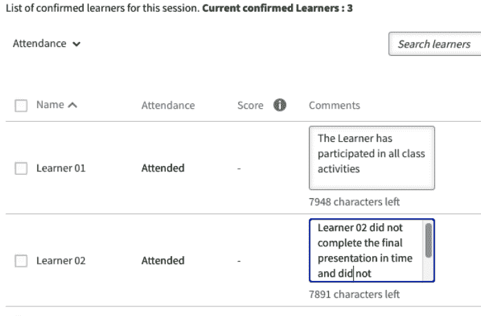

Figure 8.11 – 输入分数和/或评论

在前一屏幕截图中示例所示，您无法输入分数。这是因为，在第 4 章《创建技能和课程》中创建课程时，您未选中“是否要为此模块添加测验分数”复选框。

- 6. 根据您的要求为每位学习者输入评论。
- 7. 完成后，点击屏幕右上角的“保存”按钮。

课程交付后，讲师可能还需要执行另一项操作。如果您已为该特定课程启用提交，学习者可以上传作业、报告、评估等文件到课程中。让我们快速了解一下讲师如何审阅和评分这些提交内容：

- 8. 点击左侧边栏中的“提交”链接以打开该课程的提交页面。
- 9. 如果您已启用提交，您可以下载班级参与者上传的文件，并使用“批准”按钮批准提交内容。

这就完成了讲师管理现场培训活动可用工具和功能的概述。请记住，这些同步培训活动可以是面对面或虚拟课程。在本节中，您已回顾以下内容：

- 如何访问和编辑您的课程详细信息
- 如何管理参会者名单以及如何在上课前生成名单打印件
- 如何管理您的课程候补名单
- 如何向您的课程上传额外资源，例如额外的课程材料或实践细节
- 如何标记学习者在课程中的出勤情况以及如何对该出勤情况进行评分和评论
- 如何审阅已启用提交的课程中学习者提交的材料

这代表了 Captivate Prime 中讲师角色的大部分内容。尽管如此，讲师还负责一些额外的任务。这些内容将在接下来的两个部分中进行回顾。

## 审阅文件提交作业

除了进行面对面或虚拟课程外，讲师还负责审阅学习者使用文件提交活动上传的材料。如第 4 章《创建技能和课程》所述，文件提交活动是可添加到课程中的众多模块类型之一。在课程中使用此活动时，您必须定义负责审阅上传内容的讲师。还请记住，如第 6 章《向课程注册用户》所述，每个课程实例的指定讲师可能不同。

现在是时候回顾讲师下载学习者作业、审阅并评分所使用的流程了：

- 1. 确保您已以讲师身份登录到您的 Captivate Prime 账户。
- 2. 从讲师主页，点击左侧边栏“模块”部分中的“提交/清单”链接。

这会带您进入讲师体验的模块页面。从这里，讲师可以审阅其分配的文件提交和清单活动。

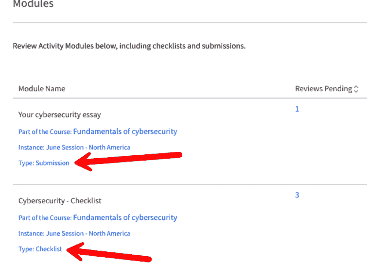

Figure 8.12 – 讲师的模块页面

活动类型（**提交**或**清单**）在列表中清晰标识，如前一屏幕截图中的箭头所示：

- 3. 点击**模块**列表中可用的任何**提交**活动以打开**提交**页面。

从那里，您可以快速查看学习者提交的所有文件。只需点击一份文件即可将其下载到您的计算机以便审阅。

- 4. 点击屏幕右上角的**编辑**按钮。

- 5. 您现在可以在上传的作业上输入讲师**评论**。

您可以通过选中**显示评论**复选框使评论对学习者可见。请注意，只有在提交被拒绝时，您的评论才会对学习者可见。

- 6. 最后，如果您作为讲师对提交内容满意，请点击**批准**按钮。

- 7. 您应为每位上传了提交内容的学习者重复此流程。

- 8. 完成后，您的屏幕应如下图所示。然后您可以点击页面右上角的**提交**按钮，让 Captivate Prime 保存此数据：

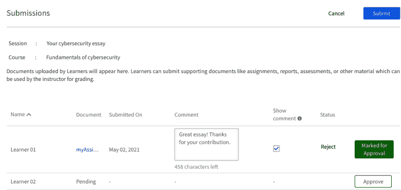

Figure 8.13 – 审阅文件提交

这就是讲师访问学习者提交的文件、添加评论并接受或拒绝提交的简单方式。在下一节中，您将回顾讲师如何填写清单活动。

## 填写清单活动

如*第 4 章，创建技能和课程*所述，清单活动是一种可添加到课程中的模块类型。

清单活动是 Captivate Prime 中可用的评估方法之一。它允许组织通过评估学习者在完成课程后行为的变化来评估课程的有效性。

其理念是讲师访问学习者在工作场所并填写表格，以评估特定课程如何*实际*转化为行为改变或生产力提高。通常，此类活动应在课程交付后几天或几周内进行。

现在让我们出发，访问您过去的学习者在工作场所，以便使用以下步骤填写清单活动：

- 1. 在您前学习者的工作地点与他/她见面，拍拍他/她的背，并花时间一起喝杯咖啡！虽然这不是强制性步骤，但这种人际互动总是非常有帮助且令人愉快！
- 2. 准备好后，以讲师身份登录您的 Prime 账户。
- 3. 从讲师主页，点击左侧边栏**模块**部分中的**提交/清单**链接。
- 4. 然后，点击适当的**清单**活动。
- 5. 在**清单**页面上，点击与您当前访问的学习者对应的**评估**链接。
- 6. 回答清单中的问题并点击对话框右下角的**提交**按钮。此操作在以下屏幕截图中进行了说明。

### 清单

根据以下提供的问题评估学习者。完成后选择提交。

Pass/Fail criteria is stated below.

合格标准如下所述。

Pass Criteria: 3 or more "Yes" responses

合格标准：3 个或更多“是”回答

Learner: Learner 01

学习者：Learner 01

Question 1
问题 1
The worker is able to identify a phishing email.
工人能够识别钓鱼邮件。
● Yes ○ No
● 是 ○ 否

Question 2
问题 2
The worker takes proper action when he/she identifies a phishing email.
工人在识别钓鱼邮件时采取适当措施。
● Yes ○ No
● 是 ○ 否

Question 3
问题 3
The worker has a strong password.
工人拥有强密码。
○ Yes ● No
○ 是 ● 否

Question 4
问题 4
The worker locks his/her workstation each time he/she leaves the workstation unattended.
工人每次离开无人看管的工作站时都会锁定其工作站。
● Yes ○ No
● 是 ○ 否

Cancel Submit

取消 提交

Figure 8.14 – 填写清单活动

提交清单时，正确回答的数量以及状态（通过或未通过）会立即显示。

清单中包含的问题是在第 4 章《创建技能和课程》中创建课程时由课程作者定义的。

## 摘要

在本章中，您已回顾了讲师角色。讲师的主要任务是开展（面对面或虚拟）课堂活动。请记住，与 *异步* 自学模块（如视频文件、PowerPoint 演示文稿、PDF 文档、SCORM 活动等）不同，课堂活动是有时间限制的 *同步* 活动，要求学习者和讲师在实际的物理地点或在线上共同参与。

这意味着全新的复杂程度和后勤限制，例如安排课程、管理候补名单、安排场地、及时向学习者发送实用细节、会在会议前发送提醒、确保每个人都已安装所需的视频会议软件、向 LMS 报告出勤情况等等。尽管 Captivate Prime 不能独自完成所有这些任务，但它为讲师提供了众多功能，极大地帮助管理课程中包含的讲师主导同步活动的后勤、行政和教学方面。

讲师还负责在学习者使用文件提交活动时审阅学习者提交的材料，并在课程交付后不久完成核对清单活动。

借助这些工具，您可以使用 Captivate Prime 开展各种培训，包括完全由自学异步模块组成的课程、完全由讲师（现场或在线）授课的课程，以及由同步和异步活动组成的课程。后者类型特别强大，因为它结合了同步和异步技术的优势。这种混合学习模式在学习者、讲师和组织中都很受欢迎。

您实施 Captivate Prime LMS、发布学习内容、创建课程并在线交付的努力开始取得成效。随着学习者和讲师现在能够以多种方式互动，您的 Captivate Prime 账户已焕发生机。

但要形成完整闭环并拥有一个真正可被视为企业级解决方案的方案，仍缺少一个至关重要的环节。所有这些学习活动和互动开始产生大量数据。此外，组织希望确保学习者对提供的学习体验感到满意，并且他们在培训上的投资是有意义且有效的。

在接下来的两章中，您将探讨 Captivate Prime 如何从学习者和经理那里收集反馈，以及组织如何利用所有这些信息生成有意义的报告。
