## 9 配置和使用反馈

感谢前几章完成的工作，您的 Captivate Prime 账户中正在进行大量活动。学习者正在学习课程并向其经理发送报名请求，经理正在审核报名请求并为其团队成员报名课程，讲师忙于授课和审阅学习者的提交内容，作者不断更新模块并创建新课程，等等。一切似乎都在最好的世界中进展顺利。

但事实真的如此吗？学习者喜欢这些课程吗？他们真的在获得新技能吗？学习效果如何？经理对培训后团队成员的行为变化和生产力提升是否满意？实施 Adobe Captivate Prime LMS 后，组织是否看到了投资回报？真相是……您不知道！

作为首选的企业 LMS，Adobe Captivate Prime 理解这种洞察对您的组织至关重要。这就是为什么 Adobe Captivate Prime 团队在平台中构建了广泛的、先进的反馈和报告功能。这使利益相关者能够衡量组织中学习的当前状态，评估学习和发展工作的有效性，监控组织内的合规水平，确定改进领域，不断重塑组织的学习和发展战略，并评估投资回报。

这些 Captivate Prime 功能基于一个名为 *学习评估的四个等级* 的理论模型，该模型由 Dr. Donald Kirkpatrick（1924–2014）在 1950 年代开发。本章首先对 Kirkpatrick 的学习评估四个等级模型进行快速理论概述，然后回顾这四个反馈和评估等级在 Captivate Prime 中的实现方式。

为实现这些目标，本章包含以下主要部分：

- 对 Kirkpatrick 的学习评估四个等级模型的快速了解
- 实现 L1 和 L3 反馈
- 检索 L1、L2 和 L3 反馈
- 使用评级

这些重要的反馈功能有助于使 Captivate Prime 成为市场上领先的企业 LMS 之一。但闲聊就到此为止！是时候立即回顾这些令人兴奋的功能了！

### 技术要求

要跟随本章的练习，您需要满足以下要求：

- 您必须拥有正在运行的 Captivate Prime 账户（可以是试用账户）的管理员访问权限。
- 您必须拥有至少有三名学习者注册的自定义课程。其中至少有一名学习者应已完成课程。
- 您必须使用先前提到的自定义课程中注册的学习者的经理的个人资料，通过经理访问权限访问您的 Prime 账户。

如果您已完成前几章的练习，您几乎可以开始本章了。只需确保您的学习者之一已完成您在 *第 4 章、创建技能和课程* 中创建的 *网络安全基础* 课程即可。为此，您可能需要以讲师身份登录，将该学习者标记为同步（现场）课程的出席者，并使用 *第 8 章、探索讲师角色* 中介绍的工具和技术接受学习者的提交内容。

### 对 Kirkpatrick 的学习评估四个等级模型的快速了解

Dr. Donald Kirkpatrick（1924 – 2014）是威斯康星大学的名誉教授。他在威斯康星大学管理学院度过了大部分职业生涯，教授诸如教练、变革管理、沟通和领导力等科目。他还担任过美国培训与发展协会（ASTD）的主席，并是《Training Magazine》名人堂成员。

在 1950 年代，他开发了学习评估四个等级模型（也称为 Kirkpatrick 模型或四个等级模型），该模型是他 1954 年博士论文的主题。他于 1994 年出版的《Evaluating Training Programs》一书使他的思想获得了全球关注。如今，该模型是最为人所知和广泛使用的培训评估模型之一。

> **更多信息**
> 您可以在 https://www.kirkpatrickpartners.com/ 找到有关 Dr. Donald Kirkpatrick 及其四个等级模型的更多信息。

Captivate Prime 的反馈和报告功能基于 Kirkpatrick 的四个等级模型，因此在进入 Captivate Prime 之前，让我们回顾一下该模型的主要思想。

Kirkpatrick 评估模型的四个等级如下：

- **第 1 级：反应**：目的是评估学习者的满意度。它包括诸如他们是否认为培训有用、有趣且与工作相关？他们是否喜欢这次经历？他们喜欢培训师吗？培训设施布置得好吗？等问题。
- **第 2 级：学习**：这一级是关于衡量学习者新技能或知识的获得。这是涉及评分和个人评估的等级。它包括诸如学习者如何回答测验？他们是否上传了作业？等问题。


-   **级别 3：行为**：该级别旨在确定参与者在工作中能够多大程度地应用培训中学到的知识。换句话说，它是关于衡量学习者在参加课程后行为的变化（例如生产力提高或办公室领导力改善）。
-   **级别 4：结果**：该级别衡量是否通过培训及配套支持计划实现了预期成果。这里我们开始衡量培训对整个组织的影响，而非关注每个单独的学习者。

实际上，大多数教师和培训师停留在 1 和 2 级，而从组织的角度来看，最有用的数据存在于 3 和 4 级。作为企业级 LMS，Captivate Prime 试图弥合这四个级别之间的差距，将尽可能多的有意义的数据提升到 3 级和 4 级，这反过来提供了学习对组织真实影响的信息，因此也提供了投资回报的信息。反向思考（从 L4 到 L1），Kirkpatrick 模型也可以成为帮助评估培训内容质量的一种方式。L1 和 L2 的成功更好地为 L3 甚至 L4 的成功做好准备。

> **有趣事实**
> 在 2011 年 5 月退休后，Donald Kirkpatrick 决定利用他的音乐天赋创作歌曲。你可以在 https://donkirkpatrick.bandcamp.com/ 收听他的歌曲。

现在你对 Kirkpatrick 四级模型的理论方面有了更多了解，让我们接下来几节看看它在 Adobe Captivate Prime 中的实现方式。

## 实现 L1 和 L3 反馈

本节中，你将回顾允许你在 Captivate Prime 账户上启用和管理 L1 和 L3 反馈的工具和选项。

> **L2 反馈怎么办？**
> L2 反馈对应于 Kirkpatrick 模型的 *学习* 级别。在 Captivate Prime 中，L2 反馈完全自动，无需管理员采取任何操作来启用或自定义它。这就是为什么本节不讨论 L2 反馈的原因。它将在本章后面的 *检索 L1、L2 和 L3 反馈* 部分讨论。

L1 反馈指的是 Kirkpatrick 学习评估四级模型的第一个级别。需要提醒的是，级别 1 被称为 *反应* 级别。它试图衡量学习者的整体满意度。在 Captivate Prime 中，L1 反馈是每个学习者在课程或学习计划结束时必须完成的表单。

L3 反馈指的是 Kirkpatrick 学习评估四级模型的第三个级别。这是 *行为* 级别，试图衡量学生在参加课程后行为是否发生变化。在 Captivate Prime 中，它是学习者的经理填写的表单，通常在学习者完成培训后的几天或几周后填写。

> **课程和学习计划**
> 请记住，虽然接下来几节讨论的是课程的 L1 和 L3 反馈，但所讨论的大多数功能也可以应用于学习计划。学习计划的 L1 和 L3 反馈的具体内容将在本章后面的 *学习计划的 L1 和 L3 反馈* 部分进行说明。

默认情况下，任何新 Prime 账户上的 L1 和 L3 反馈都是禁用的，但你可以覆盖此设置并为每个单独的课程（或学习计划）实例启用反馈。这就是你在下一节中将要检查的内容。

## 为课程实例启用 L1 和 L3 反馈

默认情况下，L1 和 L3 反馈在账户级别是禁用的，因为这对许多不熟悉 Kirkpatrick 模型或从未使用过提供此类反馈工作流程的 LMS 的培训师和人力资源经理来说可能是一种新方法。如果默认启用，将会有大量电子邮件交互，而大多数组织在 Captivate Prime 部署的早期阶段并不希望出现这种情况。

管理员可以通过为每个单独的课程启用 L1 和/或 L3 反馈来覆盖此账户默认值。换句话说，在创建新课程时，反馈默认处于 *禁用* 状态，除非管理员明确为该特定课程启用反馈。

更准确地说，反馈是针对每个单独的 *课程实例* 启用或禁用，而不是针对整个课程。这意味着对于同一门课程，你可以为某些实例启用反馈，同时让其他实例保持禁用状态。你还可以为每个单独的课程实例自定义 L1 和 L3 反馈。

还请记住，L1 和 L3 反馈是在学习者完成课程后触发的。因此，更改反馈选项仅影响未来的学习者以及尚未完成课程的当前学习者。在修改反馈选项时已完成课程的学习者不受更改影响。

你现在将使用以下步骤为 Prime 试用账户中可用的默认课程之一打开 L1 和 L3 反馈：

1.  以管理员身份登录你的 Prime 账户。
2.  从管理员主页，单击左侧边栏 **Learning** 部分中位于的 **Courses** 链接。
3.  将鼠标悬停在你想要启用反馈的课程的课程卡片上。

在本示例中，我选择了 **Color Masterclass: Simple Steps to Create Vivid Art** 课程。它是任何新 Prime 试用账户中自动提供的课程之一。如果该特定课程在你的账户中不可用，请选择任何（较短）可用课程。
4.  单击 **View Course** 链接以访问课程概览页面。
5.  从那里，单击左侧边栏 **Manage** 部分中位于的 **Instances** 链接。

该课程应该只有一个默认实例可用。如 *第 4 章，创建技能和课程* 中所述，每当你创建新课程时都会自动创建默认课程实例。大多数情况下，这个默认实例就是你所需要的。

如以下屏幕截图所示，该课程实例未启用反馈，正如课程实例的 **Feedback Enabled** 部分中出现的破折号所示（参见以下屏幕截图中的箭头）：

## Color Masterclass: Simple Steps to Create Vivid Art

### 实例

一个实例允许你将课程提供给不同受众，在不同时间和地点。一个实例拥有自己的徽章、反馈和其他设置。要创建课程的新实例，请单击 Add New Instance。

全部 活动 已退役 按...排序 新增实例

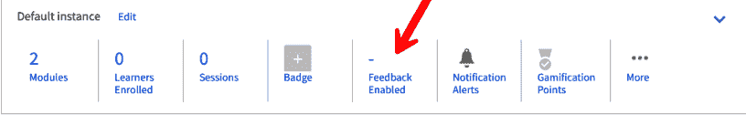

图 9.1 – 未启用反馈的课程的默认实例

你现在将为此课程实例启用 L1 和 L3 反馈。由于这是该特定课程唯一可用的课程实例，这意味着你为整个课程启用了 L1 和 L3 反馈。

6.  单击 Feedback Enabled 链接，由前一屏幕截图中的箭头标识。这将打开该特定课程实例的反馈选项。
7.  打开 L1 Reaction Feedback。此操作会在屏幕上显示一些额外的选项。
8.  在 Question 1 字段中输入 Do you have any other comments or suggestions about this course？

```
Do you have any other comments or suggestions about this course?
```

花一些时间查看其他可用选项，但此时不要更改任何选项。
9.  向下滚动页面并打开 L3 Behavior Change Feedback。

花必要的时间查看可用的 L3 反馈选项。注意 Question 1 字段中已存在的题目引导以及 Answer Format，它设置为 Likert Scale。还请注意 Question 2 字段默认为空。确保此时不要更改这些选项中的任何一个。

10.  当你的屏幕看起来像以下屏幕截图时，单击右下角的蓝色复选标记以验证你的更改（参见以下屏幕截图中的箭头）：

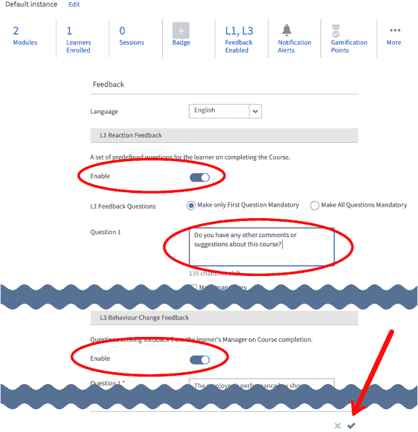

图 9.2 – 课程实例的反馈选项表单摘录

单击蓝色复选标记后，你应该会看到 L1 和 L3 反馈已为默认课程实例启用。从现在开始，每当学习者完成此课程时，他们将被要求提供 L1 反馈，他们的经理将被要求提供 L3 反馈。这就是你在接下来的两个部分中将要回顾的内容。


## 作为学习者提供 L1 反馈

现在 L1 反馈已为某门课程（实际上是 *课程实例*）启用，你将以学习者身份登录你的 Prime 账户，注册该课程并学习。如果一切顺利，系统在你完成课程后应提示你提供 L1 反馈。让我们通过以下步骤来检查：

- 1. 打开浏览器新的隐私窗口（或使用另一个浏览器），以 *学习者 01* 身份登录你的 Prime 账户。
- 2. 登录后，点击学习者主页 **我的学习清单** 部分中的 **前往目录** 链接。
- 3. 使用 *第 6 章、将用户注册到课程* 中描述的目录功能，注册你在上一节中启用了 L1 和 L3 反馈的课程。

> **提示**
> 默认情况下，目录中课程按从最新到最早的顺序显示，但不要犹豫使用屏幕右上角的 **搜索** 字段来搜索合适的课程。

- 4. 注册后，Fluidic Player 打开并开始课程。查看课程中包含的所有模块。如果使用的是新 Prime 试用账户中默认提供的课程，则最多只有一到两个视频需要查看。
- 5. 查看完所有课程材料后，关闭 fluidic player 以返回课程概览页面。

现在你已作为学生完成了课程，是时候提供 L1 反馈了。默认情况下，*学习者 01* 应收到来自 Captivate Prime 的电子邮件，询问他/她为刚完成的课程提供 L1 反馈。Captivate Prime 的通知区域中也提供了通知。

- 6. 点击屏幕右上角的通知图标。

7. 点击你刚完成的课程的 **提供反馈** 链接，如以下屏幕截图所示：

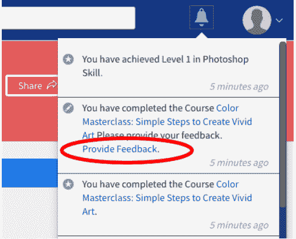

图 9.3 – Learner 01 通知区域中的提供反馈链接

点击此链接会打开 **课程反馈** 表单，其中包含六个预定义问题，要求学生对刚经历的课程体验提供反馈。

这些问题对应于 Kirkpatrick 课程评估模型的第一个层级。提醒一下，这是 *反应* 层级，学生在此层级被要求报告他们对课程体验的整体满意度。

8. 回答问题并点击 **课程反馈** 表单右下角的 **完成** 按钮。

在此过程中，请花必要的时间仔细阅读所有问题。注意你在表单末尾为此课程实例定义的自定义问题。在本章后面的部分，你将学习如何自定义此表单的其他问题。

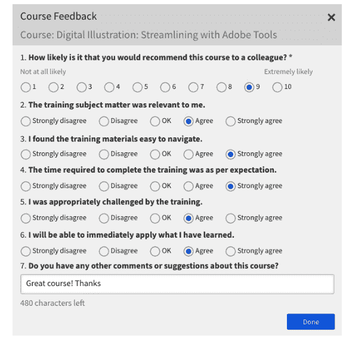

图 9.4 – 末尾带有自定义问题的 L1 反馈表单

在本节中，你已了解学习者在完成课程后如何提供 L1 反馈。但不要忘记你也为此课程启用了 L3 反馈。L3 反馈由学习者的经理提供，将在下一节中讨论。

## 作为经理提供 L3 反馈

L3 反馈对应于 Kirkpatrick 四层模型的第三层级。
提醒一下，这是行为层级，旨在衡量培训是否会在学习者返回工作场所后导致其行为发生变化。

在 Captivate Prime 中，经理负责提交 L3 反馈。毕竟，谁比员工的直接经理更适合衡量培训后的行为变化呢？通常，L3 反馈应在员工完成培训后几周内提交。

默认情况下，Captivate Prime 会在课程完成后 45 天向员工的经理发送电子邮件。这就是为什么你无法立即尝试提供 L3 反馈的原因。以下屏幕截图说明了经理必须完成的默认 L3 反馈表单。你应该能认出你在本章前面 *为课程实例启用 L1 和 L3 反馈* 部分中检查过的默认问题：

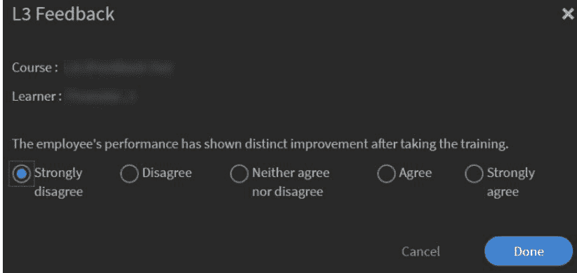

图 9.5 – 默认 L3 反馈表单

在团队成员完成培训后提供 L3 反馈，经理必须执行以下步骤：

- 1. 以经理身份登录你的 Captivate Prime 账户。
- 2. 使用屏幕右上角的用户图标切换到经理角色。事实上，提供 L3 反馈是经理角色的特殊权限之一，因此经理必须明确切换到该角色才能访问 L3 反馈表单。
- 3. 从经理主页点击左侧边栏 **查看** 部分中的 **通知** 链接。
- 4. 进入 **通知** 页面后，点击 **待处理任务** 选项卡。

该经理必须提供的待处理 L3 反馈将列在 **待处理任务** 列表的 **提供反馈** 部分中，如以下屏幕截图所示：

### 通知

通知是由 LMS 中各种事件触发的警报。

所有通知待处理任务

### 批准学习者

### 提供反馈

无此类通知。

### 认证审批

图 9.6 – 作为经理提供 L3 反馈

现在，让我们诚实一点！我们都知道很少有人在每天工作开始时登录 LMS。这就是为什么 Captivate Prime 还会向经理发送提醒电子邮件，其中包含指向相应 L3 反馈表单的直接链接。当然，这就是大多数 L3 反馈表单被访问和提交的方式。

在前几节中，你已回顾了 L1 和 L3 反馈背后的主要原则。让我们快速总结一下迄今为止你所学的内容：

- 默认情况下，任何新 Prime 账户上都禁用 L1 和 L3 反馈。
- 在课程实例级别激活 L1 和 L3 反馈。这意味着你可以拥有一些启用了反馈的课程实例，而同一课程的其他课程实例则禁用反馈。
- 默认情况下，L1 反馈表单包含六个预定义问题，你可以添加多达两个自定义问题。这允许你为课程实例定义特定问题，例如关于特定讲师或特定场地的问題。
- L1 反馈由学习者在完成课程后提供。L3 反馈由学习者的经理提供。默认情况下，L3 反馈在团队成员完成课程后 45 天提供给经理。

在下一节中，你将回顾 **实例默认值**，它允许你为给定课程的未来课程实例定义默认值。

## 自定义课程实例默认值

回到 *第 6 章、将用户注册到课程*，你了解了课程实例。让我们简要回顾一下课程实例是什么以及它们允许你做什么：

- 学习者注册的是课程实例，而不是课程本身。
- 创建课程时，会同时创建默认课程实例。学习者实际注册的就是此默认实例。在大多数情况下，此默认课程实例已足够。
- 你想要创建额外课程实例的主要情况是课程包含有时限的同步活动，例如现场或虚拟课堂会议。在这种情况下，课程实例允许你安排多个课程场次，使用不同的讲师、在不同地点、以不同语言等。

在前面的部分中，你了解到课程实例也是你决定启用或禁用 L1 和/或 L3 反馈的地方。

在本节中，你将了解如何修改课程实例的默认值。这些默认值适用于给定课程的所有未来课程实例。让我们通过以下步骤亲手回顾此工作流程：

- 1. 以管理员身份登录你的 Prime 账户。
- 2. 从管理员主页点击左侧边栏 **学习** 部分中的 **课程** 链接。
- 3. 将鼠标悬停在你想要编辑默认实例属性的课程卡上。
- 4. 点击 **查看课程** 链接以打开课程概览页面。
- 5. 接下来，点击左侧边栏 **配置** 部分中的 **实例默认值** 链接。


在此页面上，您可以修改将应用于所选课程所有未来课程实例的默认值。

- 6. 启用 **L1 反应反馈**。
- 7. 在 **问题 1** 字段中输入 `Do you have any other comments or suggestions about this course?`。
- 8. 向下滚动页面并同时启用 **L3 行为改变反馈**。

其他反馈相关选项与本章前面 *为课程实例启用 L1 和 L3 反馈* 部分中讨论的内容完全相同。

- 9. 花点时间查看其他可用选项。请注意，您也可以默认启用或禁用徽章。

徽章将在 *第 11 章，徽章与游戏化* 中讨论。

- 10. 准备就绪后，点击屏幕右上角的 **保存** 按钮。

从现在开始，您为该特定课程创建的任何新课程实例都将继承您刚刚定义的默认值。

这非常有用，可以确保每个课程实例都遵循一套基本规则和最佳实践。它还简化了新课程实例的创建，使管理员的工作变得更轻松。请记住，这些只是默认值。这意味着您可以为创建的每个新实例覆盖这些默认值。换句话说，Prime 在创建新实例时不会严格执行这些设置。此外，您刚刚定义的不同值仅适用于 *未来* 的课程实例；现有课程实例不受这些更改的影响。

在下一节中，您将了解如何默认在您的 Prime 账户上激活 L1 和 L3 反馈，以及如何自定义 L1 反馈表单中出现的问题列表。

## 账户级别的 L1 和 L3 反馈

默认情况下，您的 Prime 账户上已禁用 L1 和 L3 反馈。在之前的章节中，您学习了如何为特定课程实例启用 L1 和 L3 反馈，或默认情况下为给定课程的所有未来实例启用反馈。

您现在将查看账户级别可用的 L1 和 L3 反馈选项。这将允许您执行以下操作：

- 默认情况下为在您的 Prime 账户上创建的任何新课程打开 L1 反馈。
- 修改 L1 反馈表单上显示的问题。
- 修改向学习者（针对 L1 反馈）和经理（针对 L3 反馈）发送提醒的时间。

让我们在接下来的几个部分中逐一回顾这些项目。

## 默认情况下打开 L1 反馈

让我们使用以下步骤开始在您的 Prime 账户上默认启用 L1 反馈：

- 1. 以管理员身份登录您的 Prime 账户。
- 2. 从管理员主页，点击左侧边栏 配置 部分末尾的 设置链接。
- 3. 然后，点击左侧边栏 基础 部分中的 反馈链接。

如以下屏幕截图所示，这将带您进入 反馈设置 页面的 L1 反馈 选项卡：

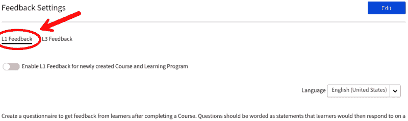

图 9.7 – 反馈设置页面的 L1 反馈 选项卡

- 4. 点击屏幕右上角的 编辑链接。
- 5. 启用 为新创建的课程和学习计划启用 L1 反馈 选项。
- 6. 点击屏幕右上角的 保存 按钮。

从现在开始，您在 Prime 账户上创建的新课程和学习计划默认将启用 L1 反馈。重要的是要记住，这仅影响 *未来* 的课程和学习计划。现有课程和学习计划不受此更改影响。

> **注意**
> 如同您对此类工作流程所做的任何其他重要更改一样，正确地向学习者传达它非常重要。毕竟，这额外的反馈步骤对他们来说也是新的。因此，告知学习者此反馈步骤是强制性的非常重要，因为如果没有正确告知更改，许多学习者会忽略它。

还值得注意的是，L1 反馈也适用于学习计划。这将在未来的章节中更详细地讨论。

在下一节中，让我们回顾如何自定义 L1 反馈表单的内容。

## 修改 L1 和 L3 反馈表单的内容

当您在 *作为学习者提供 L1 反馈* 部分作为学习者填写 L1 反馈表单时，除了您在课程实例级别定义的自定义问题外，还有六个预定义问题。在本节中，您将学习如何修改这些预定义问题。

请注意，此操作是在账户级别执行的，因此您在本节中定义的问题将用于 Prime 账户上的所有课程实例。

使用以下步骤自定义 L1 反馈表单的内容：

- 1. 以管理员身份登录您的 Prime 账户。
- 2. 从管理员主页，点击左侧边栏 **配置** 部分末尾的 **设置** 链接。
- 3. 然后，点击左侧边栏 **基础** 部分中的 **反馈** 链接。
- 4. 点击屏幕右上角的 **编辑** 链接。
- 5. 向下滚动页面，直到看到问题列表。

如以下屏幕截图所示，您可以使用切换按钮启用或禁用每个问题。

您还可以使用列表底部的 添加更多 链接修改问题词干并添加附加问题（请参阅以下屏幕截图中的箭头）。

还请注意页面右上角的语言下拉列表，它允许您选择要修改的 L1 问题的语言：

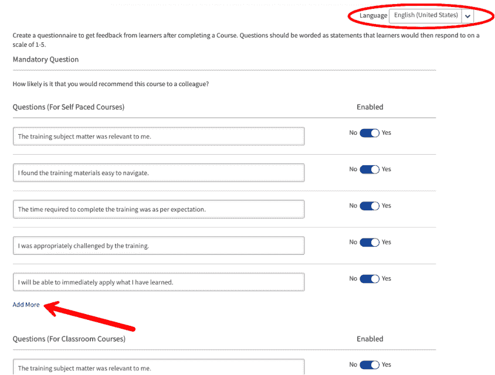

图 9.8 – 修改 L1 反馈表单的问题

在继续之前，请注意页面顶部有一个强制性问题（您向同事推荐该课程的可能性有多大？），您无法编辑或禁用此问题。还请注意，存在针对 自定进度课程 和 面授课程 的单独问题集（面授课程是指仅包含面授同步（现场或虚拟）活动的课程）。

- 6. 向下滚动页面，直到看到 L1 反馈提醒 部分。
- 7. 点击左侧列中的现有提醒，以在右侧列中查看其属性。

如以下屏幕截图所示，默认情况下，L1 反馈提醒会在课程完成后直接发送给学习者。如果学习者未填写表单，提醒将每周重复一次，持续 4 周：

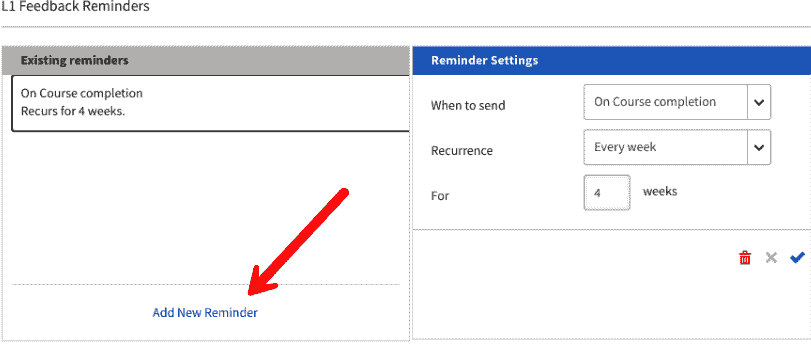

图 9.9 – L1 反馈提醒

当然，您可以使用左侧列末尾的 添加新提醒 链接修改此默认提醒和/或添加附加提醒（请参阅前一屏幕截图中的箭头）。

- 8. 花必要的时间检查此页面上可用的问题和控件。准备就绪后，点击页面右上角的 取消 按钮以丢弃您可能所做的任何更改。
- 9. 点击页面左上角的 L3 反馈 选项卡以访问与 L3 反馈相关的选项。
- 10. 花必要的时间查看可用选项。

请注意，默认的 L3 反馈提醒在课程完成后 45 天触发，如以下屏幕截图所示。当然，您可以使用本节前面为 L1 反馈描述的完全相同流程修改这些设置：

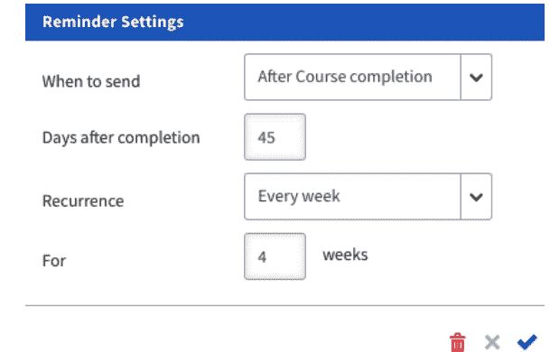

图 9.10 – 默认 L3 反馈提醒

您现在应该对账户级别可用的反馈选项有一个大致的了解。请记住，这些选项适用于 Prime 账户的每个课程和每个课程实例。还请记住，您可以在课程实例级别定义多达两个额外的 L1 问题和一个额外的 L3 问题。

在下一节中，您将快速讨论将 L1 和 L3 反馈应用于学习计划的情况。

## 学习计划的 L1 和 L3 反馈

L1、L2 和 L3 反馈也适用于学习计划，本章迄今为止讨论的所有 L1 和 L3 反馈功能也适用于学习计划。


作为提醒，学习计划是一组相关课程。当学习者注册学习计划时，他们实际上注册了该学习计划包含的所有课程。*第 6 章，注册用户参加课程* 中已讨论过创建学习计划。

让我们使用以下步骤回顾与学习计划的 L1 和 L3 反馈相关的选项：

- 1. 以管理员身份登录您的 Prime 账户。
- 2. 从管理员主页，单击左侧边栏 **学习** 部分中的 **学习计划** 链接。这会将您带到 Prime 账户中可用的学习计划列表。
- 3. 将鼠标悬停在列表中任何可用的学习计划上。

如果您已完成 *第 6 章，注册用户参加课程* 中的练习，请选择 **精通照片编辑** 学习计划。请记住，此特定学习计划包含两门课程：一门关于 Adobe Photoshop 的课程，另一门关于 Adobe Lightroom 的课程。
- 4. 单击 **查看学习计划** 链接以打开学习计划概览页面。
- 5. 接下来，单击左侧边栏 **管理** 部分中的 **实例** 链接。

就像课程一样，学习计划也有实例。每次定义新的学习计划时都会自动创建一个默认实例。大多数情况下，此默认实例已足够，但有时定义额外的学习计划实例会很有用。这已在 *第 6 章，注册用户参加课程* 中讨论过。

- 6. 单击默认学习计划实例的 **反馈已启用** 链接以打开 L1 和 L3 反馈选项。

如以下屏幕截图所示，可用的选项与课程实例的选项类似，但有一些重要区别：

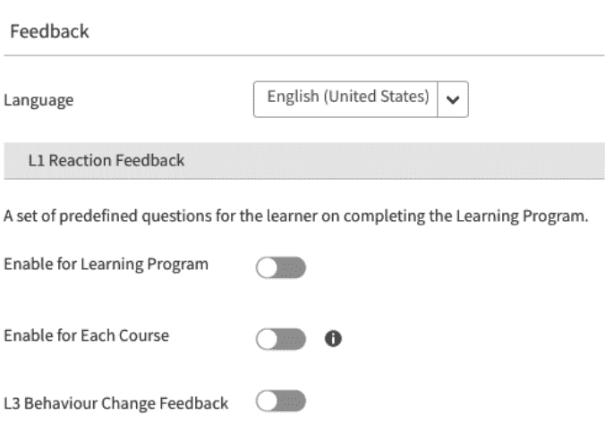

图 9.11 – 学习计划的 L1 和 L3 反馈选项

前述屏幕截图中有三个切换按钮，默认情况下全部关闭。可用的选项反映了学习计划由多个课程组成这一事实。这意味着学习计划中包含的一些（或全部）课程可能已为其各自的实例启用了 L1 和/或 L3 反馈。让我们看看每个课程的反馈选项如何（或不）与整个学习计划的反馈选项相互影响：

- 打开 **为学习计划启用** 按钮时，您将为整个学习计划激活 L1 反馈。这意味着学习者在完成学习计划中包含的 *所有课程* 后将被要求 *一次* 填写 L1 反馈表。

- 如果您还想强制执行学习计划中包含的每个课程的 L1 反馈选项，则还必须打开 **为每个课程启用** 按钮。
在这种情况下，如果学习计划中包含的课程已启用 L1 反馈，学习者将被提示为这些课程填写 L1 反馈表 *另外* 再填写整个学习计划的 L1 反馈表。请注意，如果学习计划中包含的课程均未启用 L1 反馈，则此按钮 *无效*。重要的是要理解，此按钮 *不会* 为每个课程激活 L1 反馈。它只是指示学习计划在学习计划级别定义的内容 *之外* 再应用课程级别定义的内容。还值得一提的是，此按钮仅适用于 L1 反馈，不适用于 L3 反馈。
- 打开 **L3 行为改变反馈** 可为整个学习计划启用 L3 反馈。请注意，如果学习计划中包含的课程已启用 L3 反馈，Captivate Prime *不会* 遵守课程级别的 L3 反馈。只会考虑学习计划的 L3 反馈。这样做是为了防止团队成员注册学习计划时繁忙的经理收到过多的 L3 反馈请求。

请花必要的时间查看可用选项。在前几节和章节的讨论之后，它们应该不言自明。准备好后，返回管理员主页。

到目前为止，本章已讨论了课程实例、学习计划实例和账户级别的 L1 和 L3 反馈选项。您还了解了作为学习者如何提交 L1 反馈，以及团队成员完成课程后经理如何提交 L3 反馈。

在下一节中，我们将讨论如何检索和使用这些数据。您还将了解更多关于 L2 反馈的信息。

## 检索 L1、L2 和 L3 反馈

收集数据只是第一步。最重要的是能够访问和使用数据，以便生成有意义的报告并做出明智的业务决策。

要查看 L1、L2 和 L3 反馈数据，您必须是管理员或经理。这两个角色的区别在于，管理员可以访问平台上所有可用数据，而经理只能访问与其团队成员相关的数据。

在本节中，您将以管理员身份登录您的 Captivate Prime 账户，并查看如何访问可用的 L1、L2 和 L3 反馈数据。

### 访问 L1 和 L3 反馈数据

请记住，L1 和 L3 反馈是在课程实例或学习计划实例级别收集的。因此，要访问这些数据，您需要访问您想要查看反馈的课程或学习计划。让我们通过以下步骤实际操作一下此工作流程：

- 1. 以管理员身份登录您的 Prime 账户。
- 2. 从管理员主页，单击左侧边栏 学习 部分中的 课程 链接。
- 3. 将鼠标悬停在您想要查看数据的课程的课程卡片上。
在此示例中，选择 Color Masterclass: Simple Steps to Create Vivid Art 课程，或本章前面您已提供 L1 反馈的任何其他课程。
- 4. 单击 查看课程 链接以访问课程概览页面。
- 5. 单击左侧边栏 报告 部分中的 L1 反馈 链接。
- 6. 如果课程有多个实例，请使用 选择实例 下拉列表选择您想要查看 L1 反馈的课程实例。

这将打开课程 L1 反馈页面，如以下屏幕截图所示：

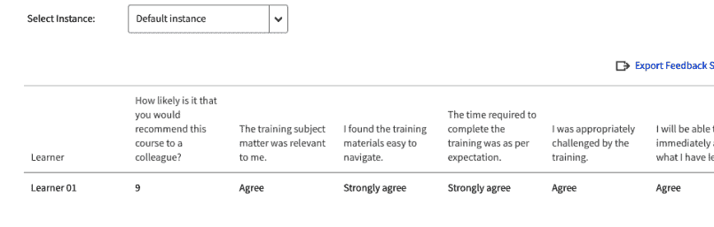

图 9.12 – 管理员查看的课程 L1 反馈页面

在前述屏幕截图中，迄今为止只有 **学员 01** 提供了 L1 反馈。您应该能认出 L1 反馈表单上显示的问题题干，以及本章前面 *作为学习者提供 L1 反馈* 部分中您提供的答案。

还请注意页面右上角的 **导出反馈分数** 链接，它允许您导出包含所有 L1 反馈数据的 Excel 文件。

访问 L3 反馈的方式完全相同。

- 7. 单击左侧边栏 **报告** 部分中的 **L3 反馈** 链接以打开所选课程的 **L3 反馈** 页面。

本页显示由经理提供的 L3 反馈。请记住，默认情况下，经理会在学习者完成课程后 45 天收到提供 L3 反馈的提醒。因此，在您的试用 Prime 账户中您可能还没有任何 L3 反馈可用。以下屏幕截图取自具有更长历史记录的另一个 Prime 账户。学习者的姓名已模糊处理以保护隐私：

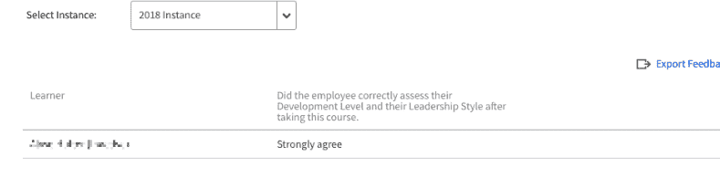

图 9.13 – 管理员查看的课程 L3 反馈

在前述屏幕截图中，您应该注意到 L3 反馈页面与前面讨论的 L1 反馈页面非常相似。还请注意页面右上角可用的完全相同的 **导出反馈分数** 链接。

在结束本节之前，请记住完全相同的 L1 和 L3 反馈页面也适用于学习计划，并且经理也可以使用相同的工具来查看与其团队成员相关的数据。

在本节中，您已了解管理员如何访问 L1 和 L3 反馈数据。现在是时候在下一节讨论 L2 反馈了。


## 访问 L2 反馈数据

L2 反馈指的是 Kirkpatrick 学习评估模型四个层级中的第二层级。顺便提醒一下，这就是 *学习* 层级，即涉及评分和个人评估以衡量学习者新技能或知识的获取程度的层级。L2 反馈检查学习者在测验上的表现，以及他们在各种作业上的结果。

在 Captivate Prime 中，L2 反馈指的是学习者在学习课程和学习项目时取得的测验分数。这些分数来自课程中包含的所有评分活动，以及交互式课程模块中包含的测验，其结果通过 AICC、SCORM 或 xAPI 标准报告给 LMS。

因此，在 Captivate Prime 中 L2 反馈大多是自动的。您无需做任何操作即可为课程或学习项目启用 L2 反馈并让 Captivate Prime LMS 收集此数据。课程或学习项目启用 L2 反馈的唯一要求是包含至少一个评分活动或测验。请注意，对于某些活动（如文件提交和清单），成绩必须由讲师手动输入系统，如 *第 8 章，探索讲师角色* 中所述。

> **AICC、SCORM 和 xAPI**
> AICC、SCORM 和 xAPI 是 eLearning 行业用于在交互式课程模块与 LMS 之间传输数据的三种标准。Captivate Prime 支持全部三种标准，因此 Captivate Prime 可以托管几乎任何 eLearning 制作工具创建的内容。有关 AICC、SCORM 和 xAPI 的更多信息，请参阅 *第 3 章，上传学习内容和管理内容库*。

当您在 *第 4 章，创建技能和课程* 中创建 *网络安全基础* 课程时，您包含了一个包含测验的 SCORM 兼容活动。该活动是使用 Adobe Captivate 制作工具构建的，但请记住 Captivate Prime 可以托管由 *任何* AICC、SCORM 或 xAPI 兼容制作工具创建的内容。

您现在将通过以下步骤查看管理员和经理如何访问测验数据：

- 1. 以管理员身份登录您的 Captivate Prime 账户。
- 2. 从管理员主页，单击左侧边栏 **学习** 部分中位于的 **课程** 链接。
- 3. 将鼠标悬停在 **网络安全基础** 课程卡上，或悬停在包含至少一个评分活动的任何课程卡上。
- 4. 单击 **查看课程** 链接以访问课程概览页面。
- 5. 单击左侧边栏 **报告** 部分中位于的 **L2 测验分数** 链接。
- 6. 如果所选课程包含多个实例，请打开 **选择实例** 下拉菜单以选择您要查看数据的课程实例。

这就是如何访问特定课程反馈的方式，如以下屏幕截图所示：

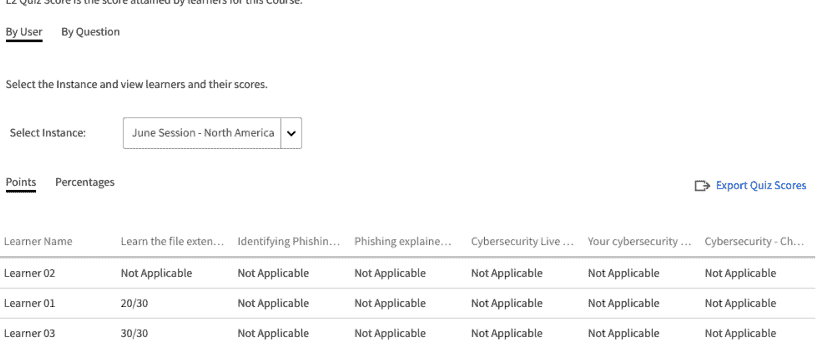

图 9.14 – 管理员查看的课程 L2 反馈页面

在之前的屏幕截图中，该课程中只有一个模块是评分模块或包含测验的模块，其分数通过 AICC、SCORM 或 xAPI 报告给 Prime。请注意页面右上角的 **导出测验分数** 链接。它允许您生成一个包含所选课程实例所有可用测验分数的 Excel 文件。

> **注意**
> 上述屏幕截图对应的 Excel 报告可在本书关联的下载内容中的 reports/L2QuizScores.xlsx 文件中找到。

您现在将继续使用 Captivate Prime 中提供的工具来试验 L2 反馈数据：

- 7. 单击数据表左上角的 **百分比** 选项卡，以使用百分比而不是分数查看分数。
- 8. 接下来，单击页面左上角的 **按问题** 选项卡。

这使您可以详细了解课程中各个评分模块包含的所有测验问题。

> **注意**
> 对于 AICC、SCORM 或 xAPI 模块，请记住 Captivate Prime 只是涉及的两个方之一，另一方是每个单独的模块，这些模块可以由各种制作工具生成。例如，**按问题** 选项卡中显示的详细数据只有在各个课程模块将相应的交互数据传输到 LMS 时才可用。这必须在用于生成 AICC、SCORM 或 xAPI 包的制作工具中定义。某些制作工具支持此功能，而其他工具则不支持。此外，详细报告可能对某些课程模块启用，而对其他模块则不启用。换句话说，不要太快就责怪 Captivate Prime 数据缺失，并确保在用于构建课程模块的任何制作工具中正确配置报告。

花点时间查看可用数据，并将您在屏幕上看到的内容与您在 *第 7 章，回顾学习者体验* 中作为学习者学习课程时的经历联系起来。

此外，您可能会对 *论文* 或 *清单* 活动缺乏可用数据感到困惑。请记住，这些活动已在 *第 8 章，探索讲师角色* 中由讲师审核过。但讲师只需 *批准* 或 *拒绝* 这些活动，而无需实际评分，这就解释了为什么这些活动没有 L2 数据可用。要对这些活动进行评分，您必须在以作者身份登录时创建课程时选中 **为此模块启用评分** 复选框。以下屏幕截图为您参考说明了该复选框：

图 9.15 – 将文件提交活动设为评分活动

在本节中，您了解了 Captivate Prime 中的 L2 反馈。请记住，收集 L2 数据大多是自动的。数据要么来自交互式学习模块发送到 LMS 的 AICC、SCORM 或 xAPI 报告，要么由讲师手动输入系统。

L1、L2 和 L3 数据也由系统用于自动计算课程有效性分数。这将在下一节中讨论。

## 使用评分

随着近年来电子商务的蓬勃发展，我们已经习惯于使用日益增多的电子商务网站和服务在线购买商品。几乎所有这些电子商务网站至少有一个共同点：评分和评论系统。事实上，这些评分和评论是将单纯兴趣转化为实际购买过程的重要组成部分。的确，也许正是这些评论说服您购买了您正在阅读的这本书！

在 Amazon、Booking.com、Netflix 以及其他此类网站和服务上成立的原则，在 Captivate Prime 课程目录中同样成立。这就是为什么学习者能够使用五星评分标准对他们正在学习的课程进行评分的原因。

> **新功能**
> 星级评分是随 2021 年 8 月 Captivate Prime 更新而引入的新功能。如果您使用的是较旧的账户（在 2021 年 8 月中旬之前创建），星级评分可能完全被禁用或被旧的课程有效性分数取代。课程有效性分数将在本节后面讨论。

默认情况下，星级评分功能在任何新 Prime 账户上均已启用。让我们通过以下步骤来检查：

- 1. 以管理员身份登录您的 Captivate Prime 账户。
- 2. 从管理员主页，单击左侧边栏 配置 部分中位于的 设置 链接。
- 3. 然后，单击左侧边栏 基础 部分中位于的 通用 链接。
- 4. 向下滚动页面，直到看到 显示评分 部分。

默认情况下，显示评分 选项应已启用并设置为 星级评分 模式，如以下屏幕截图所示：

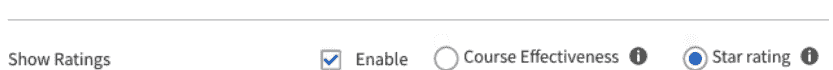

图 9.16 – 显示评分选项默认已启用


现在您将以 *Learner 01* 的身份登录您的 Prime 账户，并查看这些评级如何影响学习者体验：

-   5. 以 *Learner 01* 的身份登录您的 Prime 账户。由于您未为 *Learner 01* 分配特殊角色，系统应默认将您重定向到学习者体验。
-   6. 登录为学习者后，使用左侧边栏上的 **目录** 图标前往课程目录。

现在是时候关注每个课程卡片右上角可见的 **NR** 标签了，如以下屏幕截图所示：

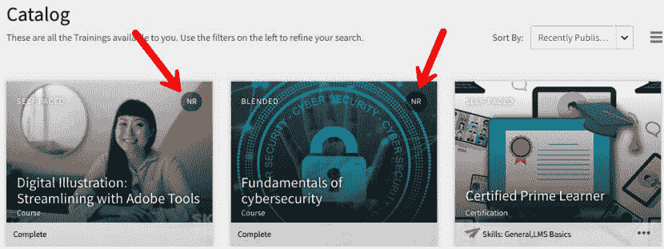

**NR** 代表 **未评级**。当信息不足以显示课程的星级评分时，Captivate Prime 会使用此标记。

在前面的屏幕截图中，请注意 **Certified Prime Learner** 项目没有此类 **NR** 标签。这是因为 **Certified Prime Learner** 不是课程，而是认证。星级评分仅适用于课程和学习项目。

现在您将访问 *Learner 01* 的 **我的学习** 页面。请记住，此页面列出了 *Learner 01* 目前注册的所有培训项目（课程、学习项目、认证等）：

-   7. 点击左侧边栏上的 **我的学习** 图标以打开 *Learner 01* 的 **我的学习** 页面。
-   8. 通过将鼠标悬停在课程卡片上时出现的 **查看课程** 链接，打开 *Learner 01* 目前注册或已完成的任何课程。

-   9. 在课程概览页面上，使用左侧边栏的 **评定此培训** 部分以 1 到 5 星的等级提交 *Learner 01* 对该课程的评分。
-   10. 完成后，使用左侧边栏的 **目录** 图标返回学习者体验的 **目录** 页面。
-   11. 确认您刚刚提交的星级评分现在在目录中的课程卡片上可见，如以下屏幕截图所示：

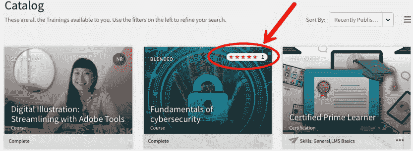

Figure 9.18 – 目录中课程卡片上可见星级评分

此功能使正在学习课程的学习者能够快速提交评分，也使浏览课程目录的学习者能够轻松识别出获得之前学习者最高评分的课程和学习项目。

## 了解课程有效性评分

除了上一节讨论的星级评分外，Captivate Prime 还会为每门课程计算课程有效性评分。

课程有效性评分由 Captivate Prime 自动计算，通过结合 L1、L2 和 L3 反馈的结果得出。Captivate Prime 为您 Prime 账户上可用的每门课程和学习项目计算出满分为 100 分的有效性评分。让我们通过以下步骤实际查看一下：

-   1. 以管理员身份登录您的 Captivate Prime 账户。
-   2. 从管理员主页，点击左侧边栏 **学习** 部分中的 **课程** 链接，以访问您 Prime 账户上当前可用的课程列表。

-   3. 打开 Sort By 下拉菜单并选择按 Course Effectiveness 对列表进行排序（请参阅以下屏幕截图中圈出的项目）。

此最后一步不是强制性的，但可以更轻松地查看课程有效性评分。如以下屏幕截图所示，课程有效性评分显示在每个课程卡片的右上角附近：

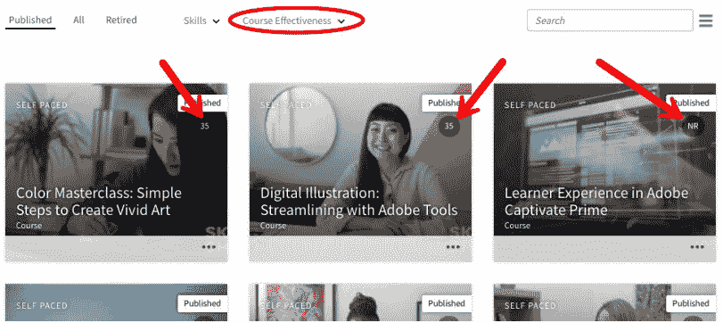

Figure 9.19 – 管理员看到的课程有效性评分

请注意，管理员看不到学习者提交的星级评分。实际上，如果启用了星级评分，它仅在学习者体验中对学习者可见。

如果 Captivate Prime 没有足够的数据来计算课程有效性，则相应课程未被评级，由 NR 标签表示（请参阅前一屏幕截图中的第三个箭头）。

可以通过点击课程卡片上的评分来查看每个课程有效性评分的细分情况。这有助于您更好地了解 Captivate Prime 如何为每门课程计算评分：

-   4. 点击列表中显示的第一门课程的评分，以打开该课程的 Course Effectiveness 框。
-   5. 此外，点击 How Course Effectiveness is calculated 链接以深入了解 Captivate Prime 如何计算课程有效性评分。

如以下屏幕截图所示，Captivate Prime 在计算课程有效性评分时会考虑 L1、L2 和 L3 反馈数据：

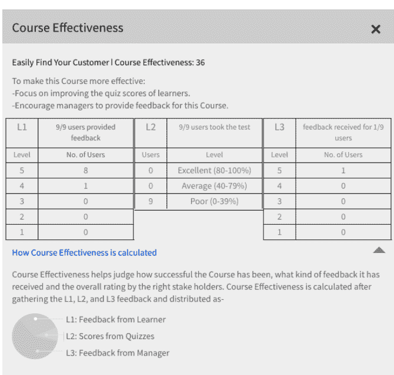

Figure 9.20 – 课程有效性对话框

请注意，前面的屏幕截图是在拥有更多课程和更多学习者的旧 Captivate Prime 账户上截取的，因此生成了更多数据，以便 Captivate Prime 更准确地计算课程有效性评分。

花点时间阅读 Course Effectiveness 对话框的下半部分。请注意，2/3 的评分基于来自经理的 L3 反馈。请记住，经理通常在学习者完成课程至少 45 天后才输入 L3 反馈。在此时间范围内，Captivate Prime 在计算课程有效性评分时无法考虑 L3 反馈，这解释了您 Prime 试用账户上当前托管的课程评分相对较低的原因。

课程有效性评分对于大致了解课程的有效性很有用，但如上一段末尾所述，在许多情况下它可能具有一定的误导性。

尽管如此，您仍可以使用以下步骤将课程有效性评分显示给学习者，而不是显示星级评分：

-   6. 关闭当前打开的任何 **课程有效性** 对话框。
-   7. 从管理员主页，点击左侧边栏末尾 **配置** 部分中的 **设置** 链接。
-   8. 接下来，点击左侧边栏 **基础** 部分中的 **常规** 链接。
-   9. 在页面底部，选择 **课程有效性** 单选按钮。

使用此配置，课程有效性评分将取代学习者体验中的星级评分信息。请注意，这不会影响 Captivate Prime 的其他角色。例如，管理员在浏览管理员应用程序的课程部分时仍会看到课程有效性评分。

现在您将恢复到默认情况并启用星级评分。

-   10. 将 **显示评分** 选项切回 **星级评分**。

在本节中，您讨论了 Captivate Prime 的 **评分** 功能。请记住，它默认启用并设置为 **星级评分** 模式，这意味着学习者可以对课程和学习项目进行 1 到 5 星的评分，并且该评分对在学习体验中浏览课程目录的学习者可见。

Captivate Prime 还根据收到的 L1、L2 和 L3 反馈为每门课程计算课程有效性评分。此评分对有权访问此信息的 Captivate Prime 的所有其他角色可见。课程有效性评分对于大致了解课程的有效性很有用，但请注意不要仅凭此评分来评判课程，因为课程有效性评分在许多情况下可能具有误导性。这就是为什么您可能希望将其隐藏在学习者之外并显示星级评分的原因。

## 摘要

在本章中，您回顾了 Captivate Prime 中提供的广泛反馈功能。这些功能对于任何现代企业 LMS 来说都是必不可少的，因为它们使组织能够收集有价值的学习数据并对其进行分析，以提供证明学习工作有效性和投资相关性的证据。


在 Captivate Prime 中，这些功能基于一个名为 *学习评估的四个层级* 的著名理论模型，该模型由 *Dr. Donald Kirkpatrick* 在 *1950年代* 提出。

Level 1 是 *反应* 层级。在 Captivate Prime 中，这是一份每当课程或学习计划完成后每个学习者都要填写的表单。Level 2 是 *学习* 层级。在 Captivate Prime 中，这些是学习者在学习所修课程的模块时获得的分数。它包括交互式模块的测验分数、提交作业获得的成绩，以及任何其他可以评分的活动类型。Level 3 是 *行为* 层级。在 Captivate Prime 中，这是一份学习者的经理必须完成的表单，用于评估参加培训如何改变了学习者回到工作场所时的行为。通常，经理会在培训完成后 45 天填写 L3 反馈表单。

L1 和 L3 反馈在 Captivate Prime 中默认是禁用的。你可以在课程实例级别、课程级别或账户级别启用它们。还请记住，这些反馈功能不仅限于课程，也适用于学习计划。

但不要忘记，柯克帕特里克学习评估模型还有第四个层级。它是 *结果* 层级，也是组织利用收集到的数据来衡量学习对整个组织影响的地方。这是下一章的主题，在下一章中，你将回顾 Captivate Prime 中可用的广泛报告功能。
