## 10 Captivate Prime 中的报告

在上一章中，我们回顾了课程和学习计划的 L1、L2 和 L3 反馈。这为你提供了有关 Prime 账户中学习者行为的重要数据。请记住，这些反馈功能基于 Dr. Donald Kirkpatrick 的学习评估四个层级模型。

四个层级，你是这么说的吗？没错！你在上一章中只涵盖了前三个层级。幸运的是，本章完全致力于柯克帕特里克模型的第四个层级。需要提醒的是，第四个层级是 **结果** Level，其目的是在组织层面衡量培训策略的结果。在此阶段，重点从个人学习者转移到学习对整个组织的影响。

Captivate Prime 的报告功能旨在帮助组织回答诸如 *我们是否通过培训增加了收入？*、*我们是否降低了成本？*、*我们是否降低了风险并提高了安全性？*、*我们是否提高了组织的合规水平？* 等问题。对于组织而言，这种洞察对于识别改进领域、不断完善组织的 L&D 策略并最终做出明智的业务决策至关重要。

从技术上讲，生成报告需要两个不同的步骤。首先，你需要收集数据，然后利用这些数据生成报告、图表等，帮助你理解数据。

在 Captivate Prime 中，数据收集在很大程度上是自动的。你无需做任何事情来启用或配置平台上的任何数据收集机制。至于数据挖掘，Captivate Prime 附带了一些预定义的 **reports**，但你也可以创建自己的 **custom reports**，与其它用户共享，甚至将数据导出到另一工具（如 Microsoft Excel）进行进一步分析。

这些报告被分组到 **dashboards** 中。其中一些仪表板是预定义的，并且在每个 Prime 账户中开箱即用，但你也可以创建自己的 **custom dashboard**，按你认为合适的方式排列自定义报告。

本章首先通过探索 Captivate Prime 中可用的默认仪表板并讨论它们包含的报告开始。然后你将创建自己的自定义报告和仪表板。最后，你将检查允许订阅报告的额外选项并讨论经理可用的报告选项。为了实现这些目标，本章包含以下主要部分：

- Reviewing default reports
- Creating custom reports and dashboards
- Subscribing to reports
- Reporting features for managers

这些报告功能是 Captivate Prime 的关键功能之一。它们有助于使 Captivate Prime 成为市场上领先的企业 LMS 之一。那么，让我们开始吧！

## Technical requirements

要跟随本章的练习，你需要满足以下要求：

- 你必须拥有一个正在运行的 Captivate Prime 账户（可以是试用账户）的管理员访问权限。
- 你必须拥有一个至少有三名学习者注册的自定义课程。其中至少一名学习者应已完成该课程。
- 你必须使用所提及自定义课程中注册学习者的经理的个人资料，通过经理访问权限访问你的 Prime 账户。

本章承接上一章的内容。因此，如果你已完成上一章的练习，你就可以开始本章。

如果你没有进行过前几章的练习，请随意使用你自己的课程材料和用户。只需注意，本章提供的说明基于前几章的练习。因此，你可能需要根据自己的情况进行调整。

> **Note**
> 
> 目前，你的 Captivate Prime 试用账户可能只有少数学习者和少数课程。这足以完成本书并迈出使用该平台的第一步，但数据太少，无法体验 Captivate Prime 广泛报告功能的全部威力。这就是为什么本章提供的一些屏幕截图取自一个较旧的 Prime 账户，该账户包含更多用户和课程，并且随着时间的推移生成了更多数据。

## Reviewing the default reports

Adobe Captivate Prime 的大部分报告功能都可供管理员和经理使用。在本节中，你将以管理员身份登录你的 Captivate Prime 账户并探索默认可用的报告。你将在本章末尾探索经理可用的报告功能：

1. 以管理员身份登录你的 Captivate Prime 账户。
2. 从管理员主页，单击左侧边栏 **Manage** 部分中位于的 **Reports** 链接。

这会将你带到管理员应用程序的 **Reports** 部分。从这里，你可以使用左侧边栏中可用的链接来查看 Captivate Prime 自动生成的报告并创建自己的 **Custom Reports**。

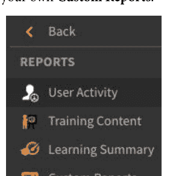

Figure 10.1 – 报告部分可用的链接

你现在将逐一回顾这些链接。这些链接会带你进入各个仪表板，每个仪表板都包含一组报告。让我们在下一节开始回顾 **User Activity** 仪表板。

## Reviewing the User Activity dashboard

在 **Reports** 部分时，左侧边栏中可用的第一个链接会带你进入 **User Activity** 仪表板，其中包含三个重要的报告。这些报告在每个 Prime 账户中都是开箱即用的。它们为你在账户内发生的用户活动提供了一些有趣的洞察。借助这些报告，你将能够回答以下问题：

- Prime 账户中注册了多少用户，这个数字如何随时间变化？请记住，Captivate Prime 按席位计费，因此密切关注这一指标对于控制成本至关重要。
- 实际上有多少学习者正在访问平台？每天有多少用户访问 Prime 账户？访问次数如何随时间变化？这些是重要的指标，有助于你衡量学习者对 LMS 和组织培训提供的参与度。
- 有多少学习者使用 Captivate Prime 移动应用程序从其移动设备访问培训内容？
- 学习者在 Captivate Prime 上学习花费了多长时间？这个数字如何变化？这些指标允许你回答诸如学习者是否花费了足够的时间学习？学习时间是否符合组织的期望？促销活动如何影响学习时间？等等。

**User Activity** 仪表板上可用的第一个报告是以下屏幕截图中显示的 **Registered Users Report**。

## 注册用户报告

日期范围：过去 12 个月 | 导出

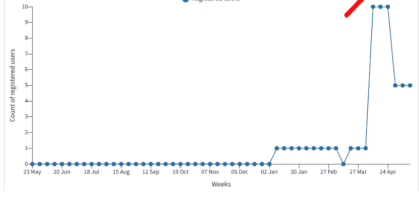

### 图 10.2 – 注册用户报告

本报告按周跟踪您账户中的注册用户数量。这对管理员来说是一个重要报告。请记住，Captivate Prime 的定价基于注册用户数量。因此，本报告允许管理员随时关注 Captivate Prime 成本的演变情况。

在前面的屏幕截图中，请注意注册用户数量在 4 月底突然下降。这是因为在第 5 章《管理用户》中创建的外部注册配置文件在当年 5 月 1 日被禁用，因此该外部配置文件使用的席位在当日起被释放，并且通过此外部注册配置文件注册的用户失去了访问 Captivate Prime 的权限。

对于使用月活跃用户（MAU）许可模式的组织而言，本报告按月显示活跃学习者的数量。

### Captivate Prime 许可模式

Adobe Captivate Prime 可用的两种主要定价模式为：注册用户定价模式和月活跃用户定价模式。这两种模式已在第 1 章《介绍 Adobe Captivate Prime》的“获取 Captivate Prime”部分中讨论过。

请注意，可以使用以下步骤将此数据导出为 **逗号分隔值 (CSV)** 文件：

- 1. 确保您位于管理员应用程序的 **用户活动** 页面上。
- 2. 单击 **注册用户报告** 右上角的 **导出** 按钮（请参阅前一屏幕截图中的箭头）。
- 3. 在单击 **确定** 按钮之前，请花点时间阅读 **生成报告请求** 对话框中的消息。
- 报告将在稍后在通知区域可用。
- 4. 报告可用时，单击通知图标（屏幕右上角的铃铛图标）下载报告。下载的 `.csv` 文件可以用任何电子表格应用程序打开。

**注册用户报告** 是 **用户活动** 页面上可用的第一个报告。请使用以下步骤探索下一个可用报告。

- 5. 向下滚动 **用户活动** 页面，直到看到 **用户访问报告**。

**用户访问报告** 显示在给定时间段内访问平台的学习者数量。请注意，每次登录都视为一次访问，即使已登录的用户未消费任何内容而只是浏览系统。

默认情况下，报告配置为显示您账户中所有用户在过去 30 天内的数据，但您可以使用报告上方的下拉列表更改此设置。

- 6. 打开 **日期范围** 下拉列表。
- 7. 选择任何可用的日期范围。报告会立即为所选日期范围更新。
- 请注意，如果您选择的值不同于 **最近 30 天**，报告将按月显示数据。当为 **日期范围** 选择 **最近 30 天** 时，数据将按天显示。
- 8. 打开 **日期范围** 下拉菜单并返回默认值 **最近 30 天**。

您还可以按 *用户组* 过滤报告。请记住，Captivate Prime 会自动创建大量用户组，例如基于每个用户的经理。也可以创建自定义组。所有这些内容已在 *第 5 章，管理用户* 中讨论过。请注意，您必须先使用以下步骤配置要用于过滤报告的用户组：

- 9. 单击 **用户访问报告** 上方的 **配置** 链接。
- 10. 花点时间阅读在配置用户组筛选器对话框中显示的消息。

完成后，在用户组字段中输入用户组的名称。
当组在列表中出现时，单击所需的组。最多可重复此操作 10 个用户组。

能够按用户组过滤此报告非常有用，可比较不同用户组如何使用平台。在以下屏幕截图中，我已配置报告以查看我自己团队的数据。

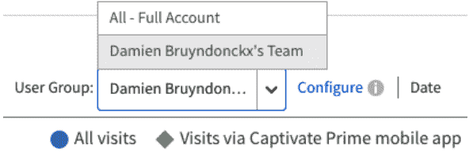

请注意，Captivate Prime 仅记录已配置用户组的数据。这意味着如果用户组配置发生变化，Captivate Prime 只能从该组添加到下拉列表之日起显示新配置组的数据。

最后，请注意，报告区分了通过 Captivate Prime 移动应用程序进行的访问和来自其他来源的访问。其他来源包括桌面和笔记本电脑，以及通过 Captivate Prime API 从外部应用程序进行的无头访问。

向下滚动用户活动页面，还有最后一个报告可用。让我们现在来探索它！

- 11. 向下滚动用户活动页面，直到看到学习时间花费报告。

本报告以蓝色显示平台上花费的总学习时间，以绿色显示单个学习者的中位时间。这是一个良好的学习者参与度指标：学习者在平台上花费的学习时间越多，他们的参与度就越高。

Captivate Prime 根据用户在平台上实际学习课程所花费的时间来计算学习时间。换句话说，在本报告中不包括浏览课程目录所花费的时间。

请注意，前面讨论的 **用户组** 和 **日期范围** 下拉菜单也适用于本报告。还请注意报告右上角可用的 **导出** 按钮，它允许您将此数据导出为 CSV 文件。

至此，我们完成了对 **用户活动** 报告页面的概述，其中为 Prime 管理员提供了三个基本报告。在下一节中，我们将通过访问 **培训内容** 页面继续探索 Captivate Prime 默认可用的报告。

## 查看培训内容仪表板

左侧列的 **报告** 部分中可用的第二个仪表板是 **培训内容** 仪表板。就像上一节中讨论的 **用户活动** 仪表板一样，**培训内容** 仪表板也在每个 Prime 账户中开箱即用。它包含两个报告，可让您深入了解 Prime 账户上可用的培训。您可以查看热门培训、跟踪所有可用培训、查看提供的培训数量等等。这些报告可帮助您回答以下问题：

- Prime 账户上可用的培训有多少，其数量如何演变？然后您可以判断这是否与组织在课程提供方面的雄心相符，并确定可用课程数量的增加是否转化为平台上学习时间的增加等等。
- 哪些课程在注册、浏览和完成方面最成功？这使您可以验证组织推广的课程是否确实被学习者接受。您还可以使用此信息来确定这些课程为何如此成功，并利用这些数据改进托管在您 Prime 账户上的其他课程等等。

让我们现在使用以下步骤动手探索此仪表板：

- 1. 以管理员身份登录您的 Prime 账户。
- 2. 从管理员主页，单击左侧边栏 **管理** 部分中的 **报告** 链接。
- 3. 接下来，单击左侧边栏中的 **培训内容** 链接以打开 **培训内容** 仪表板。

培训内容仪表板上第一个可用的报告是以下屏幕截图中说明的培训报告。

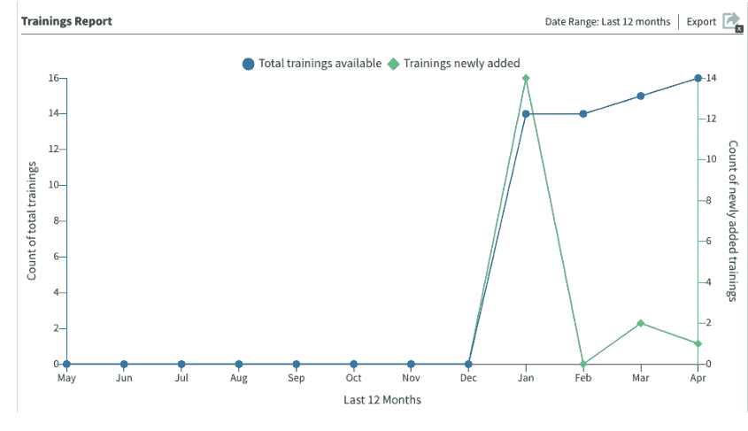

### 图 10.4 – 培训报告

本报告按月显示过去 12 个月内平台上可用培训数量的演变情况。

请注意，此特定图表有两个垂直轴（也称为 y 轴）。左侧的垂直轴用于 总可用培训数 并生成图表的蓝色线。右侧的垂直轴用于 新增培训数 并生成图表的绿色线。这两个轴可能不使用相同的比例。例如，在前面的屏幕截图中，左侧的总培训轴从 0 到 16，而右侧的新增轴从 0 到 14，这就解释了为什么两条线没有达到相同的高度。本报告的想法是让管理员和经理能够从新培训与旧培训以及正在消费的内容的角度来看待学习者的行为。也许新内容更受欢迎？

还请注意图表右上角的导出按钮，它允许您生成所表示数据的 CSV 文件。

- 4. 向下滚动培训内容仪表板，直到看到活跃培训报告。

本报告提供了有关您 Prime 账户中被视为 *活跃* 的培训的信息。Active trainings 指在给定时间范围内已报名、在 Fluidic Player 中观看过或已完成的培训。默认情况下，**活跃培训报告** 显示当月的数据，但可使用 **日期范围** 下拉菜单进行更改：

- 5. 打开位于活跃培训报告上方的 **日期范围** 下拉菜单。
- 6. 选择任意可用的日期范围，查看报告如何立即更新。
- 7. 再次打开 **日期范围** 下拉菜单并选择 **本月**，这是默认值。

请注意，您也可以使用与前面讨论的 **用户活动** 仪表板中报告相同的技术，通过 **用户组** 过滤此报告。

以下屏幕截图显示了 **活跃培训报告**，其中默认选择了 **用户组 (所有内部学习者)** 和 **日期范围 (本月)**。

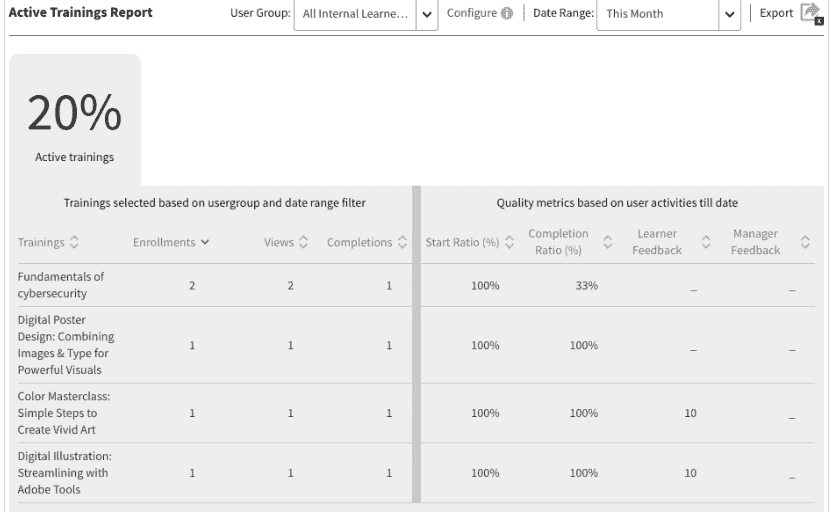

Figure 10.5 – 活跃培训报告

在前面的屏幕截图中，您可以看到该 Prime 账户中所有培训的 20% 被视为 *活跃*。同时请注意，**活跃培训报告** 分为两列：

- 左列根据给定时间段内用户组的报名、观看和完成数据显示 *活跃* 培训列表。
- 右列显示所选课程的质量指标。

**开始比率** 表示报名后实际开始培训的学习者百分比。

**完成比率** 显示开始课程并实际完成课程的学习者百分比。例如，在前面的屏幕截图中，只有三分之一开始 **网络安全基础** 课程的学习者完成了该课程。

**学习者反馈** 列是 1 到 10 分范围内所有 L1 反馈的平均值。请记住，L1 反馈由学习者在课程结束时提供。

**经理反馈** 列是 1 到 5 分范围内所有 L3 反馈的平均值。如前所述，L3 反馈由经理在培训结束后某个时间提供。默认情况下，经理应在培训结束后 45 天提供 L3 反馈。这就解释了为什么在前面的屏幕截图中 **经理反馈** 列为空。

此报告是快速了解所有活跃培训及其各自质量指标的好方法。它使组织能够快速识别最成功的培训以及需要改进的培训。当然，如前一章所述，更深入的见解可在每个单独课程的 L1、L2 和 L3 反馈页面上找到。

这结束了对 **培训内容** 仪表板的概述，该仪表板是 Captivate Prime 中开箱即用的默认仪表板之一。请记住，此仪表板包含两个报告（**培训报告** 和 **活跃培训报告**）。

还有一个默认仪表板待探索，这将在下一节中进行。

## 探索学习摘要仪表板

为了在您的 Prime 账户上实现学习，您需要一端是学习者，另一端是学习内容。前面讨论的 **用户活动** 仪表板侧重于 *学习者* 方面，而上一节讨论的 **培训内容** 仪表板则侧重于 *学习内容* 方面。

在本节中，您将探索 **学习摘要** 仪表板，这是 Captivate Prime 中可用的第三个默认仪表板。第三个仪表板侧重于学习者与学习内容之间的交互。从这个角度来看，该仪表板包含衡量您 Prime 账户 *活跃度* 的报告。

该仪表板上的报告可帮助您回答以下问题：

- Prime 账户上发生了多少次报名、观看和课程完成？有多少学习者实际参与了这些统计数据？
- 在给定时间段内学习者获得了哪些技能？这有助于您判断劳动力中可用的技能是否符合组织的需求和目标。
- 学习者在截止日期方面表现如何？他们是否按时完成 assigned 课程，从而保持合规？这对于使用 Captivate Prime 进行合规培训的组织尤其有用。

现在让我们按照以下步骤查看 **学习摘要** 仪表板及其包含的报告：

- 1. 以管理员身份登录您的 Prime 账户。
- 2. 从管理员主页，单击左侧边栏 **管理** 部分中的 **报告** 链接。
- 3. 接下来，单击左侧边栏中的 **学习摘要**。

此操作将带您进入 **学习摘要** 仪表板。从上到下，该仪表板包含三个主要报告：**摘要** 报告、**技能状态** 报告和 **合规仪表板**。

与前面两节讨论的仪表板相比，此仪表板略有不同。首先，请注意此仪表板上不可见 **导出** 按钮。仪表板右上角还有 **显示数据范围** 下拉菜单。此下拉菜单会影响该仪表板上显示的所有三个报告：

- 4. 打开位于 **学习摘要** 仪表板右上角的 **显示数据范围** 下拉菜单，并花一些时间检查其内容。

**显示数据范围** 下拉菜单中的选项包括所有 *根用户* 以及所有 *外部配置文件*。

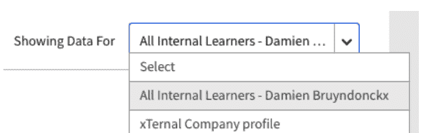

Figure 10.6 – 显示数据范围 下拉菜单

外部配置文件在 *第 5 章，管理用户* 中有讨论。作为提醒，外部配置文件允许您定义外部用户。外部用户是无需属于您的组织即可访问 Prime 账户的个人。典型的外部用户包括合作伙伴、供应商、分包商、顾问等。在前面的屏幕截图中，**xTernal Company profile** 选项对应于在 *第 5 章，管理用户* 的 *创建外部用户* 部分中定义的外部配置文件。

*根用户* 是满足以下两个要求的 Prime 账户中的所有用户：

- 首先，根用户必须是经理。
- 其次，根用户本身不向任何经理汇报。

换句话说，根用户位于用户层级结构的顶端。默认情况下，Prime 账户的主要管理员是唯一的可用根用户。在前面的屏幕截图中，我的用户配置文件（**Damien Bruyndonckx**）是唯一的可用根用户。典型的根用户是您组织的最高管理人员，或您组织中管理外部用户/合作伙伴的人员。

### 列出根用户
Captivate Prime 在 **根级学习者** 用户组中维护所有根用户的列表。这是 Captivate Prime 自动创建和维护的众多用户组之一。从管理员主页，转到 **用户 -> 用户组** 并查找 **根级学习者** 组。

您现在将使用以下步骤探索 **学习摘要** 仪表板上可用的报告：

- 5. 在 **显示数据范围** 下拉菜单中选择任何可用的内部根用户。
- 6. 花一些时间检查页面顶部的 **摘要** 报告。它为您提供了有关 Prime 账户在默认 1 个月时间范围内报名、观看和完成情况的快速概览。
- 7. 打开位于 **摘要** 报告右上角的下拉菜单以更改时间范围。

花一些时间查看可用的时间范围选项。准备好后，单击 **本月** 选项以保持默认视图。

- 8. 单击位于 **摘要** 报告右下角的 **学习摘要详情** 链接。

如以下屏幕截图所示，这将打开数据的表格视图，您可以在其中看到所选根用户下构成用户层级结构的所有团队和子团队的细分。

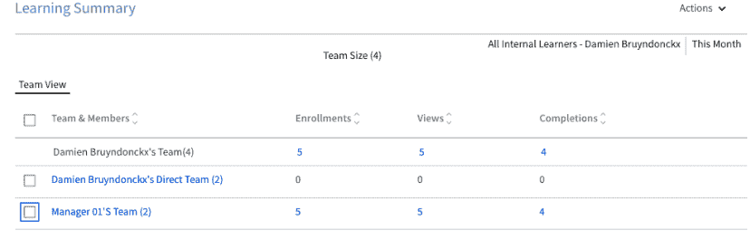

Figure 10.7 – 摘要 报告中可用的报名数据的表格视图

在前面的屏幕截图中，**Damien Bruyndonckx** 是选定的 *根用户*。 查看表格可知，**Damien Bruyndonckx** 是两位用户的直接主管。 您还了解到，这两位用户中的一位是 **Manager 01**，并且该用户管理着一个由两人组成的团队。 因此，Damien Bruyndonckx 拥有一个 4 人的团队，但直接下属只有 2 人。

- 9. 使用表格第一列中的复选框选择一个或多个可用团队。
- 10. 选择团队后，点击屏幕右上角的 **操作** 按钮。
- 11. 点击 **导出** 链接以生成所选数据的 CSV 导出文件。

通常情况下，Captivate Prime 会显示 **生成报告请求** 对话框，告知您报告正在生成中，并且可能需要一点时间后才能使用。

点击 **确定** 按钮关闭对话框，并等待报告可用通知出现在屏幕右上角的铃铛图标中。

这就是如何在 **学习摘要** 仪表板上没有直接可用的 **导出** 按钮的情况下导出该报告相关数据的方法。

数据表还允许您深入挖掘数据。 您现在将使用以下步骤进行实验：

- 12. 点击表格中 **团队与成员** 列中的团队名称，以打开一个仅显示所选团队相关数据的类似数据表。

根据用户层级的深度，您可以通过在浏览数据时点击表格中显示的团队名称来继续深入挖掘数据。

使用页面左上角的 *返回* 链接返回到用户层级。

- 13. 点击左侧边栏中的 **学习摘要** 链接返回到 **学习摘要** 仪表板。
- 14. 向下滚动页面，直到看到 **技能状态** 报告。

**技能状态** 报告是 **学习摘要** 仪表板上可用的第二个报告。 如以下屏幕截图所示，它是一个条形图，显示所选学习者群体正在进行的技能和已完成的技能（请记住，位于 **学习摘要** 仪表板最顶部的 **显示数据对象** 下拉菜单适用于页面上显示的所有三个报告）。

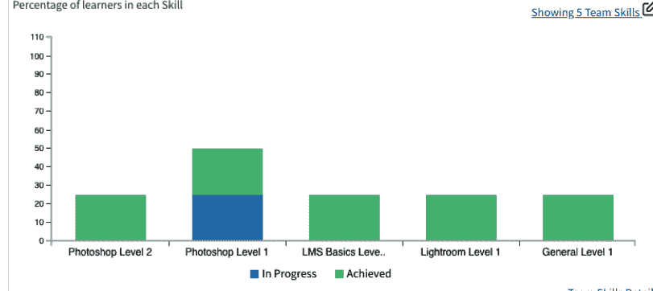

Figure 10.08 – 技能状态报告

**技能** 在 *第 4 章，创建技能和课程* 中进行了讨论。 作为提醒，您可以在 Captivate Prime 账户中创建技能和级别，并将这些技能链接到课程。 当学习者参加课程时，他们会积累用于获取已完成课程所链接技能的积分。 您现在将了解技能如何影响 **学习摘要** 仪表板上显示的报告。

就像前面讨论的 **摘要** 报告一样，您可以点击 **技能状态** 报告右下角的 **团队技能详情** 链接以表格形式显示相同的数据：

- 15. 点击 **技能状态** 报告右下角的 **团队技能详情** 链接。
- 16. 使用页面顶部的下拉列表选择一个 **技能** 和一个 **级别**。
- 17. 花点时间探索页面下半部分显示的数据表。 它具有与本节前面讨论的 **摘要** 报告数据表相同的功能。 例如，注意 **操作** 菜单，它允许您将数据导出为 CSV 文件。

18. 准备好后，点击左侧边栏中的 **学习摘要** 链接返回到 **学习摘要** 仪表板，并向下滚动页面直到再次看到 **技能状态** 报告。

您还可以使用位于 **技能状态** 报告右上角的链接选择要显示的技能：

- 19. 点击 **技能状态** 报告右上角的 **显示 X 项团队技能** 链接。
- 20. 使用 **搜索** 字段搜索其他技能。 当技能名称出现在列表中时，点击其名称。
- 21. 选择一个级别并点击 **添加** 按钮，将此技能/级别组合添加到 **技能状态** 报告中显示的技能列表中。 此操作在以下屏幕截图中进行了说明。

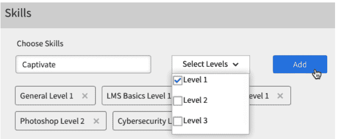

Figure 10.09 – 向技能状态报告添加技能

- 22. 您还可以使用与每个技能关联的 **X** 按钮从列表中删除所选技能。
- 23. 完成后，点击 **技能** 对话框右下角的 **提交** 按钮。 更改会立即反映在 **技能状态** 报告中。
- 24. 向下滚动页面，直到看到 **合规仪表板** 报告。

该报告允许您检查注册了各种课程的学习者的合规状态。 对于许多使用 Captivate Prime 进行合规培训的组织来说，这是一个重要的报告。 在这里，您可以概览平台上学习者所达到的合规水平。 就像该仪表板上可用的其他报告一样，您可以以表格格式查看数据并深入挖掘以进行进一步分析：

- 25. 点击合规仪表板右上角的 **X 项学习内容** 链接。

这将打开 **学习内容** 对话框，允许您选择应包含在 **合规仪表板** 报告中的课程、学习计划和认证。 请注意，可用于分析的学习内容必须有截止日期才能计入本报告。 大多数情况下，这意味着创建同一课程的多个课程实例，每个实例都有不同的截止日期。 如果学习者在截止日期前完成了课程，则被视为 *合规*。

26. 点击 **取消** 按钮关闭 **学习内容** 对话框并返回到 **合规仪表板** 报告。

27. 点击 **合规仪表板** 报告右下角的 **合规状态详情** 链接。

这允许您以表格形式查看相同的数据。 请注意，此数据表具有与本节前面讨论的其他数据表相同的基本功能。 特别值得注意的是 **操作** 菜单，它允许您将数据导出为 CSV 文件。

28. 花点时间检查可用的数据表。 准备好后，点击左侧边栏中的 **学习摘要** 链接返回到 **学习摘要** 仪表板。

这结束了我们对 Adobe Captivate Prime 中可用的默认仪表板和报告的探索。 您无需执行任何操作即可使这些报告可用。 这些报告旨在为您提供 Prime 账户中发生的一切的总体概览：

- **用户活动** 仪表板为您提供了有关 Prime 账户中定义的用户的一定见解。 您可以使用它获取有关注册用户数量、访问次数以及在账户上花费的学习时间的信息。
- **培训内容** 仪表板为您提供有关 Prime 账户中为用户提供的培训的信息。 在这里，您可以看到可用的总培训、新添加的培训和活跃的培训。
- 最后，**学习摘要** 仪表板为您提供有关用户如何与培训内容交互的信息。 您可以看到注册、查看和完成的简要摘要，以及 **技能状态** 报告和 **合规仪表板** 报告。

各种过滤器和链接为这些基本报告提供了许多有意义的变化。 请记住，要充分利用这些报告功能，您需要给学习者足够的时间与学习内容交互并完成课程。 您还需要给 Captivate Prime 一些时间来生成有意义的每日、每周和每月数据集。

这些默认报告已包含大量有用信息。但这可能并非贵组织所寻找的确切数据。因此，除了这些默认报告之外，您还可以创建自己的自定义报告并将其安排在自己的自定义仪表板中。这就是我们在下一节中将回顾的内容。

## 创建自定义报告和仪表板

上一节讨论的默认报告为管理员提供了对其 Prime 账户内情况的可靠概览。大多数组织中的大多数管理员都对默认报告提供的指标感兴趣。在某些情况下，这些报告提供了您所寻找的确切类型的信息。但更常见的是，组织会定义独属于自身的目标和成果。因此，他们会寻找有助于记录其所寻求的具体成果的指标和报告。

这就是 Captivate Prime 允许您定义大量自定义报告的原因，每份报告都允许丰富的变化和细微差别。可能性几乎无穷无尽，因此每个组织都应能找到从 Captivate Prime 中提取所需确切数据的方法。

与默认报告一样，自定义报告也以仪表板的形式排列。默认情况下，Captivate Prime 附带一个空的默认仪表板，您可以在其中按自己的意愿排列自定义报告。但您也可以创建额外的自定义仪表板并与其它用户共享。这些是我们将在本节中探索的功能。

要访问自定义报告，需要执行以下步骤：

- 1. 以管理员身份登录您的 Prime 账户。
- 2. 从管理员主页，单击左侧边栏 **Manage** 部分中的 **Reports** 链接。
- 3. 最后，单击左侧边栏中的 **Custom Reports** 链接以打开管理员应用程序的自定义报告部分。

当页面打开时，请注意主内容区顶部可用的四个选项卡，如以下屏幕截图所示：

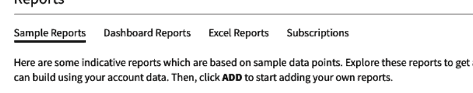

图 10.10 – 自定义报告页面的选项卡

我们将在接下来的几节中逐一回顾这四个选项卡。

- 4. 确保您位于如前一屏幕截图所示的 **Sample Reports** 选项卡上。
- 5. 花点时间查看提供的三个示例报告。

这三个示例报告的目的是让您了解可在 Captivate Prime 中定义的报告类型。它们在每个 Prime 账户中都相同，并且*不*使用*您*账户中可用的数据。这三个示例报告排列在一个单一的 **Sample Dashboard** 中。您现在将使用它们来检查自定义报告和自定义仪表板的基本功能。

- 6. 将鼠标悬停在不同报告中的条形上，以显示 Prime 报告上可用的各种工具提示。
- 7. 单击每个报告右上角的 – 图标以折叠相应的报告。
- 8. 单击 + 图标以展开已折叠的报告。
- 9. 您还可以移动报告以在示例仪表板内重新排列它们。
- 10. 向下滚动页面直到看到 **Skills vs Managers** 报告。请注意，该报告跨越示例仪表板整个第二行。

由于此特定报告包含大量数据，报告主区域中仅显示部分数据。

- 11. 使用 **Skills vs Managers** 报告的底部区域来选择图表上部可见的数据。为此，将灰色区域左右移动并查看这如何影响图表。

现在您对自定义报告的外观以及如何在自定义仪表板内排列它们有了更好的了解，您将在下一节中创建一些此类自定义报告。

### 创建自定义报告

在 Adobe Captivate Prime 中可以创建的自定义报告实在太多，无法在本书中全部涵盖。因此，为准备本节，我们联系了一些 Prime 客户和合作伙伴，询问他们前三名的自定义报告。获得最多投票的三个报告如下：

- 按个人资料统计所跟课程数量
- 每位用户花费的学习时间
- 按课程统计的课程有效性

在本节中，我们将通过逐一重新创建这三个报告来探索构建自定义报告时可用的选项。

**合适的 Prime 账户**
在操作过程中，请记住您使用的是一个试用账户，可用用户和课程非常少，因此可供这些报告使用的数据很少。
如果您有权访问拥有更多用户和课程的旧 Prime 账户，您的自定义报告将有更多数据可显示，您将能够感受到其更强大的功能。因此，如果您有此类账户，请随意将其用于本节的练习。

开箱即用时，Captivate Prime 包含一个默认仪表板，默认为空。使用以下步骤访问此默认仪表板：

- 1. 确保您已以管理员身份登录到您的 Prime 账户。
- 2. 从管理员主页，单击左侧边栏 **Manage** 部分中的 **Reports** 链接。
- 3. 接下来，单击左侧边栏中的 **Custom Reports** 链接。
- 4. 最后，打开 **Dashboard Reports** 选项卡，这是页面顶部四个选项卡中的第二个。

这将打开 Captivate Prime 中可用的默认仪表板。如以下屏幕截图所示，此仪表板默认为空。

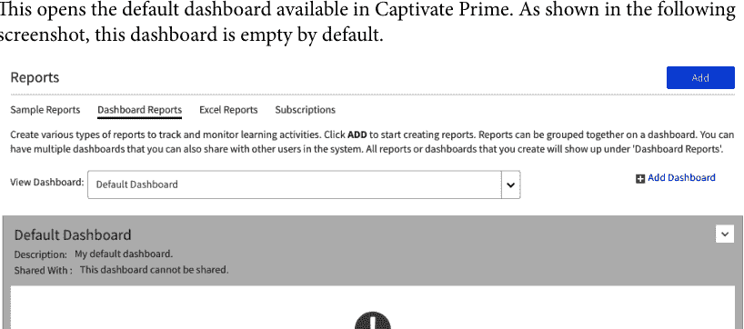

图 10.11 – 默认仪表板默认为空

如果您未创建自定义仪表板，您在 Captivate Prime 中构建的所有自定义报告都将添加到此默认仪表板。

在下一节中，您将构建第一个自定义报告并将其添加到此仪表板。您将在本章后面学习如何创建自定义仪表板以及如何在仪表板之间移动报告。

### 按个人资料统计所跟课程数量报告

您将构建的第一个报告将允许您检查每个个人资料所跟课程的数量。如第 5 章《管理用户》中所述，个人资料是在 Captivate Prime 中创建新用户时可用的字段之一。根据组织的架构，个人的个人资料可能具有不同的含义，但大多数情况下，个人的个人资料对应于其职位或所在部门。

此报告将允许您确定学习活动如何在各个人资料之间分配，并回答以下问题：

- 所有个人资料的学习方式是否相同？
- 是否有一些个人资料比其他个人资料跟随更多课程？这是否意味着这些个人资料表现更好？
- 哪些个人资料学习较少？这如何影响其表现？我们如何解释有些个人资料学习更多，而其他个人资料学习更少？

按照以下步骤构建此第一个自定义报告：

- 1. 确保您位于上一节中讨论的空默认仪表板页面上。
- 2. 单击默认仪表板中间的 Add Report 链接。您也可以单击页面右上角的 Add 按钮。

此操作将打开 Add Report 对话框。

- 3. 打开 **Add Report** 对话框上部位置的 **Type** 下拉菜单。
- 4. 查看可用选项，然后选择 **Courses Enrolled and Completed** 选项。

如您刚才所做的那样选择报告 **Type** 会为 **Add Report** 对话框中大多数其它选项提供默认值。因此，这些报告类型可以被视为*模板*，帮助您快速构建自定义报告。在此示例中，选择 **Courses Enrolled and Completed** 报告类型已自动调整以下属性：

- 在 **Report** 部分，**Name** 字段中已添加默认名称。
- 在 **Show Report for** 部分，**Y-axis** 下拉菜单设置为 **Course Statistics**，而 **For (X-axis)** 下拉菜单设置为 **Course**。请记住，图表的 *y* 轴是*垂直*轴，而 *x* 轴是*水平*轴。另请注意，*y* 和 *x* 轴都是强制性的。
- **And (Secondary Y-axis)** 下拉菜单当前设置为 **None**。请注意，此选项不是强制性的。

这些设置使您非常接近想要构建的报告。现在您将调整其中一些参数，以便获得完全正确的报告。

- 5. 打开 **For (X-axis)** 下拉菜单并查看可用选项。准备好后，选择 **Profile** 选项。
- 6. 打开 **Time Span** 部分并确认 **Date** 下拉菜单当前设置为 **YTD**（年初至今）。花点时间查看其它可用选项，但请确保不要做任何更改。
- 7. 打开 **Filters** 部分。请注意，您可以通过 **Manager**、**Profile**、**User Group** 和 **Content** 过滤报告。默认情况下未定义任何筛选器。对于此第一个示例，请确保不要添加任何筛选器。

8. 确保“添加报告”对话框与以下屏幕截图一致，然后单击“保存”按钮。

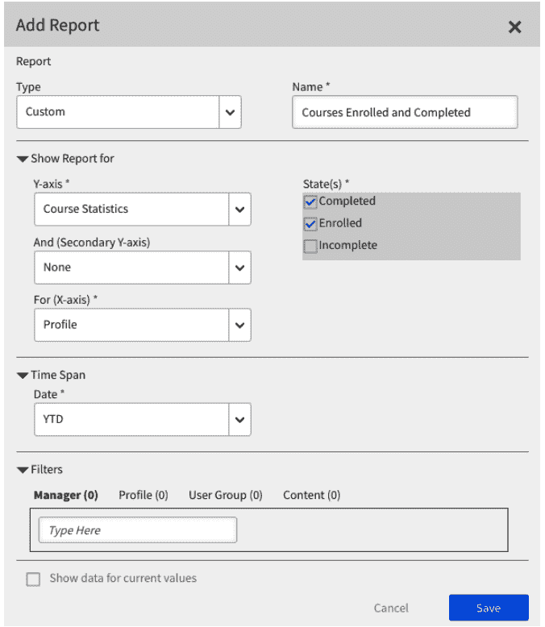

图 10-12 – 添加报告对话框

单击“保存”按钮后，“已注册并已完成课程”报告将被添加到默认仪表板。

9. 花点时间检查生成的报告。将鼠标悬停在图表上可见的条形上，以显示数据点的实际值。

还请注意图表顶部可用的两个筛选器，如以下屏幕截图所示。

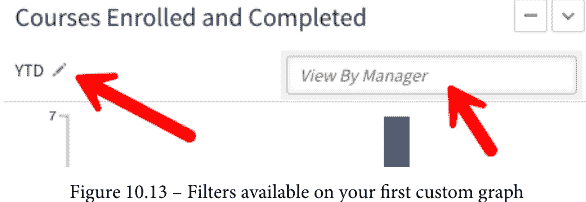

这两个字段提供的选项与前面讨论的“添加报告”对话框中的“时间跨度”和“筛选器”部分类似。现在让我们对这两个筛选器做一些实验：

- 10. 单击 YTD 标签旁边的铅笔图标（请参阅前一屏幕截图左侧的箭头）。
- 11. 打开下拉菜单并选择另一个日期范围。注意图表如何立即更新以反映您的选择。在继续本练习之前，请确保返回默认日期范围（YTD – 年至今）。
- 12. 在“按经理查看”字段中输入经理的名称。注意图表在您选择经理后如何立即更新。在继续本练习之前，请确保清除“按经理查看”字段。

这些实验说明了这些自定义图表的一些可能性和出色的灵活性。现在您将使用以下步骤完成第一个自定义图表：

- 13. 单击“已注册并已完成课程”报告右上角的向下箭头。
- 14. 花点时间检查可用选项。准备好后，单击“编辑报告”链接。
- 15. 在“报告名称”字段中输入“按档案统计的课程跟进数量”。
- 16. 打开“和（次要 Y 轴）”下拉菜单并选择“学习时间花费”选项。
- 17. 将其他选项保持在当前设置，然后单击“保存”按钮。

您的报告现在应如下屏幕截图所示。

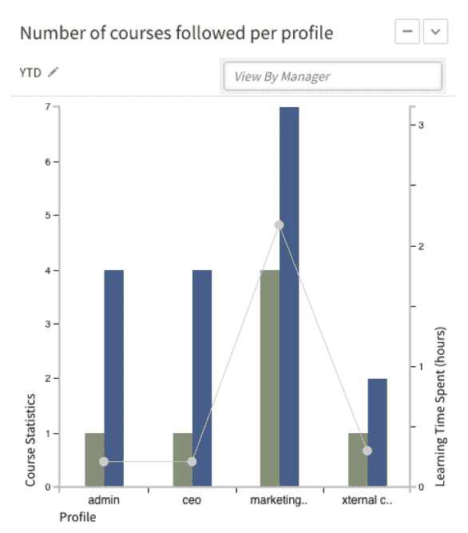

图 10.14 – 按档案统计的课程跟进数量报告

请注意，此图表现在有两个 y（垂直）轴。左侧的垂直轴对应于定义报告时 Y 轴下拉菜单。请记住，构建报告时此选项是强制性的。右侧的垂直轴对应于“和（次要 Y 轴）”下拉菜单。此选项允许您向图表添加额外的数据点（基本上，您可以将两个图表合并为一个！）。构建图表时提供次要 y 轴不是强制性的，但这是一个非常强大的选项，可让您快速比较两个值。

构建第一个图表使您能够发现 Captivate Prime 中用于生成自定义报告的基本工具和功能。您已经了解如何生成图表、如何即时筛选数据以及如何修改现有报告。在下一节中，我们将通过创建“每用户学习时间花费”报告来检查更多功能。

## 每用户学习时间花费报告

您将创建的第二个自定义报告是**每用户学习时间花费**报告。与前面讨论的**用户活动**仪表板中的默认**学习时间花费报告**不同，此自定义报告将允许您比较每个用户的学习时间花费。这将帮助您识别最活跃的用户并比较每个档案、内容、经理等的用户活动。它还将帮助您确定 Fluidic Player 中是否存在过多的跳过/前进。

由于您的 Prime 账户可能有数百甚至数千名用户，因此能够筛选此报告至关重要。这就是为什么您现在将创建的报告只考虑内部用户。让我们按照以下步骤开始：

- 1. 确保您位于管理员应用程序的**报告**部分的**自定义报告**页面上。
- 2. 转到**仪表板报告**选项卡，然后单击屏幕右上角的**添加**按钮以打开**添加报告**对话框。
- 3. 打开**类型**下拉菜单并选择**按课程统计的学习时间花费**报告。
- 4. 在**名称**字段中，将报告名称更改为 `Learning Time Spent per Internal User.`
- 5. 打开**用于（X 轴）**下拉菜单并选择**用户**选项。
- 6. 在**添加报告**对话框末尾打开**筛选器**部分。
- 7. 单击**用户组**选项卡。
- 8. 使用**在此处输入**字段将**所有内部用户**组添加到待办列表。请记住，**所有内部用户**组是 Adobe Captivate Prime 维护的自动生成组之一。本节在以下屏幕截图中进行了说明。

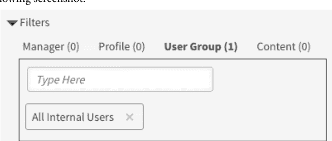

图 10.15 – 向自定义报告添加筛选器

请注意，您可以向筛选器添加多个用户组以及**经理**、**档案**、**用户组**和**内容**的任何组合。这为此报告提供了大量变体。

- 9. 单击**添加报告**对话框右下角的**保存**按钮，将报告添加到默认仪表板。

感谢上述步骤，您已创建了一个额外的自定义报告并将其添加到默认仪表板。请注意，您可以使用前面讨论的相同的 *日期范围* 和 *经理* 筛选器来调整报告显示的数据。请记住，您的 Prime 账户可能有数千名用户，因此这些筛选器在显示您想要查看的数据时非常方便。

您现在将为 *外部用户* 创建相同的报告。**外部用户的学习时间花费**报告将与您刚刚创建的报告非常相似。因此，而不是从头开始，您将复制**内部用户的学习时间花费**报告，调整一些选项，并生成**外部用户的学习时间花费**报告：

- 10. 单击**内部用户的学习时间花费**报告右上角的下拉箭头。
- 11. 单击**创建副本**选项以打开**复制报告**对话框。

**复制报告**对话框允许您选择要复制报告到的仪表板。由于您尚未创建自定义仪表板，因此唯一可用的选项是将报告复制到**默认仪表板**。

- 12. 选择**默认仪表板**选项并单击**复制**按钮。

一个名为**内部用户的学习时间花费的副本**的新自定义报告出现在默认仪表板上。

- 13. 单击**内部用户的学习时间花费的副本**报告右上角的下拉箭头。
- 14. 选择**编辑报告**选项。
- 15. 在**报告名称**字段中输入 `Learning Time Spent per External User`。
- 16. 打开**筛选器**部分并转到**用户组 (1)** 选项卡。
- 17. 从筛选器中删除**所有内部用户**组并将其替换为**所有外部用户**组。
- 18. 单击**保存**按钮关闭编辑表单并生成新报告。

您现在应该在默认仪表板上有两个额外的自定义报告：一个显示**外部用户的学习时间花费**，另一个显示**内部用户的学习时间花费**。以下屏幕截图对此进行了说明。

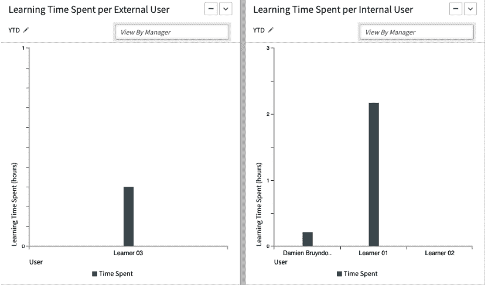

图 10.16 – 默认仪表板上出现两个额外的自定义报告

当然，用于创建前一屏幕截图的试用账户上只有少数用户，因此报告实际上很容易阅读。Prime 账户拥有数千名注册用户的情况并不少见。在这种情况下，图表只显示部分数据，并且图表下方会出现一个额外区域，允许您选择要关注的数据部分。以下屏幕截图对此进行了说明，该截图取自另一个拥有更多用户的 Prime 账户。

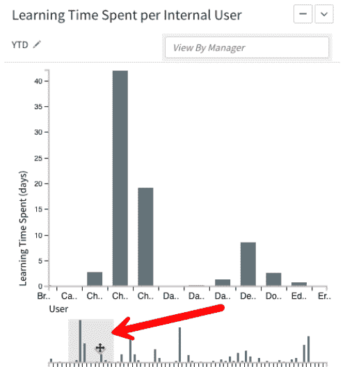

图 10.17 – 另一个拥有更多用户的 Prime 账户上的同一报告

在前一屏幕截图中，箭头指向主图表中可见的所选数据部分。您可以使用鼠标左右移动选择以检查数据的另一部分。

您还可以将所选报告的数据导出到 CSV 文件。这允许您在外部工具（如 Microsoft Excel）中打开数据表，并使用该外部应用程序的功能进一步分析数据。让我们使用以下步骤亲手回顾此功能：

- 19. 单击要导出数据的报告右上角的下拉箭头。
- 20. 单击**下载报告**选项。

- 21. 花点时间阅读 **生成报告请求** 消息。准备好后，单击 **确定** 按钮。
- 22. 一段时间后（取决于要导出的数据量），您将在 Captivate Prime 屏幕右上角的铃铛图标中看到通知。您可以从该位置下载报表。

在本节中，您已创建了 **按用户计算的学习时长** 自定义报表。
除创建报表外，您还学会了如何复制现有报表并调整副本以创建另一份报表。您还使用了 **用户组** 过滤器，其类似于 **经理**、**个人资料** 和 **内容** 过滤器。最后，您将自定义报表的相关数据导出为 CSV 文件，您可以在任何电子表格应用程序中打开该文件以进行进一步分析。

在下一节中，您将创建按课程的课程有效性报表。

## 按课程的课程有效性报表

该第三份报表将使您能够了解每门课程的有效性评分。请记住，Captivate Prime 会根据每门课程的 L1、L2 和 L3 反馈自动计算此评分。借助此报表，您将能够快速识别出课程有效性最高/最低的课程，等等。

要构建此第三份报表，您将不会使用 **类型** 下拉菜单中提供的任何预定义模板。相反，您将使用以下步骤从头开始构建报表：

- 1. 确保您位于管理员应用程序 **报表** 部分的 **自定义报表** 页面上。
- 2. 转到 **仪表板报表** 选项卡并单击屏幕右上角的 **添加** 按钮以打开 **添加报表** 对话框。
- 3. 打开 **类型** 下拉菜单并选择 **自定义**。

请注意，与前几节中使用的其他选项不同，**自定义** 报表类型不会为 **添加报表** 对话框中可用的其他字段提供任何默认值。
- 4. 在 **名称** 字段中输入 `Course effectiveness by course`。
- 5. 打开 **Y轴** 下拉菜单并选择 **课程有效性** 选项。
- 6. 打开 **和（次要 Y-）轴** 下拉菜单并选择 **学习时长** 选项。
- 7. 打开 **用于（X轴）** 下拉菜单并选择 **课程** 选项。
- 8. 将其他选项保留为默认值并单击 **保存** 按钮，将此新的自定义报表添加到默认仪表板。

请记住，课程有效性是由 Captivate Prime 根据多个因素自动计算的，包括 L1、L2 和 L3 反馈。对于某些课程，此数据可能尚未可用（请记住，L3 反馈通常在课程完成后 45 天提供）。

在本节中，您使用 **自定义** 类型从头开始创建了自定义报表。这完成了您在 Captivate Prime 中创建自定义报表的首次概述。请继续探索可用的众多变体，因为在本手册中几乎不可能全部记录。还请记住，您需要更大的数据集才能充分利用 Adobe Captivate Prime 的报表功能。因此，本节关于自定义报表的首要目标是向您展示尽可能多的选项，以帮助您入门并自行继续探索。在本节中，您学到了以下内容：

- - Captivate Prime 有一个默认仪表板，默认情况下为空。默认情况下，您的自定义报表会添加到此默认仪表板。
- - Captivate Prime 中有多个预定义的报表 **类型** 可用。将它们用作模板以加快自定义报表的创建速度。
- - 每个报表必须包含一个水平 (*x*) 轴和一个垂直 (*y*) 轴，后者显示在报表的左侧。可选地，您可以添加一个次要 *y* 轴，其显示在报表的右侧。
- - 每个报表在左上角包含一个快速 *日期范围* 过滤器，在右上角包含一个快速 *经理* 过滤器。使用这些过滤器探索自定义报表的一些非常有用的快速变体。
- - 在构建自定义报表时有许多过滤器可用。这些包括 **日期范围** 过滤器、**经理** 过滤器、**用户组** 过滤器等等。
- - 您可以将现有报表复制到任何可用仪表板。此功能的一个可能用例是允许您快速创建同一报表的多个变体。
- - 您可以在初始创建后编辑现有报表。
- - 您可以将自定义报表的数据导出为 CSV 文件，该文件可在任何电子表格应用程序中打开以进行进一步分析。

这为您和您的组织提供了一套非常强大的功能，用于挖掘 Captivate Prime 收集的数据，并对 Prime 账户中正在进行的学习获得一些非常有趣的见解。

在下一节中，您将创建自定义仪表板并在这些仪表板中排列自定义报表，在此过程中发现更多功能。

## 创建自定义仪表板

本章迄今为止您创建的自定义报表已添加到默认仪表板中，该仪表板在每个 Captivate Prime 账户中开箱即用。此默认仪表板是您用户账户独有的。这意味着其他管理员拥有自己的默认仪表板，在其中可以定义他们的自定义报表。换句话说，您迄今为止定义的自定义报表仅对您可见。

有时，此默认仪表板就是您所需要的一切，但在许多情况下，额外的自定义仪表板非常有用：

- - 自定义仪表板允许您对自定义报表进行分组，以便更好地组织它们，这有助于您分析数据并使其有意义。
- - 自定义仪表板可以与其他经理共享。借助此功能，管理员可以定义组织经理可以使用的报表。这使您可以让忙碌的经理访问有意义的数据，而无需他们自己创建自定义报表。它还有助于您标准化组织中各个成员使用的报表。当然，这并不会阻止经理在其他用户共享的报表和仪表板之上添加自己的自定义报表和仪表板。

您现在将使用以下步骤创建一个自定义仪表板，并与组织中的所有经理共享：

- 1. 确保您以管理员身份登录到您的 Prime 账户。
- 2. 从管理员主页单击左侧边栏 **管理** 部分中的 **报表** 链接。
- 3. 然后，单击左侧边栏中的 **自定义报表** 链接并转到 **仪表板报表** 选项卡。
- 4. 单击 **查看仪表板** 下拉菜单右侧的 **添加仪表板** 链接以打开 **添加仪表板** 对话框。
- 5. 在名称字段中输入 `All Managers dashboard`。
  作为最佳实践，还请在 **描述** 字段中添加简短描述。
- 6. 在共享给字段中输入 `All Managers` 并在列表中出现时选择此用户组。
- 7. 当 **添加仪表板** 对话框看起来像以下屏幕截图时，单击 **保存** 按钮。

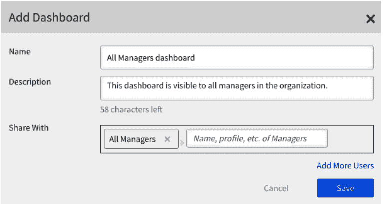

Figure 10.18 – 添加仪表板对话框

借助前面的操作，您已创建了一个新的空仪表板。您现在可以使用上一节中描述的技术将自定义报表添加到此新仪表板。您还可以使用以下步骤将其他仪表板的自定义报表复制或移动到此仪表板：

- 8. 使用 **查看仪表板** 下拉菜单返回到 **默认仪表板**。
- 9. 单击要移动/复制的报表右上角的下拉箭头。对于本示例，我将使用上一节中创建的 **内部用户的学习时长** 报表。
- 10. 单击 **移动到仪表板** 选项以打开 **移动报表** 对话框。
- 11. 选择要将报表移动到的仪表板（在本示例中，选择之前创建的 **所有经理仪表板**）并单击 **移动** 按钮。
  使用 **按个人资料统计的课程数** 报表重复这些操作。
- 12. 使用 **查看仪表板** 下拉菜单返回到之前创建的 **所有经理仪表板**。
- 13. 确认移动到此仪表板的两个自定义报表可见。
- 14. 单击 **内部用户的学习时长** 报表右上角的下拉箭头。

15. 选择 **Resize to 1×2** 选项，使报表占据仪表板整整一行。这说明了在仪表板上排列报表的又一种可用选项。

欢迎使用拖放操作和 **Resize to 1×2** 选项进一步排列此仪表板。

16. 最后，点击自定义 **All Managers dashboard** 右上角的下拉箭头。注意可用的选项，允许你向此仪表板 *add a report*、*edit* 仪表板，或完全 *delete* 仪表板。

在本节中，你创建了一个自定义仪表板，并将其中两个自定义报表移至其中。你还了解了自定义仪表板如何与其它经理共享，以及这如何帮助组织在整体上简化报表的[content]
15. 选择 **Resize to 1×2** 选项，使报表占据仪表板整整一行。这说明了在仪表板上排列报表的又一种可用选项。

欢迎使用拖放操作和 **Resize to 1×2** 选项进一步排列此仪表板。

16. 最后，点击自定义 **All Managers dashboard** 右上角的下拉箭头。请注意可用的选项，允许你向此仪表板 *添加报表*、*编辑* 仪表板，或完全 *删除* 仪表板。

在本节中，你创建了一个自定义仪表板，并将其中两个自定义报表移至其中。你还了解了自定义仪表板如何与其它经理共享，以及这如何帮助组织在整体上简化报表的[content]
15. 选择 **Resize to 1×2** 选项，使报表占据仪表板整整一行。这说明了在仪表板上排列报表的又一种可用选项。

欢迎使用拖放操作和 **Resize to 1×2** 选项进一步排列此仪表板。

16. 最后，点击自定义 **All Managers dashboard** 右上角的下拉箭头。请注意可用的选项，允许你向此仪表板 *添加报表*、*编辑* 仪表板，或完全 *删除* 仪表板。

在本节中，你创建了一个自定义仪表板，并将其中两个自定义报表移至其中。你还了解了自定义仪表板如何与其它经理共享，以及这如何帮助组织在整体上简化报表的[content]
15. 选择 **Resize to 1×2** 选项，使报表占据仪表板整整一行。这说明了在仪表板上排列报表的又一种可用选项。

欢迎使用拖放操作和 **Resize to 1×2** 选项进一步排列此仪表板。

16. 最后，点击自定义 **All Managers dashboard** 右上角的下拉箭头。请注意可用的选项，允许你向此仪表板 *添加报表*、*编辑* 仪表板，或完全 *删除* 仪表板。

在本节中，你创建了一个自定义仪表板，并将其中两个自定义报表移至其中。你还了解了自定义仪表板如何与其它经理共享，以及这如何帮助组织在整体上简化报表的[content]
15. 选择 **Resize to 1×2** 选项，使报表占据仪表板整整一行。这说明了在仪表板上排列报表的又一种可用选项。

欢迎使用拖放操作和 **Resize to 1×2** 选项进一步排列此仪表板。

16. 最后，点击自定义 **All Managers dashboard** 右上角的下拉箭头。请注意可用的选项，允许你向此仪表板 *添加报表*、*编辑* 仪表板，或完全 *删除* 仪表板。

在本节中，你创建了一个自定义仪表板，并将其中两个自定义报表移至其中。你还了解了自定义仪表板如何与其它经理共享，以及这如何帮助组织在整体上简化报表的[content]
15. 选择 **Resize to 1×2** 选项，使报表占据仪表板整整一行。这说明了在仪表板上排列报表的又一种可用选项。

欢迎使用拖放操作和 **Resize to 1×2** 选项进一步排列此仪表板。

16. 最后，点击自定义 **All Managers dashboard** 右上角的下拉箭头。请注意可用的选项，允许你向此仪表板 *添加报表*、*编辑* 仪表板，或完全 *删除* 仪表板。

在本节中，你创建了一个自定义仪表板，并将其中两个自定义报表移至其中。你还了解了自定义仪表板如何与其它经理共享，以及这如何帮助组织在整体上简化报表的[content]
15. 选择 **Resize to 1×2** 选项，使报表占据仪表板整整一行。这说明了在仪表板上排列报表的又一种可用选项。

欢迎使用拖放操作和 **Resize to 1×2** 选项进一步排列此仪表板。

16. 最后，点击自定义 **All Managers dashboard** 右上角的下拉箭头。请注意可用的选项，允许你向此仪表板 *添加报表*、*编辑* 仪表板，或完全 *删除* 仪表板。

在本节中，你创建了一个自定义仪表板，并将其中两个自定义报表移至其中。你还了解了自定义仪表板如何与其它经理共享，以及这如何帮助组织在整体上简化报表的[content]
15. 选择 **Resize to 1×2** 选项，使报表占据仪表板整整一行。这说明了在仪表板上排列报表的又一种可用选项。

欢迎使用拖放操作和 **Resize to 1×2** 选项进一步排列此仪表板。

16. 最后，点击自定义 **All Managers dashboard** 右上角的下拉箭头。请注意可用的选项，允许你向此仪表板 *添加报表*、*编辑* 仪表板，或完全 *删除* 仪表板。

在本节中，你创建了一个自定义仪表板，并将其中两个自定义报表移至其中。你还了解了自定义仪表板如何与其它经理共享，以及这如何帮助组织在整体上简化报表的[content]
15. 选择 **Resize to 1×2** 选项，使报表占据仪表板整整一行。这说明了在仪表板上排列报表的又一种可用选项。

欢迎使用拖放操作和 **Resize to 1×2** 选项进一步排列此仪表板。

16. 最后，点击自定义 **All Managers dashboard** 右上角的下拉箭头。请注意可用的选项，允许你向此仪表板 *添加报表*、*编辑* 仪表板，或完全 *删除* 仪表板。

在本节中，你创建了一个自定义仪表板，并将其中两个自定义报表移至其中。你还了解了自定义仪表板如何与其它经理共享，以及这如何帮助组织在整体上简化报表的[content]
15. 选择 **Resize to 1×2** 选项，使报表占据仪表板整整一行。这说明了在仪表板上排列报表的又一种可用选项。

欢迎使用拖放操作和 **Resize to 1×2** 选项进一步排列此仪表板。

16. 最后，点击自定义 **All Managers dashboard** 右上角的下拉箭头。请注意可用的选项，允许你向此仪表板 *添加报表*、*编辑* 仪表板，或完全 *删除* 仪表板。

在本节中，你创建了一个自定义仪表板，并将其中两个自定义报表移至其中。你还了解了自定义仪表板如何与其它经理共享，以及这如何帮助组织在整体上简化报表的[content]
15. 选择 **Resize to 1×2** 选项，使报表占据仪表板整整一行。这说明了在仪表板上排列报表的又一种可用选项。

欢迎使用拖放操作和 **Resize to 1×2** 选项进一步排列此仪表板。

16. 最后，点击自定义 **All Managers dashboard** 右上角的下拉箭头。请注意可用的选项，允许你向此仪表板 *添加报表*、*编辑* 仪表板，或完全 *删除* 仪表板。

在本节中，你创建了一个自定义仪表板，并将其中两个自定义报表移至其中。你还了解了自定义仪表板如何与其它经理共享，以及这如何帮助组织在整体上简化报表的[content]
15. 选择 **Resize to 1×2** 选项，使报表占据仪表板整整一行。这说明了在仪表板上排列报表的又一种可用选项。

欢迎使用拖放操作和 **Resize to 1×2** 选项进一步排列此仪表板。

16. 最后，点击自定义 **All Managers dashboard** 右上角的下拉箭头。请注意可用的选项，允许你向此仪表板 *添加报表*、*编辑* 仪表板，或完全 *删除* 仪表板。

在本节中，你创建了一个自定义仪表板，并将其中两个自定义报表移至其中。你还了解了自定义仪表板如何与其它经理共享，以及这如何帮助组织在整体上简化报表的[content]
15. 选择 **Resize to 1×2** 选项，使报表占据仪表板整整一行。这说明了在仪表板上排列报表的又一种可用选项。

欢迎使用拖放操作和 **Resize to 1×2** 选项进一步排列此仪表板。

16. 最后，点击自定义 **All Managers dashboard** 右上角的下拉箭头。请注意可用的选项，允许你向此仪表板 *添加报表*、*编辑* 仪表板，或完全 *删除* 仪表板。

在本节中，你创建了一个自定义仪表板，并将其中两个自定义报表移至其中。你还了解了自定义仪表板如何与其它经理共享，以及这如何帮助组织在整体上简化报表的[content]
15. 选择 **Resize to 1×2** 选项，使报表占据仪表板整整一行。这说明了在仪表板上排列报表的又一种可用选项。

欢迎使用拖放操作和 **Resize to 1×2** 选项进一步排列此仪表板。

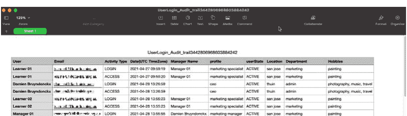

图 10.20 – 在 Apple Numbers 中显示的登录/访问报告

前面的屏幕截图说明了本节生成的报告，如 Apple Numbers 电子表格中所示。

在本节中，您已探索了 Captivate Prime 中可用的登录/访问报告。您将在下一节中探索另一份报告。

## 导出反馈报告

在上一章中，我们讨论了 L1 反馈和 L3 反馈。需要提醒的是，L1 反馈由学习者在课程完成后直接提供，而 L3 反馈则由学习者的经理在培训结束后提供。在第 9 章《配置和使用反馈》的“检索 L1、L2 和 L3 反馈”部分，您了解了如何访问特定培训的这些数据。

我们现在将探索另一种访问 L1 和 L3 反馈的方法，其附加好处是可以将多个不同课程的数据合并到单个导出中：

- 1. 在管理员的自定义报表部分中的 Excel 报表选项卡中，单击反馈报表链接以打开反馈报表对话框。
- 2. 花点时间查看可用选项。
  在此示例中，选择下载所有培训的反馈，并将反馈日期范围设置选择为至少一个月，以便有足够的数据导出。
- 3. 准备就绪时单击下载按钮。再次阅读生成报表请求消息并单击确定按钮。
- 4. 报表准备就绪后，屏幕右上角铃铛图标下方会出现通知。单击通知以 CSV 格式下载登录/访问报表。
- 5. 在您喜欢的电子表格应用程序中打开下载的 CSV 文件并检查可用数据。

您现在已查看了三个可用的 Excel 报表。希望这能让您了解 Excel 报表的工作方式以及可用的丰富选项。当然，还有其他报表，每个报表都包含无数选项。我们不可能在本書中全部涵盖，因此请随意自行继续探索可用报表，寻找能为您的组织提供有关 Captivate Prime 帐户上学习活动宝贵见解的准确信息。

## 订阅报表

在本章前面 *Creating custom reports* 部分，您了解了如何创建大量有意义的报表。但这些报表只有在您不时访问并检查数据如何演变时才有用。Captivate Prime 了解管理员和经理每天忙于组织的日常管理，并不总是有机会直接在平台上查看统计数据和报表。

这就是为什么您可以让 Captivate Prime 定期通过电子邮件发送您偏好的报表。请注意，这仅适用于您自己创建的自定义报表或与您共享的自定义仪表板上可用的自定义报表。

让我们看看如何使用以下步骤订阅此类自定义报表：

- 1. 在管理员的 **Custom Reports** 部分中，单击 **Dashboard Reports** 选项卡，返回本章前面创建的自定义报表。
- 2. 选择您想要订阅的报表。请记住，您可能在自定义仪表板上还有其他报表可用。这些报表也可以订阅。
  在此示例中，我选择了前面创建的 **Learning Time Spent for External User** 报表。
- 3. 切换到自定义报表页面的 **Subscription** 选项卡。
- 4. 在 **Reports** 字段中输入您想要订阅的报表名称。当报表在列表中出现时单击所选报表。
- 5. 打开 **Frequency** 下拉菜单并选择最合适的选项。
- 6. 如有需要，您可以在相应字段中自定义电子邮件的 **Subject of the email**。
- 7. 您还可以在 **Alternate email** 字段中自定义报表应发送到的电子邮件地址（地址）。如果您将此字段留空，报表将发送到与您的 Captivate Prime 配置文件关联的电子邮件地址。
- 8. 单击行末的蓝色复选图标以验证您的新订阅。

如以下屏幕截图所示，您现在应该在此页面上看到一个订阅列表。

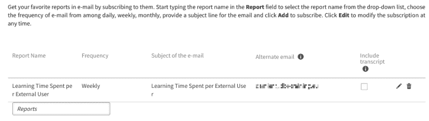

图 10.21 – 页面上列出了一个订阅

您可以根据需要添加任意数量的订阅。您还可以使用位于每行末尾的铅笔和垃圾桶图标更新和删除这些订阅。

您现在已具备订阅任何自定义报表以便 Captivate Prime 定期通过电子邮件发送给您的知识。请记住，此类订阅仅适用于您自己创建的自定义报表或存在于与您共享的仪表板上的报表。这又是首先创建自定义报表的一个很好的原因！

## 管理员的报表功能

到目前为止，您在以管理员身份登录时体验了 Captivate Prime 的报表功能。在本节中，您将发现本章讨论的大多数功能也适用于经理。

管理员访问报表与经理访问报表之间有一个重要区别。管理员可以访问 Captivate Prime 收集的所有数据，而经理只能访问与其团队相关的数据。

您现在将以 Manager 01 身份登录 Captivate Prime，并从经理的角度探索报表功能：

- 1. 以 Manager 01 身份登录您的 Captivate Prime 帐户。

请记住，在 Captivate Prime 中，经理首先是一个学习者，就像其他任何人一样。这就是为什么 Manager 01 默认被引导到学习体验的原因。
- 2. 通过单击屏幕右上角的用户图标打开用户菜单。
- 3. 单击 **Manager** 选项切换到经理体验。页面重新加载后，您应该已以经理身份登录。

花点时间查看经理主页。注意它与本章前面讨论的管理员可用的 **Learning Dashboard** 非常相似：
- 4. 单击经理主页 **Learning Summary** 部分右下角的 **Details** 链接。

此操作将 *Manager 01* 带到 **Learning Summary** 页面，在那里他/她可以看到有关其团队成员在所注册的各种培训中表现的额外信息。
- 5. 单击左侧边栏 **My Team View** 部分中的 **Compliance Dashboard** 链接。注意它与本章前面讨论的管理员可用的学习摘要页面上位于的 **Compliance Dashboard** 报表非常相似。
- 6. 单击左侧边栏 **My Team View** 部分中的 **Team Skills** 链接。注意它与本章前面讨论的管理员可用的学习摘要页面上位于的 **Skills Status** 报表非常相似。
- 7. 单击左侧边栏 **View** 部分中的 **Reports** 链接。
- 8. 花点时间查看 **Reports** 页面顶部可用的四个选项卡，如以下屏幕截图所示：

### 报表

图 10.22 – 经理可用的报表页面的四个选项卡

查看前述屏幕截图中显示的四个选项卡，您应该注意到以下内容：

- - **Sample Reports** 选项卡与 Captivate Prime 管理员区域中的完全相同。
- - **Dashboard Reports** 选项卡允许经理使用本章前面讨论的管理员可用的完全相同技术创建自己的自定义报表。经理还可以创建额外的自定义仪表板，但与管理员不同，他们无法与其他用户共享。
- - **Shared Reports** 选项卡包含由管理员创建并与 *Manager 01* 共享的仪表板。此选项卡应包含本章前面创建的 **All Managers dashboard**。
- - **Subscriptions** 选项卡允许经理使用本章前面讨论的管理员使用的相同技术订阅他们可用的任何自定义报表。

如您所见，经理可以访问与管理员几乎相同的报表功能。请记住，唯一的区别是经理只能看到与其团队成员相关的数据，而管理员可以访问 Prime 帐户上所有可用数据。

## 摘要

在本章中，您回顾了 Captivate Prime 可用的广泛报表功能。这些功能可被视为 Kirkpatrick 的 *Four Levels of Learning Evaluation* 模型的第四个层级。这是 **results** 层级，组织利用收集的数据来衡量学习对整个组织的影响。

每个 Prime 帐户默认都有一堆报表可用，但您也可以创建自己的自定义报表，将各种数据集导出为 CSV 文件，并订阅报表以便 Captivate Prime 定期通过电子邮件向您发送有关自定义报表的数据。报表组织在仪表板中，您可以创建自己的自定义仪表板，此外还有 Captivate Prime 可用的默认仪表板。管理员甚至可以将他们创建的自定义仪表板与 Prime 帐户上的经理共享。

这些非常强大的报表功能有助于确立 Captivate Prime 为市场上最好的现代企业 LMS 之一。

但 Captivate Prime 还有更多可提供的内容。在接下来的几章中，您将发现如何使用 Captivate Prime 的 **Gamification** 和 **Social Learning** 功能来增强学习者体验、提高参与度，并最终提高整个组织的学习保留率和有效性。

让我们从下一章开始探索游戏化功能。

