## 11 徽章与游戏化

人们在享受乐趣时学习效果最佳！这是教师和讲师们数千年来所知的事情。历史证据表明，游戏和基于游戏的学习在古希腊和罗马帝国时期就是众所周知的教育理念。此外，最早用于教授数学、逻辑和策略的非洲棋盘游戏是在 5,000 多年前设计的！

尽管有着悠久而丰富的历史，术语 *游戏化* 首次出现在 2008 年的网络上，并在 2010 年左右流行起来。游戏化被广泛接受的定义是 *在非游戏情境中使用游戏设计元素和游戏原则。*

该定义并非特定于教育。事实上，游戏化已应用于我们日常生活的许多方面。毕竟，航空公司允许我们赚取里程，品牌拥有忠诚度计划并在我们购买其产品时授予积分，许多组织使用员工荣誉榜来提高参与度和生产力并认可成就，我们在购物时收集积分和印章并兑换各种礼物，等等。

无论应用领域如何，游戏设计元素都是游戏化的基本构建块。使用的一些典型游戏设计元素包括积分、徽章、排行榜、基于场景的培训和头像。Captivate Prime 中提供了其中许多游戏设计元素，并被组织用于提高学习者参与度和留存率。

在本章中，我们将讨论 **徽章** 以及它们在 Captivate Prime 中的使用方式。然后你将探索 **游戏化** 功能，你可以使用这些功能在学习者与 Prime 账户上的学习内容互动时向他们授予积分。你将首先从管理员的角度探索这些功能，然后再回顾它们如何影响学习者体验。

本章包含以下主要部分：

- 创建和使用徽章
- 启用和配置游戏化
- 从学习者角度看游戏化

到本章结束时，你将回顾有助于让 Prime 账户上的学习更有趣的功能。通过应用这些技术，你应该会看到学习者参与度和 Prime 账户上进行的学习活动数量显著增加。这将进一步帮助你的组织实现培训目标，并在员工中推广学习文化。

### 技术要求

为完成本章的练习，你需要满足以下技术要求：

- 你必须拥有正在运行的 Captivate Prime 账户（可以是试用账户）的管理员和学习者访问权限。
- 你的 Prime 账户上必须至少有一个技能、一个课程、一个学习计划和一个认证可用。这可以是你自己定义的自定义培训内容，也可以是试用 Prime 账户上默认可用的内容。
- 你的计算机上必须有 JPG 或 PNG 格式的徽章图片可用。本书关联的下载中提供了示例徽章。

如果你已完成前几章的练习，你就可以开始了！如果你没有阅读前几章，请随意使用 Prime 账户上可用的任何课程内容和用户。只要注意，本章提供的说明基于前几章的练习，因此你需要根据自己的情况进行调整。

### 创建和使用徽章

徽章是在线教育中最常用的游戏设计元素之一。它们是学习者成就的视觉表现。它们象征着学习者的优点并帮助他们展示技能。它们有助于增加学习者资质的可信度，并成为自豪感的来源。

在 Captivate Prime 中，学习者通过实现你在 LMS 中定义的技能、完成课程和学习计划，或获得认证来赚取徽章。要使用徽章，你必须首先在系统中将它们定义为徽章。然后，你需要将这些徽章链接到课程、学习计划、技能和认证。

在本节中，你将学习如何使用以下步骤创建自定义徽章：

1. 确保你已以管理员身份登录到你的 Prime 账户。
2. 从管理员主页，单击左侧边栏 **配置** 部分中位于的 **徽章** 链接。

这将打开 **徽章** 页面。如以下屏幕截图所示，一小批徽章已在你的 Prime 试用账户上默认定义：

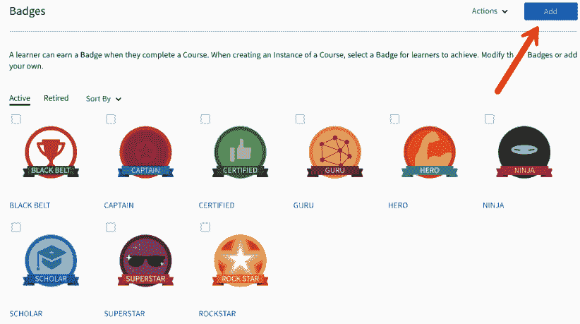

图 11.1 – 一小批徽章已在你的 Prime 试用账户中定义

花点时间检查 **徽章** 页面。注意 **排序方式** 下拉菜单，它允许你按名称或更新日期对徽章进行排序。你也可以使用以下步骤创建自己的自定义徽章：

3. 单击屏幕右上角的 **添加** 按钮（参见前一屏幕截图中的箭头）以打开 **添加徽章** 对话框。
4. 在 **徽章名称** 字段中输入 `Cybersecurity Fighter`。
5. 在 **徽章图片** 字段中上传本书关联下载中提供的 `badges/cyberSecurity_fighter.png` 文件。
   请注意，徽章图片必须是至少 250 像素 x 250 像素的正方形。如果提供的图片不是正方形，Captivate Prime 会自动将其调整为正方形。你可以使用任何流行的图片格式，包括 JPG 或 PNG 文件。
6. 当 **添加徽章** 对话框如以下屏幕截图所示时，单击 **保存** 按钮以生成你的第一个自定义徽章：

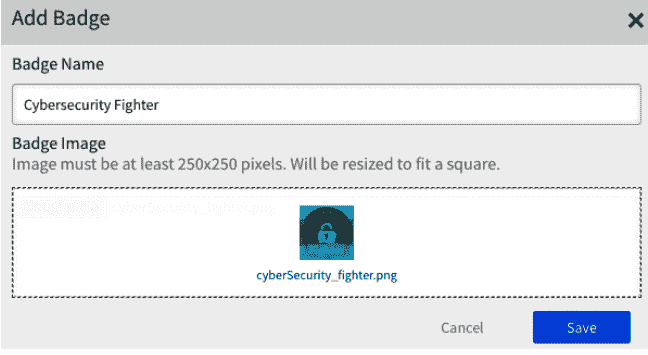

图 11.2 – 添加徽章对话框

7. 确认你的新自定义徽章出现在可用徽章列表中。

8. 重复前面的步骤以创建以下另外三个徽章。使用本书关联下载的 badges/ 文件夹中提供的图片：

徽章名称：Cybersecurity Specialist；徽章图片：cyberSecurity_specialist.png。

徽章名称：Photo Editing Master；徽章图片：photoEditingMaster.png

徽章名称：Certified Prime Learner；徽章图片：certifiedPrimeLearner.png

在此过程结束时，除了 Prime 试用账户自动提供的默认徽章外，你应该有四个自定义徽章可用。

### 创建徽章图片

本书关联下载的 badges/ 文件夹中可用的徽章图片是用 Adobe Spark Post 创建的。Adobe Spark Post 是一个应用程序，其目的是帮助你为社交媒体帖子创建外观精美的图形。在使用台式机或笔记本电脑时，它可在浏览器中使用，也可作为 iOS 和 Android 的移动应用程序使用。任何拥有 Adobe ID 的人都可以免费使用 Adobe Spark。高级功能需要付费。你可以在 https://www.adobe.com/express/ 找到有关 Adobe Spark 的更多信息。

现在你已经有徽章可用，你应该告诉 Captivate Prime 何时向学习者授予这些徽章。这就是你将在下一节开始做的事情。

### 将徽章分配给技能

学习者可以获得徽章的方式有多种。其中一种是通过实现技能。创建技能并将其链接到课程在 *第 4 章，创建技能和课程* 中进行了讨论。作为提醒，Captivate Prime 允许你定义技能以及技能内的级别。当你创建课程时，可以让课程在一个或多个技能级别中分配积分。学习者在达到所需积分数量时实现技能。

你现在将返回你在 *第 4 章，创建技能和课程* 中创建的自定义 **网络安全** 技能，并为该技能定义的两个级别中的每一个关联一个徽章。这些徽章将允许学习者公开他们新获得的技能，从而增加其成就的可信度：

1. 确保你已以管理员身份登录到你的 Prime 账户。
2. 从管理员主页，单击左侧边栏 **管理** 部分中位于的 **技能** 链接以打开 **技能** 页面。
3. 单击你在 *第 4 章，创建技能和课程* 中创建的 **网络安全** 技能，以打开 **编辑技能** 对话框。记住你为此特定技能定义了两个级别。
   （如果 **网络安全** 技能在你的 Prime 账户上不可用，请随意使用任何其他可用技能。你也可以使用 *第 4 章，创建技能和课程* 中讨论的技术从头创建自定义技能。）
4. 如有必要，展开 **编辑技能** 对话框下部中的 **第 1 级** 部分。
5. 打开 **从以下徽章中选择** 下拉菜单并选择你在上一节中定义的 **网络安全战士** 徽章。
6. 重复前面的步骤将 **网络安全专家** 徽章分配给 **网络安全** 技能的 **第 2 级**。

此操作在以下屏幕截图中显示：

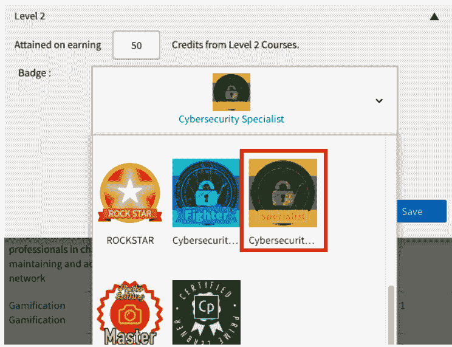

图 11.3 – 将徽章分配给技能

- 7. 准备就绪后，点击“编辑技能”对话框右下角的保存按钮。

从现在开始，只要学习者获得“网络安全 – 1 级”技能，他们将自动获得网络安全战士徽章。当学习者获得“网络安全 – 2 级”技能时，他们会自动获得网络安全专家徽章。

在本节中，你学习了如何将徽章链接到技能。这是学习者获得徽章的众多方式之一。在下一节中，你将学习如何将徽章链接到课程实例和学习项目实例。

## 将徽章分配给课程和学习项目

另一种获得徽章的方式是通过完成课程和学习项目。为此，管理员必须先将徽章链接到课程和学习项目。这正是本节中你将要做的事情。

更准确地说，你将把徽章链接到课程实例和学习项目实例。这使你可以为每个课程实例设置不同的徽章，有点像每次航天飞机任务都有自己的徽章一样。

你现在将使用以下步骤，为你在 *第 6 章，注册用户参加课程* 中创建的 *精通照片编辑* 学习项目分配一个徽章：

- 1. 从管理员主页，单击左侧边栏 **学习** 部分中的 **学习项目** 链接。
- 2. 将鼠标悬停在 **精通照片编辑** 学习项目的卡片上。
  （如果你的 Prime 账户中没有 **精通照片编辑** 学习项目，请随意使用你可用的任何其他学习项目或课程。）
- 3. 单击 **查看学习项目** 链接以打开学习项目的 **概览** 页面。
- 4. 单击左侧边栏 **管理** 部分中的 **实例** 链接。
- 5. 单击要修改的实例关联的 **徽章** 链接。
  在 **精通照片编辑** 学习项目的情况下，仅有默认实例可用。
- 6. 将 **启用徽章** 开关切换到开启状态。
- 7. 打开 **从以下徽章中选择** 下拉菜单，并选择本节中之前创建的 **照片编辑大师** 徽章。
- 8. 当你的屏幕如以下截图所示时，单击蓝色对勾（箭头标识）以验证你的更改：

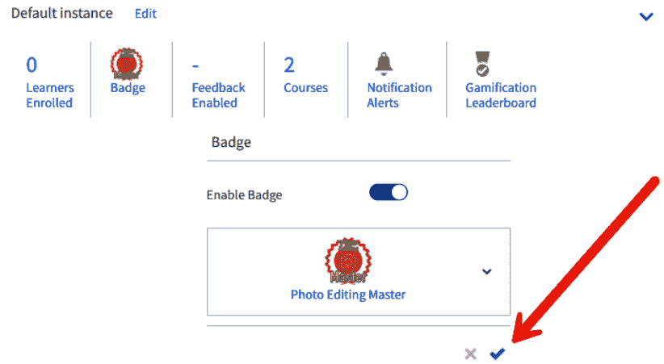

图 11.4 – 将徽章分配给课程或学习项目实例

从现在开始，完成 *精通照片编辑* 学习项目的每位学习者都将获得 *照片编辑大师* 徽章。

> **使用实例默认值**
> 如 *第 9 章，配置和使用反馈* 中的 *自定义课程实例默认值* 部分所述，你可以使用所选课程或学习项目 **配置** 部分中的 **实例默认值** 链接，默认情况下将同一徽章分配给每个 *未来* 课程或学习项目实例。

在本节中，你学习了如何为学习项目实例分配徽章。请记住，当你想为课程实例分配徽章时，过程完全相同。

在下一节中，你将通过一个非常相似的过程来为认证分配徽章。

## 将徽章分配给认证

如 *第 6 章，注册用户参加课程* 中的 *创建认证* 部分所述，认证与学习项目类似，因为它们也允许你将相关课程组合在一起。使它们与学习项目不同的是，它们有完成时限，并且在一定时间后可能会过期。

关于徽章，Captivate Prime 允许你将徽章分配给认证，以便每位按时完成认证的学习者都会获得相应的徽章。让我们使用以下步骤回顾此功能：

- 1. 从管理员主页，单击左侧边栏 **学习** 部分中的 **认证** 链接。
- 2. 将鼠标悬停在你在 *第 6 章，注册用户参加课程* 中创建的 **认证 Prime 学习者** 认证上。
  （如果你的 Prime 账户中不存在 **认证 Prime 学习者** 认证，请随意使用你可用的任何认证。）
- 3. 单击 **查看认证** 链接以打开所选认证的 **概览** 页面。
- 4. 单击屏幕右上角的 **编辑** 按钮。
- 5. 向下滚动页面，直到看到以下截图中显示的 **徽章** 选项：

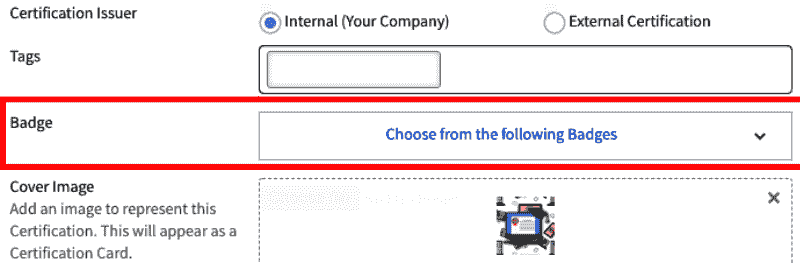

图 11.5 – 认证的徽章选项

- 6. 打开 **从以下徽章中选择** 下拉菜单，并选择本节中之前创建的 **认证 Prime 学习者** 徽章。
- 7. 最后，单击屏幕右上角的 **重新发布** 按钮以验证你的更改并使其在课程目录中可用。

在本节中，你探索了如何将徽章链接到认证。请记住，你也可以将徽章链接到技能、课程和学习项目。在下一节中，你将返回管理员账户的 **徽章** 页面，并探索更多用于长期管理徽章的功能。

## 退役徽章

随着 Captivate Prime 账户的学习内容不断发展，徽章也在不断变化。本节中，你将学习如何使用以下步骤退役和删除旧徽章：

- 1. 从管理员主页，单击左侧边栏 **配置** 部分中的 **徽章** 链接以打开 **徽章** 页面。
- 2. 使用每个徽章左上角的复选框选择一个或多个可用徽章（在此示例中，请确保不要选择本章前面创建的四个自定义徽章中的任何一个）。
- 3. 打开屏幕右上角的 **操作** 下拉菜单。
- 4. 单击 **退役** 以退役所选徽章。

*已退役* 的徽章不再可以链接到任何技能、课程、学习项目或认证，但它仍保留在已链接的技能、课程、学习项目和认证中。此外，已获得退役徽章的学习者仍保留它们并可以继续正常使用。

- 5. 单击页面左上角的 **已退役** 选项卡以打开已退役徽章列表。
- 6. 再次使用复选框选择一个或多个已退役徽章。
- 7. 打开屏幕右上角的 **操作** 下拉菜单并检查可用选项。
- 8. 在此示例中，选择所有已退役徽章并重新发布它们以恢复到初始状态。

单击 **重新发布** 选项会将所选徽章放回 *活动* 状态，因此它们可以再次分配给技能、课程、学习项目和认证。

单击 **删除** 按钮会从系统中永久删除所选徽章。

在本节中，你学习了如何 *退役* 和 *删除* 现有徽章。这结束了你在 Captivate Prime 中对徽章的探索。作为提醒，徽章是学习者成就的视觉表现。学习者通过获得新技能、参加课程和学习项目以及获得认证来获得徽章。默认情况下，Captivate Prime 包含一些预定义的徽章，但定义自己的自定义徽章非常容易。你也可以非常轻松地 *退役* 然后 *删除* 现有徽章（包括 Captivate Prime 原装提供的徽章）。

> **注意**
> 
> 在 Captivate Prime 中使用徽章完全没有义务。事实上，对徽章还不熟悉的组织并不总是确定它们会如何被员工看待，甚至不确定它们是否会激励学习者。徽章可以在 Captivate Prime 部署的稍后阶段进行，一旦学习者开始使用该平台。

在下一节中，你将回顾 Captivate Prime 的 **游戏化** 功能，该功能允许你在学习者与托管在你的 Prime 账户上的学习内容互动时向他们授予积分。

## 启用和配置游戏化

请记住，游戏化被定义为*在非游戏情境中使用游戏设计元素*。在上一节中，我们讨论了**徽章**，它是 eLearning 中使用最广泛的游戏设计元素之一。在本节中，我们将讨论**积分**的使用，它是在线学习中另一种广泛使用的游戏设计元素。思路很简单：Captivate Prime 会在各种事件发生时授予积分，例如每月完成特定数量的课程、完成自主报名课程或获得技能。

这些积分在排行榜上可见。请记住，排行榜是学习者可用的页面之一。在此页面上，学习者可以查看自己的分数并将其与同事的分数进行比较。目标是促进同事之间的积极竞争，从而提高学习和参与度。

> **避免混淆**
> 
> 许多 Prime 用户不熟悉*游戏化*这一术语，并将这些功能称为*排行榜*。由于沟通是实施这些功能的重要部分，请务必在沟通这些游戏化功能时使用每个人都能理解的术语。

首先，让我们使用以下步骤检查授予积分的事件：

- 1. 确保您已使用管理员身份登录到您的 Prime 账户。
- 2. 从管理员主页，单击左侧边栏**配置**部分中的**游戏化**链接。
- 3. 在**游戏化**页面的顶部，注意可用的不同等级。当学习者达到一定的积分阈值时，他们将被授予相应的等级。
- 4. 单击**等级**部分右上角的**编辑**链接。

如以下屏幕截图所示，这允许您修改获取每个等级所需的积分数量。另请注意**恢复为原始值**链接，它允许您返回到原始默认值：

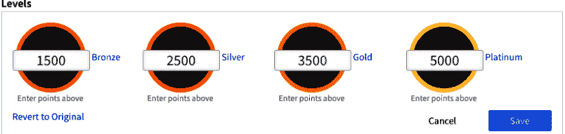

图 11.6 – 设置获取每个等级所需的积分

5. 在此示例中，单击 Cancel 按钮以保留当前值。

游戏化页面的其余部分描述了所有授予学习者积分的事件。例如，第一部分描述了快速学习者如何获得额外积分。如以下屏幕截图所示，每月完成一门课程的学习者可获得 50 分，每月完成两门课程可获得 100 分，每月完成五门课程可获得 400 分，依此类推：

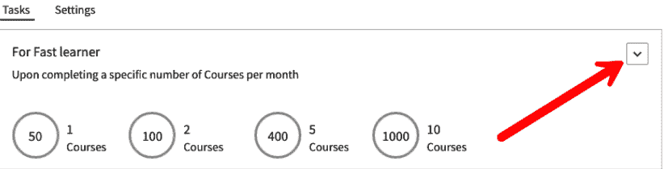

图 11.7 – 快速学习者在完成课程时获得额外积分

当然，您可以使用以下步骤更改默认值：

- 6. 单击游戏化页面顶部 For Fast learner 部分关联的下拉箭头（请参阅前一屏幕截图中的箭头）。
- 7. 单击 Edit 按钮并花一些时间查看可用选项。
- 8. 准备好后，单击 Cancel 按钮以保留当前值。

游戏化页面上提供十几个此类部分，每个部分都描述了一组授予学习者积分的事件。每个部分都可以使用前面描述的步骤进行修改。每个部分也可以根据需要被禁用。

9. 花一些时间检查可用的部分及其包含的选项。它们应该能让您更好地了解学习者在与 Prime 账户上可用的学习内容交互时如何获得积分。

在本节中，您已查看了允许您在 Prime 账户上配置游戏化的基本选项。在下一节中，我们将讨论额外的选项，这些选项将允许您微调 Captivate Prime 如何处理游戏化。

## 配置高级游戏化选项

在上一节中，您发现了 Captivate Prime 中游戏化的基本配置选项。在本节中，您将更深入地了解该功能并发现高级游戏化选项。使用以下步骤访问这些选项：

- 1. 确保您已使用管理员身份登录到您的 Prime 账户。
- 2. 从管理员主页，单击左侧边栏 Configure 部分中的 gamification 链接。
- 3. 单击位于 Levels 部分正下方的 Settings 选项卡，如以下屏幕截图所示：

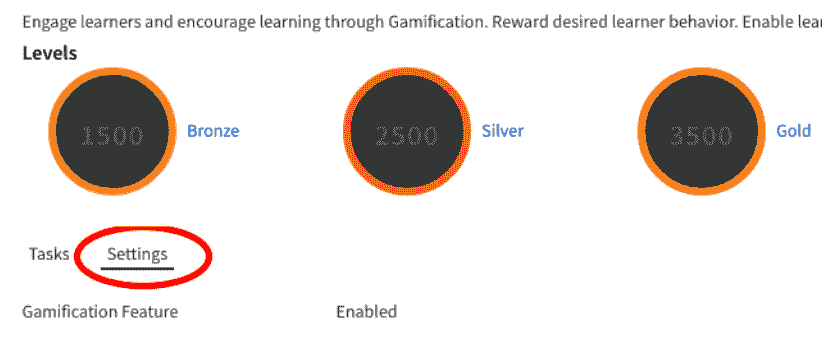

图 11.8 – 访问高级游戏化设置

这会将您带到高级设置列表，您将在接下来的几个部分中逐一查看。

### 启用和禁用游戏化

默认情况下，在任何新的 Prime 账户上，游戏化仅对内部用户启用。这是大多数组织想要的。采用此默认值，管理员无需执行任何操作即可为内部用户启用游戏化。

尽管如此，此默认值在所有情况下都不够充分：

- 游戏化会引发隐私问题，因为学习者可以在排行榜上看到彼此的分数。这就是一些组织希望完全关闭游戏化的主要原因。
- 如果您的组织培训了大量外部用户，您可能还希望为外部用户打开游戏化。请记住，默认情况下，外部用户的游戏化是关闭的。

这些是您可能想要在 Prime 账户上启用或禁用游戏化的一些原因。让我们使用以下步骤回顾如何操作：

- 1. 确保您已使用管理员身份登录到您的 Prime 账户。
- 2. 从游戏化页面的 Settings 选项卡，单击与 Gamification Feature 选项关联的 Edit 链接。
- 3. 如以下屏幕截图所示，默认情况下，游戏化对内部学习者启用，对外部学习者禁用：

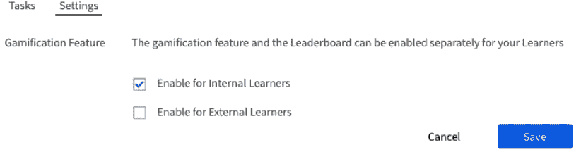

图 11.9 – 为内部和外部学习者启用和禁用游戏化

- 4. 确保不对当前设置做任何更改，并单击 Gamification Feature 部分右下角的 Cancel 按钮。

在本节中，您学习了如何为内部学习者和外部学习者启用或禁用游戏化。请记住，默认情况下，游戏化对内部学习者启用，对外部学习者禁用。

### 修改游戏化范围

启用游戏化时，默认情况下所有学习者相互竞争。当学习者数量较少（最多几百人）时效果很好，但对于拥有数千名学习者的较大组织而言，此默认情况可能并不理想：

- 您可能有一些档案（职位）其培训是其工作描述的关键部分，而其他档案需要较少的培训才能保持相关性和合规性。让这些截然不同的档案在游戏化中相互竞争真的有意义吗？
- 在不同国家运营的跨国公司需要考虑文化差异。在某些文化中，游戏化被非常认真对待，而在其他文化中则不是那么重要。在这种情况下，按位置对人员进行分组并让他们仅与同一组中的其他人竞争是有意义的。
- 一些特殊档案，例如高层管理人员，应从游戏化中移除，因为他们可能对在企业 LMS 中与自己的员工竞争积分不感兴趣。

这些是您可能想要限制游戏化范围的一些原因，可以使用以下步骤完成：

- 1. 确保您已使用管理员身份登录到您的 Prime 账户。
- 2. 从游戏化页面的 Settings 选项卡，单击与 Scope Settings 选项关联的 Edit 链接。
- 3. 选择 Limit Gamification to certain Learners and Learner groups 复选框。
- 4. 打开 User characteristic 下拉菜单并查看可用选项。在此示例中，选择 profile 选项。
  请记住，在 Captivate Prime 中，学习者的档案是其职位或部门的同义词。
- 5. 打开 Value 下拉菜单并检查可用选项。在此示例中，取消选择 Profile (ceo) 选项以将具有此档案的用户从游戏化中移除。

您的屏幕现在应如下图所示：

## 范围设置

游戏化的范围可通过用户特征进行限制。默认情况下，范围设置为系统中的所有学习者。

例如，当您在下方选择一个用户特征时，具有相同特征的学习者将相互竞争。学习者积分和奖励也将在同一组用户内进行比较。

将游戏化限制为特定学习者和学习者组

用户特征
个人资料

值
全选
个人资料（ceo）
个人资料（营销经理）
个人资料（营销专员）

取消

保存

## 保密设置

编辑

图 11.10 – 游戏化的范围设置

如前一张屏幕截图所示的配置，具有 CEO 个人资料的用户已从游戏化中移除。对于其他个人资料，每个个人资料都被视为一个游戏化范围。因此，营销经理构成一个游戏化范围，他们相互竞争，而营销专员则定义另一个范围，他们之间进行另一场游戏化竞赛。

- 6. 在本示例中，由于您的 Prime 账户上只有少数用户处于活跃状态，请点击取消按钮以丢弃您所做的更改并保持初始配置处于活动状态。

在本节中，您已查看了游戏化的范围设置，这使您可以根据您选择的某个用户特征（通常是用户个人资料或位置）将学习者拆分为不同的游戏化范围。

在下一节中，您将查看保密设置。

## 修改保密设置

假设您已在 Prime 账户上启用了游戏化，学习者正在相互竞争。它效果非常好，您确实看到了学习者参与度的显著提升以及账户上学习事件数量的增加。

但并非所有学习者都相同，员工开始注意到他们的经理（或公司的最高管理层）的积分并不如他们多。因此，当上述经理试图激励团队成员参加课程时，其可信度可能会受到质疑！

幸运的是，Captivate Prime 的保密设置允许您将特定学习者的分数隐藏起来，不让他人看到。让我们通过以下步骤亲手查看此功能：

- 1. 确保您以管理员身份登录到您的 Prime 账户。
- 2. 在 **游戏化** 页面的 **设置** 选项卡中，点击与 **保密设置** 选项关联的 **编辑** 链接。
- 3. 使用 **按姓名、个人资料等查找学习者** 字段搜索您想要隐藏分数的学习者。
- 在本示例中，搜索 **所有经理** 组以过滤列表并仅显示属于所选组的学习者。
- 4. 使用其姓名前的复选框选择 Prime 账户上所有可用的经理。
- 5. 当您的屏幕如以下屏幕截图所示时，点击 **隐藏** 按钮（由箭头标识）：

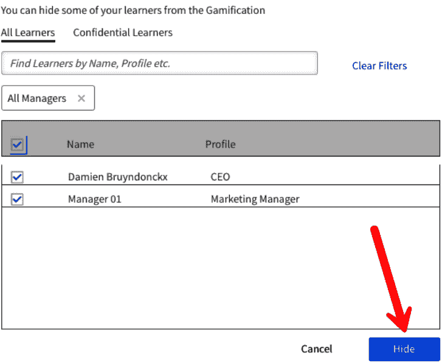

图 11.11 – 将经理从游戏化中隐藏

启用此选项后，所选经理仍会参与游戏化。每当他们完成培训或获得新技能时，仍会获得积分，但他们的分数不再显示在其他学习者可以看到的排行榜上。

现在您将按照以下步骤取消隐藏经理并返回初始状态：

- 6. 在 **游戏化** 页面的 **设置** 选项卡中，点击与 **保密设置** 选项关联的 **编辑** 链接。
- 7. 切换到 **保密学习者** 选项卡，以显示当前对其他学习者隐藏分数的保密学习者列表。
- 8. 使用复选框选择所有可用的保密学习者。
- 9. 点击页面右下角的 **取消隐藏** 按钮。

您现在已返回初始状态，所有学习者都属于单一游戏化范围。

在下一节中，您将学习如何在 Prime 账户上重置游戏化。

## 重置游戏化

John 于 2021 年 6 月加入您的组织。这也标志着 John 获得 Captivate Prime LMS 访问权限的时间。John 开始参加课程并迅速获得了一些认证。John 很有竞争精神，喜欢 Captivate Prime 的游戏化功能。但 John 是从 2021 年 6 月开始赚取积分的！他竞争的大多数同事在 LMS 上待的时间更长，因此在获取积分方面具有先发优势，这不公平！

这就是那些不时重置游戏化是个好主意的情况之一。在大多数组织中，游戏化会在每年年初重置，以防止老员工积累太多积分，导致新员工一开始就不想竞争，这将违背游戏化的初衷。

按照以下步骤在您的 Prime 账户中重置游戏化：

- 1. 确保您以管理员身份登录到您的 Prime 账户。
- 2. 在 **游戏化** 页面的 **设置** 选项卡中，点击与 **重置游戏化** 选项关联的 **重置设置** 链接。
- 3. 花点时间查看可用选项。准备好后，选择 **仅重置学习者分数** 选项。
- 4. 点击屏幕右下角的 **重置** 按钮。
- 5. 阅读 **重置游戏化** 警告消息并点击 **是** 按钮将学习者分数重置为 0！

在本节中，您学习了如何在 Prime 账户中重置游戏化。这结束了您对 Captivate Prime 高级游戏化设置的回顾。希望您现在对游戏化是什么以及它如何在 Captivate Prime LMS 中实现有了更深入的理解。

在下一节中，您将从学习者的角度回顾游戏化的影响。

## 从学习者角度看游戏化

到目前为止，本章中您已从管理员的角度看到了徽章和游戏化。但请不要忘记 Captivate Prime 是一个以学习者为中心的 LMS，这意味着您作为管理员的所有努力都应致力于改善学习者体验。

在本节中，您将以学习者身份登录到 Captivate Prime 账户，并重点关注受您在前几节中配置的徽章和游戏化功能影响的学习体验的几个方面：

- 1. 以 *学习者 01* 身份登录到您的 Captivate Prime 账户。
- 2. 登录后，打开学习者体验的 **徽章** 页面。

此页面列出了学习者已获得或正在获得的所有徽章。如以下屏幕截图所示，您应该会看到本章前面定义的 **网络安全战士** 徽章当前对 *学习者 01* 显示为 **进行中**：

## 技能

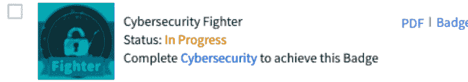

图 11.12 – 网络安全战士徽章当前正在进行中

请记住，学习者 01 已完成了您在第 4 章《创建技能和课程》中创建的网络安全基础课程。这使学习者 01 获得了 30 分，计入网络安全 – 1 级技能。当学习者 01 在该特定技能中达到总共 50 分时，他们将获得网络安全 – 1 级技能并获得网络安全战士徽章。以这种方式显示进行中的徽章是一种鼓励学习者继续学习并获得更多技能的方法。

现在，让我们回顾学习者体验的排行榜页面。

- 3. 浏览到学习者体验的排行榜页面。
- 由于您在上一节末尾重置了游戏化，学习者 01 的分数应已恢复为 0。
- 请注意，页面右栏中对学习者赚取积分的每个事件进行了快速总结。

现在您将把学习者 01 注册到精通照片编辑学习计划中并查看该学习计划中的所有课程。完成学习计划后，您将返回徽章和排行榜页面，查看学习者 01 获得的徽章和游戏化积分。

- 4. 浏览到学习者体验的目录页面。
- 5. 使用目录的功能，如第 7 章《回顾学习者体验》所述，搜索精通照片编辑学习计划。
- 6. 将鼠标悬停在学习计划的卡片上并点击查看学习计划链接以打开学习计划概览页面。

该学习计划包含两门简短课程。由于它是一个灵活的学习计划（如第 6 章《向用户注册课程》所定义），您必须在注册之前为学习计划中包含的每门课程选择一个课程实例。

- 7. 为每门课程选择默认实例并点击页面右上角出现的注册按钮。
- （如果您未执行第 6 章《向用户注册课程》的练习，则注册按钮可能在您未选择任何课程实例的情况下即可使用。在这种情况下，只需点击注册按钮即可。）
- 8. 注册后，点击页面右上角的开始按钮以打开流式播放器并查看学习计划的第一门课程。

继续复习学习计划的内容，直到完成其中包含的所有课程。

- 9. 当你完成所有 *Mastering Photo Editing* 学习计划中的课程后，返回学习者体验的 **Badges** 页面。

如以下屏幕截图所示，*Learner 01* 应该已获得 **Photo Editing Master** 徽章：

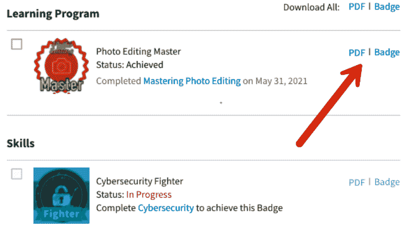

图 11.13 – Learner 01 已获得 Photo Editing Master 徽章

请注意 *Learner 01* 如何使用 **PDF** 和 **Badge** 链接（由前一屏幕截图中的箭头标识）来下载徽章。

- 10. 点击与 **Photo Editing Master** 徽章关联的 **PDF** 和 **Badge** 链接，以下载并查看学习者可以访问的文件。

- 11. 准备就绪后，浏览至学习者体验的 **Leaderboard** 页面。

进入 **Leaderboard** 页面后，你应该会注意到 *Learner 01* 通过完成 *Mastering Photo Editing* 学习计划中包含的两个课程以及获得一项新技能而获得了几分。

- 12. 将鼠标悬停在分数上以显示获得分数的明细。此操作在以下屏幕截图中进行了说明：

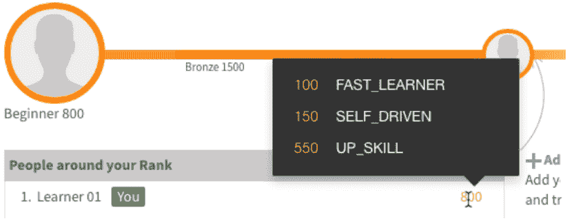

图 11.14 – 将鼠标悬停在分数上以显示获得分数的明细

作为学习者，你还可以将同事添加到排行榜中，以便跟踪他们的进度并比较自己的表现。

- 13. 点击 **Leaderboard** 页面右侧列顶部位置的 **Add Colleagues** 链接。在出现的字段中输入同事姓名，然后点击蓝色复选标记验证操作。

在本节中，你已查看了学习者体验中的 **Badges** 和 **Leaderboard** 页面，从而可以全面了解你在以管理员身份登录时配置的徽章和游戏化功能如何影响学习者与 Captivate Prime LMS 的互动方式。

## 摘要

感谢本章介绍的徽章和游戏化功能，你为学习者之间增添了一丝积极竞争，并使你在 Prime 账户上的学习变得更有趣一些。

首先，你已回顾了徽章。徽章是 eLearning 中使用最广泛的游戏设计元素之一。它们是学习者成就和[content]
继续复习学习计划的内容，直到完成其中包含的所有课程。

- 9. 当你完成 *Mastering Photo Editing* 学习计划中的所有课程后，返回学习者体验的 **Badges** 页面。

如以下屏幕截图所示，*Learner 01* 应该已获得 **Photo Editing Master** 徽章：

图 11.13 – Learner 01 已获得 Photo Editing Master 徽章

请注意 *Learner 01* 如何使用 **PDF** 和 **Badge** 链接（由前一屏幕截图中的箭头标识）来下载徽章。

- 10. 点击与 **Photo Editing Master** 徽章关联的 **PDF** 和 **Badge** 链接，以下载并查看学习者可以访问的文件。

- 11. 准备就绪后，浏览至学习者体验的 **Leaderboard** 页面。

进入 **Leaderboard** 页面后，你应该会注意到 *Learner 01* 通过完成 *Mastering Photo Editing* 学习计划中包含的两个课程以及获得一项新技能而获得了几分。

- 12. 将鼠标悬停在分数上以显示获得分数的明细。此操作在以下屏幕截图中进行了说明：

图 11.14 – 将鼠标悬停在分数上以显示获得分数的明细

作为学习者，你还可以将同事添加到排行榜中，以便跟踪他们的进度并比较自己的表现。

- 13. 点击 **Leaderboard** 页面右侧列顶部位置的 **Add Colleagues** 链接。在出现的字段中输入同事姓名，然后点击蓝色复选标记验证操作。

在本节中，你已查看了学习者体验中的 **Badges** 和 **Leaderboard** 页面，从而可以全面了解你在以管理员身份登录时配置的徽章和游戏化功能如何影响学习者与 Captivate Prime LMS 的互动方式。

## 摘要

感谢本章介绍的徽章和游戏化功能，你为学习者之间增添了一丝积极竞争，并使你在 Prime 账户上的学习变得更有趣一些。

首先，你已回顾了徽章。徽章是 eLearning 中使用最广泛的游戏设计元素之一。它们是学习者成就和功绩的视觉体现。Captivate Prime 自带一些预定义的徽章，但向系统中添加自己的自定义徽章非常容易。然后你可以将这些徽章链接到技能、课程、学习计划和认证，以便完成这些学习内容的学员获得相应的徽章。

Captivate Prime 中包含的游戏化功能允许你在特定事件发生时向学习者授予积分。这些积分在学习者体验的 **Leaderboard** 页面上可见，学习者可以在此查看自己的分数并与同事的分数进行比较。目标是通过在学习者之间创造积极竞争来促进组织内的学习文化。

同时请记住，本章讨论的功能是在 LMS 级别实现的。换句话说，它们补充了作者使用 Adobe Captivate 等工具构建单个课程模块时使用的教学设计和创作技术。成功的学习体验依赖于许多因素，LMS 只是其中之一。

但让学习变得有趣并不是提高学习参与度和效率的唯一方法。大量研究还表明，人们在 *一起* 学习时学习得更好。因此，在下一章中，你将回顾 Adobe Captivate Prime 的社交学习功能。这些功能将有助于使你在 Prime 账户中的学习者体验更具吸引力。
