## 12 启用和管理社交学习

在面对面授课时，有正式的学习时间，学员在此时聆听教师的讲座。然后，还有大量在非正式讨论他人、做小组工作、阅读他人推荐的书籍或文章，或是在与同学闲逛时发生的非正式学习。一些研究甚至表明，我们从非正式讨论和互动中保留的信息比从传统正式学习中保留的信息更多。

教师知道如何利用我们与社交互动的自然渴望来促进学习并提高记忆力。小组工作、同行评审、演示等一直是传统教学工具箱中存在了数百年的部分。

乍一看，你可能会认为远程学习使学习的社交和非正式方面变得复杂甚至无法实现。但这没有考虑到人类对社交接触的无尽需求（以及人类智慧）。例如，看看我们的孩子，他们在社交网络网站上创建私人讨论来讨论他们的课程并交换课程材料。父母和老师当然完全被禁止加入这些群组。

学习管理系统也力求让学习者能够随意和非正式地互动。许多学习平台提供实时聊天、讨论论坛和社区、协作区域等功能，以帮助鼓励学习者讨论各种主题并与他人分享内容。

Captivate Prime 也不例外。它包含一个功能齐全的社交学习引擎，用户可以在其中与同行分享内容、参与对话、关注其他用户、点赞和点踩他人发布的内容等。组织可以利用这一强大功能来鼓励学习者之间的互动并培养真正的企业学习文化。

允许任何用户在 LMS 上上传内容会引发对上传内容相关性的担忧。这就是为什么 Captivate Prime 还配备了内置的 AI 驱动内容策展引擎，管理员可以使用它来确保平台上发布的内容具有最高质量。

这些是你将在本章中回顾的主要功能。为了实现这些目标，本章将涵盖以下主要主题：

- 激活和使用课程讨论
- 启用社交学习
- 作为用户分享内容
- 内容审核和策展
- 查看管理员的社交学习选项

这又是一个内容丰富的章节，其中包含许多功能，将帮助你将 Captivate Prime 提升到下一个水平，并为学习者提供独特的体验。在阅读本章时，请尝试想象使用企业 LMS 的社交学习功能后，你的组织中的学习如何成长和发展。

## 技术要求

要跟随本章的练习，你需要满足以下要求：

- 你必须拥有一个正在运行的 Captivate Prime 账户的管理员访问权限（可以是试用账户）。
- 除了前面提到的管理员账户外，你还必须至少拥有两个学习者和一个经理账户的访问权限。
- 你必须在计算机上拥有管理员权限以安装 Captivate Prime 桌面应用程序。如果你没有权限在计算机上安装某些东西，没问题——只需阅读该部分而不执行练习即可。这不会影响你未来章节中执行练习的能力。

如果你已完成前几章的练习，你就可以开始了！如果你没有，请随意使用自己的材料和用户。只需注意，本章提供的说明基于前几章的练习。因此，你可能需要根据自己的情况进行调整。

## 激活和使用课程讨论

当你参加面对面课程时，参与者（学习者和讲师）之间自然会发生非正式互动。休息时间和午餐时间特别容易发生这些非正式讨论。更常见的是，在正式培训期间开始的讨论会在休息期间继续进行，而主题的相关方面通常会在喝咖啡、喝茶或吃三明治时进行讨论或扩展。

Captivate Prime 中这些非正式讨论的等价物是 **Course Discussion Boards**。这种讨论与特定课程相关，仅对注册该课程的学习者可用。

要更详细地了解此功能，有必要两次登录你的 Prime 账户：一次作为管理员，一次作为学习者。按照以下步骤操作：

- 1. 打开第一个浏览器窗口并以管理员身份登录你的 Prime 账户。
- 2. 打开一个私有浏览器窗口（或另一个浏览器）并以 *Learner 01* 身份登录同一 Prime 账户。
- 3. 确保在此整个部分中保持两个浏览器窗口打开。

由于这些初步步骤，你可以同时看到学习者体验和管理员应用程序。你现在准备开始探索 Captivate Prime 的课程讨论功能。

## 为单个课程激活、使用和管理课程讨论

默认情况下，您的整个 Prime 账户中的课程讨论均处于禁用状态。换句话说，您账户中当前可用的课程均未启用讨论。在本节中，您将覆盖此通用账户设置并为单个课程启用讨论。

首先，您将通过执行以下步骤快速回顾当前的学习者体验：

- 1. 使用您以 *学习者 01* 身份登录的浏览器窗口。
- 2. 从学习者主页，单击左侧边栏中的 **我的学习列表** 链接或 **我的学习** 图标以访问 **我的学习** 页面。
- 3. 单击 **我的学习** 页面上可用的任何课程卡，以打开该课程的概览页面。

请记住，学习者的 **我的学习** 页面列出了已登录学习者所注册的所有课程。

在此示例中，我选择了 **网络安全基础** 课程，该课程我们在 *第 4 章、创建技能和课程* 中创建。

如以下屏幕截图所示，*学习者 01* 目前可以访问课程概览页面的 **模块** 和 **笔记** 选项卡：

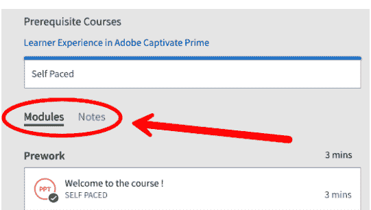

图 12.1 – 学习者 01 可以访问模块和笔记选项卡

您现在将返回管理员应用程序并使用以下步骤为该课程启用讨论：

- 4. 切换到您以管理员身份登录的浏览器窗口。
- 5. 从管理员主页，单击左侧列“学习”部分中的 课程 链接。
- 6. 将鼠标悬停在学习者 01 浏览器窗口中当前显示的课程的课程卡上。
在此示例中，我选择了网络安全基础课程。
- 7. 单击 查看课程 链接以在管理员应用程序中显示课程概览页面。
- 8. 在课程概览页面上，单击左侧边栏“配置”部分中位于的 设置 链接。
- 9. 最后，选择与 讨论板 设置关联的启用 复选框。此最后操作如以下屏幕截图所示：

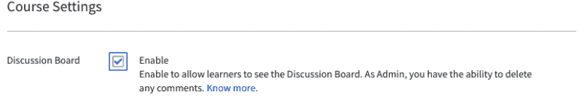

图 12.2 – 为所选课程启用讨论板

现在该特定课程的课程讨论已激活，请返回学习者体验，刷新页面并查看发生了什么变化。

> Note
> 课程讨论仅适用于内部学习者。如果您使用自己的用户，请确保以内部学习者身份登录以跟随本练习。

- 10. 返回您以学习者 01 身份登录的浏览器窗口。
- 确认您仍在课程概览页面上。如果不是，请使用学习者体验中的我的学习部分返回课程概览页面。

- 11. 在浏览器窗口中刷新页面并确认 **讨论** 选项卡现在可见，位于 **模块** 和 **笔记** 选项卡旁边：

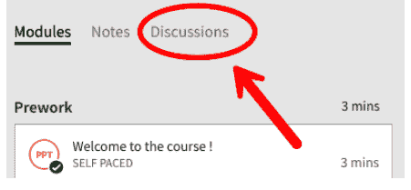

图 12.3 – 讨论选项卡现在在课程概览页面上可见

- 12. 单击 **讨论** 按钮（由前一屏幕截图中的箭头标识）以打开新激活的讨论选项卡。

- 13. 在 **对本课程说点什么** 字段中输入简短消息，然后单击 **发布** 按钮。

您的消息已发布在课程的 **讨论** 板上。它现在对参与本课程的其他用户可见。让我们来看看。

- 14. 单击屏幕右上角的用户图标并使用 **注销** 链接将 *学习者 01* 从 Captivate Prime 注销。

- 15. 以 *学习者 02* 身份重新登录。

- 16. 如果 *学习者 02* 已注册 *学习者 01* 添加了消息的课程，请使用 *学习者 02* 的 **我的学习** 页面访问该课程。

如果 *学习者 02* 尚未注册该课程，请使用目录为 *学习者 02* 自助注册。

无论哪种情况，*学习者 02* 都应最终到达课程概览页面。

- 17. 在课程概览页面上，切换到 **讨论** 选项卡。

如以下屏幕截图所示，*学习者 01* 发布的消息可以被 *学习者 02* 看到：

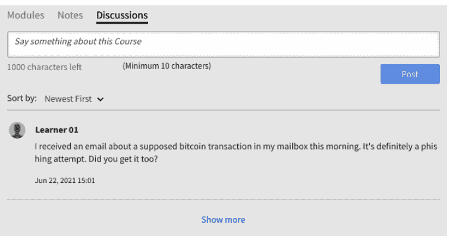

图 12.4 – 学习者 02 看到了学习者 01 发布的消息

此外，请注意，课程讨论板是一个非常简单的消息应用程序。它不提供回复他人消息或点赞/点踩消息的机制。话虽如此，学习者 02 有机会通过发布自己的另一条消息来继续对话。

- 18. 以学习者 02 身份登录时，向讨论添加第二条消息。

完成后，请注意学习者 02 可以删除他/她发布的消息，但学习者 02 不能修改或删除学习者 01 的消息。

这引发了对这些讨论板进行审核的问题。如果参与者开始互相大喊大叫怎么办？或者如果发布的内容与课程无关或质量较差怎么办？或者当旧消息不再相关且需要删除时怎么办？这些是消息所有者之外的人必须能够删除帖子的一些情况。

对于课程讨论板而言，此任务由平台管理员负责。让我们来看看这个工作流程。

- 19. 返回您以管理员身份登录的浏览器窗口。
- 20. 单击屏幕右上角的用户图标以切换到学习者角色。
- 21. 在学习者体验中，转到学习目录并打开学习者 01 和学习者 02 发布了消息的课程。

管理员无需注册该课程。

- 22. 如果课程有多个实例，请单击任何可用实例。
- 23. 在课程概览页面上，单击 **讨论** 选项卡以打开课程讨论板。

如以下屏幕截图所示，您可以在未注册的情况下访问课程的讨论板，并且由于您是管理员，您可以删除已发布的任何消息：

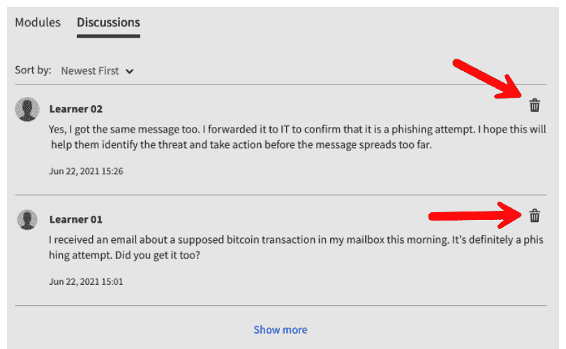

图 12.5 – 管理员可以删除任何已发布的消息

在本节中，您已为单个课程启用了讨论，并回顾了学习者用于发布和删除消息的工具和功能。

> **Tip**
> 请记住，讲师首先是普通学习者。因此，讲师可以像学习者一样浏览目录并自助注册课程，以参与与其他注册学习者的讨论。此外，一些管理员喜欢将自己注册到他们审核的课程中，因为这有助于他们更好地关注课程讨论板。

在下一节中，您将修改通用账户设置并为 Prime 账户上可用的每门课程默认启用讨论。

## 在 Prime 账户上默认启用课程讨论

请记住，课程讨论在账户级别默认处于禁用状态。在上一节中，您通过仅为该课程启用讨论来覆盖特定课程的此默认值。在本节中，您将返回管理员角色并在您的账户上默认启用课程讨论。

完成此操作后，您账户中的所有课程，包括当前所有可用的课程，都将启用其讨论板。请执行以下步骤来尝试此功能：

- 1. 确保您以管理员身份登录并且位于管理员主页上。
- 2. 从管理员主页，单击左侧边栏“配置”部分中位于的 设置 链接。此操作打开基本信息页面。
- 3. 在基本信息页面上，单击左侧边栏“基础”部分中位于的 通用 链接。
- 4. 在通用页面上，找到默认情况下处于禁用的 讨论板 选项。
- 5. 选择与 讨论板 选项关联的启用 复选框。此操作如以下屏幕截图所示：

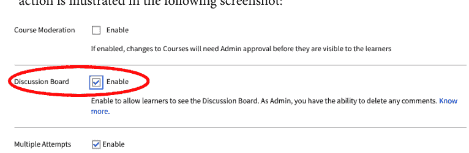

图 12.6 – 在账户上默认启用课程讨论

此操作为 Prime 账户的所有课程启用讨论。这包括当前可用的课程以及您从现在开始发布的所有未来课程。

> **警告**
> 我们坚持认为，在您的 Prime 账户中默认启用讨论会影响所有课程，*即使是在启用“讨论区”复选框之前就已存在的课程*。请确保所有人都了解此更改，以便能够及时采取适当的行动。为了避免任何混淆，此设置可能是在您在组织中首次实施 Captivate Prime 时想要打开或关闭的设置。

在单个课程级别，如果未明确为特定课程启用讨论区（请参阅上一节），则会应用全账户设置。由于全账户设置已启用，因此在课程级别上已无法禁用讨论区。这可能就是大多数组织希望保持全账户讨论区设置处于禁用状态的原因：以便管理员可以根据每个课程中讲师和管理员的意愿逐课程启用讨论。

这标志着您对 Captivate Prime 中课程讨论的探索结束。此功能试图模仿任何面对面培训中自然发生的非正式对话。它非常简单易于实施和使用，但其功能有限。让我们快速回顾一下本节中您学到的内容：

- 课程讨论在账户级别默认处于禁用状态，但管理员可以覆盖此通用账户设置，并在逐课程的基础上启用讨论。
- 当为某门课程启用课程讨论时，任何已注册的学习者都可以发布消息。但是，没有内置机制来回复他人的帖子或点赞/点踩消息。
- 用户可以删除自己的消息，但不能删除其他用户发布的消息。管理员可以删除任何已发布的消息，即使他们未注册该课程。
- 当您在账户级别启用**讨论区**时，这会立即启用您 Prime 账户中所有当前可用课程的讨论区，且无法在逐课程的基础上禁用它。

在下一节中，您将回顾 Captivate Prime 的社交学习引擎，它将允许您在 Captivate Prime 账户内激活类似社交媒体的平台。

## 使用社交学习

除了上一节讨论的课程讨论区之外，Captivate Prime 还包含一个功能完善的社交学习引擎。激活后，它提供的体验与最受欢迎的社交网络有许多相似之处：

- 学习者可以相互关注，以便在关注的人发布内容时收到通知。
- 社交学习帖子发布在**板块**上。Captivate Prime 中*板块*的概念与大多数主流社交网络使用的*墙*或*动态*概念非常相似。
- 用户可以对 Captivate Prime 社交学习板块上发布的任何内容进行点赞（喜欢）或点踩（不喜欢）。
- 除了基于文本的帖子外，用户还可以发布多媒体内容（如音频文件、视频和图像）、不同类型的文件以及 URL。

课程讨论区与您即将发现的社交学习板块之间的主要区别之一是，后者与技能相关而非课程相关。这意味着任何对某项技能感兴趣的人都可以加入与该特定技能相关的讨论区，而不管此人注册了哪些课程，甚至如果学习者未注册与该技能相关的任何课程也是如此。社交学习的这一方面完全符合 Captivate Prime 对技能的重视。

> **技能**
> *第 4 章，创建技能和课程*中讨论了技能。请参阅该章节，了解有关在 Captivate Prime 中创建和管理技能的更多信息。

组织可以利用 Captivate Prime 的社交学习功能来鼓励学习者之间的讨论，允许学习者上传自己的培训材料（在不产生任何额外费用的情况下增加 Prime 账户中的知识量）、评估学习者对当前课程的响应、讨论未来课程的想法等等。社交网络已使这种持续对话成为日常生活的一部分，并且通过看到在这些网络上活跃的组织数量，这种对话的价值毋庸置疑。那么为什么不在您的企业 LMS 上尝试一下，让真正协作的学习文化在您的组织中蓬勃发展呢？

> **注意**
> Captivate Prime 的社交学习功能由 Adobe Social 提供支持，这是一款经过验证且成熟的产品，现已成为 Adobe Marketing Cloud 的一部分。

在本节中，您将尝试 Adobe Captivate Prime 社交学习能力的各个方面。同样，有必要两次登录您的 Prime 账户以执行本节中的练习。请按照以下步骤为本节做准备：

+   1. 打开一个浏览器窗口并以管理员身份登录您的 Prime 账户。
+   2. 现在，打开一个*私密*浏览器窗口（或完全另一个浏览器）并以*Learner 01*身份登录同一 Prime 账户。
+   3. 确保在此整个部分中保持两个浏览器窗口打开。

有了这两个浏览器窗口，您就可以看到故事的两个方面：管理员端和学习者端。现在，是时候开始了！

## 启用社交学习

作为管理员，您必须做出的第一个决定是是否在您的 Prime 账户中启用或禁用社交学习。与任何社交网络一样，Captivate Prime 的社交学习功能涉及个人学习者之间的直接互动。这意味着学习者可以访问彼此的个人资料，这对许多组织来说会引发隐私问题。如果您的组织使用 Captivate Prime 向主要是外部用户提供培训，则尤其如此。

> **内部用户和外部用户**
> 内部用户和外部用户之间的差异在*第 5 章，管理用户*中进行了讨论。简而言之，内部用户是您组织中的员工，而外部用户是其他组织的员工（如客户、供应商、合作伙伴、特许经营商等）。

一些组织在工作时间使用社交媒体的规则。一些 Prime 客户决定不使用社交学习，因为它可能会向员工传达相互矛盾的信息。

在本节中，您将首先完全禁用社交学习并查看它如何影响学习者体验。然后，您将重新启用社交学习，但仅限于内部用户。

执行以下步骤以在您的 Prime 账户上禁用社交学习：

+   1. 使用您以管理员身份登录的浏览器窗口。
+   2. 从管理员主页，单击左侧边栏“管理”部分中位于的 Social Learning 链接。
+   3. 在页面顶部，切换到“设置”选项卡。（请参阅图 12.7 中屏幕截图中的箭头）
+   4. 最后，确保“社交学习功能”已关闭，如以下屏幕截图所示：

社交学习

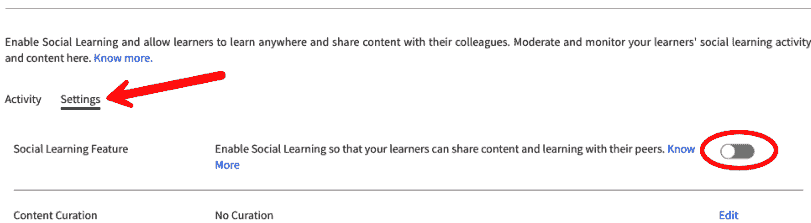

图 12.7 – 确保在您的 Prime 账户中关闭社交学习

现在您知道社交学习目前未为您的 Prime 账户启用，让我们看看它如何影响学习者体验。

+   5. 切换到您以 Learner 01 身份登录的浏览器窗口。可能需要刷新浏览器窗口，以便您作为管理员所做的更改生效。
+   6. 单击汉堡图标（位于屏幕左上角的带有三个水平条的按钮）以显示学习者体验中当前可用的页面。
+   7. 确认学习者体验的左侧边栏中目前没有 Social Learning 页面。
+   8. 此外，从上到下滚动浏览学习者主页，仔细注意其包含的部分。

现在，您将返回管理员应用程序并重新启用社交学习，但仅限内部用户。

- 9. 返回您以管理员身份登录的浏览器窗口。
- 10. 如有必要，返回管理员应用程序中社交学习页面的设置选项卡。
- 11. 将社交学习功能重新打开。
- 12. 花点时间阅读“需要确认”消息，然后点击继续按钮。

此操作会为内部和外部学习者同时启用社交学习功能。现在，您必须限制 Captivate Prime 社交学习引擎的使用，使其仅对内部用户可用。

- 13. 点击与范围设置选项关联的编辑链接。
- 14. 取消选中“为外部学习者启用”复选框。此操作在以下截图中有所说明。
- 15. 完成后点击保存按钮。

花点时间阅读“需要确认”消息并点击继续按钮。

将所有其他选项保留为各自的默认值，如下所示：

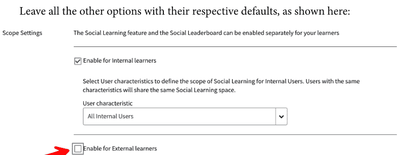

图 12.8 – 为内部用户禁用社交学习

现在，让我们返回您以 *Learner 01* 登录的浏览器窗口，看看学习者体验如何受到此更改的影响。

- 16. 切回您以 *Learner 01* 登录的浏览器窗口。
- 17. 刷新浏览器窗口，使您在管理员应用程序中所做的更改生效。
- 18. 点击屏幕左上角的汉堡菜单图标，以显示学习者体验中当前可用的页面。
- 19. 确认在学习者体验的左侧边栏中出现了一个新的 **Social Learning** 按钮：

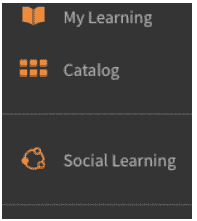

图 12.9 – 社交学习按钮在学习者体验的左侧边栏中可见

- 20. 最后，再次查看学习者主页，注意新的 **Social Feed** 小部件。它也与您刚刚启用的社交学习功能相关。

为完成本节，您必须以外部学习者身份登录您的 Prime 账户，并确认 **Social Learning** 按钮对外部学习者不可用。

- 21. 确保您仍在使用以 *Learner 01* 登录的浏览器窗口。
- 22. 使用屏幕右上角的用户图标 **Sign Out** *Learner 01*。
- 23. 以 *Learner 03* 身份重新登录。

**以 Learner 03 登录**

*Learner 03* 是在 *第 5 章，管理用户* 中定义的外部学习者。由于它是外部学习者，请记住该用户有专用的 URL 用于登录 Prime 账户。如果您不记得此 URL，请返回管理员应用程序的 **External Users** 页面，将鼠标悬停在外部注册配置文件上，然后点击链接图标将 URL 复制到剪贴板。

24. 以 *Learner 03* 登录后，确认 **Social Learning** 按钮（*Learner 01* 可用）对 *Learner 03* 不存在。

在本节中，您已在 Prime 账户上启用了社交学习，但仅限内部用户。这些用户现在可以在学习者体验的左侧边栏中看到 **Social Learning** 按钮，以及学习者主页上的 **Social Feed** 小部件。

在下一节中，您将使用以 *Learner 01* 登录的浏览器窗口，并检查学习者体验中 **Social Learning** 页面上可用的功能。

## 创建和关注讨论板

就像任何社交网络一样，Captivate Prime 的社交学习功能就是为了让用户讨论和分享内容。

在 Captivate Prime 中，使用社交学习功能发布的内容被组织到 **discussion boards** 中。Captivate Prime 的 **boards** 类似于主流社交网络中常见的 *walls* 或 *stories*。

从教学设计角度来看，Captivate Prime 讨论板特别有趣的地方在于它们与技能相连。如 *第 4 章，创建技能和课程* 中所述，单个技能可用于多个不同的课程。由于讨论板与技能相关，这意味着您可以在同一讨论板上找到报名（或感兴趣）于许多不同课程的学习者，并且他们在该技能上的熟练程度各不相同。事实上，任何对特定技能感兴趣的学习者都可以加入该技能的讨论板，即使他/她尚未报名相关课程。

为了尝试这些功能，您将再次两次登录您的 Prime 账户。但这次，您将以两个不同的内部用户身份登录。请执行以下步骤：

- 1. 打开一个浏览器窗口并以 *Learner 01* 身份登录您的 Prime 账户。
- 2. 打开一个 *private* 浏览器窗口（或完全另一个浏览器）并以 *Learner 02* 身份登录同一 Prime 账户。
- 3. 确保在此整个部分中保持两个浏览器窗口打开。

*Learner 01* 和 *Learner 02* 是您在 *第 5 章，管理用户* 中创建的两个内部学习者。由于他们都是内部用户，他们都可以访问 Captivate Prime 学习者体验中的 **Social Learning** 页面。

在本节练习中，请记住您尚未更改管理员为管理 Prime 账户上的社交学习而可用的任何常规选项。因此，您将体验 Captivate Prime 的默认社交学习配置。

现在一切就绪，您将创建第一个讨论板并在其上发布消息。

## 创建新讨论板

由于您刚刚在 Prime 账户上启用了社交学习，目前还没有可供您发布第一条消息的讨论板。因此，在发布消息之前，您必须先创建一个新讨论板。请按以下步骤操作：

- 1. 使用您以 Learner 01 登录的浏览器窗口。
- 2. 从学习者主页点击左侧边栏的社交学习图标以打开社交学习页面。

如以下截图所示，社交学习页面目前应为空：

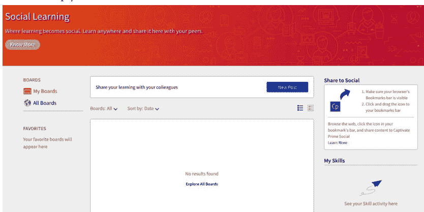

图 12.10 – 社交学习页面目前为空

- 3. 点击新建帖子按钮开始分享内容。
- 4. 在“在此处写入或粘贴内容…”字段中输入一条简短消息。

完成后，注意发布按钮仍处于禁用状态。那是因为您需要选择要发布消息的讨论板。但等等！目前还没有可用的讨论板。所以，让我们现在就创建一个。

- 5. 点击“在此处输入以搜索讨论板”字段正下方的创建新讨论板链接。此操作会打开新建讨论板对话框。
- 6. 在讨论板名称字段中输入 Cybersecurity in the organization。请注意此信息为必填项。
- 7. 作为最佳实践，也请在描述字段中提供简短描述。
- 8. 在讨论板技能字段中输入 Cybersecurity 的前几个字母。当 Cybersecurity 技能出现在列表中时，点击它将其添加到讨论板技能列表中。
请注意，您可以将单个讨论板链接到多个不同的技能。

> 注意
> Cybersecurity 技能是在第 4 章，创建技能和课程中创建的。如果它在您的 Prime 账户中不可用，请使用任何可用技能，或参考第 4 章，创建技能和课程中的创建自定义技能部分，了解如何创建 Cybersecurity 技能。

- 9. 默认情况下，创建讨论板的用户（本例中为 Learner 01）会自动被定义为讨论板版主。如有需要，请使用版主字段添加其他版主。但在本例中，目前请保持为空。
- 10. 花点时间查看新建讨论板对话框底部可用的三个可见性选项。在本例中，您将创建一个公开讨论板。
- 11. 确保新建讨论板对话框如下所示。然后，点击创建按钮：

图 12.11 – 新建看板对话框

-   12. 创建新看板可为您赢得五分！点击 **太棒了** 按钮以确认此消息。
-   13. 现在看板已可用，您可以点击 **发布** 按钮在新创建的讨论板上发布您的第一条社交学习消息。
-   14. 发布消息可再为您赢得五分！点击 **太棒了** 按钮以确认此消息。

15. 确认您的帖子出现在 **组织中的网络安全** 讨论板上，如以下屏幕截图所示：

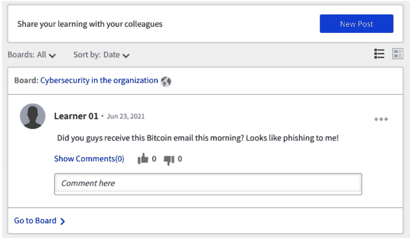

图 12.12 – 恭喜！您的第一篇文章已成功发布在新的讨论板上

## 社交学习积分和游戏化积分

创建看板和发布消息所获得的积分与上一章讨论的游戏化积分不同。本节讨论的积分特定于社交学习。它们用于定义各个讨论板的 **学科专家 (SMEs)**。*内容审核和策展* 部分将在本章后面详细介绍。

在本节中，您创建了一个新的讨论板并在其上发布了一条新消息。在继续之前，让我们花点时间反思一下刚才发生的事情，同时记住您当前正在体验默认的社交学习体验：

-   首先，帖子不能脱离讨论板而存在。如果没有可用的讨论板，在发布第一条消息时您必须创建一个。
-   默认情况下，每位学习者都可以创建新的讨论板。在本章后面的 *审查管理员的社交学习选项* 部分，您将学习如何限制可以创建新讨论板的用户数量。
-   在此示例中，您创建了一个新的 *公开* 看板。公开看板对所有用户可见，每个人都可以参与讨论。您还可以创建 *私有* 看板。这些仅对选定用户可见。当然，在创建私有看板时，您还必须提供可以访问它的用户（或用户组）列表。最后，您还可以创建 *受限* 看板。这些对所有用户可见，但只有版主可以发布内容。此选项在您只想允许选定的讲师或学科专家在讨论板上发布内容时非常有用。

这些是允许用户创建看板和发布消息的基本选项。现在，让我们看看其他用户如何关注看板并参与对话。

## 查找和关注看板

看板只有在多个学习者关注并参与讨论时才有用。在本节中，您将看到 *学习者 02* 如何访问新创建的看板并参与讨论。请执行以下步骤：

-   1. 切换到您以 *学习者 02* 身份登录的浏览器窗口。
-   2. 从学习者主页点击左侧边栏中的 **社交学习** 图标以打开 **社交学习** 页面。

默认情况下，**社交学习** 页面在 **我的看板** 选项卡上打开，该选项卡可见于页面的左侧列。但由于 *学习者 02* 尚未参与任何讨论或自行创建新看板，*学习者 02* 的 **社交学习** 页面的 **我的看板** 选项卡目前为空，因此显示 **未找到结果** 消息。

学习者 02 有几种方式可以查看上一节中由学习者 01 创建的讨论板。让我们通过执行以下步骤来探索它们：

3. 在 未找到结果 区域上方，打开 Boards 下拉菜单，如以下屏幕截图所示：

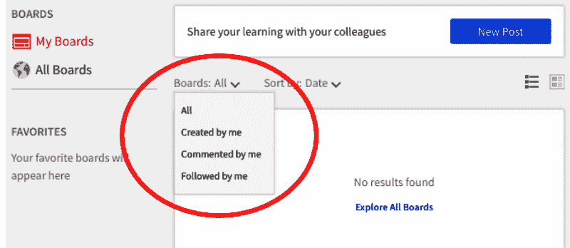

图 12.13 – 打开 Boards 下拉菜单

Boards 下拉菜单允许学习者 02 过滤其社交学习页面上显示的讨论板。由于页面上目前没有显示讨论板，因此此下拉菜单目前无用。话虽如此，它包含重要条目，可帮助您了解学习者如何关注看板：

-   首先，创建新看板的用户会自动关注它。这就是学习者 01 最终关注您在上一节中创建的 组织中的网络安全 讨论板的方式。
-   其次，您会自动关注您添加评论的任何看板。
-   最后，您也可以决定明确关注某个看板，而无需在其上发布任何消息。

让我们亲手探索这些选项。首先，您将让学习者 02 关注 组织中的网络安全 看板。然后，您将看到学习者 02 如何回复学习者 01 的帖子或创建全新的帖子。

4. 点击社交学习页面中间的 Explore All Boards 链接以打开可用看板列表。

您还可以使用左侧列 Boards 部分中的 All Boards 按钮。

在此示例中，列表相当简短：您的 Prime 账户上只有一个可用看板。当然，随着越来越多的学习者创建额外的看板并参与多个讨论，这个数字势必会增加。因此，让我们看看可用的工具，以便您可以搜索和过滤列表。

-   5. 在列表左上角，打开 Sort by 下拉菜单。默认情况下，列表按 Date 排序，但您也可以按 Relevance 排序。
-   6. 在列表右上角，注意两个允许您查看 Post View 或 Board View 的图标。默认情况下，您看到的是 Post View，如以下屏幕截图所示：

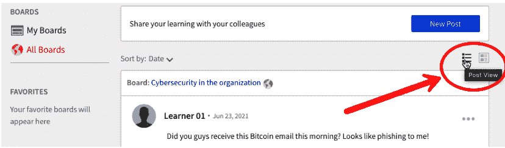

图 12.14 – 默认情况下，您看到的是 Post View

7. 使用上一张截图中说明的图标切换到 Board View。

当您处于 Board View 时，列表上方还有两个额外的下拉菜单。如以下屏幕截图所示，它们允许您按 Skills 和 Activity 过滤看板列表：

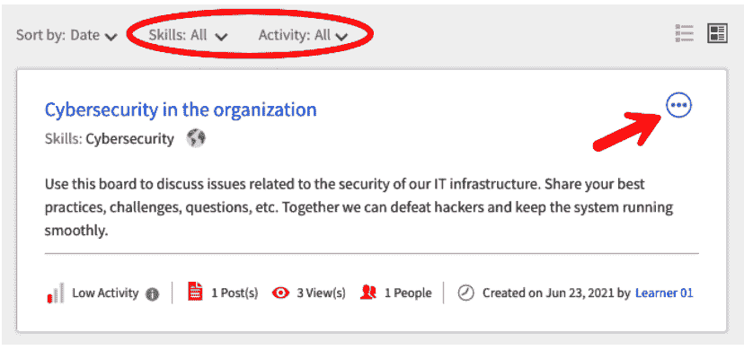

图 12.15 – Board View 的 Skills 和 Activity 过滤器

请记住，Captivate Prime 讨论板直接与一个或多个技能相关。这使得 **技能** 过滤器非常有用，因为它允许您仅查看与所选技能相关的看板。

**活动** 过滤器指的是看板的活跃程度。您希望关注最活跃的看板。

此外，请注意主搜索字段，它位于页面右上角，用户图标和通知图标旁边。此字段还允许您使用关键词搜索讨论板。

现在您知道如何搜索讨论板了，您将让 *学习者 02* 关注上一节中由 *学习者 01* 创建的 **组织中的网络安全** 看板。

-   8. 在 **看板视图** 中，点击 **组织中的网络安全** 看板卡片右上角带有三个小点的圆形图标（参见前一张截图中的箭头）。
-   9. 在打开的菜单中，点击 **关注看板** 选项。这就是您无需实际参与讨论即可关注看板的方式。当然，如果您愿意，您之后可以自由加入对话。
-   10. 点击左侧列 **Boards** 部分中的 **我的看板** 选项卡。

确认 **组织中的网络安全** 看板现在在 *学习者 02* 的 **我的看板** 选项卡中可见。

从这里，*学习者 02* 可以回复 *学习者 01* 的帖子并对其点赞（喜欢）或点踩（不喜欢）。

-   11. 点击竖起大拇指图标以点赞 *学习者 01* 的帖子。您还可以添加一个小回复。
-   12. 点击与 **组织中的网络安全** 关联的 **前往看板** 链接。这将打开 **组织中的网络安全** 看板的专用页面。
-   13. 点击 **组织中的网络安全** 标题右上角带有三个点的圆形图标。
-   14. 从打开的菜单中选择 **添加到收藏**。
-   15. 最后，点击左侧列 **Boards** 部分中的 **我的看板** 选项卡，返回 *学习者 02* 的默认 **社交学习** 页面。

在左侧列的 **收藏** 部分，注意到指向 **组织中的网络安全** 看板的直接链接。

在本节中，您讨论了学习者如何使用 **社交学习** 页面上提供的工具来搜索讨论区、关注讨论区并将讨论区添加到收藏夹中。

您现在有一个可用的讨论区，并且有两位学习者正在关注该讨论区。在下一节中，您将重点关注可在这些讨论区共享的各种内容类型。

## 在讨论区共享内容

现在您已拥有可用的讨论区，学习者将希望使用它与同伴共享不同类型的内容。在上一节中，您向讨论区添加了一些简单的文本消息，您看到了学习者如何对这些消息做出回应，以及他们如何点赞（like）或点踩（dislike）。

在本节中，您将在新创建的讨论区发布更多不同类型的内容。这包括共享网页、文档、图像、视频等。让我们从创建投票和问题开始。

## 创建投票和问题

除了上一节中讨论的简单基于文本的帖子外，学习者还可以生成简单的投票和问题。这些投票和问题是让学习者参与社交学习功能的好方法，尤其是如果他们从未参与过此类讨论的话。这也是教师扩展课堂讨论或为下一次课程准备听众的好方法。

在本节中，*学习者 02* 将在新创建的 **组织中的网络安全** 讨论区发起一个投票。请执行以下步骤：

- 1. 确保您使用的是以 *学习者 02* 身份登录的浏览器窗口，并且您位于默认的 **社交学习** 页面上。
- 2. 点击页面顶部位于的 **新建帖子** 按钮。
- 3. 在 **在此输入或粘贴内容...** 字段中输入 **您最害怕哪种安全威胁？**。
- 4. 点击文本字段下方位于的 **添加投票** 按钮。
- 5. 为投票选项输入以下四个选项：**网络钓鱼**、**病毒**、**勒索软件** 和 **其他**。
- 6. 在 **在此输入以搜索讨论区** 字段中输入 **网络安全** 的前几个字母，然后选择 **组织中的网络安全** 讨论区。
- 7. 当表单如下所示时，点击 发布 按钮：

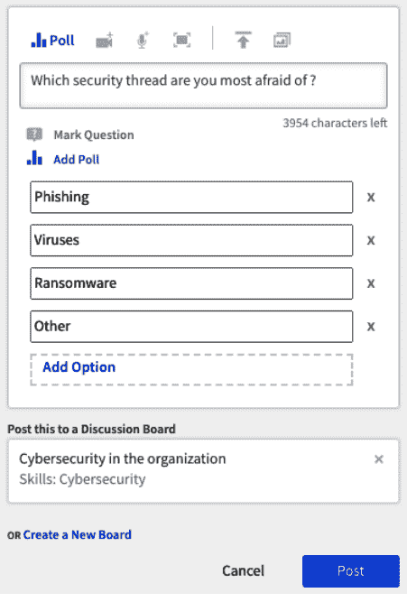

Figure 12.16 – 在讨论区创建投票

- 8. 最后，通过选择四个可用答案之一来提供您对投票的回应。不要忘记点击 Submit Choice 链接来验证您的选择。
- 9. 返回您以 学习者 01 身份登录的浏览器窗口并浏览到（或刷新）社交学习 页面。
- 10. 确认 学习者 02 创建的投票在 学习者 01 的 社交学习 页面上可见。
- 11. 以 学习者 01 的身份回答投票。

学习者 01 输入其选择后，投票结果会立即显示，如以下屏幕截图所示：

Learner 02 • Jun 24, 2021

您最害怕哪种安全威胁？

- 网络钓鱼 0% (0 票)
- 病毒 50% (1 票)
- 勒索软件 50% (1 票)
- 其他 0% (0 票)

您已提交您的选择

Figure 12.17 – 已提交答案的所有学习者均可看到投票结果

您可以使用相同的技术来创建问题。在这种情况下，您将使用 Mark Question 按钮代替 Add Poll 按钮。这允许您将其他学习者提交的评论之一标记为问题的正确答案。

创建投票是让学习者参与持续对话的简单方法，而创建问题并标记正确答案有助于学习者快速在讨论线程中找到相关信息。

在下一节中，您将探索在 Captivate Prime 讨论区共享网页的一种独特方式。

## 共享网页

在浏览互联网时，学习者 01 偶然发现了关于计算机安全的维基百科页面。他/她发现该页面非常有见地，想要与参与 组织中的网络安全 讨论区的其他学习者分享该页面。

这是一个如此常见的情况，以至于 Captivate Prime 提供了一种独特的机制，允许用户快速在任何可用的讨论区发布他们认为有趣的任何 URL。

在本节中，您将部署此机制并使用它在 **组织中的网络安全** 讨论区发布网页。请执行以下步骤进行操作：

- 1. 确保您仍在 *学习者 01* 的默认 **社交学习** 页面上。
- 2. 同时，确保浏览器的书签栏当前可见。
- 3. 在 **社交学习** 页面右侧，找到右侧列顶部位于的 **分享到社交** 小部件。
- 4. 点击并拖动 **CP** 图标到浏览器的书签栏。完成此过程后，您将在书签栏中多出一个书签，如以下屏幕截图所示：

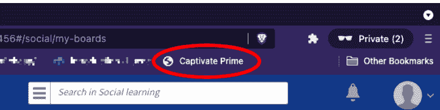

Figure 12.18 – Captivate Prime 书签可在浏览器的书签栏中使用

- 5. 现在 URL 共享机制已就位，请浏览 `https://en.wikipedia.org/wiki/Computer_security` 上的计算机安全维基百科页面。
- 6. 点击新的 **Captivate Prime** 书签，以在其中一个可用的讨论区共享您当前正在查看的页面。

如有必要，请按照屏幕上的说明以 *学习者 01* 身份登录您的 Prime 账户。
- 7. 填写在右侧窗格中出现的表单并点击 **发布** 按钮。此操作如下屏幕截图所示：

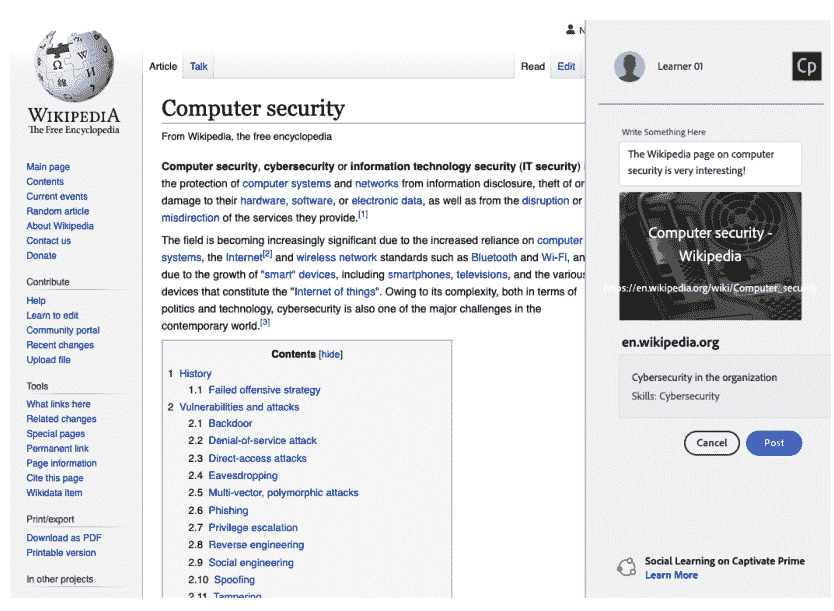

Figure 12.19 – Captivate Prime 窗格出现在浏览器窗口的右侧

这样共享网页将为 *学习者 01* 奖励五分！

- 8. 点击 **前往帖子** 按钮返回 Captivate Prime 上 *学习者 01* 的 **社交学习** 页面，并查看刚刚发布的 URL。

您放置在浏览器书签栏中的小部件称为 **bookmarklet**。这个特殊的 bookmarklet 使共享任何网页到 Captivate Prime 中任何可用的讨论区变得非常容易。最终，这个 bookmarklet 使共享网页的过程变得如此简单，以至于学习者没有任何借口不开始共享！

> **提示**
>
> 此 bookmarklet 要求您允许浏览器中的弹出窗口。此外，请注意某些浏览器（如 Firefox 和 Brave）默认会阻止大量 JavaScript 跟踪器。您可能需要调整浏览器的安全设置以允许 bookmarklet 工作。更多信息可在官方 Captivate Prime 用户指南中找到，网址为 https://helpx.adobe.com/in/captivate-prime/learners/feature-summary/share-to-social.html。

在讨论区共享网页是一个非常常见的用例。共享文件是另一个非常常见的情况，您将在下一节中检查这一点。

## 共享文件

*学习者 01* 在 **网络安全基础** 课程中提交的作业获得了教师的如此好的反馈，以至于他/她想要与参与 **组织中的网络安全** 讨论区的其他学习者分享它。

这只是用户可能想要将文档上传到其中一个可用讨论区的众多情况之一。在本节中，您将通过执行以下步骤来回顾如何完成此操作：

- 1. 确保您仍在 *学习者 01* 的默认 **社交学习** 页面上。

如前几节所述，您可以通过点击 **社交学习** 页面顶部可用的 **新建帖子** 按钮来开始新帖子。使用该技术时，您必须选择要发布新消息的讨论区。在本节中，您将通过前往所选讨论区然后从那里开始新帖子来探索另一种技术。

- 2. 点击最近帖子列表顶部位于的 **组织中的网络安全** 链接。您也可以使用页面进一步下方位于的 **前往讨论区** 链接。

这将打开 **Cybersecurity in the organization** 板页面。

> **提示**
> 请记住，您可以使用位于讨论区页眉右上角的带三个小点的圆形图标将讨论区添加到收藏夹中。这样 Learner 01 即可直接访问 **Cybersecurity in the organization** 讨论区。

- 3. 单击页面顶部、页眉下方位置的 **New Post** 按钮。
- 4. 单击位于该 **Write or paste something here...** 字段正上方的 **Upload file** 图标。此操作在以下屏幕截图中进行了说明：

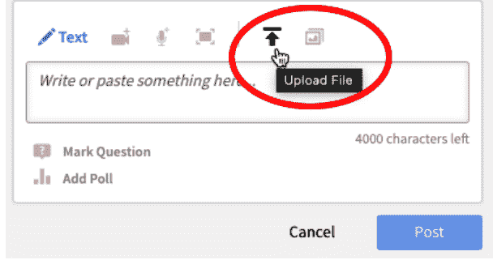

图 12.20 – 单击上传文件图标

- 5. 在 **Write or paste something here...** 字段中输入一条简短消息，以配合您的文件提交。
- 6. 使用文本字段下方的文件上传区域上传与本书关联的下载内容中的 `courseContent/myAssignment.docx` 文件。
- 7. 准备就绪后，单击 **Post** 按钮将您的文档发布到讨论区。

一段时间后，您提交的文档将在讨论区中可见。请注意，由于您直接从讨论区页面开始发布流程，因此在上传时无需选择要发布文档的讨论区。

与往常一样，其他学习者可以对您的文件提交进行评论，以及点赞（喜欢）或点踩（不喜欢），但由于您的帖子包含文件，其他学习者也可以使用以下屏幕截图中箭头突出显示的下载图标在计算机上下载该文件：

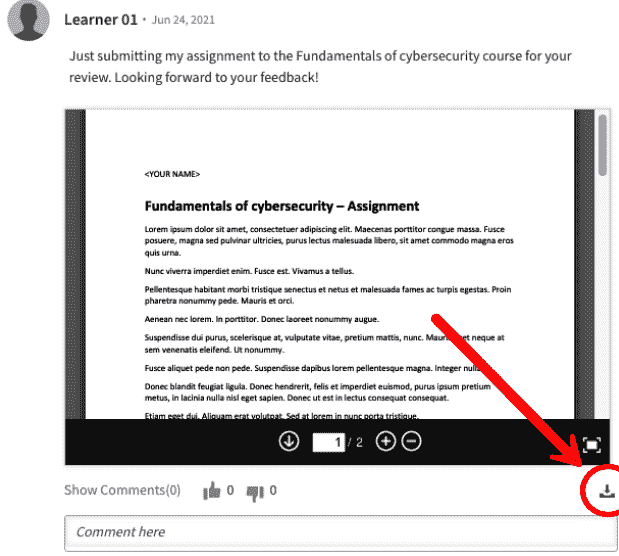

图 12.21 – 学习者可以下载提交到讨论区的任何文件

在此示例中，您上传的是具有 .docx 文件扩展名的 Microsoft Word 文档，但 Captivate Prime 支持各种视频、音频、文档和图像文件。请参阅官方 Captivate Prime 文档以获取受支持内容和格式的最新列表：https://helpx.adobe.com/captivate-prime/user-guide.html/captivate-prime/learners/feature-summary/social-learning-web-user.ug.html#Supportedcontentformats。

能够与参与讨论区的其他学习者共享如此多样化的文件，是一种非常强大且引人入胜的知识共享方式。例如，讲师可以通过发布培训幻灯片、课程讲义等内容，利用它推动学习者使用 Captivate Prime 的社交学习工具。

但 Captivate Prime 更进一步，尽可能移除了障碍，以便您使用讨论区与其他人共享高度引人入胜的内容。您将在下一节中发现这一点。

## 使用 Adobe Captivate Prime 桌面应用共享

除了共享基于文本的内容、网页和文件外，您还可以使用 Captivate Prime 的讨论区共享屏幕截图、语音录音和短视频。对于此类内容，共享是容易的部分。但首先，您必须创建内容，而这要困难得多。

这就是 Prime 工程团队开发 Adobe Captivate Prime 桌面应用程序的原因。该应用程序允许您轻松创建屏幕截图、语音录音，甚至小型视频，然后只需点击几下即可上传到 Captivate Prime 的其中一个讨论区！

> Captivate Prime 桌面应用程序可用性
> 在撰写本书时，Adobe Captivate 桌面应用程序适用于 Windows 和 Mac 计算机（最高 macOS 10.15 – macOS Big Sur（版本 11）尚未受支持）。

您将在本节中探索这一点，但在那之前，您必须通过执行以下步骤下载并安装 Adobe Captivate Prime 桌面应用程序：

- 1. 使用您以 Learner 01 身份登录的浏览器窗口。转到社交学习页面，然后转到 Cybersecurity in the organization 讨论区。
- 2. 单击页面顶部的 New Post 按钮。

花点时间检查 Write or paste something here... 字段正上方可见的图标。它们代表可在 Captivate Prime 讨论区共享的不同内容类型，如下所示：

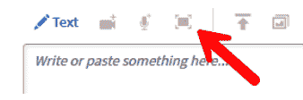

图 12.22 – Captivate Prime 讨论区支持的内容类型

默认情况下，Text 图标处于选中状态。在上一节中，您使用 Upload 图标上传了 Word 文档。现在，您将检查其他可用的图标。

从左到右，它们允许您上传视频（屏幕录制、网络摄像头视频或两者）、语音录音或屏幕截图。让我们从屏幕截图开始。

- 3. 单击前一屏幕截图中箭头标识的屏幕截图图标。

以这种方式共享屏幕截图需要您安装 Adobe Captivate Prime 桌面应用程序。如果这是您第一次点击这些图标中的一个，您将被提示下载并安装 Adobe Captivate Prime 桌面应用程序。

> **下载和安装 Captivate Prime 桌面应用**
> 有些组织不允许您从第三方服务器下载应用程序。在本章后面 *Reviewing the Social learning Options of the Administrator* 部分，您将学习如何自定义 Captivate Prime 桌面应用程序的下载位置，使其从您企业网络内的位置下载。

- 4. 如有需要，下载并安装 Adobe Captivate Prime 桌面应用程序。
- 5. 安装完成后，单击 **Sign In** 按钮并以 *Learner 01* 的身份从桌面应用程序登录到您的 Prime 账户。这将带您进入以下屏幕截图中显示的应用程序欢迎屏幕：

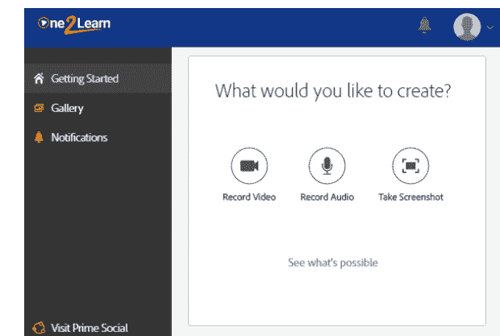

图 12.23 – Adobe Captivate Prime 桌面应用程序欢迎屏幕

如欢迎屏幕所示，Adobe Captivate 桌面应用程序允许您创建三种类型的内容：视频、音频文件和屏幕截图。让我们在接下来的几个部分中逐一了解这些选项。

## 共享屏幕截图

在此第一个示例中，您将首先截取计算机屏幕的屏幕截图并将其上传到 **Cybersecurity in the organization** 讨论区：

- 1. 单击 Adobe Captivate Prime 桌面应用程序欢迎屏幕上的 **Take Screenshot** 图标。
- 2. 按照屏幕上的说明捕获计算机的整个屏幕或仅屏幕的一部分。
- 3. 完成后，Adobe Captivate Prime 桌面应用程序会显示屏幕捕获的预览。如果您对预览满意，请单击 **Next** 按钮；否则，单击 **Discard** 链接并重新开始，直到您对预览满意为止。
- 4. 接下来，为您的屏幕捕获命名并单击 **Save** 按钮。
- 5. 现在，您可以使用 Adobe Captivate Prime 桌面应用程序左侧列中的工具为屏幕捕获添加注释。
- 6. 准备就绪后，单击屏幕右上角的 **Share** 按钮。
- 7. 选择要共享屏幕截图的讨论区（在此示例中，选择 **Cybersecurity in the organization** 讨论区），添加一条简短消息，然后单击 **Post** 按钮。
- 8. 上传完成后，单击 **Go to Board** 按钮打开网络浏览器。确认您的屏幕截图已正确发布，如以下屏幕截图所示：

图 12.24 – 直接从 Captivate Prime 桌面应用程序上传的屏幕截图

使用 Adobe Captivate Prime 桌面应用程序的这次首次体验清楚地说明了为什么要开发此应用程序。它的目的是简化此类内容的创建和共享，以至于学习者不再在 Captivate Prime 讨论区共享内容时看到任何障碍。我们甚至可以想象他们在这样做时会感到有趣！

让我们再做一次语音录音的体验。

## 共享语音录音

有时，简短的语音消息比基于文本的消息更快、更容易。这就是为什么 Adobe Captivate Prime 桌面应用程序让您轻松捕获和共享语音录音的原因。您将在本节中通过执行以下步骤探索这一点：

- 1. 打开安装在计算机上的 Captivate Prime 桌面应用程序，并确保您以 Learner 01 身份登录。
- 2. 单击应用程序欢迎屏幕中间的 **Record Audio** 图标。
- 3. 如有需要，单击录制按钮正上方的麦克风图标以选择正确的麦克风。此操作在以下屏幕截图中进行了说明：

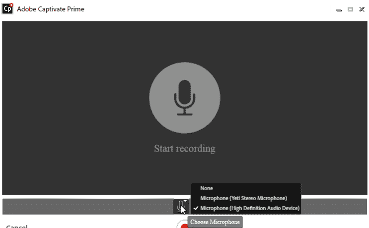

图 12.25 – 为下一次语音录音选择麦克风

- 4. 准备就绪后，点击红色的 *record* 按钮并录制你的语音留言。
- 5. 完成后，点击 *pause* 按钮以打开一个窗口，在其中可以收听录音。

如果你对语音录音满意，请点击 **Next** 按钮；否则，点击 **Discard** 链接并重新开始。你也可以通过点击 **Resume** 链接来为现有录音添加内容。
- 6. 点击 **Next** 按钮后，系统会提示你保存语音录音。只需为其命名并点击 **Save** 按钮即可。
- 7. 接下来，你可以使用 Adobe Captivate Prime 桌面应用程序左侧列中提供的工具来修剪（删除不需要的部分）你的语音录音。
- 8. 准备就绪后，点击屏幕右上角的 **Share** 按钮。
- 9. 选择你希望发布新语音录音的讨论区，添加一条简短消息，然后点击 **Post** 按钮。
- 10. 上传完成后，点击 **Go to Board** 按钮打开你的网络浏览器，并确认你的语音录音已正确发布在 **Cybersecurity in the organization** 讨论区。

再一次，Adobe Captivate Prime 桌面应用程序使在讨论区录制和分享音频内容变得非常容易。

请注意，在本节中，你直接从 Adobe Captivate 桌面应用程序开始了内容创建和分享流程。这与本章前面 *Sharing Files* 部分形成对比，在那里你是从 **Cybersecurity in the organization** 讨论区开始流程的。因此，这次在分享时，你必须选择要发布内容的讨论区。

在下一节中，我们将回顾如何使用 Adobe Captivate Prime 桌面应用程序录制和分享一个小视频。

## 分享视频

Adobe Captivate Prime 桌面应用程序允许你创建和分享的第三种内容类型是视频文件。这可以是简单的网络摄像头视频、屏幕录制，或同时包含网络摄像头和屏幕录制的视频。

让我们通过执行以下步骤来了解此功能：

- 1. 打开安装在你电脑上的 Captivate Prime 桌面应用程序，并确保你以 *Learner 01* 身份登录。
- 2. 点击应用程序欢迎屏幕中间的 **Record Video** 图标。
- 3. 在 **Webcam only**、**Screen only** 或 **Both** 之间进行选择。在此示例中，点击 **Both** 图标以查看所有可用选项。
- 4. 使用红色 *record* 按钮正上方的网络摄像头和麦克风图标来选择你想要使用的网络摄像头和麦克风。
- 5. 准备就绪后，点击红色 *record* 按钮。经过短暂的倒计时后，你将进入录制模式。
- 6. 录制你的视频，请记住你同时录制网络摄像头和屏幕。完成后，点击 *pause* 按钮停止录制。
- 7. 花必要的时间查看你刚刚录制的视频。如果你满意，请点击 **Next** 按钮；否则，点击 **Discard** 链接重新开始。你也可以通过点击 **Resume** 链接来为录制添加内容。
- 8. 点击 **Next** 按钮后，系统会提示你保存视频。为其命名并点击 **Save** 按钮。
- 9. 现在，你可以使用 Adobe Captivate Prime 桌面应用程序左侧列中提供的工具以多种方式编辑你的视频。

由于你同时录制了网络摄像头和屏幕，因此你可以使用屏幕底部的三个按钮在这两个画面之间进行选择。此功能在以下屏幕截图中有所说明：

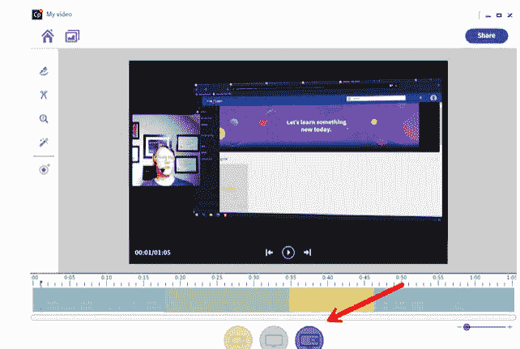

图 12.26 – Adobe Captivate Prime 桌面应用程序的视频编辑器

使用 *yellow* 图标仅显示网络摄像头，使用 *green* 图标仅显示屏幕，使用 *blue* 图标同时显示网络摄像头和屏幕。

> **Note**
> Adobe Captivate Prime 桌面应用程序的大部分视频编辑功能与 Adobe Presenter Video Express 共享。如果你熟悉 Presenter Video Express，那么 Captivate Prime 桌面应用程序应该会感觉非常熟悉。

- 10. 准备就绪后，点击屏幕右上角的 **Share** 按钮。
- 11. 选择你希望发布视频的讨论区（在此示例中，选择 **Cybersecurity in the organization** 讨论区），添加一条简短消息，然后点击 **Post** 按钮。
- 12. 上传完成后，点击 **Go to Board** 按钮打开你的网络浏览器，并确认你的视频已正确发布在所选讨论区。

通过此次视频上传，你已了解了 Adobe Captivate Prime 桌面应用程序的主要功能。请参考官方 Prime 用户指南 https://helpx.adobe.com/in/captivate-prime/learners/adobe-captivate-prime-app-for-desktop.html 了解有关 Adobe Captivate Prime 桌面应用程序的更多信息。

在本节中，你已回顾了在 Captivate Prime 讨论区创建和发布内容的几种方式。得益于分享书签小工具和 Adobe Captivate Prime 桌面应用程序，任何学习者都可以轻松上传复杂的 multimedia 内容并参与有意义的讨论。

> **Tip**
> 尽管 Captivate Prime 使创建和分享内容变得非常容易，但如果你想最大化 Captivate Prime 讨论区活跃学习者的数量，应在新员工入职流程中加入对这些工具的简短介绍。

你现在应该在 **Cybersecurity in the organization** 讨论区拥有多种类型的帖子。用户可以对这些帖子进行评论、点赞（upvote）或点踩（downvote），并与其他学习者进行讨论。

由于有如此多的学习者参与讨论，很可能会产生优秀的内容和想法，从而在你的组织中培养积极且有回报的学习文化。但你也承担着上传低质量内容或出现不当行为的风险。因此，你还需要关注内容审核和策展。这就是你在下一节中将要探索的内容。

## 内容审核与策展

允许用户在线发布内容并参与讨论无疑可以带来丰富、深入且有回报的学习体验。但它也为各种争论、分歧，甚至学习者之间的言语攻击打开了大门，更不用说所分享内容质量参差不齐了。这并非 Captivate Prime 特有的问题——只需快速浏览大多数社交网络，你就会意识到这些问题在内容被分享以及人们参与讨论时就会出现。

这就是为什么 Captivate Prime 包含强大的内容审核和策展功能的原因：

- **Content moderation** 指的是编辑和/或删除被认为不适当内容的能力。这可以由版主直接执行，或在学习者举报帖子不当时执行。
- **Content curation** 是检查学习者分享内容的质量和相关性的过程。例如，当有人发布过时、无关或甚至虚假的信息时，必须将其从 Captivate Prime 中移除，即使发布者是以完全诚实和礼貌的方式发布的。

这就是本节将要回顾的内容。首先，让我们讨论如何成为讨论区版主。

## 指定版主

在本章前面 *Creating and following discussion boards* 部分，*Learner 01* 创建了 **Cybersecurity in the Enterprise** 讨论区。这使得 *Learner 01* 成为该特定讨论区的拥有者。作为拥有者，*Learner 01* 可以删除讨论区上的每篇帖子，即使他/她不是该帖子的拥有者。让我们通过执行以下步骤来实际回顾这一能力：

- 1. 以 *Learner 01* 身份登录你的 Prime 账户。
- 2. 进入 **Social Learning** 页面，然后进入 **Cybersecurity in the organization** 板块。
- 3. 找到 *Learner 02* 创建的一篇帖子，并点击该帖子右上角的三点图标。

如以下屏幕截图所示，Learner 01 可以删除此帖子，即使它是 Learner 02 创建的：

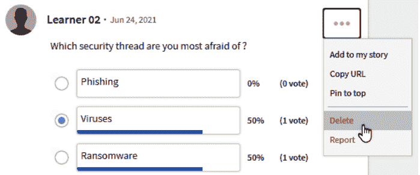

Figure 12.27 – Learner 01 可以删除 Learner 02 创建的帖子

这是因为 Learner 01 是此讨论板的拥有者，因此他/她也是该板子的版主。

现在，以 Learner 02 的身份登录你的 Prime 账户，并确认该用户没有相同的权限。

4. 使用另一个浏览器或私有窗口或同一浏览器以 Learner 02 的身份登录你的 Prime 账户。
5. 以 Learner 02 登录后，前往社交学习页面，然后进入组织中的网络安全讨论板。
6. 找到 Learner 01 创建的其中一篇帖子，并点击该帖子右上角的三点图标。注意删除选项对 Learner 02 不可用。
7. 现在，找到 Learner 02 创建的其中一篇帖子并点击与该帖子关联的三点图标。注意 Learner 02 可以删除和编辑他/她的帖子。

通过这些小实验，你了解到每个学习者都有权删除和编辑他/她的帖子。你也了解到板的拥有者也是主要版主。因此，他/她有权删除板上发布的任何内容。

现在，让我们返回登录为 Learner 01 的浏览器窗口，以修改板设置并添加额外的版主。

8. 返回登录为 Learner 01 的浏览器窗口。
9. 确保你仍在组织中的网络安全讨论板页面上。
10. 点击位于板头右上角的带三个小点的圆形图标。
11. 在打开的菜单中，点击编辑按钮以打开板设置表单。

从这里，你可以修改许多板设置选项，包括板名称、描述、板技能和可见性：

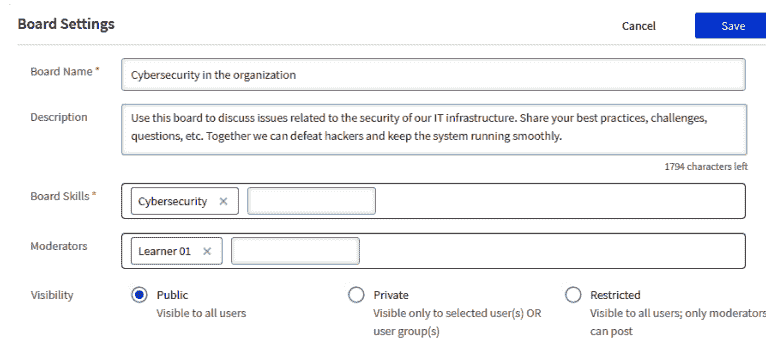

Figure 12.28 – 板设置表单

12. 将 Learner 02 添加到版主列表中。然后，点击表单右上角的保存按钮。
13. 返回登录为 Learner 02 的浏览器窗口并刷新组织中的网络安全讨论板页面。
14. 找到 Learner 01 的其中一篇帖子并点击其三点图标。确认删除选项现在在打开的菜单中可用。

现在 Learner 02 是该板子的版主之一，他/她在板上的权限与 Learner 01 相同，包括编辑主板设置和将 Learner 01 从版主列表中移除的能力。

另外也很重要要知道 Prime 管理员拥有与板拥有者相同的权限：他们可以删除任何帖子，也可以编辑（甚至删除）板本身。当例如板的拥有者离开组织时，这一点非常重要。在这种情况下，任何管理员都可以接管板的版务、指定新的版主，甚至完全删除该板。

在本节中，你学习了如何在事后修改一个板。可能的修改包括更改板的版主列表。你也了解到版主可以删除他们负责的板上的任何帖子。但这并不是版主能做的全部。在下一节中，你将研究版主的另一项职责。

## 报告不当帖子

板版务的另一个方面涉及任何学习者报告被认为不当的帖子的能力。在这种情况下，板版主必须审查报告并决定采取的行动。

这就是本节将审查的内容。首先，你将以 *Manager 01* 的身份登录你的 Prime 账户，并让该用户报告在 **组织中的网络安全** 讨论板上发布的一个帖子。执行以下步骤来操作：

1. 使用另一个浏览器或同一浏览器的另一个私有窗口以 *Manager 01* 的身份登录你的 Prime 账户。记住，经理首先是一个学习者，因此当 *Manager 01* 登录时，默认显示学习体验。
2. 前往 *Manager 01* 的 **社交学习** 页面并切换到 **所有板** 选项卡。
3. 点击 **组织中的网络安全** 板上可用的任何帖子关联的三点图标。
4. 在打开的菜单中，点击红色的 **报告** 链接。花点时间阅读 **需要确认** 消息并点击 **报告** 按钮。

这说明了用户如何报告帖子。请注意，*Manager 01* 无需订阅该板或参与讨论即可报告帖子。

现在，让我们返回登录为板版主（可以是 *Learner 01* 或 *Learner 02*）的浏览器窗口，看看版主如何跟进此报告。

5. 返回登录为板管理员（*Learner 01* 或 *Learner 02*）的浏览器窗口。
6. 点击屏幕右上角的通知图标。如以下屏幕截图所示，你应该会看到一条通知，告诉你 **Manager 01 已报告 Post 上的滥用**：

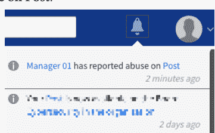

Figure 12.29 – 一条通知告诉你用户已报告帖子

7. 点击通知中可用的 **帖子** 链接以在对话框中打开被报告的帖子。

从这里，你可以审查该帖子。因为你是板版主，你可以删除它，甚至可以置之不理。

在本节中，你学习了学习者如何报告他们认为不当的消息以及版主如何跟进这些报告。

这结束了你对讨论板版务的概述。默认情况下，板的拥有者也是主要版主，但他/她可以指定额外的版主，更不用说平台上的任何管理员也可以版务 Prime 账户上可用的任何讨论板。版务一个板是为了保持讨论礼貌，但它并不能保证所分享内容的准确性或价值。这就是内容策展的用途，而这就是你在下一节中将研究的内容。

## 内容策展

在上一节中，你讨论了内容版务。版主不必是所讨论主题的专家；他们的唯一责任是确保讨论保持礼貌。

**内容策展** 另一方面是为了保证发布在讨论板上的内容质量。因此，内容策展要求对发布的内容进行准确性、相关性和是否最新的分析。这就是为什么内容策展是被认为在所讨论主题上是专家的个人的责任。

请记住，学习者在 Prime 账户上每次参与社交学习活动时都会获得积分。这些积分用于识别 Prime 账户上各种板中的 **主题专家** (**SMEs**)。这些 SMEs 负责他们擅长的讨论论坛中的手动内容策展。

这些是你将在本节中探索的功能。但在开始探索之前，有必要激活内容策展，而内容策展在任何新 Prime 账户上默认是禁用的。

### 激活内容策展

默认情况下，任何新 Prime 账户上都不进行内容策展。这意味着发布在各种讨论板上的内容质量得不到保证，这可能导致低质量内容分发给大量学习者。

在本节中，你将返回管理员应用程序并查看允许你在 Prime 账户上启用内容策展的选项。执行以下步骤：

1. 以管理员身份登录你的 Prime 账户。
2. 从管理员主页，点击左侧边栏 **管理** 部分中的 **社交学习** 链接。
3. 通过点击页面顶部的 **设置** 链接切换到 **设置** 选项卡。
4. 点击与 **内容策展** 选项关联的 **编辑** 链接。

如以下屏幕截图所示，**无策展** 是默认值：

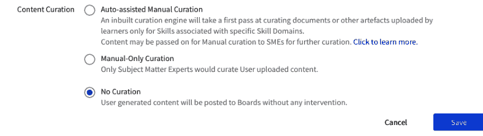

Figure 12.30 – 默认情况下，你的 Prime 账户上启用了无策展

花点时间阅读与三个值关联的描述：

- 当启用 **仅手动策展** 时，只有指定的 SMEs 才能策展学习者上传到讨论板的内容。
- 当启用 **自动辅助手动策展** 时，内置的 AI 驱动策展引擎会尝试自动检查上传内容的质量。如果失败，则内容会传递给指定的 SMEs 进行手动策展。

请注意，当启用 **自动辅助手动策展** 时，你必须将 Prime 账户上定义的技能映射到特定的 **技能域**，以帮助 AI 驱动的策展引擎完成工作。这就是你在下一节中将要做的事情，但在那之前，你必须在 Prime 账户上启用内容策展。

5. 选择 **自动辅助手动策展** 选项。
6. 点击 **保存** 按钮以确认此操作。

**自动辅助手动策展** 现在已在你的 Prime 账户上启用。请记住，为了使其高效，你需要为 AI 驱动的策展引擎提供 Prime 账户上定义的自定义技能与人工智能已知的技能域之间的映射。我们将在下一节中探索该过程。

## 将技能映射到技能域

虽然是一种非常强大的技术，人工智能仍需要实际人类的输入才能执行。

以 Captivate Prime 的内置策展引擎为例，Prime 工程团队已定义了一些技能域，并在这些技能域中训练了人工智能。因此，默认情况下，人工智能只知道这些预定义的技能域，不知道你在 Prime 账户上定义的自定义技能指的是什么。

这就是为什么你必须将 Prime 账户上可用的技能映射到一个或多个这些预定义的技能域。这就是本节中你将要做的事情，通过执行以下步骤：

- 1. 确保你已以管理员身份登录到你的 Prime 账户。
- 2. 从管理员主页，单击左侧列 **Manage** 部分中位于的 **Skills** 链接。

创建自定义技能已在 *第 4 章，创建技能和课程* 中讨论过。在该章节中，你创建了 **Cybersecurity** 技能，现在你将把它映射到 Captivate Prime 所知的预定义技能域之一或多个。

> **注意**
> 如果你尚未完成 *第 4 章，创建技能和课程* 中的练习，请使用 Prime 账户中任何讨论板链接的技能之一。

- 3. 单击你在 *第 4 章，创建技能和课程* 中创建的 **Cybersecurity** 技能，以打开 **Edit Skill** 对话框。
- 4. 在对话框中间，找到 **Skill Domain** 选项并单击关联的 **Know More** 链接。

此操作会打开 Captivate Prime 官方用户指南的页面，其中包含 Captivate Prime 所知的当前技能域列表。浏览列表并记下适用于你单击的技能的技能域。在此示例中，你将把自定义 **Cybersecurity** 技能链接到 **Computer security** 和 **Information technology** 技能域。

- 5. 返回浏览器窗口/标签页，其中可见 **Edit Skill** 对话框。
- 6. 在 **Skill Domain** 字段中输入 **Computer security** 的前几个字母。当它出现在列表中时，单击 **Computer security** 技能域。
- 7. 对 **Information technology** 技能域重复上一步。

- 8. 当 **Edit Skill** 对话框如下所示时，单击 **Save** 按钮：

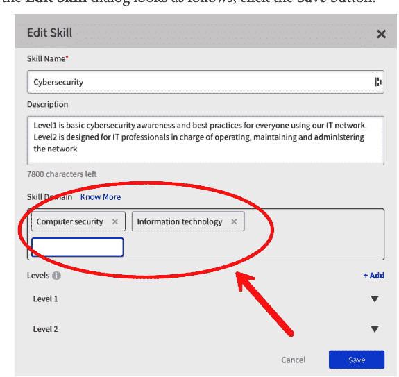

图 12.31 – 将技能映射到技能域

通过此过程，你告诉为 Captivate Prime 的策展引擎提供动力的 人工智能，你在 *第 4 章，创建技能和课程* 中定义的自定义 **Cybersecurity** 技能与它所知道的 **Computer security** 和 **Information technology** 技能域相关。

> **Adobe Sensei**
> 
> Adobe Sensei 是 Adobe 人工智能技术的名称。它为 Adobe 产品中的所有人工智能相关功能提供动力，包括 Captivate Prime 的策展引擎。有关 Adobe Sensei 和 Captivate Prime 的人工智能驱动功能的更多信息将在 *第 13 章，面向学习者的 AI 驱动推荐* 中提供。

Captivate Prime 的内置策展引擎现在已准备好开始分析学习者在链接到 **Cybersecurity** 技能的讨论板上上传的内容。但即使是最先进的人工智能技术也不是万无一失的。请记住，如果自动策展失败，则需要由活生生的 SME 进行手动策展。在尝试内容策展之前，你仍需要查看允许管理员管理每个可用技能的 SME 列表的选项。

## 管理 SME

内容策展很大程度上依赖于 SME 审查学习者分享的内容。在本节中，我们将回顾你如何成为 SME 以及管理员如何手动微调每个可用技能的 SME 列表。

请记住，当学习者参与社交学习活动时，他们会获得积分。 本章前面你已看到学习者在创建新板块和发布内容时如何获得积分。学习者在他们的内容（或评论）被点赞（喜欢）、他们的答案被标记为正确答案时也会获得积分，等等。

默认情况下，在给定技能中积累最多积分的三个用户被视为该技能的 SME。请注意，每个技能都有自己的 SME 列表，并且单个用户可以担任多个技能的 SME。

除了这些默认值之外，管理员还可以手动指定 SME，通过向选定的学习者授予额外的 SME 积分。让我们通过执行以下步骤亲手回顾此功能：

- 1. 确保你已以管理员身份登录到你的 Prime 账户。
- 2. 从管理员主页，单击左侧边栏 Manage 部分中位于的 Social Learning 链接。
  默认情况下，管理员应用程序的 Social Learning 页面在 Activity 选项卡上打开。
- 3. 向下滚动 Social Learning 页面的 Activity 选项卡，直到看到 Skills 部分。

Activity 选项卡的 Skills 部分仅显示与一个或多个可用讨论板相关的技能。在此示例中，你应该会看到列出 Cybersecurity 技能，如以下屏幕截图所示：

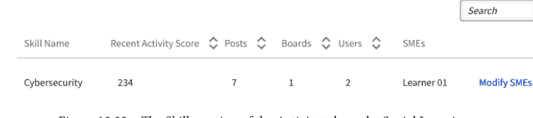

图 12.32 – Social Learning 页面上 Activity 选项卡的 Skills 部分

花点时间查看 **Activity** 选项卡的 **Skills** 部分中可用的指标。在前面的屏幕截图中，注意到 *Learner 01* 已被自动指定为 **Cybersecurity** 技能的 SME。这是因为在本章的前几节中，*Learner 01* 向 **Cybersecurity in the organization** 讨论板上传了相当多的文档。因此，他/她积累了 SME 积分，现在是该技能积分最多的三个用户之一。请注意，所有这些都是默认完成的；管理员尚未更改任何可用的 SME 相关选项。然而，作为管理员，你可以手动修改 SME 列表。

- 4. 单击与 **Cybersecurity** 技能关联的 **Modify SMEs** 链接以打开 **SMEs for this Skill** 对话框。

如以下屏幕截图所示，此对话框显示所选技能的当前 SME 列表：

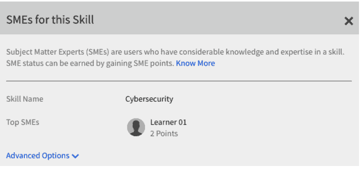

图 12.33 – SMEs for this Skill 对话框

在前面的屏幕截图中，*Learner 01* 目前是 **Cybersecurity** 技能的唯一 SME，即使该用户只有两点 SME 积分！这是因为 **Cybersecurity in the organization** 讨论板相当新，目前只有两个学习者参与讨论，所以 **2 Points** 就足以被认为是在该技能中排名靠前的 SME。但 2 个社交学习积分并不能使某人成为网络安全专家，对吧？让我们看看管理员对此能做什么

- 5. 单击对话框左下角的 **Advanced Options** 链接。
- 6. 选择 **Enable Minimum SME Points** 复选框并在相应字段中输入 50。

这意味着学习者要在 **Cybersecurity** 技能中成为 SME，至少需要 **50** 积分。这可确保当系统将其设为 SME 时，学习者在该技能方面具有一定的见解和经验。

但现在你已激活 **Enable Minimum SME Points** 选项，拥有 **2 Points** 的 *Learner 01* 不再能在该技能中成为 SME，导致 **Cybersecurity** 技能完全没有 SME！让我们通过手动为 *Learner 01* 在 **Cybersecurity** 技能中授予 100 个 SME 积分来解决这个问题。 借助这个小调整，**Cybersecurity** 技能将再次拥有 SME，并且该 SME 在参与相应讨论板的其他学习者眼中将具有很高的可信度。

- 7. 在 **Type to Search for users** 字段中输入 *Learner 01* 的前几个字母。当它出现在列表中时，单击 *Learner 01*。
- 8. 为 *Learner 01* 在 **Add Points** 字段中输入 100。这些额外积分将添加到当前积分中，使 *Learner 01* 的总积分为 102 分。
- 9. 完成后单击 **Save** 按钮。

拥有 102 个 SME 积分的 *Learner 01* 现在是网络安全方面无可争议的专家，因此组织可以依靠此用户在 AI 驱动的内置策展引擎不足时进行内容策展。

我们将在下一节中探讨该工作流程。

## 由 SME 进行手动内容策展

本节是所有内容汇聚的地方！到目前为止，你已经：

- 在你的 Prime 账户上启用了 **Auto-assisted Manual Curation**。
- 将 **Cybersecurity** 技能映射到 Captivate Prime 所知的两个预定义技能域，以帮助内置的 AI 驱动策展引擎。
- 将 *Learner 01* 定义为 **Cybersecurity** 的 SME，以便在 AI 引擎不足时指定一名真实的、活着的用户来手动处理内容策展。

你现在将以 *Learner 02* 身份登录并将一份 `PDF` 文档上传到 **Cybersecurity** **in the organization** 讨论板。该文档仅包含 *Lorem Ipsum* 占位符文本，因此自动策展引擎无法为此内容给出良好评级，并将策展决策转发给 *Learner 01*。

- 1. 打开另一个浏览器或同一浏览器的私有窗口并以 *Learner 02* 身份登录到你的 Prime 账户。

- 2. 返回 *学习者 02* 的 **社交学习** 页面，然后进入 **组织中的网络安全** 讨论区。
- 3. 点击 **新建帖子** 按钮并将随本书下载提供的 `socialLearning/fakeDocument.pdf` 文件上传到 **组织中的网络安全** 板块。
- 4. 发布文档时，注意通知已发生变化！它现在告诉我们 *帖子已被发送进行审核*。点击 **确定** 按钮以关闭通知。

*学习者 02* 上传的文档正在由内置审核引擎进行审核。事实上，AI 目前正在为此内容分配相关性评分。如果评分高于 50%，则内容被视为相关，并立即发布在讨论区。如果评分小于或等于 50%，则审核决定将转交给该技能的 SME。在本例中，由于 PDF 文件仅包含占位符文本，自动审核应失败，并且应提示 *学习者 01* 手动审核内容。让我们使用以下步骤来检查这一点：

- 5. 以 *学习者 02* 身份注销，然后以 *学习者 01* 身份重新登录。
- 6. 点击屏幕右上角的通知图标。如以下屏幕截图所示，*学习者 01* 已被要求审核 **组织中的网络安全** 板块上的一个帖子：

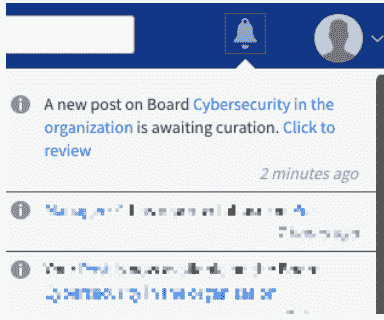

Figure 12.34 – 学习者 01 已被要求审核一篇帖子

- 7. 点击通知中的 **点击审核** 链接。

这将打开一个页面，*学习者 01* 可以在其中审核已提交的文件。在页面底部，*学习者 01* 可以估计内容的相关性并选择性地添加评论。

- 8. 评定内容的相关性，并选择性地添加评论。当您的屏幕如下所示时，点击 **提交** 按钮：

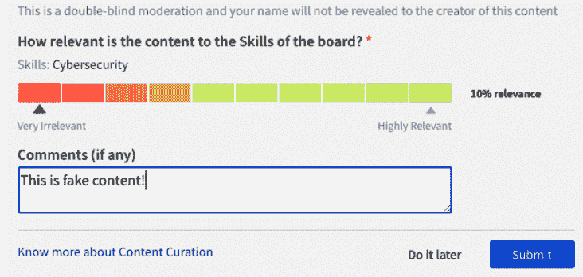

Figure 12.35 – SME 手动内容审核

请注意，此次审核工作将为 *学习者 01* 在 **网络安全** 技能中再奖励五分 SME 积分！

由于相关性评分过低，已提交的 PDF 文件已被拒绝。它不会出现在 **组织中的网络安全** 讨论区中，下次 *学习者 02* 登录 Captivate Prime 时将收到此决定的通知。

在本节中，您已回顾了自动辅助手动审核工作流程。这结束了您对 Adobe Captivate Prime 中内容审核的探索。有关内容审核的更多信息，请参阅官方 Prime 用户指南 https://helpx.adobe.com/captivate-prime/user-guide.html/captivate-prime/administrators/feature-summary/social-learning-configurations-as-an-admin.ug.html#Contentcuration。

在下一节中，我们将通过回顾管理员可用的其他选项，来总结本章关于 Captivate Prime 中社交学习的介绍。

## 审核管理员的社交学习选项

到目前为止，在本章中，您已使用大部分默认设置回顾了 Captivate Prime 的社交学习功能。在之前的练习中，您仅修改了两个通用选项：

- - 您已为外部学习者关闭了社交学习功能。
- - 您已激活自动辅助手动审核工作流程。

所有其他设置仍保持各自的默认值。

在本节中，您将探索通用的社交学习选项，并了解如何使用它们来调整 Captivate Prime 的社交学习功能，以满足您组织的特定需求。执行以下步骤以亲手开始探索这些设置：

- 1. 以管理员身份登录到您的 Captivate Prime 账户。
- 2. 从管理员主页点击左侧边栏“管理”部分中的社交学习链接。
- 3. 在页面顶部切换到“设置”选项卡，以访问 Captivate Prime 中社交学习的通用设置。

现在您已到达正确的位置，让我们在接下来的几个部分中逐一回顾此页面上可用的选项。

## 使用社交学习范围

在您用于这些练习的试用 Prime 账户中，只有少数用户相互交互；只有少数讨论区可用，并且对所有人可见。这是一个相当简单的管理情况，对于最多几百名学习者的小型组织来说效果很好。

但是，如果您拥有一个拥有数千名用户的大型组织，这些用户创建大量讨论区并参与许多讨论，您可能希望将社交学习细分为不同的范围。这使您可以根据您选择的特征维护用户群。例如，您可以执行以下操作：

- - 根据语言创建社交学习范围，以便学习者只能访问用其自己的语言创建的讨论区。
- - 根据学习者的部门确定社交学习范围，以便市场部门的学习者与其他部门的学习者具有不同的社交学习范围。
- - 根据学习者的位置确定社交学习范围，以便位于北美洲的学习者与位于欧洲的学习者共享不同的社交学习范围。
- - 以及更多

能够以这种方式细分社交学习活动在处理外部用户时更为关键。需要提醒的是，外部用户不属于您的组织。这些是与合作伙伴、供应商、客户等合作的个人，他们可以访问您的 Prime 账户。您可能希望将这些用户限制在其自己的社交学习空间中，具体取决于他们所属的组织，或者，如这些示例中所做的那样，完全禁用外部用户的社交学习。

执行以下步骤以定义社交学习范围：

- 1. 确保您位于管理员应用程序的 **社交学习** 页面 **设置** 选项卡上。
- 2. 点击与 **范围设置** 选项关联的 **编辑** 链接。需要提醒的是，您已在 *启用社交学习* 部分中早些时候使用此选项来禁用外部用户的社交学习。
- 3. 打开与内部学习者关联的 **用户特征** 下拉菜单。

如以下屏幕截图所示，此下拉菜单的默认值是 **所有内部用户**：

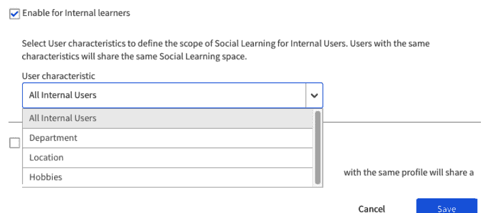

Figure 12.36 – 默认社交学习范围是所有内部用户

这意味着默认情况下所有用户共享相同的社交学习空间。当在此列表中选择另一个选项时——例如 **部门** 选项——您将根据学习者的部门定义不同的社交学习范围，以便学习者只能与其他部门的学习者互动。这有点像为每个部门提供一个不同的社交学习平台。

不过，在本例中，由于您在试用 Prime 账户中定义的学习者很少，您将保留此选项的默认值 **所有内部用户**。

- 4. 点击 **取消** 按钮以关闭 **范围设置** 选项而不保存任何更改。

得益于社交学习范围，管理员可以对学习者进行细分，以便他们只能与其他相同范围内的学习者进行社交学习活动互动。

## 修改下载配置

向下移动列表，下一个选项是 **下载配置**。这是指用户从何处下载 Captivate Prime 桌面应用程序。默认情况下，应用程序从 Adobe 服务器下载，在许多情况下这可能完全合适。

然而，出于明显的安全原因，许多组织限制用户可以从何处下载。在这种情况下，您可以在企业网络上托管 Captivate Prime 桌面应用程序安装程序，然后让 Captivate Prime 在下载或更新 Captivate Prime 桌面应用程序时将学习者重定向到该自定义位置。

让我们通过执行以下步骤亲手回顾此功能：

- 1. 确保您位于管理员应用程序的 **社交学习** 页面 **设置** 选项卡上。
- 2. 点击与 **下载配置** 选项关联的 **编辑** 链接。

从这里，您可以选择以下三个选项中的任何一个：

- - **Adobe 服务器**。这是默认值；Captivate Prime 桌面应用程序从 Adobe 服务器下载。

-   **企业服务器。** 选择此值时，Captivate Prime 桌面应用安装程序托管在您的企业网络上。在这种情况下，您必须提供安装程序的 URL 以及贵公司托管的版本。以下屏幕截图说明了此选项：

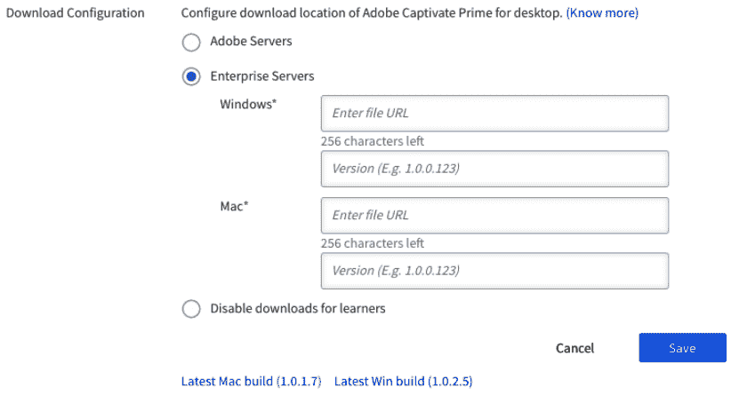

图 12.37 – 为 Captivate Prime 桌面应用安装程序配置自定义下载位置

-   **禁用学习者下载。** 在这种情况下，用户无法下载 Captivate Prime 桌面应用程序。这并不意味着他们不能在 Captivate Prime 讨论板上分享图像、视频或音频录制，而仅仅是他们不能使用 Captivate Prime 桌面应用来制作这些素材。

另外，请注意前述屏幕截图底部的两个链接，它们允许管理员下载安装文件，以便将其保存在企业网络的某个位置。在本示例中，您将保留默认值。

3.  单击 **取消** 按钮以关闭 **下载配置** 选项而不保存任何更改。

现在让我们在下一节继续探索社交学习的常规设置。

## 修改板块创建权限

默认情况下，任何学习者都可以在您的 Prime 账户上创建任意数量的讨论板块。此默认值符合社交学习旨在促进的信息共享和非正式讨论行为。但它也会带来问题，尤其是在拥有数千名学习者的较大账户中，或当组织内出现热门话题（例如与大型培训计划相关的话题）时。在这种情况下，您可能会拥有如此多的讨论板块，以至于社交学习很快就会变得难以管理。此外，相关讨论被分散到如此多的板块中，以至于学习者难以访问这些信息，这违背了社交学习的初衷。

这就是您想要限制允许创建新讨论板块的人数的主要原因。您可以按以下步骤操作：

1.  确保您位于管理员应用程序的 **社交学习** 页面 **设置** 选项卡上。
2.  单击与 **板块创建权限** 选项关联的 **编辑** 链接。
3.  选择 **一组学习者** 单选按钮。
4.  最后，使用搜索字段搜索允许创建新讨论板块的用户组。

您可以选择任何内置组或自定义组。不属于所选组之一的用户将无法创建新的讨论板块。话虽如此，他们仍然保留参与任何可用板块上讨论的所有能力。

> **注意**
> 内置组和自定义组已在 *第 5 章，管理用户* 中讨论。

在本示例中，您将保留默认值并允许 **所有学习者** 创建新的讨论板块。

5.  切回 **所有学习者** 单选按钮并单击 **保存** 按钮。

在下一节中，我们将讨论 **特殊用户** 选项。

## 定义特殊社交学习用户

下一个可用选项是 **特殊用户** 选项。当您使用范围时，此选项非常有用，如本章前面 *使用社交学习范围* 部分所述。

作为提醒，社交学习范围允许您根据选定的用户特征对学习者进行细分，以便他们只能与同一范围内的其他学习者互动。

这意味着组织中没有人能全面了解在不同范围内的 Prime 账户上进行的各种社交学习活动。希望管理员可以授予用户组 *特殊用户* 权限。Captivate Prime 然后会绕过所有范围限制并授予这些用户访问所有可用讨论板块的权限。

让我们通过执行以下步骤来看一下此功能：

1.  确保您位于管理员应用程序的 **社交学习** 页面 **设置** 选项卡上。
2.  单击与 **特殊用户** 选项关联的 **编辑** 链接。
3.  使用搜索字段搜索适当的用户组。
   请注意，您只能选择一个用户组。希望这可以是内置组或自定义组。
4.  在本示例中，由于您尚未启用任何社交学习范围，因此 **特殊用户** 选项不相关。
   单击 **取消** 按钮以关闭 **特殊用户** 选项而不保存任何更改。

此页面上可用的最后一个设置是 **自定义** 设置，您将在下一节中查看它。

## 自定义社交学习页面

在本节中，您将探索 **自定义** 选项。它允许您自定义学习者体验中 **社交学习** 页面的外观和感觉。让我们通过执行以下步骤快速查看一下：

1.  确保您位于管理员应用程序的 **社交学习** 页面 **设置** 选项卡上。
2.  单击与 **自定义** 选项关联的 **编辑** 链接。

从这里，您可以自定义显示给学习者的 **社交学习** 页面的各个方面，包括横幅图像、页面标题、支持文本等。请注意，您可以使用以下屏幕截图中箭头突出显示的 **语言** 下拉菜单为每种语言执行此操作：

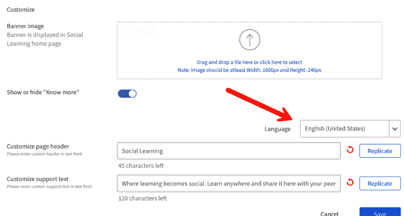

图 12.38 – 可用于自定义社交学习页面外观和感觉的选项

随意按您希望的方式自定义这些选项。完成后不要忘记单击 **保存** 按钮以保存您的更改。

这结束了对 Prime 管理员可用的一般 **社交学习** 设置的概述。借助这些选项，您可以微调 Captivate Prime 账户中社交学习的工作方式，使其符合您组织的具体要求。

## 摘要

早在古代，亚里士多德就说过，

> *人天生就是社会性动物。*

这就是为什么，尽管我们拥有远程交流的各种技术工具，我们仍然喜欢旅行、参加会议并参加由有血有肉的讲师授课的面对面现场课程。这些现场活动的附加价值是我们与同学和讲师或与其他会议参与者进行的无数非正式对话。事实上，在这些非正式对话中发生了很多事情：人们相互认识，交换名片，讨论用例等等。盈利性的商业合作伙伴关系甚至真正的友谊往往诞生于这些对话。相信我，这是真的！您正在阅读的这本书就是这一现象的完美例证（嗨，肖恩！）。

有人说远程学习使这些社交互动复杂化甚至阻止了这些社交互动。虽然 LMS 和远程学习永远无法完全取代我们对社交接触的迫切需求，但学习平台已开发出各种工具来促进讨论、信息共享、积极竞争、协作、参与等。这些工具不仅补充了正式的（现场或在线）学习。正确使用时，它们甚至可以成为组织学习和发展战略不可或缺的一部分，通过培养真正的学习、分享和协作文化而使每个人受益。

Captivate Prime 也不例外！首先，它允许您在 LMS 中可用的任何课程中启用非正式讨论板块。这允许注册该课程的任何学习者与其他学习者参与讨论。此功能默认处于禁用状态，但您可以轻松地为每门课程单独启用或在账户级别启用。

Captivate Prime 还集成了功能齐全的社交学习平台。它基于讨论板块，学习者可以在其中发布各种内容，从简单的基于文本的消息到包含屏幕录制和网络摄像头画面的复杂视频。URL 共享书签和小部件以及 Adobe Captivate Prime 桌面应用程序使创建和共享内容变得如此简单，以至于学习者没有借口不参与这些讨论板块。此外，先进的内容审核和策展功能，包括集成的 AI 驱动策展引擎，使得这些讨论板块的日常管理变得轻而易举！

但 AI 驱动的策展引擎并不是 Captivate Prime 依赖人工智能的唯一功能。请记住，Captivate Prime 是一个以学习者为中心的 LMS，任何人都可以为课程目录中提供的课程自行注册。在庞大的课程目录中找到方向并不总是容易。幸运的是，Captivate Prime 的人工智能可用于为每个学习者提供个性化推荐。您将在下一章中探索这一点。

