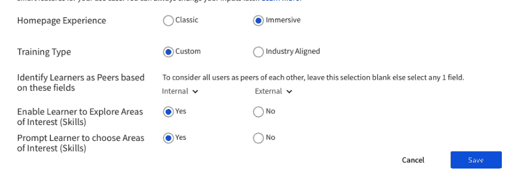
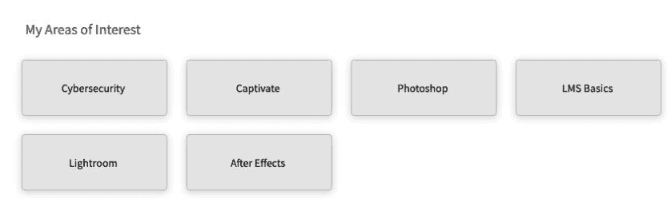
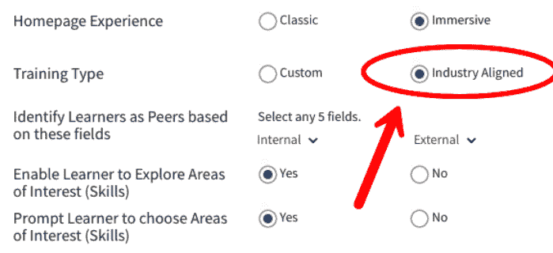
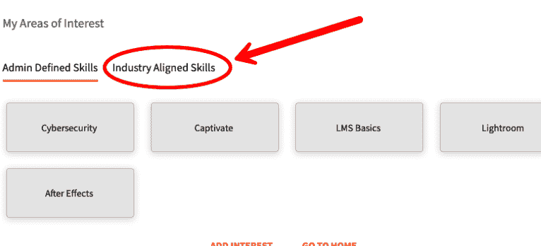
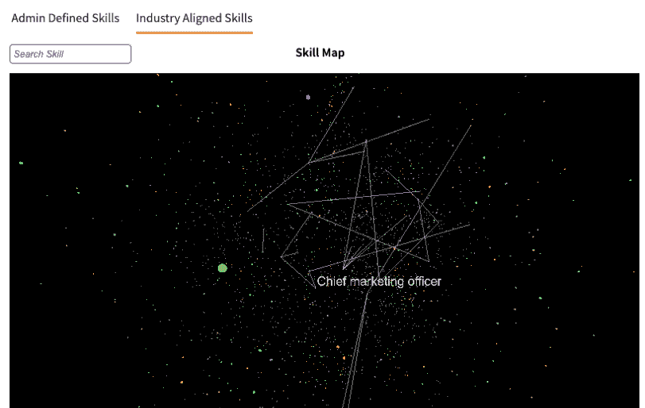
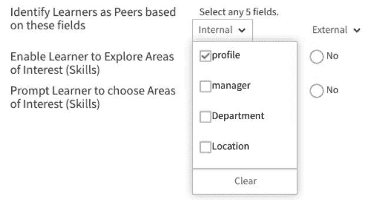
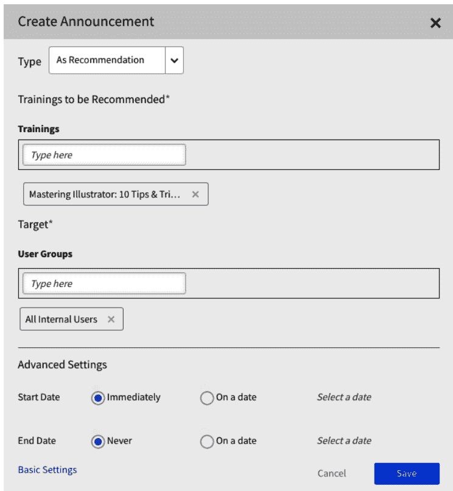
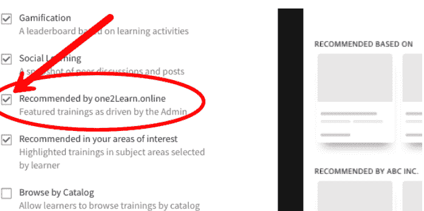

## 13 AI 驱动的学习者推荐

在 Adobe Captivate Prime 中，学习者参加课程的主要方式是浏览课程目录并自行报名感兴趣的课程。这正是 Captivate Prime 成为以学习者为中心的 LMS 的原因。然而，Captivate Prime 也是一个企业级 LMS。因此，它应帮助各种规模的组织管理其学习策略，确保组织内部可用的技能与其实践策略、行业以及当地和国际法规所需的技能相匹配。

因此，Captivate Prime 的使命是弥合课程目录中提供的课程、组织需求以及每位学习者个人兴趣之间的差距。为完成这一复杂任务，Captivate Prime 依赖于一个关键概念：**技能**。一方面，学习者参加课程以提升技能或获取新技能。另一方面，组织需要确保其员工队伍中可用的技能与组织的战略、行业所需的技能以及其应遵守的规则和法规保持一致。

另一个需要考虑的重要方面是，Captivate Prime 的设计可处理拥有数千名学习者和庞大课程目录的大规模部署，其中包含数万门课程，这些课程由内部讲师、第三方供应商提供，或是从之前的 LMS 迁移而来。如此庞大的数据量以及相应的互动机会，正是使事情既有趣又略显复杂的原因。学习者需要在这些庞大的课程目录中得到引导，根据其个人资料、职位描述、过往活动、同事活动和个人兴趣找到所需的确切课程，同时还要关注组织的战略、行业动态、监管环境等。

这并非易事。当你的课程目录主要由第三方现成内容构成时，你如何维护 Prime 账户上可用的技能列表？当组织的规模意味着你需要培训各种职业和职位档案时，你如何向每位学习者推荐课程？你如何确保组织内部的技能与行业不断变化的需求保持一致？你如何调整向学习者提供的课程推荐以实施针对你组织的特定学习和发展战略？这些都是内置于 Captivate Prime 平台中的 **人工智能 (AI)** 和 **机器学习 (ML)** 算法帮助你解决的主要问题。

在本章中，你将重新审视学习者主页并讨论可用的各种推荐类型。然后你将了解人工智能在为每位学习者提供高度个性化推荐时考虑的输入。某些输入由人工智能自动整理，无需管理员参与；这些称为 *隐式输入*。其他输入则由管理员甚至学习者本人手动输入到系统中。这些称为 *显式输入*。最后，其他输入受管理员选择的影响，同时仍保持高度自动化。

为讨论这些功能和流程，本章包含以下主要部分：

- 关于 Adobe Sensei 的说明
- 重新审视学习者主页
- 使用行业对齐的技能
- 基于同伴活动的推荐
- 使用手动推荐

在复习本章练习时，请记住 AI 需要非常大量的数据才能变得相关。换句话说，本章讨论的功能在拥有数百名学习者、学习数千门课程的大型账户上最有用。这在你阅读本书时使用的试用 Prime 账户中可能并不适用。

### 技术要求

为复习本章的练习，你需要满足以下技术要求：

- 你必须使用两个不同的用户配置文件（一个管理员配置文件和一个学习者配置文件）访问正在运行的 Captivate Prime 账户（可以是试用账户）的管理员和学习者权限。

如果你已完成前几章的练习，那就万事俱备。如果没有，也不用担心。你可以使用自己的课程内容和用户账户。只需记住，本章提供的说明基于前几章的练习，因此你可能需要根据自己的具体情况进行调整。

### 关于 Adobe Sensei 的说明

Adobe Sensei 是 Adobe 自家的 人工智能 (AI) 和机器学习 (ML) 技术。它于 2016 年 11 月首次推出，旨在与开发了自己的 AI/ML 解决方案的其他大型科技公司（如 Amazon、IBM、Microsoft 和 Apple）竞争。Adobe 怀着特定的用例开发了 Sensei，以便将其嵌入各种 Adobe 品牌的应用程序和解决方案中。

> **注意**
> Sensei 是日语中对受人尊敬的老师或领导者的称呼。

如今，Adobe Sensei 为 Adobe 开发的各种解决方案和应用程序中的数十项功能提供支持：

- Adobe Sensei 用于各种 Adobe Creative Cloud 应用程序，为诸如 Adobe Photoshop 中的内容感知填充、Adobe Stock 中的增强搜索功能、Adobe Color 中的色彩匹配算法、Adobe Premiere Pro 和 After Effects 中的高级视频效果等功能提供支持，等等。
- Adobe Sensei 是 **Adobe Experience Cloud** 的核心，为预测分析、广告定位、个性化内容、推荐、搜索引擎等功能提供支持，等等。
- Adobe Sensei 也存在于 **Adobe Document Cloud** 中，有助于提高 PDF 文档的扫描准确性，简化 PDF 表单的填写，或使用 Adobe Sign 协助签署 PDF 文档。

正如你所见，Sensei 通过为其最引人注目的前沿功能提供支持，已成为 Adobe 众多最畅销产品中的关键技术。

就 Captivate Prime 而言，Adobe Sensei 是幕后技术，驱动着自动整理流程（如 *第 12 章，启用和管理社交学习* 中所述），以及强大的推荐引擎，而推荐引擎正是本章的主题。

有关 Adobe Sensei 技术的更多信息，可在 Adobe 官方网站 https://www.adobe.com/sensei.html 上找到。

### 重新审视学习者主页

请始终牢记 Captivate Prime 是一个以学习者为中心的 LMS，报名课程的主要方式是通过自助注册。这意味着每位学习者都可以登录 Prime 账户，浏览课程目录，并报名他们认为最相关的课程。学习者如何确定课程的相关性取决于许多因素，例如个人兴趣、职业规划、在组织中的职位、同事推荐、培训历史等。

内置于 Captivate Prime 的人工智能和机器学习 (AI/ML) 算法旨在帮助学习者和组织根据广泛的因素发现最相关的课程。

这些推荐通过各种小部件显示在学习者主页上，管理员可以以多种方式在页面上排列它们。在本节中，让我们回顾学习者主页以及允许你自定义它的管理员选项。为此，你需要使用以下步骤两次登录你的 Prime 账户：一次作为管理员，一次作为学习者：

- 1. 打开一个浏览器窗口并以管理员身份登录你的 Prime 账户。
- 2. 打开另一个浏览器，或同一浏览器的隐私窗口，并以 *Learner 01* 的身份第二次登录你的 Prime 账户。

确保在这整章中保持这两个浏览器窗口打开。

## 审查管理员选项

回到 *第 2 章，自定义 Captivate Prime 的外观和感觉* 时，我们讨论了 **Classic** 学习者体验和 **Immersive** 学习者体验之间的差异，并自定义了学习者主页上可用的内容。让我们快速回顾这些选项，确保您已准备好进行本章的练习：

- 1. 使用您以管理员身份登录的浏览器窗口。
- 2. 从管理员主页，单击左侧边栏 **Configure** 部分中的 **Branding** 链接。
- 3. 向下滚动 **General** 页面，直到可以看到 **Homepage Experience** 选项。
- 4. 单击与 **Homepage Experience** 选项关联的 **Edit** 链接。这将启用位于 **General** 页面底部的所有选项，如以下屏幕截图所示：

图 13.1 – Branding 页面中的主页体验部分

- 5. 确保 **Homepage Experience** 设置为 **Immersive**。

作为提醒，沉浸式体验是在 2020 年 12 月更新中引入的。它被设计为类似 Netflix 的界面，为每位学习者显示个性化推荐。我们在 *第 2 章，自定义 Captivate Prime 的外观和感觉* 的 *自定义学习者体验* 部分讨论了这一点。

- 6. 确保 **Training Type** 选项当前设置为 **Custom**。

这告诉 Captivate Prime，课程目录主要包含自定义课程（即您自己定义的课程，例如您在 *第 4 章，创建技能和课程* 中创建的 **Fundamentals of Cybersecurity** 课程）。这对于包含很少（如果有的话）第三方现成内容的较小课程目录效果很好。因此，Captivate Prime 的 AI 驱动推荐引擎只需考虑与您的自定义课程关联的技能即可生成推荐。请记住，您已明确定义这些技能，并使用 *第 4 章，创建技能和课程* 中讨论的功能手动将它们链接到您的课程。

- 7. 确保 **Enable Learner to Explore Areas of Interest (Skills)** 和 **Prompt Learner to choose Areas of Interest (Skills)** 选项均设置为 **Yes**。我们将在本章后面 *审查学习者体验* 部分进一步讨论这些选项。
- 8. 当您的屏幕与 *图 13.1* 类似时，单击 **Save** 按钮以保存更改并将这些选项应用于您的 Captivate Prime 账户。
- 9. 单击左侧边栏顶部位置的 **Learner Homepage** 链接以打开 **Learner Homepage Settings** 页面。

如 *第 4 章，创建技能和课程* 中所述，这是管理员可以修改学习者主页内容的地方。

- 10. 在页面顶部，确保 **Immersive** 开关已打开。
- 11. 然后，单击页面右上角的 **Reset to Default** 链接。
- 12. 从上到下滚动整个页面并查看已应用的设置。大多数设置应该是自解释的。请确保您记住它们以备下一节使用。
- 13. 准备好后，单击页面右上角的 **Save** 按钮。

这些选项和开关现在已配置为下一节练习的正确配置，在该练习中您将审查当前的学习者体验。

## 审查学习者体验

您现在将切换到以 *Learner 01* 身份登录的浏览器窗口。在这里，我们将快速回顾一些学习者体验的关键区域，这些区域受您在上一节中操作选项的影响。请执行以下步骤：

- 1. 使用您以 *Learner 01* 身份登录的浏览器窗口。
- 2. 确保刷新浏览器窗口以应用您在上一节中进行的更改。
- 3. 向下滚动学习者主页，特别注意 **Recommended based on your areas of interest** 和 **Recommended based on peer activity** 部分的内容。

这些是学习者主页上可看到 AI 驱动推荐引擎效果的两个部分。您可以在这两个部分中查看的内容均由 AI 仔细挑选，并且特定于 *Learner 01*。

请记住，在 Captivate Prime 中，*areas of interest* 这个表达是 *skills* 的同义词，因此 **Recommended based on your areas of interest** 部分的内容直接取决于影响 *Learner 01* 配置文件的技能。这些技能是通过多种方法确定的：

- 首先，有与 *Learner 01* 已注册的课程相关的技能。例如，**Fundamentals of cybersecurity** 课程与 **Cybersecurity level 1** 技能相关联，如 *第 4 章，创建技能和课程* 中所定义。所以，当 *Learner 01* 在 *第 6 章，注册学习者课程* 中注册了 **Fundamentals of Cybersecurity** 课程时，**Cybersecurity level 1** 技能会自动链接到 *Learner 01* 的配置文件，因此在生成学习者主页的 **Recommended based on your areas of interest** 部分时，人工智能会考虑与同一技能相关的任何其他课程。
- 此外，请记住管理员可以将技能分配给单个学习者和/或用户组。这使组织能够推广员工需要关注的技能。这些由管理员分配的技能在生成推荐时也会被人工智能考虑。
- 因为您已在管理员应用程序中将 **Enable Learner to Explore Areas of Interest (Skills)** 选项设置为 **Yes**，学习者还可以使用学习者体验中的 **Skills** 部分手动挑选他们的 *areas of interest*。

现在，让我们返回 Captivate Prime 的学习者体验，并快速回顾学习者用于修改其 *areas of interest*（即他们感兴趣的技能列表）的 **Skills** 页面：

- 4. 从学习者体验的左侧列单击 **Skills** 图标以打开 *Learner 01* 的技能页面。

如以下屏幕截图所示，此页面列出了与 *Learner 01* 配置文件关联的 *Skills*（又名 **Areas of Interest**）：

图 13.2 – 与 Learner 01 配置文件相关的技能

这些是 AI 在生成主页 **Recommended based on your areas of interest** 部分内容时考虑的技能。请记住，*Learner 01* 可以随时修改此列表。

- 5. 使用鼠标悬停在这些技能中的任何一个上。这会显示一个叉号图标，您可以使用它从列表中删除该技能。
- 6. 单击 **Add Interest** 链接以打开 **Add to my Areas of Interest** 页面。

此页面列出了所有当前不属于 *Learner 01* 兴趣领域的可用技能。

*Learner 01* 可以单击他们感兴趣的技能进行选择，然后单击页面右下角的 **Add** 按钮，将其添加到 AI 在填充学习者主页内容时考虑的技能列表中。

在最后两个部分中，您回顾了 Prime 试用账户提供的当前学习者体验以及相应的管理员选项。此外，您重新发现了 Captivate Prime 中 **Skills** 的概念及其在 AI 生成每个单独学习者的独特主页时的重要意义。

生成学习者主页的 **Recommended based on your areas of interest** 部分是一个示例过程，该过程在幕后自动进行，但深受管理员和学习者所做选择的深刻影响。

在下一节中，您将通过打开 Prime 人工智能所知的 **Industry-Aligned Skills** 继续讨论技能。

## 使用与行业对齐的技能

您在上一节中查看的当前学习者体验在课程目录相对有限且主要由内部作者或承包商定义的课程时效果非常好。然而，大多数大型组织也在其 Prime 账户的课程目录中包含第三方现成内容。

市场上有许多学习内容提供商。许多大型组织订阅第三方学习内容库，以便为员工提供丰富的学习资源。一些最著名的提供商包括 LinkedIn Learning（以前称为 Lynda.com）、Udemy、Open Classrooms 和 Pluralsight。

> **Note**
> Captivate Prime 于 2021 年 8 月的更新引入了 Content Marketplace，这是 Adobe 自家的现成内容产品。该功能将在第 14 章《使用目录和同行账户》中讨论。

Captivate Prime 能够通过专用集成（我们将在第 16 章《探索集成管理员角色》中讨论）或某种自定义开发，将此外部内容集成到其自身的课程目录中。

利用此功能，您可以大幅扩展 Prime 账户中可用课程所涵盖的技能列表。这对学习者和整个组织来说都是个好消息，但它使这些技能的管理和跟踪变得更加复杂！

- 当大多数课程都来自这些外部库时，您如何维护 Prime 账户中可用的技能列表？更不用说这些库会不断由各自的所有者更新。
- 您如何将这些庞大课程目录所涵盖的技能映射到贵公司和员工最需要的技能？
- 您如何挖掘这些庞大的课程目录，以便在行业和法规不断变化的瞬息万变世界中做出相关的课程推荐？

这些都是您需要解决的问题，以确保学习者和组织都能充分利用这一庞大的课程资源。

幸运的是，Captivate Prime 已为您提供支持！内置 AI 会根据管理员可用的几个简单选项为您完成繁重的工作。让我们通过以下步骤亲手回顾这些选项：

- 1. 使用您以管理员身份登录的浏览器窗口。
- 2. 从管理员主页，单击左侧边栏 **Configure** 部分中位于的 **Branding** 链接。
- 3. 向下滚动 **Branding** 页面，直到可以看到 **Homepage Experience** 部分。
- 4. 单击与 **Homepage Experience** 选项关联的 **Edit** 链接。
- 5. 将 **Training Type** 选项切换为 **Industry Aligned**，如下图所示：

Figure 13.3 – 将培训类型切换为行业对齐

这就是告诉 Captivate Prime 您的课程目录包含由 LinkedIn Learning、Get Abstract 和 Pluralsight 等第三方提供商提供的现成内容，或您已使用 Captivate Prime 的 Content Marketplace 直接从 Adobe 购买此类内容的方式。因此，在为学习者生成个性化推荐时，AI 必须考虑数千个与行业对齐的技能，除您在 Prime 账户中定义的自定义技能之外。

这些与行业对齐的技能由 Adobe 策划，通过持续监控数百个行业、数千门课程、数百万份简历和职位描述等进行维护。此数据由 Captivate Prime 工程团队用于训练 Captivate Prime 的内置 AI 算法。

在保存更改并检查其如何影响学习者体验之前，还需要在管理员中执行一个更重要的步骤。此步骤必须现在执行，以便 Captivate Prime 允许您保存更改。但是，它将在下一节中进一步讨论：

- 6. 打开与 **Identify Learners as Peers based on these fields** 选项关联的 **Internal** 下拉菜单，并选择 **profile** 复选框。
- 7. 现在，打开与 **Identify Learners as Peers based on these fields** 选项关联的 **External** 下拉菜单，并同样选择 **profile** 复选框。
- 8. 最后，单击页面右下角的 **Save** 按钮。

这些简单的步骤就是管理员启用与行业对齐技能使用所需的一切。从现在起，您的 Prime 账户中就有超过 50,000 个新技能可用！最棒的是，AI 会自动将这些技能映射到课程目录中可用的数千门课程中，从而帮助学习者浏览目录并注册对他们最相关的课程。

说到学习者，让我们回到学习者体验，探索您刚刚所做的更改如何影响它。

## 学习者体验中的与行业对齐技能

在本节中，您将返回以 *Learner 01* 身份登录的浏览器窗口，并检查激活 **Industry Aligned** 技能如何影响学习者体验。

> **Note**
> 
> 在阅读本节时，请记住，与行业对齐的技能通常与更大的课程目录一起使用，这些目录主要由即用的第三方培训内容组成。这意味着，使用您 Prime 试用账户中当前可用的非常小的课程目录，您将看不到此功能的即时好处。

使用以下步骤作为学习者浏览与行业对齐的技能：

- 1. 使用您以 Learner 01 身份登录的浏览器窗口。
- 2. 从学习者主页，单击左侧边栏的 Skills 图标以打开该我的兴趣领域页面。

如果您已在该页面上，请确保刷新浏览器窗口，以便应用上一节中进行的更改。

现在您已在管理员中激活了与行业对齐的技能，请注意我的兴趣领域页面上出现了新的 Industry Aligned Skills 选项卡：

Figure 13.4 – Industry Aligned Skills 选项卡可从我的兴趣领域页面获得

在此页面上，Admin Defined Skills 选项卡包含您使用管理员应用程序的 Skills 页面定义的自定义技能。这些技能特定于您的组织，您必须手动将它们链接到您的自定义课程。Industry Aligned Skills 由 Captivate Prime 的 AI 提供。它们会自动映射到课程目录中可用的任何第三方内容：

- 3. 切换到我的兴趣领域页面的 Industry Aligned Skills 选项卡。

应该会出现一条消息，提示您尚未对任何技能表示兴趣。

- 4. 单击页面底部的 Add Interest 链接。这将打开添加到我的兴趣领域页面。

- 5. 切换到添加到我的兴趣领域页面的 Industry Aligned Skills 选项卡。

这就是 AI 发挥魔力的地方！如下图所示，您将看到一个包含 AI 所知的数千项技能的巨型 **Skill Map**：

Figure 13.5 – 您将看到一个巨型技能地图

图片上的每个点代表一项技能。线条用于将相关技能连接在一起。您可以使用鼠标光标探索技能地图。此外，您还可以使用 **Skill Map** 顶部的 **Search Skills** 字段以及 **Skill Map** 下方位置的 **Show Skills for which trainings are present in my account** 复选框：

- 6. 使用鼠标移动 **Skill Map**。此外，您还可以使用鼠标滚轮放大和缩小 **Skill Map**。
- 7. 准备就绪后，使用 **Skill Map** 左上角的 **Search Skill** 字段搜索您选择的技能（地图上有超过 50,000 项技能，您可以，事实上，搜索您想要的*任何*技能）。
- 8. 在 **Search Skill** 字段中选择技能后，**Skill Map** 将放大到所选技能及其连接的技能。

-   9. 使用这些工具继续浏览 **Skill Map**。每次你点击一个技能（即地图上的一个点），它就会被添加到 **Skill Map** 下方的 **Selected Skills** 部分。
-   10. 完成后，向下滚动页面直到看到 **Selected Skills** 部分。
-   11. 你可以通过将鼠标光标悬停在特定技能上，然后点击悬停技能右上角出现的叉号图标来从你的选择中移除技能。
-   12. 最后，点击页面右下角的 **Add** 按钮。

从现在开始，AI 在生成学习者主页 **Recommended based on your areas of interest** 部分的内容时，除了与用户资料相关联的 **Admin Defined Skills** 外，还会考虑 *Learner 01* 在 **Skill Map** 中选择的 **Industry Aligned Skills**。这也意味着 AI 会在向学习者推荐时包含课程目录中可用的第三方课程的庞大库。

得益于这两组技能（*Admin Defined* 和 *Industry Aligned*），学习者可以选择与个人兴趣相关的技能，而组织仍可向员工分配技能，以在公司可用技能上保持重大影响。请记住，只有在管理员的 **Branding** 页面将 **Training Type** 设置为 **Industry Aligned** 时，才可以使用行业对齐技能。

然而，学习者主页的 **Recommended based on your areas of interest** 部分并不是唯一提供个性化推荐的部分：

-   13. 点击屏幕左上角的公司标志或左侧边栏的 **Home** 图标返回学习者主页。
-   14. 向下滚动页面直到可以看到 **Recommended based on peer activity** 部分。

**Recommended based on peer activity** 部分是学习者主页上又一个由 Captivate Prime 人工智能生成的个性化推荐小部件。让我们在下一节中更详细地了解它。

## 基于同行活动的推荐

Captivate Prime 的默认学习者主页包含多个小部件，其内容由平台内置的人工智能引擎提供。在上一节中，我们讨论了 **Recommended based on your areas of interest** 小部件，并且你了解了 *Admin Defined* 和 *Industry Aligned* 技能如何影响其内容。

在本节中，你将探索 **Recommended based on peer activity** 小部件以及管理员可用的影响其推荐结果的选项。

为了得出该小部件提供的推荐，人工智能必须分析你和你的同行在 Prime 账户上的行为。这包括分析学习者注册的课程、这些课程涵盖的技能、收到的 L1 和 L3 反馈、平台上发布的新课程是否成功、当前行业趋势等。所有这些数据都输入到人工智能中，以生成学习者主页 **Recommended based on peer activity** 部分的内容。

这个复杂的过程大部分是自动的，并在后台进行，无需管理员干预。然而，管理员可以（并且应该）干预该过程的一个关键方面。AI 必须知道你所说的“同行”是什么意思。

例如，一个组织可能会决定特定部门的所有用户都被视为“同行”。在这种情况下，AI 在生成学习者主页 **Recommended based on peer activity** 部分显示的推荐时，会分别分析市场部门用户和开发部门用户的行为。其他组织可能会根据地理位置、资历或所说语言的数量来划分用户。事实上，一些组织甚至可能同时根据这些特征中的几个来划分学习者群体。

你现在将返回管理员，以了解如何选择 AI 用于确定你在 Prime 账户上定义的用户的同行组的用户特征：

-   1. 使用你以管理员身份登录的浏览器窗口。
-   2. 从管理员主页，点击左侧边栏 **Configure** 部分中的 **Branding** 链接。
-   3. 向下滚动 **Branding** 页面直到看到 **Homepage Experience** 部分。
-   4. 点击与 **Homepage Experience** 选项关联的 **Edit** 链接。
-   5. 打开与 **Identify Learners as Peers based on these fields** 选项关联的 **Internal** 下拉菜单。

如以下屏幕截图所示，**profile** 选项应是该下拉菜单中唯一选中的选项：

图 13.6 – Internal 下拉菜单中唯一选中的选项应为 profile

这意味着具有相同 *profile* 的学习者会被 Captivate Prime 的人工智能视为同行。请记住，每个组织都可以自行决定 *profile* 的含义，但在 Captivate Prime 中，profile 通常是 *职位、角色、等级或职位描述* 的同义词。

请注意，你可以从列表中选择多达五个字段，这使每个组织能够精确定义 AI 应将谁视为 *同行*。另外，请注意，Captivate Prime 在定义同行组时会区分内部用户和外部用户。

> **重要说明**
> 这仅适用于包含超过 1,000 名用户的 Captivate Prime 账户。如果你的账户用户少于 1,000 名，AI 没有足够的数据将你的学习者划分为同行组。在这种情况下，所有用户都属于同一个同行组。

再次强调，此选项在包含数千名用户和课程的大型账户上效果良好。在仅包含少数用户和课程的试用账户上，很难体验到此功能的全部威力。随着你的账户在用户数量和可用课程数量方面不断增长，请随意进一步尝试此功能：

-   6. 点击页面右下角的 **Cancel** 按钮以关闭这些选项而不保存任何更改。

在本节中，你回顾了学习者主页的 Recommended by peer activity 部分的工作原理，以及你作为管理员如何定义 Captivate Prime 将你的用户群体划分为不同同行组的方式。

Captivate Prime 中还有另一种推荐类型。在下一节中，你将探索管理员手动进行的推荐。

## 使用手动推荐

到目前为止，本章中你探索的推荐类型均由 Captivate Prime 内置的 AI 技术提供支持。管理员当然可以影响推荐的生成方式，但该过程在很大程度上是完全自动化的。这些推荐很好地服务于学习者，体现了 Captivate Prime 作为以学习者为中心的 LMS 的承诺。

但 Captivate Prime 也是一个企业 LMS，组织有权决定平台应向其员工、合作伙伴和客户推荐哪些课程。在许多情况下，组织确保精心挑选的一组课程在学习者主页上占据突出位置是非常有用的。例如：

-   你希望在正式产品发布前让员工有机会接受新产品的培训。
-   你需要让员工接受组织正在实施的新工具或公司使用的业务关键型企业解决方案新版本的培训。
-   你希望宣传与组织中技能供应不足相关的课程。
-   等等。

这些只是手动向组织内特定目标受众推荐课程可能非常有帮助的众多情况中的几个。希望 Captivate Prime 已经为你提供了支持！让我们在本节中使用以下步骤亲手回顾此功能：

-   1. 使用你以管理员身份登录的浏览器窗口。
-   2. 从管理员主页，点击左侧边栏 Manage 部分中的 Announcements 链接以打开管理员的 Announcements 页面。

从此页面，您可以在整个 Prime 账户中创建和发布多种类型的公告。本节仅涵盖课程推荐。其他类型的公告将在 *第 15 章，处理消息和公告* 中讨论：

- 3. 点击页面右上角的 **添加** 按钮以打开 **创建公告** 对话框。
- 4. 打开 **创建公告** 对话框顶部的 **类型** 下拉菜单并选择 **作为推荐**。
- 5. 在 **创建公告** 对话框的 **培训** 部分输入您想要推荐的培训名称的前几个字母。
- 6. 在 **创建公告** 对话框的 **用户组** 部分输入您希望此公告面向的目标用户组名称的前几个字母。
- 7. 点击 **创建公告** 对话框左下角的 **高级设置** 链接。花点时间查看可用的高级设置，但此时不要更改任何内容。
- 8. 当 **创建公告** 对话框看起来与以下屏幕截图类似时，点击框体右下角的 **保存** 按钮：

例如，选取 Prime 账户中 *Learner 01* 尚未 注册的任何课程。

在输入您想要推荐的培训名称时，请注意，您可以使用这种类型的公告不仅推荐课程，还可以推荐工作辅助工具、学习计划、认证等。

最后，请注意，您可以在同一公告中包含多种不同类型的培训。

在此示例中，选择 **所有内部用户** 组。请注意，如有需要，您可以选择多个用户组。

Figure 13.7 – 创建公告对话框

- 9. 最后，点击 **公告创建成功** 消息右下角的 **立即发布** 按钮。
- 10. 切换到 **公告** 页面中的 **已发布** 选项卡，并确认您的新课程推荐已在列表中可用。

在本节中，您学习了作为管理员，如何使用管理员应用程序的 **公告** 部分手动创建课程推荐。在下一节中，您将切换到学习者角色，并探索该推荐在学习者主页上的呈现方式。

## 作为学习者查看手动推荐

在本节中，您将返回登录为 Learner 01 的浏览器窗口，并检查上一节中创建的推荐在学习者主页上如何显示：

- 1. 返回您以 Learner 01 身份登录的浏览器窗口。
- 2. 如有必要，点击页面左上角的标志或左侧边栏的 Home 图标返回学习者主页。
- 3. 在学习者主页上上下滚动，查找上一节中创建的公告。

坏消息！您的手动课程推荐默认不会显示在学习者主页上。这是因为 **由 <your organization name> 推荐** 小部件默认不在学习者主页上。因此，让我们返回管理员角色以启用该小部件：

- 4. 返回您以管理员身份登录的浏览器窗口。
- 5. 从管理员主页，点击左侧边栏“配置”部分中的 品牌 链接。
- 6. 从 品牌 页面，点击左侧边栏的学习者主页 链接以打开学习者主页设置页面。
- 7. 确保页面顶部的 沉浸式 开关已打开。
- 8. 向下滚动页面并选择 **由 <your organization name> 推荐** 复选框，如以下屏幕截图所示：

Figure 13.8 – 选择 **由 <your organization name> 推荐** 复选框

- 9. 最后，点击页面右上角的 **保存** 按钮。

现在您已在学习者主页上启用了 **由 <your organization name> 推荐** 小部件，您将返回登录为 *Learner 01* 的浏览器窗口来查看！

- 10. 返回您以 *Learner 01* 身份登录的浏览器窗口。
- 11. 刷新浏览器窗口，以确保您作为管理员所做的更改已应用。
- 12. 向下滚动学习者主页并确认 **由 <your organization name> 推荐** 小部件存在于页面上，并且显示了您在上一节中手动推荐的课程。

此外，请记住，此手动推荐仅对内部学习者可见。

在本节中，您在管理员中激活了 **由 <your organization name> 推荐** 小部件，以便您的手动课程推荐显示在学习者主页上。这演示了作为管理员，您如何手动向 Prime 账户中定义的用户特定目标受众推荐不同类型的培训内容（包括课程、工作辅助工具、认证等）。

## 摘要

您将在自己的 Prime 账户中使用本章讨论的功能的方式主要取决于课程目录中可用课程的性质以及课程/学习者的数量。如果您主要拥有由内部作者或承包商创建的自定义课程，则应使用 **自定义** 课程类型。在这种情况下，只有您在管理员中定义并手动链接到自定义课程的技能才会被人工智能考虑，以为学习者生成个性化推荐。

另一方面，如果您的课程目录主要由第三方供应商提供的外部内容库组成，您应选择 **行业对齐** 课程类型。这将在您的 Prime 账户中启用数千项行业对齐技能。这些技能由 Prime 工程团队精心策划，并集成到 Adobe Sensei 中，而 Adobe Sensei 是内置于 Captivate Prime 的 Adobe 自有人工智能算法。这就是这些庞大外部库提供的课程内容在 AI 生成显示在学习者主页上的个性化推荐时如何被考虑的方式。

除了技能之外，人工智能还会根据同伴活动生成推荐。这就是需要考虑使用您的 Prime 账户的学习者数量的地方。请记住，Captivate Prime 是一款专为数千用户的大规模部署而设计的企业 LMS。在大型组织中，所有这些用户在公司内部都有非常不同的角色和职能。他们有如此多的不同期望和兴趣，以至于将他们全部视为单一同伴群体意义不大。这就是为什么 Captivate Prime 允许您选择五个用户特征，然后可用于将用户拆分为各个同伴群体，从而使人工智能能够根据同伴活动生成更准确的推荐。

最后，组织对向员工推荐哪些课程也有发言权。因此，管理员可以手动为学习者分配技能并手动向特定目标受众推荐课程。

请记住，这些强大的功能依赖于庞大且持续的数据流来兑现其承诺，因此在自己的 Prime 账户中充分利用这项技术之前，请给您的 LMS 足够的时间成长。对于使用 Captivate Prime 的中小型组织而言尤其如此，因为这些账户产生的数据比大型部署少。

到目前为止，在本书中，您使用的是任何 Prime 账户中都可用的默认培训目录。该目录对所有内部和外部用户可见。因此，目前所有用户都可以访问相同的课程、培训计划、认证和工作辅助工具。在下一章中，您将创建额外的课程目录并学习如何仅将其提供给某些学习者。这将使您能够根据 Prime 账户中可用的不同用户组定制课程供应。

