## 14 使用目录和同级账户

作为首选的企业 LMS，Adobe Captivate Prime 深知没有两个组织是相同的！每个组织都有自己的项目、自己的结构、自己的企业文化和自己的战略。这就是为什么 Captivate Prime 在设计时充分考虑了灵活性，以便能够适应尽可能广泛的组织和行业，每个组织和行业都有自己的要求。

例如，目前，您 Prime 账户中定义的所有用户都可以访问课程目录中提供的所有课程。这是默认情况，可能完全满足您的需求。然而，更多时候，组织需要对谁可以访问哪些课程进行精确控制，或需要为特定用户组细分内容和报告数据。例如，可供内部用户使用的课程可能与可供外部用户使用的课程不同；包含敏感或机密信息的课程可能仅向组织内部的特定受众开放。这只是众多情况中的两种，并非所有学习者都应有权访问相同的课程集。在 Captivate Prime 中，此类访问控制是通过创建多个课程目录实现的。

除了允许您定义谁可以访问哪些课程之外，创建目录还允许您与其它 Prime 账户共享课程，这在许多情况下非常有用，例如当您向其它组织销售课程时，或当跨国公司的总部希望与全球各地的本地办公室共享课程时。

除了共享课程内容之外，Captivate Prime 还允许您使用同级账户功能与其它账户共享用户席位。如在 *第 1 章，Adobe Captivate Prime 简介* 的 *获取 Captivate Prime* 部分所述，Captivate Prime 按席位计费。使用同级账户，组织可以购买大量席位并将其分配给其区域子公司的 Prime 账户。此外，组织还可以使用同级账户为其合作伙伴或特许经营商提供培训资金。在这种情况下，Prime 由组织购买，用户席位分配给这些合作伙伴和特许经营商使用的同级账户。这使大型组织能够集中使用 Captivate Prime 的成本（更不用说购买大量席位通常会获得更好的费率），同时关注整个组织的整体培训和发展战略。

这些就是您将在本章中探索的功能，本章包括以下主要部分：

- 使用多个目录
- 共享目录
- 启用和禁用目录
- 学习者体验中的目录
- 探索内容市场
- 使用同级账户

有了这些功能，您将能够根据组织的规模、行业、战略或内部运营情况，将 Captivate Prime 部署完全调整为与组织需求相匹配。

### 技术要求

要完成本章的练习，您需要满足以下技术要求：

- 您必须拥有正在运行的 Captivate Prime 账户的管理员访问权限（可以是试用账户）。
- 除了前面提到的管理员访问权限外，您还必须能够使用内部学习者账户和外部学习者账户访问同一 Prime 账户。
- 您的 Prime 账户中应至少有十几个课程（每个新 Prime 账户中提供的默认课程就足够了）。
- 可选地，第二个 Prime 账户的管理员访问权限将允许您进一步尝试本章讨论的一些功能。

如果您已完成前几章的练习，您应该准备就绪。
如果没有，请随意使用 Prime 账户上可用的课程内容和用户。
请注意，本章提供的说明是基于前几章练习编写的，因此您可能需要根据自己的具体情况进行调整。

### 使用多个目录

在 Captivate Prime 中，目录是学习对象的集合。到目前为止，在本书中，您账户上的所有内容都是默认目录的一部分，该目录与您的 Prime 账户一起自动创建。此默认目录具有以下特征：

- 它不能被删除（但可以被禁用；有关更多信息，请参阅本章的启用和禁用目录部分）。
- 您在 Prime 账户上创建的所有课程、学习计划、认证和工作辅助资料都会自动包含在默认目录中。
- 默认情况下，您账户上定义的所有学习者（包括内部和外部学习者）都可以访问默认目录，因此可以访问 Prime 账户上的所有内容。

这种默认情况非常简单易懂且易于管理，可能完全符合您的需求。在生产环境中使用它也没有问题。然而，也有许多情况并非所有学习者都应有权访问相同的课程集：

- 例如，内部使用的企业解决方案课程应仅对您组织的员工开放，而不应向有权访问您 Prime 账户的外部合作伙伴、供应商或客户开放。
- 公司内部开发的未来产品课程应仅可供研发部门访问。事实上，这些课程可能包含目前处于保密期的机密信息。在这些新产品发布之前，此类信息不得离开组织。
- 订阅第三方供应商提供的外部课程库需要付费。大多数情况下，此费用取决于访问这些在线库的用户数量。因此，您可能希望将访问这些第三方课程的用户数量限制为最相关的人员（例如，管理人员的领导力课程或开发人员的编程课程）。
- 一些课程可能仅在世界某些地区相关。例如，关于当地法规的课程。只有相应地区的用户才应有权访问这些课程。

这些只是控制学习者对课程访问权限有用的情况中的几个例子。

Captivate Prime 通过使用目录来解决此问题。**目录** 是学习项目的集合，可包含课程、学习计划、认证和工作辅助资料。作为管理员，您可以在 Prime 账户中创建无限数量的自定义目录，并决定谁可以访问哪个目录。对谁可以访问哪个课程的控制，只需将课程放入正确的目录（们）即可。

单个课程可以属于多个目录，单个目录可以包含无限数量的学习项目。

现在您已经对目录是什么以及为什么可能想要使用它们有了高层次的理解，让我们返回 Captivate Prime 来亲手探索此功能。让我们从下一节开始创建目录。

### 创建自定义目录

在本节中，您将以管理员身份登录 Prime 账户并创建两个新目录。第一个目录仅对内部用户可访问，第二个目录仅对外部用户可访问。按照以下步骤创建这两个课程目录：

- 1. 以管理员身份登录您的 Prime 账户。
- 2. 从管理员主页，单击左侧边栏 **Learning** 部分中位于的 **Catalogs** 链接。这将打开管理员的 **Catalogs** 页面。

如以下屏幕截图所示，此页面列出了您 Prime 账户中可用的所有目录。默认情况下，只应列出 **默认目录**：

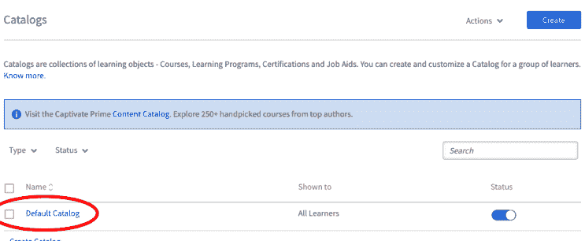

图 14.01 – 默认情况下，唯一可用的目录是默认目录

3. 单击页面右上角的 **创建目录** 链接或 **创建** 按钮以打开 **创建目录** 页面。

请注意，**创建目录** 页面的左侧列仅包含两个链接：**返回** 链接和 **概览** 链接。

4. 在 **目录名称** 字段中输入 `Internal Catalog`。请注意，这是创建新目录时唯一需要的信息。

> **提示**
> 在 Prime 部署的早期阶段建立清晰的命名规范是个好主意。这不仅适用于目录，也适用于 Captivate Prime 中您可以命名的任何其他元素。这将确保一致性，因此从第一天起学习者和管理员都易于使用。

5. 作为最佳实践，请花点时间提供 **封面图片** 并在 **描述** 字段中输入简短描述。

如果您没有合适的图片，可以使用本书下载中提供的 `catalogs/internal.jpg` 图片。

6. 当 **创建目录** 页面与以下屏幕截图类似时，单击屏幕右上角的 **下一步** 按钮：

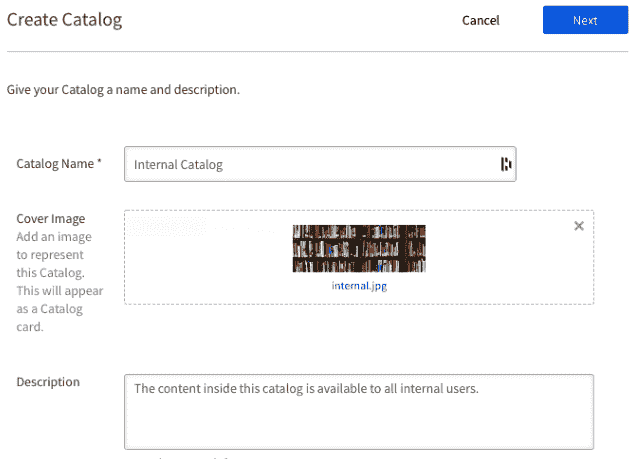

图 14.02 – 创建内部目录

页面重新加载后，左侧边栏中会出现额外的链接。它们允许您向目录添加内容并在内部或外部共享。您将在后面的章节中查看这些链接。现在，请返回管理员的 **目录** 页面并使用以下步骤创建 **外部目录**：

- 7. 单击左侧边栏顶部的 **返回** 链接。
- 
- 这会带您返回 **目录** 页面，您应该可以在列表中看到新的 **内部目录**。请注意，您的新目录尚未启用，如表格最后一列中的 **状态** 开关所示。
- 
- 8. 重复上述操作以创建 **外部目录**。如果您没有合适的图片，可以使用本书下载中提供的 `catalogs/external.jpg` 图片。
- 
- 9. 完成后，管理员的 **目录** 页面应与以下屏幕截图类似：

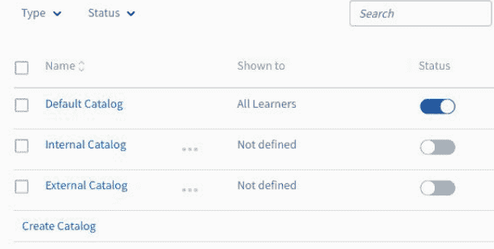

图 14.03 – 创建两个自定义目录后的目录页面

如您所见，创建新目录的过程非常简单。尽管如此，在激活新目录并使其可供学习者使用之前仍有两件事需要做。首先，您需要定义每个目录的内容，其次，您需要选择将有权访问它们的受众。

> **目录图片**
> 
> 您可以使用互联网上可用的任何流行图片文件格式作为目录图片，包括 . jpg 和 . png 文件。目录图片的首选尺寸为 280 px × 100 px。有关此内容的更多信息可在官方 Captivate Prime 用户指南中找到，网址为 https://helpx.adobe.com/au/captivate-prime/system-requirements.html#Recommendedsizeofimages。

在下一节中，您将向本节中定义的两个目录添加内容。

## 向目录添加内容

目录是一组学习对象。在上一节中，您在 Prime 账户中创建了两个自定义目录。现在您将使用以下步骤向这些课程目录添加内容：

- 1. 确保您已作为管理员登录到您的 Prime 账户。
- 2. 从管理员主页，单击左侧边栏 **学习** 部分中的 **目录** 链接。

3. 单击上一节中创建的 **内部目录**。这将打开 **内部目录** 页面，您可以在其中根据需要编辑目录的 **目录名称**、**封面图片** 和 **描述**。

4. 单击左侧边栏 **管理** 部分中的 **内容** 链接。

如以下屏幕截图所示，页面顶部可见的四个选项卡代表可以包含在 Captivate Prime 目录中的四种内容类型：

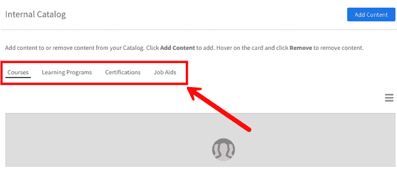

图 14.04 – 可以包含在 Prime 目录中的四种内容类型

5. 单击页面中间的 **添加内容** 链接或右上角的 **添加内容** 按钮。

这会带您进入一个页面，列出 Prime 账户中所有可用的课程。该页面左侧具有 **技能** 过滤器、**排序方式** 下拉菜单，右侧具有 **搜索** 字段。您可以使用它们搜索要添加到当前打开目录的课程。

6. 要将课程添加到目录，请将鼠标悬停在相应的课程卡上并单击 **添加** 链接。

如果您添加到目录的课程有先决条件，这些先决条件也会自动添加到目录中，除所选课程外。

使用此技术向 **内部目录** 添加几门您选择的课程。

7. 使用页面顶部的选项卡向目录添加所需的 **学习计划**、**认证** 和 **工作辅助**。

8. 完成后，单击页面右上角的 **保存** 按钮。

- 9. 然后，单击左侧边栏顶部的 **返回** 链接返回管理员的主 **目录** 页面。
- 10. 重复上述操作以向 **外部目录** 添加一些培训内容。请记住，相同的内容可以包含在多个目录中。

为了测试所有可能的情况，请确保您向两个目录都添加了课程，其他课程仅在两个目录之一中可用，最后，一些课程未添加到任何目录中。

> **注意**
> 当我们说 *课程* 时，我们指的是可以添加到目录的任何类型的学习内容：课程、学习计划、认证和工作辅助。

在本节中，您向本章前面 *创建自定义目录* 部分中创建的两个自定义目录添加了内容。本节的主要要点如下：

- - 目录是一组学习项目，可以包含课程、学习计划、认证和工作辅助。
- - 同一个学习对象可以属于多个目录。

您现在已完成了在激活目录并使其可供学习者使用之前所需的两个操作中的第一个。您仍需要在激活它们之前选择将有权访问这两个目录的用户。这就是我们在下一节中要做的事情。

## 分享目录

在本节中，您将决定哪些学习者可以访问哪个目录。在 Captivate Prime 管理员中，这称为 *分享* 目录。Captivate Prime 允许您在内部或外部分享目录：

- - 内部分享意味着您向在 Prime 账户中定义的学习者授予目录访问权限。这些可以是 *内部和外部学习者*。请记住，这两种类型的学习者确实是在您的 Prime 账户中定义的，如 *第 5 章，管理用户* 中所述。
- - 外部分享意味着您的目录可供在 *其他 Captivate Prime 账户* 中定义的学习者访问。这意味着在该外部账户（称为接收账户）中定义的学习者（内部或外部）最终将能够访问您内容。

内部和外部分享与第 5 章《管理用户》中描述的内部和外部用户概念无关。它指的是您可以将目录内容与账户内定义的用户（内部分享）或拥有自己的内部和外部用户的其他 Captivate Prime 账户（外部分享）共享这一事实。

在下一节中，让我们首先回顾内部分享机制。

## 内部共享

在我们的示例中，我们希望上一节中定义的内部目录仅可由 Prime 账户的内部用户访问。外部目录，也在上一节中定义，应仅可由 Prime 账户的外部用户访问。由于本示例中的所有用户都在 Prime 账户中定义，因此这两种情况都属于 Captivate Prime 的内部分享机制。

让我们使用以下步骤回顾一下：

- 1. 确保您已作为管理员登录到您的 Prime 账户。
- 2. 从管理员主页，单击左侧边栏学习部分中的 Catalogs 链接。
- 3. 单击上一节中创建的 Internal Catalog 以打开 Internal Catalog 页面。
- 4. 单击左侧边栏中的 Share Internally 链接。
- 5. 单击页面中间的 Add User Groups 链接或右上角的 Add 按钮。
- 6. 在 Search 字段中开始输入 All Internal Users。当该组出现在列表中时，单击它将其添加到所选用户组中。

请注意，您可以根据需要重复此操作以添加多个用户组。

7. 当您的屏幕与以下截图类似时，请点击 **保存** 按钮：

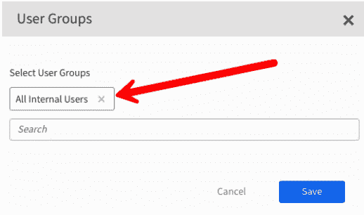

图 14.05 – 将“所有内部用户”组添加到“选择用户组”

您刚刚授予所有内部用户访问 **内部目录** 的权限。现在您将重复相同的操作，以授予所有外部用户访问 **外部目录** 的权限：

- 8. 点击左侧列顶部的 **返回** 链接，返回到 **目录** 页面。
- 9. 在可用目录列表中点击 **外部目录**。
- 10. 在左侧边栏中点击 **内部共享** 链接（请记住，您的外部用户是在 *您的 Prime 账户内* 定义的，因此您必须使用 *内部* 共享机制）。
- 11. 点击页面中间的 **添加用户组** 链接，或右上角的 **添加** 按钮。
- 12. 将 **所有外部用户** 组添加到所选用户组中，然后点击 **保存** 按钮。
- 13. 最后，点击左侧边栏顶部的 **返回** 链接，返回管理员的主 **目录** 页面。

如果您尝试以学习者身份登录您的 Prime 账户，您将不会注意到任何变化，尽管您在本章中已经完成了所有步骤。这是因为您的新自定义目录尚未启用。我们将在本章后面的 *启用和禁用目录* 部分讨论启用和禁用目录。然而，现在让我们在下一节中简要讨论外部共享。

## 外部共享

将目录外部共享可让您向在其他 Prime 账户中定义的用户授予访问课程内容的权限。在许多情况下，这非常有用：

- 您可以将课程销售给其他也使用 Adobe Captivate Prime 作为其企业 LMS 的组织。
- 如果您的合作伙伴、供应商和客户也使用 Captivate Prime 作为其 LMS，您可以使用外部共享，而不是将他们的员工定义为您自己的 Prime 账户的外部学习者。这样做，您无需为这些外部用户使用的用户席位付费，因为该成本由另一个 Prime 账户承担。
- 一些跨国公司选择为其每个区域分支使用单独的 Prime 账户。这允许每个分支保持独立，并将其自身的培训策略与组织的总部和其他分支分开管理。在这种情况下，总部可以使用外部目录共享将企业培训内容推送到其分支的 Prime 账户中。这使得可以在区域策略之上实施全球培训策略。

这些只是外部目录共享非常有用的情况中的几个。让我们通过以下步骤动手探索此功能：

- 1. 确保您已以管理员身份登录到您的 Prime 账户。
- 2. 从管理员主页，点击左侧边栏 **学习** 部分中的 **目录** 链接。
- 3. 点击您的自定义 **内部目录**。
- 4. 最后，点击左侧边栏中的 **外部共享** 链接。

如以下截图所示，一条消息告知您此目录已内部共享，因此无法外部共享：

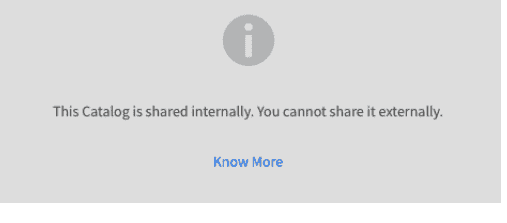

图 14.06 – 您不能同时在内部和外部共享同一个目录

感谢这个小实验，您发现不能同时在内部和外部共享同一个目录。换句话说，共享是排他的：您可以 *要么* 在内部 *或* 在外部共享目录。

因此，要继续此练习，您需要再创建一个自定义目录：

- 5. 点击左侧边栏顶部的 **返回** 链接，返回到主 **目录** 页面。
- 6. 点击 **创建目录** 链接或页面右上角的 **创建** 按钮。
- 7. 在 **目录名称** 字段中输入您选择的任何名称，然后点击 **下一步** 按钮。
- 8. 点击左侧边栏中的 **外部共享** 链接。
- 9. 点击 **添加外部账户** 链接或屏幕右上角的 **添加** 按钮。

由于此新目录尚未内部共享，您有机会 **添加外部账户**。

这将打开 **外部账户** 对话框，如以下截图所示：

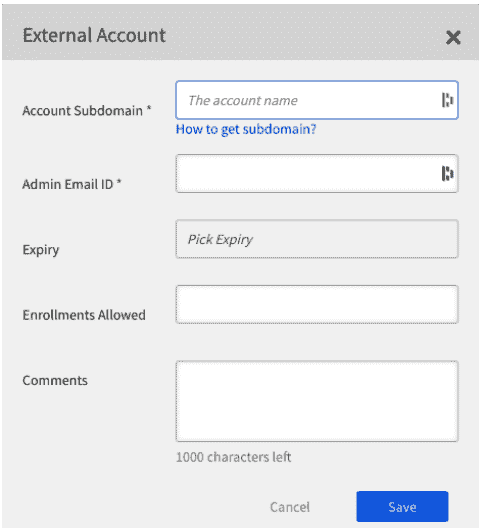

图 14.07 – 外部账户对话框

**外部账户** 对话框中可用的大多数字段应该是自解释的。请注意，此表单中只有两个必填字段：

- 在 **账户子域** 字段中，输入您想要与之共享此目录的外部 Prime 账户的 URL。
- 您需要在 **管理员电子邮件 ID** 字段中输入外部账户管理员的电子邮件地址。

填写完此表单后，外部账户的管理员将收到一封电子邮件，其中包含一个唯一的 URL，他/她必须点击该 URL 以接受或拒绝共享的目录。

> **提示**
> 不要犹豫联系 Captivate Prime 支持团队，以获得有关这些略微技术性的 Captivate Prime 功能的正确实施方面的帮助。

默认情况下，接受共享目录会产生以下后果：

- 共享目录中包含的所有学习对象都将对接收账户可用。如果共享的课程、学习计划或认证有相关的作业辅助，则这些作业辅助将自动成为共享的一部分，即使它们未明确包含在共享目录中。此外，与共享目录关联的技能将自动复制到接收账户。
- 共享课程中包含的模块在接收账户的内容库中不可见（我们在 *第 3 章、上传学习内容和管理内容库* 中讨论了模块和内容库）。
- 接收账户不允许修改共享目录或其中包含的任何学习对象。也就是说，接收账户可以在其自己的学习计划、认证和目录中使用共享课程。共享时，课程包含在接收账户创建的目录中；该目录随后不能外部共享，以防止共享项目的重新共享。
- 当您修改已外部共享的目录时，您的修改将自动传播到所有有权访问共享目录的账户。

除此默认情况外，您还可以启用共享目录的完全控制。在这种情况下，共享学习对象中包含的模块在接收账户的内容库中可见。这意味着接收账户可以使用它们组装新课程。接收账户还可以编辑甚至删除共享目录的一部分的对象。这些编辑和删除仅在接收账户中进行。接收账户中执行的操作不会影响有权访问此共享目录的其他 Prime 账户。

> **注意**
> 有关此功能的更多信息可在官方 Captivate Prime 用户指南中找到，网址为 https://helpx.adobe.com/captivate-prime/administrators/feature-summary/shared-catalog-full-control.ug.html。

如果您恰好有权访问另一个 Prime 账户，请不要犹豫进一步尝试此功能。也就是说，在本书的上下文中，我们将在此中断流程并删除您刚刚创建的自定义目录：

- 10. 点击 **外部账户** 对话框底部的 **取消** 按钮。
- 11. 然后，点击左侧边栏顶部的 **返回** 按钮。
- 12. 将鼠标悬停在您在本节中创建的目录上以显示垃圾桶图标。
- 13. 点击垃圾桶图标删除目录。
- 14. 通过点击 **确认需要** 消息中出现的 **删除** 按钮来确认您的意图。

有关外部共享目录以及这些共享目录如何在接收 Prime 账户中显示的更多信息，可在官方 Adobe Captivate Prime 用户指南中找到，网址为 https://helpx.adobe.com//captivate-prime/administrators/feature-summary/catalogs.html#ext。

> **注意**
> 任何新 Prime 账户中可用的默认课程实际上是 Adobe Systems 创建的课程目录的一部分，该目录使用本节中讨论的 **外部共享** 功能推送到您的 Prime 账户。

在本节中，我们讨论了内部或外部共享目录。请记住，内部共享允许您将目录的访问权限授予在 Prime 账户中定义的 user groups。这包括账户上可用的内部和外部用户。外部共享允许您将自定义课程目录与其它 Captivate Prime 账户共享。这些可以属于同样使用 Adobe Captivate Prime 作为其 LMS 的提供商、供应商、合作伙伴和客户，或您自身国际组织的地方子公司。

您现在在 Prime 账户中有两个自定义目录可用。每个目录包含若干学习项目，并且您已定义有权访问这些目录的用户。尽管如此，学习者体验尚未受到本章迄今为止所做的任何更改的影响。这是因为您尚未启用新创建的目录。我们将在下一节中探讨这一点。

## 启用和禁用目录

在前面的章节中，您在 Prime 账户中创建了两个自定义目录，向其中添加了学习内容，并决定哪些用户组可以访问这些目录。现在您可以激活它们，使其在学习者体验中可用。

但在这样做之前，请记住，您的 Prime 账户中还有第三个目录：与账户一起自动创建的默认目录。该默认目录具有其自身的一些特殊特性。让我们在下一节中探讨这一点。

## 修改默认目录

请记住，默认目录包含 Prime 账户中可用的所有学习对象，并且所有用户都可以访问。让我们看看如何使用以下步骤修改此默认目录：

- 1. 确保您已以管理员身份登录到 Prime 账户。
- 2. 从管理员主页，单击左侧边栏 **Learning** 部分中位于的 **Catalogs** 链接。
- 3. 单击列表顶部可见的 **Default Catalog** 以打开 **Default Catalog** 页面。

如以下屏幕截图所示，当 **Default Catalog** 打开时，左侧边栏仅包含其通常功能的一小部分：

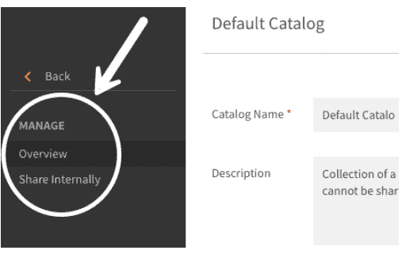

图 14.08 – 默认目录的左侧边栏

请注意，当默认目录打开时，左侧边栏中没有 **Content** 链接可用。这意味着您无法更改默认目录的内容。换句话说，您在 Prime 账户中创建的每门课程、学习计划、认证和工作辅助资料都将 *始终* 属于默认目录，无论如何！

此外，请注意，没有 **Share Externally** 链接可用。这意味着您的默认目录无法与外部 Prime 账户共享。换句话说，只有您明确自行创建的自定义目录才能进行外部共享：

- 4. 单击左侧边栏中可用的 **Share Internally** 链接。

这将打开一个页面，您可以在其中修改谁有权访问 **Default Catalog**。请记住，默认情况下，在 Prime 账户上定义的所有用户（内部和外部）都有权访问 **Default Catalog**。然而，由于 **Default Catalog** 中的内容无法修改，使用 Captivate Prime 目录控制对学习内容的访问，通常涉及禁用默认目录。这就是您现在将使用以下步骤执行的操作：

- 5. 单击左侧边栏顶部的 **Back** 链接返回管理员的主 **Catalogs** 页面。
- 6. 使用表格 **Status** 列中的切换按钮关闭 **Default Catalog**。
- 7. 然后，使用相同的方法打开 **Internal Catalog**。
- 8. 最后，使用复选框在列表中选择 **External Catalog**。然后，打开位于页面右上角的 **Actions** 下拉菜单。花点时间查看可用操作并单击 **Enable** 以打开 **External Catalog**。

借助此流程，您已禁用 **Default Catalog** 并启用了本章前面创建的两个自定义目录。管理员的 **Catalogs** 页面现在应类似于以下屏幕截图：

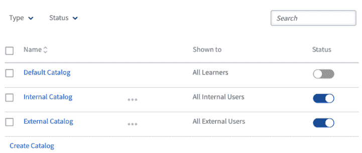

图 14.09 – 您已禁用默认目录并启用了两个自定义目录

借助本节中实施的更改，您的两个自定义目录现在在学习者体验中可用。我们将在下一节中探讨这一点。

## 学习者体验中的目录

在本节中，您将以学习者身份登录到 Prime 账户，并检查本章前面各节完成的工作如何影响学习者体验。在此过程中，请记住以下几点：

- 您在 Prime 账户上启用了两个自定义目录。
- 其中一个可供所有内部用户使用，而另一个可供所有外部用户使用。
- 有些课程仅包含在两个目录中的一个中，其他课程包含在两个目录中，最后有些课程未包含在任一目录中。
- 在您创建自定义目录并禁用默认目录之前，Prime 账户中定义的某些学习者已经注册、开始甚至完成了课程。

考虑到这一点，让我们进入学习者体验并检查自定义目录对其产生的影响：

- 1. 以 *Learner 01* 身份登录到 Prime 账户。
请记住，*Learner 01* 是您在 *Chapter 5, Managing Users* 中定义的内部学习者之一。
- 2. 登录后，单击主页的 **Go To Catalog** 链接，或左侧边栏的 **Catalog** 图标，以打开 *Learner 01* 的 **Catalog** 页面。
- 3. 确认 *Learner 01* 的 **Catalog** 页面上可用的课程是您之前创建的 **Internal Catalog** 中包含的课程。

> **注意**
> 如果登录的学习者有多个目录可用，则 **Catalog** 页面的左侧列中提供额外的筛选器，允许学习者按目录筛选课程。

- 4. 单击左侧边栏中的 **My Learning** 图标以打开 *Learner 01* 的 **My Learning** 页面。

如 *Chapter 7, Reviewing the Learner Experience* 中所述，**My Learning** 页面列出了登录学习者注册的所有课程，包括他们已完成的课程。这包括不属于 **Internal Catalog** 但学习者在 **Default Catalog** 仍启用时注册的课程：

- 5. 单击屏幕右上角的徽标，或左侧边栏的 **Home** 图标，返回学习者主页。
- 6. 将学习者主页一直向下滚动到底部，注意可用的课程推荐（如有）仅包含登录学习者当前可访问的目录（s）中的课程。

您现在将以 *Learner 01* 身份注销并以 *Learner 03* 身份重新登录。请记住，*Learner 03* 是您在 *Chapter 5, Managing Users* 中定义的外部学习者之一。此外，请记住，外部学习者必须使用特定于其外部配置文件的特殊登录页面登录到 Prime 账户。

> **访问外部学习者的登录页面**
> 如果您不记得 *Learner 03* 登录页面的 URL，请返回管理员的 **Users | External** 页面，将鼠标悬停在外部学习者配置文件上，然后单击出现的 *chain* 图标以将登录页面 URL 复制到剪贴板。

- 7. 单击屏幕右上角的用户图标，然后单击 **Sign Out** 链接以注销 *Learner 01*。
- 8. 以 *Learner 03* 身份重新登录。不要忘记使用相应外部学习者配置文件的特殊登录页面。
- 9. 登录后，单击主页的 **Go To Catalog** 链接或左侧边栏的 **Catalog** 图标以打开 *Learner 03* 的 **Catalog** 页面。
- 10. 确认 *Learner 03* 的 **Catalog** 页面上可用的课程是您在本章前面创建的 **External Catalog** 中包含的课程。

这些实验表明，*Learner 01* 和 *Learner 03* 不再有权访问相同的课程集。这是因为这两个学习者无法访问相同的课程目录（s），因此他们只能查看他们有权访问的目录（s）中包含的课程、学习计划、认证和工作辅助资料。

本节结束了我们对 Captivate Prime 的 **Catalogs** 功能的概述。主要的收获是，您无法在单个课程级别决定谁有权访问哪些课程，但您可以决定哪些用户组有权访问哪些目录。正是通过将课程、学习计划、认证和工作辅助资料放置在这些目录中，您可以控制哪些学习者有权访问这些学习对象。此外，您可以使用 Captivate Prime 的 **external sharing** 功能与其它账户共享目录。

## 探索内容市场

为了更轻松地将第三方内容集成到 Prime 账户中，Adobe 开发了 Captivate Prime **Content Marketplace**。Content Marketplace 于 2021 年 8 月推出时，已包含超过 70,000 门涵盖广泛主题的课程。

使用这个新的 Content Marketplace，您可以执行以下操作：

- 探索可用课程并让用户表达兴趣。
- 购买全部内容或精心挑选的播放列表的访问权限。

这就是您将在本节中，使用以下步骤进行探索的内容：

- 1. 确保您已以管理员身份登录到 Prime 账户。
- 2. 从管理员主页，单击左侧边栏 **Manage** 部分中位于的 **Content Marketplace** 链接，以打开管理员应用程序的 **Content Marketplace** 页面。

在撰写本文时，主内容市场页面包含两个磁贴，如以下屏幕截图所示：

## 内容市场

高质量的培训内容让您轻松启动数字学习计划。现在可从领先的内容提供商处访问 70,000 多门课程，涵盖 Creative Cloud、商务、销售与营销、安全、合规等主题领域。

提供涵盖合规、商务、营销等各方面的多样化课程组合。为您的用户提供由世界级内容提供商策划的高质量学习内容组合。

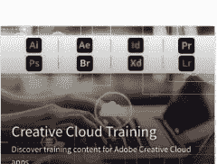

掌握您所需工具，充分释放创造力，通过精心挑选的培训课程成为艺术家和梦想家们全球最佳平台的专家。

Figure 14.10 – 内容市场的主页

- 3. 点击 **Creative Cloud 培训** 选项。
- 这将打开一个新页面，您可以在其中浏览一个特殊的课程目录，其中包含有关 Adobe Creative Cloud 应用程序（如 Photoshop、Illustrator 和 InDesign）的课程。如果您有兴趣购买这些课程，请点击该页面右上角的 **联系 Adobe** 按钮。
- 4. 返回浏览器窗口，其中可见 Prime 管理员的 **内容市场** 页面。
- 5. 点击 **企业培训** 选项以打开市场中的 **企业培训** 页面。
- 花点时间上下滚动页面，以大致了解其包含的功能。
- 6. 完成后，将注意力集中在页面左下角的 **邀请用户** 部分。

您可以使用本节提供的工具邀请学习者探索 **内容市场** 中 **企业学习** 目录中的可用内容，以便他们表达对其中课程和播放列表的兴趣。此外，您可以决定仅邀请选定的学习者团队，还是让所有学习者浏览市场并表达兴趣。

在此示例中，您将邀请所有内部学习者浏览 **内容市场** 并表达他们的兴趣：

- 7. 确保 **企业培训** 页面中的 **邀请用户** 部分设置为 **选定学习者**。
- 8. 点击 **邀请用户** 按钮打开 **邀请用户探索** 对话框。
- 9. 在 **邀请用户探索** 对话框的 **搜索** 字段中开始输入 All Internal Users。列表出现时点击 All Internal Users 组。
请注意，您可以根据需要添加任意数量的个人用户/用户组。
- 10. 最后，点击 **邀请用户探索** 对话框右下角的 **邀请用户** 按钮。
- 11. 花点时间阅读 **邀请用户** 确认消息并点击 **继续** 按钮。

从现在开始，您的所有内部用户都可以探索 Captivate Prime 的 **内容市场** 中可用的课程并表达兴趣。确认 **企业培训** 页面的 **邀请用户** 部分与以下屏幕截图类似：

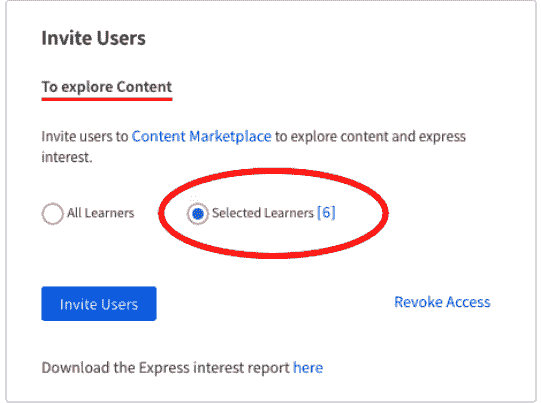

Figure 14.11 – 邀请用户访问内容市场以表达他们的兴趣

在下一节中，您将以 Learner 01 的身份登录您的 Prime 账户，并检查邀请用户查看内容市场如何影响学习者体验。

## 作为学习者浏览内容市场

在上一节中，您邀请所有内部学习者探索内容市场中可用的课程，以便他们表达对所提供课程的兴趣。这是在购买全部或部分内容访问权限之前，组织衡量对这些额外内容的兴趣的好方法。在本节中，您将以内部学习者的身份登录您的 Prime 账户，浏览内容市场，并对其中一些课程表达兴趣。为此，请执行以下步骤：

- 1. 以 Learner 01 的身份登录您的 Prime 账户。请记住，Learner 01 是您在第 5 章《管理用户》中定义的内部学习者之一。
- 2. 在学习者主页上，注意左侧边栏底部出现的新内容市场图标，如以下屏幕截图所示。
- 3. 点击左侧边栏底部的 内容市场 链接。

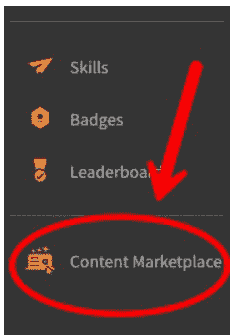

Figure 14.12 – 学习者体验中的新的内容市场链接

这将 Learner 01 带到一个与学习者体验中的目录页面非常相似的页面。从这里，Learner 01 可以使用左侧列中可用的筛选器、搜索字段以及页面顶部位置的“按...排序”下拉菜单来浏览内容市场中可用的课程：

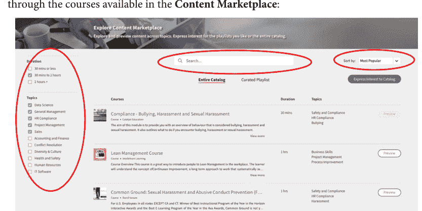

Figure 14.13 – 浏览内容市场可用的搜索工具

- 4. 利用可用搜索工具花必要的时间浏览内容市场页面。
- 5. 如果您发现此课程提供的内容有趣，并且希望您的组织购买对其的无限访问权限，请点击页面右上角的 Express Interest to Catalog 按钮。
- 6. 点击页面顶部、搜索字段正下方的 精选播放列表 选项卡。
- 7. 从这里，您可以探索可用的播放列表并分别对其中任何一个表达兴趣。

请注意，部分课程提供两分钟预览。

在进入下一节之前，请确保您对其中一些播放列表表达了兴趣。

在本节中，您回顾了选定学习者如何浏览 **内容市场** 并对整个目录或任何可用播放列表表达兴趣。在下一节中，您将返回管理员应用程序并在 **内容市场** 中购买之前下载 **表达兴趣报告**。

## 查看表达兴趣报告

您现在有许多学习者对 **内容市场** 上可用的内容表达兴趣。这会产生大量有趣的数据，帮助组织决定是否购买部分或全部这些第三方现成内容的使用权。

在本节中，您将了解管理员如何在做出购买决定之前下载 **表达兴趣报告**。为此，请执行以下步骤：

- 1. 以管理员身份登录您的 Prime 账户。
- 2. 从管理员主页，点击左侧边栏 **管理** 部分中的 **内容市场** 链接。
- 3. 从 **内容市场** 页面，点击 **企业培训** 卡片。
- 4. 向下滚动 **企业培训** 页面，直到可以看到 邀请用户 部分。
- 5. 点击以下屏幕截图中所示的 **在此下载表达兴趣报告** 链接：

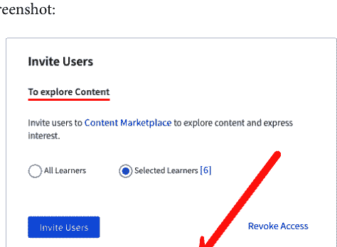

Figure 14.14 – 下载表达兴趣报告

- 6. 花点时间阅读 **下载表达兴趣报告** 消息，然后点击 **确定** 按钮。
- 7. 报告准备好后，通知图标（铃铛图标）中会出现通知，该图标位于屏幕右上角。

表达兴趣报告是一个 .CSV 文件，可以使用任何电子表格应用程序打开，例如 Microsoft Excel、Apple Numbers 或 Open Office。为了方便您，样本表达兴趣报告可在与本书关联的下载中的 marketplace/ 文件夹中找到。

如果您的组织决定购买部分或全部可用内容，您必须返回管理员应用程序的 **企业培训** 页面并点击页面 **购买** 部分中的链接，以启动与 Adobe 销售团队的购买流程，如以下屏幕截图所示：

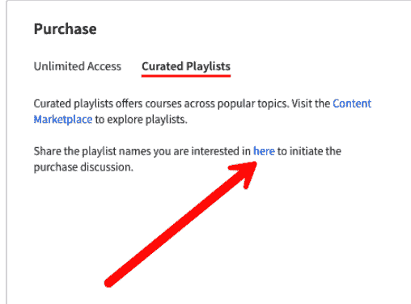

Figure 14.15 – 启动购买流程

在本节中，您回顾了管理员如何下载 **表达兴趣报告** 以及如何与 Adobe 销售团队启动购买流程。

一旦购买完成，新的课程可以推送到现有目录或通过新目录。有关此流程的更多信息可在官方 Adobe Captivate Prime 用户指南中找到，网址为 https://helpx.adobe.com/captivate-prime/user-guide.html/captivate-prime/administrators/feature-summary/content-marketplace.ug.html。

## 使用对等账户协作

有时，单个 Captivate Prime 账户足以让一个组织管理其所有的培训项目。然而，对于大型组织来说，使用多个不同的 Captivate Prime 账户并不罕见。这提供了很大的灵活性，并使 Captivate Prime 能够集成到几乎任何类型的组织中，无论其规模、复杂性和内部结构如何：

- 跨国组织可为其各个分支机构和地区办事处使用多个 Prime 账户。
- 单个企业拥有的不同品牌可使用多个 Prime 账户。
- 部分组织使用多个 Prime 账户以提高培训安全性。包含机密信息的课程托管在单独的 Prime 账户上，仅获授权的学习者可访问。
- 等等。

使用多个 Prime 账户所提供的灵活性体现在三个不同的方面。

首先，是内容方面。每个 Prime 账户都有特定的内容库，以及自己的课程、学习项目、认证和工作辅助资料集合。如本章前面“外部共享”部分所述，Prime 账户可通过外部共享的自定义目录将内容推送到其他 Prime 账户中。这使得，例如，多国组织的地区办事处能够独立于总部管理其课程供应，同时总部可以将全球相关的企业内容推送到其每个子 Prime 账户中。

其次，是财务方面；换句话说，谁为每个 Prime 账户使用的用户席位付费？同样，Captivate Prime 的高度灵活性使您可以从多个角度来看待这个问题：

- 组织可以决定让每个 Prime 账户自行支付使用费用。这是默认情况。就计费而言，每个 Prime 账户都是不同的客户，直接从 Adobe 购买自己的用户席位套装。
- 一些组织更喜欢集中购买所有 Prime 账户所需的所有用户席位。在这种情况下，Captivate Prime 的成本完全由公司总部承担，并且所有用户席位都在单个 Prime 账户内购买。购买席位的 Prime 账户随后可使用对等账户功能将其分配给其他 Prime 账户。
- 当然，这两种模式的混合也是可能的。特定 Prime 账户中可用用户席位的一部分可直接从该账户购买，而另一部分可用席位则从另一个 Prime 账户分配。

第三，是品牌方面。由于每个 Prime 账户都可以进行品牌定制，对等账户对于需要为每个单独的 Prime 账户使用完全不同的品牌形象、特定标志和颜色的组织非常有用。这对于拥有多个品牌的大型公司尤其有用。

现在是时候通过以下步骤亲手探索 **Peer Accounts** 功能：

- 1. 以管理员身份登录您的 Prime 账户。
- 2. 从管理员主页，单击左侧边栏 **Configure** 部分中的 **Settings** 链接。
- 3. 然后，单击左侧边栏 **Integrations** 部分中的 **Peer Accounts** 链接，以打开管理员的 **Peer Accounts** 页面。

从此页面，您可以查看已与其它账户共享的席位和报告列表，以及从其它账户收到的席位和报告列表：

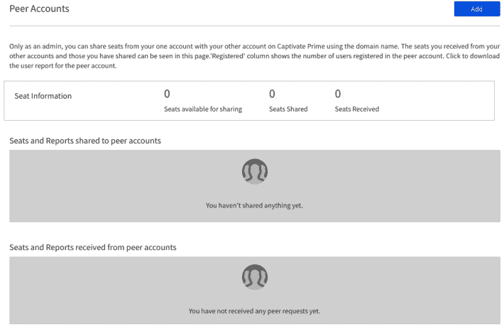

图 14.16 – 管理员的对等账户页面

在此示例中，假设您是组织总部 Prime 账户的管理员，并且您想将在此账户中购买的一些用户席位分配给其中一个本地分支机构的 Prime 账户：

4. 单击页面右上角的 **Add** 按钮以开始定义新的对等账户。这将打开 **Add Peer Information** 对话框，如以下屏幕截图所示：

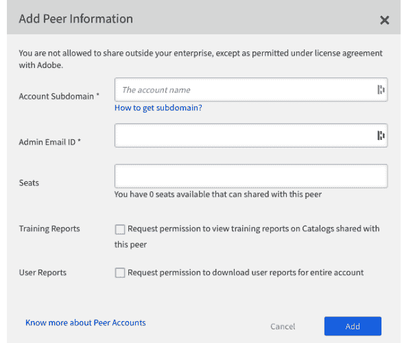

图 14.17 – 添加对等信息对话框

请注意，**Add Peer Information** 对话框中只有两个字段是必需的：

- **Account Subdomain** 字段是您想要分配席位的 Prime 账户的 URL。
- **Admin Email ID** 字段是另一个 Prime 账户管理员的电子邮件地址。完成此表单后，Captivate Prime 将向此地址发送电子邮件，说明如何在接收端设置此对等账户。

当然，您还应使用 **Seats** 字段指定要分配给另一个账户的用户席位数量。

可选地，您可以使用 **Training Reports** 和 **User Reports** 复选框来访问您当前正在创建的对等账户生成的报告。当您希望组织使用的不同 Prime 账户的所有报告都可在一个中央位置（例如公司总部的 Prime 账户）中使用时，这非常有用。我们在 *第 10 章，Captivate Prime 中的报告* 中讨论了 Captivate Prime 的报告功能。

如果您对另一个 Prime 账户具有管理员访问权限，请随意进一步尝试此功能。不幸的是，在本书的上下文中，我们必须使用以下步骤中止该过程：

- 5. 单击 **Add Peer Information** 对话框右下角的 **Cancel** 按钮。

这将取消当前过程并带您返回管理员主 **Peer Accounts** 页面。

> **注意**
> 有关对等账户的更多信息，可在官方 Captivate Prime 用户指南中找到，网址为 https://helpx.adobe.com/captivate-prime/user-guide.html/captivate-prime/administrators/feature-summary/peer-account-ug.html。

## 摘要

在本章中，您发现了 Captivate Prime 的三个重要功能：目录、Content Marketplace 和对等账户。

目录允许您控制哪些学习者可以访问哪些学习对象。请记住，您并非直接控制谁可以访问哪门课程，而是控制谁可以访问哪个目录。因此，通过将课程、学习项目、认证和工作辅助资料添加到 Prime 账户中可用的各种目录中，您有效地对学习内容实施了访问控制。

目录可以内部共享或外部共享。您使用内部共享来确定 *在您的 Prime 账户内定义的* 哪些学习者可以访问哪个目录。在您的 Prime 账户内定义的学习者包括内部和外部学习者，如 *第 5 章，管理用户* 中所述。您使用外部共享时，希望在其他 Prime 账户中定义的学习者能够访问您的学习内容。

**Default Catalog** 与 Prime 账户同时创建。它包含 Prime 账户中可用的所有学习对象，并且对所有学习者可见。虽然您可以更改有权访问 **Default Catalog** 的用户组，但您无法更改其内容，也无法删除它。因此，有效的访问控制策略通常涉及完全禁用 **Default Catalog**。

您还可以使用随 2021 年 8 月更新添加到 Captivate Prime 的新 **Content Marketplace** 功能部署额外的课程目录。得益于这一新功能，组织可以轻松地在不离开 Captivate Prime 环境的情况下购买对额外课程目录的访问权限。

另一方面，对等账户允许您使用单个 Prime 账户购买大量用户席位，并将其中一些席位分配给其他 Prime 账户。此功能被大型组织使用，这些组织希望在为每个地区分支使用多个独立 Prime 账户的同时集中控制其 Captivate Prime 部署的成本。

很容易将外部共享的自定义目录与对等账户混淆。为了区分它们，请记住，外部共享的自定义目录旨在使 *内容* 可用于其他 Prime 账户。通过使用此功能，您正在处理课程供应的编辑和教学设计方面。

相比之下，通过使用对等账户，您对 Prime 部署的 *计费* 和 *品牌* 方面采取行动。您是希望在一个 Prime 账户中购买大量席位然后将这些席位分配给其他账户？还是更喜欢让每个 Prime 账户自行管理其成本？

由于这是两个不同的功能，您可以决定使用其中一个或同时使用两者。这使得 Captivate Prime 如此灵活，以至于它可以适应几乎任何组织，无论其内部运营方式如何。

在本书的许多章节中，您已经回顾了多个功能，并且 Captivate Prime 已向您在 *第 5 章，管理用户* 中创建的各个学习者发送了不少电子邮件。这些消息在 Captivate Prime 的运行方式以及学习者与平台的互动方式中发挥着关键作用。在下一章中，您将了解 Adobe Captivate Prime 的公告和消息系统，并自定义所有这些重要消息。

