## 15 使用消息和公告

在我们超互联的世界里，我们每个人都在不断增长的平台和网络上拥有大量账户。从社交网络到消息应用，从电子邮件账户到企业平台，我们在个人和职业生活中都被各种在线服务包围。在这种杂乱的技术环境中，企业 LMS 对学习者而言可能只是又一个需要使用和参与的平台。这可能导致学习者产生技术疲劳，从而导致参与度下降和注意力分散。

Adobe Captivate Prime 承认这一现实，并制定了策略将学习者带回 LMS 并保持他们在学习过程中的参与度。第 11 章《徽章和游戏化》以及第 12 章《启用和管理社交学习》中讨论的功能有助于这一策略，但还有更多！Captivate Prime 还会向用户发送大量电子邮件消息。这些消息旨在让用户了解 LMS 上发生的情况，这有助于他们回到平台并与可用的学习内容以及同行进行互动。最后，坦白说——大多数组织中的员工都是从电子邮件收件箱或手机上的消息中收到培训指令和要求。因此，简而言之，消息传递对于任何 LMS 部署的成功都至关重要。

这些消息将 LMS 的覆盖范围扩展到每个学习者的邮箱中，并且对大多数用户而言是学习者体验的起点。这就是为什么大多数组织在视觉设计和内容方面都会非常仔细地定制这些消息的原因。

Captivate Prime 还允许您在学习者体验中向特定目标受众传递不同类型的公告。您可以在各种情况下使用它们，例如推广新的学习内容、发送各种类型的提醒、显示平台公告等。

这就是本章将讨论的内容，其中包含以下主要部分：

- 使用公告
- 配置消息系统
- 自定义单个电子邮件消息

到本章结束时，您将拥有必要的工具，通过自定义平台本身的用户体验以及 LMS 发送的消息，完全掌控您的 Prime 账户。

## 技术要求

要完成本章中的练习，您必须满足以下技术要求：

- 您必须拥有对正在运行的 Captivate Prime 账户（可以是试用账户）的管理员和学习者访问权限。
- 您必须能够访问这些用户的邮箱，以阅读 Captivate Prime 发送的电子邮件消息。

如果您已完成前几章中的练习，您就可以开始了。如果您没有阅读本书的前几章，请随意使用 Prime 账户上可用的课程材料和用户。在这种情况下，请记住本章提供的说明是基于前几章编写的，因此您需要根据自己的情况进行调整。

## 使用公告

假设您的组织刚刚订阅了一个新的第三方内容库，或购买了 Captivate Prime 新内容市场中部分或全部内容的访问权限。得益于您的开发人员与内容提供商团队的合作，这新的库已作为新的 Captivate Prime 目录提供给您的学习者。现在是通知学习者这些新课程可用性的时机，鼓励他们查看这个新目录并注册其中的课程。这是 Captivate Prime 的 **公告** 功能派上用场的情况之一。

作为 Captivate Prime 管理员，您可以创建三种不同类型的公告：

- **通知** 显示为对话框，并在学习者体验右上角的铃铛图标下方显示。这对于有针对性的提醒（例如提醒经理提交 L3 反馈）或平台公告（例如游戏化积分即将重置）来说是一个很好的选择。L3 反馈在 *第 9 章，配置和使用反馈* 中讨论过，而游戏化积分则在 *第 11 章，徽章和游戏化* 中讨论过）。
- 您还可以在 **页眉** 中显示公告，页眉是学习者主页的顶部部分。这些公告在学习体验中更为突出，基于图像或视频文件。它们作为针对目标受众的行动号召。因此，它们通常包含一个链接，允许用户了解有关公告的更多信息。
- 最后，**推荐** 是一种公告类型，您可以用它手动向特定目标受众推荐课程。这些手动课程推荐除了 AI 驱动的推荐之外，还在 *第 13 章，面向学习者的 AI 驱动推荐* 中讨论过。

现在，让我们探索 *通知* 和 *页眉* 公告，从下一节开始的通知开始。

## 创建通知

本章中您将查看的第一种公告类型是通知。通知通常用于一般平台公告（例如比赛获胜者、维护停机时间、企业活动等）或有针对性的提醒（例如提醒经理提交他们的 L3 反馈或审查其团队成员的注册请求等）。

在此示例中，您将创建一个通知，宣布游戏化积分的年度重置即将到来，如 *第 11 章，徽章和游戏化* 中的 *配置高级游戏化选项* 部分所述。在执行此操作之前，请记住您仅为内部用户启用了游戏化，因此您应该仅将通知定位到此特定用户组。

现在是时候返回 Captivate Prime 管理员并使用以下步骤创建您的第一个通知：

1. 以管理员身份登录您的 Captivate Prime 账户。
2. 从管理员主页，单击左侧边栏 **管理** 部分中的 **公告** 链接。
   这将打开管理员的主 **公告** 页面。
3. 单击页面右上角的 **添加** 按钮以打开 **创建公告** 对话框。
4. 在 **创建公告** 对话框顶部，确保 **类型** 下拉菜单设置为 **作为通知**。
5. 在表单的 **消息** 字段中输入您的通知消息。请注意，这是必填信息。

> **HTML 消息**
> **创建公告** 表单的 **消息** 字段支持 HTML。这允许您在 **消息** 字段中输入 HTML 代码片段而不是纯文本。这对于在消息中插入超链接或添加一些格式非常有用。

6. 可选地，您可以将图像或视频文件附加到您的公告。对于此练习，您可以使用本书下载中包含的 `announcements/notification.png` 示例图像。
7. 在对话框底部，**目标** 属性是表单的第二个必填项。在此示例中，通知针对的是 **所有内部用户** 组。
   在 **在此输入** 字段中开始输入 `Internal`，当它出现在列表中时单击 **所有内部用户**。请注意，您可以在表单的 **目标** 部分添加任意数量的用户组。

> **向注册了特定课程的学习者发送通知**
> 使用 **创建公告** 表单中 **目标** 部分的 **培训** 选项卡，您可以将通知定位到注册了特定课程、学习计划和认证的学习者，而不是使用用户组。

8. 点击表单左下角的 **高级设置** 链接以显示更多选项。

9. 保持 **固定** 复选框未选中。

对于 **开始日期**，保持 **立即** 选项被选中。

对于 **结束日期**，选择 **指定日期** 选项，然后点击 **选择日期** 按钮并选择近期任意日期。

10. 当 **创建公告** 对话框如下所示时，点击表单右下角的 **保存** 按钮：

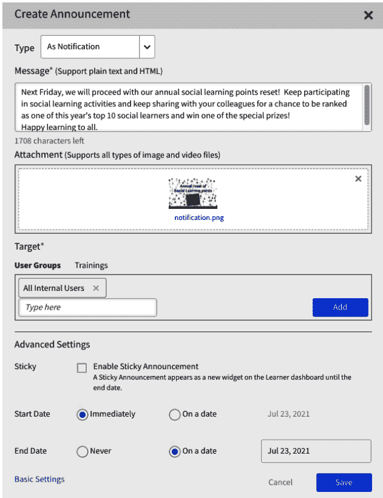

图 15.1 – 创建通知时创建公告表单

11. 最后，点击 **稍后发布** 按钮以关闭 **公告创建成功** 消息。

如以下屏幕截图所示，您的新通知已创建，现在处于 **草稿** 状态（请参阅以下屏幕截图中的箭头）：

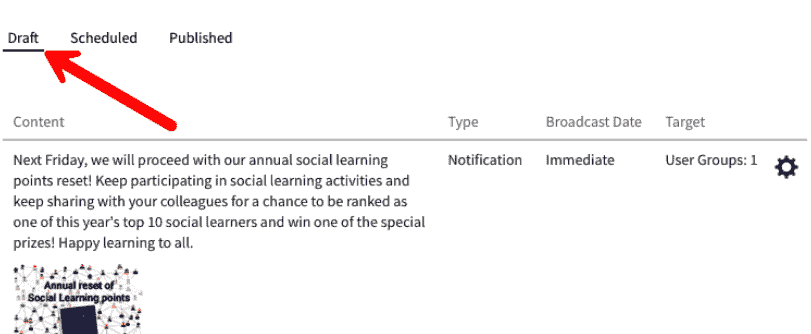

图 15.2 – 新通知处于草稿状态

在新通知显示给登录 Prime 账户的学员之前，我们还必须执行最后一步。

- 12. 点击与新公告关联的 *齿轮* 图标，并花一些时间查看可用选项。
- 13. 准备好后，点击 **发布**。
- 14. 最后，切换到 **公告** 页面中的 **已发布** 选项卡，以确认您的通知现在处于已发布状态。

一旦通知发布，就会向公告的目标学员发送电子邮件：

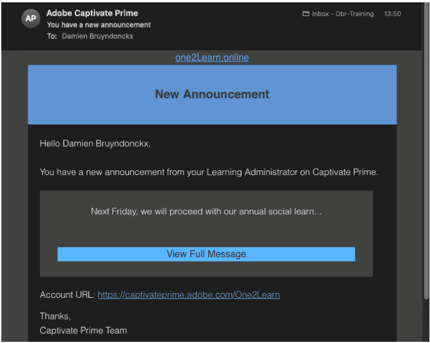

图 15.3 – Captivate Prime 在通知发布时发送的电子邮件

此外，通知也会显示给登录 Prime 账户的任何内部学员。我们将在下一节更详细地查看这一点。

## 学员体验中的通知

现在您已发布通知，可以以内部学员身份登录，查看该通知在学员体验中的显示方式：

- 1. 以 *学习者 01* 或其他可用的内部学员身份登录您的 Prime 账户。
- 2. 登录后，通知会出现在屏幕中间。花点时间查看它，然后使用通知右上角的关闭按钮将其关闭。

3. 通知也可在屏幕右上角的铃铛图标中找到，如以下屏幕截图所示：

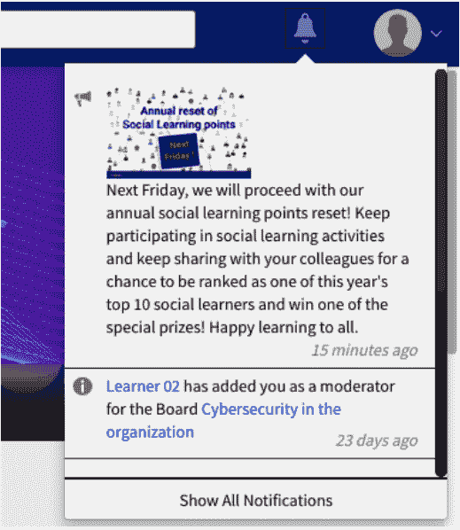

图 15.4 – 通知也会出现在铃铛图标中

在本节中，您创建了一个通知并查看了它在学员体验中的显示方式。请记住，通知只是 Adobe Captivate Prime 中可用的三种公告类型之一。此外，请记住，此类通知的目标受众可以是一个或多个用户组，或 enrolled 在特定课程、学习计划或认证中的学员。通知通常用于计划中的维护停机、通用平台或公司公告、定向提醒等情况。

在下一节中，您将回顾 Captivate Prime 的页眉公告。

## 创建页眉公告

页眉是横跨学员体验顶部的较大矩形区域。登录为学员时，您当前可以在此区域看到消息 **今天学习点新东西**：

图 15.5 – Adobe Captivate Prime 的默认页眉

当然，这也是向学员展示各种公告的首选区域之一。通常，您会使用页眉来推广新课程、学习计划、认证或目录，但没有什么可以阻止您将其用于其他目的，例如推广公司活动、宣布全公司培训的截止日期，或宣布积累最多游戏化积分的学员！除了在用户界面中的突出位置外，页眉的独特之处在于它可以用作号召性用语，将学员重定向到另一个网页。

在此练习中，您将使用页眉宣布您在 *第 14 章，处理目录和同行账户* 中创建的内部目录的即时可用性，并为内部用户提供指向此新目录的直接链接。为此，您的第一个任务是按照以下步骤获取内部目录的链接：

- 1. 确保您以管理员身份登录 Prime 账户。
- 2. 从管理员主页，点击左侧边栏 **学习** 部分中可用的 **目录** 链接。
- 3. 将鼠标悬停在上一章中创建的内部目录上。
- 4. 点击屏幕上出现的 *链* 图标，将相应目录的直接链接复制到剪贴板。

**注意**
如果 **内部目录** 在您的 Prime 账户中不可用，请选择任何可用的目录。

现在链接已在剪贴板上，您的下一个任务是配置您的页眉公告。

- 5. 点击左侧边栏 **管理** 部分中的 **公告** 链接，返回管理员的主 **公告** 页面。
- 6. 点击屏幕右上角的 **添加** 按钮以打开 **创建公告** 对话框。
- 7. 在 **创建公告** 对话框顶部，打开 **类型** 下拉菜单并选择 **作为页眉**。
- 8. 对于 *页眉* 类型的公告，您必须在 **附件** 字段中提供图像或视频文件。

在此示例中，您可以使用本书下载中提供的 `announcements/masthead.jpg` 文件。

请注意 **附件** 部分右上角的 **语言** 下拉菜单，它允许您为平台支持的每种语言上传不同的图像。

> **首选图像尺寸**
> 页眉图像或视频的首选尺寸为 1,280 x 360 像素。
> 您可以在官方 Captivate Prime 用户指南的以下页面查看图像的推荐尺寸以及其他系统要求：
> `https://helpx.adobe.com/captivate-prime/system-requirements.html`。

- 9. 点击 **创建公告** 对话框 **操作按钮** 部分中的 **了解更多** 字段，并粘贴您在此节中之前复制的内部目录链接。
- 10. 最后，将 **所有内部用户** 用户组添加到表单的 **目标** 部分。
- 11. 当 **创建公告** 对话框如下所示时，点击右下角的 **保存** 按钮：

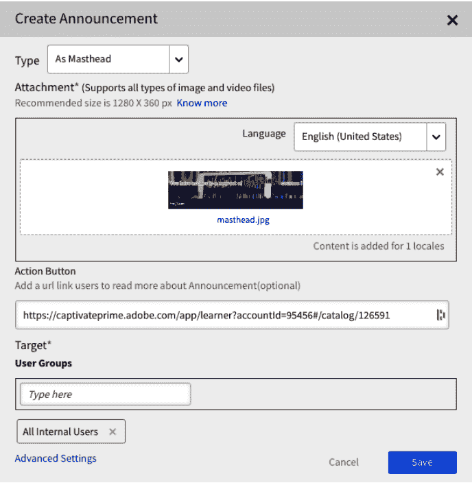

图 15.6 – 创建页眉时创建公告表单

12. 点击 **确定** 按钮以关闭 **公告创建成功** 消息。

创建页眉时，Captivate Prime 需要一点时间来处理正在上传的内容。通常不会超过几分钟。当 Captivate Prime 完成内容处理后，您的新页眉公告将在 **公告** 页面的 **草稿** 选项卡中可用。如常，您现在必须 *发布* 新页眉，以便登录 Prime 账户的学员可以看到它。

13. 点击与新页眉关联的 *齿轮* 图标并点击 **发布**。

14. 切换到 **公告** 页面的 **已发布** 选项卡，以确认您的通知现在处于已发布状态。

完成此过程后，新页眉应对所有登录 Prime 账户的内部学员可见。我们将在下一节查看这一点。

## 学员体验中的页眉

在本节中，您将通过以内部用户身份登录，返回 Captivate Prime 账户中的学习体验，以查看您在上一节中创建的页眉：

- 1. 以 *学习者 01* 或其他内部用户身份登录您的 Prime 账户。
- 2. 登录后，您应该在学员主页的顶部区域看到您的新页眉：

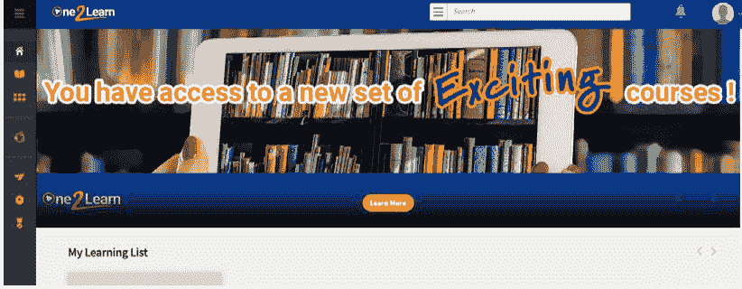

图 15.7 – 新页眉可见于学员主页顶部

3. 点击 **了解更多** 链接并确认您已被重定向到学员体验中的内部 **目录** 页面。

> **多个页眉**
> 如果当前登录用户有多个页眉，它们将一个接一个地在图像轮播中显示。

在本节中，您已回顾了页眉公告类型。您首先使用图像和链接创建了一个页眉，该链接将学员重定向到您在上一章中创建的自定义目录之一。请记住，使用 **页眉** 作为号召性用语的能力是页眉与其他 Adobe Captivate Prime 公告类型不同的原因。完成后，您前往学员体验，查看新页眉如何向 Prime 账户的内部用户展示。

在下一节中，您将学习如何通过下载 **通知公告报告** 来了解哪些用户看到了哪些公告。

## 导出通知公告报告

你现在在 Prime 账户中拥有多种类型的公告。它们都已发布并正在广播，因此在学习者体验中都可见。但这是否意味着学习者实际上会查看它们呢？对于不经常登录 Prime 账户的学习者来说又如何？他们会及时看到重要公告吗？这些都是作为管理员，了解谁*实际*查看了哪条公告的概览为何重要的原因之一。

这正是 *通知公告报告* 的目的，该报告可以从管理员的 **公告** 页面导出。让我们通过执行以下步骤来查看它：

-   1. 确保你已以管理员身份登录到你的 Prime 账户。
-   2. 从管理员主页点击左侧边栏 **管理** 部分中的 **公告** 链接。
-   3. 在 **公告** 页面的右上角，点击 **操作** 按钮，然后点击 **导出通知公告报告**。
-   4. 花点时间阅读 **生成报告请求** 消息。阅读完毕后，点击 **确定** 按钮将其关闭。

根据你的账户规模以及当前正在广播的公告数量，Captivate Prime 生成报告可能需要一点时间。报告准备好后，通知将出现在管理员的通知区域中，如以下屏幕截图所示：

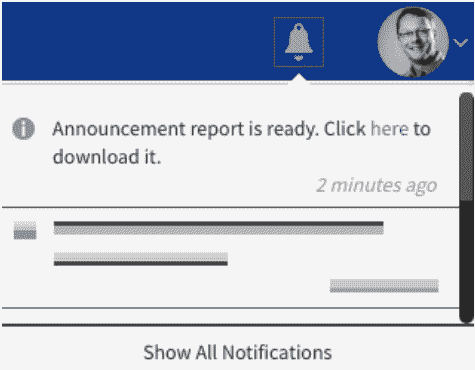

图 15.8 – 报告准备好时会显示通知

只需点击通知中的链接即可下载 CSV 格式的 **通知公告报告**。

> **CSV 文件格式**
> CSV 代表 *逗号分隔值*。请记住，此类文件几乎可以在任何电子表格应用程序中打开，包括 Microsoft Excel、Apple Numbers 和 Open Office。

花必要的时间在系统上可用的电子表格应用程序中打开报告并检查其内容。为了方便你，本书相关下载中的 `announcements` 文件夹里提供了 `.csv` 格式的示例通知公告报告。

在下一节中，你将回顾管理员 **公告** 页面上用于查看、编辑和删除公告的工具。

## 查看、修改和删除公告

在本节中创建 masthead 公告时，你没有做的一件事是为公告提供开始和结束日期。因此，masthead 会立即广播并保持可见，直到你手动撤回它。现在，让我们使用以下步骤更仔细地查看此过程：

-   1. 以管理员身份登录到你的 Prime 账户。
-   2. 从管理员主页点击左侧边栏 **管理** 部分中的 **公告** 链接。

默认情况下，管理员的 **公告** 页面打开时显示 **草稿** 选项卡，如以下屏幕截图所示：

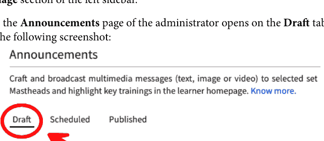

图 15.9 – 公告页面打开时显示草稿选项卡

这里可以看到仍处于草稿状态的公告。
当公告已保存但尚未发布时，它处于草稿状态。

请注意，**公告** 页面的顶部还有两个额外的选项卡：

-   - **计划** 选项卡显示具有未来开始日期的已发布公告列表。Captivate Prime 会自动广播这些公告，并在其各自的开始日期到达时将它们移至 **已发布** 选项卡。
-   - **已发布** 选项卡列出所有当前对学习者可见的公告。如果你已完成本书中的所有练习，那么你创建的各种公告应显示在此处。

现在，转到 **已发布** 选项卡并手动撤回你在上一节中创建的 masthead 公告。

-   3. 切换到 **公告** 页面的 **已发布** 选项卡。
-   4. 点击与你的 masthead 公告关联的 *齿轮* 图标。
-   5. 在打开的菜单中点击 **编辑** 选项以打开 **编辑公告** 对话框。
-   6. 点击 **编辑公告** 对话框左下角的 **高级设置** 链接。
-   7. 尝试修改你的 masthead 公告的 **开始日期** 和/或 **结束日期** 属性。

请注意，Captivate Prime 不允许你更改此信息。你不能更改已发布公告的开始日期或结束日期。换句话说，要停止在本节中创建的 masthead 的广播，你唯一能做的就是完全撤回该公告。

-   8. 点击 **编辑公告** 对话框右下角的 **取消** 按钮返回到 **公告** 页面的 **已发布** 选项卡。
-   9. 再一次点击与你的 masthead 公告关联的 *齿轮* 图标。
-   10. 这次，在打开的菜单中点击 **撤回** 选项。

从现在开始，此 masthead 不再向任何学习者显示。请注意，这不会将公告从已发布公告列表中移除。你始终可以稍后修改公告和/或再次广播它。你也可以决定完全删除公告，这就是你接下来要做的。

-   11. 最后一次点击与你的 masthead 公告关联的 *齿轮* 图标。
-   12. 点击打开的菜单中可用的 **删除** 链接。请注意，**删除** 选项仅适用于之前已撤回的公告。

这完成了你对 Adobe Captivate Prime 公告的概述。
请记住，Captivate Prime 提供三种类型的公告：

-   - **推荐** 在 *第 13 章、面向学习者的 AI 驱动推荐* 中进行了讨论。你可以使用它们向目标用户组手动推荐课程、学习计划、认证和工作辅助工具。这些手动推荐显示在学习者主页上，旁边是 Captivate Prime 内置人工智能生成的推荐。
-   - **通知** 在学习者登录时作为对话框显示在学习者体验中。它们也可在学习者体验右上角的通知图标（铃铛图标）中找到。此外，Captivate Prime 在通知发布时还会向所有被该通知定位的用户发送电子邮件消息。
-   - **页眉公告** 显示在学习者体验的顶部。它们特别之处在于可作为行动号召，用于将学习者重定向到另一个网页。

在下一节中，你将回顾 Adobe Captivate Prime 的消息系统并自定义平台发送的所有电子邮件消息。

## 配置消息系统

如果你已完成本书迄今为止提供的各种练习，那么你在 *第 5 章、管理用户* 中定义的用户应已收到大量来自 Captivate Prime 的电子邮件。事实上，Captivate Prime 中发生的几乎每个事件都会触发一封电子邮件。经理收到的邮件更多，因为除了关于他们作为学习者活动的邮件（请记住，经理首先是学习者）之外，他们还收到关于其团队成员活动的邮件。

这是一种有意的做法，旨在让学习者定期返回 Captivate Prime，尽管我们每天使用的大量在线平台。因此，这些电子邮件扩展了 Captivate Prime 体验的覆盖范围，可被视为许多 Prime 工作流程的开始。

这就是许多组织特别关注这些电子邮件通信的视觉设计和内容的原因。

在本节中，你将回顾允许管理员配置 Prime 账户电子邮件系统的主要选项。然后，在下一节中，你将专注于自定义每封电子邮件的内容。

执行以下步骤以查看 Captivate Prime 消息系统的[content]
执行以下步骤以查看 Captivate Prime 消息系统的[content]
执行以下步骤以查看 Captivate Prime 消息系统的[content]
执行以下步骤以查看 Captivate Prime 消息系统的[content]
执行以下步骤以查看 Captivate Prime 消息系统的[content]
执行以下步骤以查看 Captivate Prime 消息系统的[content]
执行以下步骤以查看 Captivate Prime 消息系统的[content]
执行以下步骤以查看 Captivate Prime 消息系统的[content]
执行以下步骤以查看 Captivate Prime 消息系统的[content]
执行以下步骤以查看 Captivate Prime 消息系统的[content]
请按以下步骤查看 Captivate Prime 消息系统的[content]
执行以下步骤以查看 Captivate Prime 消息系统的[content]
测试翻译
[/content]

That works? Let's try.

[content]
测试翻译

如以下屏幕截图所示，这允许您为特定用户选择应被阻止的电子邮件类型：

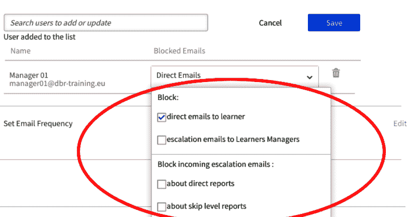

图 15.12 – 配置“请勿打扰”列表

- 6. 您可以根据需要继续向“请勿打扰”列表添加个人，并在完成后点击“保存”按钮。

然而，在本练习的上下文中，您不会向“请勿打扰”列表添加任何人。只需点击“取消”按钮关闭此选项而不保存任何更改。

“请勿打扰”功能不应与打开和关闭单个电子邮件消息的能力混淆。主要区别在于“请勿打扰”功能仅影响少数个人，而启用和禁用电子邮件会影响您 Prime 账户的所有用户。

在下一节中，我们将讨论 Captivate Prime 发送的另一种电子邮件类型。

## 配置摘要电子邮件消息功能

除了由账户中发生的事件触发的各种消息外，Captivate Prime 还可以向每位学习者发送定期摘要电子邮件。由于账户中常规操作发送的消息数量较多，此选项默认处于禁用状态。在本节中，您将查看此类摘要电子邮件的外观。然后，您将了解如何启用和配置摘要电子邮件消息。

让我们通过执行以下步骤开始操作：

- 1. 确保您位于管理员的 **电子邮件模板** 部分的 **设置** 选项卡上。
- 2. 向下滚动页面，直到在页面底部看到 **摘要电子邮件设置** 选项。
- 3. 点击 (**查看电子邮件**) 链接，在另一个浏览器窗口/标签页中打开一份示例摘要电子邮件消息。

花点时间查看此示例消息，以便更好地了解摘要电子邮件的外观。准备好后返回 Captivate Prime 管理员。

请注意，**摘要电子邮件设置** 选项关联的 **编辑** 链接默认不可用。这是因为该选项尚未在您的 Prime 账户上启用。启用它是在 Captivate Prime 管理员的另一部分完成的。现在让我们来看看它。

- 4. 点击左侧边栏 **配置** 部分中的 **设置** 链接以打开 **基本信息** 页面。
- 5. 然后，点击左侧边栏 **基础** 部分中的 **常规** 链接。
- 6. 向下滚动页面，直到看到 **摘要电子邮件** 选项。

**摘要电子邮件** 选项默认处于禁用状态，只能在活跃的 Captivate Prime 账户上启用。换句话说，它在试用账户中不可用。如果您拥有活跃的 Prime 账户，欢迎进一步尝试此功能，但对于本次练习，不幸的是，我们必须在此停止流程。

> **注意**
> 您可以在官方 Captivate Prime 用户指南的以下页面找到有关 **摘要电子邮件** 功能的更多信息： https://helpx.adobe.com/captivate-prime/administrators/feature-summary/email-templates.html#digest-email.

这结束了您对 Captivate Prime 消息系统主要设置的探索。请记住，本节中讨论的所有内容都会影响您整个账户的消息系统。

本节中您更改的主要选项是用于上传自定义 **电子邮件横幅** 和自定义 **电子邮件签名**。请记住，这些简单的步骤对于为学习者提供流畅且专业的用户体验至关重要。

您还采取了措施防止经理和其他高级管理人员从 Captivate Prime 收到太多电子邮件。

在下一节中，您将学习如何自定义由您的 Prime 账户发送的每封电子邮件。

## 自定义单个电子邮件消息

到目前为止，您在 *第 5 章，管理用户* 中定义的用户应该已从 Captivate Prime 收到相当多的电子邮件。以下屏幕截图显示了 *学习者 01* 的邮箱，自本书开始以来，已有不少于 49 条消息源自 Captivate Prime！

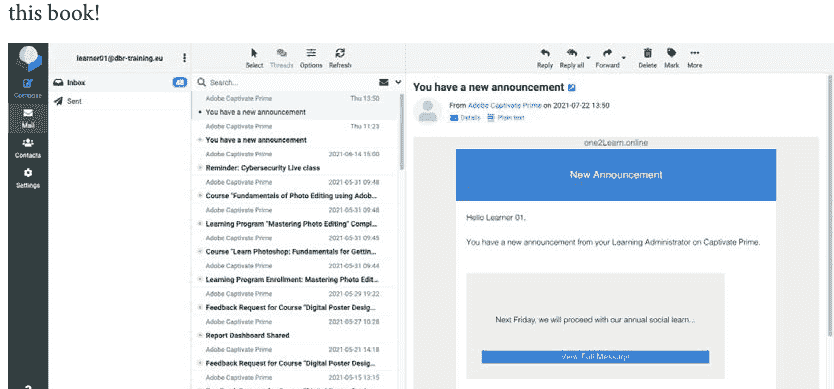

图 15.13 – 学习者 01 的邮箱包含 49 条来自 Captivate Prime 的消息

这是发送给学习者的大量电子邮件通知，我们必须承认 Captivate Prime 在发送电子邮件方面有点过度。

幸运的是，Captivate Prime 允许您选择应发送哪些消息以及应禁用哪些消息。您还可以完全自定义每条消息的内容。

这就是本节中您将探索的内容。您将首先详细查看 Captivate Prime 中可用的长消息列表以及如何单独启用和禁用它们。

## 启用和禁用消息

Adobe Captivate Prime 中有许多事件会触发电子邮件发送。这些消息可以在 Captivate Prime 管理员的各个部分进行自定义：

- Captivate Prime 管理员的 **电子邮件模板** 部分是自定义 Captivate Prime 发送的所有电子邮件消息的主要位置。在管理员的此部分中进行的任何自定义都会影响您的整个 Prime 账户，而不管消息是从哪个课程、学习计划还是认证发送的。
- 您可以在单个课程、学习计划和认证级别覆盖 Captivate Prime 管理员 **电子邮件模板** 部分中定义的一些消息。这允许您根据电子邮件源自的学习活动自定义每条消息的内容。

让我们开始回顾 Captivate Prime 管理员主 **电子邮件模板** 部分中可用的电子邮件消息列表。

## 账户级消息

在本节中，您将回顾 Captivate Prime 管理员主 **电子邮件模板** 部分中可用的电子邮件消息列表。请记住，您在此管理员区域中进行的更改会影响整个 Prime 账户。在下一节中，您将看到每个课程、学习计划和认证如何覆盖您在此节中将做出的决定。

是时候通过执行以下步骤来查看这些消息了：

- 1. 确保您以管理员身份登录到您的 Prime 账户。
- 2. 从管理员主页，点击左侧边栏 **配置** 部分中的 **电子邮件模板** 链接。

在本章前面的 *配置消息系统* 部分中，您检查了此页面 **设置** 选项卡上可用的选项。在本节中，您将检查另外三个选项卡：**常规** 选项卡、**学习活动** 选项卡和 **提醒和更新** 选项卡：

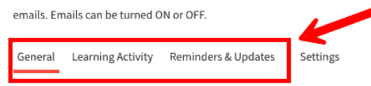

图 15.14 – 管理员的电子邮件模板页面的选项卡

这些选项卡中的每一个都包含一个电子邮件消息列表，每当发生特定事件时就会广播这些消息。

- 3. 花必要的时间浏览 **电子邮件模板** 页面上 **常规**、**学习活动** 和 **提醒和更新** 选项卡上可用的消息列表。
- 4. 使用表格最后一列中的开关来启用/禁用相应的电子邮件消息。

请注意，默认情况下，所有消息均已启用。

以下屏幕截图显示了 **电子邮件模板** 页面 **常规** 选项卡的上部，其中 **分配角色 - 讲师** 消息已禁用：

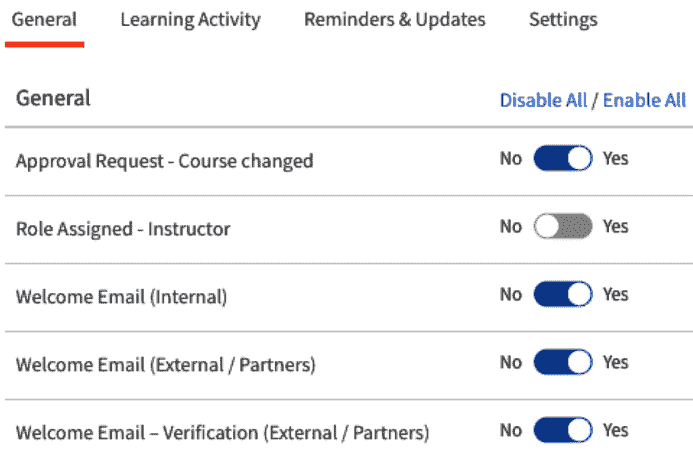

图 15.15 – 分配角色 – 讲师 消息已禁用

现在您对 Captivate Prime 管理员 **电子邮件模板** 部分中可用的消息列表有了更好的了解，让我们来看看课程、学习计划和认证的 **电子邮件模板** 部分。

## 面向课程、学习计划和认证的电子邮件模板

每个课程、学习计划和认证也都有其自己的 **邮件模板** 列表。默认情况下，这些学习对象会继承账户级别定义的电子邮件模板，但您也可以选择自定义每个单独课程、学习计划或认证的电子邮件模板。在这种情况下，在学习对象级别所做的编辑将优先于账户级别定义的选项。请执行以下步骤以修改课程的电子邮件模板：

- 1. 确保您已以管理员身份登录到您的 Prime 账户。
- 2. 点击左侧边栏学习部分中位于的 **课程** 链接。
- 3. 将鼠标悬停在您想要更改电子邮件模板的课程卡片上，然后点击 **查看课程** 链接。
- 4. 最后，点击左侧边栏 **配置** 部分中位于的 **邮件模板** 链接。

这将打开该特定课程的电子邮件模板列表。默认情况下，**邮件模板** 从 Prime 账户继承。请注意表格最后一列中的开关，它允许您启用/禁用每条消息。请记住，您在此处所做的更改优先于在账户级别所做的更改。换句话说，您可以在 Prime 账户的主 **邮件模板** 部分中禁用一条消息，然后仅为该课程重新启用该消息（反之亦然）。

- 5. 花点时间查看可用消息的列表。
- 6. 完成后，点击屏幕左上角的徽标图像返回管理员主页。
- 7. 您可以使用相同的流程来查看 Prime 账户上可用的学习计划和认证的电子邮件模板。

在本节结束时，您应该对 Captivate Prime 发送的电子邮件数量有更清晰的了解。重要的是要记住，您无法向此列表添加自己的消息。但是，您可以修改其中每条消息的内容，这将在下一节中讨论。

## 修改电子邮件消息的内容

在本章前面的 *配置消息系统* 部分中，您修改了 Captivate Prime 发送的所有消息的 **电子邮件横幅** 和 **电子邮件签名**。重要的是要记住，这些修改以相同的方式影响所有消息。

在本节中，您将学习如何修改每条电子邮件消息的内容。您将使用 Captivate Prime 管理员主 **邮件模板** 部分中可用的其中一条消息来回顾此流程，但该流程对于 **Captivate Prime** 管理员各个部分中可用的其他每个电子邮件模板都相同。

在此示例中，您将在平台级别自定义 **课程 – 由管理员/经理注册** 消息，因此此更改默认情况下会影响平台上所有可用的课程（除非您也在课程级别修改同一消息，在这种情况下课程级别的消息优先）。完成后，您将把 *学习者 02* 注册到 Prime 账户上可用的任何课程中，以触发 Captivate Prime 发送您的自定义电子邮件消息。最后，您将登录 *学习者 02* 的邮箱并查看您的自定义电子邮件消息。

让我们通过执行以下步骤开始自定义电子邮件模板：

- 1. 确保您已以管理员身份登录到您的 Prime 账户。
- 2. 从管理员主页，点击左侧边栏 **配置** 部分中位于的 **邮件模板** 链接。
- 3. 点击 **学习活动** 选项卡。
- 4. 最后，点击 **课程 – 由管理员/经理注册** 消息。

如以下屏幕截图所示，此操作会打开 **模板预览** 对话框，其中包含自定义电子邮件模板内容所需的所有工具：

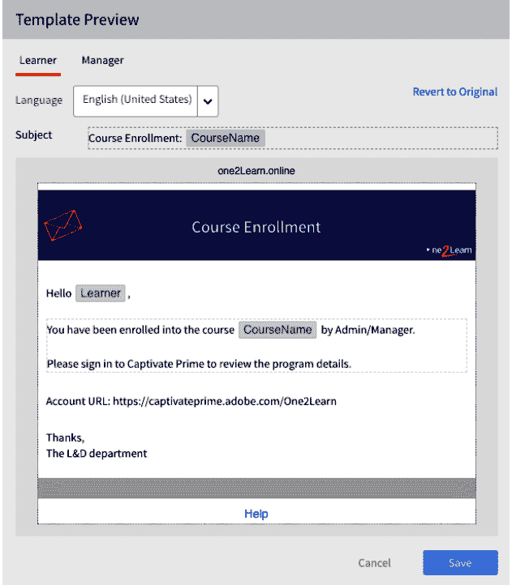

图 15.16 – 模板预览对话框用于自定义电子邮件模板的内容

- 5. 在 **模板预览** 对话框的最顶部，确保您位于 **学习者** 选项卡上。

**学习者** 选项卡显示在相应事件发生时发送给学习者的消息。**经理** 选项卡显示在事件发生时发送给学习者经理的消息。（请记住，您可以使用 **设置** 选项卡上可用的 **可选经理邮件** 选项禁用所有经理消息。）

- 6. 使用 **语言** 下拉菜单选择您想要自定义的语言版本。

- 7. 如有需要，您可以使用 **主题** 字段修改消息的主题。

- 8. 最后，您可以修改消息正文，包括横幅中的消息标题。

修改此类消息的内容时，您可以使用两种类型的文本元素：

- **静态文本** 是您使用键盘输入的文本。基于此模板的每条消息的这些文本部分始终相同，无论涉及的学习者或课程如何。
- **动态文本** 是每次基于此模板发送消息时不同的文本片段。例如，学习者的姓名或课程名称就是动态文本的片段。

要输入动态文本片段，您必须使用出现在正在编辑文本右上角的图标。例如，在以下屏幕截图中，我们正在自定义此电子邮件消息的正文。允许我们在消息的此区域中包含动态文本片段的图标由箭头突出显示：

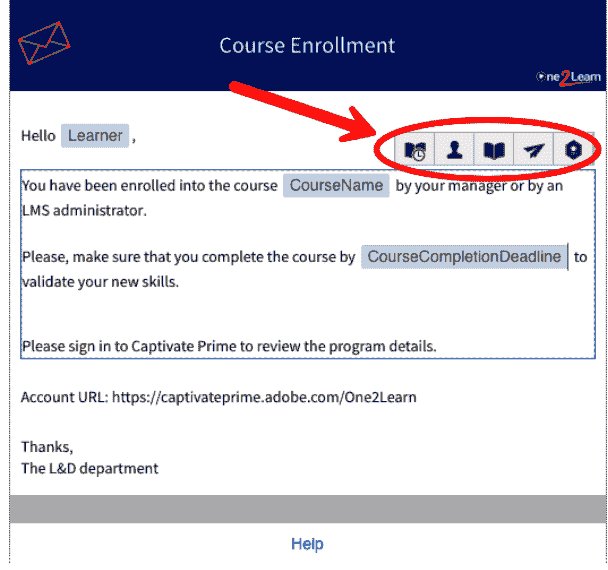

图 15.17 – 向电子邮件模板添加动态文本片段

在前面的屏幕截图中，**Learner**、**CourseName** 和 **CourseCompletionDeadline** 元素是动态内容片段。

- 9. 如有需要，您可以切换到 **经理** 选项卡以查看和自定义发送给学习者经理的消息。
- 您也可以从 **语言** 下拉菜单中选择另一种语言，并在多种不同的语言中自定义同一消息。
- 10. 完成后，点击 **模板预览** 对话框右下角的 **保存** 按钮。
- 11. 最后，确保您刚刚自定义的 **课程 – 由管理员/经理注册** 消息已启用（相应开关设置为 **是**）。

现在您已自定义了 **课程 – 由管理员/经理注册** 消息的内容，您将使用您的管理员超能力将 *学习者 02* 注册到 Prime 账户上可用的其中一门课程中。

- 12. 点击左侧边栏 **学习** 部分中位于的 **课程** 链接。
- 13. 将鼠标悬停在任何可用的课程卡片上，然后点击 **查看课程** 链接以打开课程详情。
- 14. 点击左侧边栏 **管理** 部分中位于的 **学习者** 链接。
- 15. 点击 **注册** 链接以打开 **注册学习者** 对话框。如果所选课程有多个实例，请使用 **选择实例** 下拉菜单选择所需的课程实例。
- 16. 将 *学习者 02* 添加到待注册学习者列表中。
- 17. 当 **注册学习者** 对话框如下所示时，点击右下角的 **继续** 按钮：

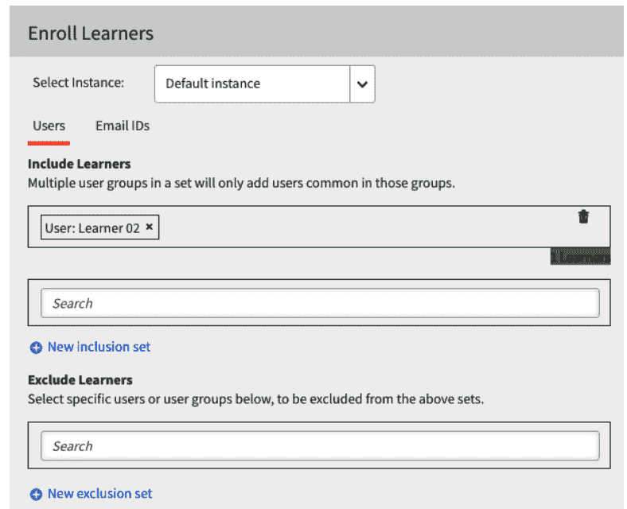

图 15.18 – 将学习者 02 注册到其中一门可用课程中

- 18. 通过点击屏幕上出现的 **注册学习者** 消息中的 **注册** 按钮来确认您的意图。
- 19. 最后，检查 *学习者 02* 的邮箱并确认他/她收到了 Captivate Prime 关于新课程注册的电子邮件，并且该消息与您在本节前面配置的内容相匹配。

以下屏幕截图显示了 *学习者 02* 收到的自定义电子邮件消息。请注意，除了消息内容被自定义之外，该消息还具有自定义电子邮件横幅和自定义电子邮件签名，如本章前面的 *配置消息系统* 部分中所定义：

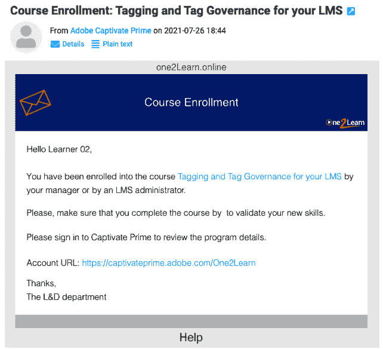

图 15.19 – 学习者 02 收到的自定义电子邮件消息

在本节中，您学习了如何修改 Captivate Prime 发送的电子邮件消息的内容。请记住以下内容：

- 对每个课程、学习计划或认证的电子邮件模板所做的修改会覆盖对 Prime 账户主 **邮件模板** 部分所做的修改。
- 您使用键盘输入的文本被视为 *静态* 文本，每次使用电子邮件模板时都相同。
- 您通过点击 **模板预览** 对话框中可用的图标添加的文本片段被视为 *动态* 文本元素。这些文本元素每次使用电子邮件模板时都不同，具体取决于相关用户、课程等。

-   大多数情况下，同一个事件会触发发送两条消息：一封发送给学习者，另一封发送给学习者的经理。您可以使用 **Template Preview** 对话框顶部提供的两个标签来自定义这两种版本的邮件。
-   您还可以使用 **Template Preview** 对话框的 **Language** 下拉菜单，在 Captivate Prime 支持的每种语言中自定义同一条消息。

这些易于使用的工具让您能够完全掌控从 Prime 账户发送的电子邮件。请记住，这些消息是您为学习者提供的体验的重要组成部分。因此，请务必认真关注对这些消息的个性化设置。

## Summary

平台如 Captivate Prime 的挑战之一是让学习者在长时间内保持积极参与。这在当今过度互联的世界中尤其如此，我们每个人在个人和职业生活中都已经被日益增多的社交媒体平台、消息应用程序、文件共享工具、视频会议系统等包围。

为应对这一挑战，您了解到 Captivate Prime 会在平台上发生事件时发送电子邮件。几乎每个 Captivate Prime 事件都会触发发送两封电子邮件：一封发送给相关学习者，一封发送给学习者的经理。这些电子邮件旨在扩展 Captivate Prime 的覆盖范围，使学习者始终了解 LMS 上发生的情况，并不断被鼓励重新登录以与可用的学习内容和同行互动。大多数组织将这些电子邮件视为其企业 LMS 提供的学习者体验的关键组成部分。因此，他们花费大量时间和精力来个性化这些消息的外观和内容。

虽然这种技术已被证明是有效的，但它也存在自身的一系列问题。一些学习者可能会抱怨从 LMS 收到的大量电子邮件。对于经理和其他高级管理人员来说尤其如此，他们收到的消息比普通学习者更多，而他们的收件箱本已超载。希望您已了解到 Captivate Prime 中提供的工具，这些工具允许您禁用 **Optional Manager Emails** 并将一小部分选定人员（通常是顶级经理和其他高级管理人员）列入 **Do Not Disturb** 列表。您还可以自定义每条消息的内容，甚至可以单独决定启用或禁用每条消息。

您还回顾了学习者在登录 Prime 账户时可见的各种公告类型。这些公告可帮助您让学习者了解平台上最新的事件、推广新课程、宣布比赛获奖者等。这些通知、横幅和推荐可以通过 Prime 账户中可用的各种用户组针对特定受众。

此类公告和消息在让您的账户充满活力并在组织内部培育真正的学习和分享文化方面发挥着关键作用。这是学习体验的一个重要方面， certainly 值得投入必要的时间和关注。

但企业 LMS 提供的学习体验只是组织为其员工、合作伙伴、供应商、客户等提供的整体体验的众多要素之一。Adobe Captivate Prime 的标志性功能之一是其能够无缝集成到任何企业环境中，并通过培训组件增强任何现有体验。这得益于开箱即用的众多集成以及 Captivate Prime API，后者使其能够用作无头 LMS。这就是您将在本书下一章也是最后一章中探索的内容。
