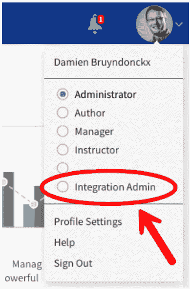
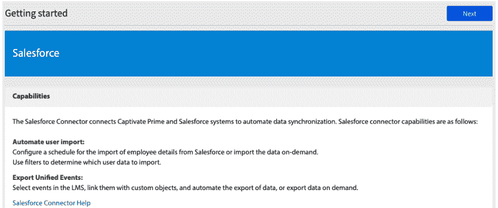
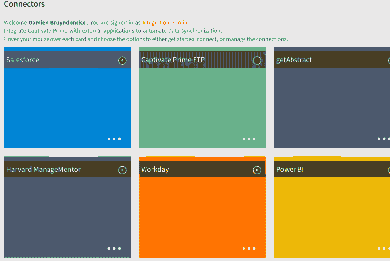
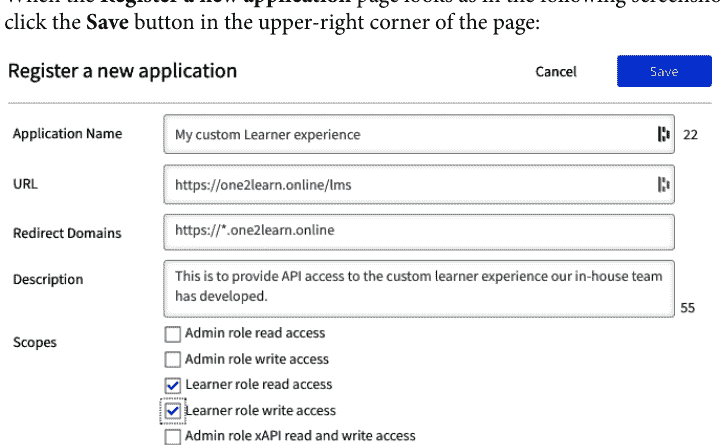
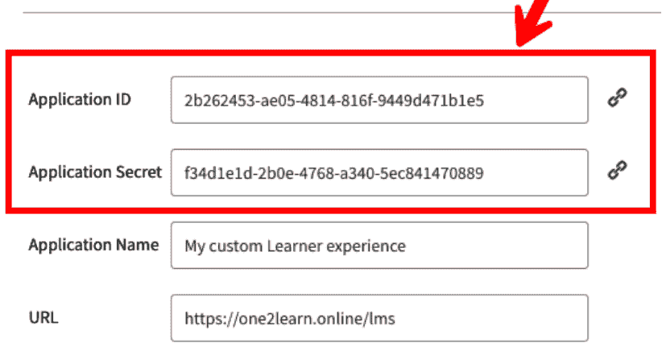
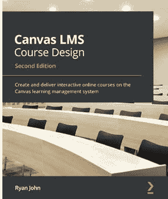

## 16 Exploring the Integration Admin Role

Adobe Captivate Prime 从一开始就被设计为以学习者为中心的企业 LMS。使用 Adobe Captivate Prime 的组织有各种规模的企业、大型企业、跨国公司、国家和国际机构等等。事实证明，这些组织中的大多数已经使用各种其他企业应用程序和系统来运行其日常运营。对于大多数这些组织而言，与现有基础设施无缝集成的能力是决定是否投资于 Adobe Captivate Prime 等解决方案的关键因素。

这就是为什么 Adobe Captivate Prime 包含大量工具和功能，旨在轻松将 Captivate Prime 连接到企业中使用的几乎任何解决方案。这些功能的主要目标是使 Captivate Prime LMS 与这些外部系统之间能够通过交换各种类型的数据进行通信。这可以是用户数据、学习记录、来自外部供应商的课程内容、由您的 Prime 账户生成的各种报告等等。

Adobe 知道将新平台集成到现有环境中通常需要买方投入更多投资，因此 Captivate Prime 附带了一些连接器，旨在帮助客户在很短的时间内以最少的额外成本将 Prime 账户连接到最受欢迎的企业应用程序。

在本章中，您将首先发现 Adobe Captivate Prime 中开箱即用的连接器。这些可用于将 Prime 与 Salesforce、Power BI、Microsoft Active Directory 和 Workday 等企业解决方案连接起来。如果贵组织使用的系统没有可用的连接器，您可以利用 Captivate Prime API 开发自定义解决方案。

Captivate Prime API 也是使 Captivate Prime 成为无头 LMS 的原因。这意味着开发人员可以在仍使用 Adobe Captivate Prime 管理员处理任何后端任务的同时创建完全定制的学习者体验。

最后，我们将简要讨论 Captivate Prime 迁移服务，该服务通过帮助组织将其现有 LMS 中的学习者和培训数据迁移到 Adobe Captivate Prime 来促进 Captivate Prime 在组织中的部署。

配置、监控和保护这些连接器和远程访问是一项专属于 Adobe Captivate Prime 集成管理员角色的任务。因此，本章完全致力于探索集成管理员角色的各个方面。为了实现这一目标，本章包含以下主要部分：
-   Captivate Prime 与其他系统之间的数据交换
-   探索可用的连接器
-   使用 Captivate Prime API 开发应用程序
-   发现迁移流程

得益于这些独特功能，您将能够将 Captivate Prime 无缝融入组织中使用的现有 IT 基础设施中，无论该环境的规模或复杂程度如何。

## Technical requirements

要执行本章中提出的练习和实验，您必须满足以下技术要求：
-   您必须拥有一个正在运行的 Captivate Prime 账户的集成管理员访问权限，该账户可以是试用账户。
-   对编程和应用程序开发有基本了解是有帮助的，但不是必需的。

您现在准备好发现 Adobe Captivate Prime LMS 提供的又一套令人惊叹的功能。

## Data Exchange Between Captivate Prime and Other Systems

本章讨论的所有工具和功能都有一个共同目标：实现 Adobe Captivate Prime 与组织内部部署的其他 IT 解决方案之间的数据交换。本节简要讨论可以从 Adobe Captivate Prime 导出和导入的各种数据类型，并检查此类数据交换有用的一些典型用例。

### Automated user import

如第 5 章《Managing Users》中所述，完全可以在 Captivate Prime 中直接定义用户。话虽如此，几乎每个组织都维护一个用户目录，这些用户可以访问其 IT 基础设施。此类目录负责用户身份验证和授权，这使其成为任何企业网络的关键组成部分：
-   **Authentication** 回答了“你是谁？”这个问题。这就是您在登录网络时使用用户名和密码的原因，但也可能使用其他身份验证方式，例如指纹、面部识别和徽章。
-   **Authorization** 回答了“你可以做什么？”这个问题。仅仅因为系统知道你是谁，并不意味着你有权访问网络的所有区域。一些用户拥有管理员访问权限，可以做几乎任何他们想做的事情，而其他用户仅限于访问某些网络资源。

符合 LDAP 标准的目录解决方案，例如 Microsoft Active Directory、Azure ADFS、OpenLDAP 和 ApacheDS，是任何规模组织中最受欢迎的企业目录解决方案之一。

## LDAP
**LDAP** 代表 **轻量级目录访问协议**。它是最广泛使用的行业标准，用于在计算机网络中访问和维护目录服务。大多数企业目录软件都符合 LDAP 标准。看到 LDAP 实际运行的最简单方法是查看您电子邮件系统中的全局地址簿，它展示了 LDAP 目录的功能视图。

由于大多数组织已在其 IT 基础设施中部署的目录中拥有用户列表，因此在 Adobe Captivate Prime 中再次重新定义这些相同用户意义不大。这就是为什么 Captivate Prime 中有多种方法可以自动导入这些外部目录中定义的用户并保持用户列表最新。

## Automated User Skill export

如 *第4章，创建技能和课程* 中所述，*技能* 的概念是大多数组织整个培训策略的核心。学员参加课程以获得新技能，而组织为其员工提供培训机会，以便在组织内部培养和维护当前且合规的技能组合。

许多组织更进一步，将技能管理纳入人力资源管理的更广泛范围，通过为取得特定技能的个人提供额外福利和职业机会。

这就是为什么 Captivate Prime 允许您自动将用户技能报告导出到您首选的人力资源管理系统的原因。

## Exporting report data from Captivate Prime

数据对于日益增多的企业来说是新的 *埃尔多拉多*。海量数据集不断被收集，并推动着用于为组织提供业务运营的历史、当前和预测视图的数据挖掘和可视化技术。

Adobe Captivate Prime 只是产生此类数据的众多平台之一，尽管它提供广泛的报告功能（如 *第10章，Captivate Prime 中的报告* 中所述），但这些功能仅限于分析您 Prime 账户中产生的数据。

从 Adobe Captivate Prime 导出此数据的能力使其能够与组织内各种系统产生的大得多的数据集集成。组织然后可以使用数据挖掘和可视化技术，将 Prime 生成的学习数据与来自各种来源的其他大量数据进行交叉引用，以便将其整合到整体商业智能工作中。

## Data exchange with virtual classroom solutions

回到 *第4章，创建技能和课程*，您了解到 Captivate Prime 课程可以包含 **同步** 和 **异步** 模块：

- *异步* 模块是上传到 LMS 的培训内容，学员可根据自己的方便单独访问。典型的异步模块包括教学视频、PDF 文档、PowerPoint 演示文稿以及符合 SCORM 标准的交互式学习模块。
- *同步* 模块是现场或虚拟课程，多个参与者在同一物理或虚拟空间中一起学习。传统的讲师主导培训（在教室或讲堂进行）以及使用任何类型的视频会议解决方案提供的虚拟课程是同步模块的典型示例。

如 *第3章，上传学习内容和管理内容库* 中所述，同步模块直接托管在您的 Prime 账户上，使用账户的内容库。但 Captivate Prime 没有内置的虚拟课堂解决方案。

换句话说，在向课程添加同步模块时，您必须依赖外部视频会议系统或虚拟课堂解决方案，例如 Zoom、Microsoft Teams 或 Adobe Connect。

希望 Captivate Prime 能够与这些流行的虚拟课堂解决方案交换数据。例如，出勤数据、交互数据和完成状态可以在大多数这些解决方案与您的 Prime 账户之间自动同步。

## Integration of external content libraries

Captivate Prime 可以通过专用连接器或使用 Captivate Prime API 进行自定义开发，与几乎任何第三方教学内容库交换数据。这使您能够在 Prime 账户中显示这些外部库提供的课程并跟踪学员与此外部内容的交互。

## Connecting to cloud services and FTP accounts

Captivate Prime 可以使用 Box.com（一种流行的基于云的文件共享解决方案）或通用 FTP 连接导入和导出各种数据。这使您能够为 Captivate Prime 与组织中使用的几乎任何企业解决方案之间的数据交换定义自定义工作流程。

> **CSV 和 FTP**
> 
> **CSV** 代表 **逗号分隔值**。CSV 文件是一种分隔文本文件，使用分隔符（通常是逗号、制表符或分号）分隔每个值。CSV 文件格式是交换各种系统之间数据的一种非常流行的通用解决方案。**FTP** 代表 **文件传输协议**。它是一种用于在计算机之间传输文件的标准通信协议。

这样一个工作流程在 *第5章，管理用户* 中有详细讨论，用于使用上传到 FTP 服务器的 CSV 文件自动将用户数据导入 Captivate Prime。

在本节中，您已对 Captivate Prime 与组织中使用的其他系统之间可以交换的主要数据类型有了高层次的概述。从本质上讲，这些数据交换可以归类如下：

- **用户数据**：这允许 Captivate Prime 检索在其他系统中定义的用户。
- **报告数据**：这允许您从 Captivate Prime 导出报告数据，以便使用专用数据挖掘和可视化工具进行进一步分析。
- **学习活动数据**：这允许您使用外部虚拟课堂解决方案和学习内容库，并将完成状态、测验结果和其他数据与 Captivate Prime 同步。

在下一节中，您将了解 Captivate Prime 内置的各种连接器如何帮助您实现这些数据交换。

## Exploring the Available Connectors

现在您对可以与 Adobe Captivate Prime 交换的主要数据类型有了更多的了解，让我们看看如何在您的 Prime 账户中实现它们。这些数据交换可以通过 Adobe Captivate Prime 中开箱即用的专用连接器完成，也可以通过需要一些自定义开发的 Captivate Prime API 完成。

在本节中，您将以集成管理员身份登录到您的 Prime 账户，并探索 Adobe Captivate Prime 中开箱即用的连接器。请使用以下步骤开始探索 Prime 中内置的连接器：

- 1. 以管理员身份登录到您的 Prime 账户（或任何其他分配了集成管理员角色的用户）。
- 2. 单击屏幕右上角的用户图标，以显示分配给当前登录用户的角色列表。
- 3. 单击集成管理员角色，如以下屏幕截图所示：

Figure 16.1 – 点击集成管理员角色

- 4. 页面重新加载后，您应已作为集成管理员连接。

默认情况下，集成管理员体验打开时显示可用连接器列表。每个连接器都有独特的功能集和可配置选项。让我们看看如何发现每个连接器的功能。

- 5. 将鼠标悬停在 Salesforce 连接器上，然后单击屏幕上出现的入门链接。

这将打开一个描述 Salesforce 连接器主要功能的页面，如以下屏幕截图所示：

Figure 16.2 – Salesforce 连接器的入门页面

从这里，您了解到可以使用 Salesforce 连接器进行自动用户导入。换句话说，您 Salesforce 账户中定义的所有用户也可以自动成为您的 Captivate Prime 账户的用户。

您还具有导出统一事件的能力，这意味着您可以配置 Captivate Prime，以便在发生事件时（例如培训注册、培训完成、技能完成和添加新用户）自动将各种数据（例如学习成绩单、用户报告和技能报告）发送到 Salesforce。

有关 Salesforce 连接器的更多信息可在官方 Adobe Captivate Prime 用户指南中找到，网址为 https://helpx.adobe.com/captivate-prime/user-guide.html/captivate-prime/integration-admin/feature-summary/connectors.ug.html。

> **关于 Salesforce**
> **Salesforce** 是一款流行的基于云的 **客户关系管理（CRM）** 服务，由总部位于旧金山的软件公司 Salesforce.com, Inc. 提供。有关 Salesforce 的更多信息可在 Salesforce Wikipedia 页面 https://en.wikipedia.org/wiki/Salesforce 或官方 Salesforce 网站 https://www.salesforce.com/ 上找到。

- 6. 要将您的 Salesforce 账户连接到您的 Captivate Prime 账户，请单击页面右上角的 **下一步** 按钮。

首先，您需要输入您组织的 Salesforce URL，这需要您拥有 Salesforce 订阅。如果您有的话，欢迎进一步尝试此连接器，但为了本练习的目的，我们将返回可用连接器的列表并继续探索。

- 7. 点击位于左侧边栏顶部的 **Back to Connectors** 链接以返回可用连接器的列表，如以下屏幕截图所示：

图 16.3 – 连接器页面是集成管理员体验的主页

- 8. 将鼠标悬停在任何可用连接器上以显示相应的 **Getting Started** 链接，该链接打开一个页面，进一步解释所选连接器的功能。

花必要的时间对其他连接器重复上述步骤，以便更好地了解它们各自的功能。

在本节中，您已查看了随 Adobe Captivate Prime LMS 一起提供的开箱即用连接器。由于这些连接器允许您将 Captivate Prime 连接到其他应用程序，因此为了配置这些连接器，您除了订阅 Captivate Prime 本身外，还必须订阅所选的外部服务。

> **Note**
> 这些连接器由 Adobe Captivate Prime 开发团队开发。目前不支持向列表中添加自定义连接器。

可用的连接器涵盖了世界各地组织使用的许多最受欢迎的企业应用程序和服务。但在不断变化的技术环境中，不可能为每一种可以想象的外部应用程序提供专用连接器。很有可能您组织内使用的应用程序并未被这些连接器所覆盖。在这种情况下，您需要依赖 Captivate Prime API 以及一些自定义开发，将 Captivate Prime 与您组织中使用的解决方案集成起来。这就是我们在下一节中将讨论的内容。

## 使用 Captivate Prime API 开发应用程序

API 代表 **Application Programming Interface**。它是一种接口类型，通常由开发人员用来连接不同的应用程序。通过 Captivate Prime API，您帐户中包含的几乎任何数据以及 Captivate Prime LMS 提供的任何服务都可以以编程方式访问并集成到由您内部开发团队开发的任何类型的自定义应用程序中。

以下是涉及 Adobe Captivate Prime API 的一些最常见用例：

- 一些组织希望利用 Adobe Captivate Prime 的功能，而不使用默认的学习者体验。在这种情况下，他们可以使用自己选择的任何技术开发自己的个性化学习者体验。最常见的是，这种定制的用户体验以网站和/或移动应用程序的形式出现，完全由组织的内部开发人员设计和开发。在幕后，该网站/应用程序使用 Captivate Prime API 访问必要的数据（例如已登录用户的详细信息、可用课程列表和完成状态），并将学习者交互报告回 Captivate Prime。这就是所谓的将 Captivate Prime 用作 *headless* LMS。
- 您可以使用 Captivate Prime API 将 Captivate Prime 与平台中内置连接器未涵盖的企业应用程序集成。
- 您可以使用 Captivate Prime API 构建扩展 Captivate Prime 原生功能的自定义应用程序。

这些只是 Captivate Prime API 有用的众多实例中的几个。

如果这对您来说听起来有点技术性，请记住 Captivate Prime API 是为开发人员准备的。作为 Captivate Prime 管理员或集成管理员，您无需完全了解开发人员在构建这些自定义解决方案时使用的编程语言中如何实现 Captivate Prime API 的细节。

您唯一需要注意的是，Captivate Prime API 使用名为 **OAuth 2.0** 的安全框架来验证和授权外部应用程序。此安全框架要求您为每个需要通过 API 访问您的 Captivate Prime 帐户的外部应用程序生成安全令牌。

> **OAuth**
> 
> **OAuth** 代表 **Open Authorization**。它是一种开放的行业标准，用于授予网站和其他应用程序安全地相互访问。有关 OAuth 标准的更多信息可在官方 OAuth 网站 `https://oauth.net/` 上找到。我强烈建议您观看他们主页上的视频，以便快速但透彻地了解 OAuth 是什么。

为了尝试此工作流程，假设您想将 Captivate Prime 用作 headless LMS，因此您需要开发一个自定义网站/应用程序，为您的用户提供学习者体验。此自定义网站/应用程序由您托管，并通过 API 访问必要的 Captivate Prime 数据。因此，您需要使用以下步骤将此应用程序注册到您的 Prime 帐户并生成必要的安全令牌：

- 1. 以集成管理员身份登录您的 Prime 帐户。
- 2. 从集成管理员主页，单击左侧边栏中位于的 **Applications** 链接。
- 3. 单击页面右上角的 **Register** 按钮以打开 **Register a new application** 页面。
- 4. 在 **Application Name** 字段中输入应用程序名称。这不是技术性的，因此请随意选择您认为合适的任何名称。请注意，此名称之后无法更改。
- 5. 在 **URL** 字段中提供您的自定义应用程序将托管的 URL。
  为本练习的目的，只需输入您网站的 URL 或任何其他有效 URL。
- 6. 在 **Redirect Domains** 字段中输入 `https://*.<the_address_of_your_website>`。

这些是在用户通过 OAuth 服务器进行身份验证后安全重定向用户的域。请注意，您可以在此字段中添加多个重定向域。

- 7. 作为最佳实践，花必要的时间提供您正在注册的应用程序的简要描述。
- 8. 在页面的 Scopes 部分中，选择您的应用程序所需的复选框。

在此示例中，您正在构建自定义学习者体验，但您仍将使用原生的 Captivate Prime 管理员来构建课程并管理您的 LMS。因此，您只需要选择学习者角色读取访问权限和学习者角色写入访问权限。

使用此配置，您的自定义应用程序将被授权读取和写入与学习者角色相关的任何内容，但您将无法使用它远程管理您的 Captivate Prime 帐户。

- 9. 如果您希望此应用程序对您的 Prime 帐户的其他管理员可见，请在 For this account only? 字段中选择 No 单选按钮；否则，保留为 Yes。
- 10. 当 Register a new application 页面如下图所示时，单击页面右上角的 Save 按钮：

图 16.4 – 注册新应用程序页面

- 11. 一旦您单击 **Save** 按钮，页面将刷新并显示应用程序 ID 和应用程序密钥。这些是您的开发人员需要在发送到 Captivate Prime API 的每个请求中包含的安全令牌。

### 我的自定义学习者体验

图 16.5 – 点击保存时将生成应用程序 ID 和应用程序密钥

- 12. 单击左侧边栏顶部位于的 **Back to Applications** 链接以返回集成管理员体验的 **Applications** 页面。

返回 **Applications** 页面后，确认您新注册的应用程序出现在页面上。如有需要，您可以单击此应用程序编辑其详细信息或完全删除它。

> **Internal and external applications**
> 
> 您在本节中注册的应用程序被视为 *internal* 应用程序。外部应用程序由 Captivate Prime 提供或由 Prime 合作伙伴开发。要注册 Prime 合作伙伴提供的应用程序，请使用 **Applications** 页面右上角的 **Approve** 按钮并输入该合作伙伴提供的应用程序 ID。要使用 Captivate Prime 提供的任何应用程序，请使用 **Applications** 页面的 **Featured Apps** 选项卡。

当谈到 Captivate Prime API 时，作为集成管理员的你的角色基本上到此为止。现在就看你的开发人员来进一步推进并将你的自定义应用程序变为现实了。为了帮助他们，你可以通过点击左侧边栏中的 Developer Resources 链接找到所有必要的开发者资源。在该页面上，你可以找到 Captivate Prime API 参考文档、应用程序开发者手册，以及用于测试和开发的临时访问令牌生成工具。如果你从事开发工作，这些资源将为你提供立即开始为 Captivate Prime 开发自定义应用程序所需的所有信息！

在本节中，你学习了如何注册应用程序，以便开发人员能够使用 Captivate Prime API 以编程方式访问你的 Prime 账户。

在下一节中，你将简要讨论 Captivate Prime 迁移流程，该流程有助于从你当前的企业 LMS 过渡到 Captivate Prime。

## 发现迁移流程

如果你的组织已有 LMS，迁移流程将帮助你将当前 LMS 中存在的培训数据和内容迁移到 Captivate Prime。

要启动迁移项目，你必须联系 Captivate Prime 支持团队，他们将激活你账户中的该功能。

基本上，迁移流程使用以下主要步骤：

- 首先，你需要将当前 LMS 中的数据导出到 .csv 文件。
- 其次，你必须将从当前 LMS 导出的信息与 Adobe Captivate Prime 所期望的信息进行匹配。Adobe Captivate Prime 支持团队将通过提供必要的技术信息来帮助你，以便准备数据使其能够完美导入 Captivate Prime。
- 最后，你必须使用集成管理员体验中提供的迁移向导将数据导入 Adobe Captivate Prime。这必须按特定顺序进行，并且在整个过程中必须执行数据完整性检查。再次强调，Captivate Prime 支持团队将帮助你完成此流程并排查可能出现的问题。

要了解有关迁移流程的更多信息，请参阅官方 Adobe Captivate Prime 用户指南中的迁移手册，网址为 https://helpx.adobe.com/captivate-prime/user-guide.html/captivate-prime/integration-admin/feature-summary/migration-manual.ug.html。

## 摘要

在本章中，你了解了集成管理员可用的工具和功能，用于将你的 Captivate Prime 账户连接到组织中使用的其他企业工具和服务。所有这些工具和功能都指向一个单一目标：实现 Adobe Captivate Prime 与其余 IT 基础设施之间的数据交换。

为此，Captivate Prime 附带了一些连接器，你可以使用它们将 Prime 账户与世界各地组织使用的一些最受欢迎的应用程序集成。如果组织内使用的解决方案没有内置连接器，或者项目需要额外的自定义开发，你可以使用 Captivate Prime API 以编程方式访问 Prime 账户的几乎每个方面。

在这种情况下，请记住 Captivate Prime 使用 OAuth 2.0 安全框架来验证和授权通过 API 请求访问你的 Prime 账户的外部应用程序。生成对 API 的安全请求是开发人员的责任。作为集成管理员，你唯一的责任是将这些应用程序注册到你的 Captivate Prime 账户，并将必要的 security tokens 告知开发团队。

最后，你发现了 Adobe Captivate Prime 中包含的迁移向导。该功能旨在帮助组织从当前 LMS 解决方案过渡到 Captivate Prime。请记住，迁移助手默认未启用。你需要联系 Adobe Captivate Prime 支持团队以激活它并协助你的迁移项目。

随着本最终章节的结束，我们探索 Adobe Captivate Prime LMS 的旅程也告一段落。我希望你喜欢这次旅程，并找到了在组织内实施 Captivate Prime LMS 所需的信息。

就我个人而言，我要感谢你阅读我的书，并祝你一切顺利，在使用 Adobe Captivate Prime LMS 时玩得开心。

Packt.com

订阅我们的在线数字图书馆，即可完全访问超过 7,000 本书籍和视频，以及行业领先的工具，帮助你规划个人发展并提升职业生涯。如需更多信息，请访问我们的网站。

## 为什么订阅？

- 花更少时间学习，花更多时间编码，使用来自 4,000 多名行业专业人士的实用电子书和视频
- 使用专为你打造的技能计划提升学习效果
- 每月获得一本免费电子书或视频
- 完全可搜索，便于快速访问重要信息
- 复制、粘贴、打印和书签内容

你知道 Packt 为每本出版的书籍都提供电子书版本，文件格式包括 PDF 和 ePub 吗？你可以在 packt.com 升级到电子书版本，作为印刷书籍客户，你有权享受电子书的折扣。欲了解更多详情，请联系我们 customercare@packtpub.com。

在 www.packt.com，你还可以阅读大量免费技术文章，订阅多种免费新闻通讯，并获得 Packt 书籍和电子书的独家折扣和优惠。

## 你可能感兴趣的其他书籍

如果你喜欢这本书，你可能对 Packt 的以下其他书籍感兴趣：

### Canvas LMS Course Design - Second Edition

Ryan John

ISBN: 978-1-80056-851-8

- 了解在线学习作为学生成长的有力且独特的工具
- 在 Canvas 中创建、访问和个性化你的用户账户和个人资料设置
- 为学生在你的课程中参与而生成、上传和导入课程内容
- 设计并排序课程内容，以清晰简洁地呈现信息和活动
- 发现设计课程大纲和创建活动的专家技巧
- 探索满足你教育需求的 Canvas 功能，例如在线评估和内容交付

### Teaching with Google Classroom - Second Edition

Michael Zhang

ISBN: 978-1-80056-592-0

- 创建一个课堂并为每个班级添加自定义信息
- 向学生发送公告和问题
- 通过 Google Classroom 创建、分配、收集和批改作业
- 将学生账户链接到监护人电子邮件以获取每日或每周更新
- 使用 Google 表单创建自动评分并将结果返回给学生的测验
- 重用帖子、归档课堂并在 Google Classroom 中执行其他管理任务
- 与学生主持在线会议并设置 Google Classroom 的移动应用

## Packt 正在寻找像你这样的作者

如果你有兴趣成为 Packt 的作者，请访问 authors.packtpub.com 并立即申请。我们已与数千名开发人员和技术专业人士合作，帮助他们与全球技术社区分享见解。你可以提交通用申请、申请我们正在招聘作者的特定热门主题，或提交你自己的想法。

Hi!

我是 Damien Bruyndonckx，《Enterprise LMS with Adobe Captivate Prime》的作者。
我真的希望你喜欢阅读这本书，并发现它有助于提高你在组织中使用 Adobe Captivate Prime 实施学习策略时的生产力和效率。

如果你能在 Amazon 上留下关于《Enterprise LMS with Adobe Captivate Prime》的评论，分享你的想法，这将对我（和其他潜在读者！）非常有帮助。

你的评论将帮助我了解这本书做得好的地方，以及未来版本可以改进的地方，所以真的非常感谢。

祝好，

Damien Bruyndonckx

