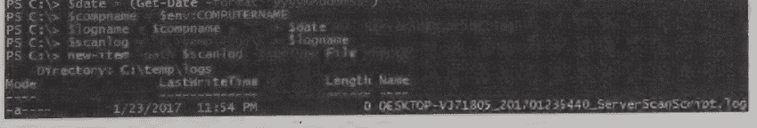
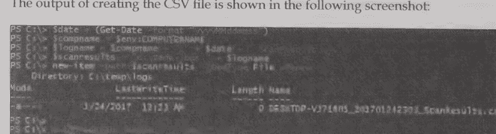
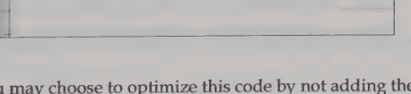
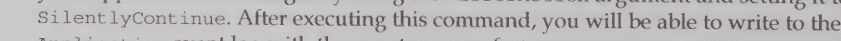
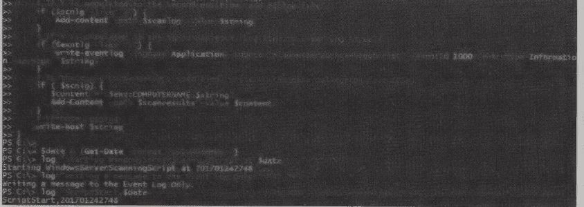
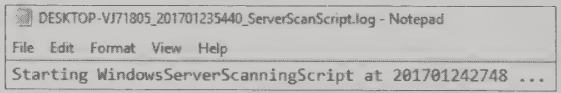
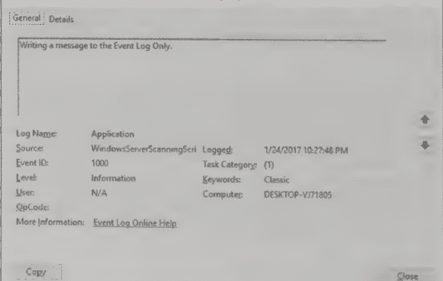
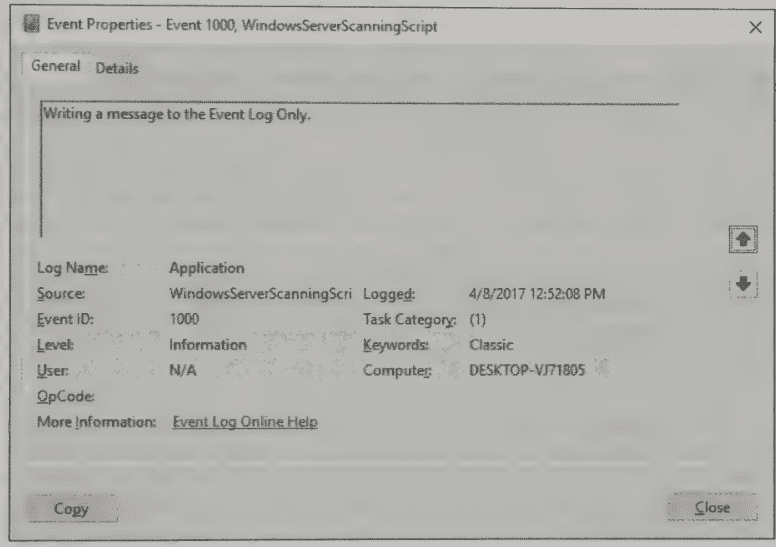

# 2 脚本结构、注释块和脚本日志记录

## 脚本结构、注释块和脚本日志记录

Windows 服务器扫描脚本需要三个核心组件才能使其适用于企业环境。这些组件包括开发严格的脚本结构、创建注释块以及开发灵活的日志解决方案。严格的脚本结构确保所有脚本都按相同顺序创建。这意味着代码的每个部分在所有脚本中都定义在相同的位置。统一的结构有助于他人快速理解你的代码，并使他们能够遵循标准化的格式进行更改。

你还将学习如何在脚本开头创建注释块。注释块确保你完整记录脚本的目的、要求、错误修复和更改历史。它还提供了有关如何利用命令行参数执行脚本的详细信息。

本章讨论的最后一个核心组件是日志机制。日志机制提供了在脚本执行期间记录正在执行的操作信息的可能性。这些信息通常写入日志文件、事件日志和数据收集文件。

本章中，你将：

- 学习 PowerShell 脚本的整体结构
- 创建注释块以描述脚本的功能
- 为你的脚本开发日志平台


> 本章中的示例相互构建。你需要按顺序执行脚本，才能使本章中的最终脚本正常工作。

## 整体脚本结构

在创建脚本时，你应遵循严格的脚本结构。脚本的结构决定了执行的顺序以及处理方式。以下图表显示了组织脚本的正确方法：

| 代码 | 描述 |
|------|-------------|
| `<# Comment Block #>` | ← 头部 |
| `Param($Input1,$Input2)` | ← 输入参数 |
| `$CPU = $env:computername` | ← 全局参数 |
| `Function doSomething { write-host "$cpu Done" }` | ← 函数 |
| `doSomething` | ← 脚本执行 |
| `write-host "Script Complete"` | ← 脚本结束 |

建议你按如下方式结构化脚本：

- 1. **声明注释块：** 为开始脚本编写过程，声明一个注释块并包含与脚本相关的所有内容。这可能包括描述、修订信息、作者、编辑和附加说明。
- 2. **声明输入参数：** 在头部之后，如果脚本需要，声明你的输入参数。输入参数必须直接位于注释块之后。输入参数有助于开发人员识别输入到脚本中的内容，以及正确执行脚本所需的字段。
- 3. **声明全局变量：** 你应在输入参数之后声明全局变量。由于在函数中声明的变量仅在函数范围内有效，你需要在全局使用的变量应在此定义。
- 4. **按顺序声明函数：** 结构的下一部分是声明你的函数。如果有相互调用的函数，你希望先在脚本中声明所需的函数。这可确保你的脚本不会因函数在执行前未声明而出错。
- 5. **开始脚本的执行：** 在声明函数之后，你可以开始脚本的执行。此部分将调用由全局变量和参数使用的其他函数，以完成脚本的任务。
- 6. **声明脚本的结束：** 执行后，建议你创建一个指示器，指定脚本已成功运行。无论是将退出代码记录到文件还是在末尾暂停脚本，都很重要，你需要创建逻辑来声明脚本的正确或不正确执行。

## 注释块

第一个建议是为 PowerShell 脚本本身的详细跟踪信息创建注释块。注释块可以跟踪有关脚本创建、作者、更改以及其他有用信息，以便你快速确定脚本正在做什么。PowerShell 具有内置的注释块支持，可与 `get-help cmdlet` 集成。

所需组件包括以下内容：

- 1. **注释块位置：** 注释块必须是脚本顶部定义的第一个项目。如果使用参数块，你在注释块之后指定参数块。
- 2. **开始注释块：** 为了与帮助系统集成，你需要指定注释块的开始。要开始注释块，你输入 `<#`。
- 3. **.SYNOPSIS：** 要为脚本创建概要，在一行上键入 `.SYNOPSIS`，然后在下一行键入脚本创建原因的一行描述。
- 4. **.DESCRIPTION：** 要为脚本创建完整描述，在一行上键入 `.DESCRIPTION`，然后在下一行键入脚本功能的描述，以便脚本的任何编辑者都知道脚本的基本功能。如果是复杂的脚本或调用其他脚本的脚本，请描述其整体流程。你可能还想包含作者信息，其中包含作者姓名、作者职位、作者公司、联系信息、初始发布编号和初始发布日期。
- 5. **.PARAMETER：** 为了在运行脚本时提供可用的参数信息，你可以键入 `.PARAMETER`，并指定参数名称。在下一行，键入该参数的描述。如果有多个参数，你可以定义多个引用参数名称的 `.PARAMETER` 语句。


- 6. `.EXAMPLE`：要为脚本提供使用示例，可以键入 `.EXAMPLE` 并提供从命令行运行脚本的示例。如果有多个示例，可以定义多个 `.EXAMPLE` 语句。

- 7. `.NOTES`：要提供执行注意事项，可以键入 `.NOTES`，并在下一行键入执行脚本的使用说明。

- 8. `.LINK`：如果有其他想要链接的帮助主题，可以键入 `.LINK`，并在下一行提供另一个帮助主题的 URL。

- 9. `Ending comment block`：为了与帮助系统集成，需要指定注释块的结束。要结束注释块，需要键入 `#>`.

以下屏幕截图显示了一个可与帮助系统集成的正确注释块：

```
<#
.SYNOPSIS
This is a server discovery script which will scan different server components to determine
the current configuration.
.DESCRIPTION
This script will scan processes, Windows services, scheduled tasks, server features, disk information,
registry, and files for pertinent server information.
Author: Brenton J.W. Blawat / Packt Publishing / Author / email@email.com
Revision: 2.1a - Initial Release of Script / 6-22-2018
Revision: 2.5 - Paul Brandes / Company XYZ / Consultant / email@company.com / 11-21-2018
R2.5 details: Updated script to support systems still running PowerShell 2.0.
.PARAMETER SDD
This script requires a server side decryptor as a parameter to the script.
.EXAMPLE
powershellscript.ps1 /SDD "ServerSideDecryptor"
.NOTES
You must have administrative rights to the server you are scanning. Certain functions will not work properly
without running the script as system or administrator.
#>
```

这正确展示了可通过 PowerShell 帮助系统使用的注释块的语法。你首先通过 <# 定义注释块。然后创建 .SYNOPSIS 部分，提供脚本的概要。接着创建 .DESCRIPTION 部分并提供脚本的详细描述。你还提供有关作者、修订版以及脚本编辑修订的详细信息。在该部分之后，你定义 .PARAMETER PATH 部分，提供脚本中 .PARAMETER PATH 的详细信息。接下来，创建 .EXAMPLE 部分以提供使用示例，并创建 .NOTES 部分以提供有关所需执行环境的信息。然后通过发出 #> 关闭注释块。

## 脚本日志记录

在创建企业脚本模板时，你需要加入日志记录机制。日志记录允许你捕获脚本输出，包括信息、警告和错误消息。在典型的日志记录场景中，你需要将脚本操作记录到事件日志、日志文件或数据收集文件（如逗号分隔值（CSV）文件）中。虽然 PowerShell 具有可通过 start-transcript 和 stop-transcript cmdlet 调用的转录功能，但它仅允许将输出记录到单个日志文件。这无法提供写入事件日志或数据收集文件的功能。

一种流行的日志记录机制是创建自己的 PowerShell 日志函数。这使你能够向日志函数传入参数，指示脚本写入事件日志、日志文件，或将数据追加到数据收集文件。它还可以将操作写入 PowerShell 窗口以查看进度。这避免了每次想要在事件日志、日志文件或数据收集文件中显示内容时都要编写多行代码。你只需调用日志函数并传入所需参数，它就会写入你指定的位置。

## 创建日志文件

首先，你需要创建用于日志记录的文件。企业通常会在日志文件中同时包含服务器名称和日期时间戳。这使得在大型环境中可以清晰识别日志文件和执行时间。

要创建带时间戳的日志文件，可以执行以下操作：

```
$date = (Get-Date -format "yyyyMMddmmss")
$compname = $env:COMPUTERNAME
$logname = $compname + "_" + $date + "_ServerScanScript.log"
$scanlog = "c:\temp\logs\" + $logname
new-item -path $scanlog -ItemType File -Force
```

创建日志文件的输出显示在以下屏幕截图中：



前面的脚本展示了如何为脚本日志记录创建 .log 文件。首先，使用 -format 参数设置为 "yyyyMMddmmss" 的 Get-Date cmdlet 并将其放入 $date 变量中。$date 变量随后将按顺序包含脚本执行时的四位年份、两位月份、两位日期、两位分钟和两位秒。你然后通过利用 $env:COMPUTERNAME 环境变量并将值放入 $compname 变量来获取计算机名称。然后你将 $compname 变量与加号、用于分隔的下划线与加号、日期时间戳与加号以及日志文件名 "ServerScanScript.log" 组合起来，并存储在 $logname 变量中。然后你通过指定 "c:\temp\logs\" 与加号和 $logname 目录来创建完整日志路径，并将其存储在 $scanlog 变量中。最后，你利用 new-item cmdlet，-path 参数设置为 $scanlog，-ItemType 设置为 File，-Force 参数。执行后，你将在 c:\temp\logs\ 中拥有一个日志文件，文件名格式为 computername_datetimestamp_ServerScanScript.log。

要创建格式为 CSV 文件的带时间戳数据收集文件，可以执行以下操作：

```
$date = (Get-Date -format "yyyyMMddmmss")
$compname = $env:COMPUTERNAME
$logname = $compname + "_" + $date + "_ScanResults.csv"
$scanresults = "c:\temp\logs\" + $logname
new-item -path $scanresults -ItemType File -Force
```

```
# Add Content Headers to the CSV File
$csvheader = "ServerName, Classification, Other Data"
Add-Content -path $scanresults -Value $csvheader
```

创建 CSV 文件的输出显示在以下屏幕截图中：



前面的脚本展示了如何为脚本日志记录创建格式为 .csv 文件的数据收集文件。首先，使用 -format 参数设置为 "yyyyMMddmmss" 的 Get-Date cmdlet 并将其放入 $date 变量中。$date 变量随后将按顺序包含脚本执行时的四位年份、两位月份、两位日期、两位分钟和两位秒。你然后通过利用 $env:COMPUTERNAME 环境变量并将值放入 $compname 变量来获取计算机名称。然后你将 $compname 变量与加号、用于分隔的下划线与加号、日期时间戳与加号以及日志文件名 _ScanResults.csv 组合起来，并存储在 $logname 变量中。然后你通过指定 "c:\temp\logs\" 与加号和 $logname 目录来创建完整日志路径，并将其存储在 $scanresults 变量中。然后你将利用 new-item cmdlet，-path 参数设置为 $scanresults，-ItemType 设置为 File，-Force 参数。执行后，你将在 c:\temp\logs\ 中拥有一个 .csv 文件，文件名格式为 computername_datetimestamp_ScanResults.csv。

最后，要向 CSV 文件添加标题，你将标题名称以 "ServerName, Classification, Other Data" 的形式分隔并存储在 $csvheader 变量中。然后你通过利用 Add-content cmdlet，-path 参数设置为 $scanresults，-value 参数设置为 $csvheader，将标题添加到 CSV 文件中。computername_datetimestamp_ScanResults.csv 文件将具有 ServerName、Classification 和 Other Data 的标题。

在 Excel 中打开 CSV 文件时，标题显示如下：



> 你可以选择通过不使用 $compname 变量添加计算机名称来优化此代码。或者，你也可以在设置 $logname 变量时直接调用 $env:COMPUTERNAME 变量。该脚本编写的目的是展示日志文件字符串的构建过程，其中包含计算机名称、日期时间戳和脚本文件名。


## 创建 Windows 事件日志源

如果您想要写入 Windows 事件日志，其先决条件之一是将脚本作为事件源注册到 Windows 事件日志系统。这是使用 New-EventLog cmdlet 完成的。您首先指定 New-EventLog cmdlet，然后是 -LogName 参数，后跟事件日志名称。您可以选择自己的事件日志，也可以指定内置事件日志之一，例如 Application 或 System。最后，您使用正在执行的脚本名称指定 -Source 参数。

事件日志源只能注册一次，这可能导致在同一系统上多次执行脚本时出现错误。您可以通过指定带有 -LogName 参数的 get-eventlog cmdlet 并将结果通过管道传递到 Select-object Source -Unique 来检索事件日志源。这并不理想，因为它要求系统查询所有日志事件以确定源是否已注册。由于 Windows 系统具有大量事件日志和日志事件，因此该查询非常占用 CPU 和内存。

避免重复事件日志源错误消息的最快方法是抑制错误消息本身。这是通过使用 New-EventLog cmdlet 将 -ErrorAction 参数设置为 SilentlyContinue 来实现的。指定 SilentlyContinue 的 -ErrorAction 参数将捕获错误并静默继续执行脚本，从而抑制错误消息。

要注册新的事件日志源并抑制错误消息，您可以执行以下操作：

```
New-EventLog -LogName Application -Source "WindowsServerScanningScript" -ErrorAction SilentlyContinue
```

PowerShell 窗口的输出将如下所示：



前面的脚本演示了如何使用 Windows 事件日志系统注册新的事件日志源。您首先使用 -LogName 参数设置为 Application 的 New-EventLog cmdlet。然后您指定 -Source 参数并将其设置为脚本名称 “WindowsServerScanningScript”。最后，您通过使用 -ErrorAction 参数并将其设置为 SilentlyContinue 来抑制错误消息。执行此命令后，您将能够使用事件源 WindowsServerScanningScript 写入 Application 事件日志。


> 当您创建事件日志源时，它提供了使用该源记录消息的能力。您需要向该事件日志源写入内容，才能使其出现在 Application 事件日志中。


> Windows 事件日志 cmdlet 要求 PowerShell 窗口以管理员身份运行。在测试此代码时，您需要右键单击 PowerShell 图标并选择以管理员身份运行。如果您远程执行此代码，可能需要确保您使用的用户凭据对系统具有管理员权限。

## 创建日志函数

在创建日志文件并注册事件日志源之后，您现在可以创建自定义日志函数。日志函数具有灵活性，因为它可以接受三种类型的数据写入的参数。这些包括事件日志、日志文件和数据收集 .csv 文件。

日志函数使用 function log { 声明。然后您需要利用参数块将参数接受到函数中。参数块使用 param() 声明，并包括变量 $string、$scnlg 和 $evntlg。$string 将是信息、警告、错误或数据收集内容的字符串值。$scnlg 变量决定内容是否写入扫描日志文件。$evntlg 变量决定内容是否写入事件日志。

要创建日志函数的开头，请输入以下内容：

```
function log { param($string, $scnlg, $evntlg)
```

使用日志函数的参数变体，您可以将日志信息写入不同的位置。您可以设置以下内容：

- 如果将 $scnlg 设置为 Y 且未为 $evntlg 指定值，脚本将仅写入扫描日志文件。
- 如果将 $scnlg 设置为 N 且将 $evntlg 设置为 Y，脚本将仅写入事件日志。
- 如果将 $scnlg 设置为 Y 且将 $evntlg 设置为 Y，脚本将同时写入扫描日志文件和事件日志。
- 如果除 $string 之外的参数未传递到函数中，它将把内容写入数据收集 CSV 文件。
- 在所有情况下，日志函数都将使用 write-host cmdlet 并使用 $string 变量的内容。这将详细打印所有日志变体。

要创建完整的日志函数，您可以执行以下操作：

```
function log { param($string, $scnlg, $evntlg)
    # If Y is populated in the second position, add to log file.
    if ($scnlg -like "y*") {
        Add-content -path $scanlog -Value $string
    }
    # If Y is populated in the third position, Log Item to Event Log As well
    if ($evntlg -like "y*") {
        write-eventlog -logname Application -source "WindowsServerScanningScript" -eventID 1000 -entrytype Information -message "$string"
    }
    # If there are no parameters specified, write to the data collection file (CSV)
    if (! $scnlg) {
        $content = "$env:COMPUTERNAME,$string"
        Add-Content -path $scanresults -Value $content
    }
    # Verbose Logging
    write-host $string
}
```

```
$date = Get-Date
log "Starting WindowsServerScanningScript at $date ..." "y" "y"
log "Writing a message to the Event Log Only." "N" "y"
log "ScriptStart,$date"
```

此脚本的输出将如下所示的屏幕截图：



此示例演示如何创建日志函数并将信息记录到日志文件、事件日志和数据收集 CSV 文件。首先，您先声明 function log {。然后您使用 param($string, $scnlg, $evntlg) 代码段将三个参数接受到函数中。然后您创建一个 IF 语句来确定 $scnlg 内容是否 -like “Y”。如果返回 true，则执行 Add-content cmdlet，将 -path 参数设置为 $scanlog，将 -Value 参数设置为 $string。字符串的内容现在将在 $scanlog 文件中。

第二个 IF 语句评估 $evntlg 内容是否 -like “Y”。如果返回 True，则使用 -logname 参数设置为 Application 的 write-eventlog cmdlet。您还包括 -source 参数设置为 “WindowsServerScanningScript”、-eventID 参数设置为事件 ID 号 1000、-entrytype 参数设置为 Information 以及 -message 属性设置为 $string。字符串的内容现在将在 Application 事件日志中，源为 WindowsServerScanningScript，事件 ID 为 1000。

> 某些企业环境具有可以解析事件日志并根据事件 ID 触发操作的监控解决方案。作为传递 “Y” 的替代方案，您可以传递事件 ID，从而自动使用这些监控系统触发警报。您需要将 if 语句更新为 if ($evntlg) {}，如果变量中包含数据则返回 True。然后您可以在脚本中将 -eventID 参数设置为 $evntlg，从而能够根据需要更改事件 ID。

第三个 if 语句确定 $scnlg 变量中是否有任何数据。这意味着默认操作将写入数据收集 CSV 文件。您使用在 $scnlg 变量前加上感叹号的 if 语句。这指定如果不是 True，或者该变量中未传递任何数据，则继续执行下一步。然后您指定环境变量 $env:COMPUTERNAME，后跟逗号，后跟 $string 变量，并将值设置为 $content 变量。然后您通过使用 -path 参数设置为 $scanresults 且 -value 参数设置为 $content 的 Add-content cmdlet 将 $content 变量写入 CSV 文件。

函数的最后一步是通过使用 write-host cmdlet 并将 $string 作为内容来显示内容。

要测试脚本，您然后使用 Get-Date cmdlet 获取日期时间戳并将值设置为 $date 变量。然后您使用第一个参数为 “Starting WindowsServerScanningScript at $date”、第二个参数为 “Y”、第三个参数为 “Y” 调用 log 函数。这会将第一个参数中的内容同时写入日志文件和事件日志。

以下显示了所创建日志文件的内容：



以下显示了脚本生成的事件日志的内容：




然后你再次调用 log 函数，第一个参数为 "Writing A Message to the Event Log Only."，第二个参数为 "N"，第三个参数设为 "Y"。这会将信息写入应用程序日志，来源为 WindowsServerScanningScript，事件 ID 为 1000。

以下显示了由脚本生成的事件日志的内容：



最后，你调用 log 函数并将第一个参数设为 "Script, $date"。此函数未指定其他参数。脚本随后将按照以下语法写入数据收集 CSV 文件—— "computer name, ScriptStart, DateTimestamp"。

以下显示了所创建的数据收集 CSV 文件的内容：

| A | B | C | D |
|---|---|---|---|
| 服务器名称 | 分类 | 其他数据 |  |
| DESKTOP-VJ71805 | ScriptStart | 201701242748 |  |
|  |  |  |  |

## 摘要

在本章中，你成功学习了脚本模板的三个核心组件。第一个组件是定义脚本结构。你学习了各个脚本组件所需的所有位置。然后你学习了如何编写注释块以及在注释块本身中包含的正确文档。最后，你学习了如何为脚本创建日志机制。你首先学习了如何创建带时间戳的日志文件，然后学习了如何创建数据收集 CSV 文件，以及如何创建新的事件日志源。最后，你将所有组件放在一起创建了一个名为 log 的函数。

在下一章中，你将探索脚本的应答文件和排除列表。
