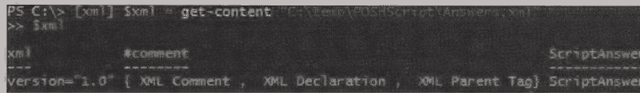
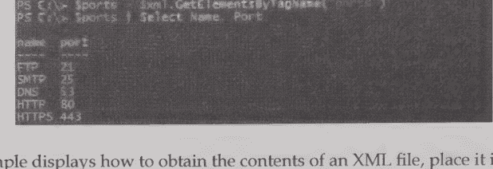
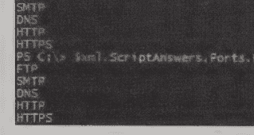
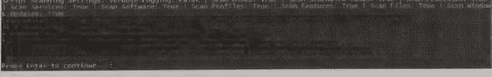

# 3 使用应答文件
## 使用应答文件

随着你继续开发 Windows 服务器扫描脚本，你可能会遇到需要修改脚本以在不同环境中运行的情况。虽然在一两行脚本中修改代码的风险相对较低，但大型企业脚本需要更好的结构和流程。一般的经验法则是，如果你需要为不同场景调整脚本中的值，就应该将这些值放入应答文件中。应答文件的内容在运行时读取，并将这些值用作脚本的输入。这为你的脚本提供了另一层稳定性，因为你不会通过修改脚本本身的代码而增加风险。

应答文件有许多不同的格式。.NET 程序的行业标准是基于 XML 的应答文件。这是因为 XML 标准中内置了文件格式完整性。如果应答文件格式不正确，应用程序将无法使用它。PowerShell 具有内置的 XML 支持，可以创建、读取、修改和利用 XML 文件，这使其非常适合脚本应答文件。

在本章中，你将：

- 探索可以利用应答文件的不同方式
- 学习基于 XML 的文件的结构
- 读取基于 XML 的应答文件中各个标签、属性和属性值
- 创建一个函数从 XML 文件中提取不同的元素并将它们存储在变量中


> 本章中的示例相互构建。你需要按顺序执行脚本，才能使本章中的示例正常工作。

## 应答文件

在你开发企业脚本模板时，你会发现可能需要为在不同环境中运行而修改代码的少量部分。例如，如果你在多个不信任的 Active Directory 森林中使用相同的脚本，你很可能需要在脚本中存储有关这些相应森林的信息。这会造成复杂性，因为你必须为多个森林管理多个脚本。不仅效率低下，而且更改已验证的脚本会引入大量脚本错误的风险。

减少这种风险的常见方法是利用应答文件。应答文件是包含将在脚本中使用的信息的单独文件。这使你能够修改脚本的参数，而无需触及脚本本身的代码。

包含在应答文件中的最常见项目包括：

- **脚本日志位置**：这定义了你希望存储所有日志文件的位置。这通常是本地系统或 UNC 路径。
- **数据源**：这定义了连接到不同数据源类型的连接字符串信息。这可能包括服务器信息、用户名、密码、端口号和驱动程序信息。
- **数据输出信息**：这定义了你希望存储脚本输出的位置。这可能是电子邮件服务器信息、数据库信息或存储文件的 UNC 路径。
- **加密数据**：任何加密的用户名、密码、服务器名称、安全密钥和其他安全数据都可以存储在应答文件中。由于你可以在脚本中执行后轻松删除应答文件，因此这是一种常见的数据类型存储位置。
- **包含/排除列表**：包含和排除列表是你希望在脚本中使用的列表数据。通常，这些列表存储为数组或正则表达式。
- **启用/禁用脚本功能**：管理员快速打开和关闭脚本部分的常见需求。与其注释掉代码，你可以利用应答文件快速启用和禁用代码块。

> 强烈建议不要在脚本或应答文件中使用明文用户名和密码。由于 PowerShell 脚本和应答文件以人类可读的明文编写，因此建议仅利用安全的方法来存储凭据。这将在后面的章节中讨论。

## XML 应答文件

脚本语言使用的应答文件格式有很多种。像 .NET 这样的语言利用 .config 格式的文件进行应用程序配置，而像 Java 这样的语言利用 .properties 格式的文件进行配置数据。虽然你可以使用逗号分隔值（CSV）文件作为 PowerShell 的应答文件，但强烈建议使用可扩展标记语言（XML）格式的文件。

XML 由万维网联盟（W3C）创建，用于标准化文档的编码，使其既可供人类阅读又可供计算机系统使用。XML 格式与超文本标记语言（HTML）非常相似。如果你了解 HTML 的基础知识，应该能很快掌握 XML。

XML 文件语法的四个主要组件是：

- **XML 声明：** XML 声明是 XML 文档本身开头的一个强制性行。声明告诉 XML 解析器使用哪个 XML 规范版本以及使用哪个编码格式（可选）。
- **XML 注释：** 注释是数据，与 PowerShell 中的注释一样。它们为开发人员提供有关 XML 文件中各个部分或单个项目的的信息。
- **XML 标签：** 当你在 XML 文件中构建多个标签时，你需要遵循 XML W3C 文档对象模型（DOM）树结构。简单来说，XML DOM 树结构由父级、子级和同级组成。父级是分组标签，用于分组子标签。如果父标签中有多个子标签，则各个子标签是同级。
- **XML 属性和元素：** 定义单个 XML 标签数据的有两种方法。第一种方法是利用属性和属性值。属性是描述与 XML 标签相关的项目的唯一名称。属性值是你希望为该属性存储的任何数据。第二种方法是利用元素或内部 XML 数据。此数据也与标签相关联。当 XML 解析器在脚本中调用标签时，元素将被返回以供使用。


一个 XML 答案文件的示例如下所示：

```
```xml
<?xml version="1.0"?>
<!-- XML Comment -->
<!-- XML Declaration -->

<!-- XML Parent Tag -->
<ScriptAnswers>

    <!-- XML Child Tag -->
    <ports port="21" name="FTP"></ports>

    <!-- XML Sibling Tags -->
    <ports port="25" name="SMTP"></ports>
    <ports port="53" name="DNS"></ports>
    <ports port="80" name="HTTP"></ports>
    <ports port="443" name="HTTPS"></ports>

<!-- XML Parent Closing Tag -->
</ScriptAnswers>
```
```

前面的图形显示了一个格式正确的 XML 答案文件。文件通过指定 XML 声明来打开。这必须是 XML 文件中的第一行，否则你会收到语法错误。它以 <?xml 开头，并且将属性 version 设置为属性值 1.0。声明随后以 ?> 关闭。脚本随后展示了 XML 注释的使用。注释的语法以 <!-- 开头，后跟注释，并以 --> 关闭。

答案文件继续声明父标签 <ScriptAnswers>。在父标签之后，声明了子标签 <ports。该标签将 port 属性设置为属性值 21，并将 name 属性设置为 FTP。标签通过声明 </ports> 来关闭。脚本继续使用 ports 的同级标签。它显示了 SMTP 的端口 25、DNS 的 53、HTTP 的 80 以及 HTTPS 的 443。最后，XML 文件以父关闭标签 </ScriptAnswers> 关闭。

要完成本章中的示例，你需要在 C:\Temp\POSHScript\ 位置创建一个名为 Answers.xml 的新 XML 文件。利用你选择的文本编辑器，将前面数据插入 Answers.xml 文件中。示例也是相互关联的，因此你希望按顺序执行本章，以确保所有代码示例都能正常工作。

你也可以参考本章的代码文件，以便快速创建前面描述的内容。

## 读取 XML 答案文件

PowerShell 能够原生读取和解析 XML 文件中的数据。这是通过将 XML 文件加载到 XML 文档对象中，使用 get-content cmdlet 来完成的。你首先通过将数据类型设置为 [xml] 来定义一个像 $xmlfile 这样的变量。然后你调用 get-content cmdlet，并将 -path 参数设置为 XML 文件的位置。如果你定义变量时省略了 [xml] 数据类型，它会将文件解释为文本文件。这意味着你将无法利用任何内置的 XML 支持。

加载你之前创建的 XML 答案文件，可以执行以下操作：

```
[xml] $xml = get-content "C:\temp\POSHScript\Answers.xml"
$xml
```

此命令的输出如下所示：



此示例展示了如何正确获取 XML 文件的内容并将其放入 XML 格式的变量中。命令首先声明 [xml] 数据类型，然后是 $xml 变量。你随后利用 get-content cmdlet 并声明内容路径为 "C:\temp\POSHScript\Answers.xml"，内容存储在 $xml 变量中。最后，你调用 $xml 变量以显示 XML 格式的内容。

在检索到 XML 文件的内容后，你将希望检索单个 XML 标签，以便将配置信息存储在脚本的内存中。.GetElementsByTagName("TagName") 方法使你能够搜索名称为特定值的标签。这将返回 XML 标签的属性和元素。如果存在同名标签，或子标签有同级标签，该方法将返回所有等于方法中指定的标签值的值。

要检索 XML 文件的内容并检索特定的标签信息，可以执行以下操作：

```
[xml] $xml = get-content "C:\temp\POSHScript\Answers.xml"
$ports = $xml.GetElementsByTagName("ports")
$ports | Select Name, Port
```

此命令的输出如下所示：



此示例展示了如何获取 XML 文件的内容，将其放入 XML 格式的变量中，并通过 XML 标签名称检索数据。命令首先声明 [xml] 数据类型，然后是 $xml 变量。你随后利用 get-content cmdlet 并声明内容路径为 "C:\temp\POSHScript\Answers.xml"，内容存储在 $xml 变量中。

你随后在 $xml 变量上使用 "ports" 参数利用 .GetElementsByTagName() 方法来获取名为 "ports" 的 XML 标签。执行此命令后，你将在 $ports 变量中拥有与标签名称 "ports" 匹配的子级和同级信息。然后你将 $ports 管道传输到 Select Name, Port，这将显示 Name 和 Port 属性的属性值。

> 一旦你调用 get-content cmdlet 并将 XML 数据放入变量中，你就不再处理 XML 文件中包含的数据。你将处理 XML 文件的内存副本。如果你更改 XML 文件中的任何内容，你需要重新运行 get-content cmdlet 以在内存中获得更新的副本。

XML 还支持使用点表示法检索 XML 标签数据。使用点表示法，你只需通过调用标签名称和属性，以句点分隔，即可检索所有父级、子级和同级标签。对于前面的示例，你可以调用 $ports.Name 来返回 FTP、SMTP、DNS、HTTP 和 HTTPS。你也可以直接引用 $xml 内容并指定 $xml.ScriptAnswers.Ports.Name 来返回 FTP、SMTP、DNS、HTTP 和 HTTPS。

使用点表示法查看端口名称，可以输入以下内容：

```
$ports.Name
$xml.ScriptAnswers.Ports.Name
```

此命令的输出如下所示：



前面的示例展示了如何在 PowerShell 中利用点表示法查看 XML 内容中的不同属性。第一个示例利用 $ports 变量通过点表示法引用 Name 属性。这返回了 FTP、SMTP、DNS、HTTP 和 HTTPS。第二个示例展示了使用顶级 XML 内容来引用子级和同级属性。这是通过在 $xml 内容、父级 ScriptAnswers、子级 Ports 和属性 Name 之间使用点表示法完成的。这返回了 FTP、SMTP、DNS、HTTP 和 HTTPS。

## XML 标签函数

随着你开始构建更复杂的脚本，你可能会在答案文件中添加更多标签。你可以使用标签名称作为参数利用 .GetElementsByTagName() 方法来收集答案文件中的额外数据。这使你能够单独调用每个标签并将内容存储到变量中。

当你利用 .GetElementsByTagName() 方法时，它只读取一次数据并将数据存储在变量中。这意味着如果 XML 文件发生变化，数据不会自动在变量中更新。你需要第二次调用该方法以收集 XML 文件中数据的更新副本。

或者，你也可以选择创建一个函数来读取单个 XML 标签。此函数每次调用时都可以刷新内存中的 XML 内容。这使得函数可以在脚本的多个部分中调用，并且始终具有当前的 XML 数据。

考虑以下用于 XML 标签函数的答案文件（Scan_Answers.xml）：

```
```xml
<?xml version="1.0"?>
<ScriptAnswers>
    <!-- This section enables and disables features in the script -->
    <!-- To Enable Logging For Each Step, Set To True. To Disable Logging, Set to False -->
    <verboselog id="False"></verboselog>
    <!-- Scan Disks -->
    <scndisks id="True"></scndisks>
    <!-- Scan Scheduled Tasks -->
    <scnschtks id="True"></scnschtks>
    <!-- Scan Processes -->
    <scnproc id="True"></scnproc>
    <!-- Scan Services -->
    <scnsvcs id="True"></scnsvcs>
    <!-- Scan Software -->
    <scnsoft id="True"></scnsoft>
    <!-- Scan User Profiles -->
    <scnuprof id="True"></scnuprof>
    <!-- Scan Windows Features -->
    <scnwfeat id="True"></scnwfeat>
    <!-- Scan Files -->
    <scnfls id="True"></scnfls>
    <!-- Scan Windows Updates -->
    <scnwupd id="True"></scnwupd>
</ScriptAnswers>
```
```

前面的 XML 文件和数据将在本章的其余部分中使用。要完成本章中的示例，你需要在 c:\Temp\POSHScript\ 位置创建一个名为 Scan_Answers.xml 的新 XML 文件。利用你选择的文本编辑器，将之前的数据插入 Scan_Answers.xml 文件中。

> 你也可以参考本章的代码文件，以便快速创建前面描述的内容。

要创建 XML 标签读取函数，可以执行以下操作：

```
```powershell
# Answer File Location
$xmlfile = "c:\temp\POSHScript\Scan_Answers.xml"
Function read-xmltag { param($xmlanswers, $xmlextract)
    # Validate that the XML file still exists
    $test = test-path $xmlanswers
    if (!$test) {
        Write-Error "$xmlanswers not found on the system. Select any key to exit!"
        # Stop the Script for reading the Error Message
        PAUSE
```

```powershell
# Exit the Script
    exit
}
# Read XML Data
[xml] $xml = (get-content $xmlanswers)
return $xml.GetElementsByTagName("$xmlextract")
}
# Determine Features of Script
$logging = (read-xmltag $xmlfile "verboselog").id
$scanDisks = (read-xmltag $xmlfile "scndisks").id
$scanSchTasks = (read-xmltag $xmlfile "scnschtks").id
$scanProcess = (read-xmltag $xmlfile "scnproc").id
$scanServices = (read-xmltag $xmlfile "scnsvcs").id
$scanSoftware = (read-xmltag $xmlfile "scnsoft").id
$scanProfiles = (read-xmltag $xmlfile "scnuprof").id
$scanFeatures = (read-xmltag $xmlfile "scnwfeat").id
$scanFiles = (read-xmltag $xmlfile "scnfls").id
$scanWinUpdates = (read-xmltag $xmlfile "scnwupd").id
#Display Features
Write-host "Script Scanning Settings: Verbose Logging: $logging | Scan Disks: $scanDisks | Scan Scheduled Tasks: $scanSchTasks | Scan Processes: $scanProcess | Scan Services: $scanServices | Scan Software: $scanSoftware | Scan Profiles: $scanProfiles | Scan Features: $scanFeatures | Scan Files: $scanFiles | Scan Windows Updates: $scanWinUpdates"
# Intentional Wrong Answer File Path to Display Error
read-xmltag "C:\Temp\POSHScript\DOES_NOT_EXIST.xml" "scndisks"
```

该脚本的输出如下所示：



本示例演示了如何正确创建 XML 读取函数，使其在每次调用时读取 XML 文件。它还展示了如何在脚本中显示收集到的 XML 数据。脚本通过显示缺失 XML 答案文件的错误处理来完成。

首先，通过将 $xmlfile 变量设置为 c:\temp\POSHScript\Scan_Answers.xml 来定义 XML 文件位置。然后你继续声明新函数，声明 function read-xmltag {}。由于在调用函数时你将提供 XML 文件位置和标签名称，因此通过声明 param ($xmlanswers, $xmlextract) 创建参数块。使用时，$xmlanswers 将包含文件名，而 $xmlextract 将包含 XML 标签名称。

你继续使用 test-path cmdlet 来确定 $xmlanswers 中声明的文件是否存在于系统中，并将值设置为 $test。你然后创建语句 if (!$test) {}，即如果不为真，则使用 write-error cmdlet 抛出 $xmlanswers 未在系统上找到的错误。按任意键退出！然后你执行 PAUSE 命令，以暂停脚本并为用户提供阅读错误消息的机会。然后你提供 exit 命令以关闭 PowerShell 脚本。这样做是为了确保如果答案文件不存在，脚本将无法正常运行。

如果 $test 等于 true，即答案文件存在，你继续读取答案文件中的数据。你使用 $xmlanswers 作为参数调用 get-content cmdlet，将内容存储在变量 $xml 中，该变量的强制数据类型为 [xml]。最后，你使用 $xmlextract 参数调用 $xml.GetElementsByTagName() 方法来收集标签信息。不是将结果存储在变量中，你使用 return，它将值返回给原始调用函数。通过执行此函数，你有效地将参数传递给函数，操作数据，并将结果返回给脚本以供将来使用。

然后你继续将来自 XML 答案文件的脚本设置数据存储在各个变量中。你首先声明一个变量并执行 read-xmltag 函数，第一个参数为 $xmlfile，第二个参数为你想要从答案文件中提取的 XML 标签。当函数执行时，它返回所有标签元素，包括属性和属性值。由于你只想要 id 属性的属性数据，你在 read-xmltag 语句周围使用括号并使用点表示法指定 id。Settings 变量现在将包含来自 XML 答案文件的设置信息。这一过程重复多次，直到 XML 答案文件中的所有设置都存储在变量中。

然后你使用 write-host cmdlet 显示来自 XML 文件的不同设置值。当你执行命令时，脚本返回 Script Scanning Settings: Verbose Logging: False | Scan Disks: True | Scan Scheduled Tasks: True | Scan Processes: True | Scan Services: True | Scan Software: True | Scan Profiles: True | Scan Features: True | Scan Files: True | Scan Windows Updates: True。

脚本中使用的最后一个命令指定了一个无效的 XML 答案文件 "C:\temp\POSHScript\DOES_NOT_EXIST.xml"。由于这是一个无效文件，脚本会抛出错误消息 read-xmltag: C:\Temp\POSHScripts\DOES_NOT_EXIST.xml 未在系统上找到。按任意键退出！当你按下键盘上的任意键时，脚本退出。


> 在某些情况下，PowerShell 2.0 可能无法使用点表示法。为了解决此问题，你可以使用相同的函数调用，但不要使用 .id 的点表示法，而是将结果通过管道传递给 Select id。

## 摘要

本章中，你学习了答案文件的基础知识以及它们为何与脚本结合使用。你学习了 XML 的结构以及如何创建基于 XML 的答案文件。你继续探索如何从文件中读取标签数据。然后你创建了一个名为 read-xmltag 的函数，用于从答案文件读取标签数据。最后，你学习了如何将 XML 答案文件数据存储在变量中以便在脚本后面使用。在下一章中，你将学习如何利用 RijndaelManaged 256 位加密进行字符串加密和解密。
