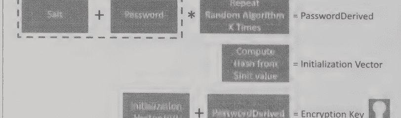
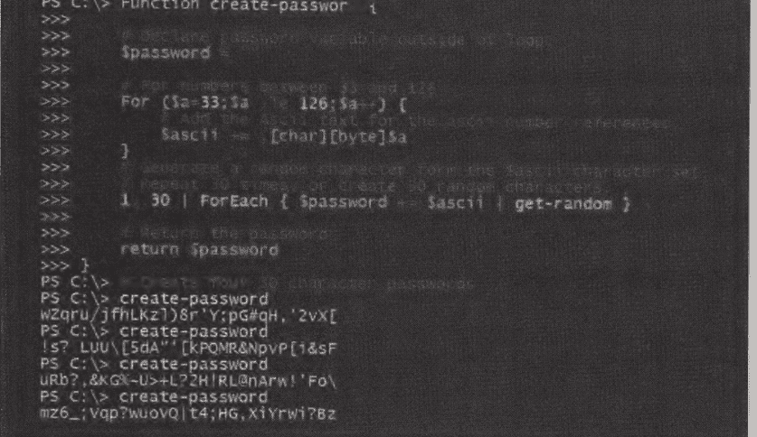
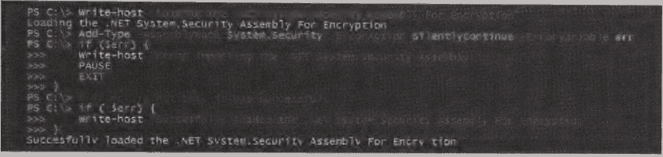
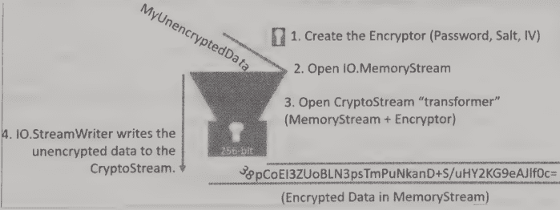
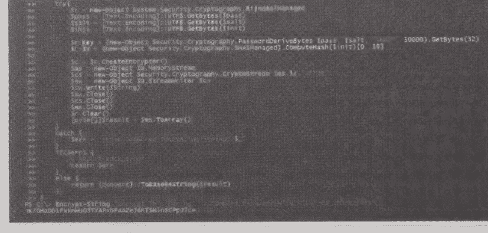
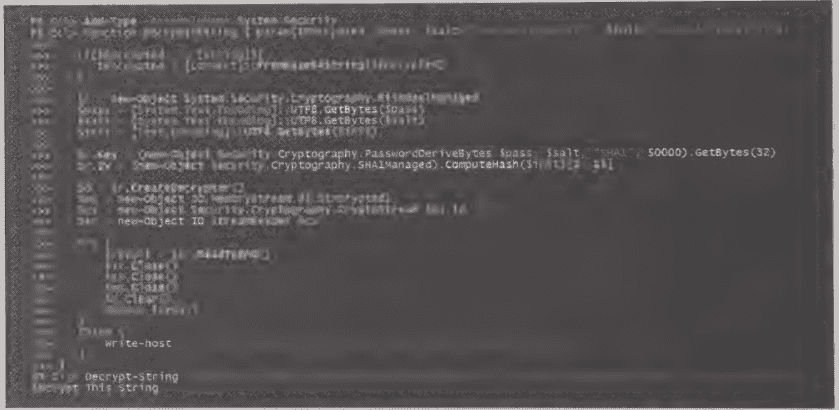
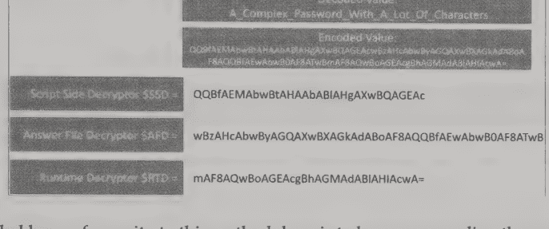
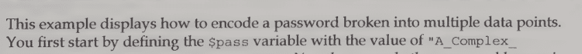
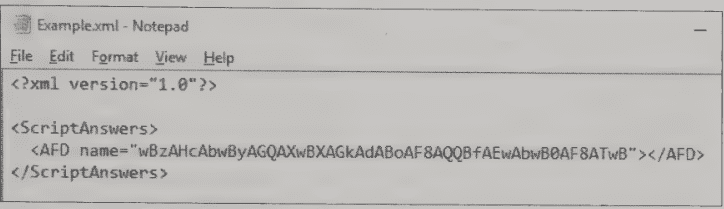

# 4 RijndaelManaged 加密
字符串加密
和解密

大型企业通常具有行业特定法规要求的非常严格的安全标准。当你创建 Windows 服务器扫描脚本时，需要在某些安全概念的指导下谨慎处理脚本。你可能遇到的最常见情况之一是在脚本中需要使用敏感数据，例如凭据。虽然你可以在运行时提示输入敏感数据，但大多数企业希望使用零接触自动化来完全自动化脚本。

零接触自动化要求脚本是自包含的，并且具有成功运行所需的所有凭据和组件。然而，将敏感数据纳入脚本的问题在于数据可以以明文形式获取。脚本中使用明文密码是不良做法，并且违反了许多法规和安全标准。

因此，PowerShell 脚本编写者需要一种方法来安全地存储和检索敏感数据以在脚本中使用。保护敏感数据的一种流行方法是加密敏感字符串。本章探讨 RijndaelManaged 对称加密，以及如何使用 PowerShell 加密和解密字符串。

本章将涵盖以下主题：
- 了解 RijndaelManaged 对称加密
- 了解加密算法的 salt、init 和 password
- 编写创建随机 salt、init 和 password 值的方法
- 使用 RijndaelManaged 加密加密和解密字符串
- 为加密密码创建编码和数据分离安全机制

> 本章中的示例相互构建。你需要按顺序执行脚本，才能使本章的最终脚本正常工作。

### RijndaelManaged 加密

当你创建脚本时，最佳做法是为敏感数据使用某种混淆或加密。有许多不同的策略可以用来保护你的数据。其中之一是利用字符串和脚本编码。编码会将你的可读字符串或脚本打乱，使他人更难看到实际代码是什么。编码的缺点是你必须解码脚本才能对其进行更改，并且解码不需要使用密码或密码短语。因此，有人可以使用与你解码脚本相同的方法轻松解码你的敏感数据。

编码的替代方案是利用加密算法。加密算法提供了多种保护脚本和字符串的机制。虽然你可以加密整个脚本，但最常见的是加密脚本本身或答案文件中的敏感数据。

与 PowerShell 一起使用的最受欢迎的加密算法之一是 RijndaelManaged。RijndaelManaged 是一种对称分组密码算法，美国国家标准与技术研究院（NIST）为其高级加密标准（AES）实现而选定。使用 RijndaelManaged 实现 AES 标准时，它支持 128 位、192 位和 256 位加密。




与编码不同，加密算法需要额外的信息才能正确加密和解密字符串。在 PowerShell 中实现 RijndaelManaged 时，算法需要 **盐**、**密码** 和 **初始化向量** (IV)。**盐** 通常是一个随机值，每次使用加密算法时都会发生变化。在传统的加密场景中，**盐** 的目的是每次使用加密函数时更改加密值。这在加密多个具有相同值的密码或字符串的场景中很重要。如果两个用户使用相同的密码，则数据库中的加密值也将相同。通过每次更改 **盐**，密码虽然值相同，但在数据库中会有不同的加密值。在本章中，我们将使用静态盐值。

**密码** 通常是由用户手动输入的值，或通过参数块输入到脚本中。您也可以从证书、Active Directory 属性值或多种其他来源派生密码值。在本章中，我们将使用三个来源作为密码。

**初始化向量** (IV) 是从 IV 字符串生成的哈希值，并用于 **加密密钥**。IV 字符串也通常是一个随机值，每次使用加密算法时都会发生变化。IV 字符串的目的是加强加密算法创建的哈希值。这是为了阻止黑客使用预先计算的哈希表进行彩虹攻击，而这些哈希表不使用 IV 字符串或使用常用字符串。由于您设置了 IV 字符串，哈希组合的数量呈指数级增长，从而降低了彩虹攻击的有效性。在本章中，我们将使用静态初始化向量值。

盐和初始化向量字符串的随机化实现在加密大量数据的情况下变得更加重要。攻击者可以拦截数十万个数据包或字符串，从而揭示有关您 IV 的越来越多的信息。有了这些信息，攻击者可以猜测 IV 并推导出密码。


> IV 最著名的攻击案例是使用弱或较小的初始化向量的 **有线等效隐私** (WEP) 无线协议。在捕获足够多的数据包后，IV 哈希值可能被猜出，黑客可以轻松获取无线网络上使用的密码短语。

## 创建随机盐、初始化向量和密码

在创建脚本时，您需要确保为盐、IV 字符串和密码使用复杂的随机值。这是为了防止字典攻击，其中个人可能会使用常见的密码和短语来猜测盐、IV 字符串和密码。创建盐和 IV 时，请确保它们各自至少为 10 个随机字符。还建议密码至少使用 30 个随机字符。

在 PowerShell 中创建随机密码，您可以执行以下操作：

```
Function create-password {
    # Declare password variable outside of loop.
    $password = ""
    # For numbers between 33 and 126
    For ($a=33;$a -le 126;$a++) {
        # Add the Ascii text for the ascii number referenced.
        $ascii += ,[char][byte]$a
    }
    # Generate a random character from the $ascii character set.
    # Repeat 30 times, or create 30 random characters.
    1..30 | ForEach { $password += $ascii | get-random }
    # Return the password
    return $password
}
# Create four 30 character passwords
create-password
create-password
create-password
create-password
```

此命令的输出如下所示：



此函数将创建一个包含 30 个随机字符的字符串，用于随机密码创建。您首先通过声明 create-password 函数开始。然后通过将其设为 "" 来声明 $password 变量以在函数内使用。

下一步是创建 For 命令以循环一组数字。这些数字代表可用于密码选择的 ASCII 字符编号。然后您通过编写 For ($a=33; $a -le 126;$a++) 来创建 For 命令。这意味着从数字 33 开始，将值增加一 ($a++)，并继续直到数字小于或等于 126。然后您声明 $ascii 变量并使用 += 赋值运算符构造该变量。随着 For 循环进行迭代，它会向数组值添加一个字符。然后脚本利用 [char] 或包含在 $a 中的 [byte] 数字的字符值。在此部分之后，$ascii 数组将包含字节值在 33 到 126 之间的所有 ASCII 字符的数组。

然后您继续进行随机字符生成。您声明 1..30 命令，这意味着对于 1 到 30 的数字，重复以下命令。您将其通过管道传递给 ForEach {，这将指定每个 30 次迭代。然后您调用 $ascii 数组并将其通过管道传递给 | get-random cmdlet。get-random cmdlet 将随机选择 $ascii 数组中的一个字符。然后使用赋值运算符 += 将该值连接到 $password 字符串中的现有值。经过 30 次迭代后，$password 变量中将有 30 个随机值。最后，您使用 return $password 将此值返回给脚本。在声明函数后，您使用 create-password 四次调用该函数。这创建了四个随机密码以供使用。


> 要创建长度小于 30 个随机字符的字符串，您可以将 1..30 修改为您想要的任何值。如果您想要 15 个随机字符的盐和初始化向量，则使用 1..15 即可。

## 加密和解密字符串

要开始使用 RijndaelManaged 加密，您需要在脚本中导入 .NET System.Security 程序集。与导入模块以提供额外的 cmdlet 类似，使用 .NET 程序集为 PowerShell 中通常无法访问的各种类提供了扩展。导入程序集不是持久的。这意味着您需要在 PowerShell 会话中使用它或每次运行脚本时都需要导入程序集。

要加载 .NET 程序集，您可以使用 Add-Type cmdlet，并使用 System.Security 参数作为 -AssemblyName 参数。由于该 cmdlet 实际上不会向屏幕输出任何内容，您可以在成功导入程序集后选择向屏幕打印信息。

要导入带有显示信息的 System.Security 程序集，您可以执行以下操作：

```
Write-host "Loading the .NET System.Security Assembly For Encryption"
Add-Type -AssemblyName System.Security -ErrorAction SilentlyContinue -ErrorVariable err
if ($err) {
Write-host "Error Importing the .NET System.Security Assembly."
    PAUSE
    EXIT
}
```

```
# if err is not set, it was successful.
if (!$err) {
    Write-host "Successfully loaded the .NET System.Security Assembly For Encryption"
}
```

此命令的输出如下所示：



在此示例中，您成功导入 .NET System.Security 程序集以供 PowerShell 使用。您首先使用 Write-host 命令将 "Loading the .NET System.Security Assembly for Encryption" 写入屏幕。然后您使用 Add-Type cmdlet，并使用 System.Security 参数作为 -AssemblyName 参数，使用 SilentlyContinue 参数作为 -ErrorAction 参数，以及使用 err 参数作为 -ErrorVariable 参数。然后您创建一个 if 语句来检查 $err 是否包含数据。如果包含，它将使用 Write-host cmdlet 向屏幕打印 "Error Importing the .NET System.Security Assembly."。它将暂停脚本以便读取错误。最后，它将退出脚本。如果 $err 为 $null，由 if (!$err) { 指定，它将使用 Write-host cmdlet 向屏幕打印 "Successfully loaded the .NET System.Security Assembly for Encryption"。此时，脚本或 PowerShell 窗口已准备好使用 System.Security 程序集。




加载 System.Security 程序集后，您可以开始创建加密函数。RijndaelManaged 加密需要四步流程来加密字符串，该流程在前面的图表中表示。

RijndaelManaged 加密流程如下：

- 1. 流程首先通过创建加密器开始。加密器由加密密钥（密码和盐）以及初始化向量派生而来。
- 2. 在定义加密器后，您需要使用 IO.MemoryStream 对象创建一个新的内存流。内存流用于在内存中存储值以供加密程序集使用。
- 3. 内存流打开后，您定义一个 System.Security.Cryptography.CryptoStream 对象。CryptoStream 是使用内存流和加密器将未加密数据转换为加密数据的机制。为了利用 CryptoStream，您需要向 CryptoStream 写入数据。
- 4. 最后一步是使用 IO.StreamWriter 对象将未加密值写入 CryptoStream。此转换的输出被放置到 MemoryStream 中。要访问加密值，您需要读取内存流中的数据。

> 要了解有关 System.Security.Cryptography.RijndaelManaged 类的更多信息，您可以查看以下 MSDN 文章：https://msdn.microsoft.com/en-us/library/system.security.cryptography.rijndaelmanaged(v=vs.110).aspx.

要创建使用 RijndaelManaged 加密来加密字符串的脚本，请执行以下操作：

```
Add-Type -AssemblyName System.Security
function Encrypt-String { param($String, $Pass,
$salt="CreateAUniqueSalt", $init="CreateAUniqueInit")
try{
    $r = new-Object System.Security.Cryptography.RijndaelManaged
    $pass = [Text.Encoding]::UTF8.GetBytes($pass)
    $salt = [Text.Encoding]::UTF8.GetBytes($salt)
    $init = [Text.Encoding]::UTF8.GetBytes($init)
$r.Key = (new-Object Security.Cryptography.PasswordDeriveBytes $pass, $salt, "SHA1", 50000).GetBytes(32)
$r.IV = (new-Object Security.Cryptography.SHA1Managed).ComputeHash($init)[0..15]

$c = $r.CreateEncryptor()
$ms = new-Object IO.MemoryStream
$cs = new-Object Security.Cryptography.CryptoStream $ms,$c,"Write"
$sw = new-Object IO.StreamWriter $cs
$sw.Write($String)
$sw.Close()
$cs.Close()
$ms.Close()
$r.Clear()
[byte[]]$result = $ms.ToArray()
}
catch {
    $err = "Error Occurred Encrypting String: $_"
}
if($err) {
    # Report Back Error
return $err
}
else {
return [Convert]::ToBase64String($result)
}
}
Encrypt-String "Encrypt This String","A_Complex_Password_With_A_Lot_Of_Characters"
```

此脚本的输出如下所示：



此函数展示了如何利用 RijndaelManaged 加密算法加密字符串。您首先通过利用 Add-Type cmdlet 导入 System.Security 程序集开始，使用 -AssemblyName 参数并传入 System.Security 参数。然后您声明 Encrypt-String 函数。您包含一个参数块以接受并将值设置到函数中。第一个值是 $string，即未加密文本。第二个值是 $pass，用于加密密钥。第三个是预定义的 $salt 变量，设置为 "CreateAUniqueSalt"。然后您定义 $init 变量，设置为 "CreateAUniqueInit"。

在参数块之后，您声明 try { 以处理 .NET 程序集中的任何错误。第一步是使用 new-Object cmdlet 并传入 System.Security.Cryptography.RijndaelManaged 参数来声明加密类。您将此对象放置在 $r 变量中。

然后您将 $pass、$salt 和 $init 值转换为 UTF8 字符编码标准，并将字符字节值存储在变量中。这是通过为 $pass 变量指定 [Text.Encoding]::UTF8.GetBytes($pass)、为 $salt 变量指定 [Text.Encoding]::UTF8.GetBytes($salt) 以及为 $init 变量指定 [Text.Encoding]::UTF8.GetBytes($init) 来完成的。

在设置正确的字符编码后，您继续为 RijndaelManaged 加密算法创建加密密钥。这是通过将 RijndaelManaged $r.Key 属性设置为由 (new-Object Security.Cryptography.PasswordDeriveBytes $pass, $salt, "SHA1", 50000).GetBytes(32) 创建的对象来完成的。此对象利用 Security.Cryptography.PasswordDeriveBytes 类，并使用 $pass 变量、$salt 变量、"SHA1" 哈希名称以及迭代派生 50000 次来创建密钥。此类的每次迭代都会生成不同的密钥值，使猜测密钥变得更加复杂。然后您利用 .Get-Bytes(32) 方法返回密钥的 32 字节值。

> RijndaelManaged 256 位加密是密钥中 32 字节的派生。32 字节乘以每字节 8 位等于 256 位。

要为算法创建初始化向量，您将 RijndaelManaged $r.IV 属性设置为由 (new-Object Security.Cryptography.SHA1Managed).ComputeHash($init)[0..15] 创建的对象。代码的这一部分利用 Security.Cryptography.SHA1Managed 并基于 $init 值计算哈希。当您调用 [0..15] 范围运算符时，它将获取哈希的前 16 个字节并将其放入 $r.IV 属性中。

> RijndaelManaged 初始化向量的默认块大小为 128 位。16 字节乘以每字节 8 位等于 128bits。

在设置所需属性后，您现在准备开始加密数据。您首先利用具有已定义 $r.Key 和 $r.IV 属性的 $r RijndaelManaged 对象开始。您使用 $r.CreateEncryptor() 方法生成加密器。

生成加密器后，您需要创建一个内存流以在内存中进行加密。这是通过声明 new-Object cmdlet，设置为 IO.MemoryStream 类，并将内存流对象放置在 $ms 变量中来完成的。

接下来，您创建 CryptoStream。CryptoStream 用于将未加密数据转换为加密数据。您首先声明 new-Object cmdlet 并传入 Security.Cryptography.CryptoStream 参数。您还定义 $ms 的内存流、$c 的加密器以及 "Write" 操作符，以告诉该类将未加密数据写入内存中的加密流。

创建 CryptoStream 后，您准备将未加密数据写入 CryptoStream。这是通过使用 IO.StreamWriter 类来完成的。您声明一个 new-Object cmdlet 并传入 IO.StreamWriter 参数，并为写入定义 $cs 的 CryptoStream。

最后，您取出存储在 $string 变量中的未加密字符串，并通过 $sw.Write($String) 将其传递给 StreamWriter $sw。加密值现在存储在内存流中。为了停止向 CryptoStream 和 MemoryStream 写入数据，您使用 $sw.Close() 关闭 StreamWriter，使用 $cs.Close() 关闭 CryptoStream，并使用 $ms.Close() 关闭内存流。出于安全目的，您还通过声明 $r.Clear() 清除加密器数据。

加密过程完成后，您需要将内存流导出为字节数组。这是通过调用 $ms.ToArray() 方法并将其设置为具有 [byte[]] 数据类型的 $result 变量来完成的。内容以字节数组形式存储在 $result 中。

代码的这一部分是您声明 catch { 语句的地方。如果加密过程中出现任何错误，脚本将执行此部分。您使用 "Error Occurred Encrypting String: $_" 参数声明 $err 变量。$_ 将是在 try {} 部分期间发生的管道错误。然后您创建一个 if 语句来确定 $err 变量中是否有数据。如果 $err 中有数据，它将错误字符串返回给脚本。

如果没有错误，脚本将进入脚本的 else { 部分。它将通过利用 [Convert]::ToBase64String($result) 将 $result 字节数组转换为 Base64String。这将字节数组转换为字符串以供脚本使用。

在定义加密函数后，您调用该函数以供使用。您首先通过调用 Encrypt-String 后跟 "Encrypt This String" 开始。您还将第二个参数声明为加密器的密码，即 "A_Complex_Password_With_A_Lot_Of_Characters"。执行后，此示例接收到由函数生成的加密值 hK7GHaDD1FxknHu03TYAPxbfAAZeJ6KTSH1nSCPpJ7c=。您的结果将根据您为加密算法使用的盐、init 和密码而有所不同。

> 虽然此示例使用 $salt 为 "CreateAUniqueSalt"、$init 为 "CreateAUniqueInit" 以及密码为 "A_Complex_Password_With_A_Lot_Of_Characters"，但强烈建议为自己的脚本更改这些值。这些值应使用在“创建随机盐、初始化向量和密码”部分中描述的随机生成的强值。未能使用强值以及未能将这些值保存在安全位置可能会损害您的加密数据。


## 解密字符串

字符串的解密与您在加密字符串时执行的过程非常相似。与将数据写入内存流不同，该函数从内存流中读取数据。此外，与使用 .CreateEncryptor() 方法不同，解密过程利用 .CreateDecryptor() 方法。

要创建使用 RijndaelManaged 加密解密加密字符串的脚本，请执行以下操作：

```powershell
Add-Type -AssemblyName System.Security
function Decrypt-String { param($Encrypted, $pass,
$salt="CreateAUniqueSalt", $init="CreateAUniqueInit")

if($Encrypted -is [string]){
    $Encrypted = [Convert]::FromBase64String($Encrypted)
}

$r = new-Object System.Security.Cryptography.RijndaelManaged
$pass = [System.Text.Encoding]::UTF8.GetBytes($pass)
$salt = [System.Text.Encoding]::UTF8.GetBytes($salt)
$init = [System.Text.Encoding]::UTF8.GetBytes($init)

$r.Key = (new-Object Security.Cryptography.PasswordDeriveBytes $pass,
$salt, "SHA1", 50000).GetBytes(32)
$r.IV = (new-Object Security.Cryptography.SHA1Managed).
ComputeHash($init)[0..15]

$d = $r.CreateDecryptor()
$ms = new-Object IO.MemoryStream @(, $Encrypted)
$cs = new-Object Security.Cryptography.CryptoStream $ms,$d,"Read"
$sr = new-Object IO.StreamReader $cs

try {
    $result = $sr.ReadToEnd()
    $sr.Close()
    $cs.Close()
    $ms.Close()
    $r.Clear()
Return $result
}
Catch {
    Write-host "Error Occurred Decrypting String: Wrong String Used In Script."
}
}
Decrypt-String "hK7GHaDD1FxknHu03TYAPxbFAAZeJ6KTSH1nSCPpJ7c=" "A_Complex_Password_With_A_Lot_Of_Characters".
```

此脚本的输出如下所示：



此函数演示了如何利用 RijndaelManaged 加密算法解密字符串。您首先通过利用 Add-Type cmdlet 导入 System.Security 程序集，使用 -AssemblyName 参数并指定 System.Security 参数。然后您声明 Decrypt-String 函数。您包含一个参数块以接受并为函数设置值。第一个值是 $Encrypted，即加密文本。第二个值是 $pass，用于加密密钥。第三个是预定义的 $salt 变量，设置为 "CreateAUniqueSalt"。然后您定义 $init 变量，其设置为 "CreateAUniqueInit"。

在参数块之后，您通过使用 if ($Encrypted -is [string]) { 检查加密值是否格式化为字符串。如果此条件评估为 True，您将使用 [Convert]::FromBase64String($Encrypted) 将字符串转换为字节，并将编码值放入 $Encrypted 变量中。接下来，您使用 new-Object cmdlet 并传入 System.Security.Cryptography.RijndaelManaged 参数来声明解密类。您将此对象放入 $r 变量中。

然后您将 $pass、$salt 和 $init 值转换为 UTF8 字符编码标准，并将字符字节值存储在变量中。这是通过为 $pass 变量指定 [System.Text.Encoding]::UTF8.GetBytes($pass)、为 $salt 变量指定 [System.Text.Encoding]::UTF8.GetBytes($salt)，以及为 $init 变量指定 [System.Text.Encoding]::UTF8.GetBytes($init) 来完成的。

在设置正确的字符编码后，您继续为 RijndaelManaged 加密算法创建加密密钥。这是通过将 RijndaelManaged $r.Key 属性设置为由 (new-Object Security.Cryptography.PasswordDeriveBytes $pass, $salt, "SHA1", 50000).GetBytes(32) 创建的对象来完成的。此对象利用 Security.Cryptography.PasswordDeriveBytes 类，并使用 $pass 变量、$salt 变量、"SHA1" 哈希名称以及迭代派生 50000 次来创建密钥。此类的每次迭代都会生成不同的密钥值，使密钥更难以猜测。然后您利用 .get-bytes(32) 方法返回密钥的 32 字节值。

为了为算法创建初始化向量，您将 RijndaelManaged $r.IV 属性设置为由 (new-Object Security.Cryptography.SHA1Managed).ComputeHash($init)[0..15] 创建的对象。代码的这一部分利用 Security.Cryptography.SHA1Managed 类并基于 $init 值计算哈希。当您调用 [0..15] 范围运算符时，哈希的前 16 个字节将被获取并放入 $r.IV 属性中。

在设置所需属性后，您现在准备开始解密数据。您首先利用具有已定义 $r.key 和 $r.IV 属性的 $r RijndaelManaged 对象。您使用 $r.CreateDecryptor() 方法生成解密器。

生成解密器后，您必须创建一个内存流以在内存中进行解密。这是通过声明 new-Object cmdlet 并传入 IO.MemoryStream 类参数来完成的。然后您使用 @(, $Encrypted) 将 $encrypted 值引用到内存流对象中，并将填充的内存流存储在 $ms 变量中。

接下来，您创建 CryptoStream，用于将加密数据转换为解密数据。您首先声明 new-Object cmdlet 并传入 Security.Cryptography.CryptoStream 类参数。您还定义 $ms 的内存流、$d 的解密器以及 "Read" 操作符，以告诉该类从内存中的加密流读取加密数据。

创建 CryptoStream 后，您准备好从 CryptoStream 读取解密数据。这是通过使用 IO.StreamReader 类来完成的。您使用 IO.StreamReader 类参数声明 new-Object，并定义要读取的 $cs CryptoStream。

此时，您使用 try { 来捕获从 StreamReader 读取数据时生成的任何错误消息。您调用 $sr.ReadToEnd()，它调用 StreamReader，读取完整的解密值，并将数据放入 $result 变量中。为了停止向 CryptoStream 和 MemoryStream 读取数据，您使用 $sw.Close() 关闭 StreamWriter，使用 $cs.Close() 关闭 CryptoStream，并使用 $ms.Close() 关闭内存流。出于安全目的，您还通过声明 $r.Clear() 清除解密器数据。如果解密成功，您将 $result 的值返回给脚本。

在定义解密函数后，您调用该函数以供使用。您首先通过调用 Decrypt-String 后跟 "hK7GHaDD1FxknHu03TYAPxbFAAZeJ6KTSH1nSCPpJ7c=" 来开始。您还将第二个参数声明为解密器的密码，即 "A_Complex_Password_With_A_Lot_Of_Characters"。执行后，您将收到由该函数生成的解密值 "Encrypt This String"。

## 保护密码

| 脚本侧解密器 SSD | 答案文件解密器 AFD | 运行时解密器 RTD |
|---|---|---|
| A_Complex_Pass + | word_With_A_Lot + | _Of_Characters |

您加密方法中最重要的部分之一是保护用于加密的密码。一种推荐的保护密码的方法是将密码拆分为三个或更多位置。前面的图表将密码 A_Complex_Password_With_A_Lot_Of_Characters 拆分为三个独立的段。目的是使密码数据部分位于脚本本身中，部分位于答案文件中，其余部分在运行时作为参数馈送到脚本中。如果三个密码段中的任何一个未提供，加密过程将因密码不正确而失败。

这种方法的目的是为密码提供多个数据点。运行时解密器需要用户干预，答案文件解密器需要在执行时存在答案文件，而脚本侧解密器确保密码不能仅从答案文件中确定。



对此方法的一项额外安全层是利用密码输入的编码。虽然编码可能不适合加密脚本中的实际密码，但它为在多个位置存储密码提供了非常有价值的混淆。当您为密码生成编码值时，它会增加字符数量并极大地阻碍对加密过程中使用的编码和密码的暴力破解。

要编码密码，请执行以下操作：

```
$pass = "A_Complex_Password_With_A_Lot_Of_Characters"
$encodedpass = [System.Text.Encoding]::Unicode.GetBytes($pass)
$encodedvalue = [Convert]::ToBase64String($encodedpass)
$encodedvalue
```

此命令的输出如下所示：



此示例演示了如何编码拆分为多个数据点的密码。您首先通过将值 "A_Complex_Password_With_A_Lot_Of_Characters" 定义为 $pass 变量来开始。然后您利用 [System.Text.Encoding]::Unicode.GetBytes($pass) 方法对密码进行编码，并将值存储在 $encodedpass 变量中。然后您通过利用 [Convert]::ToBase64String($encodedpass) 将编码值转换为字符串，并将值存储在 $encodedvalue 变量中。在此示例的末尾，您调用 $encodedvalue 变量以显示编码字符串。


要解码一个字符串，您可以执行以下操作：

```
$encvalue = "QQBfAEMAbwBtAHAAbAB1AHgAXwBQAGEAcwBzAHcAbwByAGQAXwBXAGkAdABoAF8AQQBfAEwAbwB0AF8ATwBmAF8AQwBoAGEAcgBhAGMADAB1AHIAcwA="
$encbytes = [System.Convert]::FromBase64String($encvalue)
$decodedvalue = [System.Text.Encoding]::Unicode.GetString($encbytes)
$decodedvalue
```

解码字符串的输出将如下所示：


本示例演示如何解码密码以在脚本中使用。您首先通过定义 $encvalue 变量并赋值为 "QQBfAEMAbwBtAHAAbAB1AHgAXwBQAGEAcwBzAHcAbwByAGQAXwBXAGkAdABoAF8AQQBfAEwAbwB0AF8ATwBmAF8AQwBoAGEAcgBhAGMADAB1AHIAcwA=" 开始。然后您通过执行 [System.Convert]::FromBase64String($encvalue) 将字符串转换为字节，并将输出存储在 $encbytes 中。然后您通过调用 [System.Text.Encoding]::Unicode.GetString($encbytes) 解码字节，并将输出存储在 $decodedvalue 中。在此示例的末尾，您调用 $decodedvalue 变量以显示解码后的密码 "A_Complex_Password_With_A_Lot_Of_Characters"。

## 使用编码密码进行解密

本章的最终脚本将您在前两章中学到的多个组件联系在一起。您将学习如何结合 Answer File Decryptor、Script Side Decryptor 和 Runtime Decryptor 来解密加密字符串。要遵循此示例，您需要在系统的 c:\temp\ 目录中创建 Example.xml 文件和 Example.ps1 文件。

> 参阅本章的代码文件有助于快速创建接下来描述的内容。

在 c:\temp\ 目录中创建 Example.xml 文件，并将解密器值设置为 wBzAHcAbwByAGQAXwBXAGkAdABoAF8AQQBfAEwAbwB0AF8ATwB：



您需要在系统的 c:\temp\ 中创建 Example.ps1 脚本。该脚本的内容应如下所示：

```
# The script is invoked with the command line of:
# powershell.exe -file "c:\temp\Example.ps1""c:\temp\Example.xml""mAF8AQwBoAGEAcgBhAGMADAbIAHIAcwA="
param($xmlfile, $RTD)
########################################################################################
# Example On How To Decrypt a String
########################################################################################
Add-Type -AssemblyName System.Security
function Decrypt-String { param($Encrypted, $pass,
$salt="CreateAUniqueSalt", $init="CreateAUniqueInit")
if($Encrypted -is [string]){
    $Encrypted = [Convert]::FromBase64String($Encrypted)
}
$r = new-Object System.Security.Cryptography.RijndaelManaged
$pass = [System.Text.Encoding]::UTF8.GetBytes($pass)
$salt = [System.Text.Encoding]::UTF8.GetBytes($salt)
$init = [System.Text.Encoding]::UTF8.GetBytes($init)
$r.Key = (new-Object Security.Cryptography.PasswordDeriveBytes $pass,
$salt, "SHA1", 50000).GetBytes(32)
$r.IV = (new-Object Security.Cryptography.SHA1Managed).
ComputeHash($init)[0..15]
$d = $r.CreateDecryptor()
$ms = new-Object IO.MemoryStream@(, $Encrypted)
$cs = new-Object Security.Cryptography.CryptoStream $ms,$d,"Read"
$sr = new-Object IO.StreamReader $cs
try {
    $result = $sr.ReadToEnd()
    $sr.Close()
    $cs.Close()
    $ms.Close()
    $r.Clear()
    Return $result
}
Catch {
    Write-host "Error Occurred Decrypting String: Wrong String Used In Script."
}
}
# Read the XML file for the Answer File Decryptor
[xml] $xml = (get-content $xmlfile)
$AFD = $xml.GetElementsByTagName("AFD").Name
# Define the Script Side Decryptor
$SSD = "QQBfAEMAbwBtAHAAbABlAHgAXwBQAGEAc"
# Combine the Decryptors
$encvalue = $SSD + $AFD + $RTD
# Decode the values
$encbytes = [System.Convert]::FromBase64String($encvalue)
$decrypt = [System.Text.Encoding]::Unicode.GetString($encbytes)
# Decrypt the string.
Decrypt-String "hK7GHaDD1FxknHu03TYAPxbFAAZeJ6KTSH1nSCPpJ7c=" $decrypt
PAUSE
```

要执行此脚本，您需要在 PowerShell 中执行以下命令：

```
powershell.exe -file "c:\temp\Example.ps1""c:\temp\Example.xml""mAF8AQwBoAGEAcgBhAGMAbAB1AHIAcwA="
```

此脚本的输出如下所示：


本示例演示如何结合 Answer File Decryptor、Script Side Decryptor 和 Runtime Decryptor 来解密加密字符串。在本章开始时，您加密了字符串 "Encrypt This String"。这生成了加密值 hK7GHaDD1FxnHu03TYAPxbFAAZeJ6KTSH1nSCPpJ7c=。本章后面我们学习了如何利用密码 "A_Complex_Password_With_A_Lot_Of_Characters" 解密加密值。然后您了解到应将密码进行编码并将值分离到三个位置。此脚本涵盖了解密字符串并利用来自三个数据源的编码密码。

您首先通过 param ($xmlfile,$RTD) 定义参数块。当您执行脚本时，您输入了 xml 文件位置 c:\temp\example.xml，其存储在 $xmlfile 中，以及运行时解密器 "mAF8AQwBoAGEAcgBhAGMAdABlAHIAcwA="，其存储在 $RTD 中。在参数块填充后，您使用 Add-Type cmdlet 并将 -AssemblyName 参数设置为 System.Security 参数来添加 System.Security 程序集。然后您定义 Decrypt-String 函数，该函数在本章前面已详细解释。

下一步是检索 XML 文件内容。您使用 get-content cmdlet 并使用 $xmlfile 路径执行此操作，并将值存储在具有 [xml] 数据类型的 $xml 变量中。然后您调用设置为 AFD 的 $xml.GetElementsByTagName() 方法。您使用点表示法检索具有 Name 属性值的答案文件解密器，并将其存储在 $AFD 变量中。

检索 Answer File Decryptor 后，您指定 Script Side Decryptor，将 $SSD 变量设置为 "QQBfAEMAbwBtAHAAbABlAHgAXwBQAGEAc"。然后您将 Script Side Decryptor（即 $SSD）后面的字符串与 Answer File Decryptor（即 $AFD）以及最终的 Runtime Decryptor（即 $RTD）组合起来。您继续通过将它们转换为字节来解码组合值，并将值存储在 $encbytes 变量中。然后您解码 $encbytes 变量以显示存储在 $decrypt 中的脚本密码。

一旦获得加密密码，您就会执行来自前一个示例的 Decrypt-String "hK7GHaDD1FxnHu03TYAPxbFAAZeJ6KTSH1nSCPpJ7c=" $decrypt 命令，以返回结果 "Encrypt This String"。您还发出 pause 命令以阻止脚本关闭。执行后，您已成功解码密码并解密字符串。

## 摘要

在本章中，我们学习了 RijndaelManaged 256 位加密。我们首先从加密过程的基础开始。然后，我们继续学习如何在脚本中创建随机 salt、init 和密码。然后我们学习了如何加密和解密字符串。我们以学习如何编码密码并利用多个来源派生编码密码结束本章。

在下一章中，我们将学习如何与服务、进程、配置文件和已登录用户交互。
