# 5 与服务、进程、配置文件和已登录用户交互

## 与服务、进程、配置文件和已登录用户交互

Windows 服务器扫描脚本为企业提供了对正在扫描的系统的整体功能的可见性。虽然您可以评估已安装的 Windows 功能和角色，但这样做通常无法提供足够的信息来确定服务器的完整功能。此外，如果没有更深入的检查，您将无法确定系统上是否正在运行业务关键服务和进程。

然而，当您评估系统上的身份时，您可以获得有关系统功能非常有价值的信息。通常，在企业环境中，服务帐户用于在系统上运行不同的服务和进程。这些服务帐户与普通用户类似；然而，它们具有受限的权限。当您识别出未作为默认内置用户运行的服务或进程时，系统很可能出于某种原因而这样配置。这将揭示系统的非标准配置，这些配置是使用 Windows 服务器扫描脚本进行审查的绝佳提示。

除了确定服务帐户使用情况外，扫描进程还会显示登录到特定系统的用户。由于登录到系统的每个用户帐户都有自己的进程分配给其会话，因此您可以快速分析用户登录的原因。此外，还有一些已知的遗留软件解决方案需要交互式登录才能正确运行服务、shell 和程序。评估已登录用户将使您更好地了解用户帐户如何与系统交互。


最后，您需要评估用户配置文件。在大型企业环境中，可能几乎没有关于哪个用户或部门拥有特定系统的痕迹。由于用户配置文件包含登录系统的个人的用户名，扫描这些配置文件将为系统所有权提供指导。

在本章中，您将：

- 了解如何获取、停止、启动和设置 Windows 服务
- 利用不同的 cmdlet 与 Windows 进程交互
- 识别系统上的已登录用户
- 收集系统上用户配置文件的数据

> 本章中的示例相互构建。您需要按顺序执行脚本，才能使本章中的最终脚本正常工作。
> 建议您在安装了 PowerShell 的 Windows Server 2012 R2 或更高版本服务器上执行这些示例。该服务器必须加入 Windows 域。

## Windows services

当您使用基于 Microsoft 的系统时，可能需要与 Windows 服务交互。PowerShell 提供了多种 cmdlet，可让您处理这些服务。首先，您可以通过利用 Get-service cmdlet 来查看系统上的服务。通过调用 Get-service cmdlet，您可以检索系统上 Windows 服务的完整列表。如果您想获得特定服务的筛选视图，可以利用引用服务特定名称的 -name 参数。执行此命令后，您将看到服务的 Status、Name 和 DisplayName。您还可以使用 -RequiredServices 参数来显示使该特定服务正常运行所需的服务。您可以通过执行 -DependentServices 参数来查询依赖的 Windows 服务。

要使用 Get-service cmdlet 查询 Windows Audio 服务，您可以执行以下操作：

```powershell
Get-service -DisplayName "Windows Audio"
Get-service -DisplayName "Windows Audio" -RequiredServices
(Get-service -DisplayName "Windows Audio").Status
```

以下屏幕截图显示了此输出：

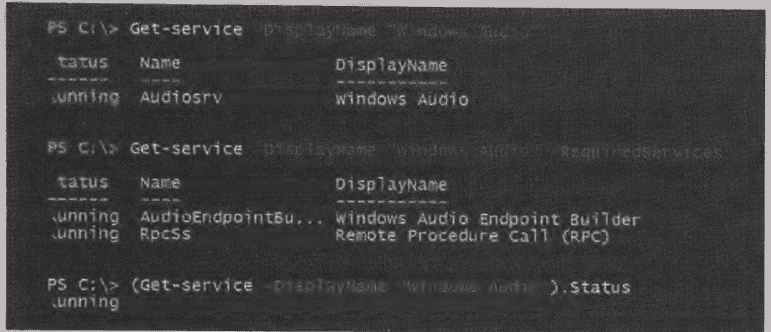

此示例演示如何获取有关 Windows Audio 服务的信息。您首先通过调用 Get-service cmdlet，利用 -DisplayName 参数并引用 Windows Audio Windows 服务。执行后，您将在 PowerShell 窗口中看到 Status、Name 和 DisplayName 字段。然后使用 Get-service cmdlet，-DisplayName 参数引用 Windows Audio，并使用 -RequiredServices 参数。执行 Get-service 命令后，您将看到使 Windows Audio Windows 服务正常运行所需的所有服务的 Status、Name 和 DisplayName。您最后一次调用利用 Get-service cmdlet，-DisplayName 参数引用 Windows Audio。此整个语句用括号括起来，然后是 .Status 的点表示法。这将返回 Windows Audio Windows 服务的当前状态，即 Running。

在您想要启动、重新启动和停止服务的情况下，您也可以利用 start-service、restart-service 和 stop-service cmdlet。要启动服务，您可以调用 start-service cmdlet，后跟 -name 或 -DisplayName 参数以及相应的服务名称。执行后，服务状态将从 Stopped 更改为 StartPending；成功启动后，状态将更改为 Running。

要停止服务，您可以调用 stop-service cmdlet，后跟 -name 或 -DisplayName 参数以及相应的服务名称。执行后，服务状态将从 Running 更改为 StopPending，成功停止后，状态将更改为 Stopped。

要重新启动服务，您可以调用 restart-service cmdlet，后跟 -Name 或 -DisplayName 参数以及相应的服务名称。执行后，服务状态将从 Running 更改为 StopPending，StopPending 更改为 Stopped，Stopped 更改为 StartPending；成功启动后，状态将更改为 Running。

> 启动和停止 Windows 服务需要以提升权限运行的 PowerShell 窗口。您需要使用“以管理员身份运行”参数打开 PowerShell。

要停止和启动 Windows Audio 服务，您可以执行以下操作：

```
stop-service -DisplayName "Windows Audio"
(Get-service -DisplayName "Windows Audio").Status
start-service -DisplayName "Windows Audio"
(Get-service -DisplayName "Windows Audio").Status
```

以下屏幕截图显示了此输出：

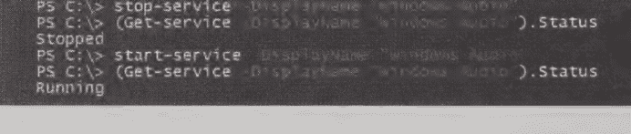

此示例演示如何启动和停止 Windows 服务。您首先通过利用 stop-service cmdlet 和 -DisplayName 参数引用 Windows Audio 显示名称来停止 Windows Audio 服务。然后通过执行 Get-service 并使用 -DisplayName 参数引用 Windows Audio 显示名称来获取服务的当前状态。将其括在括号中并利用 .Status 的点表示法将当前状态打印到屏幕上。控制台将返回 Stopped 状态。

然后通过利用 start-service cmdlet 和 -DisplayName 参数引用 Windows Audio 显示名称来启动 Windows Audio 服务。然后通过执行 Get-service 并使用 -DisplayName 参数引用 Windows Audio 显示名称来获取服务的当前状态。将其括在括号中并利用 .Status 的点表示法将当前状态打印到屏幕上。控制台将返回 Running 状态。

您还可以使用 set-service cmdlet 修改 Windows 服务的不同方面。set-service cmdlet 可以修改服务描述、启动类型，甚至服务的显示名称。由于 Windows 不允许您修改正在运行的服务，因此您首先需要利用 stop-service cmdlet 停止服务以进行编辑。

如果您想修改服务的启动类型，可以利用 set-service cmdlet 并使用 -Name 参数以及相应的服务名称。然后使用 -startup type 参数包含 Automatic 表示自动启动、Manual 表示手动启动，或 Disabled 表示禁用服务启动。要查看服务启动类型的更改，您需要利用 get-wmiobject cmdlet 引用 win32_service 类，并使用 -filter 参数引用 DisplayName='Display Name'。


> 在大多数情况下，您可以利用 Get-service cmdlet 显示服务属性，但某些属性对 cmdlet 不可用。因此，您可能需要直接使用 get-wmiobject 查询 WMI 以查看该服务的所有属性。要查看 Get-service 或 WMI 可用的所有属性，可以将结果通过管道 | 传递给 get-member，它将显示您可以查看的所有可用属性。

要更改 Windows Audio -startup type 参数，您可以执行以下操作：

```
(get-wmiobject win32_service -filter "DisplayName='Windows Audio'").StartMode
stop-service -name "Audiosrv"
set-service -name "Audiosrv" -startup "Manual"
(get-wmiobject win32_service -filter "DisplayName='Windows Audio'").StartMode
set-service -name "Audiosrv" -startup "Automatic"
(get-wmiobject win32_service -filter "DisplayName='Windows Audio'").StartMode
Start-service -name "Audiosrv"
```

以下屏幕截图显示了此输出：

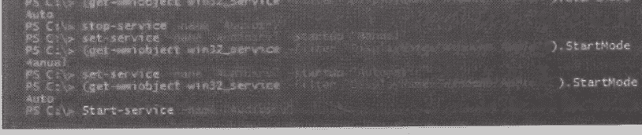

此示例演示如何在系统上更改 Windows 服务的启动方式。您首先通过查询系统来查看现有的 StartMode。为此，您需要利用 get-wmiobject cmdlet 引用 win32_service 类。您利用 -filter 参数，过滤选项为 DisplayName='Windows Audio'。然后将该语句括在括号中并利用 .StartMode 的点表示法将系统的启动模式打印到屏幕上。命令将打印 Auto 到屏幕，表示服务启动类型设置为 Automatic。然后通过调用 stop-service cmdlet 并使用 -name 参数引用 Audiosrv 服务名称来停止服务。然后通过调用 set-service cmdlet 并使用 -name 参数引用 AudioSrv 以及 -startup 参数引用 Manual 来将服务启动类型配置为 Manual。运行此命令后，您使用 get-wmiobject cmdlet 引用 win32_service 类来验证启动更改。您利用 -filter 参数，过滤选项为 DisplayName='Windows Audio'。然后将该语句括在括号中并利用 .StartMode 的点表示法将系统的启动模式打印到屏幕上。命令将打印 Manual 到屏幕，表示服务启动类型设置为 Manual。

然后通过调用 set-service cmdlet 并使用 -name 参数引用 AudioSrv 以及 -startup 参数引用 Automatic 将服务设置回 Automatic。设置此命令后，您使用 get-wmiobject cmdlet 引用 win32_service 类来验证启动更改。您利用 -filter 参数，过滤选项为 Displayname='Windows Audio'。然后将该语句括在括号中并利用 .StartMode 的点表示法将系统的启动模式打印到屏幕上。命令将打印 Auto 到屏幕，表示服务启动类型设置为 Automatic。完成最终配置后，您通过调用 start-service cmdlet 并使用 -name 参数引用 Audiosrv 服务名称来启动服务。


在您想要修改服务的描述时，首先需要通过使用 stop-service cmdlet 来停止该服务。然后调用 set-service cmdlet，并使用 -name 指定服务名称，以及 -Description 参数指定要为特定服务设置的描述。description 属性是唯一的，因为它不会在 get-service cmdlet 中提供。为了解决这个问题，您需要使用 get-wmiobject cmdlet。要查看描述，您可以使用引用 win32_service 类的 get-wmiobject cmdlet，并使用 -filter 参数引用 DisplayName='Display Name'。执行此脚本后，描述将打印到屏幕上。设置描述后，您可以使用 start-service cmdlet 启动服务。

要为 Windows Audio 服务设置描述，您可以执行以下操作：

```powershell
$olddesc = (get-wmiobject win32_service -filter "DisplayName='Windows Audio'").description
$olddesc
stop-service -DisplayName "Windows Audio"
Set-service -name "Audiosrv" -Description "My New Windows Audio Description."
(get-wmiobject win32_service -filter "DisplayName='Windows Audio'").description
Set-service -name "Audiosrv" -Description $olddesc
(get-wmiobject win32_service -filter "DisplayName='Windows Audio'").description
start-service -DisplayName "Windows Audio"
```

此操作的输出显示在以下屏幕截图中：

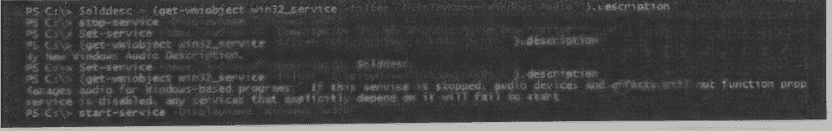

此示例演示如何更改 Windows 服务的描述并将其恢复为原始描述。您首先通过查询系统来查看现有描述是什么。为此，您需要使用引用 win32_service 类的 get-wmiobject cmdlet。您使用 -filter 参数并使用 DisplayName='Windows Audio' 的筛选选项。然后将该语句用括号括起来并使用 .description 的点表示法。输出即 Windows 服务描述，然后被设置为变量 $olddesc。要查看旧描述，您调用 $olddesc 变量，其显示内容为：管理基于 Windows 的程序的音频。如果停止此服务，音频设备和效果将无法正常工作。如果禁用此服务，任何显式依赖它的服务都将无法启动。您然后使用 stop-service cmdlet 和引用 Windows Audio 的 -DisplayName 参数停止服务。要设置描述，您使用 set-service cmdlet，将 -name 参数设置为 Audiosrv，并将 -Description 参数设置为 My New Windows Audio Description。

设置描述后，您使用引用 win32_service 类的 get-wmiobject cmdlet 查询系统，并使用 DisplayName='Windows Audio' 的筛选选项的 -filter 参数。然后将该语句用括号括起来并使用 .description 的点表示法。此操作的输出将是当前描述，即 My New Windows Audio Description。要将描述恢复为原始值，您使用 set-service cmdlet，将 -name 参数设置为 Audiosrv，并将 -description 参数引用 $olddesc 变量。将描述恢复为原始描述后，您使用引用 win32_service 类的 get-wmiobject cmdlet 查询系统，并使用 DisplayName='Windows Audio' 的筛选选项的 -filter 参数。然后将该语句用括号括起来并使用 .description 的点表示法。此操作的输出将是当前描述，即管理基于 Windows 的程序的音频。如果停止此服务，音频设备和效果将无法正常工作。如果禁用此服务，任何显式依赖它的服务都将无法启动。您然后通过启动 Windows Audio 服务完成此过程。您使用引用 Windows Audio 的 -DisplayName 参数的 start-service cmdlet。

可能存在您想要确定哪个用户或服务帐户正在运行 Windows 服务的情况。为此，您可以使用 -class 参数和 win32_service 参数使用 get-wmiobject cmdlet。WMI 服务对象具有多个属性，可让您查看系统上运行的服务的扩展信息。.DisplayName 属性显示 Windows 服务显示名称，而 .StartName 属性显示被委派启动 Windows 服务的用户。

> 查询 Windows 服务需要以提升权限运行的 PowerShell 窗口。您需要使用“以管理员身份运行”参数打开 PowerShell。

要查询 Windows Audio 服务以获取被委派启动该服务用户，您可以执行以下操作：

```
$service = get-wmiobject win32_service | where {$_.DisplayName -like "Windows Audio"}
$servicedisplay = $service.DisplayName
$serviceAuthUser = $service.StartName
write-host "Service with $servicedisplay name is running with $serviceAuthUser account."
```

此操作的输出显示在以下屏幕截图中：


此示例演示如何确定系统上服务的拥有者。您首先调用 get-wmiobject cmdlet，将 -class 参数设置为 win32_service。此命令通过管道传递到 where {$_.DisplayName -like "Windows Audio"}。Windows Audio 对象然后被放入 $service 变量中。您通过调用 $service.DisplayName 属性来收集 Windows 服务显示名称，并将该属性放入 $servicedisplay 变量中。您通过调用 $service.StartName 属性来检索 Windows 服务启动用户，并将该属性放入 $serviceAuthUser 变量中。要显示收集的数据，您使用 write-host cmdlet，并使用 Service with $servicedisplay name is running with $serviceAuthUser account.。在此特定系统上，返回 Service with Windows Audio name is running NT Authority\LocalService account.。

## 管理 Windows 进程

在脚本编写中，可能需要检查系统上是否有正在运行的进程。PowerShell 提供 get-process cmdlet 来搜索系统上可用的进程。单独运行 get-process cmdlet 时，您将获得系统上所有正在运行服务的报告。关于正在运行服务的默认记录集包括：

- Handles：某个进程正在使用的线程句柄数
- NPM (K)：非分页内存是完全位于物理内存中且未分配到页面文件中的内存，该内存正被进程使用
- PM (K)：可分页内存是被分配到页面文件中的内存，该内存正被进程使用
- WS (K)：工作集是进程最近引用的内存
- VM (M)：虚拟内存是进程正在使用的虚拟内存量
- CPU (s)：这是处理器时间，即 CPU 利用该进程所花费的时间
- ID：这是分配给进程的唯一 ID
- ProcessName：这是内存中的进程名称

通常，当您查询系统上活动的正在运行进程时，您会查找特定进程。为此，您可以使用 -name 参数引用进程名称来使用 get-process cmdlet 查看有关该特定进程的信息。您还可以使用星号 (*) 作为通配符来查询与您指定的部分词相似的进程。您也可以直接引用进程的进程 ID，如果您使用进程的 ID 调用 -id 参数。 如果您想要有关正在运行进程的更多信息，您还可以使用 -FileVersionInfo 参数从进程中提取 ProductVersion、FileVersion 和 FileName 信息。在需要查找进程加载的所有模块或 DLL 引用的情况下，您也可以使用 -module 参数。

要使用通配符搜索进程并通过进程 ID 获取进程，您可以执行以下操作：

```
$process = get-process powersh*
$process
get-process -id $process.id
```

本输出显示在以下屏幕截图中：

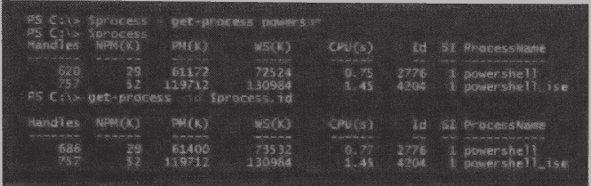

本脚本演示如何通过通配符搜索进程并获取进程 ID。你也可以通过调用该服务的进程 ID 来查看同一服务。首先使用 get-process cmdlet 并使用 powersh* 搜索通配符开始。系统将 PowerShell 进程对象返回到 $process 变量中。然后你调用 $process 变量以查看有关 PowerShell 进程的信息。然后你使用指向 $process 变量的 -id 参数利用 get-process cmdlet，引用 .id 的点表示法。这会返回相同的 PowerShell 进程信息，即在第一次搜索结果的进程 ID 中引用的 $process.id。执行此脚本后，你将看到 PowerShell 进程的 Handles、NPM(K)、PM(K)、WS(K)、VM、CPU(s)、Id 和 ProcessName 信息。

要使用通配符获取进程并获取其 FileVersionInfo 信息，可以执行以下操作：

```
$process = get-process powersh*
get-process -id $process.id -FileVersionInfo | format-table -AutoSize
```

本输出显示在以下屏幕截图中：

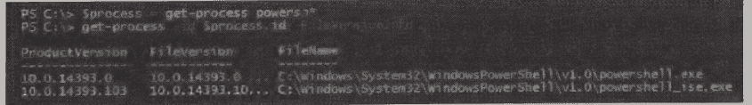

本脚本演示如何通过通配符搜索进程，然后使用该信息查看文件版本信息。你首先使用 get-process cmdlet 并使用 powersh* 搜索通配符开始。系统将 PowerShell 进程返回到 $process 变量中。然后你调用 get-process cmdlet 并利用指向 $process 变量的 -id 参数，引用 .id 的点表示法。你还调用 -FileVersionInfo 参数以显示有关 PowerShell 进程的详细信息。然后你将结果通过管道传递给带有 -AutoSize 参数的 format-table cmdlet，该参数格式化表格以免截断结果。执行此脚本后，你将看到有关 PowerShell 进程的 ProductVersion、FileVersion 和 FileName 信息。

可能存在需要确定哪个用户或服务帐户正在运行进程的情况。为此，你可以使用带有 -class 参数和 win32_process 参数的 get-wmiobject cmdlet。WMI 进程对象具有多个属性和方法，可让你查看系统上运行的进程的扩展信息。.Name 属性显示名称，而 .GetOwner() 方法则显示有关进程所有者的信息。此方法是一个 .User 属性，显示运行服务的用户，以及 .Domain 属性，提供用户所属的域。


> 查询系统进程和其他用户的进程需要以提升权限运行的 PowerShell 窗口。你需要使用“以管理员身份运行”参数打开 PowerShell。

要获取系统上运行 PowerShell.exe 的用户，可以执行以下操作：

```powershell
$processes = Get-WmiObject -class win32_process | where {$_.Name -like "powersh*"}

foreach ($process in $processes) {
    $procname = $process.Name
    $procdom = $process.GetOwner().Domain
    $procuser = $process.GetOwner().User
    Write-host "$procname is running with the $procdom\$procuser account."
}
```

本输出显示在以下屏幕截图中：

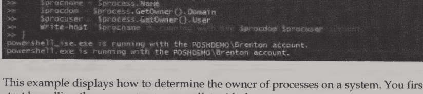

本示例演示如何确定系统上进程的所有者。你首先通过将 -class 参数设置为 win32_process 调用 get-WmiObject cmdlet 开始。此命令通过管道传递到 where {$_.Name -like "powersh*"}，它将检索所有名称以 Powersh 开头的进程。这些对象随后被放入 $processes 变量中。然后你创建一个 foreach 语句来遍历 $processes 变量中的每个 $process 对象。你使用 $process.Name 属性检索进程名称并将其设置为 $procname 变量。你通过利用 $process.GetOwner() 方法和 .Domain 属性来收集进程所有者域名称。最后，你使用 $process.GetOwner() 方法和 .User 属性检索进程所有者名称。要显示收集的数据，你使用 write-host cmdlet 并显示 $procname is running with the $procdom\$procuser account。在此特定系统上，返回 powershell_ise.exe 以 POSHDEMO\Brenton 帐户运行。 和 powershell.exe 以 POSHDEMO\Brenton 帐户运行。

要启动新进程或调用程序，可以使用 start-process cmdlet。使用此 cmdlet 的正确语法是调用 start-process cmdlet，提供指向要执行项目的所在位置的 -FilePath 参数。然后你可以调用可选的 -argumentList 参数引用执行项目所需的参数，可选的 -verb 参数以调用与文件类型关联的任何动词（如 Edit、Open、Play、Print 和 RunAs），可选的 -NoNewWindow 参数以不在新的 Powershell 控制台中生成命令，以及可选的 -wait 参数以在继续脚本之前等待进程完成。如果不执行 -wait 参数，脚本将继续执行下一步，而不会等待当前步骤成功。启动进程后，进程将获得一个进程 ID，你可以使用其他进程 cmdlet 引用它。

要启动新的记事本进程，可以执行以下操作：

```
start-process -FilePath notepad.exe
$process = get-process notepad*
```

本输出显示在以下屏幕截图中：

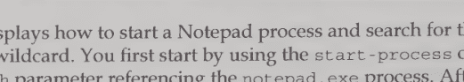

本脚本演示如何启动记事本进程并通过通配符搜索记事本进程。你首先使用 start-process cmdlet 并使用引用 notepad.exe 进程的 -FilePath 参数开始。执行后，它将启动 notepad.exe。然后你使用 notepad* 通配符使用 get-process cmdlet。系统将 PowerShell 进程对象返回到 $process 变量中。将 PowerShell 进程对象存储在 $process 变量中可让你根据需要与该对象的属性进行交互。

要停止进程或停止程序，可以使用 stop-process cmdlet。使用此 cmdlet 的正确语法是调用 stop-process cmdlet，提供指向要终止项目的所在位置的 -FilePath 参数。你也可以利用 -processname 参数通过其进程名称停止服务。你还可以使用通配符与 -processname 参数一起使用，以结束与你指定的部分单词相似的进程。你也可以指定 -id 参数通过其进程 ID 终止进程。默认情况下，如果你终止进程，它会提示确认。使用 -force 参数将强制终止进程而不提示用户。

要停止正在运行的记事本进程，可以执行以下操作：

```
start-process -FilePath notepad.exe
$process = get-process notepad*
stop-process -ID $process.id
```

本输出显示在以下屏幕截图中：

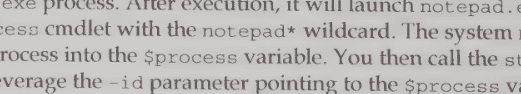

本脚本演示如何启动记事本进程，通过通配符搜索记事本进程，然后使用该信息停止记事本进程。你首先使用 start-process cmdlet 并使用引用 notepad.exe 进程的 -FilePath 参数开始。执行后，它将启动 notepad.exe。然后你使用 notepad* 通配符使用 get-process cmdlet。系统将 PowerShell 进程返回到 $process 变量中。然后你调用 stop-process cmdlet 并利用指向 $process 变量的 -id 参数，引用 .id 的点表示法。执行此脚本后，你将看到记事本打开并关闭。

## 识别已登录用户

可能存在需要识别已登录到系统的用户的情况。当用户登录到你的计算机时，他们会与系统创建交互式会话。这会在该用户名下生成进程作为进程所有者。此外，当你创建服务帐户在系统上启动服务时，底层进程将作为该服务帐户运行。鉴于这两种方法都会调用进程，确定当前已登录用户的最佳方法是评估正在运行的进程。

除了识别已登录用户外，你还需要过滤掉内置 Windows 帐户。为此，你可以创建 switch 语句以对进程所有者进行多次评估。如果进程所有者用户名是 NETWORK SERVICE、LOCAL SERVICE、$null 或 SYSTEM，你可以跳过报告用户名。如果它与这些值中的任何一个都不匹配，它将使用默认 switch 并将用户报告到列表中。由于多个进程在同一用户下运行，你可以将用户结果通过管道传递给 Get-Unique cmdlet，它只会选择数组中的唯一值。

> 根据系统上进程的数量，以下示例最多需要 30 秒才能执行。

要评估正在运行的进程以获取非内置已登录用户列表，可以执行以下操作：

```
$users = @()
$processes = Get-WmiObject win32_process
foreach ($process in $processes) {
    $procuser = $process.GetOwner().User
    switch ($process.GetOwner().User) {
        "NETWORK SERVICE" { $continue = "Skip User" }
        "LOCAL SERVICE" { $continue = "Skip User" }
        "SYSTEM" { $continue = "Skip User"}
        "$null" { $continue = "Skip User" }
        default { $continue = "Report User" }
    }
    if ($continue -eq "Report User") {
        $users += $procuser
    }
}
$users | Get-Unique
```

此输出显示在以下屏幕截图中：

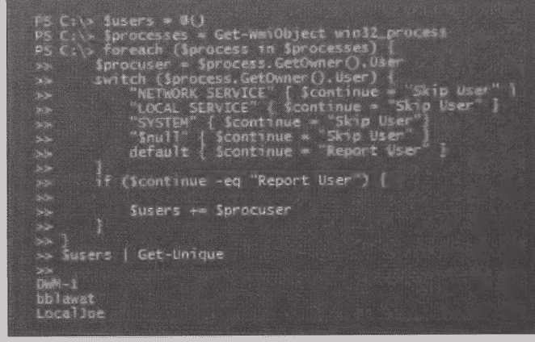

此示例演示如何在系统上输出当前非内置用户。你首先定义一个名为 $users 的数组。然后你使用 Get-WmiObject 并传入 Win32_Process 类作为参数，并将结果放入 $processes 中。然后你创建一个 foreach 循环，并遍历 $processes 变量中的每个 $process。你接着使用 $process.GetOwner() 方法获取迭代进程的所有者，并将 .User 属性放入 $procuser 变量中。然后你声明一个 switch 语句来评估 $process.GetOwner().User 属性。首次评估针对的是内置账户。如果账户为 NETWORK SERVICE、LOCAL SERVICE、SYSTEM 或 $null，则会将 $continue 设置为 "Skip User"。如果不匹配这些内置用户，则会使用默认值，将 $continue 变量设置为 "Report User"。

退出 switch 语句后，你使用 If 语句评估 $continue 变量，如果值等于 "Report User" 则继续执行。此步骤会将 $procuser 变量添加到 $users 数组中。foreach 循环完成后，你将为每个非内置用户列出大量用户。为了将列表精简为单个或唯一用户，你将 $users 变量通过管道传递给 Get-Unique cmdlet。结果是系统上唯一非内置用户的列表。运行此示例的系统上有三个用户：DWM-1、bblawat 和 LocalJoe。

## User profiles

用户配置文件是企业中的常见挑战。由于它们在登录时自动生成，且没有内置的自动删除本地配置文件的功能，系统饱受旧配置文件账户困扰。旧配置文件不仅占用系统数据，还会泄露环境中其他活动账户的信息。

PowerShell 提供了检索用户配置文件信息的能力。要从系统检索用户配置文件，可以使用调用 Win32_UserProfile 类的 Get-WmiObject cmdlet。检索到用户配置文件对象后，你可以使用多个属性来收集有关配置文件的的信息。.SID 属性是配置文件中用户的 security identifier。虽然 SID 是一个唯一的用户名，但你可以使用 .NET System.Security.Principal 类轻松将其转换。你首先通过调用 New-Object cmdlet 并使用 System.Security.Principal.SecurityIdentifier 类创建新的 .NET 对象，将用户的 SID 作为参数。然后你从设置为 [System.Security.Principal.NTAccount] 类的 .Translate() 方法中检索值。.NET 类将从 SecurityIdentifier 转换到 NTAccount，从而输出用户名。

要将用户的 security identifier 转换为用户名，可以执行以下操作：

```powershell
$sid = "S-1-5-18"

$usersid = New-Object System.Security.Principal.SecurityIdentifier("$SID")

$usersid.Translate( [System.Security.Principal.NTAccount] ).Value
```

此输出显示在以下屏幕截图中：


此示例演示如何正确地将 SID 转换为用户名。你首先定义 "S-1-5-18" 的 security identifier 并将其放入 $sid 变量中。然后你使用 New-Object cmdlet 调用 System.Security.Principal.SecurityIdentifier 类，并使用 $sid 参数并将其设为等于 $SID。这会将 SID 对象放入 $usersid 变量中。然后你在 SID 对象上调用 $usersid.Translate() 方法，并指定 [System.Security.Principal.NTAccount] 作为参数。最后，你在转换后的数据上调用 .Value 属性，即可获得用户名的值。在此示例中，你了解到 SID S-1-5-18 被转换为了 NT AUTHORITY\SYSTEM。

Win32_UserProfile 类中另一个常用的属性是 LastUseTime 属性。LastUseTime 提供了配置文件上次使用时间的洞察。此时间戳采用分布式管理任务组（DMTF）格式，通常不是便于阅读的用户友好格式。为了将此值简化为不同的时间格式，可以使用 [Management.ManagementDateTimeConverter] 类的 ToDateTime() 方法，并将 LastUseTime 作为参数。运行此方法后，你将成功把值转换为用户友好的格式。

要将 LastUseTime 转换为用户友好的格式，可以执行以下操作：

```powershell
$profile = Get-WmiObject Win32_UserProfile | Where {$_.SID -eq "S-1-5-18"}
$lastusetime = $profile.LastUseTime
$lastusetime
[Management.ManagementDateTimeConverter]::ToDateTime($lastusetime)
```

此输出显示在以下屏幕截图中：

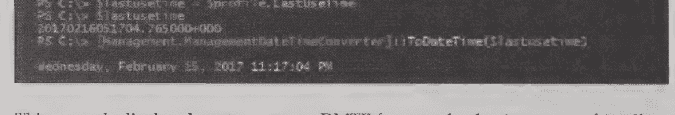

此示例演示如何将 DMTF 格式的值转换为用户友好的格式。你首先使用 Get-WmiObject cmdlet 并调用 Win32_UserProfile 类。然后你将此值通过管道传递给 Where {$_.SID -eq "S-1-5-18"} 并将此配置文件对象放入 $profile 变量中。然后你检索 .LastUseTime 属性并将其放入 $lastusetime 变量中。然后你调用 $lastusetime 以在屏幕上显示 DMTF 格式的时间。在此示例中，DMTF 为 20170216051704.765000+000。最后，你调用 [Management.ManagementDateTimeConverter] 类并使用 $lastusetime 作为参数调用 ToDateTime() 方法。此命令的输出是用户友好的值 Wednesday, February 15, 2017 11:17:04 PM。

要确定用户配置文件的 SID、用户名和年龄，可以执行以下操作：

```powershell
$profiles = Get-WmiObject Win32_UserProfile
foreach ($profile in $profiles) {
    $currentdate = Get-Date
    $lastusetime = $profile.LastUseTime
    $lastusetime = [Management.ManagementDateTimeConverter]::ToDateTime($lastusetime)

    $age = [math]::Round(($currentdate - $lastusetime).TotalDays)

    $sid = $profile.SID
    Try {
        $usersid = New-Object System.Security.Principal.SecurityIdentifier("$SID")
        $username = $usersid.Translate( [System.Security.Principal.NTAccount]).Value
    }
    Catch {
        Write-Host "There was an error translating SID value $sid to a username. Account may not exist."
        $username = "(Deleted Account)"
    }
    Write-host "User with name $username and SID $sid last logged in $lastusetime. ($age Days Old)"
}
```

此输出显示在以下屏幕截图中：

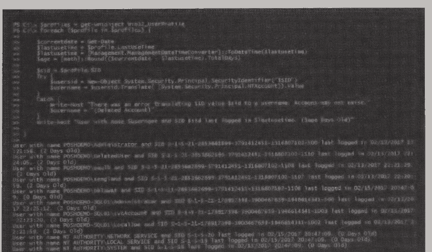

此示例演示如何检索用户配置文件的 SID、用户名和年龄。你首先使用 Win32_UserProfile 类作为参数使用 Get-WmiObject cmdlet 并将 UserProfile 对象存储在 $profiles 变量中。然后你使用 $profile 作为迭代器、$profiles 作为数据集的 foreach 循环。对于配置文件老化过程，你调用 Get-Date cmdlet 并将值设置在 $currentdate 变量中。然后你获取 $profile.LastUseTime 属性的当前实例，并将其放入 $lastusetime 变量中。

要计算年龄，首先必须将 $lastusetime 转换为友好格式。为此，你使用 $lastusetime 变量作为参数使用 [Management.ManagementDateTimeConverter]::ToDateTime() 方法，并将结果放入 $lastusetime 变量中。这会用标准时间格式值覆盖之前的 DMTF 格式值。然后你通过从 $lastusetime 中减去 $currentdate 变量并选择 .TotalDays 属性来计算年龄。由于返回的值包含小数，你使用 [math]::Round() 方法对 TotalDays 属性结果执行 .net 四舍五入计算。这会返回一个日期年龄的单个数字，并设置在 $age 变量中。

要计算用户名，你调用当前实例 $profile.SID 属性并将其设为等于 $sid 变量。然后你执行 Try{ 语句以捕获 SID 上任何 .NET 转换错误。在 Try 语句内部，你使用 New-Object cmdlet、System.Security.Principal.SecurityIdentifier() 类和 $SID 参数获取 SID 对象。然后 SID 对象返回到 $usersid 变量。然后你使用设置为 [System.Security.Principal.NTAccount] 类对象的 $usersid.Translate() 方法将 SID 转换为 NTAccount。值转换后，你调用 .Value 属性将结果放入 $username 变量中。

如果 SID 或用户不存在，你执行 Catch { 语句来捕获错误。如果发生这种情况，你使用 Write-Host cmdlet 向显示器写入 "There was an error translating SID value $sid to a username. Account may not exist"。然后你将 $username 变量设置为 "(Deleted Account)"。

作为最后一步，你使用 Write-Host cmdlet 向屏幕写入 "User with the name $username and SID $sid last logged in $lastusetime. ($age Days old)"。处理此脚本后，此示例显示系统上内置的、本地的和域配置文件。


## 摘要

本章中，您了解了 Windows 服务以及如何在 Windows 服务中停止、启动和设置项目。您继续学习了 Windows 进程以及如何获取、停止和启动进程。您学习了如何通过系统上运行的进程扫描系统以查找已登录用户。您通过使用 PowerShell 学习如何评估系统上的用户配置文件来结束本章。

在下一章中，您将学习如何与系统上的计划任务进行交互。
