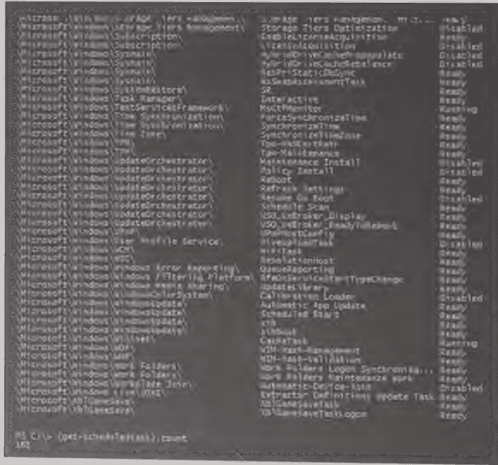
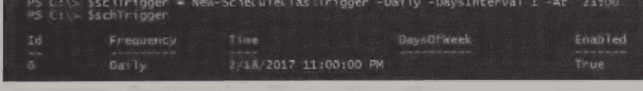
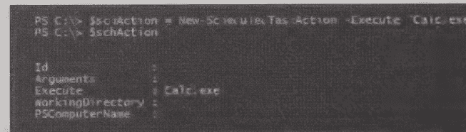
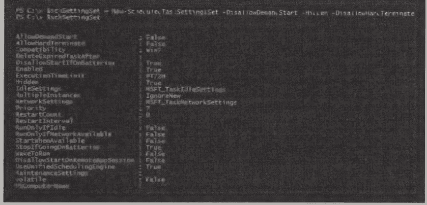
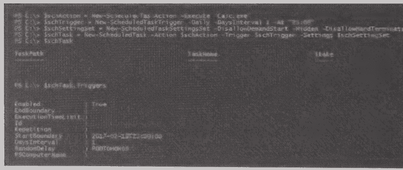
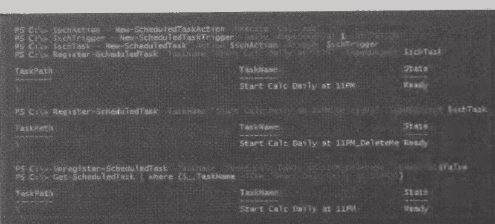
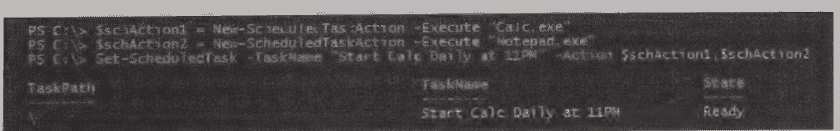
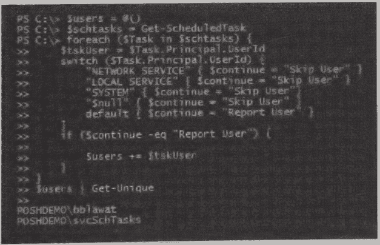

# 6 评估计划任务
## 评估计划任务

企业利用计划任务实现多种目的。无论是处理业务交易还是提供健康检查，它们已成为按计划运行操作的标准。计划任务具有灵活性，因为它们也可以在登录时、在触发特定事件后甚至手动运行。计划任务可以运行可执行文件，甚至可以启动脚本以扩展自动化无限的可能性。

由于计划任务用途广泛，使用 Windows 服务器扫描脚本扫描它们非常重要。这将帮助您识别仅在触发或按计划运行的进程，例如季度报告或夜间进程。它还可以用于识别用于运行这些计划任务的备用用户帐户。由于计划任务非常灵活，因此必须捕获计划任务正在执行的操作、如何调用它们以及指定运行任务的帐户。

本章中，您将：

- 了解如何在系统上查看计划任务
- 创建计划任务触发器、操作和设置集对象
- 利用触发器、操作和设置集创建计划任务对象
- 在系统上注册和注销计划任务
- 使用新操作更新现有计划任务
- 识别作为备用用户帐户运行的计划任务

### 计划任务

计划任务使您能够在系统上安排自动化操作。Microsoft 具有各种内置计划任务，其中包括时间同步、通用即插即用、Windows 更新和磁盘碎片整理。这些任务操作由不同的触发条件调用并自动在系统上运行。

您可以使用 get-scheduledtask cmdlet 检索系统上的计划任务列表。get-scheduledtask cmdlet 显示计划任务名称、其 taskpath 和当前状态的列表。您还可以返回其他属性，例如作者、日期、说明、版本和文档。

要检索和计算系统上的计划任务，您可以利用以下内容：

```
get-scheduledtask
(get-scheduledtask).count
```

此命令的输出如下所示：



此示例显示如何检索系统上的计划任务以及如何计算任务总数：

1. 您首先通过调用 get-scheduledtask cmdlet 开始。您将在系统上看到大量计划任务列表。
2. 然后您使用 .count 方法执行 get-scheduledtask cmdlet。此示例中的系统返回 165 个计划任务。

创建计划任务所需的两个组件是任务操作和任务触发器。任务触发器启动计划任务。最常见的触发器是按计划、在登录时、在启动时、在空闲时、在事件上和手动。在使用触发器时，您必须利用 New-ScheduledTaskTrigger cmdlet 创建新的任务触发器对象。然后您需要将任务触发器对象存储在变量中以创建计划任务。

要按计划创建计划任务触发器，您可以执行以下操作：

```
$schTrigger = New-ScheduledTaskTrigger -Daily -DaysInterval 1 -At "23:00"
$schTrigger
```

此命令的输出如下所示：



在此示例中，您学习如何创建计划任务触发器：

1. 您首先通过调用 New-ScheduledTaskTrigger cmdlet 开始，使用 -Daily 参数、使用 1 属性的 -DaysInterval 参数以及设置为 23:00 属性的 -At 参数。
2. 然后您将此计划任务触发器对象存储在 $schTrigger 变量中。当您调用 $schTrigger 变量时，它返回触发器 Id 为 0，频率为 Daily，时间为 2/18/2017 11:00:00 PM，DaysOfWeek 为 $null，并且 Enabled 设置为 true。

> 有关计划任务触发器及其语法的更多信息，您可以浏览至： https://technet.microsoft.com/itpro/powershell/windows/scheduled-tasks/new-scheduledtasktrigger.

任务操作定义计划任务正在执行的内容。任务操作可以简单到运行可执行文件，也可以调用脚本执行各种操作。您使用 New-ScheduledTaskAction cmdlet 创建新的操作对象。除了 cmdlet 之外，您还可以利用 -Execute 参数启动可执行文件。您还具有 -Argument 参数，它使您可以向正在调用的可执行文件传递参数。您需要将任务操作对象存储在变量中以创建计划任务。

要创建打开 calc.exe 的计划任务操作，您可以执行以下操作：

```powershell
$schAction = New-ScheduledTaskAction -Execute "Calc.exe"
$schAction
```

此命令的输出如下所示：



在此示例中，您学习如何创建计划任务操作：

1. 您首先通过调用 New-ScheduledTaskAction cmdlet 开始，将 -Execute 参数设置为 calc.exe 属性。
2. 然后您将此计划任务对象保存在 $schAction 变量中。

当您调用 $schAction 变量时，它返回 Id 为 $null，Arguments 为 $null，Execute 为 Calc.exe，WorkingDirectory 为 $null 和 PSComputerName 为 $null。如果向 new-ScheduledTaskAction cmdlet 传递了其他参数，$null 字段将填充数据。

配置的可选组件是任务设置集，它为计划任务本身提供配置。如果您想要包含其他参数，可以配置电池上的执行、执行持续时间、空闲持续时间、重启计数和重启间隔。您可以使用 New-ScheduledTaskSettingsSet cmdlet 定义计划任务设置集，并且您需要将其存储在变量中以创建计划任务。

要使用 -DisallowDemandStart、-Hidden 和 -DisallowHardTerminate 参数创建计划任务设置集，您可以执行以下操作：

```
$schSettingSet = New-ScheduledTaskSettingsSet -DisallowDemandStart
-Hidden -DisallowHardTerminate
$schSettingSet
```

此命令的输出如下所示：



在此示例中，您创建一个新的计划任务设置集：

1. 您首先通过声明 New-ScheduledTaskSettingsSet cmdlet 开始，使用 -DisallowDemandStart、-Hidden 和 -DisallowHardTerminate 参数。
2. 然后您将计划任务设置集对象设置为 $schSettingSet 变量。

当您调用 $schSettingSet cmdlet 时，您会显示计划任务设置集具有的所有参数。在此设置集中，您可以看到 AllowDemandStart 设置为 False，AllowHardTerminate 设置为 False，Hidden 设置为 True。

> 有关计划任务设置及其语法的更多信息，您可以浏览至： https://technet.microsoft.com/itpro/powershell/windows/scheduled-tasks/new-scheduledtasksettingsset.

在将任务操作和任务触发器捕获到变量后，您创建计划任务对象。您调用 New-ScheduledTask cmdlet，使用 -Action 参数引用任务操作对象，并使用 -Trigger 参数引用任务触发器对象。您还可以使用 -Settings 参数使用可选的任务设置集，通过引用任务设置集对象。您将所有这些项目放入将包含计划任务对象的变量中。

要创建计划任务变量，您可以执行以下操作：

```
$schAction = New-ScheduledTaskAction -Execute "Calc.exe"
$schTrigger = New-ScheduledTaskTrigger -Daily -DaysInterval 1 -At "23:00"
$schSettingSet = New-ScheduledTaskSettingsSet -DisallowDemandStart -Hidden -DisallowHardTerminate
$schTask = New-ScheduledTask -Action $schAction -Trigger $schTrigger -Settings $schSettingSet
$schTask
$schTask.Triggers
```

此命令的输出如下所示：



此示例显示如何采用计划任务操作、触发器和设置集来创建计划任务对象：

1. 您首先通过调用 New-ScheduledTaskAction cmdlet 开始，将 -Execute 参数设置为 calc.exe 属性。
2. 然后您将此计划任务对象保存在 $schAction 变量中。
3. 然后您使用 New-ScheduledTaskAction cmdlet 将 -Execute 参数设置为 calc.exe 属性。


- 4. 然后你将此计划任务对象保存在 `$schAction` 变量中。
- 5. 你继续声明 `New-ScheduledTaskSettingsSet` cmdlet，并使用 `-DisallowDemandStart`、`-Hidden` 和 `-DisallowHardTerminate` 参数。
- 6. 然后你将计划任务设置集对象设置为 `$schSettingSet` 变量。
- 7. 最后，你调用 `New-ScheduledTask` cmdlet，将 `-Action` 参数设置为 `$schAction`，将 `-Trigger` 参数设置为 `$schTrigger`，并将 `-Settings` 参数设置为 `$schSettingSet`。
- 8. 然后你取出计划任务对象并将其放入 `$schTask` 变量中。然而，当你调用 `$schTask` 变量时，它返回的 `TaskPath`、`TaskName` 和 `State` 为空白。这是因为任务需要注册，如下一步所述。虽然 `TaskPath`、`TaskName` 和 `State` 属性为空，但当你调用诸如 `$schTask.Triggers` 之类的属性时，你会看到这些属性已正确填充。在这种情况下，它返回你在之前步骤中设置的晚上11点触发器。
- 9. 最后一步是在系统上注册计划任务。

要注册计划任务，你可以使用 `Register-ScheduledTask` cmdlet，并使用 `-TaskName` 参数以及所需的名称作为参数。你还需要包含 `-InputObject` 参数，引用使用 `New-ScheduledTask` cmdlet 创建的对象。执行后，计划任务将在你的系统上正确创建。

如果你想删除计划任务，可以使用 `Unregister-ScheduledTask` cmdlet，并使用 `-TaskName` 参数以及要删除的名称作为参数。执行后，`Unregister-ScheduledTask` cmdlet 会提示你确认删除计划任务。要暂停确认提示，可以使用 `-Confirm:$false` 作为参数。这将从系统上删除计划任务而不提示。

要注册两个计划任务以便每天在 23:00 启动计算器，并注销其中一个计划任务，请执行以下操作：

```
$schAction = New-ScheduledTaskAction -Execute "Calc.exe"
$schTrigger = New-ScheduledTaskTrigger -Daily -DaysInterval 1 -At "23:00"
$schTask = New-ScheduledTask -Action $schAction -Trigger $schTrigger
Register-ScheduledTask -TaskName "Start Calc Daily at 11PM" -InputObject $schTask
```

```
Register-ScheduledTask -TaskName "Start Calc Daily at 11PM_DeleteMe" -InputObject $schTask
```

```
Unregister-ScheduledTask -TaskName "Start Calc Daily at 11PM_DeleteMe" -Confirm:$false
```

```
Get-ScheduledTask | where {$_.TaskName -like "Start Calc Daily at 11PM*"}
```

此命令的输出将如下所示：



在此示例中，你将学习如何创建两个计划任务以便每天在 23:00 启动计算器。你还将学习如何删除其中一个计划任务：

- 1. 你首先通过使用 New-ScheduledTaskAction cmdlet 创建计划任务操作，使用 -Execute 参数和 Calc.exe 参数开始。
- 2. 你将此对象放入 $schAction 变量中。
- 3. 你继续通过使用 New-ScheduledTaskTrigger cmdlet 创建计划任务触发器，使用 -Daily 参数、使用参数为 1 的 -DaysInterval 参数，以及参数为 23:00 的 -At 参数。
- 4. 你将计划任务触发器对象放入 $schTrigger 变量中。
- 5. 然后你通过使用 New-ScheduledTask cmdlet 创建计划任务对象，将 -Action 参数设置为 $schAction 的参数，并将 -Trigger 参数设置为 $schTrigger 的参数。
- 6. 你将此计划任务对象放入 $schTask 变量中。

- 7. 要使用两个不同的名称在系统上注册计划任务，你使用 Register-ScheduledTask cmdlet，将 -TaskName 参数设置为 Start Calc Daily at 11pm 参数。你还包含将 -InputObject 参数设置为 $schTask 变量。执行后，将创建名为 Start Calc Daily at 11pm 的计划任务。
- 8. 要创建第二个计划任务，你使用 Register-ScheduledTask cmdlet，将 -TaskName 参数设置为 Start Calc Daily at 11pm_DeleteMe 参数。你还包含将 -InputObject 参数设置为 $schTask 变量。执行后，将创建名为 Start Calc Daily at 11pm_DeleteMe 的计划任务。

要注销名称以 _Deleteme 结尾的计划任务，你使用 Unregister-ScheduledTask cmdlet，将 -TaskName 参数设置为 Start Calc Daily at 11PM_DeleteMe。你还使用 -Confirm:$false 参数来指定 cmdlet 无需提示确认。执行后，名为 Start Calc Daily at 11PM_DeleteMe 的计划任务将被从系统注销。你可以通过运行 Get-ScheduledTask cmdlet 并管道到 where {$_.TaskName -like "Start Calc Daily at 11PM*"} 来确认这一点。执行后，脚本将返回一个 Start Calc Daily at 11PM 的实例。

修改计划任务主要有两种方法：

- 1. 你可以选择注销并重新创建计划任务。
- 2. 你可以选择使用 Set-ScheduledTask cmdlet。Set-ScheduledTask cmdlet 允许你通过 -TaskName 参数调用特定的计划任务，并指定新的或额外的触发器、操作和计划任务设置。

利用前面的示例，要设置两个新的计划任务操作以打开记事本和计算器，你可以执行以下操作：

```powershell
$schAction1 = New-ScheduledTaskAction -Execute "Calc.exe"
$schAction2 = New-ScheduledTaskAction -Execute "Notepad.exe"
Set-ScheduledTask -TaskName "Start Calc Daily at 11PM" -Action $schAction1,$schAction2
```

此命令的输出将如下所示：



此示例显示如何更新现有计划任务以具有两个新的计划任务操作：

- 1. 你首先通过调用 `New-ScheduledTaskAction` cmdlet 开始，使用 `-Execute` 参数和 `calc.exe` 参数。
- 2. 你将此计划操作任务对象放入 `$schAction1` 变量中。
- 3. 然后你调用 `New-ScheduledTaskAction` cmdlet，使用 `-Execute` 参数和 `notepad.exe` 参数。
- 4. 你将此计划操作任务对象放入 `$schAction2` 变量中。
- 5. 最后，你调用 `Set-ScheduledTask` cmdlet，将 `-TaskName` 参数设置为 `Start Calc Daily at 11PM`。你还调用 `-Action` 参数并声明两个操作：`$schAction1`、`$schAction2`。执行后，计划任务设置为 23:00 并将同时启动 `calc.exe` 和 `notepad.exe`。

> 在撰写本文时，没有原生的重命名计划任务的方法。为此，你需要将计划任务导出为 XML，并使用 XML 文件注册新的计划任务。有关导出过程的更多信息，请参阅这里: https://technet.microsoft.com/itpro/powershell/windows/scheduled-tasks/export-scheduledtask。

## 识别以其他用户身份运行的计划任务

可能存在需要识别使用非默认凭据运行的计划任务的情况。如果用户利用其身份运行计划任务，或你正在使用服务帐户，你需要在系统上识别其使用情况。`Get-ScheduledTask` cmdlet 具有 Principal 属性，其中包含运行计划任务的用户帐户的信息。`UserID` 反映了指定运行计划任务的帐户的用户名。

除了识别 Principal UserId 之外，你还需要过滤掉内置 Windows 帐户。为此，你可以创建 switch 语句以对 Principal UserIds 进行多次评估。如果进程所有者用户名是 `NETWORK SERVICE`、`LOCAL SERVICE`、`$null` 或 `System`，你可以跳过报告用户名。如果它与这些值中的任何一个都不匹配，它将使用默认 switch 并将用户报告到列表中。由于多个计划任务在同一用户下运行，你可以将用户结果管道到 `Get-Unique` cmdlet，该 cmdlet 仅选择数组中的唯一值。


为了评估计划任务并获取运行计划任务的账户列表，您可以执行以下操作：

```
$users = @()
$schtasks = Get-ScheduledTask
foreach ($Task in $schtasks) {
    $tskUser = $Task.Principal.UserId
    switch ($Task.Principal.UserId) {
"NETWORK SERVICE" { $continue = "Skip User" }
"LOCAL SERVICE" { $continue = "Skip User" }
"SYSTEM" { $continue = "Skip User"}
"$null" { $continue = "Skip User" }
        default { $continue = "Report User" }
    }
    if ($continue -eq "Report User") {

        $users += $tskUser
    }
}
$users | Get-Unique
```

其输出如下图所示：



本示例展示如何输出运行计划任务的非内置用户账户：

1. 你首先定义一个名为 `$users` 的数组。
2. 然后你利用 `Get-ScheduledTask` cmdlet，将结果放在 `$schtasks` 变量中。
3. 然后你创建一个 `foreach` 循环，遍历 `$schtasks` 变量中的每个 `$Task`。
4. 你接着使用 `$Task.Principal.UserID` 属性收集当前迭代计划任务的 `Principal.UserID`，并将其放入 `$tskUser` 变量中。
5. 然后你声明一个 `switch` 语句来评估 `$Task.Principal.UserID` 属性。最初的评估针对的是内置账户。如果账户为 `NETWORK SERVICE`、`LOCAL SERVICE`、`SYSTEM` 或 `$null`，则会将 `$continue` 设置为 `Skip User`。如果与这些内置用户都不匹配，则会使用 `default` 值，将 `$continue` 变量设置为 `Report User`。
6. 退出 `switch` 语句后，你使用 `If` 语句评估 `$continue` 变量，如果值等于 `Report User` 则继续。此步骤会将 `$tskUser` 变量添加到 `$users` 数组中。

`foreach` 循环完成后，你将为每个非内置用户列出大量用户。为了将列表精简为单个或唯一用户，你将 `$users` 变量通过管道传递给 `get-unique` cmdlet。结果是系统上唯一非内置用户的列表。

该示例运行的系统有两个非默认用户账户：
`POSHDEMO\bblawat` 和 `POSHDEMO\svcSchTasks`。

## Summary

本章中，你学习了如何在 PowerShell 中处理计划任务。你首先学习了如何在系统上获取计划任务。然后你学习了如何设置计划任务触发器、计划任务操作和计划任务设置集。你继续创建了一个计划任务对象并将其注册到系统中。你还学习了如何注销计划任务以将其从系统中移除。然后你练习了更新现有计划任务。本章以学习如何识别用于运行计划任务的任何用户或服务账户的权限而结束。

在下一章中，你将学习如何查询系统以确定磁盘统计信息，例如可用空间、磁盘利用率和驱动器类型判定。
