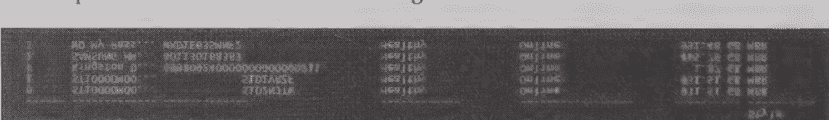
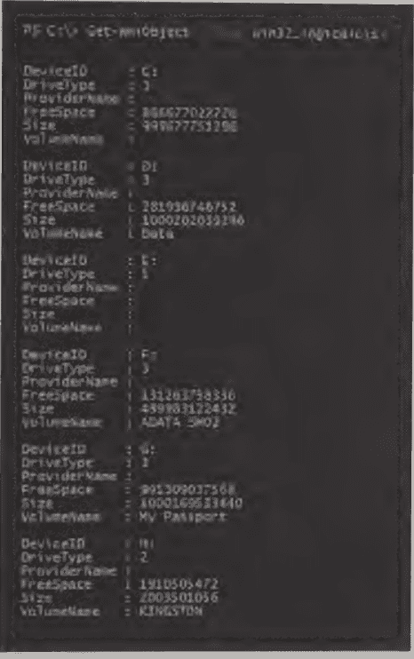
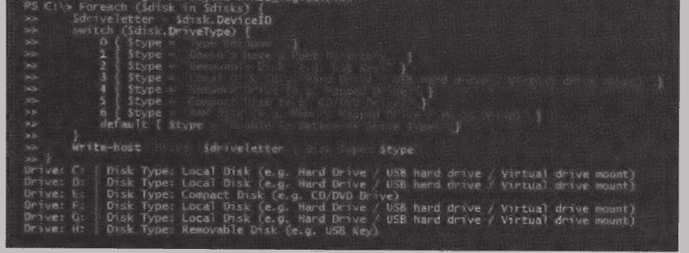
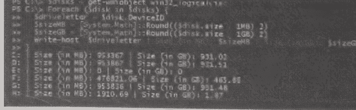
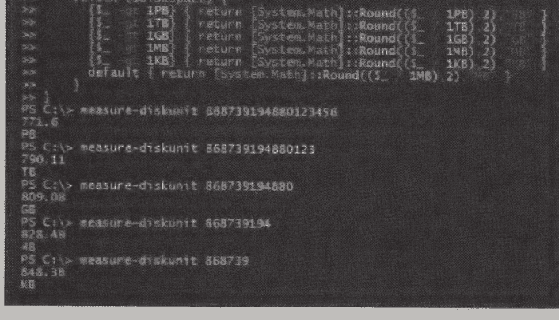
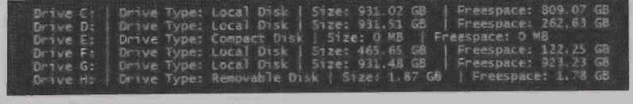

# 7 Determining Disk Statistics

## Determining Disk Statistics

使用 Windows 服务器扫描脚本评估的另一个重要组件是磁盘统计信息。无论你是扫描以识别配置还是扫描以替换系统，评估完整的磁盘配置都很重要。通过 PowerShell，你能够收集有关物理磁盘布局、逻辑磁盘布局以及插入系统中的可移动设备的信息。这有助于识别 USB 授权密钥设备，甚至是插入系统用于备份的外部硬盘。

Windows 服务器扫描脚本还可以让你查看连接到系统上的所有设备的磁盘大小和可用空间。这些信息在系统磁盘空间不足或驱动器大小不符合公司标准时可能很有帮助。本章将使你能够详细了解系统上的磁盘配置。

本章中，我们讨论以下主题：

- 检索物理和逻辑磁盘信息
- 确定连接到系统的磁盘类型
- 将磁盘字节值转换为兆字节和千兆字节
- 动态确定磁盘度量单位
- 创建磁盘信息脚本以查询系统上的磁盘、转换磁盘大小和可用空间、计算度量单位并识别驱动器类型

> 为了获得本章示例的最佳效果，建议使用具有多个磁盘的系统。你也可以选择插入外部硬盘或 USB 驱动器以模拟额外的存储设备。


### Disk statistics

无论你是进行容量规划还是计划服务器更换，评估磁盘信息的原因有很多。PowerShell 提供了多种检索磁盘信息的方法。如果想了解系统上物理磁盘的更多信息，可以使用 `get-disk` cmdlet。`get-disk` cmdlet 提供的信息包括 Number、Friendly Name、Serial Number、HealthStatus、OperationalStatus、Total size 和 Partition Style。


> 要确定 `get-disk` cmdlet 可用的所有属性，可以执行 `get-disk | get-member`。这将显示物理磁盘的所有可用方法和属性。

### Retrieving physical and logical disk information

要检索系统上物理磁盘的磁盘信息，可以执行以下命令：

```
get-disk
```

其输出如下图所示：



本示例展示如何获取系统上物理磁盘的信息。当你执行 `get-disk` cmdlet 时，该 cmdlet 返回磁盘 Number、Friendly Name、Serial Number、HealthStatus、OperationalStatus、TotalSize 和 Partition Style。该示例运行的系统连接了五个逻辑设备，这在 cmdlet 的输出中有所体现。

当你想确定有关磁盘操作系统使用的更多信息时，可以利用 Windows 管理规范（WMI）。要读取逻辑磁盘信息，可以使用 `get-wmiobject` cmdlet，并将 `-class` 参数设置为 `win32_logicaldisk` 参数。当你查询 `win32_logicaldisk` 类时，可以访问 DeviceID、DriveType、ProviderName、FreeSpace、Size 和 Volume name 属性。

要查询 win32_logicaldisk 类以获取磁盘信息，可以执行以下操作：

```
Get-WmiObject -class win32_logicaldisk
```

其输出如下图所示：



以下示例展示如何利用 get-wmiobject 查询 WMI 以提供磁盘信息：

1. 你首先使用 `-class` 参数设置为 win32_logicaldisk 参数的 get-wmiobject cmdlet。
2. 执行后，cmdlet 返回 DeviceID、DriveType、ProviderName、FreeSpace、Size 和 VolumeName 属性。

该示例运行的系统连接了六个设备，这在 cmdlet 的输出中有所体现。这与 get-disk cmdlet 不同，WMI 提供程序考虑了空的 CD-ROM/DVD 驱动器。

### The DriveType property

DriveType 属性表示一个数值，对应于一种驱动器类型。该值范围为 0 到 6，具体取决于连接的物理设备类型。DriveType 对应关系如下：

- 0: Unknown device type
- 1: Drive does not have a root directory
- 2: Removable disk (USB key)
- 3: Local disk (hard drive/USB hard drive/virtual drive mount)
- 4: Network drive/mapped drive
- 5: Compact disk (CD/DVD drive)
- 6: RAM drive (memory mapped drive/PE OS drive)

为了快速确定 DriveType 属性的对应关系，可以执行以下 switch 命令：

```powershell
$disks = get-wmiobject win32_logicaldisk
Foreach ($disk in $disks) {
    $driveletter = $disk.DeviceID
    switch ($disk.DriveType) {
        0 { $type = "Type Unknown." }
        1 { $type = "Doesn't have a Root Directory." }
        2 { $type = "Removable Disk (e.g. USB Key)" }
        3 { $type = "Local Disk (e.g. Hard Drive / USB hard drive / Virtual drive mount)" }
        4 { $type = "Network Drive (e.g. Mapped Drive)" }
        5 { $type = "Compact Disk (e.g. CD/DVD Drive)" }
        6 { $type = "RAM Disk (e.g. Memory Mapped Drive / PE OS Drive)" }
        default { $type = "Unable To Determine Drive Type!" }
    }
    Write-host "Drive: $driveletter | Disk Type: $type"
}
```

本脚本的输出显示在以下屏幕截图中：



在此示例中，您创建一个 switch 语句，将 DriveType 数字与可读值关联起来：

- 1. 您首先使用 `get-wmiobject` 并传入 `win32_logicaldisk` 参数，并将驱动器信息存储在 `$disks` 变量中。
- 2. 然后您创建一个 `Foreach` 语句来评估 `$disks` 变量中的每个 `$disk`。
- 3. 然后您通过调用 `$disk.DeviceID` 属性来获取驱动器号，并将值设置到 `$driveletter` 中。
- 4. 然后您启动 `switch` 语句并评估 `$disk.DriveType` 值。

`switch` 语句评估数字并将其关联到可读值。如果 `DriveType` 为 0，则会将 `$type` 变量设置为 类型未知。如果 `DriveType` 为 1，则会将 `$type` 变量设置为 没有根目录。如果 `DriveType` 为 2，则会将 `$type` 变量设置为 可移动磁盘（例如 USB 密钥）。如果 `DriveType` 为 3，则会将 `$type` 变量设置为 本地磁盘（例如 硬盘 / USB 硬盘 / 虚拟驱动器挂载）。如果 `DriveType` 为 4，则会将 `$type` 变量设置为 网络驱动器（例如 映射驱动器）。如果 `DriveType` 为 5，则会将 `$type` 变量设置为 光盘（例如 CD/DVD 驱动器）。如果 `DriveType` 为 6，则会将 `$type` 变量设置为 RAM 磁盘（例如 内存映射驱动器 / PE OS 驱动器）。

- 5. 在这些评估之后，您随后利用 `write-host` cmdlet 将内容打印到屏幕：驱动器：`$driveletter` | 磁盘类型：`$type`。

运行此示例的系统上连接了五个逻辑设备，具有不同的驱动器类型。不同的驱动器类型在 cmdlet 的输出中有所体现。

## 将磁盘空间转换为 MB 和 GB

在处理逻辑磁盘的 Size 和 FreeSpace 属性时，值以字节表示。PowerShell 提供了一种快速方法将字节转换为多种格式。您可以取 Size 或 FreeSpace 属性并除以 1MB 得到兆字节，除以 1GB 得到千兆字节，除以 1TB 得到太字节，除以 1PB 得到拍字节。转换后，您通常需要对数字进行四舍五入，利用 `[System.Math]::Round()` 方法。默认情况下，此 .NET Round() 方法会四舍五入到最接近的整数。要包含小数位，您可以提供额外的数值参数，例如 `[System.Math]::Round($value,2)`，将 $value 四舍五入到两位小数。

要将磁盘 Size 属性转换为兆字节和千兆字节，您可以执行以下操作：

```
$disks = get-wmiobject win32_logicaldisk
Foreach ($disk in $disks) {
    $driveletter = $disk.DeviceID
    $sizeMB = [System.Math]::Round(($disk.size / 1MB),2)
    $sizeGB = [System.Math]::Round(($disk.size / 1GB),2)
    Write-host "$driveletter | Size (in MB): $sizeMB | Size (in GB): $sizeGB"
}
```

本脚本的输出显示在以下屏幕截图中：



此示例演示如何将硬盘 `Size` 属性格式化为兆字节和千兆字节：

- 1. 您首先通过利用 `get-wmiobject` cmdlet 并传入 `win32_logicaldisk` 参数来启动脚本，并将返回的值放在 `$disks` 变量中。
- 2. 然后您创建一个 `Foreach` 语句来评估 `$disks` 变量中的每个 `$disk`。
- 3. 您评估 `$disk.DeviceID` 属性并将驱动器号值设置为 `$driveletter` 变量。
- 4. 然后您利用 `[System.Math]::Round()` 方法对从 `$disk.Size` 参数计算得出的值除以 1MB 后进行四舍五入。
- 5. 您还将 `,2` 参数传递给该方法，以在计算中提供两位小数。
- 6. 您将此值的输出存储在 `$sizeMB` 变量中。
- 7. 您继续利用 `[System.Math]::Round()` 方法对从 `$disk.Size` 参数计算得出的值除以 1GB 后进行四舍五入。
- 8. 您再次将 `,2` 参数传递给该方法，以在计算中提供两位小数。
- 9. 您将此值的输出存储在 `$sizeGB` 变量中。
- 10. 最后，您利用 `write-host` cmdlet 将内容打印到屏幕：`$driveletter | Size (in MB): $sizeMB | Size (in GB): $sizeGB`。
- 11. 在系统上执行此脚本后，您会看到每个驱动器号都被打印出来，并且以 MB 为单位的 `Size` 和以 GB 为单位的大小都会显示。

您还会看到所有值都四舍五入到两位小数，除非计算结果为整数。您还会在示例中看到一个驱动器的驱动器大小评估为 0。根据前面的示例，您注意到该驱动器是系统上的 CD-ROM/DVD 驱动器。由于该驱动器中没有插入磁盘，因此 `Size` 为 0。

## 空闲空间属性

另一个重要的属性是 FreeSpace 属性。FreeSpace 属性的范围可以从磁盘的 Size 属性值到 0。在编写脚本以确定可用空间时，您必须考虑剩余空间可能不是您开始时使用的相同度量单位。例如，您可能有一个 2 太字节的驱动器，但磁盘上可能只剩下 100 千字节。如果您将剩余的 100 千字节转换为太字节，该值将会有很长的十进制位数。相反，您需要建立逻辑来根据驱动器上的剩余空间确定适当的度量单位。

实现此目的最简单的方法之一是创建一个 PowerShell 函数来评估系统上的磁盘空间。此函数将允许使用 $diskspace 参数。然后它将利用 switch 语句来评估 $diskspace 值。如果它大于 1PB、1TB、1MB 或 1KB，按此顺序，它将执行适当的数学计算以转换适当的度量单位。随后将四舍五入到两位小数的值连同度量单位一起返回给脚本。此方法成功的关键在于利用函数进行评估。当找到适当的度量单位时，您使用 Return 命令，函数在将值返回给脚本后退出。

要将磁盘空间转换为相应的度量单位，您可以执行以下操作：

```
function measure-diskunit { param($diskspace)
    switch ($diskspace) {
        {$_ -gt 1PB} { return [System.Math]::Round(($_ / 1PB),2),"PB" }
        {$_ -gt 1TB} { return [System.Math]::Round(($_ / 1TB),2),"TB" }
        {$_ -gt 1GB} { return [System.Math]::Round(($_ / 1GB),2),"GB" }
        {$_ -gt 1MB} { return [System.Math]::Round(($_ / 1MB),2),"MB" }
        {$_ -gt 1KB} { return [System.Math]::Round(($_ / 1KB),2),"KB" }
        default { return [System.Math]::Round(($_ / 1MB),2),"MB" }
    }
}

measure-diskunit 868739194880123456
measure-diskunit 868739194880123
measure-diskunit 868739194880
measure-diskunit 868739194
measure-diskunit 868739
```

本脚本的输出显示在以下屏幕截图中：



此示例演示如何将字节值转换为多种度量单位：

- 1. 您首先通过声明一个名为 `measure-diskunit` 的函数并使用 param of (`$diskspace`) 来开始。
- 2. 然后您创建一个带有参数 `$diskspace` 的 `switch` 语句。

在 `switch` 评估中，您首先评估由 `$_` 表示的管道，然后确定 `$diskspace` 值是否大于 1 PB（1PB）：

- 如果值大于 1PB，脚本将使用管道值并除以 1PB。然后它将利用 `[System.Math]::Round()` 方法并使用参数 2 对结果值进行四舍五入，以保留两位小数。作为返回数组的第二个值，您提供一个逗号后跟 PB 单位。转换后的值和单位将返回给脚本，从而终止函数中的进一步评估。
- 如果单位不是大于 1PB，它将继续评估 `switch` 语句中的语句。
- 它将确定 `$diskspace` 值是否大于 1TB，进行四舍五入，并将单位返回给脚本。


- 如果 $diskspace 值不大于 1TB，它将在 switch 语句中继续判断该值是否大于 1GB、1MB 和 1KB，判断方式相同，并在匹配时返回转换后的值和度量单位。
- 如果没有值匹配，switch 将默认以 MB 返回值。

在此示例中，你使用五个不同的 $diskspace 值运行 measure-diskunit 函数。第一个语句 measure-diskunit 868739194880123456 返回数组 771.6 和 PB。下一个语句 measure-diskunit 868739194880123 返回数组 790.11 和 TB。接下来的语句 measure-diskunit 868739194880 返回数组 809.08 和 GB。语句 measure-diskunit 868739194 返回数组 828.49 和 MB。最后的语句 measure-diskunit 868739 返回数组 848.38 和 KB。

## 磁盘信息脚本

本章解释了扫描系统上附加的逻辑驱动器不同方面的不同方法。如果您想查询系统上的磁盘、转换磁盘大小和可用空间并识别驱动器类型，可以创建以下脚本：

```
function measure-diskunit { param($diskspace)
    switch ($diskspace) {
        {$_ -gt 1PB} { return [System.Math]::Round(($_ / 1PB),2),"PB" }
        {$_ -gt 1TB} { return [System.Math]::Round(($_ / 1TB),2),"TB" }
        {$_ -gt 1GB} { return [System.Math]::Round(($_ / 1GB),2),"GB" }
        {$_ -gt 1MB} { return [System.Math]::Round(($_ / 1MB),2),"MB" }
        {$_ -gt 1KB} { return [System.Math]::Round(($_ / 1KB),2),"KB" }
        default { return [System.Math]::Round(($_ / 1MB),2),"MB" }
    }
}
```

```
$disks = get-wmiobject win32_logicaldisk
Foreach ($disk in $disks) {
    $driveletter = $disk.DeviceID
    $freespace = $disk.FreeSpace
    $size = $disk.Size
}
```

```
if ($freespace -lt 1) { $freespace = "0" }
if ($size -lt 1) { $size = "0" }

$freetype = measure-diskunit $freespace
$convFreeSpc = $freetype[0]
$funit = $freetype[1]

$sizetype = measure-diskunit $size
$convsize = $sizetype[0]
$sunit = $sizetype[1]

switch ($disk.DriveType) {
  0 { $type = "Type Unknown." }
  1 { $type = "Doesn't have a Root Directory." }
  2 { $type = "Removable Disk" }
  3 { $type = "Local Disk" }
  4 { $type = "Network Drive" }
  5 { $type = "Compact Disk" }
  6 { $type = "RAM Disk" }
  default { $type = "Unable To Determine Drive Type!" }
}

    write-host "Drive $driveletter | Drive Type: $type | Size: $convsize $sunit | Freespace: $convFreeSpc $funit"
}
```

此脚本的输出显示在以下屏幕截图中：



此示例解释了如何查询系统上的磁盘、转换磁盘大小和可用空间并识别驱动器类型：

- 1. 你首先通过定义 `measure-diskunit` 函数开始。

本章前面你了解到，此函数用于确定度量单位，并计算该单位中的转换值。你还了解到此函数还利用 `[System.Math]::Round()` 方法将值四舍五入到两位小数。你还了解到此函数以数组形式向脚本返回两个值。第一个值是转换后的值；第二个值是度量单位。

- 2. 然后你继续查询系统上的本地磁盘，利用 `get-wmiobject` cmdlet 并使用 `win32_logicaldisk` 参数，并将结果设置在 `$disks` 变量中。你为 `$disks` 变量中的每个 `$disk` 创建一个 `Foreach` 循环。

- 3. 然后你通过调用 `$disk.DeviceID` 属性来获取驱动器号并将其存储在 `$driveletter` 变量中。

- 4. 你通过调用 `$disk.FreeSpace` 属性来检索可用空间并将结果存储在 `$freespace` 变量中。

- 5. 你最后调用 `$disk.Size` 属性并将值存储在 `$size` 变量中。

- 6. 下一步是评估磁盘可用空间或磁盘大小是否小于 1。这意味着驱动器已满或驱动器中未加载任何介质。为捕获除零错误，如果可用空间为 0，则将 `$freespace` 值设置为 0。如果大小为 0，则将 `$size` 设置为零。

- 7. 接下来你通过使用 `$freespace` 参数利用 `measure-diskunit` 来评估磁盘可用空间的度量单位。函数的计算结果被返回并存储在 `$freetype` 变量中。由于 `measure-diskunit` 返回的值是一个包含两项的数组，你将第一个值，即 `$freetype[0]`，设置在 `$convFreeSpc` 变量中。你将第二个值，即 `$freetype[1]`，设置在 `$funit` 变量中。

- 8. 你继续通过使用 `$size` 参数利用 `measure-diskunit` 来评估磁盘大小的度量单位。函数的计算结果被返回并存储在 `$sizetype` 变量中。由于 `measure-diskunit` 返回的值是一个包含两项的数组，你将第一个值，即 `$sizetype[0]`，设置在 `$convSize` 变量中。你将第二个值，即 `$sizetype[1]`，设置在 `$sunit` 变量中。

- 9. 最后，你使用之前创建的 switch 根据驱动器类型编号确定驱动器类型。

然后驱动器类型的结果被放入 $type 变量以供脚本最终输出使用。在 `Foreach` 循环的最后，你运行 `write-host` cmdlet 来输出该磁盘迭代的 `Drive $driveletter | Drive Type: $type | Size: $convsize $sunit | Freespace: $convFreeSpc $funit` 结果。执行脚本后，所有磁盘驱动器号、驱动器类型、大小、可用空间以及适当的度量单位都会返回到屏幕上。

## 总结

在本章中，你学习了如何利用 PowerShell 与磁盘驱动器交互。你通过学习 `get-disk` cmdlet 开始本章。你继续利用 `get-wmiobject` 和 `win32_logicaldisk` 类来查询磁盘信息。然后你创建了一个 `switch` 语句来确定不同的磁盘类型。你还学习了如何将字节转换为兆字节和千兆字节。你创建了一个函数来动态转换为不同的度量单位并将值四舍五入到两位小数。你以创建磁盘信息脚本结束本章，该脚本查询系统上的磁盘、转换磁盘大小和可用空间、计算度量单位并识别驱动器类型。

在下一章中，你将扫描 Windows 功能和系统上安装的软件。
