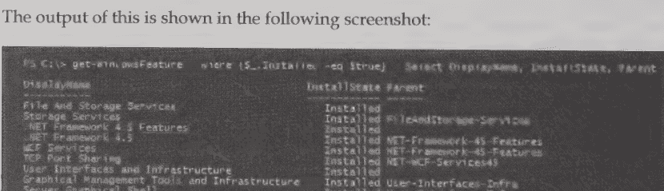
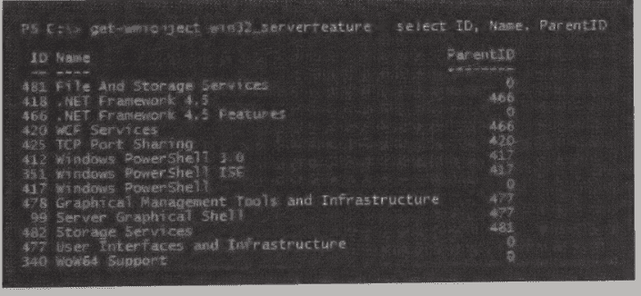
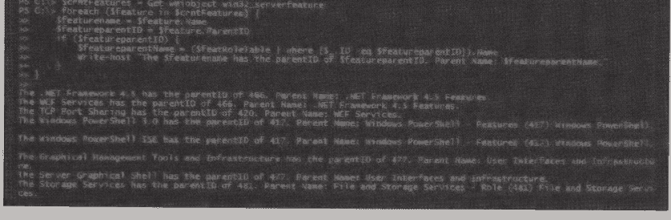
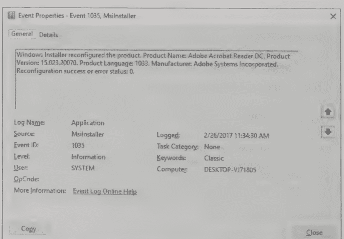
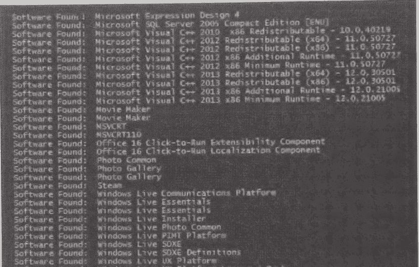
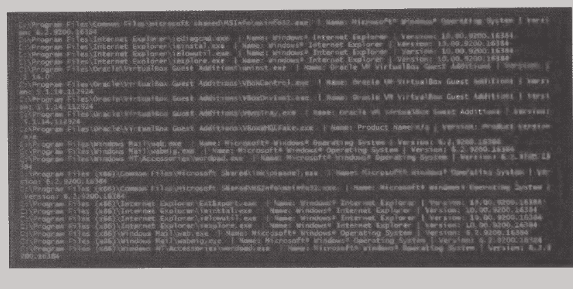

# 8 Windows 功能和已安装软件检测

发现系统功能的一部分是确定安装了哪些 Windows 功能和软件标题。在企业环境中，有时很难确定单个系统上安装了什么。虽然你可以手动登录服务器并评估配置，但收集所有服务器信息可能需要很长时间。

Windows 服务器扫描脚本通过各种 cmdlet 使扫描单个 Windows 功能、角色和软件变得容易。你将学习如何扫描注册表和单个可执行文件以获取系统上已安装软件的信息。这使你能够检测在添加/删除程序中可以找到的软件，以及未在添加/删除程序中添加已安装条目的软件。

在本章中，你将：

- 使用 `get-windowsFeature` cmdlet 检索服务器功能和角色
- 评估 `win32_serverfeature` 类以获取旧系统上的功能和角色
- 将 Windows 功能、角色 ID 和父 ID 与用户友好的名称相关联
- 了解为什么不应使用 `win32_product` 类进行软件发现
- 利用注册表确定已安装的软件
- 扫描 `Program Files` 和 `Program Files (x86)` 以获取已安装软件信息


> 为遵循本章中的示例，建议您在 Windows Server 2012 系统上运行示例。本章中引用的某些 cmdlet 在 PowerShell 2.0、工作站操作系统或早于 Server 2008 R2 的操作系统中不可用。

## Windows 功能

当您尝试确定 Windows 服务器的功能时，通常首先通过评估 Windows 功能和角色开始。PowerShell 有多种方法可在系统上查询服务器功能和角色。get-WindowsFeature cmdlet 可在 Server 2008 R2 及更高版本中使用，可提供已安装在系统上的功能和角色的简单显示。get-WindowsFeature cmdlet 具有多个属性，包括 DisplayName 属性、Name 属性、Installed 属性、Parent 属性和 InstallState 属性。DisplayName 属性是服务的友好名称。Name 属性是 DisplayName 的简短版本。Installed 属性是一个 true 或 false 属性，反映功能是否已安装。InstallState 属性提供有关功能是否已安装、已移除或可供安装的信息。

要查询服务器上已安装的服务器功能，您可以执行以下操作：

```
get-WindowsFeature | where { $_.Installed -eq $true } | Select DisplayName, InstallState, Parent
```

此输出显示在以下屏幕截图中：



在此示例中，您展示如何利用 get-WindowsFeature cmdlet 报告已安装的 Windows 功能：

- 1. 您首先调用 get-WindowsFeature cmdlet 并将其通过管道传递给 where {$_.Installed -eq $true}。这会选择系统上安装的所有 Windows 功能。然后您将这些结果通过管道传递给 Select cmdlet 以收集 DisplayName、InstallState 和 Parent 属性。
- 2. 执行后，您会看到服务器系统上安装的所有 Windows 功能，包括其 DisplayName、InstallState 和 Parent 属性。

在早于 Windows Server 2008 R2 的系统上，或安装了 PowerShell 2.0 的系统上，get-WindowsFeature cmdlet 不可用。相反，您可以利用 Windows 管理规范 (WMI) 提供已安装服务器功能的列表。您首先通过调用 get-wmiobject cmdlet 并将 win32_serverfeature 类作为参数。执行后，您只会收到系统上安装的功能。可用属性的数量也仅限于 ID、Name 和 ParentID。

要在早于 Windows Server 2008 R2 的系统上或安装了 PowerShell 2.0 的系统上查询服务器上已安装的服务器功能，您可以执行以下操作：

```
get-wmiobject win32_serverfeature | select ID, Name, ParentID
```

此输出显示在以下屏幕截图中：



此示例展示如何通过利用 win32_serverfeature 类查询 Windows 功能：

- 1. 您首先使用 get-wmiobject cmdlet 并使用 win32_serverfeature 参数。
- 2. 然后您将结果通过管道传递给 Select cmdlet，值为 ID、Name 和 ParentID。
- 3. 执行后，已安装的 Windows 功能将与其 ID、Name 和 ParentID 属性一起显示。

> 本节利用预填充的 XML 文件进行 Windows 功能 ID 搜索。要获取此文件，您可以从本书的资源页面下载。

当您查询 win32_serverfeature 类时，功能和角色父信息将作为 ID 返回。当您想要确定功能或角色的 ParentID 时，您必须想出替代方法来执行关联。本章中，您将利用本书示例中的预填充 ServerFeatureIDs.xml 文件将 ID 与其友好名称相关联。ServerFeatureIDs.xml 文件应复制到 c:\temp\POSHScript\ 目录。

要调用 win32_serverfeature 类、查询具有 ParentID 的功能和角色并通过利用 XML 文件进行关联，您可以执行以下操作：

```
[xml] $frxml = Get-Content "C:\temp\POSHScript\ServerFeatureIDs.xml"
$featRoleTable = $frxml.GetElementsByTagName("feature")
$crntFeatures = Get-wmiobject win32_serverfeature
foreach ($feature in $crntFeatures) {
    $featurename = $feature.Name
    $featureparentID = $feature.ParentID
    if ($featureparentID) {
        $featureparentName = ($featRoleTable | where { $_.ID -eq $featureparentID}).Name
        Write-host "The $featurename feature has the parentID of $featureparentID. Parent Name: $featureparentName."
    }
}
```

此输出显示在以下屏幕截图中：



此示例展示如何利用 win32_serverfeature 类查询 Windows 功能和角色，并将它们的 ParentIDs 与友好名称相关联：

- 1. 您首先获取 ServerFeatureIDs.xml 文件中的 XML 内容。这是通过使用 Get-Content cmdlet 并使用 c:\temp\POSHScript\ServerFeatureIDs.xml 参数完成的。
- 2. 您将结果保存在 $frxml 变量中，强制为 [XML] 数据类型。
- 3. 然后您从 ServerFeatureIDs.xml 创建关联数据的表。为此，您调用 $frxml 变量并使用 .GetElementsByTagName() 方法，并使用 feature 参数。然后关联数据的数组存储在 $featRoleTable 变量中。
- 4. 然后您继续查询系统上安装的所有功能。
- 5. 您利用 get-wmiobject cmdlet 并将 win32_serverfeature 类作为参数，并将结果存储在 $crntFeatures 变量中。
- 6. 然后您使用 foreach 循环评估 $crntFeatures 中的每个 $feature。
- 7. 您收集 $feature.Name 属性以将其放入 $featurename 变量中，并将 $feature.ParentID 属性放入 $featureparentID 变量中。
- 8. 为确保仅显示具有父 ID 的功能，您利用 if ($featureparentID) 语句，只有在 $featureparentID 用数据填充时才会继续。如果存在父 ID，则您通过使用管道搜索 $featRoleTable 数组。您查询 | where { $_.ID -eq $featureparentID }，它将 $featureparentID 与关联数据中的 ID 匹配，
- 9. 然后您将整个语句用括号括起来并选择查询结果的 .Name 属性。
- 10. 最后，您利用 `write-host` cmdlet 将内容写入屏幕。`$featurename` 功能的 parentID 为 `$featureparentID`。父名称：`$featureparentName`。执行后，脚本返回系统上的活动功能、功能或角色名称、功能的 parentID 以及从 parentID 到功能父友好名称的关联。

> 服务器功能和角色名称随着不同版本的 Windows Server 不断发展。如需获取最新的 Windows 功能和角色 ID 及名称列表，您可以参考以下 MSDN 链接：https://msdn.microsoft.com/en-us/library/cc280268(v=vs.85).aspx。

## 已安装软件检测

检测系统上的软件可能是一项困难的任务。虽然 WMI `win32_product` 类记录了系统上每个 **微软安装程序 (MSI)** 安装的软件，但强烈建议您不要使用此类。当您查询 `win32_product` 类时，它会重新配置系统上安装的每个 MSI 软件。这可能会导致意外服务中断，因为应用程序被重新安装、配置被覆盖，并且 MSI 修复无法成功完成：



前面的屏幕截图显示了调用 win32_product 类时生成的多个消息之一。您会看到 Windows 安装程序强制重新配置已安装的软件产品。您还会看到重新配置状态和错误状态消息。如果您不小心使用了 win32_product 类，您可以扫描事件日志以获取状态消息，并在出现错误时正确重新安装应用程序。


> 请避免在脚本中使用 win32_product 类。由于 MSI 会对已安装的软件执行修复/重新配置，这将导致环境不稳定。请使用本章中的其他方法来识别系统上安装的软件。

由于 win32_product 类的限制，您需要访问操作系统的多个区域来识别已安装的应用程序。首先要开始的地方是注册表。由于 MSI 和其他软件安装程序将卸载应用程序的逻辑放在注册表中，您可以在 HKLM:\Software\Microsoft\Windows\CurrentVersion\Uninstall\ 和 HKLM:\Software\Wow6432Node\Microsoft\Windows\CurrentVersion\Uninstall\ 注册表项位置中识别已安装的软件。要识别这些软件标题，您必须遍历每个子项并搜索属性：DisplayName。如果键没有 DisplayName 属性，很可能您需要利用替代方法来发现已安装的软件。

要使用注册表识别已安装的软件，您可以执行以下操作：

```
$RegLocations = "HKLM:\Software\Microsoft\Windows\CurrentVersion\
Uninstall\*","HKLM:\Software\Wow6432Node\Microsoft\Windows\
CurrentVersion\Uninstall\*"

foreach ($reg in $RegLocations) {
    $softwareKeys = get-ItemProperty $reg | Select DisplayName | Sort DisplayName
    foreach ($software in $softwareKeys) {
        if ($software.DisplayName -ne $null) { Write-host "Software Found: " $software.DisplayName }
    }
}
```


The output of this is shown in the following screenshot:



This example displays how to identify installed software by leveraging the Uninstall registry keys:

- 1. You first start by declaring both the standard registry location of `HKLM:\Software\Microsoft\Windows\CurrentVersion\Uninstall\*` and the WOW6432Node location of `HKLM:\Software\Wow6432Node\Microsoft\Windows\CurrentVersion\Uninstall\*`, and placing it into the `$regLocations` array.
- 2. You continue to create a `foreach` loop to evaluate each `$reg` key in `$RegLocations`.
- 3. To get the sub-keys of both registry locations, you leverage the `get-ItemProperty` cmdlet with the current `$reg` key.
- 4. You pipe that value to select the `DisplayName` property, and pipe those results to sort by `DisplayName`.
- 5. You then place the result of this in the `$softwarekeys` variable.
- 6. After gathering all of the sub-keys, you leverage a `foreach` loop to examine each `$software` in `$softwarekeys`.
- 7. You create an If statement to ensure that the $software.DisplayName is not equal to blank or $null.
- 8. You then use the write-host cmdlet with Software Found: $software.Displayname. When you execute this command, the script will look at both registry locations, gather the sub-keys, select DisplayName properties that are not blank, and output the values on the screen.

## Scanning executables in \Program Files

When you are scripting, there will be additional applications that do not place Uninstall data in the registry. For these applications, you may be able to find them by evaluating the executables in the Program Files and Program Files (X86) directories. To create a dynamic script, you will need to evaluate all of the logical drives for the Program Files directories, and scan the subdirectories for files ending in .exe. You can then evaluate the individual files, leveraging the get-itemproperty cmdlet, and reveal the ProductName and ProductVersion executables' properties. You may also pipe the results from the get-itemproperty cmdlet to get-member to access extended properties about the executable.

> Scanning Program Files requires a PowerShell window running with elevated privileges. You will need to open PowerShell with the Run as Administrator parameter.

To evaluate the Program Files and Program Files (x86) directories for .exe files, and retrieve their extended properties, you can do the following:

```
$progpaths = "\Program Files\","\Program Files (x86)\"
$disks = (Get-WmiObject win32_logicaldisk | where {$_.DriveType -eq "3"}).DeviceID
foreach ($disk in $disks) {
    foreach ($progpath in $progpaths) {
        $progfile = $disk + $progpath
        $test = test-path $progfile
        if ($test) {
            $files = Get-ChildItem -file $progfile -Recurse | where {$_.FullName -like "*.exe"} | Select Fullname
            foreach ($file in $files) {
                $productName = (get-itemproperty $file.FullName).VersionInfo.ProductName
                if (!$productName) { $productName = "Product Name n/a" }
                $productVersion = (get-itemproperty $file.FullName).VersionInfo.ProductVersion
                if (!$productVersion) { $productVersion = "Product Version n/a"}
                Write-host $file.Fullname " | Name: $productName | Version: $productVersion"
            }
        }
    }
}
```

The output of this is shown in the following screenshot:



In this example, you learned how to evaluate the Program Files directories for .exe files, and retrieve their extended properties:

- 1. To start the script, you begin by declaring the \Program Files\ and \Program Files (x86)\ strings in the $progpaths array. These strings are used to build dynamic paths for all of the local drives on the system.
- 2. Next, you gather the local drive letters by using the get-wmiobject cmdlet with the win32_logicaldisk class.
- 3. You filter the data by piping the result to where {$_.DriveType -eq "3"}, or where the drive is equal to a local disk.
- 4. You then set the entire statement in parentheses and set the DeviceID property of each disk in the $disks variable. The $disks variable will now contain all of the drive letters of the local disks on the system.
- 5. You then create a foreach loop to query each $disk drive letter in the $disks variable.
- 6. You create a second foreach loop to dynamically build the \Program Files\ and \Program Files (x86)\ directories for each drive letter. Within the second foreach loop, you build the drive letter by combining the current $disk and the current $progpath and set the result to the $progfile variable.

To verify that the directory exists, you leverage the test-path cmdlet with the $progfile argument. If the directory exists, the script continues to gather all of the executable files in that directory. This is done by leveraging the get-childitem cmdlet with the -file parameter, the $progfile argument, and the -recurse parameter:

- 1. You then filter the returned list by piping the result to where {$_.Fullname -like "*.exe"}.
- 2. You finally pipe this result to select FullName, to only return the FullName property of each file, and set the individual files in the $files variable.
- 3. To dig deeper into the individual file for extended attributes, you create a third foreach loop to query each $file in the $files variable.
- 4. You gather the ProductName attribute by leveraging the get-itemproperty cmdlet with the $file.Fullname argument.
- 5. You embrace the statement in parentheses and leverage dot notation to access the extended attributes of .VersionInfo.ProductName for that file.
- 6. You then set the ProductName property result in the $productName variable. In the instance that the ProductName property is not defined for an executable, you create an If statement of !$productname, where $productname is not TRUE. The script will set the $productname variable to Product Name n/a.
- 7. You then gather the ProductVersion attribute by leveraging the get-itemproperty cmdlet with the $file.Fullname argument.
- 8. You embrace the statement in parentheses and leverage dot notation to access the extended attributes of .VersionInfo.ProductVersion for that file.
- 9. You then set the ProductVersion property result in the $productVersion variable. In the instance that the ProductVersion property is not defined for an executable, you create an If statement of !$productVersion, where $productVersion is not TRUE. The script will set the $productVersion variable to Product Version n/a.
- 10. Finally, you print the result to the screen by leveraging the write-host cmdlet with $file.Fullname | Name: $productName | Version: $productVersion.

After executing this script, PowerShell will scan the system for drive letters; for each drive on the system it will look for the `Program Files` and `Program Files (x86)` directories. If a drive contains one or both of those folders, it will evaluate the individual files in those directories whose extension matches `.exe`. It will continue to dig into the extended properties for those executables to retrieve their `ProductNames`, and `ProductVersions`. It will print all of the file information to the screen, successfully scanning all of the Program Files directories for installed software.

## Summary

In this chapter, you learned how to get Windows features with the `get-windowsFeature` cmdlet. You then learned how to use the `win32_serverfeature` to retrieve Windows features on legacy systems. You also leveraged an XML file to correlate feature, role, and parent IDs from the `win32_serverfeature` class to user-friendly names. You proceeded to evaluate why `win32_product` should not be used in scripts. You then leveraged the registry to discover installed software. Finally, you learned how to scan the `Program Files` and `Program Files (x86)` directories for executables and extended properties for software identification.

In the next chapter, you will learn a method for scanning a folder structure for files that contain specific strings.


