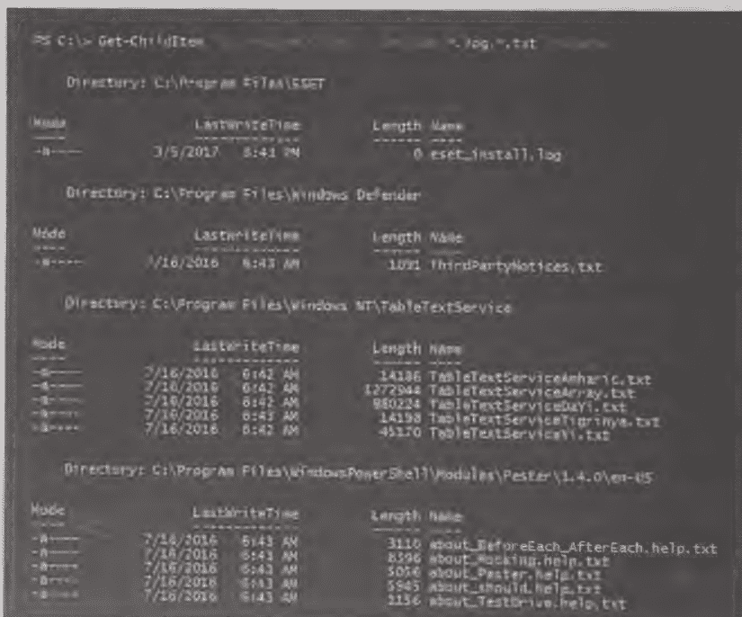
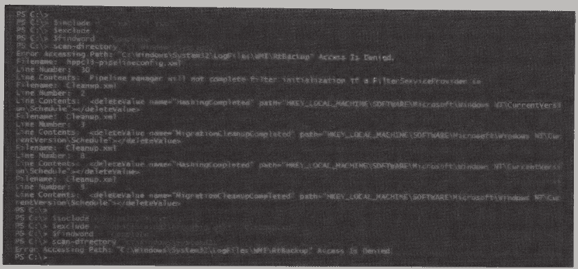

# 9 文件扫描

当你在评估环境中的系统时，可能需要扫描文件以查找特定内容。Windows 服务器扫描脚本使你能够搜索目录中包含特定字符串的文件。常见字符串可能包括错误消息、明文密码，甚至是主机名和 IP 地址等特定服务器信息。扫描系统以查找特定内容的能力是一项极其强大的工具，可以揭示有关系统的诸多信息。

扫描系统时，出现大量并非所需的结果是很常见的，这也被称为误报。本章将探讨如何通过将搜索范围缩小到特定文件类型来减少误报数量。它还将解释如何从搜索中排除文件，以帮助你获取所需的数据。

在本章中，你将：

-   了解如何获取子目录及其内容
-   将文件发现过程限制为特定文件类型
-   高效地在文件中搜索字符串并确定其位置
-   学习如何处理超过 248 个字符的长路径和权限问题导致的错误
-   排除搜索中的误报文件

### 文件扫描

文件扫描是企业环境中的一项重要活动。无论是为了识别凭据的使用位置、敏感信息的使用，还是服务器配置信息，你都需要一种快速高效地扫描文件数据的技术。PowerShell 原生具有从明文文件收集数据并解析信息的能力。最常见的明文文件包括但不限于文本文件、日志文件、XML 文件、配置文件和脚本文件。

在开发扫描函数时，你需要扫描目录中的特定文件类型以及文件本身的内容。要扫描特定文件类型，可以使用文件夹路径作为参数利用 Get-ChildItem cmdlet。你还使用 -Include 参数并指定要搜索的通配符文件扩展名。对于日志和文本文件，通配符文件扩展名分别看起来像 *.log 和 *.txt。如果要扫描多个扩展名，可以在每个要搜索的文件扩展名之间放置逗号。如果要扫描子目录中的文件类型，可以包含 -Recurse 参数以递归遍历子目录。

要扫描 Program Files 目录及其子目录中的 *.log 和 *.txt 文件，可以执行以下操作：

```
Get-ChildItem "c:\Program Files\" -Include *.log,*.txt -recurse
```

以下屏幕截图显示了此操作的输出：



此示例演示如何扫描 Program Files 目录中的 .log 和 .txt 文件类型。你首先使用 C:\Program Files\ 参数调用 Get-ChildItem cmdlet。你还使用 *.log,*.txt 参数利用 -Include 参数来扫描 .log 和 .txt 文件。最后，你利用 -recurse 参数来扫描 C:\Program Files\ 的子目录。执行后，PowerShell 脚本将显示 C:\Program Files\ 目录中的所有 .log 文件和 .txt 文件。

要扫描文件内部的特定内容，需要获取文件内容并将其放入内存。为此，可以使用要扫描的文件路径作为参数利用 get-content cmdlet。然后将结果放入变量中进行评估。要扫描文件内容，可以利用 select-string cmdlet，它允许将内容字符串与正则表达式匹配。你首先定义 select-string cmdlet，然后跟上带有文件参数的 -path 参数。然后使用正则表达式作为参数调用 -pattern 参数。要搜索字面字符串，可以使用字符串作为参数的 -pattern 参数，并利用 -SimpleMatch 参数来匹配特定字符串。

你也可以选择在管道后利用 select-string cmdlet。要扫描文件内部的特定内容，可以将 Get-ChildItem cmdlet 的文件名结果通过管道传递给 select-string cmdlet。然后 select-string cmdlet 将对各个文件进行字符串模式评估。这避免了使用 foreach 循环查询各个文件的需要，并且每个文件在由 Get-ChildItem cmdlet 返回时都会被评估。

select-string cmdlet 的另一个独特功能是它还会返回文件中匹配的行号，以及找到各个结果时匹配内容的整行。你可以调用 Line 属性返回整行，并调用 LineNumber 属性返回行号。你还可以调用 FileName 属性返回找到条件的特定文件。

要搜索 Program Files 中的 .log 和 .txt 文件并扫描其中的字符串，可以执行以下操作：

```
$matches = Get-ChildItem "c:\Program Files\" -Include *.log,*.txt -recurse
| select-string -pattern "Complete" -SimpleMatch
foreach ($match in $matches) {
    Write-Host "Filename: " $match.FileName
    Write-Host "Line Number: " $match.LineNumber
    Write-Host "Line Contents: " $match.Line
}
```

以下屏幕截图显示了此操作的输出：


此示例演示如何扫描 Program Files 目录中的 .log 和 .txt 文件，并搜索文件中的字符串 "Complete"。你首先使用 c:\Program Files\ 参数调用 Get-ChildItem cmdlet。你还将 -Include 参数设置为 *.log,*.txt 参数，并使用 -recurse 参数搜索子目录。然后将结果通过管道传递给 select-string cmdlet，并将 -pattern 参数设置为 "Complete" 字符串作为参数。然后发出 -SimpleMatch 参数以对该字符串执行简单搜索。这些命令的输出随后存储在 $matches 变量中。

然后继续利用 foreach 循环评估 $matches 中的每个 $match。然后利用 Write-Host cmdlet 显示 "FileName:" 以及 $match 变量的 .FileName 属性。你还使用 Write-Host cmdlet 显示 "Line Number:" 以及 $match 变量的 .LineNumber 属性。最后，你使用 Write-Host cmdlet 显示 "Line Contents:" 以及 $match 变量的 .Line 属性。

执行后，脚本将已扫描 c:\Program Files\ 目录中的 .log 和 .txt 文件。当识别出正确文件类型的文件时，脚本将评估该文件是否包含 "Complete" 字符串。如果找到该字符串，脚本将继续提供各个文件中的文件名、行号和该行的内容。

### 排除长路径

在企业文件服务器中，你可能会遇到文件夹结构和文件字符数超过 248 个字符的情况。Windows 默认将长文件路径的使用限制为 248 个字符长度。拥有基于 Linux 的文件服务器或映射网络驱动器，其文件路径超过 248 个字符限制的情况并不少见。

PowerShell 与 Windows 操作系统具有相同的路径限制。所有 PowerShell cmdlet 在查询文件夹路径长于 248 个字符的文件系统时都会出现问题。有一些程序例如 robocopy.exe 可以用来显示长于 248 个字符的文件和文件夹的完整路径。虽然你有返回长路径的能力，但仍无法使用 PowerShell cmdlet 与该目录中的任何文件进行交互。此外，与 Get-ChildItem cmdlet 相比，robocopy.exe 速度非常慢，并且需要在其上运行的系统上具有管理员备份权限。

这使你与长文件和文件夹路径交互的选项变得有限。因此，建议你在脚本中处理文件路径并访问错误消息。使用 Get-ChildItem cmdlet 处理错误是通过使用 -ErrorAction 和 -ErrorVariable 参数完成的。然而，与其为错误创建单个变量，你需要将错误放在数组中。这是因为 Get-ChildItem cmdlet 会获取指定路径中的所有文件和目录，即使它存在访问问题或由于路径长度无法访问该路径。如果你只使用一个变量，错误变量中唯一的错误将是最后发生的那个。相反，为了规避这个问题，你可以利用 $errors = @() 定义一个数组，并将 $errors 用作 -ErrorVariable 的参数。这告诉 PowerShell 在发生错误时向 $errors 数组添加一个额外项。

> 要执行以下示例，你需要在系统上创建一个名为 "Brenton" 的本地用户。或者，你可以将反映 "$env:computername\Brenton" 的行更新为你想要的任何用户名。

要创建超过 248 个字符的共享目录结构，收集文件和目录信息并捕获错误，可以执行以下操作：

```
# Create Folder Structure to Scan
$userdrive = "c:\Temp\POSHScript\Chapter9Examples\CompanyXYZ\Milwaukee\InformationTechnologyDepartment\UserHomeDrives\UserLoginID\"
new-item $userdrive -ItemType Directory -Force
$domainuser = "$env:computername\Brenton"
New-SmbShare -name "UserData" -Path $userdrive -FullAccess $domainuser
New-PSDrive -Name H -root "\\$env:computername\Userdata" -Persist -PSProvider FileSystem
cd H:
$userFolder = "Information Technology Department\All Company Software\ISO\Microsoft\Microsoft SQL Server 2012 R2\SQL Server Update Patches\Service Pack 3\Cumulative Update 7\AutomatedWindowsInstaller\"
```


```
new-item $userFolder -ItemType Directory -Force
```

## 扫描文件夹结构
$directory = "c:\Temp\POSHScript\Chapter9Examples\CompanyXYZ\"
$errors = @()
get-childitem $directory -recurse -ErrorActionSilentlyContinue -ErrorVariable +errors
if ($errors) {
foreach ($err in $errors) {
if ($err.Exception -like "*Could not find a part of the path*") {
    $filepath = ($err.Exception).ToString().split("'")[1]
    Write-Host "Error Accessing Path: "$filepath" may be over 248 Characters."
}
if ($err.Exception -like "*is denied.*") {
    $filepath = ($err.Exception).ToString().split("'")[1]
    Write-Host "Error Accessing Path: "$filepath" Access Is Denied."
}
}
}

## 移除映射驱动器和共享
cd c:
Remove-PSDrive -Name H -Force
Remove-SmbShare -name "UserData" -Force

此输出显示在以下屏幕截图中：


此示例展示了如何在捕获访问被拒绝和长文件路径错误的同时，正确地查询系统以获取文件和文件夹信息：

- 1. 你首先通过创建所需的文件夹结构开始。由于无法创建超过 248 个字符长的文件夹结构，你创建一组较小的目录，共享这些目录，将驱动器映射到该目录路径，并使用映射的驱动器位置创建额外的文件夹。其输出是一个超过 248 个字符的目录结构。
- 2. 要创建第一个目录结构，你定义字符串 "C:\Temp\POSHScript\Chapter9Examples\CompanyXYZ\Milwaukee\InformationTechnologyDepartment\UserHomeDrives\UserLoginID\" 并将其设置为 $userdrive 变量。
- 3. 然后你利用 new-item cmdlet 以 $userdrive 变量作为参数，-ItemType 参数值为 Directory，以及 -Force 参数。这会创建第一个目录结构。
- 4. 要创建目录共享，你必须指定共享将与之共享的凭据。你指定 $env:computername 来表示计算机名称，后跟反斜杠、Brenton 用户，并将值放在 $domainuser 变量中。
- 5. 你通过利用 New-SmbShare cmdlet 将此目录结构共享，其 -name 参数设置为 "UserData"。你还包含 -Path 参数并指定 $userdrive 参数，以及 -FullAccess 参数并使用 $domainuser 参数。

执行后，"c:\Temp\POSHScript\Chapter9Examples\CompanyXYZ\Milwaukee\InformationTechnologyDepartment\UserHomeDrives\UserLoginID\" 在系统上共享，可以通过 UNC 路径 \\computername\Userdata 访问。

- 6. 然后你继续通过利用 New-PSDrive cmdlet 映射 H 驱动器，-Name 参数为 H 作为参数。然后你指定 -root 参数并指定 \\\$env:computername\Userdata 作为参数。你还包含 -Persist 参数以使映射持久化，以及 -PSProvider 参数设置为 FileSystem。执行后，你将 H:\ 驱动器映射到 \\computername\Userdata。
- 7. 然后你使用 cd H: 发出对 H: 驱动器的目录更改并继续构建目录结构。
- 8. 你构建字符串 "Information Technology Department\All Company Software\ISO\Microsoft\Microsoft SQL Server 2012 R2\SQL Server Update Patches\Service Pack 3\Cumulative Update 7\AutomatedWindowsInstaller\" 并将其放在 $userFolder 变量中。
- 9. 然后你利用 new-item cmdlet 以 $userFolder 作为参数，-ItemType 参数值为 Directory，以及 -Force 参数。

这会在 H: 驱动器中创建第二组目录。然后你继续扫描文件夹结构。

- 10. 你首先通过定义要在 C:\Temp\POSHScript\Chapter9Examples\CompanyXYZ\ 中扫描的目录并将其设置为 $directory 变量开始。
- 11. 然后你通过将其设置为 @() 的值来定义 $errors 数组。
- 12. 你利用 Get-ChildItem cmdlet 使用 $directory 参数和 -recurse 参数扫描 C:\Temp\POSHScript\Chapter9Examples\CompanyXYZ\ 目录及其子目录。你利用 -ErrorAction 参数值为 SilentlyContinue 以及 -ErrorVariable 参数值为 +errors。这为一系列错误消息启用了累加操作，因为它们会发生到 $errors 数组中。
- 13. Get-ChildItem cmdlet 完成后，你评估 $errors 变量以确定其中是否有任何值。
- 14. 由于你创建了一个超过 248 个字符的文件夹结构，$errors 变量中将有数据，导致 if 语句评估为 $true。
- 15. 然后脚本继续执行 foreach 循环以评估 $errors 数组中的每个 $err。
- 16. 然后脚本执行 if 语句以确定 $err.Exception 属性是否类似于 "*Could not find a part of the path*"。如果 Get-ChildItem 知道路径存在但无法进一步遍历目录，则会指定此特定错误消息。这表明文件路径长于 248 个字符。
- 17. 如果评估为 true，脚本将获取 $err.Exception 属性并将异常转换为字符串。
- 18. 你评估字符串以按撇号字符将其拆分。
- 19. 你指定 [1] 以选择第二个值，即文件名，并将其设置为 $filepath 变量。
- 20. 你利用 Write-Host cmdlet 使用字符串 "Error Accessing Path:""$filepath"" may be over 248 Characters"。
- 21. 如果 $errors 变量中的此特定 $err 匹配，它将在屏幕上显示适当的 message。你继续进行对 $errors 变量的第二次评估。
- 22. 在此评估期间，你确定 $err.Exception 属性是否类似于 "*is denied.*"。这会捕获系统上可能发生的访问被拒绝错误消息。
- 23. 如果评估为 true，脚本将获取 $err.Exception 属性并将异常转换为字符串。
- 24. 你评估字符串以按撇号字符将其拆分。
- 25. 你指定 [1] 以选择第二个值，即文件名，并将其设置为 $filepath 变量。
- 26. 你利用 Write-Host cmdlet 使用字符串 "Error Accessing Path: "$filepath" Access Is Denied."。
- 27. 如果 $errors 变量中的此特定 $err 匹配，它将在屏幕上显示适当的 message。
最终步骤是脚本的清理部分。
- 28. 为了清理脚本，你执行 cd c: 将目录更改回 c: 驱动器。
- 29. 你通过利用 Remove-PSDrive cmdlet 将 H 驱动器断开连接，-name 参数设置为 H 且 -Force 参数。
- 30. 你关闭 SMB 共享，利用 Remove-SmbShare cmdlet 将 -name 参数设置为 "UserData" 且 -Force 参数。

如果此脚本在服务器文件共享上执行，Get-ChildItem cmdlet 将报告 $directory 变量中的所有文件和目录。它还将打印到屏幕上，如果有任何目录长于 248 个字符，以及文件夹结构上是否生成任何访问被拒绝错误消息。

## 排除文件

当你在环境中执行扫描时，你最终希望过滤掉一些误报。这在你利用模板构建系统时尤其正确，因为可能会检测到大量共同点。你可能还希望过滤掉已知安全的非常大的文件以优化扫描持续时间。

Get-ChildItem cmdlet 包含 -exclude 参数，它使你能够指定要排除的对象字符串。-exclude 参数还支持用逗号分隔的多个值以及使用星号字符的通配符。首先，你指定 Get-ChildItem cmdlet 并以要扫描的目录作为参数。然后你提供 -exclude 参数并以文件作为其参数。当 Get-ChildItem cmdlet 执行时，它将过滤掉指定为 -exclude 参数参数的那些项。


为了创建一个函数来扫描系统中 .xml 和 .txt 文件中是否包含单词 "Complete"，先不使用排除项，再使用排除项，可以执行以下操作：

```
function scan-directory { param($directory)
    $errors = @()
    $content = get-childitem $directory -Include $include -Exclude $exclude -recurse -ErrorActionSilentlyContinue -ErrorVariable +errors | select-string -Pattern $findword -SimpleMatch -ErrorActionSilentlyContinue
    if ($errors) {
        foreach ($err in $errors) {
            if ($err.Exception -like "*Could not find a part of the path*") {
                $filepath = ($err.Exception).ToString().split(" ")[1]
                Write-Host "Error Accessing Path: ~"$filepath"~ may be over 248 Characters."
            }
            if ($err.Exception -like "*is denied.*") {
                $filepath = ($err.Exception).ToString().split(" ")[1]
                Write-Host "Error Accessing Path: ~"$filepath"~ Access Is Denied."
            }
        }
    }
    foreach ($match in $content) {
        Write-Host "Filename: " ($match.FileName).Trim()
        Write-Host "Line Number: " $match.LineNumber
        Write-Host "Line Contents: " ($match.Line).Trim()
    }
}
```

$include = "*.xml","*.txt"
$exclude = ""
$findword = "Complete"
scan-directory "c:\Windows\System32\"

$include = "*.xml","*.txt"

```
$exclude = "*hppc13-pipelineconfig.xml*", "Cleanup.xml"
$findword = "Complete"
scan-directory "c:\Windows\System32\"
```

以下截图显示了此操作的输出：



此示例展示了如何扫描目录结构中 .xml 和 .txt 文件以查找单词 "Complete"。它还展示了如何成功排除扫描函数返回的结果：

- 1. 你首先通过创建名为 `scan-directory` 的函数开始。
- 2. 你创建一个参数块，将第一个参数设为 `$directory`。
- 3. 为了启动函数，你通过将 `$errors` 设为 `@()` 来声明 `$errors` 数组。
- 4. 你使用 `$directory` 参数调用 `Get-ChildItem` cmdlet，使用 `$include` 参数的 `-Include` 参数，以及使用 `$exclude` 参数的 `-exclude` 参数。
- 5. 你继续包含用于子目录扫描的 `-recurse` 参数，将 `-ErrorAction` 参数设为 `SilentlyContinue` 参数，并将 `-ErrorVariable` 设为 `+errors` 加法运算符。
- 6. 然后 `Get-ChildItem` cmdlet 语句被管道传输到 `select-string` cmdlet，使用 `$findword` 参数、`-SimpleMatch` 参数以及 `SilentlyContinue` 的 `-ErrorAction`。
- 7. 此部分将查询 $directory 位置及其子目录中 $include 中指定的文件类型，排除 $exclude 中的文件，并选择具有 -Simplematch $findword 的字符串。
- 8. -ErrorAction 应用于 select-string cmdlet，以抑制无法访问的文件和文件夹或长度超过 248 个字符的错误。
- 9. 这些错误已通过 Get-ChildItem cmdlet 添加到 $errors 变量中。
- 10. 此命令的结果随后存储在 $content 变量中。
- 11. 在 Get-ChildItem cmdlet 完成后，你评估 $errors 变量以确定其中是否有任何值。
- 12. 由于你创建了一个长度超过 248 个字符的文件夹结构，$errors 变量中将有数据，导致 if 语句求值为 $true。然后脚本继续执行 foreach 循环以评估 $errors 数组中的每个 $err。
- 13. 然后脚本执行一个 if 语句，以确定 $err.Exception 属性是否类似于 "*Could not find a part of the path*"。
- 14. 如果此求值为 true，脚本将获取 $err.Exception 属性并将 Exception 转换为字符串。
- 15. 你评估字符串以按撇号字符将其拆分。
- 16. 你指定 [1] 来选择第二个值，即文件名，并将其设为 $filepath 变量。
- 17. 你使用 Write-Host cmdlet 并使用字符串 "Error Accessing Path:""$filepath"" may be over 248 Characters"。如果 $errors 变量中的此特定 $err 匹配，它将在屏幕上显示适当的[content]
为了创建一个函数来扫描系统中 .xml 和 .txt 文件中是否包含单词 "Complete"，先不使用排除项，再使用排除项，可以执行以下操作：

```
function scan-directory { param($directory)
    $errors = @()
    $content = get-childitem $directory -Include $include -Exclude $exclude -recurse -ErrorActionSilentlyContinue -ErrorVariable +errors | select-string -Pattern $findword -SimpleMatch -ErrorActionSilentlyContinue
    if ($errors) {
        foreach ($err in $errors) {
            if ($err.Exception -like "*Could not find a part of the path*") {
                $filepath = ($err.Exception).ToString().split(" ")[1]
                Write-Host "Error Accessing Path: ~"$filepath"~ may be over 248 Characters."
            }
            if ($err.Exception -like "*is denied.*") {
                $filepath = ($err.Exception).ToString().split(" ")[1]
                Write-Host "Error Accessing Path: ~"$filepath"~ Access Is Denied."
            }
        }
    }
    foreach ($match in $content) {
        Write-Host "Filename: " ($match.FileName).Trim()
        Write-Host "Line Number: " $match.LineNumber
        Write-Host "Line Contents: " ($match.Line).Trim()
    }
}
```

$include = "*.xml","*.txt"
$exclude = ""
$findword = "Complete"
scan-directory "c:\Windows\System32\"

$include = "*.xml","*.txt"

```
$exclude = "*hppc13-pipelineconfig.xml*", "Cleanup.xml"
$findword = "Complete"
scan-directory "c:\Windows\System32\"
```

以下截图显示了此操作的输出：


此示例展示了如何扫描目录结构中 .xml 和 .txt 文件以查找单词 "Complete"。它还展示了如何成功排除扫描函数返回的结果：

- 1. 你首先通过创建名为 `scan-directory` 的函数开始。
- 2. 你创建一个参数块，将第一个参数设为 `$directory`。
- 3. 为了启动函数，你通过将 `$errors` 设为 `@()` 来声明 `$errors` 数组。
- 4. 你使用 `$directory` 参数调用 `Get-ChildItem` cmdlet，使用 `$include` 参数的 `-Include` 参数，以及使用 `$exclude` 参数的 `-exclude` 参数。
- 5. 你继续包含用于子目录扫描的 `-recurse` 参数，将 `-ErrorAction` 参数设为 `SilentlyContinue` 参数，并将 `-ErrorVariable` 设为 `+errors` 加法运算符。
- 6. 然后 `Get-ChildItem` cmdlet 语句被管道传输到 `select-string` cmdlet，使用 `$findword` 参数、`-SimpleMatch` 参数以及 `SilentlyContinue` 的 `-ErrorAction`。
- 7. 此部分将查询 $directory 位置及其子目录中 $include 中指定的文件类型，排除 $exclude 中的文件，并选择具有 -Simplematch $findword 的字符串。
- 8. -ErrorAction 应用于 select-string cmdlet，以抑制无法访问的文件和文件夹或长度超过 248 个字符的错误。
- 9. 这些错误已通过 Get-ChildItem cmdlet 添加到 $errors 变量中。
- 10. 此命令的结果随后存储在 $content 变量中。
- 11. 在 Get-ChildItem cmdlet 完成后，你评估 $errors 变量以确定其中是否有任何值。
- 12. 由于你创建了一个长度超过 248 个字符的文件夹结构，$errors 变量中将有数据，导致 if 语句求值为 $true。然后脚本继续执行 foreach 循环以评估 $errors 数组中的每个 $err。
- 13. 然后脚本执行一个 if 语句，以确定 $err.Exception 属性是否类似于 "*Could not find a part of the path*"。
- 14. 如果此求值为 true，脚本将获取 $err.Exception 属性并将 Exception 转换为字符串。
- 15. 你评估字符串以按撇号字符将其拆分。
- 16. 你指定 [1] 来选择第二个值，即文件名，并将其设为 $filepath 变量。
- 17. 你使用 Write-Host cmdlet 并使用字符串 "Error Accessing Path:""$filepath"" may be over 248 Characters"。如果 $errors 变量中的此特定 $err 匹配，它将在屏幕上显示适当的[content]
为了创建一个函数来扫描系统中 .xml 和 .txt 文件中是否包含单词 "Complete"，先不使用排除项，再使用排除项，可以执行以下操作：

```
function scan-directory { param($directory)
    $errors = @()
    $content = get-childitem $directory -Include $include -Exclude $exclude -recurse -ErrorActionSilentlyContinue -ErrorVariable +errors | select-string -Pattern $findword -SimpleMatch -ErrorActionSilentlyContinue
    if ($errors) {
        foreach ($err in $errors) {
            if ($err.Exception -like "*Could not find a part of the path*") {
                $filepath = ($err.Exception).ToString().split(" ")[1]
                Write-Host "Error Accessing Path: ~"$filepath"~ may be over 248 Characters."
            }
            if ($err.Exception -like "*is denied.*") {
                $filepath = ($err.Exception).ToString().split(" ")[1]
                Write-Host "Error Accessing Path: ~"$filepath"~ Access Is Denied."
            }
        }
    }
    foreach ($match in $content) {
        Write-Host "Filename: " ($match.FileName).Trim()
        Write-Host "Line Number: " $match.LineNumber
        Write-Host "Line Contents: " ($match.Line).Trim()
    }
}
```

$include = "*.xml","*.txt"
$exclude = ""
$findword = "Complete"
scan-directory "c:\Windows\System32\"

$include = "*.xml","*.txt"

```
$exclude = "*hppc13-pipelineconfig.xml*", "Cleanup.xml"
$findword = "Complete"
scan-directory "c:\Windows\System32\"
```

以下截图显示了此操作的输出：


此示例展示了如何扫描目录结构中 .xml 和 .txt 文件以查找单词 "Complete"。它还展示了如何成功排除扫描函数返回的结果：

- 1. 你首先通过创建名为 `scan-directory` 的函数开始。
- 2. 你创建一个参数块，将第一个参数设为 `$directory`。
- 3. 为了启动函数，你通过将 `$errors` 设为 `@()` 来声明 `$errors` 数组。
- 4. 你使用 `$directory` 参数调用 `Get-ChildItem` cmdlet，使用 `$include` 参数的 `-Include` 参数，以及使用 `$exclude` 参数的 `-exclude` 参数。
- 5. 你继续包含用于子目录扫描的 `-recurse` 参数，将 `-ErrorAction` 参数设为 `SilentlyContinue` 参数，并将 `-ErrorVariable` 设为 `+errors` 加法运算符。
- 6. 然后 `Get-ChildItem` cmdlet 语句被管道传输到 `select-string` cmdlet，使用 `$findword` 参数、`-SimpleMatch` 参数以及 `SilentlyContinue` 的 `-ErrorAction`。
- 7. 此部分将查询 $directory 位置及其子目录中 $include 中指定的文件类型，排除 $exclude 中的文件，并选择具有 -Simplematch $findword 的字符串。
- 8. -ErrorAction 应用于 select-string cmdlet，以抑制无法访问的文件和文件夹或长度超过 248 个字符的错误。
- 9. 这些错误已通过 Get-ChildItem cmdlet 添加到 $errors 变量中。
- 10. 此命令的结果随后存储在 $content 变量中。
- 11. 在 Get-ChildItem cmdlet 完成后，你评估 $errors 变量以确定其中是否有任何值。
- 12. 由于你创建了一个长度超过 248 个字符的文件夹结构，$errors 变量中将有数据，导致 if 语句求值为 $true。然后脚本继续执行 foreach 循环以评估 $errors 数组中的每个 $err。
- 13. 然后脚本执行一个 if 语句，以确定 $err.Exception 属性是否类似于 "*Could not find a part of the path*"。
- 14. 如果此求值为 true，脚本将获取 $err.Exception 属性并将 Exception 转换为字符串。
- 15. 你评估字符串以按撇号字符将其拆分。
- 16. 你指定 [1] 来选择第二个值，即文件名，并将其设为 $filepath 变量。
- 17. 你使用 Write-Host cmdlet 并使用字符串 "Error Accessing Path:""$filepath"" may be over 248 Characters"。如果 $errors 变量中的此特定 $err 匹配，它将在屏幕上显示适当的[content]
为了创建一个函数来扫描系统中 .xml 和 .txt 文件中是否包含单词 "Complete"，先不使用排除项，再使用排除项，可以执行以下操作：

```
function scan-directory { param($directory)
    $errors = @()
    $content = get-childitem $directory -Include $include -Exclude $exclude -recurse -ErrorActionSilentlyContinue -ErrorVariable +errors | select-string -Pattern $findword -SimpleMatch -ErrorActionSilentlyContinue
    if ($errors) {
        foreach ($err in $errors) {
            if ($err.Exception -like "*Could not find a part of the path*") {
                $filepath = ($err.Exception).ToString().split(" ")[1]
                Write-Host "Error Accessing Path: ~"$filepath"~ may be over 248 Characters."
            }
            if ($err.Exception -like "*is denied.*") {
                $filepath = ($err.Exception).ToString().split(" ")[1]
                Write-Host "Error Accessing Path: ~"$filepath"~ Access Is Denied."
            }
        }
    }
    foreach ($match in $content) {
        Write-Host "Filename: " ($match.FileName).Trim()
        Write-Host "Line Number: " $match.LineNumber
        Write-Host "Line Contents: " ($match.Line).Trim()
    }
}
```

$include = "*.xml","*.txt"
$exclude = ""
$findword = "Complete"
scan-directory "c:\Windows\System32\"

$include = "*.xml","*.txt"

```
$exclude = "*hppc13-pipelineconfig.xml*", "Cleanup.xml"
$findword = "Complete"
scan-directory "c:\Windows\System32\"
```

以下截图显示了此操作的输出：


此示例展示了如何扫描目录结构中 .xml 和 .txt 文件以查找单词 "Complete"。它还展示了如何成功排除扫描函数返回的结果：

- 1. 你首先通过创建名为 `scan-directory` 的函数开始。
- 2. 你创建一个参数块，将第一个参数设为 `$directory`。
- 3. 为了启动函数，你通过将 `$errors` 设为 `@()` 来声明 `$errors` 数组。
- 4. 你使用 `$directory` 参数调用 `Get-ChildItem` cmdlet，使用 `$include` 参数的 `-Include` 参数，以及使用 `$exclude` 参数的 `-exclude` 参数。
- 5. 你继续包含用于子目录扫描的 `-recurse` 参数，将 `-ErrorAction` 参数设为 `SilentlyContinue` 参数，并将 `-ErrorVariable` 设为 `+errors` 加法运算符。
- 6. 然后 `Get-ChildItem` cmdlet 语句被管道传输到 `select-string` cmdlet，使用 `$findword` 参数、`-SimpleMatch` 参数以及 `SilentlyContinue` 的 `-ErrorAction`。
- 7. 此部分将查询 $directory 位置及其子目录中 $include 中指定的文件类型，排除 $exclude 中的文件，并选择具有 -Simplematch $findword 的字符串。
- 8. -ErrorAction 应用于 select-string cmdlet，以抑制无法访问的文件和文件夹或长度超过 248 个字符的错误。
- 9. 这些错误已通过 Get-ChildItem cmdlet 添加到 $errors 变量中。
- 10. 此命令的结果随后存储在 $content 变量中。
- 11. 在 Get-ChildItem cmdlet 完成后，你评估 $errors 变量以确定其中是否有任何值。
- 12. 由于你创建了一个长度超过 248 个字符的文件夹结构，$errors 变量中将有数据，导致 if 语句求值为 $true。然后脚本继续执行 foreach 循环以评估 $errors 数组中的每个 $err。
- 13. 然后脚本执行一个 if 语句，以确定 $err.Exception 属性是否类似于 "*Could not find a part of the path*"。
- 14. 如果此求值为 true，脚本将获取 $err.Exception 属性并将 Exception 转换为字符串。
- 15. 你评估字符串以按撇号字符将其拆分。
- 16. 你指定 [1] 来选择第二个值，即文件名，并将其设为 $filepath 变量。
- 17. 你使用 Write-Host cmdlet 并使用字符串 "Error Accessing Path:""$filepath"" may be over 248 Characters"。如果 $errors 变量中的此特定 $err 匹配，它将在屏幕上显示适当的[content]
为了创建一个函数来扫描系统中 .xml 和 .txt 文件中是否包含单词 "Complete"，先不使用排除项，再使用排除项，可以执行以下操作：

```
function scan-directory { param($directory)
    $errors = @()
    $content = get-childitem $directory -Include $include -Exclude $exclude -recurse -ErrorActionSilentlyContinue -ErrorVariable +errors | select-string -Pattern $findword -SimpleMatch -ErrorActionSilentlyContinue
    if ($errors) {
        foreach ($err in $errors) {
            if ($err.Exception -like "*Could not find a part of the path*") {
                $filepath = ($err.Exception).ToString().split(" ")[1]
                Write-Host "Error Accessing Path: ~"$filepath"~ may be over 248 Characters."
            }
            if ($err.Exception -like "*is denied.*") {
                $filepath = ($err.Exception).ToString().split(" ")[1]
                Write-Host "Error Accessing Path: ~"$filepath"~ Access Is Denied."
            }
        }
    }
    foreach ($match in $content) {
        Write-Host "Filename: " ($match.FileName).Trim()
        Write-Host "Line Number: " $match.LineNumber
        Write-Host "Line Contents: " ($match.Line).Trim()
    }
}
```

$include = "*.xml","*.txt"
$exclude = ""
$findword = "Complete"
scan-directory "c:\Windows\System32\"

$include = "*.xml","*.txt"

```
$exclude = "*hppc13-pipelineconfig.xml*", "Cleanup.xml"
$findword = "Complete"
scan-directory "c:\Windows\System32\"
```

以下截图显示了此操作的输出：


此示例展示了如何扫描目录结构中 .xml 和 .txt 文件以查找单词 "Complete"。它还展示了如何成功排除扫描函数返回的结果：

- 1. 你首先通过创建名为 `scan-directory` 的函数开始。
- 2. 你创建一个参数块，将第一个参数设为 `$directory`。
- 3. 为了启动函数，你通过将 `$errors` 设为 `@()` 来声明 `$errors` 数组。
- 4. 你使用 `$directory` 参数调用 `Get-ChildItem` cmdlet，使用 `$include` 参数的 `-Include` 参数，以及使用 `$exclude` 参数的 `-exclude` 参数。
- 5. 你继续包含用于子目录扫描的 `-recurse` 参数，将 `-ErrorAction` 参数设为 `SilentlyContinue` 参数，并将 `-ErrorVariable` 设为 `+errors` 加法运算符。
- 6. 然后 `Get-ChildItem` cmdlet 语句被管道传输到 `select-string` cmdlet，使用 `$findword` 参数、`-SimpleMatch` 参数以及 `SilentlyContinue` 的 `-ErrorAction`。
- 7. 此部分将查询 $directory 位置及其子目录中 $include 中指定的文件类型，排除 $exclude 中的文件，并选择具有 -Simplematch $findword 的字符串。
- 8. -ErrorAction 应用于 select-string cmdlet，以抑制无法访问的文件和文件夹或长度超过 248 个字符的错误。
- 9. 这些错误已通过 Get-ChildItem cmdlet 添加到 $errors 变量中。
- 10. 此命令的结果随后存储在 $content 变量中。
- 11. 在 Get-ChildItem cmdlet 完成后，你评估 $errors 变量以确定其中是否有任何值。
- 12. 由于你创建了一个长度超过 248 个字符的文件夹结构，$errors 变量中将有数据，导致 if 语句求值为 $true。然后脚本继续执行 foreach 循环以评估 $errors 数组中的每个 $err。
- 13. 然后脚本执行一个 if 语句，以确定 $err.Exception 属性是否类似于 "*Could not find a part of the path*"。
- 14. 如果此求值为 true，脚本将获取 $err.Exception 属性并将 Exception 转换为字符串。
- 15. 你评估字符串以按撇号字符将其拆分。
- 16. 你指定 [1] 来选择第二个值，即文件名，并将其设为 $filepath 变量。
- 17. 你使用 Write-Host cmdlet 并使用字符串 "Error Accessing Path:""$filepath"" may be over 248 Characters"。如果 $errors 变量中的此特定 $err 匹配，它将在屏幕上显示适当的[content]
为了创建一个函数来扫描系统中 .xml 和 .txt 文件中是否包含单词 "Complete"，先不使用排除项，再使用排除项，可以执行以下操作：

```
function scan-directory { param($directory)
    $errors = @()
    $content = get-childitem $directory -Include $include -Exclude $exclude -recurse -ErrorActionSilentlyContinue -ErrorVariable +errors | select-string -Pattern $findword -SimpleMatch -ErrorActionSilentlyContinue
    if ($errors) {
        foreach ($err in $errors) {
            if ($err.Exception -like "*Could not find a part of the path*") {
                $filepath = ($err.Exception).ToString().split(" ")[1]
                Write-Host "Error Accessing Path: ~"$filepath"~ may be over 248 Characters."
            }
            if ($err.Exception -like "*is denied.*") {
                $filepath = ($err.Exception).ToString().split(" ")[1]
                Write-Host "Error Accessing Path: ~"$filepath"~ Access Is Denied."
            }
        }
    }
    foreach ($match in $content) {
        Write-Host "Filename: " ($match.FileName).Trim()
        Write-Host "Line Number: " $match.LineNumber
        Write-Host "Line Contents: " ($match.Line).Trim()
    }
}
```

$include = "*.xml","*.txt"
$exclude = ""
$findword = "Complete"
scan-directory "c:\Windows\System32\"

$include = "*.xml","*.txt"

```
$exclude = "*hppc13-pipelineconfig.xml*", "Cleanup.xml"
$findword = "Complete"
scan-directory "c:\Windows\System32\"
```

以下截图显示了此操作的输出：


此示例展示了如何扫描目录结构中 .xml 和 .txt 文件以查找单词 "Complete"。它还展示了如何成功排除扫描函数返回的结果：

- 1. 你首先通过创建名为 `scan-directory` 的函数开始。
- 2. 你创建一个参数块，将第一个参数设为 `$directory`。
- 3. 为了启动函数，你通过将 `$errors` 设为 `@()` 来声明 `$errors` 数组。
- 4. 你使用 `$directory` 参数调用 `Get-ChildItem` cmdlet，使用 `$include` 参数的 `-Include` 参数，以及使用 `$exclude` 参数的 `-exclude` 参数。
- 5. 你继续包含用于子目录扫描的 `-recurse` 参数，将 `-ErrorAction` 参数设为 `SilentlyContinue` 参数，并将 `-ErrorVariable` 设为 `+errors` 加法运算符。
- 6. 然后 `Get-ChildItem` cmdlet 语句被管道传输到 `select-string` cmdlet，使用 `$findword` 参数、`-SimpleMatch` 参数以及 `SilentlyContinue` 的 `-ErrorAction`。
- 7. 此部分将查询 $directory 位置及其子目录中 $include 中指定的文件类型，排除 $exclude 中的文件，并选择具有 -Simplematch $findword 的字符串。
- 8. -ErrorAction 应用于 select-string cmdlet，以抑制无法访问的文件和文件夹或长度超过 248 个字符的错误。
- 9. 这些错误已通过 Get-ChildItem cmdlet 添加到 $errors 变量中。
- 10. 此命令的结果随后存储在 $content 变量中。
- 11. 在 Get-ChildItem cmdlet 完成后，你评估 $errors 变量以确定其中是否有任何值。
- 12. 由于你创建了一个长度超过 248 个字符的文件夹结构，$errors 变量中将有数据，导致 if 语句求值为 $true。然后脚本继续执行 foreach 循环以评估 $errors 数组中的每个 $err。
- 13. 然后脚本执行一个 if 语句，以确定 $err.Exception 属性是否类似于 "*Could not find a part of the path*"。
- 14. 如果此求值为 true，脚本将获取 $err.Exception 属性并将 Exception 转换为字符串。
- 15. 你评估字符串以按撇号字符将其拆分。
- 16. 你指定 [1] 来选择第二个值，即文件名，并将其设为 $filepath 变量。
- 17. 你使用 Write-Host cmdlet 并使用字符串 "Error Accessing Path:""$filepath"" may be over 248 Characters"。如果 $errors 变量中的此特定 $err 匹配，它将在屏幕上显示适当的[content]
为了创建一个函数来扫描系统中 .xml 和 .txt 文件中是否包含单词 "Complete"，先不使用排除项，再使用排除项，可以执行以下操作：

```
function scan-directory { param($directory)
    $errors = @()
    $content = get-childitem $directory -Include $include -Exclude $exclude -recurse -ErrorActionSilentlyContinue -ErrorVariable +errors | select-string -Pattern $findword -SimpleMatch -ErrorActionSilentlyContinue
    if ($errors) {
        foreach ($err in $errors) {
            if ($err.Exception -like "*Could not find a part of the path*") {
                $filepath = ($err.Exception).ToString().split(" ")[1]
                Write-Host "Error Accessing Path: ~"$filepath"~ may be over 248 Characters."
            }
            if ($err.Exception -like "*is denied.*") {
                $filepath = ($err.Exception).ToString().split(" ")[1]
                Write-Host "Error Accessing Path: ~"$filepath"~ Access Is Denied."
            }
        }
    }
    foreach ($match in $content) {
        Write-Host "Filename: " ($match.FileName).Trim()
        Write-Host "Line Number: " $match.LineNumber
        Write-Host "Line Contents: " ($match.Line).Trim()
    }
}
```

$include = "*.xml","*.txt"
$exclude = ""
$findword = "Complete"
scan-directory "c:\Windows\System32\"

$include = "*.xml","*.txt"

```
$exclude = "*hppc13-pipelineconfig.xml*", "Cleanup.xml"
$findword = "Complete"
scan-directory "c:\Windows\System32\"
```

以下截图显示了此操作的输出：


此示例展示了如何扫描目录结构中 .xml 和 .txt 文件以查找单词 "Complete"。它还展示了如何成功排除扫描函数返回的结果：

- 1. 你首先通过创建名为 `scan-directory` 的函数开始。
- 2. 你创建一个参数块，将第一个参数设为 `$directory`。
- 3. 为了启动函数，你通过将 `$errors` 设为 `@()` 来声明 `$errors` 数组。
- 4. 你使用 `$directory` 参数调用 `Get-ChildItem` cmdlet，使用 `$include` 参数的 `-Include` 参数，以及使用 `$exclude` 参数的 `-exclude` 参数。
- 5. 你继续包含用于子目录扫描的 `-recurse` 参数，将 `-ErrorAction` 参数设为 `SilentlyContinue` 参数，并将 `-ErrorVariable` 设为 `+errors` 加法运算符。
- 6. 然后 `Get-ChildItem` cmdlet 语句被管道传输到 `select-string` cmdlet，使用 `$findword` 参数、`-SimpleMatch` 参数以及 `SilentlyContinue` 的 `-ErrorAction`。
- 7. 此部分将查询 $directory 位置及其子目录中 $include 中指定的文件类型，排除 $exclude 中的文件，并选择具有 -Simplematch $findword 的字符串。
- 8. -ErrorAction 应用于 select-string cmdlet，以抑制无法访问的文件和文件夹或长度超过 248 个字符的错误。
- 9. 这些错误已通过 Get-ChildItem cmdlet 添加到 $errors 变量中。
- 10. 此命令的结果随后存储在 $content 变量中。
- 11. 在 Get-ChildItem cmdlet 完成后，你评估 $errors 变量以确定其中是否有任何值。
- 12. 由于你创建了一个长度超过 248 个字符的文件夹结构，$errors 变量中将有数据，导致 if 语句求值为 $true。然后脚本继续执行 foreach 循环以评估 $errors 数组中的每个 $err。
- 13. 然后脚本执行一个 if 语句，以确定 $err.Exception 属性是否类似于 "*Could not find a part of the path*"。
- 14. 如果此求值为 true，脚本将获取 $err.Exception 属性并将 Exception 转换为字符串。
- 15. 你评估字符串以按撇号字符将其拆分。
- 16. 你指定 [1] 来选择第二个值，即文件名，并将其设为 $filepath 变量。
- 17. 你使用 Write-Host cmdlet 并使用字符串 "Error Accessing Path:""$filepath"" may be over 248 Characters"。如果 $errors 变量中的此特定 $err 匹配，它将在屏幕上显示适当的[content]
为了创建一个函数来扫描系统中 .xml 和 .txt 文件中是否包含单词 "Complete"，先不使用排除项，再使用排除项，可以执行以下操作：

```
function scan-directory { param($directory)
    $errors = @()
    $content = get-childitem $directory -Include $include -Exclude $exclude -recurse -ErrorActionSilentlyContinue -ErrorVariable +errors | select-string -Pattern $findword -SimpleMatch -ErrorActionSilentlyContinue
    if ($errors) {
        foreach ($err in $errors) {
            if ($err.Exception -like "*Could not find a part of the path*") {
                $filepath = ($err.Exception).ToString().split(" ")[1]
                Write-Host "Error Accessing Path: ~"$filepath"~ may be over 248 Characters."
            }
            if ($err.Exception -like "*is denied.*") {
                $filepath = ($err.Exception).ToString().split(" ")[1]
                Write-Host "Error Accessing Path: ~"$filepath"~ Access Is Denied."
            }
        }
    }
    foreach ($match in $content) {
        Write-Host "Filename: " ($match.FileName).Trim()
        Write-Host "Line Number: " $match.LineNumber
        Write-Host "Line Contents: " ($match.Line).Trim()
    }
}
```

$include = "*.xml","*.txt"
$exclude = ""
$findword = "Complete"
scan-directory "c:\Windows\System32\"

$include = "*.xml","*.txt"

```
$exclude = "*hppc13-pipelineconfig.xml*", "Cleanup.xml"
$findword = "Complete"
scan-directory "c:\Windows\System32\"
```

以下截图显示了此操作的输出：


此示例展示了如何扫描目录结构中 .xml 和 .txt 文件以查找单词 "Complete"。它还展示了如何成功排除扫描函数返回的结果：

- 1. 你首先通过创建名为 `scan-directory` 的函数开始。
- 2. 你创建一个参数块，将第一个参数设为 `$directory`。
- 3. 为了启动函数，你通过将 `$errors` 设为 `@()` 来声明 `$errors` 数组。
- 4. 你使用 `$directory` 参数调用 `Get-ChildItem` cmdlet，使用 `$include` 参数的 `-Include` 参数，以及使用 `$exclude` 参数的 `-exclude` 参数。
- 5. 你继续包含用于子目录扫描的 `-recurse` 参数，将 `-ErrorAction` 参数设为 `SilentlyContinue` 参数，并将 `-ErrorVariable` 设为 `+errors` 加法运算符。
- 6. 然后 `Get-ChildItem` cmdlet 语句被管道传输到 `select-string` cmdlet，使用 `$findword` 参数、`-SimpleMatch` 参数以及 `SilentlyContinue` 的 `-ErrorAction`。
- 7. 此部分将查询 $directory 位置及其子目录中 $include 中指定的文件类型，排除 $exclude 中的文件，并选择具有 -Simplematch $findword 的字符串。
- 8. -ErrorAction 应用于 select-string cmdlet，以抑制无法访问的文件和文件夹或长度超过 248 个字符的错误。
- 9. 这些错误已通过 Get-ChildItem cmdlet 添加到 $errors 变量中。
- 10. 此命令的结果随后存储在 $content 变量中。
- 11. 在 Get-ChildItem cmdlet 完成后，你评估 $errors 变量以确定其中是否有任何值。
- 12. 由于你创建了一个长度超过 248 个字符的文件夹结构，$errors 变量中将有数据，导致 if 语句求值为 $true。然后脚本继续执行 foreach 循环以评估 $errors 数组中的每个 $err。
- 13. 然后脚本执行一个 if 语句，以确定 $err.Exception 属性是否类似于 "*Could not find a part of the path*"。
- 14. 如果此求值为 true，脚本将获取 $err.Exception 属性并将 Exception 转换为字符串。
- 15. 你评估字符串以按撇号字符将其拆分。
- 16. 你指定 [1] 来选择第二个值，即文件名，并将其设为 $filepath 变量。
- 17. 你使用 Write-Host cmdlet 并使用字符串 "Error Accessing Path:""$filepath"" may be over 248 Characters"。如果 $errors 变量中的此特定 $err 匹配，它将在屏幕上显示适当的[content]
为了创建一个函数来扫描系统中 .xml 和 .txt 文件中是否包含单词 "Complete"，先不使用排除项，再使用排除项，可以执行以下操作：

```
function scan-directory { param($directory)
    $errors = @()
    $content = get-childitem $directory -Include $include -Exclude $exclude -recurse -ErrorActionSilentlyContinue -ErrorVariable +errors | select-string -Pattern $findword -SimpleMatch -ErrorActionSilentlyContinue
    if ($errors) {
        foreach ($err in $errors) {
            if ($err.Exception -like "*Could not find a part of the path*") {
                $filepath = ($err.Exception).ToString().split(" ")[1]
                Write-Host "Error Accessing Path: ~"$filepath"~ may be over 248 Characters."
            }
            if ($err.Exception -like "*is denied.*") {
                $filepath = ($err.Exception).ToString().split(" ")[1]
                Write-Host "Error Accessing Path: ~"$filepath"~ Access Is Denied."
            }
        }
    }
    foreach ($match in $content) {
        Write-Host "Filename: " ($match.FileName).Trim()
        Write-Host "Line Number: " $match.LineNumber
        Write-Host "Line Contents: " ($match.Line).Trim()
    }
}
```

$include = "*.xml","*.txt"
$exclude = ""
$findword = "Complete"
scan-directory "c:\Windows\System32\"

$include = "*.xml","*.txt"

```
$exclude = "*hppc13-pipelineconfig.xml*", "Cleanup.xml"
$findword = "Complete"
scan-directory "c:\Windows\System32\"
```

以下截图显示了此操作的输出：


此示例展示了如何扫描目录结构中 .xml 和 .txt 文件以查找单词 "Complete"。它还展示了如何成功排除扫描函数返回的结果：

- 1. 你首先通过创建名为 `scan-directory` 的函数开始。
- 2. 你创建一个参数块，将第一个参数设为 `$directory`。
- 3. 为了启动函数，你通过将 `$errors` 设为 `@()` 来声明 `$errors` 数组。
- 4. 你使用 `$directory` 参数调用 `Get-ChildItem` cmdlet，使用 `$include` 参数的 `-Include` 参数，以及使用 `$exclude` 参数的 `-exclude` 参数。
- 5. 你继续包含用于子目录扫描的 `-recurse` 参数，将 `-ErrorAction` 参数设为 `SilentlyContinue` 参数，并将 `-ErrorVariable` 设为 `+errors` 加法运算符。
- 6. 然后 `Get-ChildItem` cmdlet 语句被管道传输到 `select-string` cmdlet，使用 `$findword` 参数、`-SimpleMatch` 参数以及 `SilentlyContinue` 的 `-ErrorAction`。
- 7. 此部分将查询 $directory 位置及其子目录中 $include 中指定的文件类型，排除 $exclude 中的文件，并选择具有 -Simplematch $findword 的字符串。
- 8. -ErrorAction 应用于 select-string cmdlet，以抑制无法访问的文件和文件夹或长度超过 248 个字符的错误。
- 9. 这些错误已通过 Get-ChildItem cmdlet 添加到 $errors 变量中。
- 10. 此命令的结果随后存储在 $content 变量中。
- 11. 在 Get-ChildItem cmdlet 完成后，你评估 $errors 变量以确定其中是否有任何值。
- 12. 由于你创建了一个长度超过 248 个字符的文件夹结构，$errors 变量中将有数据，导致 if 语句求值为 $true。然后脚本继续执行 foreach 循环以评估 $errors 数组中的每个 $err。
- 13. 然后脚本执行一个 if 语句，以确定 $err.Exception 属性是否类似于 "*Could not find a part of the path*"。
- 14. 如果此求值为 true，脚本将获取 $err.Exception 属性并将 Exception 转换为字符串。
- 15. 你评估字符串以按撇号字符将其拆分。
- 16. 你指定 [1] 来选择第二个值，即文件名，并将其设为 $filepath 变量。
- 17. 你使用 Write-Host cmdlet 并使用字符串 "Error Accessing Path:""$filepath"" may be over 248 Characters"。如果 $errors 变量中的此特定 $err 匹配，它将在屏幕上显示适当的[content]
为了创建一个函数来扫描系统中 .xml 和 .txt 文件中是否包含单词 "Complete"，先不使用排除项，再使用排除项，可以执行以下操作：

```
function scan-directory { param($directory)
    $errors = @()
    $content = get-childitem $directory -Include $include -Exclude $exclude -recurse -ErrorActionSilentlyContinue -ErrorVariable +errors | select-string -Pattern $findword -SimpleMatch -ErrorActionSilentlyContinue
    if ($errors) {
        foreach ($err in $errors) {
            if ($err.Exception -like "*Could not find a part of the path*") {
                $filepath = ($err.Exception).ToString().split(" ")[1]
                Write-Host "Error Accessing Path: ~"$filepath"~ may be over 248 Characters."
            }
            if ($err.Exception -like "*is denied.*") {
                $filepath = ($err.Exception).ToString().split(" ")[1]
                Write-Host "Error Accessing Path: ~"$filepath"~ Access Is Denied."
            }
        }
    }
    foreach ($match in $content) {
        Write-Host "Filename: " ($match.FileName).Trim()
        Write-Host "Line Number: " $match.LineNumber
        Write-Host "Line Contents: " ($match.Line).Trim()
    }
}
```

$include = "*.xml","*.txt"
$exclude = ""
$findword = "Complete"
scan-directory "c:\Windows\System32\"

$include = "*.xml","*.txt"

```
$exclude = "*hppc13-pipelineconfig.xml*", "Cleanup.xml"
$findword = "Complete"
scan-directory "c:\Windows\System32\"
```

以下截图显示了此操作的输出：


此示例展示了如何扫描目录结构中 .xml 和 .txt 文件以查找单词 "Complete"。它还展示了如何成功排除扫描函数返回的结果：

- 1. 你首先通过创建名为 `scan-directory` 的函数开始。
- 2. 你创建一个参数块，将第一个参数设为 `$directory`。
- 3. 为了启动函数，你通过将 `$errors` 设为 `@()` 来声明 `$errors` 数组。
- 4. 你使用 `$directory` 参数调用 `Get-ChildItem` cmdlet，使用 `$include` 参数的 `-Include` 参数，以及使用 `$exclude` 参数的 `-exclude` 参数。
- 5. 你继续包含用于子目录扫描的 `-recurse` 参数，将 `-ErrorAction` 参数设为 `SilentlyContinue` 参数，并将 `-ErrorVariable` 设为 `+errors` 加法运算符。
- 6. 然后 `Get-ChildItem` cmdlet 语句被管道传输到 `select-string` cmdlet，使用 `$findword` 参数、`-SimpleMatch` 参数以及 `SilentlyContinue` 的 `-ErrorAction`。
- 7. 此部分将查询 $directory 位置及其子目录中 $include 中指定的文件类型，排除 $exclude 中的文件，并选择具有 -Simplematch $findword 的字符串。
- 8. -ErrorAction 应用于 select-string cmdlet，以抑制无法访问的文件和文件夹或长度超过 248 个字符的错误。
- 9. 这些错误已通过 Get-ChildItem cmdlet 添加到 $errors 变量中。
- 10. 此命令的结果随后存储在 $content 变量中。
- 11. 在 Get-ChildItem cmdlet 完成后，你评估 $errors 变量以确定其中是否有任何值。
- 12. 由于你创建了一个长度超过 248 个字符的文件夹结构，$errors 变量中将有数据，导致 if 语句求值为 $true。然后脚本继续执行 foreach 循环以评估 $errors 数组中的每个 $err。
- 13. 然后脚本执行一个 if 语句，以确定 $err.Exception 属性是否类似于 "*Could not find a part of the path*"。
- 14. 如果此求值为 true，脚本将获取 $err.Exception 属性并将 Exception 转换为字符串。
- 15. 你评估字符串以按撇号字符将其拆分。
- 16. 你指定 [1] 来选择第二个值，即文件名，并将其设为 $filepath 变量。
- 17. 你使用 Write-Host cmdlet 并使用字符串 "Error Accessing Path:""$filepath"" may be over 248 Characters"。如果 $errors 变量中的此特定 $err 匹配，它将在屏幕上显示正确[content]
你继续对 $errors 变量进行第二次评估。
- 18. 在此评估期间，你确定 $err.Exception 属性是否类似于 "*is denied.*" 。这会捕获系统上可能发生的访问被拒绝错误消息。
- 19. 如果此求值为 true，脚本将获取 $err.Exception 属性并将 Exception 转换为字符串。
- 20. 然后你评估字符串以按撇号字符将其拆分。
- 21. 你指定 [1] 来选择第二个值，即文件名，并将其设为 $filepath 变量。
- 22. 你使用 Write-Host cmdlet 并使用字符串 "Error Accessing Path: \"$filepath\" Access Is Denied." 如果 $errors 变量中的此特定 $err 匹配，它将在屏幕上显示正确的信息。
- 23. 在错误处理部分之后，你继续评估 $content 变量中的每个 $match。
- 24. 你使用 Write-Host cmdlet 显示 "Filename: " 和 $match.FileName 属性。
- 25. 你对该结果使用 .Trim() 方法以移除首尾空格。这会显示匹配项所在的文件名。
- 26. 然后你使用 Write-Host cmdlet 显示 "Line Number: " 和 $match.LineNumber 属性。这会显示匹配项所在的[content]
你继续对 $errors 变量进行第二次评估。
- 18. 在此评估中，你判断 $err.Exception 属性是否像 "*is denied.*" ，以捕获可能的访问被拒绝错误。
- 19. 若为 true，脚本取 $err.Exception 属性并转为字符串。
- 20. 然后按撇号字符拆分该字符串。
- 21. 指定 [1] 选择第二个值即文件名，赋给 $filepath。
- 22. 使用 Write-Host 输出 "Error Accessing Path: \"$filepath\" Access Is Denied." 匹配时显示该信息。
- 23. 错误处理后，遍历 $content 中的每个 $match。
- 24. 用 Write-Host 显示 "Filename: " 和 $match.FileName。
- 25. 使用 .Trim() 去除首尾空格，显示匹配文件。
- 26. 用 Write-Host 显示 "Line Number: " 和 $match.LineNumber。
- 27. 最后用 Write-Host 显示 "Line Contents: " 和 $match.line。
- 28. 使用 .Trim() 去除首尾空格，显示匹配行内容。

函数创建完成。随后设置函数调用：
- 1. 搜索 *.xml 和 *.txt，定义 "*.xml","*.txt" 放入 $include。
- 2. $exclude 设为空 ""，不排除任何项。
- 3. 定义搜索词 "Complete" 放入 $findword，最后调用 scan-directory "c:\windows\system32"。
- 4. 调用后 scan-directory 用 Get-ChildItem 判断 $directory 中是否存在 $include 扩展名的文件。
- 5. $exclude 为空不排除任何值，然后通过管道传给 select-string 判断是否 -SimpleMatch 包含 $findword "Complete"。
- 6. 函数报告 "access or paths exceeding 248 character" 消息。
- 7. 函数打印符合条件的[content]
为了创建一个函数来扫描系统中 .xml 和 .txt 文件中是否包含单词 "Complete"，先不使用排除项，再使用排除项，可以执行以下操作：

```
function scan-directory { param($directory)
    $errors = @()
    $content = get-childitem $directory -Include $include -Exclude $exclude -recurse -ErrorActionSilentlyContinue -ErrorVariable +errors | select-string -Pattern $findword -SimpleMatch -ErrorActionSilentlyContinue
    if ($errors) {
        foreach ($err in $errors) {
            if ($err.Exception -like "*Could not find a part of the path*") {
                $filepath = ($err.Exception).ToString().split(" ")[1]
                Write-Host "Error Accessing Path: ~"$filepath"~ may be over 248 Characters."
            }
            if ($err.Exception -like "*is denied.*") {
                $filepath = ($err.Exception).ToString().split(" ")[1]
                Write-Host "Error Accessing Path: ~"$filepath"~ Access Is Denied."
            }
        }
    }
    foreach ($match in $content) {
        Write-Host "Filename: " ($match.FileName).Trim()
        Write-Host "Line Number: " $match.LineNumber
        Write-Host "Line Contents: " ($match.Line).Trim()
    }
}
```

$include = "*.xml","*.txt"
$exclude = ""
$findword = "Complete"
scan-directory "c:\Windows\System32\"

$include = "*.xml","*.txt"

```
$exclude = "*hppc13-pipelineconfig.xml*", "Cleanup.xml"
$findword = "Complete"
scan-directory "c:\Windows\System32\"
```

以下截图显示了此操作的输出：


此示例展示了如何扫描目录结构中 .xml 和 .txt 文件以查找单词 "Complete"。它还展示了如何成功排除扫描函数返回的结果：


