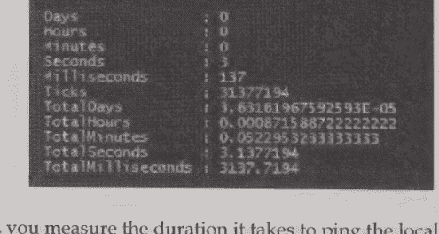
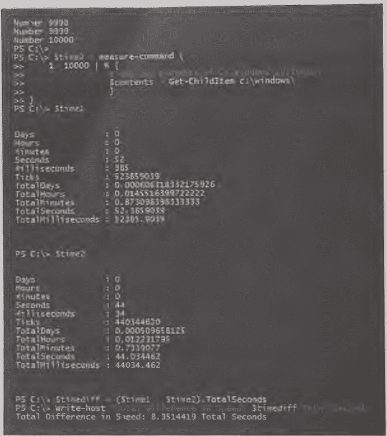
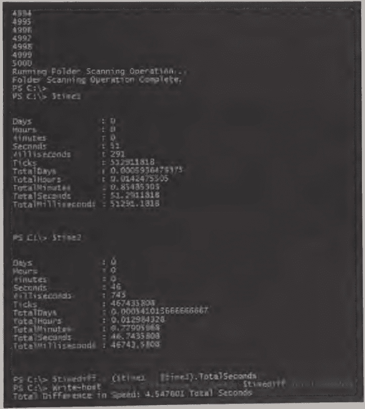
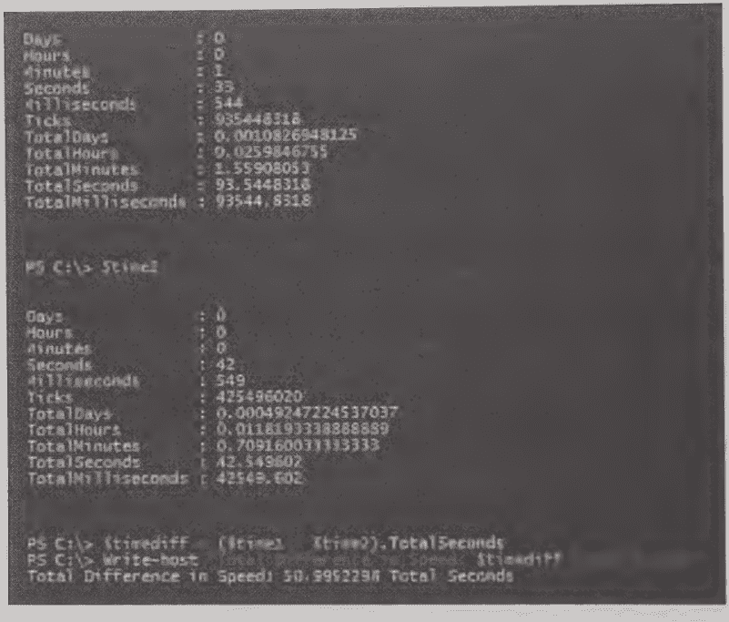
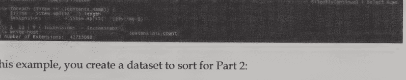
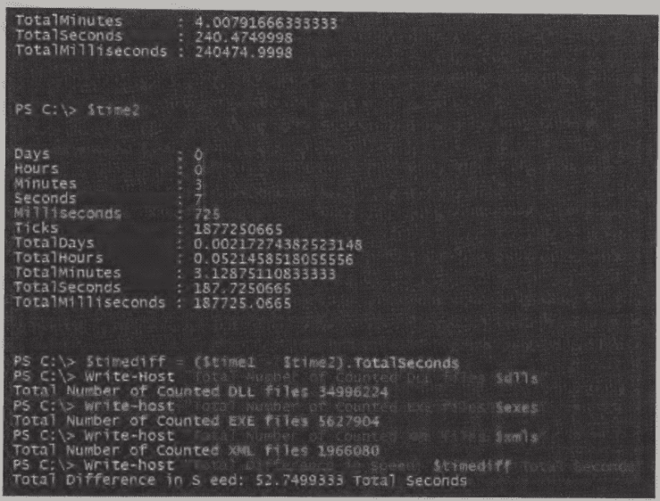

# 10 优化脚本执行速度

当你执行 Windows 服务器扫描脚本时，你很可能需要处理大量对象。 编码实践中的微小效率提升可使大型数据集的执行时间呈指数级加快。 由于 PowerShell 具有很强的灵活性，可以编写两套执行完全相同活动的代码。 然而，你会发现某些编码技术比其他技术高效得多。 在某些情况下，你可以将脚本性能提高超过 200%。

本章重点介绍你可以对脚本进行快速更改以优化效率。 你还将了解应避免使用的 cmdlet 和方法，以确保不会影响脚本的性能。 通过遵循本章中的建议，你可以显著减少 Windows 服务器扫描脚本扫描系统所需的时间。

在本章中，你将：

- 学习如何测量脚本中命令的持续时间
- 确定将所有操作写入屏幕的开销
- 创建一个日志函数，允许你打开和关闭详细日志记录
- 评估 write-progress 函数对脚本性能的影响
- 确定多个 `if` 和 `switch` 语句之间的速度差异

### 脚本执行速度

当 PowerShell 脚本执行时，它们会消耗系统上的内存和 CPU 资源。 对于较大的扫描脚本，这可能会在一段明显的时间内导致系统资源激增。 因此，优化脚本以快速执行手头的任务非常重要。 你可以使用 measure-command cmdlet 来测量脚本执行时间。 要测量执行时间，你调用 measure-command cmdlet 并将要执行的代码放在大括号中。 measure-command cmdlet 的输出将显示操作的 Days、Hours、Seconds、Milliseconds、Ticks、TotalDays、TotalHours、TotalMinutes、TotalSeconds 和 TotalMilliseconds。 这代表代码执行该代码段所花费的时间长度。

要通过利用 measure-command cmdlet 来测量命令，你可以执行以下操作：

```
measure-command { ping localhost }
```

此输出显示在以下屏幕截图中：



在此示例中，你测量 ping 系统上 localhost 所需的持续时间。 你首先通过声明 measure-command cmdlet 开始。 在大括号中，你指定 ping localhost。 执行后，measure-command 返回操作的 Days、Hours、Seconds、Milliseconds、Ticks、TotalDays、TotalHours、TotalMinutes、TotalSeconds 和 TotalMilliseconds。 你会看到，在此示例中，ping localhost 的持续时间为 3.13 秒。

### write-host cmdlet 的速度考虑

显示进度信息有助于确定脚本中正在执行哪些操作，或在脚本故障排除过程中。 然而，当你开始向 PowerShell 窗口写入大量信息时，你会开始看到脚本执行速度变慢。 当你将 PowerShell 操作保留在内存中时，系统会与内存中的操作进行交互。 当你将内容显示到屏幕上时，你必须等待内核将操作写入屏幕，然后才能继续下一个操作。 这本质上比保留在内存中慢得多。


> 以下示例大约需要四分钟才能执行。 执行时间会根据系统硬件和可用资源而有所不同。

要显示打印到屏幕上的操作与内存中的操作，你可以执行以下操作：

```
$time1 = measure-command {
    1..10000 | % {
        write-host "Number $_"
        # Get the contents of C:\Windows\
        $contents = Get-ChildItem c:\windows\
    }
}

$time2 = measure-command {
    1..10000 | % {
        # Get the contents of C:\Windows\
        $contents = Get-ChildItem c:\windows\
    }
}

$time1
$time2
$timediff = ($time2 - $time1).TotalSeconds
Write-host "Total Difference in Speed: $timediff Total Seconds"
```

此输出显示在以下屏幕截图中：



在此示例中，你计时写入屏幕的数据与保留在内存中的操作之间的差异：

- 1. 你首先通过声明 measure-command cmdlet 开始。
- 2. 你声明从 1 到 10000 的范围并将其通过管道传递给 %，它是 foreach 的别名。
- 3. 然后你使用 "Number $_" 利用 write-host cmdlet 显示当前步骤的编号。
- 4. 你还使用 c:\Windows\ 参数利用 Get-ChildItem cmdlet 并将这些结果设置为 $contents。
- 此操作将重复 10,000 次。 执行持续时间将被 measure-command cmdlet 捕获并存储在 $time1 变量中。
- 5. 然后你设置第二个测量命令。
- 6. 你声明 measure-command cmdlet。
- 7. 你还声明从 1 到 10000 的范围并将其通过管道传递给 %。
- 8. 你使用 c:\Windows\ 参数利用 Get-ChildItem cmdlet 并将这些结果设置为 $contents。
- 此操作将重复 10,000 次。 执行持续时间将被 measure-command cmdlet 捕获并存储在 $time2 变量中。
- 在第二个命令执行后，你通过调用变量来显示 $time1 和 $time2 中的持续时间。
- 9. 然后你通过调用 $time1 - $time2 并引用 TotalSeconds 属性来计算执行时间差异。
- 10. 你将此值设置在 $timediff 变量中。
- 11. 最后，你使用 write-host cmdlet 和 "Total Difference in Speed: $timediff Total Seconds" 将时间值打印到显示器上。

你会看到，在此示例中，将操作保留在内存中比将其显示在屏幕上快约 15 倍。

此示例表明，将单个项目的进度写入屏幕比将计算保留在内存中更慢。 虽然建议在脚本中提供进度信息，但同样重要的是要知道在何处使用脚本进度信息。 当你想要指定不同脚本操作的开始或停止时，写入屏幕是合适的。 然而，如果你正在扫描文件系统，你不想在屏幕上显示每个正在扫描的文件。 这会由于打印到屏幕的数据量而显著影响脚本的执行。

有两种策略可以改善屏幕上显示的信息。 第一个策略是利用一个函数将信息写入屏幕，你可以使用变量将其打开和关闭。 在此，你可以在测试阶段在屏幕上显示详细信息。 测试完成后，你可以关闭生产使用中的所有屏幕写入。

第二个策略是仅写入高级脚本状态信息。 不要将每个操作写入屏幕，而是在开始时指定 Running Operation... 并在完成时使用 Operation Complete。 这将减少放置在屏幕上的文本量；然而，它仍会在屏幕上显示进度。 创建一个允许你启用和禁用屏幕打印的函数可以让你在代码的某些部分禁用详细输出，同时在其他部分为测试目的启用它。 这种组合为你管理屏幕写入性能提供了很大的灵活性。

要创建可以启用和禁用的 write-host 函数，在操作中途禁用详细日志记录并计时差异，你可以执行以下操作：

```
$verbose = $true
function log { if ($verbose) { write-host $_ } }

$time1 = measure-command {
    1..10000 | % {
        log "Number $_"
        # Get the contents of C:\Windows\
        $contents = Get-ChildItem c:\windows\
    }
}

$time2 = measure-command {
    1..5000 | % {
        log "Log $_"
        # Get the contents of C:\Windows\
        $contents = Get-ChildItem c:\windows\
    }
    $verbose = $false
    Write-host "Running Folder Scanning Operation..."
    1..5000 | % {
        log "Number $_"
        # Get the contents of C:\Windows\
    }
}
```


```
$contents = Get-ChildItem c:\windows\
}
Write-host "Folder Scanning Operation Complete."
}
```

```
$time1
$time2
$timediff = ($time1 - $time2).TotalSeconds
Write-host "Total Difference in Speed: $timediff Total Seconds"
```

此输出在以下屏幕截图中显示：



在此示例中，您创建一个可以启用和禁用的 write-host 函数，在操作中途禁用详细日志记录，并计时差异：

- 1. 您首先通过声明 $verbose 变量并将其值设置为 $true 开始。
- 2. 然后您创建 log 函数，该函数包含一个 if 语句来验证 $verbose 是否设置为 $true。如果 $verbose 设置为 $true，write-host cmdlet 会将管道或 $_ 打印到屏幕上。
- 3. 您声明 measure-command cmdlet 来测量时间。
- 4. 您创建一个从 1 到 10000 的范围并将其通过管道传递给 %，它是 foreach 的别名。
- 5. 您使用 "Number $_" 利用 log 函数来显示当前步骤的编号。
- 6. 然后您使用 "c:\Windows\" 参数使用 Get-ChildItem cmdlet 并将这些结果设置为 $contents。
- 此操作将重复 10,000 次。执行持续时间将被 measure-command cmdlet 捕获并存储在 $time1 变量中。
- 7. 对于第二个操作，您调用 measure-command cmdlet。
- 8. 您创建一个从 1 到 5000 的范围并将其通过管道传递给 %。
- 9. 您使用 "Number $_" 作为管道发出 log 函数。
- 10. 然后您使用 "c:\Windows\" 参数利用 Get-ChildItem cmdlet 并将这些结果设置为 $contents。
- 11. 操作重复 5,000 次后，您通过将 $verbose 设置为 $false 来禁用详细日志记录。
- 12. 您还使用 write-host cmdlet 将其设置为 "Running Folder Scanning Operation..." 将高级信息写入屏幕。
- 13. 您继续创建一个从 1 到 5000 的第二个范围，即操作的后半部分。您将范围通过管道传递给 %。
- 14. 您使用 "Number $_" 作为管道发出 log 函数。
- 15. 您使用 "c:\Windows\" 参数利用 Get-ChildItem cmdlet 并将这些结果设置为 $contents。
- 操作再重复 5,000 次后，执行持续时间将被 measure-command cmdlet 捕获并存储在 $time2 变量中。
- 要查看测量的时间，您通过调用变量来显示 $time1 和 $time2 中的持续时间。

- 16. 然后您通过调用 `$time1 - $time2` 并引用 TotalSeconds 属性来计算执行时间的差异。
- 17. 您将此值设置在 `$timediff` 变量中。
- 18. 最后，您使用 Write-host cmdlet 并使用 "Total Difference in Speed: $timediff Total Seconds" 将时间值打印到显示器上。

您将看到，在此示例中，虽然两个操作都调用相同的日志函数，但禁用 `$verbose` 可将性能提高约 10%。

## write-progress cmdlet 的速度考虑

write-progress cmdlet 是在屏幕上显示操作进度的绝佳方式。它不会用信息淹没屏幕，并提供当前进度的清晰度量。然而，write-progress cmdlet 与 write-host cmdlet 有类似的问题。由于您在循环中提供视觉反馈，因此会减慢脚本的整体性能。

要显示使用 write-progress 循环与将操作保留在内存之间的速度差异，您可以执行以下操作：

```
$time1 = measure-command {
    1..10000 | % {
        $attempt = $_
        $perComplete = [math]::truncate(($attempt/10000)*100)
        write-progress -Activity "Looping Retrieval of Contents of c:\Windows" -Status "$attempt of 10000." -PercentComplete $perComplete
        # Get the contents of C:\Windows\
        $contents = Get-ChildItem c:\windows\
    }
}

$time2 = measure-command {
    1..10000 | % {
        # Get the contents of C:\Windows\
        $contents = Get-ChildItem c:\windows\
    }
}

$time1
$time2
$timediff = ($time1 - $time2).TotalSeconds
Write-host "Total Difference in Speed: $timediff Total Seconds"
```

此输出在以下屏幕截图中显示：



此示例显示了使用 write-progress cmdlet 与将操作保留在内存之间的差异：

- 1. 您首先通过声明 `measure-command` cmdlet 开始。
- 2. 然后您声明从 1 到 10000 的范围并将其通过管道传递给 `%`，它是 `foreach` 的别名。
- 3. 接下来，您创建 `$attempt` 变量并将其设置为管道 `$_`，即脚本的当前迭代。
- 4. 由于 write-progress cmdlet 不会自动舍入完成百分比，您必须利用 [math].Net 程序集将完成百分比截断为整数。
- 5. 要计算完成百分比，您取当前尝试次数除以总迭代次数（10,000），并通过将值乘以 100 获得百分比。此舍入值随后存储在 $perComplete 变量中。
- 6. 您继续使用 write-progress cmdlet，将 -Activity 参数设置为 "Looping Retrieval of Contents of c:\Windows:"，将 -status 参数设置为 "$attempt of 10000."，并将 -PercentComplete 参数设置为 $perComplete。
- 7. 最后，您使用 c:\windows\ 参数调用 Get-ChildItem cmdlet。此操作将重复 10,000 次。
- 执行持续时间将被 measure-command cmdlet 捕获并存储在 $time1 变量中。
- 8. 然后您设置第二个测量命令。
- 9. 您声明 measure-command cmdlet。
- 10. 您声明从 1 到 10000 的范围并将其通过管道传递给 %。
- 11. 您使用 "c:\Windows\" 参数利用 Get-ChildItem cmdlet 并将这些结果设置为 $contents。
- 12. 此操作将重复 10,000 次。执行持续时间将被 measure-command cmdlet 捕获并存储在 $time2 变量中。
- 执行第二个命令后，您通过调用变量来显示 $time1 和 $time2 中的持续时间。
- 13. 然后您通过调用 $time1 - $time2 并引用 TotalSeconds 属性来计算执行时间的差异。
- 14. 您将此值设置在 $timediff 变量中。
- 15. 最后，您使用 write-host cmdlet 并使用 "Total Difference in Speed: $timediff Total Seconds" 将时间值打印到显示器上。

您将看到，在此示例中，将操作保留在内存中比使用 write-progress cmdlet 快约 219%。

## 速度考虑 - switch 与 if 语句

可能有时候您需要对字符串的多个值进行评估。常见的做法是创建多个 if 语句来评估这些字符串。虽然这在小型数据集中可能效果良好，但通过利用 switch 语句可以获得性能提升。这是因为 switch 语句在数据通过时评估数据的方式。switch 语句在找到匹配项后会停止向下评估语句列表。相反，多个 if 语句即使找到匹配项也会每次都进行评估。这也意味着，如果您正在排序大量数据，您希望将最常见的数据放在 switch 语句的顶部，而不太可能的数据放在底部。这将使您能够快速匹配最常见的分母并继续传递到循环中的下一个值。

下一个示例将模拟大型 .exe、.dll 和 .xml 文件夹结构。此示例的第一部分设置用于评估的数据集，而第二部分将文件类型的计数排序到不同的变量中。您将利用 if 语句和 switch 来确定 switch 的效率。

> 第 1 部分和第 2 部分要求 PowerShell 窗口以管理员身份运行。在测试此代码时，您需要右键单击 PowerShell 图标并选择以管理员身份运行。如果您远程执行此代码，您需要确保您使用的用户凭据对系统具有管理权限。

Part 1 – 要创建 .dll、.exe 和 .xml 文件的数据集，您可以执行以下操作：

```powershell
# Gather all the File Extensions c:\windows\System32
$dlls = 0
$exes = 0
$xmls = 0
$extensions = @()
$contents += ((Get-ChildItem "c:\windows\System32\" -include "*.xml","*.dll","*.exe" -Recurse -ErrorActionSilentlyContinue) | Select Name)
foreach ($item in ($contents.Name)) {
    $sline = $item.split(".").length
    $extensions += '.' + $item.split(".")[$sline-1]
}
1..13 | % { $extensions += $extensions }
Write-host "Total number of Extensions: " $extensions.count
```


此输出显示在以下屏幕截图中：



在此示例中，您为第 2 部分创建了一个要排序的数据集：

- 1. 您首先通过将变量 $dlls、$exes 和 $xmls 设置为零值开始。
- 2. 您通过将其设置为等于 @() 来声明 $extensions 数组。
- 3. 接下来，您使用 Get-ChildItem cmdlet，参数为 "c:\Windows\System32"，-include 参数为 "*.xml"、"*.dll"、"*.exe"，以及 -Recurse 参数，并将 -ErrorAction 参数设置为 SilentlyContinue 参数。
- 4. 然后您将该值通过管道传递给 Select Name，以选择每个文件的 name 属性。
- 5. 然后您使用 += 赋值运算符将每个值添加到 $contents 变量中。 然后您继续获取每个文件的扩展名。
- 6. 您首先使用 foreach 循环通过 Name 属性评估 $contents 中的每个 $item。
- 7. 由于文件名可能包含多个句点，您必须通过文件名中的最后一个句点来确定扩展名。您继续按句点字符拆分当前的 $item 并计算文件名中句点的数量。
- 8. 您将计算出的句点数量设置为 $sline 变量。
- 9. 为了选择文件名中的最后一个值，您设置 $item 并使用 .split(".") 方法。
- 10. 然后您通过 $sline 数字减一来选择最后一个拆分值，并且数组是从零开始的。
- 11. 您向 $extensions 数组添加一个 "," 加上文件的最终扩展名。

第 1 部分的最后一部分是将找到的扩展名按 13 的倍数复合。这将模拟大量信息通过第 2 部分的脚本传递。您随后利用 write-host cmdlet 显示 "Total number of extensions: " 并使用 $extensions.count 显示扩展名数量。此示例返回 42,713,088 个待排序的扩展名。

## 第 2 部分 - 要测量使用 if 语句和 switch 语句对数据进行排序之间的持续时间差异，您可以执行以下操作：

```
$time1 = measure-command {
foreach ($extension in $extensions) {
    # Determine the file types
    if ($extension -like "*.xml") { $xmls += 1 }
    if ($extension -like "*.exe") { $exes += 1 }
    if ($extension -like "*.dll") { $dlls += 1 }
}
}
# Reset Count
$dlls = 0
$exes = 0
$xmls = 0
$time2 = measure-command {
foreach ($extension in $extensions) {
    # Determine the file types
    switch($extension) {
".dll" { $dlls += 1 }
".exe" { $exes += 1 }
".xml" { $xmls += 1 }
    default { } #do nothing
    }
}
}

$time1
$time2
$timediff = ($time1 - $time2).TotalSeconds
Write-Host "Total Number of Counted DLL files $dlls"
Write-Host "Total Number of Counted EXE files $exes"
Write-Host "Total Number of Counted XML files $xmls"
Write-Host "Total Difference in Speed: $timediff Total Seconds"
```

此输出显示在以下屏幕截图中：



在此示例中，您测量使用 if 语句和 switch 语句对数据进行排序之间的差异：

- 1. 您首先利用 measure-command cmdlet 来测量使用 if 语句排序的持续时间。
- 2. 您继续使用 foreach 循环来评估 $extensions 数组中的每个 $extension。
- 3. 您声明如果 $extension -like "*.xml" 的语句。如果此条件评估为 true，则它将利用 += 赋值运算符向 $xmls 变量添加一个值。
- 4. 然后您评估如果 $extension -like "*.exe" 的语句。如果此条件评估为 true，则它将利用 += 赋值运算符向 $exes 变量添加一个值。
- 5. 最后，您评估如果 $extension -like "*.dll" 的语句。如果此条件评估为 true，则它将利用 += 赋值运算符向 $dlls 变量添加一个值。数据排序完成后，脚本将测量的时间添加到 $time1 变量中。

为第二个数据排序准备脚本时，您通过将它们设置为 0 来重置 $dlls、$exes 和 $xmls 变量。

- 6. 您继续利用 measure-command cmdlet 来测量使用 switch 语句排序的持续时间。
- 7. 您调用 foreach 循环来评估 $extension 数组中的每个 $extension。
- 8. 您使用 $extension 作为参数调用 switch 语句。
- 9. 您声明 ".dll"；如果匹配，脚本将向 $dlls 变量添加一个值。
- 10. 然后您声明 ".exe"；如果匹配，脚本将向 $exes 变量添加一个值。
- 11. 您还声明 ".xml"；如果匹配，脚本将向 $xmls 变量添加一个值。
- 12. 最后，您使用 default 语句并将其设置为 { }，不执行任何操作。
- 13. 数据排序完成后，脚本将测量的时间添加到 $time2 变量中。

在进行时间测量后，您通过调用变量来显示 $time1 和 $time2 中的持续时间。

- 14. 您调用 write-host cmdlet 并显示 "Total Number of Counted DLL files $dlls"。
- 15. 您再次调用 write-host cmdlet，并显示 "Total Number of Counted EXE files $exes"。
- 16. 您最后一次调用 write-host cmdlet，并显示 "Total Number of Counted XML files $xmls"。
- 17. 您通过调用 $time1 - $time2 并引用 TotalSeconds 属性来计算执行时间差异。您将此值设置为 $timediff 变量。
- 18. 最后，您使用 write-host cmdlet 并使用 "Total Difference in Speed: $timediff Total Seconds" 将时间值打印到显示器上。

您会看到，在此示例中，用于数据排序的 switch 比使用 `if` 语句快约 128 倍。

您会注意到，`switch` 语句中的评估顺序设置为先 `.dll`，其次 `.exe`，最后 `.xml`。这些是基于系统上的常见性进行评估的。由于 switch 在找到匹配项后会停止评估，因此脚本编写为先评估最受欢迎的项目，从而优化 switch 的功能。

## Summary

在本章中，您学习了可以优化执行速度的不同脚本技术。您首先学习了如何通过利用 `measure-command` cmdlet 来测量脚本执行持续时间。然后您比较了将数据写入屏幕和将操作保留在内存中之间的时间差异。然后您学习了一种在运行时优化脚本执行的技术，即打开和关闭屏幕数据写入。您继续评估 `write-progress` cmdlet 以及它对性能的影响。通过评估 `if` 语句和 `switch` 语句之间的性能差异，您完成了本章。

在下一章中，您将学习如何利用正则表达式进行字符串匹配，以显著提高脚本性能。
