# 11 提高性能以使用正则表达式

## 提高性能以使用正则表达式

当您使用 Windows Server 扫描脚本评估系统时，可能需要找到与特定值不匹配的敏感数据。信用卡号、社会安全号码，甚至税务识别号码都是您需要识别但仅使用字符串搜索就不可能搜索的数据的绝佳示例。

正则表达式提供了模式匹配，可以识别您通常无法通过字符串搜索找到的数据。正则表达式非常动态，可以用于检测脚本中所需的任何模式。事实上，正则表达式可以如此精细，以至于可以搜索单词的一部分。这意味着您可以在 `MyPasswordIsString` 字符串中找到 `Password` 单词。

正则表达式也非常快。与使用多个数组和 `if` 语句相比，正则表达式通常比其他技术快超过 50%！这就是开发人员选择利用正则表达式来优化其代码并提供强大的搜索平台的原因。

在本章中，您将：

- 学习组织中常用的正则表达式
- 利用比较运算符使用正则表达式
- 动态构建脚本中使用的正则表达式
- 评估使用正则表达式与多个 `foreach` 循环的性能增益


本章不会深入讲解如何创建和阅读正则表达式。有一个很好的指南可以帮助你拆解单个正则表达式，可在此处找到：https://msdn.microsoft.com/en-us/library/az24scfc(v=vs.110).aspx.

## 使用正则表达式

提高脚本性能的最佳方法之一是利用正则表达式。正则表达式提供强大的模式匹配功能，可快速评估大量数据。使用正则表达式的两种常见方法是对比较运算符和支持使用正则表达式的 cmdlet。例如，`-match` 比较运算符允许你将字符串或数组与表达式进行匹配。如果模式匹配，正则表达式会将语句评估为 true，即找到了匹配项。

你也可以使用 `select-string` cmdlet 等 cmdlet，它原生支持正则表达式模式。虽然 `select-string` cmdlet 提供了 `-SimpleMatch` 参数以简化搜索，但你也可以使用同一个 cmdlet 来匹配正则表达式模式。这增加了现有 cmdlet 的多功能性，因为它们现在除了搜索字符串外，还可以支持正则表达式来搜索模式。

下表列出了一些更受欢迎的正则表达式：

| 表达式类型 | 正则表达式 |
|---|---|
| IP 地址 | \b\d{1,3}\.\d{1,3}\.\d{1,3}\.\d{1,3}\b |
| MAC 地址 | ^([0-9a-f]{2}:){5}[0-9a-f]{2}$ |
| 电子邮件地址 | ^.+@[^\.]*\.[a-z]{2,}$ |
| Visa 信用卡号码 | ^\d{4}-\d{4}-\d{4}-\d{4}$ |
| 社会安全号码 | ^\d{3}-\d{2}-\d{4}$ |

要利用 `-match` 运算符验证不同的模式，可以执行以下操作：

```
"192.168.12.24" -match "\b\d{1,3}\.\d{1,3}\.\d{1,3}\.\d{1,3}\b"
```

```
"00:A0:F8:12:34:56" -match "^([0-9a-f]{2}:){5}[0-9a-f]{2}$"
```

```
"brent@testingdomain.com" -match "^.+@[^\.]*\.[a-z]{2,}$"
```

```
"4000-4000-4000-4000" -match "^\d{4}-\d{4}-\d{4}-\d{4}$"
```

```
"123-45-6789" -match "^\d{3}-\d{2}-\d{4}$"
```

以下屏幕截图显示了此操作的输出：

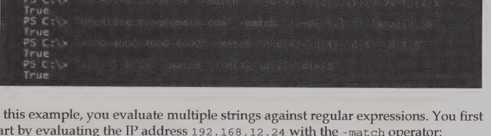

在此示例中，你将多个字符串与正则表达式进行评估。你首先使用 -match 运算符评估 IP 地址 192.168.12.24：

- 1. 你定义 \b 整个单词边界，后跟表达式 \d 仅接受数字。
- 2. 你指定范围 {1,3} 以接受 1-3 位数字。
- 3. 然后你指定 \. 以允许八位字节之间有句点，并继续重复语句 \d{1,3} 再三次。
- 4. 这允许 IP 地址中有四个八位字节。最后，你使用 \b 关闭表达式以关闭单词边界。
- 5. 当 -match 比较运算符评估字符串 192.168.12.24 时，它将返回 True。

然后你使用 -match 运算符评估 MAC 地址 00:A0:F8:12:34:56：

- 1. 你首先使用锚点 ^ 从开头开始评估。
- 2. 然后表达式使用分组构造 ( ) 来对表达式 [0-9a-f]{2} 进行分组：
- 3. 此表达式验证每个字符是否具有有效的十六进制 [0-9a-f] 值，并使用量词指定每个序列仅为两个字符。
- 4. 表达式以 : 结尾，这是每组值之间的分隔符。
- 5. 接下来，你使用另一个量词 {5} 重复带有冒号结尾的两个十六进制字符五次。
- 6. 表达式的最后一部分由结束锚点 $ 匹配。
- 7. 结束锚点验证每个字符是否具有有效的十六进制 [0-9a-f] 值，并使用量词指定字符串结尾仅为两个字符。
- 8. 当 -match 运算符评估字符串 00:a0:f8:12:34:56 时，它将返回 True。

你继续使用 -match 运算符评估电子邮件地址 brent@testingdomain.com：

- 1. 你首先使用锚点 ^ 从开头开始评估。
- 2. 你指定 . 字符表示电子邮件地址开头可以包含任何内容。
- 3. 你使用 +@ 来评估字面字符 @。
- 4. 然后你指定范围 [^\.]，它指定 @ 后的第一个字符不能是句点。
- 5. 然后它继续评估 . *，表示可以指定任何字符。
- 6. 然后表达式指定 \. 以允许在指定顶级域名后有一个句点。
- 7. 最后，你指定字符集范围 [a-z]，最小为两个字符，由 {2,} 指定。
- 8. 表达式的最后一部分由结束锚点 $ 匹配。
- 9. 当 -match 运算符评估字符串 brent@testingdomain.com 时，它将返回 True。

然后你使用 -match 运算符评估 Visa 信用卡 4000-4000-4000-4000：

- 1. 你首先使用锚点 ^ 从开头开始评估。
- 2. 你指定 \d 表示所有数字。
- 3. 然后你提供范围 {4} 以允许恰好四位数字。
- 4. 你使用 - 字符作为数字分隔符，后跟 \d{4} 提供另外四位数字。
- 5. 你重复 - 字符作为数字分隔符，后跟 \d{4} 再两次。
- 6. 表达式的最后一部分由结束锚点 $ 匹配。
- 7. 当 -match 运算符评估字符串 4000-4000-4000-4000 时，它将返回 True。

最后，你使用 -match 运算符评估社会安全号码 123-45-6789：

- 1. 你首先使用锚点 ^ 从开头开始评估。
- 2. 你指定 \d 表示所有数字。
- 3. 然后你提供范围 {3} 以允许恰好三位数字。
- 4. 你提供 - 字符作为数字分隔符，后跟 \d{2} 以允许恰好两位数字。
- 5. 然后你指定 \d{4} 以允许恰好四位数字。
- 6. 表达式的最后一部分由结束锚点 $ 匹配。
- 7. 当 -match 运算符评估字符串 123-45-6789 时，它将返回 True。

## 动态构建表达式

当你创建脚本使用正则表达式搜索字符串时，搜索模式可能需要在每次执行时更改。不是每次运行脚本时更新正则表达式，PowerShell 提供了动态构建正则表达式的能力。例如，如果你需要搜索文件中经常更改的 Active Directory 组成员，则每次运行脚本时都需要更新表达式。相反，你可以在运行时查询 Active Directory 组，并动态构建用于搜索的正则表达式。这提供了即时更改搜索词的灵活性，并且不需要为每次执行编辑脚本。

首先，你需要声明一个对象数组以提供给正则表达式。在本例中，我们将定义 "administrator"、"password" 和 "username" 并将它们设置在 $myarray 变量中。你然后继续通过声明 (?i)^.*( 字符串来构建正则表达式字符串。这使用 (?i) 声明不区分大小写，以允许以下字符串中同时使用大写和小写，并使用锚点 ^ 从开头开始评估。

你继续使用 .*( 来接受下一个序列中定义的字符串之前的任何字符。在括号内，你调用 $myarray 并将其通过管道传递给 %，它是 foreach 的别名。

在 foreach 循环内部，你取当前值并利用 [regex] .NET 类 ::escape 任何可能干扰正则表达式的字符。这将动态地将这些字符解释为字面字符而不是正则表达式指令。

然后你利用 -join 运算符在 $myarray 数组中的每个单词之间添加 |。搜索字符串中的 | 字符表示 OR 操作。foreach 循环继续将剩余的单词添加到正则表达式字符串中。这创建了搜索模式 administrator | password | username。

你继续在模式末尾添加 ).*$ 以关闭括号语句，并匹配模式末尾的任何字符。最后，你将构建的字符串放入名为 $searchregex 的变量中。然后你可以使用 -match 运算符或支持正则表达式的 cmdlet 利用此正则表达式进行搜索。

> 默认情况下，PowerShell 中的正则表达式不区分大小写。然而，当你利用 [regex] .NET 类时，该类会以区分大小写的方式转换表达式，从而覆盖默认设置。这要求你通过调用 (?i) 强制表达式以不区分大小写的方式进行评估。

要创建数组并使用动态构建的正则表达式进行搜索，可以执行以下操作：

```
$myarray = "administrator","password","username"
$searchRegex = '(?i)^.*(' + ($myarray | % {[regex]::escape($_)}) -join "|" + ').*$'
"This String has Administrators in it." -match $searchRegex
"This PASSWORD is not secure." -match $searchRegex
"TheUsernames are not written." -match $searchRegex
$searchRegex.tostring()
```

以下屏幕截图显示了此操作的输出：


在本示例中，您将学习如何从数组构建动态字符串搜索正则表达式：

- 1. 您首先通过构建包含 "administrator"、"password"、"username" 的数组，并将其设置在 $myarray 变量中。
- 2. 您随后继续通过声明 (?i)^.*( 字符串来构建正则表达式字符串。
- 3. 这会使用 (?i) 声明不区分大小写，以便在以下字符串中允许大写和小写，并使用 ^ 锚点从开头开始评估。
- 4. 您继续使用 .*( 来接受在下一序列中定义的字符串之前的任何字符。
- 5. 在括号内，您调用 $myarray 并将其通过管道传递给 %，它是 foreach 的别名。
- 6. 在 foreach 循环中，您获取当前值并利用 [regex] .NET 类来 ::escape 可能干扰正则表达式的任何字符。
- 7. 您随后利用 -join 运算符在 $myarray 数组中的每个单词之间添加一个 |。
- 8. 您在模式末尾添加 ).*$ 以关闭括号语句，并匹配模式末尾的任何字符。
- 9. 最后，您将构建的字符串放入名为 $searchRegex 的变量中。

创建正则表达式后，您开始评估 administrator、password 或 username 的值。

- 1. 您声明 "This string has Administrators in it." 并使用 -match 比较运算符与 $searchRegex 正则表达式。
- 2. 此操作的结果返回值为 True。
- 3. 这是因为正则表达式在 "administrators" 中匹配到字符串 "administrator"。
- 4. 由于您声明 administrator 可以在字符串之前或之后出现任何字符，因此表达式返回为 True。

然后您继续评估下一个字符串。

- 1. 您声明 "This PASSWORD is not secure." 并使用 -match 比较运算符与 $searchRegex 正则表达式。
- 2. 此操作的结果返回值为 True。
- 3. 这是因为正则表达式匹配到字符串 "password"，忽略了字符串的大小写。
- 4. 由于您为不区分大小写声明了 `(?i)`，字符串被匹配且表达式返回为 true。
- 5. 然后您声明 "TheUsernames are not written." 并使用 `-match` 比较运算符与 `$searchRegex` 正则表达式。
- 6. 此操作的结果返回值为 True。
- 7. 这是因为正则表达式在字符串 "TheUsernames" 中匹配到字符串 "username"。
- 8. 由于您声明 username 可以在字符串之前或之后出现任何字符，因此表达式返回为 True。
- 9. 最后，您使用 `.toString()` 方法调用 `$searchRegex` 表达式。
- 10. 这会显示正则表达式的文本，即其动态构建的方式。
- 11. 正则表达式 `(?i)^.*(administrator|password|username).*$` 然后显示在屏幕上。

## 实现正则表达式性能

正则表达式在 PowerShell 脚本中实现时非常多用途。它们不仅用于模式验证，而且在分析大量数据时速度更快。将正则表达式与 foreach 数组循环并排比较时，前者会始终优于后者。


> Part 1 和 Part 2 要求 PowerShell 窗口以 **以管理员身份运行** 运行。在测试此代码时，您需要右键单击 PowerShell 图标并选择 **以管理员身份运行**。如果您远程执行此代码，您需要确保您使用的用户凭据对系统具有管理权限。
> 
> `$files` 数组中的文件总数可能与本示例中显示的略有不同。

Part 1 – 要在 c:\Windows\System32 中创建大型文件名数据集，您可以执行以下操作：

```powershell
$files = (Get-ChildItem c:\Windows\System32 -Recurse -ErrorAction SilentlyContinue).Name
1..8 | % { $files += $files }
Write-host "Total Number of Files to Analyze: " $files.count
```

此操作的输出显示在以下屏幕截图中：

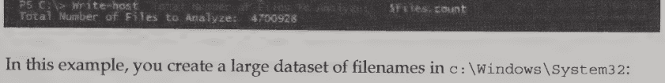

在本示例中，您在 c:\Windows\System32 中创建大型文件名数据集：

- 1. 您首先通过使用 c:\Windows\System32 参数利用 Get-ChildItem cmdlet 开始。
- 2. 您利用 -Recurse 参数扫描子目录，并将 -ErrorAction 参数设置为 SilentlyContinue 参数。
- 3. 您将该语句放在括号中并选择 .Name 属性以返回文件名。
- 4. 文件名被放置在 $files 变量中。
- 5. 然后您声明 1..8 范围以将 $files 变量中的文件名复合八次。
- 6. 您通过将范围通过管道传递给 % 来实现这一点，% 是 foreach 的别名。
- 7. 然后您声明赋值运算符 $files += $files。这会获取 $files 中的当前值并将其添加到 $files 变量中。基本上，每次调用时它都在复制 $files 中包含的内容。
- 8. 最后，您使用 write-host cmdlet 并指定 "Total Number of Files to Analyze:"，引用 $files 变量和 .count 方法。
- 9. 这会显示："Total Number of Files to Analyze: 4700928"。

Part 2—要衡量使用 foreach 循环和正则表达式识别字符串之间的持续时间差异，您可以执行以下操作：

```
$types = ".xml",".exe",".dll"
$filefound = 0
$time1 = Measure-Command {
    foreach ($type in $types) {
        foreach ($file in $files) {
            if ($file -like "*$type*") { $filefound += 1 }
        }
    }
}
Write-host "Total Number of Found Files $filefound"
$filefound = 0
```

## 通过使用正则表达式提高性能

```
$searchRegex = '^.*(' + (($types | foreach {[regex]::escape($_)}) -join "|") + ').*$'

$time2 = Measure-Command {
    foreach ($file in $files) {
        if ($file -match $searchRegex) { $filefound += 1 }
    }
}

Write-host "Total Number of Found Files $filefound"
$time1
$time2

$timediff = ($time1 - $time2).TotalSeconds
Write-host "Total Difference in Speed: $timediff Total Seconds"
```

此操作的输出显示在以下屏幕截图中：

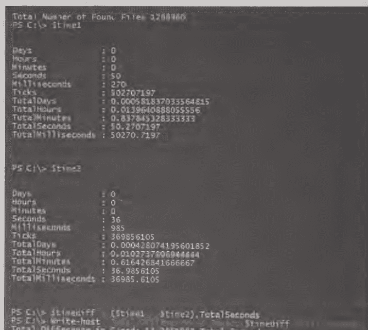

在本示例中，您将衡量使用 `foreach` 循环和正则表达式识别字符串之间的持续时间差异：

- 1. 您首先通过声明要在文件名中搜索的字符串开始。
- 2. 字符串 ".xml"、".exe" 和 ".dll" 被添加到 `$types` 数组中。
- 3. 然后您将 `$filefound` 变量设置为 0。
- 4. 您利用 `measure-command` cmdlet 来衡量使用多个 `foreach` 循环排序的持续时间。
- 5. 您继续使用 `foreach` 循环来评估 `$types` 变量中的每个 `$type`。
- 6. 您在该 `foreach` 循环内部嵌套第二个 `foreach` 循环以评估 `$files` 变量中的每个 `$file`。
- 7. 最后，您利用 `if` 语句来评估 `$file` 变量是否 `-like *$type`。这是一个通配符搜索，允许在当前文件 `$type` 之前有任何字符。
- 8. 如果文件名与类型匹配，它将向 `$filefound` 变量添加一个值。
- 9. 在两个循环完成后，您随后将执行持续时间捕获到 `$time1` 变量中。
- 10. 您还使用 `write-host` cmdlet 并使用 "Total Number of Found Files `$filefound`" 参数。
- 11. 这会显示 `Total Number of Found Files 1288960`。
- 12. 然后您通过将 `$filefound` 变量设置为 0 来重置文件计数器。
- 13. 您通过声明 `(?i)` 表示不区分大小写并声明 `^` 从开头开始评估来开始创建正则表达式。
- 14. 您继续使用 `.* (` 来接受下一序列中定义的字符串之前的任何字符。
- 15. 在括号内，您调用 `$myarray` 并将其通过管道传递给 `%,`，它是 `foreach` 的别名。
- 16. 在 `foreach` 循环内部，您获取当前值并利用 `[regex].NET` 类来 `::escape` 可能干扰正则表达式的任何字符。
- 17. 然后您利用 `-join` 运算符在 `$myarray` 数组中的每个单词之间添加一个 `|`。


-   18. 你在末尾添加 $ 结束锚点，以确保它仅评估文件类型，而不是将文件扩展名作为单词的一部分进行评估。
-   19. 你将此正则表达式存储在 $searchRegex 变量中。
-   20. 你继续利用 measure-command cmdlet 来测量 foreach 循环和正则表达式的评估。
-   21. 你首先使用 foreach 来评估 $files 中的每个 $file。
-   22. 然后你使用 -match 比较运算符声明一个 if 语句，以确定 $file 是否匹配 $searchRegex 中设置的正则表达式。
-   23. 如果正则表达式返回 True，则 $filefound 变量将增加 1。
-   24. 在 foreach 循环完成对每个文件的评估后，你随后将执行持续时间捕获到 $time2 变量中。
-   25. 你还使用 write-host cmdlet 并传入 "Total Number of Found Files $filefound" 参数。
-   26. 这会显示 Total Number of Found Files 1288960。
-   27. 最后，你通过调用变量来显示 $time1 和 $time2 中的持续时间。
-   28. 然后你通过调用 $time1 - $time2 并引用 TotalSeconds 属性来计算执行时间的差值。
-   29. 你将此值设置在 $timediff 变量中。
-   30. 最后，你使用 write-host cmdlet 并传入 "Total Difference in Speed: $timediff Total Seconds" 来将时间值打印到显示器上。
-   31. 你会看到，在此示例中，利用正则表达式比使用 foreach 循环处理数据快 13.285 秒。

## Summary

在本章中，你学习了正则表达式。你探索了不同的常见正则表达式，并了解到你可以使用它们与 -match 比较运算符一起使用。你还了解到有一些 cmdlet 支持使用正则表达式。然后你使用数组中的值创建了一个动态正则表达式，并识别了匹配这些表达式的字符串。最后，你评估了使用正则表达式与使用多个数组进行字符串搜索之间的性能差异。在下一章中，你将把本书中学习到的所有概念结合起来，创建一个 Windows 服务器扫描脚本。

# 12 Overall Script Workflow, Termination Files, and Merging Data Results

当你准备创建 Windows 服务器扫描脚本时，在执行脚本本身之前，你需要创建多个组件。例如，如果你打算使用加密字符串，你需要开发一个脚本来创建随机密码、salt 和 init。你还需要另一个脚本来执行字符串的加密。由于你可能需要创建多个脚本，本章概述了推荐的脚本工作流程，以确保你在环境中运行扫描脚本所需的所有组件都已齐全。

在探索工作流程后，你将继续开发一个脚本来创建随机字符串。这些随机字符串是加密脚本的直接输入，并存储在 `answer` 文件中。你还将学习如何开发一个加密脚本，在循环中加密多个字符串。

完成字符串加密后，你将继续学习 `answer` 文件。你将了解可以在 answer 文件中包含的不同组件，以在脚本中启用多种功能。

你将探索利用终止文件在本地和远程停止扫描脚本执行的方法。你还将学习如何删除 `termination` 文件以重新启用 Windows 服务器扫描脚本的运行。

本章中你将学习的最后一个组件是如何合并服务器扫描脚本的结果。如果你在多个系统上运行了脚本，你需要一种方法将 CSV 文件合并在一起。这将使你能够在一个位置查看所有收集的数据，并发现环境中系统之间的相似之处。

In this chapter, you will:

-   Obtain an overview of the Windows server scanning script
-   Create a script to generate randomized strings for use in the encryption script
-   Develop an encryption script that will enable encrypting of multiple strings
-   Learn the `answer` file's structure
-   Understand the purpose of creating and deleting `termination` files locally and remotely on a system
-   Merge multiple CSVs into a single CSV file

## Windows server scanning script overview

Windows 服务器扫描脚本是一个企业级工具，你可以用它来检查环境中的系统。此脚本可作为起点，用于创建自己的脚本。在实施 Windows 服务器扫描脚本时，你需要遵循一个通用工作流程，以确保脚本安全可靠。

The workflow steps include:

-   1. **Security key generation:** 你将创建一个字符串生成脚本，可随机创建你的加密密码、salt 和 init。你还将利用编码来增强密码、salt 和 init。此脚本的输出将由 `encryption` 函数、`decryption` 函数和 `answer` 文件使用。
-   2. **Encryption script:** 然后你将利用安全密钥生成中生成的值来创建加密脚本。这将使你能够加密字符串以在你的 `answer` 文件中使用。
-   3. **Answer file:** 你将学习需要在 `answer` 文件中存储的不同答案。你还将了解到你需要从本书本章的代码文件中下载 `Scan_Answers.xml` answer 文件。
-   4. **Termination script**: 为了确保你能够远程终止 Windows 服务器扫描脚本，你将创建一个终止脚本。此脚本将在系统上创建一个终止文件，如果存在该文件，则会使 Windows 服务器扫描脚本停止。
-   5. **Windows server scanning script**: 在下一章中，你将把本书中所有示例的概念结合起来，创建一个完整的扫描脚本。本节中的所有其他工作流程步骤都会创建脚本和数据，以补充 Windows 服务器扫描脚本。
-   6. **Merging files**: 工作流程中的最后一个脚本是合并脚本。如果在多个系统上运行 Windows 服务器扫描脚本，你可以将结果合并到一个易于阅读的文件中。

## Pre-script security

当你想要创建一个企业级脚本时，你需要从安全组件开始。在 Chapter 4, String Encryption and Decryption 中，你学习了利用编码和加密为脚本提供额外安全性的重要性。你可以遵循几种企业策略，以确保正确实施编码和加密。其中一种流行策略是创建所有脚本共享的加密和解密 salt、init 和密码。从脚本管理角度来看，这是一种更简单的方法，但你会让所有部门访问相同的加密数据。或者，你可以让各部门为脚本创建自己的编码 salt、init 和密码。这样，加密数据与你的部门生成的数据不同。这为在 answer 文件中实现的加密数据提供了额外的模糊层。虽然这种方法更安全，但协调共享脚本会更困难一些。你需要确保每个团队在脚本和 answer 文件中实现自己的编码 salt、init 和密码。

## Script 1 - randomized password and string generator

无论你为环境选择什么策略，你都需要通过创建随机密码来开始脚本编写过程。然后你对该密码进行编码，拆分为脚本侧解密器（SSD），或 $SSD，答案文件解密器（AFD），或 $AFD，以及运行时解密器（RTD），或 $RTD。最后，你指定一个 salt 字符串，并将其编码到 $salt 变量中，并指定一个 init 字符串，并将其编码到 $init 变量中。你现在拥有了所有先决条件，可以通过利用加密函数开始加密数据。


> 您不希望将编码和加密代码段包含在任何打算部署到环境的脚本中。由于您正在生成安全值，因此应将此脚本放置在访问受限的安全位置。

创建随机密码、盐值和初始化向量，您可以执行以下操作：

```
Function create-password {
    $password = ""
    For ($a=33;$a -le 126;$a++) {
        $ascii += ,[char][byte]$a
    }
    1..30 | % { $password += $ascii | get-random }
    return $password
}

$pass = create-password
$salt = create-password
$init = create-password
```

此操作的输出显示在以下屏幕截图中：

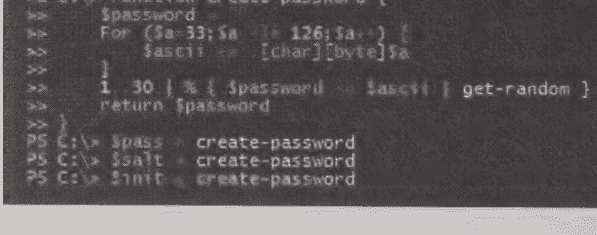

在此示例中，您为加密函数创建随机密码、盐值和初始化向量：

- 1. 您首先通过定义 create-password 函数开始。
- 2. 在函数内部，您定义一个空白的 `$password` 变量来构建密码字符串。
- 3. 您继续创建一个 for 循环，从 `$a` 值等于 33 开始，当 `$a` 小于或等于 126 时，并在每次迭代中将一个值添加到 `$a`。

- 4. 在循环内部，您创建一个 `$ascii` 变量，向其添加 33 到 126 之间的每个字符 `[char]` 字节 `[byte]` 值。
- 5. `$ascii` 变量中的结果是用于随机化的所有字符。
- 6. 之后，您调用通过管道传递到 `%` 的 `1..30` 范围，其中 `%` 是 `foreach` 的别名。
- 7. 然后您将 `$ascii` 变量通过管道传递给 `get-random` 并将值添加到 `$password` 变量。
- 8. 添加 30 个字符后，您使用 return 和 `$password` 变量将值返回到调用该函数的位置。这为 `$pass`、`$salt` 和 `$init` 生成随机值。

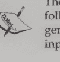

> 在此示例中生成的数值将在以下加密脚本示例中使用。请注意为 SSD、AFD、RTD、salt 和 init 生成的值。这些将是加密函数的直接输入。

创建 `$salt`、`$init` 和 `$pass` 的编码值，将 `$pass` 变量拆分为脚本侧解密器、答案文件解密器和运行时解密器的三个值；您可以按如下方式操作：

```
$encodedpass = [System.Text.Encoding]::Unicode.GetBytes($pass)
$encodedvalue = [Convert]::ToBase64String($encodedpass)
$SSD = $encodedvalue.substring(0,27)
$AFD = $encodedvalue.substring(27,27)
$RTD = $encodedvalue.substring(54,26)
$encSalt = [System.Text.Encoding]::Unicode.GetBytes($salt)
$encSalt = [Convert]::ToBase64String($encSalt)
$encInit = [System.Text.Encoding]::Unicode.GetBytes($init)
$encInit = [Convert]::ToBase64String($encInit)
Write-host "The SSD is: $SSD"
Write-host "The AFD is: $AFD"
Write-host "The RTD is: $RTD"
Write-host "The Salt is: $encSalt"
Write-host "The Init is: $encInit"
```

此操作的输出显示在以下屏幕截图中：

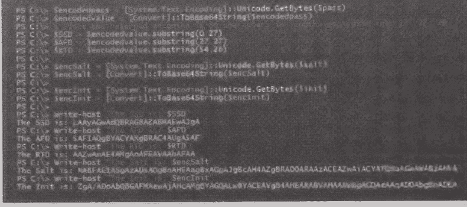

在此示例中，您取自上一个示例中存储在 $pass 中的编码密码。然后您将 $pass 变量拆分为 AFD、SSD 和 RTD 的三个段。最后，您继续为加密脚本创建 $salt 和 $init 的编码值：

- 1. 您首先通过利用 `[System.Text.Encoding]::Unicode.GetBytes($pass)` 方法对密码进行编码，并将值存储在 `$encodedpass` 变量中。
- 2. 然后您通过利用 `[Convert]::ToBase64String($encodedpass)` 方法将编码值转换为字符串，并将值存储在 `$encodedvalue` 变量中。
- 3. 为了得出 SSD，您从 `$encodedvalue` 变量的 0 文本位置开始取子字符串，并在该位置之后获取 27 个字符。您将此值设置为 `$SSD` 变量。
- 4. 为了得出 AFD，您从 `$encodedvalue` 变量的第 27 个文本位置开始取子字符串，并在该位置之后获取 27 个字符。您将此值设置为 `$AFD` 变量。
- 5. 为了得出 RTD，您从 `$encodedvalue` 变量的第 54 个文本位置开始取子字符串，并在该位置之后获取 26 个字符。

总计，您将取出 $encodedvalue 变量中的全部 80 个字符并将其拆分为脚本中使用的三个变量：

- 1. 然后您继续通过利用 [System.Text.Encoding]::Unicode.GetBytes($salt) 方法对盐值进行编码，并将值存储在 $encSalt 变量中。然后您通过利用 [Convert]::ToBase64String($encSalt) 方法将编码值转换为字符串，并将值存储在 $encSalt 变量中。
- 2. 最后，您通过利用 [System.Text.Encoding]::Unicode.GetBytes($init) 方法对 init 进行编码，并将值存储在 $encInit 变量中。然后您通过利用 [Convert]::ToBase64String($encInit) 方法将编码值转换为字符串，并将值存储在 $encInit 变量中。

## 脚本 2 - 字符串加密脚本

如果您希望在答案文件中包含加密字符串，则需要开发一个加密脚本。使用脚本 1 生成的密码（AFD、SSD 和 RTD）、salt 和 init 值，您可以创建一个加密函数。您还可以为该函数创建一个循环，这将使您能够在一个会话中加密多个字符串。生成加密字符串后，您可以将其安全地放置在答案文件中。

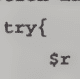

> 要获得有关编码、加密和解密的详细说明，您可以参考第 4 章《字符串加密和解密》。

创建一个加密函数以利用编码的 salt、init 和答案文件解密器，您可以按如下方式操作：

```
Add-Type -AssemblyName System.Security
function Encrypt-String { param($Sstring)
    try{
        $r = new-Object System.Security.Cryptography.RijndaelManaged
        $pass = [Text.Encoding]::UTF8.GetBytes($pass)
        $salt = [Text.Encoding]::UTF8.GetBytes($salt)
        $init = [Text.Encoding]::UTF8.GetBytes($init)

        $r.Key = (new-Object Security.Cryptography.PasswordDeriveBytes $pass, $salt, "SHA1", 50000).GetBytes(32)
        $r.IV = (new-Object Security.Cryptography.SHA1Managed).ComputeHash($init)[0..15]

    $c = $r.CreateEncryptor()
    $ms = new-Object IO.MemoryStream
    $cs = new-Object Security.Cryptography.CryptoStream $ms,$c,"Write"
    $sw = new-Object IO.StreamWriter $cs
    $sw.Write($SString)
    $sw.Close()
    $cs.Close()
    $ms.Close()
    $r.Clear()
    [byte[]]$result = $ms.ToArray()
}
catch {
    $err = "Error Occurred Encrypting String: $_"
}
if($err) {
    # Report Back Error
    return $err
}
else {
    return [Convert]::ToBase64String($result)
}
}

# All of the encoded values from YOUR execution of Script 1 example.
$rtd = "AAZwAmAE4AMgAoAFEAVAhAhFAA"
$ssd = "LAAyAGwAdQBRAG8AZABMAEwAJgA"
$afd = "5AFIAQgBYACYAXgBRAC4AUgA5AF"
$encSalt = "ABFAEIAsgAzADsA0gBnAHEAagBxAGgAJgBcAH4AZgBRAD0ARAAzACEAZwA1ACYATQBuAGwAWABzAHkA"
$encInit = "ZgA/ADOAbQBGAFMAewAjAHcAMgBYAGQALwBYACEAVGB4AHEARABVAHAANWBgACQAeAAqAD0AbgBnADEA"

# Decode the Password
$encpass = $ssd + $afd + $rtd
```

```
$encbytes = [System.Convert]::FromBase64String($encpass)
$pass = [System.Text.Encoding]::Unicode.GetString($encbytes)

# Decode the Salt
$encbytes = [System.Convert]::FromBase64String($encSalt)
$salt = [System.Text.Encoding]::Unicode.GetString($encbytes)

# Decode the Init
$encbytes = [System.Convert]::FromBase64String($encInit)
$Init = [System.Text.Encoding]::Unicode.GetString($encbytes)

cls
write-host "To End This Application, Close the Window"
Write-host ""

do
{
    $string = read-host "Please Enter a String to Encrypt"
    $encrypted = Encrypt-String $string
    write-host "Encrypted String is: $encrypted"
}
While ($good -ne "True")
```

此操作的输出显示在以下屏幕截图中：

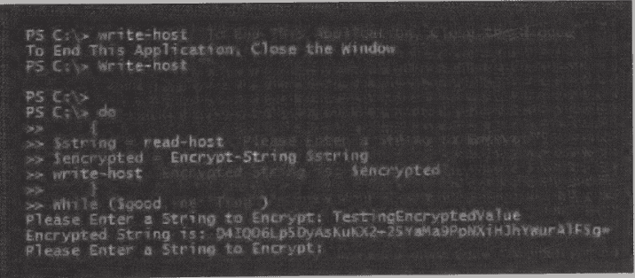


在此示例中，您利用编码的盐、初始化向量和密码以及一个加密函数来生成加密值：

- 1. 您首先使用 Add-Type cmdlet 添加 System.Security 类。
- 2. 然后您声明 Encrypt-String 函数，并带有一个参数 $string。
- 3. 由于 $pass、$init 和 $salt 是在函数外部生成的，因此它们不包含在参数块中。
- 4. 然后您创建一个 System.Security.Cryptography.RijndaelManaged 对象并将其放入 $r 变量中。
- 5. 您获取 $pass 的字节并将其放入 $pass 变量中，获取 $salt 的字节并将其放入 $salt 变量中，并获取 $init 的字节并将其放入 $init 变量中。
- 6. 您继续使用 $pass 和 $salt 变量生成一个密钥，并将该值放入 $r.Key 属性中。
- 7. 您使用 $init 生成一个 IV，并将值放入 $r.IV 属性中。
- 8. 您继续使用 $r.CreateEncryptor() 创建一个加密器，并将其放入 $c 变量中。
- 9. 您使用 IO.MemoryStream 打开一个内存流，并将其放入 $ms 变量中。
- 10. 您使用 $ms 和 $c 变量打开一个加密流，并将其放入 $cs 变量中。
- 11. 您使用 $cs 打开一个流写入器，并将其放入 $sw 变量中。
- 12. 最后，您将 $string 值写入流写入器。
- 13. 您关闭 $sw、$cs 和 $ms 变量，并清除 $r 变量。
- 14. 您取出 $ms 中的值并将其转换为数组，然后放入 $result 变量中。
- 15. 您将 $result 转换为字符串并返回加密值。
- 16. 然后您声明 $rtd、$ssd、$afd、$encSalt 和 $encInit 的所有编码值。
- 17. 您将 $ssd、$afd 和 $rtd 组合以生成密码，并将其放入 $encpass 变量中。
- 18. 您对编码的 $encpass 值进行解码并将其放入 $pass 变量中。
- 19. 您对 $encSalt 值进行解码并将其放入 $salt 变量中。
- 20. 最后，您对 $encInit 值进行解码并将其放入 $init 变量中。

到此时，您已拥有加密字符串所需的一切。您创建一个循环函数来加密多个字符串：

- 1. 您使用 `cls` 命令清除屏幕，并利用 `write-host` cmdlet 显示“要结束此应用程序，请关闭窗口。”。
- 2. 您利用 `write-host` cmdlet 创建一个新行。
- 3. 您创建一个 `do...while` 循环，条件为 `$good -ne "True"`。这是为了无限循环以生成多个加密值。
- 4. 在循环内部，您使用 `read-host` cmdlet 并使用参数“请输入要加密的字符串”。输入的值将存储在 `$string` 变量中。
- 5. 然后您通过使用 `$string` 变量调用 `Encrypt-String` 函数来加密该字符串。
- 6. 加密函数将返回一个加密值，您将该值存储在 `$encrypted` 变量中。
- 7. 然后您利用 `write-host` cmdlet 通过使用参数“Encrypted String is: $encrypted”来显示该值。

在此示例中，TestingEncryptedValue 已输入到 read-host cmdlet 中。显示的值为“Encrypted String is: D4IQO6Lp5DyAsKuKX2+25YaMa9PpNXiHJhYWurAlF5g=”。您还会看到 do...while 循环随后提示输入另一个要加密的值。您可以继续使用脚本为脚本使用加密多个值。

## XML 答案文件创建

答案文件对于创建灵活的 PowerShell 脚本至关重要。它们提供了在不实际修改脚本本身代码的情况下更改脚本功能的能力。对于 Windows 服务器扫描脚本，您希望在答案文件中包含几项关键内容。

扫描脚本答案文件中应包含的核心组件有：

- **安全信息**：这将包括脚本的 AFD、盐、初始化向量和其他重要的编码或加密数据。
- **日志记录**：这将提供启用和禁用写入事件日志、在屏幕上写入以及写入日志文件的能力。
- **功能**：这将包括脚本的完整扫描功能列表，以及打开或关闭它们的能力。
- **搜索数据**：这将包括用于识别系统上敏感数据的加密搜索信息。
- **终止文件位置：** 这将提供脚本终止文件所在位置。
- **目录扫描列表：** 这将列出您想要扫描敏感数据的目录。这还将包括您想要扫描的文件类型。
- **文件忽略列表：** 这将列出您希望脚本在脚本的文件扫描部分期间忽略的文件。
- **搜索忽略列表：** 这将是您希望脚本忽略的否定搜索词或误报。
- **内置用户列表：** 这是在扫描系统时要忽略的内置用户和帐户列表。

> 本章中使用的 `Scan_Answers.xml` 答案文件可以在本章的代码文件中找到。这将是执行本章示例所必需的。

Windows 服务器扫描脚本的 `answer` 文件设计为一次性使用文件。这是为了防止敏感数据驻留在远程系统上，最终可能被泄露。此外，由于 `answer` 文件具有 AFD，因此它使暴力破解编码和加密变得指数级困难。删除 `answer` 文件的最佳时间是在将内容放入内存之后。PowerShell 在初始读取后只需要与 `answer` 文件的内存版本交互，因此这是删除文件的最佳时机。

## PowerShell 脚本 3 - 终止文件

可能有一段时间您需要终止 Windows 服务器扫描脚本的执行。这可能是由于脚本消耗了太多资源，或者脚本执行时间过长。快速且优雅地终止脚本最有效的方法之一是利用 `termination` 文件。当 `termination` 文件放置在系统上时，脚本将停止其当前操作并优雅地退出脚本。

在环境中部署 `termination` 文件的两种方法是在服务器上本地部署，或利用远程命令。当您利用部署工具时，您可能必须创建一个在系统上本地运行的脚本。如果您想在系统上本地创建 `termination` 文件，可以利用 `new-item` cmdlet 并将 `-path` 参数设置为 "c:\temp\KILL_SERVER_SCAN.NOW"。然后您指定 `-ItemType` 参数并使用 `File` 作为参数。执行后，`termination` 文件将被创建。

要在系统上本地创建终止文件，您可以执行以下操作：

```
new-item -path "c:\temp\KILL_SERVER_SCAN.NOW" -ItemType File
```

其输出显示在以下屏幕截图中：

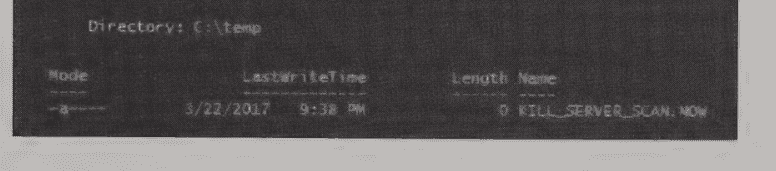

在此示例中，您在系统上本地创建终止文件：

- 1. 您首先利用 `new-item` cmdlet 并将 `-path` 参数设置为 `"c:\temp\KILL_SERVER_SCAN.NOW"`。
- 2. 然后您指定 `-ItemType` 参数并使用 `File` 作为参数。
- 3. 执行后，`KILL_SERVER_SCAN.NOW` 文件将在系统上创建，并且 `new-item` cmdlet 将显示文件创建。

要在系统上远程创建终止文件，您可以利用 PSSession 在系统上启用远程 PowerShell 会话。您可以通过利用 Enter-PSSession cmdlet 并将 -ComputerName 参数设置为服务器名称来打开 PSSession。然后您可以通过像本地一样利用 new-item cmdlet 来创建终止文件。运行命令后，您可以利用 Exit-PSSession cmdlet 关闭 PowerShell 会话。如果您需要利用不同的凭据访问服务器，可以利用 get-credentials cmdlet 获取或声明新凭据，并将其存储在变量中。然后您可以使用 Enter-PSSession cmdlet、-credential 参数以及包含凭据的变量来使用不同的用户帐户对 PowerShell 会话进行身份验证。

> PSSession 旨在在 PowerShell 控制台中手动输入。如果您在脚本中执行命令，您希望内置延迟以确保您处于 PSSession 中。如果不这样做，Enter-PSSession cmdlet 之后的命令可能会在本地运行，而不是在会话本身中运行。


To leverage Enter-PSSession to remotely create a termination file, you can perform the following:

```
Enter-PSSession -ComputerName POSHDEMO-SQL01
new-item -path "c:\temp\KILL_SERVER_SCAN.NOW" -ItemType File
Exit-PSSession
```

The output of this is shown in the following screenshot:

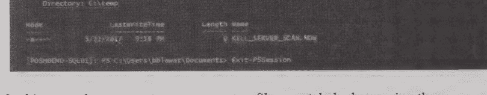

In this example, you create a termination file remotely by leveraging the Enter-PSSession cmdlet:
- 1. You first start by leveraging the Enter-PSSession cmdlet with the -ComputerName parameter set to the POSHDEMO-SQL01 argument.
- 2. You then leverage the new-item cmdlet with the -path parameter set to c:\temp\KILL_SERVER_SCAN.NOW.
- 3. You also leverage the -ItemType parameter with the File argument.
- 4. After execution, the KILL_SERVER_SCAN.NOW file will be created on the system, and the new-item cmdlet will display the file creation.
- 5. To close the remote session, you leverage the Exit-PSSession cmdlet.
- 6. This will terminate the connection to the remote server.

After terminating the script, it is best practice to remove the termination file. This would be required if you wanted to run the Windows server scanning script again. If you want to remove the termination file locally on a system, you can leverage the remove-item cmdlet with the -path parameter set to "c:\temp\KILL_SERVER_SCAN.NOW". You then specify the -Force parameter to force the deletion of the file. After execution, the termination file will be removed from the system.

To remove a termination file locally on a system, you can perform the following:

```
Remove-Item -Path "c:\temp\KILL_SERVER_SCAN.NOW" -Force
```

There is no output from executing this command.

In this example, you remove a termination file from a local system. You first start by declaring the Remove-Item cmdlet with the -Path parameter set to the c:\temp\KILL_SERVER_SCAN.NOW argument. You then leverage the -Force command. After execution, the file will be removed from the system; however, the cmdlet does not provide any visual feedback of the removal.

To remove a termination file remotely on a system, you can leverage a PSSession to enable a remote PowerShell session on a system. You can open a PSSession by leveraging the Enter-PSSession cmdlet with the -ComputerName parameter set to a server name. You can then remove the termination file by leveraging the remove-item cmdlet as you did locally. After running the command, you can leverage the Exit-PSSession cmdlet to close the PowerShell session.

To leverage Enter-PSSession to remotely remove a termination file, you can perform the following:

```powershell
Enter-PSSession -ComputerName POSHDEMO-SQL01
Remove-Item -Path "c:\temp\KILL_SERVER_SCAN.NOW" -Force
Exit-PSSession
```

The output of this is shown in the following screenshot:

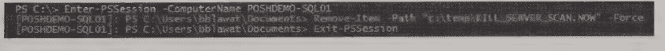

In this example, you remove a termination file, remotely leveraging the Enter-PSSession cmdlet:
- 1. You first start by leveraging the Enter-PSSession cmdlet with the -ComputerName parameter set to the POSHDEMO-SQL01 argument.
- 2. You then leverage the Remove-Item cmdlet with the -Path parameter set to c:\temp\KILL_SERVER_SCAN.NOW.
- 3. You also leverage the -Force parameter.
- 4. After execution, the KILL_SERVER_SCAN.NOW file will be removed from the system.
- 5. To close the remote session, you leverage the Exit-PSSession cmdlet. This will terminate the connection to the remote server.

## PowerShell script 4 - merging the scanning script result data

As you run the Windows server scanning script on multiple systems in your environment, you will have a need to merge multiple CSV files into a single CSV file. This will allow for better searching of the scan results, and help you identify trends in your server infrastructure. PowerShell offers the Import-csv and Export-csv cmdlets, which provide the ability to manipulate CSV data. A common technique is to use the Import-csv and Export-csv cmdlets with a pipeline to import, manipulate, and export the data to a new CSV file.

To get started, you will need to create several CSV files to merge together. To create multiple CSVs that are similar to the Windows server scanning script output, you can perform the following:

```powershell
$logloc = "C:\temp\POSHScript\CSVDEMO\"
$date = (Get-Date -format "yyyyMMddHHmmss")
Function create-testcsv { param($servername)
    $csvfile = "$logloc\$servername" + "_" + $date + "_ScanResults.csv"
    new-item $csvfile -ItemType File -Force | Out-Null

    $csvheader = "ServerName, Classification, Other Data"
    Add-content $csvfile -Value $csvheader

    $csvcontent = "$servername, CSVTestData, This is CSV Test Data for $servername."
    Add-content $csvfile -Value $csvcontent
}
create-testcsv POSHDEMO-Server1
create-testcsv POSHDEMO-Server2
create-testcsv POSHDEMO-Server3
create-testcsv POSHDEMO-Server4
create-testcsv POSHDEMO-Server5
get-childitem $logloc
```

The output of this is shown in the following screenshot:

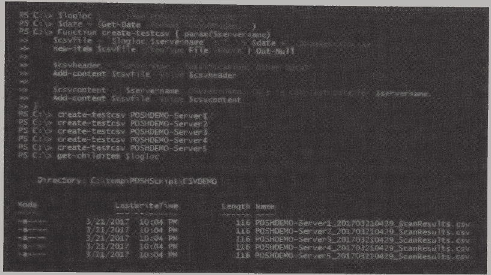

In this example, you create multiple CSV files to emulate data from the server scanning script:
- 1. You start by defining the log location by declaring "C:\temp\POSHScript\CSVDEMO\" and storing it in the $logloc variable.
- 2. You then continue to generate the date timestamp by using the get-date cmdlet with the -format parameter set to the "yyyyMMddhhmmss" argument.
- 3. You store this value in the $date variable.
- 4. You then proceed to declare the create-testcsv function with the parameter block set to $servername.
- 5. You continue to build the string for the log location by declaring "$logloc\$servername" + "_" + $date + "_ScanResults.csv and setting it in the $csvfile variable.
- 6. You then leverage the new-item cmdlet with the $csvfile argument, the parameter of -ItemType set to the File argument, and the -Force parameter.
- 7. You pipe this to Out-Null to suppress notification of the file creation.
- 8. You then define the script header of "ServerName, Classification, Other Data" and set it to the $csvheader variable.
- 9. You continue to add the header to the newly created CSV file by leveraging the Add-Content cmdlet with the $csvfile argument and the -Value parameter set to the $csvheader variable.
- 10. You then create the content for the CSV file by defining the '$servername, CSVTestData, This is CSV Test Data for $servername.' value and placing the $csvcontent variable.
- 11. You complete the function by adding the CSV content to the CSV file by calling the Add-Content cmdlet with the $csvfile argument and the -Value parameter set to $csvcontent.
- 12. Finally, you leverage the create-testcsv function multiple times to create CSV files for the servers named POSHDEMO-Server1, POSHDEMO-Server2, POSHDEMO-Server3, POSHDEMO-Server4, and POSHDEMO-Server5.
- 13. You verify the file creation by leveraging the Get-ChildItem cmdlet with the $logloc variable.

You will see that the function created five files in the C:\temp\POSHScript\CSVDEMO\ directory.

After generating the CSV files, you will be able to merge all of the results into a single CSV file. To do this, you leverage the Get-ChildItem cmdlet, calling the directory where the CSV files are stored. You leverage the -filter parameter with the '*.csv' argument to only select the CSV files in that directory. You place the results in a parenthetical statement calling the .FullName property, which returns the full pathname to all of the CSV files. You use the pipeline to import all of the CSV files in memory using the Import-csv cmdlet, and you use another pipeline to export all of the CSV files in memory to a file. To remove all type information from the CSV export, you can leverage the -NoTypeInformation parameter with the Export-csv cmdlet.

To merge the CSV files into a single CSV file, you can perform the following:

```powershell
$logloc = "C:\temp\POSHScript\CSVDEMO\"
$date = (Get-Date -format "yyyyMMddHHmmss")
$mergefile = "$logloc" + "Merged_$date.csv"
New-Item $mergefile -ItemType File | Out-Null
(get-childitem $logloc -filter "*.csv").FullName | Import-csv | Export-csv $mergefile -NoTypeInformation
```

本输出在以下屏幕截图中显示：

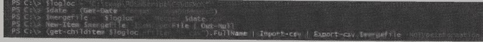

生成的合并 CSV 文件在以下屏幕截图中显示：

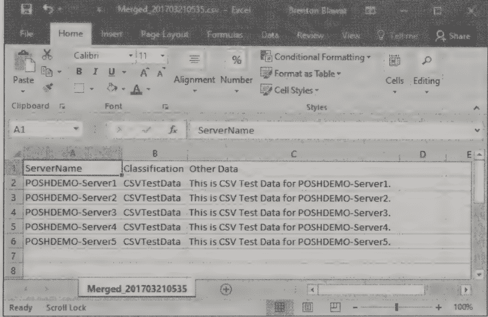

在此示例中，您将所有创建的 CSV 文件合并为单个 CSV 文件：

- 1. 您首先通过声明 "C:\temp\POSHScript\CSVDEMO\" 并将其放入 $logloc 变量中来定义日志位置。
- 2. 然后您继续使用 Get-Date cmdlet 生成日期时间戳，并将 -format 参数设置为 "yyyyMMddhhmmss" 参数。
- 3. 您将此值存储在 $date 变量中。
- 4. 您通过将 "$logloc" + "Merged_$date.csv" 放入 $mergefile 变量来构建合并文件字符串。
- 5. 然后您通过使用 $mergefile 参数利用 New-Item cmdlet 创建合并文件，并将 -ItemType 参数设置为 File。
- 6. 您将这些结果通过管道传递给 Out-Null 以抑制文件创建通知。
- 7. 您继续从 $logloc 目录收集所有文件，以便在管道中使用 Import-Csv 将它们合并。
- 8. 您首先调用 Get-ChildItem cmdlet，将 $logloc 作为参数，并将 -Filter 参数设置为 "*.csv" 参数。
- 9. 您将结果放入括号语句中并调用 .FullName 属性以获取文件的全部完整路径名。
- 10. 您将所有这些结果通过管道传递给 Import-Csv cmdlet，以在内存中合并所有 CSV 文件。
- 11. 然后您将该 cmdlet 的输出通过管道传递给 Export-Csv cmdlet，将 $mergefile 作为参数，并将 -NoTypeInformation 作为参数。

执行此脚本后，您将收集 $logloc 目录中的所有 CSV 文件，合并 CSV 文件，并将合并结果导出到 $mergefile CSV 文件。

## 摘要

本章中，您回顾了 Windows 服务器扫描脚本的概述。您了解到需要在环境中实现脚本时遵循工作流程。您首先开发了一个脚本来生成随机字符串以创建加密密码、盐和初始化向量。然后在同一脚本中对结果进行编码以进一步保护值。创建编码后的密码、盐和初始化向量后，您使用这些值创建了一个加密脚本以开始加密字符串。加密字符串后，您继续了解脚本所需的答案文件。您了解了需要在答案文件中包含哪些项目以确保 Windows 服务器扫描脚本保持灵活。然后您继续探索终止文件以及它们如何用于远程优雅地停止扫描脚本。您创建了一个脚本，用于在本地以及使用 PSSession 创建和删除终端文件。最后，您开发了一个脚本，将 Windows 服务器扫描脚本的 CSV 结果合并到单个文件中以供审阅。

在下一章中，您将学习如何创建 Windows 服务器扫描脚本。您将创建注释块、参数块、答案文件读取函数和解密函数，然后填充答案文件并创建脚本日志和日志函数。您将创建用于扫描磁盘、计划任务、进程、Windows 服务、软件、用户配置文件、Windows 功能和文件目录的函数。您将通过学习执行后清理注意事项来完成本章。
