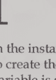
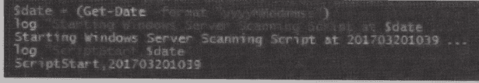
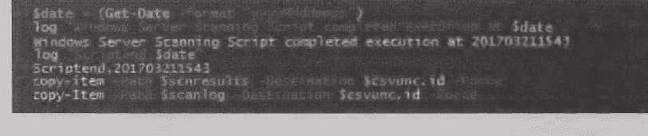
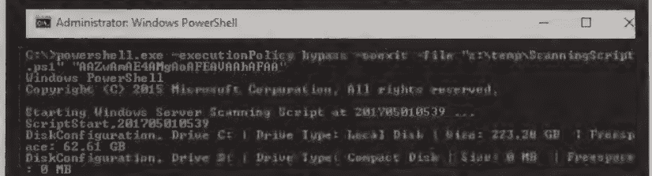

# 13 创建 Windows 服务器扫描脚本和执行后清理

## 创建 Windows 服务器扫描脚本和执行后清理

当您在大型企业中运行系统时，通常需要识别环境中不同服务器的信息。虽然您可以手动评估每台服务器上的项目以确定其角色，但您很可能希望自动化该过程。在阅读本书的过程中，您学习了使用 PowerShell 扫描和识别服务器上非标准配置的多个方面。您还学习了如何优化代码以显著提高脚本的性能。这些示例引导您进入本章，本章将您所学到的所有概念结合成一个 Windows 服务器扫描脚本。

Windows 服务器扫描脚本的开发目的是深入了解服务器在环境中的角色和功能。当您针对环境执行 Windows 服务器扫描脚本时，可以快速查看使服务器独特的非默认配置。当您执行大规模服务器发现以确定环境中服务器之间的共同点时，这也非常强大。建议采用此现有脚本并在此基础上构建，以满足您环境的独特需求。

本章中，您将：

- 了解整体脚本结构的概述
- 实现注释块、参数块、答案文件读取函数和解密函数
- 从答案文件填充变量和数组
- 创建一个 `logging` 函数，用于将日志记录到数据收集文件、`log` 文件和事件日志
- 实现脚本终止函数以优雅地退出脚本
- 集成并调用多个函数以扫描系统的不同区域
- 调用脚本的函数并将 `log` 文件复制到文件共享
- 探索如何从命令行启动脚本
- 了解执行后脚本清理活动

## Windows 服务器扫描脚本创建

当您开始构建自己的 Windows 服务器扫描脚本版本时，您需要遵循脚本结构。当您使用标准化的脚本结构时，您可以将代码组织到不同的部分。这使您可以快速在脚本中找到组件并添加到各个部分。它还为他人快速学习和修改您的脚本提供了便捷的平台。

以下是 Windows 服务器扫描脚本的组成部分：

**注释块**：在此处描述脚本的功能。

**参数块**：在此处您可以将变量和数据传递到脚本中，例如运行时解密器。

**答案文件读取函数**：这使您可以动态读取答案文件中的不同值。

**解密函数**：这使您能够在运行时解密加密字符串。

**将脚本答案填充到变量和数组中**：这将采用答案文件读取函数的输出来填充变量和数组。这还使您能够根据答案文件数据动态构建正则表达式。

**创建日志文件和日志函数**：这将使您能够记录脚本的不同操作，记录脚本找到的数据，将输出写入屏幕，甚至将事件写入事件日志。

**创建终止函数**：终止函数将使您能够多次检查系统上是否放置了终止文件。如果存在，则会终止扫描脚本。

**多个脚本函数**：在此处定义所有用于扫描系统不同组件的函数。

调用函数：当所有其他函数和组件都定义后，您通过调用函数（如果在答案文件中启用）来完成本章。

## 注释块

您的 Windows 服务器扫描脚本的第一行应该是注释块。注释块将描述脚本的功能并提供修订详细信息以及有关所需运行时解密器 (RTD) 的信息。本节应提供有关如何运行脚本的示例，以及有关脚本执行的任何其他说明。

以下屏幕截图显示了一个正确创建的注释块，该注释块与帮助系统集成：

```
<#
.SYNOPSIS
This is a server discovery script which will scan different server components to determine
the current configuration.
.DESCRIPTION
This script will scan processes, Windows services, scheduled tasks, server features, disk information,
registry, and files for pertinent server information.
Author: Brenton J.W. Blawat / Packt Publishing / Author / email@email.com
.PARAMETER RTD
This script requires a run time decryptor as a parameter to the script.
.EXAMPLE
powershellscript.ps1 /RTD "Run Time Decryptor"
.NOTES
You must have administrative rights to the server you are scanning. Certain functions will not work properly
without running the script as system or administrator.#>
```

## 参数块

在脚本的注释块之后，您需要立即声明参数块。参数块对于在脚本中捕获 RTD 是必需的。由于解密过程依赖于 RTD，如果该参数不可用，您将退出脚本。

要创建参数块并检查是否存在值，您可以执行以下操作：

```
param($RTD)
if (!$RTD) { exit }
```

声明参数块时没有输出。在此示例中，您使用 param 命令定义参数块，并使用脚本的输入填充 $RTD 变量。您还创建了一个 if 语句，如果 $RTD 变量为 $null，则会退出脚本。


## 答案文件读取函数

你继续通过定义答案文件读取函数、将 XML 加载到内存中并删除答案文件来完善扫描脚本。你可以选择注释掉 Remove-Item cmdlet 步骤。这将在你的环境中提供测试，而无需在脚本目录中重新创建 XML 文件。

要创建 XML 读取函数、将 XML 加载到内存中并删除 XML 文件，可以执行以下操作：

```
Function read-xmltag { param ($xmlextract)
return $xml.GetElementsByTagName("$xmlextract")
}

$xmlfile ="$PSScriptRoot\Scan_Answers.xml"

$test = test-path $xmlfile

if (!$test) {
    Write-Error "$xmlfile not found on the system. Select any key to exit!"
    PAUSE
    exit
}

[xml] $xml = get-content $xmlfile
Remove-Item $xmlfile -force
```

创建此函数时没有输出可显示。

在此示例中，你定义答案文件读取函数：

- 1. 你首先通过 param ($xmlextract) 的参数块定义 read-xmltag 函数。
- 2. 然后你利用 $xml.GetElementsByTagName() 方法获取 $xmlextract 中指定的 xml 标签。
- 3. 你将结果返回给调用该函数的脚本部分。然后你继续通过调用 $PSScriptRoot 并将其值与 "\Scan_Answers.xml" 组合来获取脚本的当前路径。你将结果存储在 $xmlfile 变量中。
- 4. 你继续通过使用 $xmlfile 参数的 test-path cmdlet 来确定文件是否存在。
- 5. 你在 $test 变量上声明一个如果不存在的语句，如果文件不存在，则使用 write-error cmdlet 显示 "$xmlfile not found on the system. Select any key to exit."。
- 6. 然后你发出 PAUSE 语句以停止脚本，并在键盘按下键后发出 exit 语句以退出脚本。如果答案文件存在，脚本将继续将 XML 文件加载到内存中。
- 7. 你使用 $xmlfile 参数的 get-content cmdlet。
- 8. 然后你将此值放入具有 [xml] 数据类型的 $xml 变量中。
- 9. 在将 XML 文件加载到内存后，你通过使用 $xmlfile 参数和 -Force 参数的 Remove-Item cmdlet 删除 XML 文件。答案文件将被从系统中删除。

## 解密函数

在完成将 XML 文件加载到内存后，下一步是定义解密函数。由于答案文件包含编码和加密的值，你需要此函数将加密值转换为字符串。

要声明解密函数，可以执行以下操作：

```
Add-Type -AssemblyName System.Security
function Decrypt-String { param($Encrypted)
    if($Encrypted -is [string]){
        $Encrypted = [Convert]::FromBase64String($Encrypted)
    }
    $r = new-Object System.Security.Cryptography.RijndaelManaged
    $pass = [System.Text.Encoding]::UTF8.GetBytes($pass)
    $salt = [System.Text.Encoding]::UTF8.GetBytes($salt)
    $init = [System.Text.Encoding]::UTF8.GetBytes($init)
    $r.Key = (new-Object Security.Cryptography.PasswordDeriveBytes $pass, $salt, "SHA1", 50000).GetBytes(32)
    $r.IV = (new-Object Security.Cryptography.SHA1Managed).ComputeHash($init)[0..15]
    $d = $r.CreateDecryptor()
    $ms = new-Object IO.MemoryStream @($Encrypted)
    $cs = new-Object Security.Cryptography.CryptoStream $ms,$d,"Read"
    $sr = new-Object IO.StreamReader $cs
    try {
```
```
$result = $sr.ReadToEnd()
$sr.Close()
$cs.Close()
$ms.Close()
$r.Clear()
Return $result
}
Catch {
    Write-host "Error Occurred Decrypting String: Wrong String Used In Script."
}
}
```

创建此函数时没有输出可显示。

在此示例中，你声明解密函数：

- 1. 你首先通过 Add-Type cmdlet 加载 System.Security 程序集。
- 2. 然后你使用 param($encrypted) 参数块声明 Decrypt-String 函数。
- 3. 你继续检查 $encrypted 值是否为字符串，如果是则将其转换为字节。
- 4. 然后你创建 System.Security.Cryptography.RijndaelManaged 对象并将其放入 $r 变量中。
- 5. 你获取 $pass 的字节并将其放入 $pass 变量中，获取 $salt 的字节并将其放入 $salt 变量中，并获取 $init 的字节并将其放入 $init 变量中。你继续使用 $pass 和 $salt 变量生成密钥并将此值放入 $r.Key 属性中。
- 6. 你使用 $init 生成 IV 并将值放入 $r.IV 属性中。
- 7. 你继续创建解密器对象并将其放入 $d 变量中，使用 $encrypted 值的内存流对象放入 $ms 变量中，使用 $ms 和 $d 变量的 CryptoStream 对象放入 $cs 变量中，并使用 $cs 变量的流读取器对象放入 $sr 变量中。
- 8. 然后你发出 try...catch 命令以捕获解密过程中发生的任何错误。
- 9. 你继续在流读取器上使用 ReadToEnd() 方法并将解密后的文本放入 $result 变量中。
- 10. 你关闭 $sr、$cs 和 $ms 对象。
- 11. 你清除 $r 变量并将 $result 的结果返回给调用该函数的脚本部分。
- 12. 如果解密过程中出现错误，脚本将利用 write-host cmdlet 显示 "Error Occurred Decrypting String: Wrong String Used In Script"。

## 在变量和数组中填充脚本答案

Windows 服务器扫描脚本中的下一步是将答案文件中的数据填充到变量和数组中。当你访问内存中的答案文件数据时，你需要操作数据以供脚本使用。例如，搜索数据将具有需要解密的加密值，忽略列表需要制作为正则表达式，搜索扩展名需要放入数组中。

由于你将为脚本动态创建多个正则表达式，最佳做法是创建一个生成正则表达式的函数。脚本可以在文件搜索数据、文件忽略列表、搜索忽略列表和内置用户列表中没有值的情况下运行。你需要验证传递给函数的列表是否不为空。空白或未填充任何值的正则表达式将匹配所有值为 true。这将导致脚本执行问题，应避免这种情况。

为了解决此问题，如果你检测到列表为空，则将列表值设置为系统中不会匹配的字符串，例如 No_Input_Provided_For_List_Item。当使用该表达式评估正则表达式时，该表达式与条件匹配的可能性极低。

要创建动态创建正则表达式的函数，可以执行以下操作：

```
```powershell
function create-SearchRegEx { param($list)
    if (! $list) { $list = "No_Input_Provided_For_List_Item" }
    $RegEx = '(?i)^.*(' + (($list | % {[regex]::escape($_)}) -join "|") + ').*$'
    return $regex
}
```
```

创建此函数时没有输出可显示。

在此示例中，你创建一个名为 create-SearchRegex 的新函数，参数块为 param($list)：

- 1. 你创建一个 if 语句来确定 $list 变量是否没有值。如果为空，它将把 $list 变量设置为 "No_Input_Provided_For_List_Item"。
- 2. 该函数将继续动态生成不区分大小写的正则表达式，并将匹配 $list 变量中列出的任何值。
- 3. 创建正则表达式后，值存储在 $regex 变量中。
- 4. 脚本将把 $regex 中的值返回给调用该函数的脚本部分。

与正则表达式类似，你将在脚本中多次进行解码，并且需要一个解码函数。要创建用于解码值的函数，可以执行以下操作：

```
function decode-string { param($string)
    $encbytes = [System.Convert]::FromBase64String($string)
    $string = [System.Text.Encoding]::Unicode.GetString($encbytes)
    return $string
}
```

创建此函数时没有输出可显示。

在此示例中，你创建用于解码值的函数：

- 1. 你首先通过参数块设置为 param($string) 来定义 decode-string 函数。
- 2. 然后你将字符串转换为字节并将输出存储在 $encbytes 变量中。
- 3. 然后你通过调用 [System.Text.Encoding]::Unicode.GetString($encbytes) 解码字节并将输出存储在 $string 变量中。
- 4. 脚本将把 $string 中的值返回给调用该函数的脚本部分。


创建用于正则表达式生成和字符串解码的函数后，您可以开始将答案文件数据放置到变量和数组中。要将系统配置信息放入变量和数组中，可以执行以下操作：

```
$ssd = "LAAyAGwAdQBRAG8AZABMAEwAJgA"
$afd = (read-xmltag "afd") | Select id
$encpass = $ssd + $afd.id + $rtd
$pass = decode-string $encpass
$salt = (read-xmltag "salt") | % { decode-string $_.id }
$init = (read-xmltag "init") | % { decode-string $_.id }
```

创建此代码不会显示任何输出。

在此示例中，您将系统配置信息设置到多个变量中：

- 1. 您首先通过定义 SSD 并将值设置到 $ssd 变量中开始。
- 2. 然后您使用参数为 "afd" 的 read-xmltag 函数。
- 3. 您将此值通过管道传递给 Select id 并将结果存储在 $afd 变量中。
- 4. 然后您将脚本侧、答案文件和运行时解密器组合到 $encpass 变量中。
- 5. 您使用 $encpass 利用 decode-string 函数，脚本解码解密密码并将结果放在 $pass 变量中。
- 6. 您为 salt 参数利用 read-xmltag，将其通过管道传递给 %，并利用 decode-string 函数解码管道字符串。
- 7. 解码后的值被放置在 $salt 变量中。
- 8. 最后，您为 init 参数利用 read-xmltag，将其通过管道传递给 %，并利用 decode-string 函数解码管道字符串。
- 9. 解码后的值被放置在 $init 变量中。

然后您继续通过执行以下操作来定义日志和功能信息：

```
$logloc = (read-xmltag "logloc") | Select id
$verboselog = (read-xmltag "verboselog") | Select id
$filelog = (read-xmltag "filelog") | Select id
$evntlog = (read-xmltag "evntlog") | Select id
$csvunc = (read-xmltag "csvunc") | Select id
$scanDisks = (read-xmltag "scndisks") | Select id
$scanSchTasks = (read-xmltag "scnschtsks") | Select id
$scanProcess = (read-xmltag "scnproc") | Select id
$scanServices = (read-xmltag "scnsvcs") | Select id
$scanSoftware = (read-xmltag "scnsoft") | Select id
$scanProfiles = (read-xmltag "scnuprof") | Select id
$scanFeatures = (read-xmltag "scnwfeat") | Select id
$scanFiles = (read-xmltag "scnfls") | Select id
$scnloc = (read-xmltag "scnloc") | Select id
$killfile = (read-xmltag "killfile") | Select id
```

创建此代码不会显示任何输出。

在此示例中，您从内存中的 XML 文件数据中收集日志和功能信息。对于这些值中的每一个，您都利用 read-xmltag 并使用相应的标签名称作为参数。您将结果通过管道传递给 Select id。然后日志和功能信息存储在与所存储数据相对应的变量中。

在声明日志和功能信息后，您继续创建搜索扩展。要创建带有通配符的搜索扩展数组，可以执行以下操作：

```
# Search Extensions
$srextlist = @()
$srext = (read-xmltag "srext") | % { $srextlist += "*" + $_.id }
```

创建此代码不会显示任何输出。

在此示例中，您创建包含通配符的搜索扩展数组：

- 1. 开始时，您将 $srextlist 声明为数组。
- 2. 然后您使用 srext 参数利用 read-xmltag 函数从内存中的 XML 文件收集搜索扩展。
- 3. 您将结果通过管道传递给 %，即 foreach 的别名，在其中您在当前扩展前面添加一个 *，该扩展位于 $_.id XML 属性中。
- 4. 执行后，您将在 $srextlist 中拥有一个通配符扩展数组。

本节的最后一部分是从内存中的 XML 数据创建正则表达式。要从 XML 数据创建多个正则表达式，请执行以下操作：

```
# File Search Data
$srterms = read-xmltag "srterm" | % { decrypt-string $_.id }
$srtermsRegEx = create-SearchRegEx $srterms
```

```
# File Ignore list
$flign = (read-xmltag "flign") | Select id
$flignRegEx = create-SearchRegEx $flign.id
```

```
# Search Ignore List
$srign = (read-xmltag "srign") | Select id
$srignRegEx = create-SearchRegEx $srign.id
```

```
# Built-in User List
$blst = (read-xmltag "blst") | Select id
$blstRegEx = create-SearchRegEx $blst.id
```

创建此代码不会显示任何输出。

在此示例中，您从内存中的 XML 数据创建多个正则表达式：

- 1. 您首先从 XML 文件收集文件搜索数据并解密值。
- 2. 为此，您使用 srterm 属性调用 read-xmltag 函数。
- 3. 您将此结果通过管道传递给 %，并使用 decrypt-string 函数和 $_.id XML 属性解密每个加密值。
- 4. 解密后的值被放置在 $srterms 变量中。
- 5. 然后您使用 $srterms 参数利用 create-SearchRegex 函数。
- 6. 然后由 create-SearchRegex 函数生成的正则表达式被放置在 $srtermsregex 变量中。
- 7. 您继续通过利用 read-xmltag 函数获取文件忽略列表，或 flign，搜索忽略列表，或 srign，以及内置用户列表，或 blst。
- 8. 获取结果后，您将值通过管道传递给 Select Id 以选择 XML 文件的 ID 属性。
- 9. 您将结果存储在其各自的变量中。
- 10. 最后，您为这些变量中的每一个调用 create-SearchRegex 函数，生成的正则表达式存储在每个列表各自的 regex 变量中。

## 创建日志文件和日志函数

最终的核心脚本组件是日志文件和日志函数。当您创建日志文件时，通常希望在文件名中包含服务器名称和时间戳。这使您能够确定日志文件适用于哪台机器以及何时运行扫描。由于 Windows 服务器扫描脚本还收集有关系统的信息，因此您还需要创建一个 CSV 文件来记录相关信息。

要创建带有服务器名称和时间戳的文件名的日志和 CSV 文件，可以执行以下操作：

```powershell
$date = (Get-Date -format "yyyyMMddHHmmss")
$compname = $env:COMPUTERNAME
$logloc = $logloc.id
```

```powershell
$scanlog = "$logloc\$compname" + "_" + $date + "_ServerScanScript.log"
new-item $scanlog -ItemType File -Force | Out-Null

# Create the CSV File
$scnresults = "$logloc\$compname" + "_" + $date + "_ScanResults.csv"
$csvheader = "ServerName, Classification, Other Data"
new-item $scnresults -ItemType File -Force | Out-Null
Add-content $scnresults -Value $csvheader
```

创建此代码不会显示任何输出。

在此示例中，您使用服务器名称和文件名中的时间戳创建日志和 CSV 文件：

- 1. 开始时，您使用 -format 参数并使用 "yyyyMMddhhmmss" 参数利用 Get-Date cmdlet，并将值放在 $date 变量中。
- 2. 然后您调用 $env:COMPUTERNAME 环境变量并将计算机名称放在 $compname 变量中。
- 3. 您还为 $logloc 选择 XML 文件的 .id 属性，并将其放回 $logloc 变量中。
- 4. 结果值将是日志位置的字符串。
- 5. 您继续通过声明来自答案文件的 $logloc 变量、带下划线的 $compname、带 "_ServerScanScript.log" 的 $date 时间戳来创建日志文件名，然后将字符串设置在 $scanlog 变量中。
- 6. 然后您使用 $scanlog 作为参数、-ItemType 参数为 file 以及 -Force 参数利用 new-item。
- 7. 您将此值通过管道传递给 Out-Null 以抑制文件创建输出。
- 8. 执行代码段后，创建以计算机名、时间戳和 "_ServerScanScript.log" 作为文件名的日志文件。

创建日志文件后，您继续创建 CSV 文件：

- 1. 您使用来自答案文件的 $logloc 变量、带下划线的 $compname、带 "_ScanResults.csv" 的 $date 时间戳，并将字符串设置在 $scnresults 变量中。
- 2. 然后您通过指定 "ServerName, Classification, Other Data" 声明 CSV 头部，然后将值放在 $csvheader 变量中。


- 3. 你继续通过调用 new-item cmdlet 创建 CSV 文件，将 $scnresults 作为参数，-ItemType 参数设为 File 参数，并使用 -Force 参数。
- 4. 你将此值通过管道传递给 Out-Null 以抑制文件创建输出。
- 5. 最后，你使用 Add-Content cmdlet，参数为 $scnresults，并将 -Value 参数设为 $csvheader。

执行此段代码后，CSV 文件将以 computername、timestamp 和 _ScanResults.csv 作为文件名创建，并包含 "ServerName, Classification, Other Data" 作为内容。



> CSV 头部不能通过 new-item cmdlet 中的 -Value 参数添加。new-item cmdlet 在将数据放入文件后不会追加换行。这意味着当你使用 Add-Content cmdlet 添加额外行时，数据将被作为头部的一部分放置。为纠正这些问题，你需要将添加数据与创建文件分开。

如果你要写入事件日志，则需要创建事件日志源。要创建新的事件日志源，如果 $evntlog 变量设为 true，可以执行以下操作：

```
if ($evntlog -eq "True") { New-EventLog -LogName Application -Source "WindowsServerScanningScript" -ErrorAction SilentlyContinue }
```

创建此代码后没有输出可显示。

在此示例中，如果 $evntlog 变量设为 True，则创建事件日志源：

- 1. 你首先创建一个 if 语句来判断 $evntlog 是否 -eq True。
- 2. 如果变量为 true，则使用 New-EventLog cmdlet，-Logname 参数设为 Application，-Source 参数设为 "WindowsServerScanningScript"，-ErrorAction 设为 SilentlyContinue。
- 3. 执行后，系统即可写入新的事件日志源。

创建日志文件和事件日志源后，你可以创建日志函数。日志函数将使你能够通过单个命令将信息写入多个位置。log 函数接受三个不同的参数，默认参数是在除 $string 之外的参数均未包含时使用。这将假定你希望写入 CSV 文件并将额外数据追加到 CSV 中。如果你包含一个 $string 与单个 "y"，它将尝试记录到日志文件。如果日志文件未启用，日志机制将跳过向日志文件添加内容。第三个参数用于写入事件日志。这是通过在函数中包含 $string、第二个参数为 Y 或 N，以及第三个参数为 Y 来调用的。如果事件日志写入已启用，它将把 $string 写入事件日志。最后，函数将评估是否打开了详细日志记录。如果启用了详细日志记录，它将把当前操作写入屏幕。

要创建可写入日志文件、CSV 文件和事件日志的日志函数，可以执行以下操作：

```
function log { param($string, $scnlg, $evntlg)
    if ($scnlg -like "Y") {
        if ($filelog -eq "True") { Add-content $scanlog -Value $string }
    }
    if ($evntlg -like "Y") {
        if ($evntlog -eq "True") { write-eventlog -logname Application -source "WindowsServerScanningScript" -eventID 1000 -entrytype Information -message "$string" }
    }
    if (!$scnlg) {
        $content = "$env:COMPUTERNAME,$string"
        Add-Content $scnresults -Value $content
    }
    if ($verboselog -eq "True") { write-host $string }
}
```

创建此代码后没有输出可显示。

此示例创建了一个可将数据写入日志文件、事件日志和 CSV 文件的日志函数：

- 1. 你首先通过 param($string, $scnlg, $evntlg) 参数块定义 log 函数。
- 2. 然后你创建一个 if 语句来判断 $filelog 设置是否等于 "True"。

- 3. 如果 $filelog 设为 True，则脚本将继续到第二个 if 语句来判断 $scnlg 是否 -like Y。
- 4. 如果传入 log 函数的第二个参数为 Y，且 $filelog 设置为 "True"，它将使用 Add-Content cmdlet，参数为 $scanlog，并将 -Value 参数设为 $string。脚本继续执行第二组 if 语句。
- 5. 脚本将判断 $evntlg 变量是否 -like "Y"。
- 6. 如果变量为 true，它将继续到另一个 if 语句来判断 $evntlog 变量是否等于 "True"。
- 7. 如果传入 log 函数的第二个参数为 Y，且 $filelog 设置为 "True"，脚本将使用 write-eventlog cmdlet，-logname 参数设为 Application，-source 参数设为 WindowsServerScanningScript，-eventID 参数设为 1000，-entrytype 参数设为 Information，-message 参数设为 $string。

这将在 Application 事件日志中添加一个新值。第三次评估是判断脚本是否应写入 CSV 文件：

- 1. 如果 log 函数未传入额外参数，或 $scnlg 参数为空，log 函数将把计算机名附加到 $string 值开头并将其放入 CSV 文件。
- 2. 这是通过使用 Add-Content cmdlet，参数为 $scnresults，并将 -Value 参数设为 $content 来实现的。
- 3. 最后，你判断 $verboselog 是否等于 "True"。
- 4. 如果设为 "True"，它将使用 write-host cmdlet 在屏幕上显示 $string。

创建日志函数后，通常会在日志文件、事件日志和屏幕上为执行开始时间添加时间戳。要为脚本执行的开始时间添加时间戳，可以执行以下操作：

```
$date = (Get-Date -format "yyyyMMddHHmmss")
log "Starting Windows Server Scanning Script at $date ..." "Y" "Y"
log "ScriptStart,$date"
```

此输出显示在以下屏幕截图中：



在此示例中，你为脚本执行的开始时间添加时间戳：

你首先使用 Get-Date cmdlet，-format 参数设为 "yyyyMMddHHmmss" 参数。

然后你使用 log 函数，将 "Starting Windows Server Scanning Script at $date ..." 作为第一个参数，"Y" 作为第二个参数，"Y" 作为第三个参数。

输出为 "Starting Windows Server Scanning Script at 201703201039..."。

然后你使用 "ScriptStart,$date" 作为第一个参数调用 log 函数。输出为 ScriptStart,201703201039。

## 创建终止函数

当 PowerShell 脚本在系统上执行时，它们会消耗内存和 CPU 资源。如果你在扫描目录并使用 Get-Content cmdlet 评估文件，则尤其如此。PowerShell 必须将目录列表加载到内存中，并将文件的整个内容放入内存中进行处理。

在企业范围内部署 PowerShell 脚本时，最常见的担忧之一是如果需要能够在扫描中途终止脚本。虽然你可以使用 stop-process cmdlet 或 taskkill.exe 来终止 PowerShell 进程，但你也可能无意中终止系统上所有正在运行的 PowerShell 进程。如果脚本未完全执行，你可能会在系统上留下敏感的扫描数据。

一种替代杀死 PowerShell 进程的方法是创建一个函数来检查系统上是否存在 kill 文件。如果该 kill 文件存在于系统上，脚本将优雅地终止。这将允许脚本停止当前进程，将部分创建的扫描数据复制到 UNC 路径，然后退出 PowerShell 脚本。这将提供更强大的脚本终止体验。你在 Windows 服务器扫描脚本中插入该函数以检查文件是否存在。一般经验法则是将终止文件存在性检查作为每个函数的第一行。你还希望在长时间扫描操作（如扫描系统上的文件）的迭代之间检查该文件。在每次文件扫描后，你应运行文件检查。虽然这可能会稍微减慢脚本速度，但它提供了正在进行的脚本的快速终止。

要创建终止函数，你首先定义一个名为 check-kill 的函数。然后你使用 test-path cmdlet 验证 kill 文件是否不存在于系统上。kill 文件应存储在常用区域，例如 c:\temp\，并使用唯一名称，例如 KILL_SERVER_SCAN.NOW。如果 test-path 返回 True，你会生成日期时间戳，记录检测到 kill 文件，并将收集的数据日志文件和数据复制到其目标位置。然后你退出脚本。

要创建函数来检查是否存在 kill 文件、报告文件已被检测到，然后退出脚本，可以执行如下操作：

```powershell
function check-kill {
    if (test-path $killfile.id) {
        $date = (Get-Date -format "yyyyMMddHHmmss")
        log "Kill File Detected at $date. Terminating Script." "y" "y"
        log "KillFile, Kill File Detected at $date.. Terminating Script"
        copy-item -Path $scnresults -Destination $csvunc.id -Force
        copy-Item -Path $scanlog -Destination $csvunc.id -Force
        exit
    }
}
```

此脚本没有输出，因为它会退出 PowerShell 实例。

在此示例中，你创建一个函数来检测是否存在 kill 文件，报告文件已被检测到，将文件复制到 $csvunc，然后退出脚本：

- 1. 你首先声明 check-kill 函数。你使用 test-path cmdlet 创建一个 if 语句来判断 $killfile.id 是否存在。
- 2. 如果存在，你使用 Get-Date cmdlet 获取日期时间戳，-format 参数设为 "yyyyMMddHHmmss" 参数。


- 3. 然后你使用 log 函数并传入 "Kill File Detected at $date. Terminating Script." "Y" "Y" 值。
- 4. 这会将 kill 文件终止记录到事件日志和日志文件中（如果已启用）。
- 5. 然后你再次使用 log 函数并传入 "KillFile, Kill File Detected at $date. Terminating Script" 值。
- 6. 这会在 CSV 文件中记录 kill 文件的检测。
- 7. 然后你使用 copy-item cmdlet 将 $scnresults 文件复制到 $csvunc.id 路径，并使用 -Force 参数。
- 8. 你还使用 copy-item cmdlet 将 $scanlog 文件复制到 $csvunc.id 路径，并使用 -Force 参数。
- 9. 最后，你需要使用 exit 命令退出脚本。

在定义函数后，你使用 check-kill 调用该函数。当函数进行评估时，如果文件不存在，则允许脚本继续执行下一个操作。如果文件存在，则会终止并将扫描结果和扫描日志复制到提供的 UNC/文件路径。

## 多台 Windows 服务器扫描脚本函数

在完成整个核心脚本组件的创建后，你开始为脚本定义各个扫描函数。扫描函数将评估系统的多个方面并将所有结果记录到 CSV 文件中。你将创建用于扫描磁盘、计划任务、进程、Windows 服务、软件、用户配置文件、Windows 功能以及包含字符串的文件目录的函数。你还将创建一个用于转换磁盘存储单位的 measure-diskunit 函数。

要创建 measure-diskunit 和 scan-disk 函数，可以执行以下操作：

```
function measure-diskunit { param($diskspace)
    switch ($diskspace) {
        {$_ -gt 1PB} { return [System.Math]::Round(($_ / 1PB),2),"PB" }
        {$_ -gt 1TB} { return [System.Math]::Round(($_ / 1TB),2),"TB" }
        {$_ -gt 1GB} { return [System.Math]::Round(($_ / 1GB),2),"GB" }
        {$_ -gt 1MB} { return [System.Math]::Round(($_ / 1MB),2),"MB" }
        {$_ -gt 1KB} { return [System.Math]::Round(($_ / 1KB),2),"KB" }
        default { return [System.Math]::Round(($_ / 1MB),2),"MB" }
    }
}
```

```
function scan-disks {
    check-kill
    $disks = get-wmiobject win32_logicaldisk
    Foreach ($disk in $disks) {
        $driveletter = $disk.DeviceID
        $freespace = $disk.FreeSpace
        $size = $disk.Size

        if ($freespace -lt 1) { $freespace = "0" }
        if ($size -lt 1) { $size = "0" }

        $freetype = measure-diskunit $freespace
        $convFreeSpc = $freetype[0]
        $funit = $freetype[1]

        $sizetype = measure-diskunit $size
        $convsize = $sizetype[0]
        $sunit = $sizetype[1]

        switch ($disk.DriveType) {
            0 { $type = "Type Unknown." }
            1 { $type = "Doesn't have a Root Directory." }
            2 { $type = "Removable Disk" }
            3 { $type = "Local Disk" }
            4 { $type = "Network Drive" }
            5 { $type = "Compact Disk" }
            6 { $type = "RAM Disk" }
            default { $type = "Unable To Determine Drive Type!" }
        }
        log "DiskConfiguration, Drive $driveletter | Drive Type: $type | Size: $convsize $sunit  | Freespace: $convFreeSpc $funit"
    }
}
```

创建此函数时没有输出可显示。

在此示例中，你创建了一个函数来测量磁盘单位并扫描系统上的单个磁盘配置：

- 1. 你首先通过 param($diskspace) 的参数块定义 measure-diskunit 函数。
- 2. 然后你创建一个 switch 语句来评估 $diskspace 变量。
- 3. 脚本按降序评估 petabytes、terabytes、gigabytes、megabytes 和 kilobytes。
- 4. 如果脚本对某个度量单位返回 True，它将用该单位度量除以该值并将值四舍五入到十分位。
- 5. 它将返回一个包含转换后的磁盘空间和度量单位标签的数组。然后你定义 scan-disks 函数来评估系统上的磁盘。
- 6. 你调用 check-kill 函数来确定脚本应继续还是终止。
- 7. 如果脚本可以继续，你使用 win32_logicaldisk 类来确定每个磁盘的驱动器号、可用空间和磁盘大小。
- 8. 你使用 measure-diskunit 函数来确定度量单位和该单位中的值。
- 9. 然后你使用 switch 语句来评估驱动器类型编号。
- 10. 相应的编号将返回磁盘类型的字符串值。
- 11. 你通过使用 log 函数并传入 "DiskConfiguration, Drive $driveletter | Drive Type: $type | Size: $convsize $sunit | Freespace: $convFreeSpc $funit" 来完成 scan-disks 函数。

## 计划任务函数

要创建用于扫描非内置用户运行的计划任务的函数，可以执行以下操作：

```
function scan-schtasks {
    check-kill
    $schtasks = Get-ScheduledTask
    foreach ($Task in $schtasks) {
        $tskUser = $Task.Principal.UserId
        if($tskUser -eq $null) { $tskuser = "SYSTEM" }
        if (!( $tskUser -match $blstRegEx) ) {
            $tskname = ($task.TaskName).replace(","," ")
        }
    }
}
```

```
$tskpath = $task.TaskPath
log "ScheduledTsksData, Scheduled task with the name of $tskname in the location of $tskpath is running as $tskuser"
}
}
}
```

创建此函数时没有输出可显示。

在此示例中，你创建了一个函数来扫描非内置用户运行的计划任务：

你首先定义 scan-schtasks 函数。

你调用 check-kill 函数来确定脚本应继续还是终止。

如果脚本可以继续，你使用 Get-ScheduledTask cmdlet 来收集所有计划任务。

你评估每个计划任务并确定 Principal.UserID 属性是否与内置用户正则表达式匹配。

如果用户与 $blstRegEx 正则表达式不匹配或 !($tskuser -match $blstRegEx)，你将收集计划任务名称和计划任务路径。

你通过使用 log 函数并传入 "ScheduledTsksData, Scheduled task with the name of $tskname in the location of $tskpath is running as $tskuser" 值来完成该函数。

## Windows 进程函数

要创建用于扫描系统中非内置用户进程的函数，可以执行以下操作：

```
function scan-process {
    check-kill
    $processes = Get-WmiObject win32_process
    foreach ($process in $processes) {
        $procuser = $process.GetOwner().User
        if (!( $procuser -match $blstRegEx)) {
            $procname = $process.Name
            $procdom = $process.GetOwner().Domain
```

```
log "WindowsProcessData, $procname is running with the $procdom\$procuser account."
    }
}
}
```

创建此函数时没有输出可显示。

在此示例中，你创建了一个函数来扫描非内置用户运行的进程：

你首先定义 scan-process 函数。你调用 check-kill 函数来确定脚本应继续还是终止。

如果脚本可以继续，你使用 win32_process WMI 类来获取当前正在运行的进程。

你继续评估每个进程以确定 .GetOwner().User 属性是否与内置用户正则表达式匹配。

如果用户与 $blstRegex 正则表达式不匹配或 !($procuser -match $blstRegEx)，你将收集进程名称、进程用户域和进程用户名。

你通过使用 log 函数并传入 "WindowsProcessData, $procname is running with the $procdom\$procuser account." 值来完成该函数。

## Windows 服务函数

要创建用于扫描系统中非内置用户服务的函数，可以执行以下操作：

```
function scan-services {
    check-kill
    $service = get-wmiobject win32_service
    foreach ($service in $services) {
        $svcAuthUser = $service.StartName
        if (!($svcAuthUser -match $blstRegEx)) {
            $svcdisplay = $service.DisplayName
            log "WindowsServicedata, Service with $svcdisplay name is running with $svcAuthUser account."
```

```
}
}
}
```

创建此函数时没有输出可显示。

> 要获取有关与 Windows 服务交互的详细说明，您可以参考第 5 章《与服务、进程、配置文件和已登录用户交互》。

在此示例中，您创建一个函数来扫描未以内置用户身份运行的 Windows 服务：

- 1. 您首先定义 scan-services 函数。
- 2. 您调用 check-kill 函数以确定脚本应继续还是终止。
- 3. 如果脚本可以继续，您利用 win32_service WMI 类获取有关 Windows 服务的信息。
- 4. 您继续评估每个服务，以确定 .Startname 属性是否与内置用户正则表达式匹配。
- 5. 如果用户未被 $blstRegEx 正则表达式匹配，或 !($svcAuthUser -match $blstRegEx)，您将收集服务的 DisplayName。
- 6. 您通过使用 log 函数并传入 “WindowsServicedata, Service with $svcdisplay name is running with $svcAuthUser account.” 值来完成该函数。

## 已安装软件函数

要创建用于扫描系统上已安装软件的函数，您可以执行以下操作：

```
function scan-software {
    check-kill
    $RegLocations = "HKLM:\Software\Microsoft\Windows\CurrentVersion\Uninstall\*","HKLM:\Software\WOW6432Node\Microsoft\Windows\CurrentVersion\Uninstall\*"
    foreach ($reg in $RegLocations) {
        $softwareKeys = get-ItemProperty $reg | Select DisplayName | Sort DisplayName
        foreach ($software in $softwareKeys) {
```
```
if ($software.DisplayName -ne $null) {
    $value = "InstalledSoftware," + $software.DisplayName
    log $value
}
}
}
$progpaths = "\Program Files\","\Program Files (x86)\"
$disks = (Get-WmiObject win32_logicaldisk | where {$_.DriveType -eq "3"}).DeviceID
foreach ($disk in $disks) {
    foreach ($progpath in $progpaths) {
        check-kill
        $progfile = $disk + $progpath
        $test = test-path $progfile
        if ($test) {
            $files = Get-ChildItem -file $progfile -Recurse | where {$_.FullName -like "*.exe"} | Select Fullname
            foreach ($file in $files) {
                $productName = (get-itemproperty $file.FullName).VersionInfo.ProductName
                if (!$productName) { $productName = "Product Name n/a" }
                $productVersion = (get-itemproperty $file.FullName).VersionInfo.ProductVersion
                if (!$productVersion) { $productVersion = "Product Version n/a"}
                $value = "InstalledSoftware," + $file.Fullname + " | Name: $productName | Version: $productVersion"
                log $value
            }
        }
    }
}
}
```

创建此函数时没有输出可显示。

在此示例中，您创建一个函数来扫描系统上已安装的软件：

- 1. 您首先定义 scan-software 函数。
- 2. 您调用 check-kill 函数以确定脚本应继续还是终止。
- 3. 如果脚本可以继续，您填充包含已安装软件显示名称的两个主要注册表项，并将它们放在 $reglocations 变量中。
- 4. 对于这些注册表位置中的每一个，您利用 get-ItemProperty cmdlet 获取已安装软件的显示名称。
- 5. 如果显示名称有值，您构建 “InstalledSoftware,” + $software.DisplayName 字符串并将其放在 $value 变量中。
- 6. 然后您使用 $value 利用 log 函数将各个软件标题记录到 CSV 文件中。

您继续在每个磁盘驱动器上的 \program files\ 和 \program files (x86)\ 目录中评估可执行文件：

- 1. 您利用 win32_logicaldisk WMI 类获取本地磁盘的驱动器号。
- 2. 您对每个磁盘评估 program files\ 和 \program files (x86)\，并递归查询所有以 .exe 扩展名结尾的文件。
- 3. 然后您再次调用 check-kill 函数以确定脚本应继续还是终止。
- 4. 如果脚本可以继续，您查询可执行文件 VersionInfo.ProductName 属性并将其放在 $productname 变量中。
- 5. 如果未找到产品名称，您将 $productname 变量替换为 “Product Name n/a”。
- 6. 您继续获取 VersionInfo.ProductVersion 属性并将其放在 $productversion 变量中。
- 7. 如果未找到产品版本，您将 $productversion 变量替换为 “Product Version n/a”。
- 8. 然后您创建 “InstalledSoftware,” + $file.Fullname + " | Name: $productName | Version: $productVersion" 字符串并将其放在 $value 变量中。
- 9. 然后您使用 $value 利用 log 函数将各个软件可执行产品的产品名称和产品版本记录到 CSV 文件中。

## 用户配置文件函数

要创建用于扫描系统配置文件以识别用户配置文件的函数，您可以执行以下操作：

```
function scan-profiles {
check-kill
$profiles = get-wmiobject Win32_UserProfile
    foreach ($profile in $profiles) {
        $currentdate = Get-Date
        $lastusetime = $profile.LastUseTime
        $lastusetime = [Management.ManagementDateTimeConverter]::ToDateTime($lastusetime)
        $age = [math]::Round(($currentdate - $lastusetime).TotalDays)
        $sid = $profile.SID
        Try {
            $usersid = New-Object System.Security.Principal.
SecurityIdentifier("$SID")
            $username = $usersid.Translate( [System.Security.Principal.
NTAccount] ).Value
        }
        Catch {
            log "There was an error translating SID value $sid to a username. Account may not exist." "y"
            $username = "(Deleted Account)"
        }
        log "UserProfileData, User with name $username and SID $sid last logged in $lastusetime. ($age Days Old)"
    }
}
```

创建此函数时没有输出可显示。

在此示例中，您创建一个函数来扫描系统上的用户配置文件：

- 1. 您首先声明 scan-profiles 函数。
- 2. 您调用 check-kill 函数以确定脚本应继续还是终止。
- 3. 如果脚本可以继续，您利用 win32_userprofile WMI 类从系统中收集用户配置文件。
- 4. 然后您评估系统上每个配置文件的上次使用时间。
- 5. 您计算配置文件上次使用以来的天数。
- 6. 您继续识别配置文件的 .SID 属性并将其存储在 $SID 变量中。
- 7. 您尝试将 $SID 变量翻译为用户名。如果用户名翻译正确，它将把用户名放在 $username 变量中。
- 8. 如果翻译失败，try...catch 方法将处理错误并使用 log 函数以及 “There was an error translating SID value $sid to a username. Account may not exist.” “Y” 值。
- 9. 这将在启用时将错误消息记录到日志文件。
- 10. 如果 SID 无法翻译，脚本还将 $username 变量设置为 (Deleted Account)。
- 11. 最后，您使用 log 函数并传入 “UserProfileData, User with name $username and SID $sid last logged in $lastusetime. ($age Days Old)” 值。根据配置文件的数量，CSV 文件中将记录多个值。

## Windows 功能函数

要创建用于扫描已安装 Windows 功能的函数，您可以执行以下操作：

```
function scan-features {
    check-kill
    $crntFeatures = Get-wmiobject win32_serverfeature -ErrorAction SilentlyContinue -ErrorVariable err
    if ($err) { log "ServerFeatureInfo, Cannot get server feature information from WMI. System may not be a server or access is denied to WMI." }
    foreach ($feature in $crntFeatures) {
```
```
$featurename = $feature.Name
    log "ServerFeatureInfo, $featurename feature is installed on the system."
}
}
```

创建此函数时没有输出可显示。

在此示例中，您创建一个函数来查询系统上已安装的 Windows 功能：

- 1. 您首先通过定义 scan-features 函数开始。
- 2. 您调用 check-kill 函数以确定脚本应继续还是终止。
- 3. 如果脚本可以继续，您通过利用 win32_serverfeature WMI 类获取系统上当前安装的所有功能。
- 4. 如果获取服务器功能时出现错误，您使用 log 函数并传入 “ServerFeatureInfo, Cannot get server feature information from WMI. System may not be a server or access is denied to WMI.” 值。
- 5. 如果您能够获取功能信息，脚本将继续评估系统上安装的每个功能。
- 6. 您获取功能的 .Name 属性并将其放在 $featurename 变量中。
- 7. 最后，您使用 log 函数并传入 “ServerFeatureInfo, $featurename feature is installed on the system.” 值。

## 扫描文件和文件夹函数

要创建用于扫描目录中包含特定字符串的文件的函数，您可以执行以下操作：

```
function scan-directory {
    $errors = @()
    foreach ($directory in $scnloc) {
        check-kill
        $content = get-childitem $directory.id -Include $srextlist -recurse -ErrorAction SilentlyContinue -ErrorVariable +errors | select-string -Pattern $srtermsRegEx -ErrorAction SilentlyContinue
        if ($errors) {
            foreach ($err in $errors) {
```


```powershell
if ($err.Exception -like "*Could not find a part of the path*") {
    $filepath = ($err.Exception).ToString().split(",")[1]
    log "FileScanData, Error Accessing Path: `"$filepath`" may be over 248 Characters."
}
    if ($err.Exception -like "*is denied.*") {
        $filepath = ($err.Exception).ToString().split(",")[1]
        log "FileScanData, Error Accessing Path: `"$filepath`" Access Is Denied."
    }
}
}
foreach ($match in $content) {
    $filename = ($match.Path).Trim()
    if (!($filename -match $flingRegEx)) {
        $lineno = $match.LineNumber
        $linecontents = (($match.Line).Trim()).Replace(",","")
        log "FileScanData, String match found in file named $filename with the line number of $lineno and the line contents of $linecontents."
    }
}
}
}
```

创建此函数时没有输出可显示。

在此示例中，您创建一个函数来扫描目录中包含特定字符串的文件：

- 1. 您首先通过定义 scan-directory 函数来查询 $scloc 变量中定义的目录。
- 2. 您调用 check-kill 函数来确定脚本应继续还是终止。
- 3. 如果脚本可以继续，您将使用 Get-ChildItem cmdlet，其中包括 $srextlist 变量中指定的文件扩展名。
- 4. 您将这些结果通过管道传递给 select-string cmdlet，使用 -Pattern 参数，并将 $srtermsRegEx 中的正则表达式作为参数。

- 5. 具有适当扩展名并且包含与 $srtermsRegEx 匹配的字符串的文件将被放置在 $content 变量中。
- 6. 如果 Get-ChildItem cmdlet 在获取内容时出现错误，您将捕获每个错误并将它们存储在 $errors 数组中。
- 7. 然后您通过查看 Exception 属性来处理每个错误。
- 8. 如果异常为 -like *Could not find a part of the path*，脚本将使用 log 函数并传入 "FileScanData, Error Accessing Path: "$filepath" may be over 248 Characters." 值。
- 9. 如果异常为 -like *is denied.*，脚本将使用 log 函数并传入 "FileScanData, Error Accessing Path: "$filepath" Access Is Denied." 值。如果未发现错误，脚本将评估找到的每个文件名。
- 10. 如果文件名未被 $flingRegEx 正则表达式匹配，或 !($filename -match $flingRegEx)，脚本将获取匹配行的行号和内容。
- 11. 最后，您使用 log 函数并传入 "FileScanData, String match found in file named $filename with the line number of $lineno and the line contents of $linecontents." 值。

## 调用函数

要检查函数是否已启用并在启用时调用它们，您可以执行以下操作：

```
if ($scanDisks.id -eq "True") { scan-disks }
if ($scanSchTasks.id -eq "True") { scan-schtasks }
if ($scanProcess.id -eq "True") { scan-process }
if ($scanServices.id -eq "True") { scan-services }
if ($scanSoftware.id -eq "True") { scan-software }
if ($scanProfiles.id -eq "True") { scan-profiles }
if ($scanFeatures.id -eq "True") { scan-features }
if ($scanFiles.id -eq "True") { scan-directory }
```

如果启用了详细日志记录，此函数的输出会有所不同。

在此示例中，您检查 Windows 服务器扫描函数是否已启用，并在启用时调用它们。对于每个功能，您查询 XML 文件答案的 .ID 属性，以确定值是否设置为 True 或 False。如果值为 True，则相应的函数将执行。

脚本的最后一步要求您拥有一个名为 csvFiles 的共享本地文件夹。脚本将在执行后将日志文件和 CSV 文件复制到 \\localhost\csvFiles。要标记脚本的结束并将日志文件和 CSV 文件复制到 UNC 路径，您可以执行以下操作：

```
$date = (Get-Date -format "yyyyMMddmmss")
log "Windows Server Scanning Script completed execution at $date" "Y" "Y"
log "Scriptend,$date"
copy-item -Path $scnresults -Destination $csvunc.id -Force
copy-Item -Path $scanlog -Destination $csvunc.id -Force
```

此输出显示在以下屏幕截图中：



在此示例中，您标记脚本的结束，并将日志文件和 CSV 文件复制到 UNC 路径：

- 1. 您首先使用 Get-Date cmdlet 并将 -format 参数设置为 "yyyyMMddmmss" 属性来获取日期。
- 2. 您使用 log 函数并传入 "Windows Server Scanning Script completed execution at $date" "Y" "Y" 值。
- 3. 如果已启用，这会将字符串同时添加到日志文件和事件日志中。
- 4. 您继续使用 log 函数并传入 "Scriptend,$date"。
- 5. 这会在 CSV 文件中写入脚本完成的时间戳。
- 6. 最后，您使用 copy-item cmdlet 并使用 -Force 参数将 $scnresults 文件复制到 $csvunc.id 路径。
- 7. 您还使用 copy-item cmdlet 并使用 -Force 参数将 $scanlog 文件复制到 $csvunc.id 路径。

执行后，您将已完全扫描系统，并且日志文件位于文件共享中以供审查。

## 运行脚本

脚本过程中的最后一步是调用 Windows 服务器扫描脚本。您需要确保答案文件与脚本位于同一目录中。您还希望保留答案文件的副本，因为 Windows 服务器扫描脚本将在执行后删除答案文件。

要从命令行执行 Windows 服务器扫描脚本，您可以执行以下操作：

```
powershell.exe -executionPolicy bypass -noexit -file"c:\temp\ScanningScript.ps1" "AAZwAmAE4AMgAoAFEAVA...AhAF..."
```

此输出显示在以下屏幕截图中：



在此示例中，您成功启动 Windows 服务器扫描脚本：

- 1. 您首先从提升的命令提示符调用 powershell.exe 可执行文件。
- 2. 您通过使用 -executionPolicy 参数并使用 bypass 参数来绕过 PowerShell 执行策略。
- 3. 然后您使用 -noexit 参数以确保 PowerShell 会话在执行后不会退出。
- 4. 然后您使用 -file 参数并指定 c:\temp\ScanningScript.ps1 脚本名称和位置。您需要将此值更新为与您的脚本名称相匹配。
- 5. 最后，您将运行时解密器 "AAZwAmAE4AMgAoAFEAVA...AhAF..." 作为调用 Windows 服务器扫描脚本的最终参数包含在内。

执行此命令后，您将看到 Windows 服务器扫描脚本开始在系统上执行。

## 执行脚本清理

一旦您在系统上完成 PowerShell 脚本的执行，您需要评估在系统上留下的数据占用情况。如果您正在创建文件，您需要确保它们不包含敏感数据。如果您使用答案文件，您需要确保它们已从系统上删除。

一些常见的脚本清理活动包括：

- **删除答案文件**：由于答案文件通常包含敏感信息，您希望在脚本结束时验证文件已被删除。
- **删除支持文件**：用于软件安装的任何文件都应从系统上删除。
- **删除敏感文件**：如果您正在收集敏感信息的数据，您需要确保从系统上删除文件。在某些情况下，您可能希望在写入数据时对其进行加密，以确保安全的数据收集体验。
- **确保所有由脚本创建的进程和作业已完成**：在某些情况下，您的 PowerShell 脚本可能会在系统上调用额外的进程和作业。在退出 PowerShell 之前，您应验证所有进程和作业是否已成功完成。

## 摘要

在本章中，您学习了如何编写 Windows 服务器扫描脚本。您首先学习了 Windows 服务器扫描脚本的结构。您继续进入核心脚本组件部分，在那里您定义了注释块、参数块，创建了答案文件读取函数、解密函数，填充了答案文件，创建了脚本的日志和日志函数，并创建了 check-kill 函数。


你继续通过创建用于扫描磁盘、计划任务、进程、Windows 服务、软件、用户配置文件、Windows 功能以及包含字符串的文件目录的函数来创建脚本。然后你创建了一个部分来查询扫描脚本函数是否已启用，并在启用时调用这些函数。你通过在脚本文件末尾添加注释并将日志和 CSV 文件复制到 UNC 路径来完成脚本。你学习了如何通过命令行使用多个参数启动 Windows 服务器扫描脚本。本章以探索不同的执行后清理活动作为结尾。
