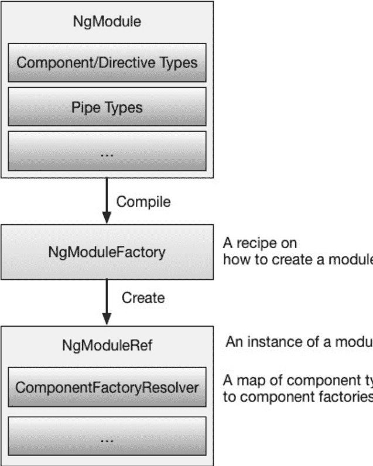
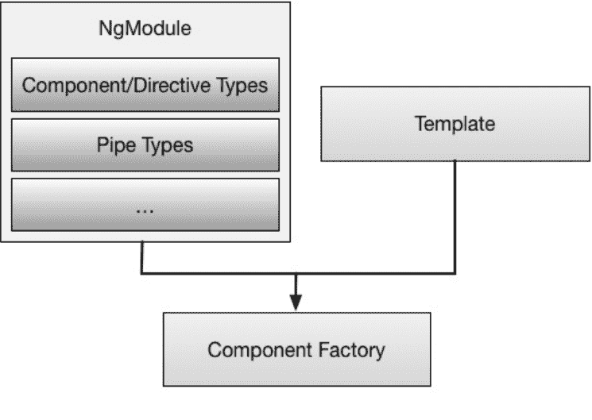

# 第 2 章 编译

Angular 的核心是一个复杂的编译器，它接收一个 `NgModule` 类型并生成一个 `NgModuleFactory`。



`NgModule` 中声明了组件。在创建模块工厂时，编译器会获取模块中每个组件的模板，并利用已声明组件和管道的信息，生成一个组件工厂。组件工厂是一个 JavaScript 类，框架可以使用它来实例化组件。



```
NgModule

Component/Directive Types

Pipe Types

...

Template

Component Factory
```

### 它是如何实现的？

为什么我们之前没有在 Angular 1 中做到这一点？为了让 AOT 工作，应用程序必须清晰地区分静态数据和动态数据。而且编译器的构建方式必须使其只依赖静态数据。在设计并构建 Angular 时，我们投入了大量精力来实现这一点。而类和装饰器这些新版本 JavaScript 和 TypeScript 支持的原始特性，让这一切变得容易得多。

为了在实践中看到这种分离是如何工作的，让我们看下面的例子。在这里，装饰器中的信息是静态已知的。Angular 知道 `talk` 组件的选择器和模板。它也知道该组件有一个名为 `talk` 的输入和一个名为 `rate` 的输出。但框架不知道构造函数或 `onRate` 函数做了什么。

```typescript
@Component({
  selector: 'talk-cmp',
  template: `
    {{talk.title}} {{talk.speaker}}
    Rating: {{ talk.rating | formatRating }}
    <watch-button [talk]="talk"></watch-button>
    <rate-button [talk]="talk" (click)="onRate()"></rate-button>
  `
})
class TalkCmp {
  @Input() talk: Talk;
  @Output()...
}
```

### 权衡取舍

由于 AOT 优势显著，我们建议在生产环境使用它。但与其他任何事情一样，也存在权衡取舍。为了让 Angular 能够提前编译你的应用程序，元数据必须是静态可分析的。例如，以下代码在 AOT 模式下将无法工作：

```typescript
@Component({
  selector: 'talk-cmp',
  template: () => window.hide ? 'hidden' :
    '{{talk.title}} {{talk.speaker}}
    Rating: {{ talk.rating | formatRating }}
    <watch-button [talk]="talk"></watch-button>
    <rate-button [talk]="talk" (click)="onRate()"></rate-button>'
})
class TalkCmp {
  //...
}
```

`window.hide` 属性不会被定义。因此编译将无法指出错误。为了让编译器变得更智能，我们做了大量工作，使其能够理解你在构建应用程序时使用的大多数日常模式。但某些东西永远不会奏效，比如前面的示例。
