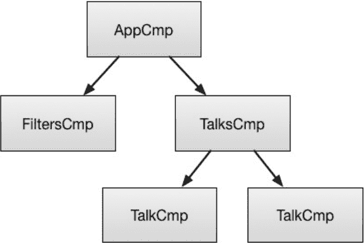
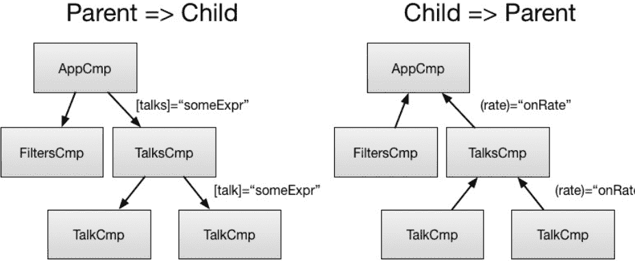

# 第 4 章 组件与指令

要构建一个 Angular 应用，你需要为每个 UI 元素、屏幕和路由定义一组组件。一个应用总是有根组件（通常只有一个），它包含所有其他组件。为了让事情更简单，在本书中我们假设应用只有一个根组件，因此我们的 Angular 应用将有一个组件树，可能看起来像这样：



AppCmp 是根组件。FiltersCmp 组件具有 speaker 输入和 filter 按钮。TalksCmp 是你在底部看到的列表。TalkCmp 是该列表中的一项。为了理解 Angular 中组件的构成，让我们仔细看看 TalkCmp：

```typescript
@Component({
  selector: 'talk-cmp',
  template: `
    {{talk.title}}  {{talk.speaker}}
    {{talk.rating | formatRating }}
    <watch-button [talk]="talk"></watch-button>
    <rate-button [talk]="talk"></rate-button>
  `
})
class TalkCmp {
  @Input() talk: Talk;
  @Output() rate: EventEmitter;
  //...
}
```

### 输入和输出属性

一个组件有输入和输出属性，它们可以在组件装饰器中定义，也可以使用属性装饰器定义。

```typescript
class TalkCmp {
  @Input() talk: Talk;
  @Output() rate: EventEmitter;
  //...
}
```

数据通过输入属性流入组件。数据通过输出属性流出组件，因此得名：输入和输出。



输入和输出属性是组件的公共 API。当你在应用中实例化组件时，会用到它们。

```html
<talk-cmp [talk]="someExpr" (rate)="onRate($event.rating)"></talk-cmp>
```

你可以通过方括号使用属性绑定来设置输入属性。可以通过圆括号使用事件绑定来订阅输出属性。


### 生命周期

组件拥有一个定义良好的生命周期，你可以利用它。`TalkCmp` 并未订阅任何生命周期事件，但其他组件可以。例如，当其输入属性发生变化时，该组件会收到通知。

```typescript
@Component({
  selector: 'cares-about-changes'
})
class CaresAboutChanges implements OnChanges {
  @Input() field1;
  @Input() field2;

  ngOnChanges(changes) { // ... }
}
```

### 提供者

组件可以通过定义组件及其子组件可以注入的提供者列表来配置依赖注入。

```typescript
@Component({
  selector: 'conf-app',
  providers: [Logger]
})
class AppCmp { //... }

@Component({
  ...
})
class TalksCmp {
  constructor(logger: Logger) { //... }
}
```

在此示例中，我们在应用组件中声明了 logger 服务，这使其在整个应用中可用。talks 组件注入了 logger 服务。我将在第 5 章《依赖注入》中详细讲解依赖注入。现在，只需记住组件可以配置依赖注入即可。

### 查询

除了访问其宿主元素外，组件还可以与其子组件交互。组件可以有两种类型的子组件：**内容子组件**和**视图子组件**。为了理解它们之间的区别，让我们看下面的示例：

```typescript
@Component({
  selector: 'tab',
  template: `...`
})
class TabCmp {}
```

```typescript
@Component({
  selector: 'tabs',
  template: `
    Tabs:
    <div>
      <ng-content></ng-content>
    </div>
    <div>
      <button (click)="selectPrev()">Prev</button>
      <button (click)="selectNext()">Next</button>
    </div>
  `,
})
class TabsCmp {}
```

```typescript
@Component({
  template: `
    <tabs>
      <tab></tab>
      <tab title="Two"></tab>
      <tab></tab>
    </tabs>
  `,
})
class CmpUsingTabs {
}
```

`tabs` 组件的内容子组件是三个 `tab` 组件。The

### 那指令呢？

如果你熟悉 Angular 1，你一定会想“指令去哪了？”实际上，指令在 Angular 中仍然存在。组件只是指令中最重要的类型，但不是唯一的类型。组件是一个带有模板的指令。但你仍然可以编写装饰器风格的指令，它们没有模板。

### 为什么使用模板？

在我们讨论如何之前，让我们先谈谈为什么。

使用模板符合最小权力原则，这是一个有用的设计原则。

> 语言越不强大，就越能用存储在该语言中的数据做更多事情。[...] 我选择 HTML 不是为了让它成为一种编程语言，因为我希望不同的程序可以用不同的方式处理它：以不同的方式呈现它，提取目录，对其进行索引，等等。
> 
> —蒂姆·伯纳斯-李，关于最小权力原则

**注意：** 有关完整文章，请参阅 https://www.w3.org/DesignIssues/Principles.html#PLP。

由于模板是纯 HTML，因此受到约束，工具和开发者可以对组件是什么以及它们如何表现做出明智的假设，而 Angular 可以做很多如果组件使用 JavaScript 而不是这样就无法实现的有趣事情。让我们看一些例子。

### 交换实现

性能很棘手：通常很难提前知道某种技术效果如何。此外，现在高效的东西可能

### Angular 模板

模板*可以*以 JavaScript *根本*无法实现的方式进行分析、转换和声明。设计 Angular 时，我们投入了大量精力确保模板语言具有这些特性。让我们看看我们最终得到的结果。

### 属性和事件绑定

输入和输出属性是指令的公共 API。数据通过输入流向指令，通过输出流出。我们可以使用属性绑定来更新输入属性。并且我们可以使用事件绑定来订阅输出属性。

假设我们有一个组件，它渲染一个按钮，允许对会议演讲进行评分。我们可以在模板中这样使用该组件：

```html
<rate-button [talk]="myTalk" (rate)="handleRate($event)"></rate-button>
```

这告诉 Angular 每当 `myTalk` 发生变化时，Angular 需要通过调用 setter 自动更新 `rate-button` 组件。这也告诉 Angular 如果触发名为 `rate` 的事件，它应该调用 `handleRate`。

现在，让我们看看 `RateButtonCmp` 类：

```typescript
@Component({
  selector: 'rate-button',
  templateUrl: './rate-button.component.html',
  styleUrls:...
```

### 让我们回顾一下

这就是 Angular 模板的工作方式。让我们看看它们是否可分析、可转换，以及是否提供了我在本章开头提到的好处。

与 Angular 1 相比，框架在静态上可以告诉模板的更多信息。

例如，无论组件元素是什么，Angular 都知道 `[property1]="name"` 中的 `name` 是一个字段读取，而 `property2="name"` 中的 `name` 是一个字符串字面量。它还知道 `name` 属性不能由组件更新：属性绑定从父组件更新到子组件。同样，Angular 仅通过查看 `*ngFor` 就能知道模板中定义了哪些变量。最后，它可以区分模板中的静态部分和动态部分。

所有这些都使我们能够在编译时可靠地 introspect 和转换模板。这是一个强大的功能，例如 Angular i18n 支持就是建立在它之上的。

以这种方式设计模板后，我们还解决了 Angular 1 最大的问题之一：IDE 支持。使用 Angular 1 时，编辑器和 IDE 必须做很多猜测才能提供补全、重构和导航。
