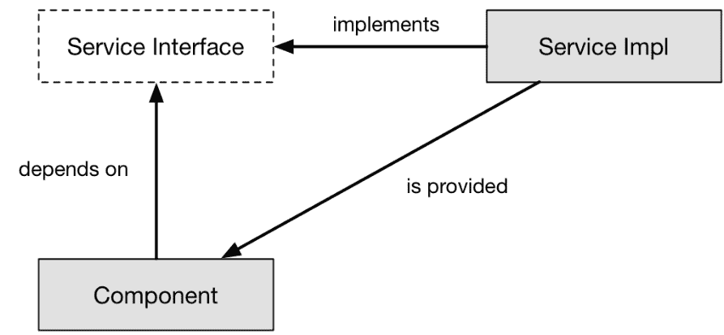
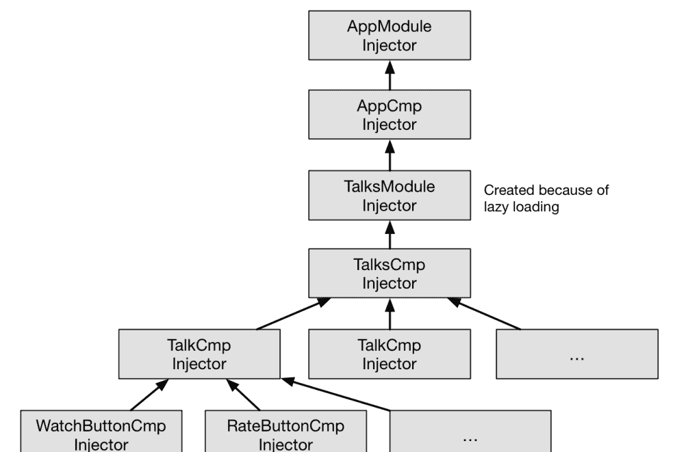
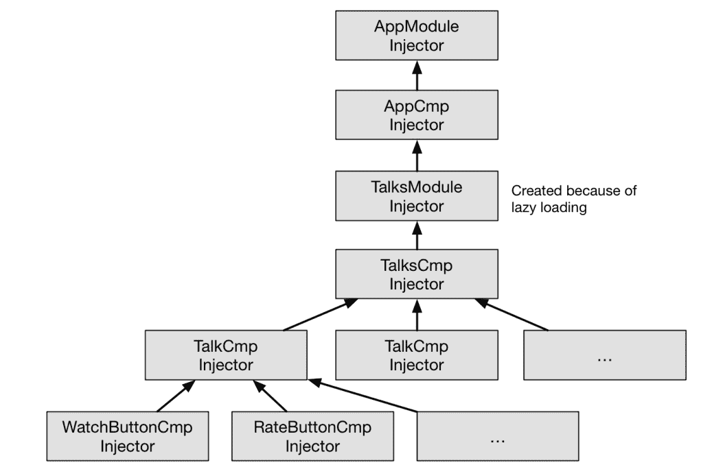
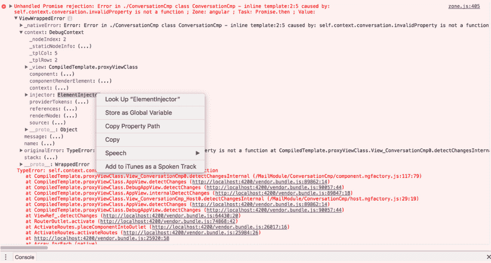

# 第 6 章 依赖注入

依赖注入背后的想法非常简单。如果你有一个依赖于服务的组件，你不会自己创建该服务。相反，你在构造函数中请求它，框架会为你提供一个。通过这样做，你可以依赖接口而不是具体类型。这导致代码更解耦，从而实现可测试性和其他很棒的事情。



Angular 带有依赖注入系统。为了了解如何使用它，让我们看一下以下组件，该组件使用 `*ngFor` 指令渲染演讲列表：

```typescript
@Component({
  selector: 'talks-cmp',
  template: `
    <h2>Talks:</h2>
    <talk *ngFor="let t of talks" [talk]="t"></talk>
  `
})
class TalksCmp {
  constructor() { // ... get the data }
}
```

### 注册提供者

为此你需要注册一个提供者，有两个地方可以注册。第一个是在组件装饰器中。

```typescript
@Component({
  selector: 'talks-cmp',
  template: `
    <h2>Talks:</h2>
    <talk *ngFor="let t of talks" [talk]="t"></talk>
  `,
  providers: [TalksAppBackend]
})
class TalksCmp {
  constructor(backend: TalksAppBackend) {
    this.talks = backend.fetchTalks();
  }
}
```

另一个是在模块装饰器中。

```typescript
@NgModule({
  declarations: [FormattedRatingPipe, WatchButtonCmp, RateButtonCmp, TalkCmp, TalksCmp],
  exports: [TalksCmp],
  providers: [TalksAppBackend]
})
class TalksModule {}
```

有什么区别，应该偏好哪一个？

通常，我建议在它们不依赖于 DOM、组件或指令时在模块级别注册提供者。只有与 UI 相关且必须限定到特定组件的提供者才应在组件级别注册。由于 `TalksAppBackend` 与 UI 无关，请在模块级别注册它。

### 注入器树

现在你知道了依赖注入配置有两个部分：

- **注册提供者**：对象应如何以及在何处创建。
- **注入依赖**：对象依赖于什么。

对象所依赖的一切（服务、指令和元素）都会注入到其构造函数中。为了使其工作，框架会构建注入器树。

首先，每个带有组件或指令的 DOM 元素都会获得一个注入器。该注入器包含组件实例、组件注册的所有提供者以及一些“本地”对象（例如，元素）。

其次，在引导 NgModule 时，Angular 会使用模块和其中定义的提供者创建一个注入器。

因此，应用的注入器树将如下所示：




### 解析

这就是依赖解析算法的工作方式：

// this is pseudocode.
let inj = this;
while (inj) {
    if (inj.has(requestedDependency)) {
        return inj.get(requestedDependency);
    } else {
        inj = inj.parent;
    }
}
throw new NoProviderError(requestedDependency);
```

在解析 TalksCmp 的后端依赖时，Angular 会从 talks 组件本身的注入器开始。然后，如果不成功，它会向上攀升到 app 组件的注入器，最后会上升到从 AppModule 创建的注入器。这就是为什么要解析 TalksAppBackend，你需要在 TalksCmp、AppCmp 或 AppModule 中注册它。

### 懒加载

一旦开始使用懒加载，设置就会变得更复杂。

懒加载一个模块类似于引导一个模块，因为它会从该模块创建一个新的注入器并将其插入到注入器树中。为了亲眼看到它，让我们更新我们的应用程序以懒加载 talks 模块。

```typescript
@NgModule({
  declarations: [AppCmp],
  imports: [RouterModule.forRoot([
    {path: 'talks', loadChildren: 'talks'}
  ])]
})
class AppModule { }

@NgModule({
  declarations: [FormattedRatingPipe, WatchButtonCmp, 
    RateButtonCmp, TalkCmp, TalksCmp],
  entryComponents: [TalksCmp],
  providers: [TalksAppBackend],
  imports: [RouterModule.forChild([
    {path: '', component: TalksCmp}
  ])]
})
class TalksModule { }
```

有了这个更改，注入器树将如下所示：



### 获取注入器

你可以使用 `ng.probe` 来探测与页面上元素关联的注入器。当抛出异常时，你也可以看到元素的注入器。



右键单击这些对象中的任何一个，将它们存储为全局变量，以便你可以在控制台中与它们交互。

### 高级主题

### 控制可见性

你可以更具体地指定想要从哪里获取依赖。例如，你可以请求同一元素上的另一个指令。

```typescript
class CustomInputComponent {
  constructor(@Self() f: FormatterDirective) {}
}
```

或者你可以请求同一模板中的指令，也就是说，你只能注入来自同一 HTML 文件的祖先指令。

```typescript
class CustomInputComponent {
  constructor(@Host() f: CustomForm) {}
}
```

最后，你可以要求跳过当前元素，这对于装饰现有提供者或构建树状结构非常有用。

```typescript
class SomeComponent {
  constructor(@SkipSelf() ancestor: SomeComponent) {}
}
```

### 可选依赖

要将依赖标记为可选，请使用 Optional 装饰器。

```typescript
class Login {
  constructor(@Optional() service: LoginService) {}
}
```
