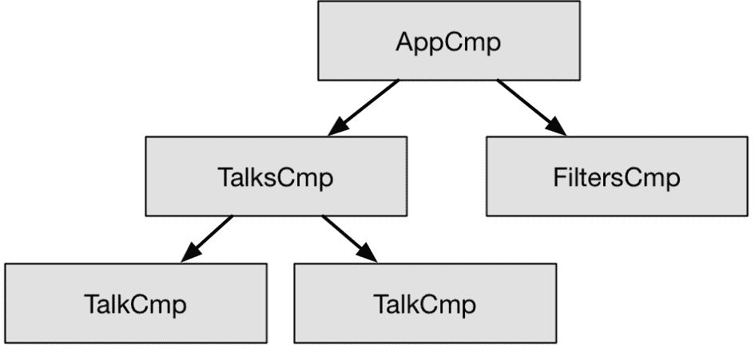
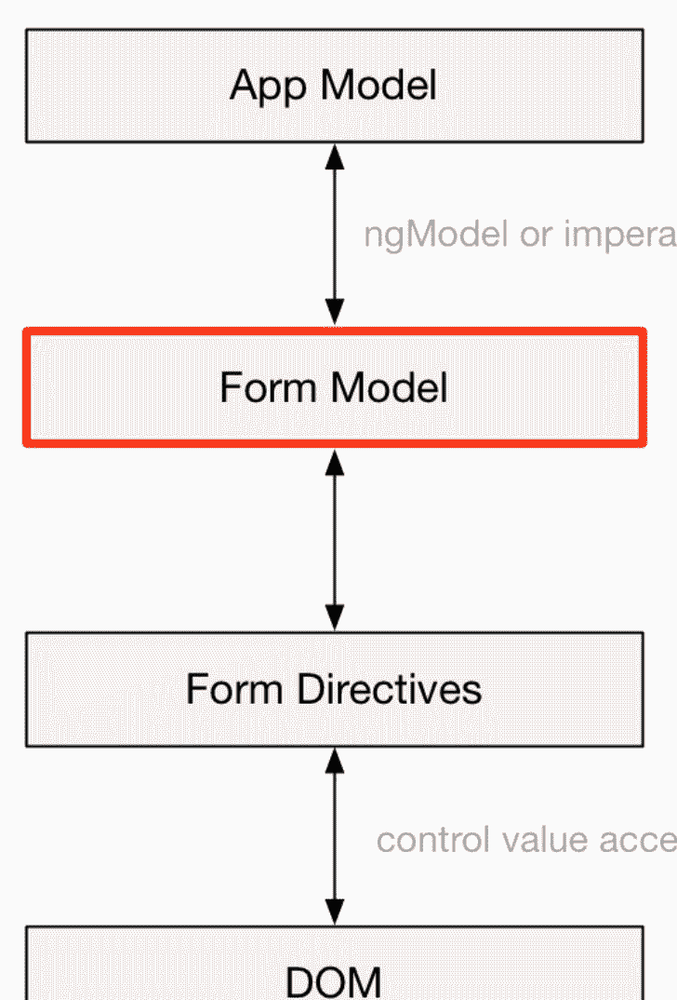
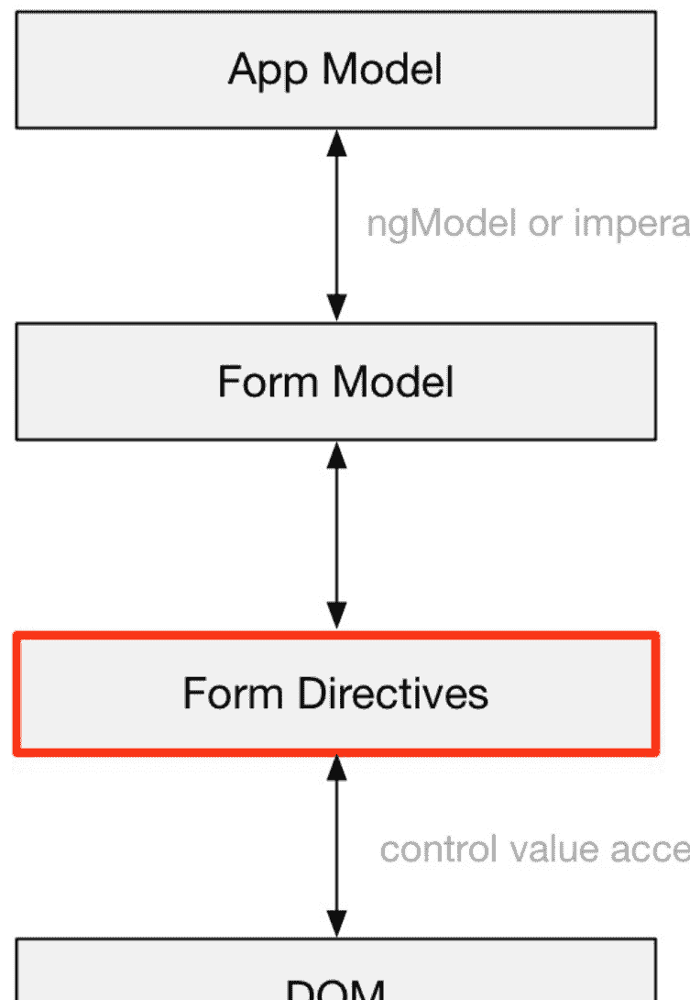
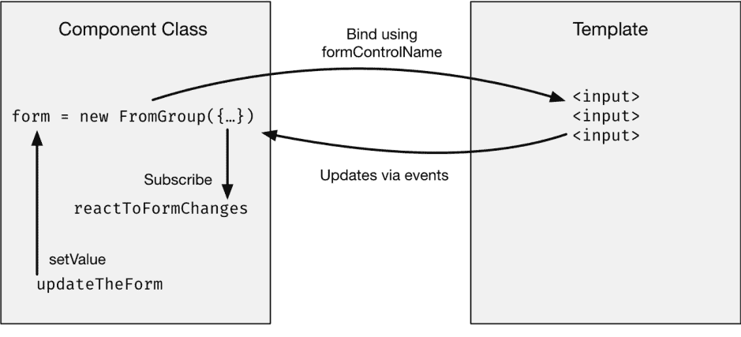
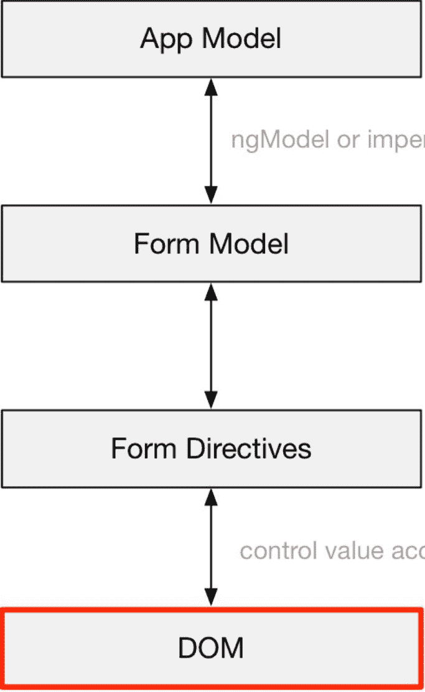

# 第 7 章 变更检测

### 两个阶段

Angular 将更新应用程序模型和在视图中反映模型状态这两个操作分离为两个不同的阶段。开发者负责更新应用程序模型。Angular 通过绑定，借助变更检测，负责在视图中反映模型的状态。框架会在每个 VM 轮转时自动执行此操作。

**事件绑定**，可以使用 () 语法添加，可用于捕获浏览器事件或组件输出以在组件或指令上执行某些函数。因此它们通常会触发第一阶段。

**属性绑定**，可以使用 [] 语法添加，应仅用于在视图中反映模型的状态。

正如我们所学，Angular 应用程序由嵌套组件组成，因此它总是有组件树。假设对于此应用，它如下所示：



接下来，定义将存储我们应用程序状态的应用程序模型。

```json
{
  "filters": {"speakers": "Rich Hickey"},
  "talks": [
    {
      "id":898,
      "title": "Are we there yet",
      "speaker": "Rich Hickey",
      ...
```

### Angular 如何强制执行它？

如果我尝试破坏这种分离会怎样？如果我尝试在由变更检测系统调用的 setter 中更改应用程序模型会怎样？

Angular 会尝试确保我们为组件定义的 setter 仅更新此组件或其子组件的视图状态，而不更新应用程序模型。为此，Angular 在开发者模式下会检查所有绑定两次。第一次传播更改，第二次确保没有更改。如果在第二次遍历中发现更改，则意味着我们的某个 setter 更新了应用程序模型；框架会抛出异常，指出违规发生的位置。

```typescript
, </tabs>
})
class CmpUsingTabs {
}
```

`tabs` 组件的内容子项是三个 ...

### ChangeDetectionStrategy.OnPush

如果我们使用在多个组件之间共享的可变对象，Angular 就无法知道这些组件何时可能受到影响。一个组件可能会影响系统中的任何其他组件。这就是为什么默认情况下，Angular 不对组件依赖于什么做任何假设。因此它必须保守，并在每次浏览器事件时检查每个组件的每个模板。由于框架必须为每个组件执行此操作，即使新版本的 Angular 中的变更检测速度快了很多，它也可能成为性能问题。

如果我们的应用程序模型状态使用不可变对象，如前例所示，我们就可以知道谈话组件何时可能发生变化。组件仅在任何输入发生变化时才会发生变化。我们可以通过将变更检测策略设置为 OnPush 来将此信息传达给 Angular。

```typescript
@Component({
  selector: 'talk',
  template: `
    {{talk.title}} {{talk.speaker}}
    {{talk.rating | formatRating}}
    <watch-button [talk]="talk"></watch-button>
    <rate-button [talk]="talk" (rate)="handleRate($event)">
    ...
```

### 两个模块

在 AngularJS 1.x 中，`ng-model` 指令被烘焙到核心框架中。这已不再如此。`@angular/core` 包不包含表单处理库。它只提供了我们可以用来构建它的关键原语。

当然，让每个人都自己构建是不切实际的。这就是 Angular 团队构建了 `@angular/forms` 包的原因，其中包含两个模块：`FormsModule` 和 `ReactiveFormsModule`。

`FormsModule` 实现了 AngularJS 风格的表单处理。我们通过在模板中放置指令来创建表单。然后我们使用数据绑定将数据传入和传出该表单。

`ReactiveFormsModule` 是处理输入的另一种方法，我们在组件类中定义表单，然后将其绑定到模板中的元素。我们倾向于使用响应式编程将数据传入和传出表单，因此得名“reactive”。

乍一看，这两个模块似乎非常不同。但一旦我们理解了底层机制，我们就会看到它们有多少共同点。此外，它还会让我们了解如果需要如何构建自己的表单处理模块。

### 应用模型

应用模型是由应用程序开发者提供的对象。它可以是从服务器获取的 JSON 对象，也可以是在客户端构造的某些对象。Angular 对此没有任何假设。

### 表单模型

表单模型是表单的与 UI 无关的表示。它由三个构建块组成：FormControl、FormGroup 和 FormArray。我们将在本章后面详细介绍表单模型。FormsModule 和 ReactiveFormsModule 都使用此模型。

### 表单指令

这些是连接表单模型与 DOM 的指令（例如 NgModel）。FormsModule 和 ReactiveFormsModule 提供不同的指令集。

### DOM

这些是我们的输入框、复选框和单选按钮。


## 表单模型



为了使表单处理不依赖于 UI，`@angular/forms` 提供了一组用于构建表单模型的基础构件：`FormControl`、`FormGroup` 和 `FormArray`。

## FormControl

`FormControl` 是表单中不可分割的部分，一个原子。它通常对应于一个简单的 UI 元素，例如输入框。

```
const c = newFormControl('Init Value', Validators.required);
```

一个 `FormControl` 具有一个值、一个状态和一个错误映射：

```
expect(c.value).toEqual('Init Value');
expect(c.errors).toEqual(null); //null means 'no errors'
expect(c.status).toEqual('VALID');
```

## FormGroup

`FormGroup` 是一个固定大小的控件集合，一条记录。

```
const c = new FormGroup({
  login: new FormControl(''),
  password: new FormControl('', Validators.required)
});
```

`FormGroup` 本身也是一个控件，因此具有与 `FormControl` 相同的方法。

```
expect(c.value).toEqual({login: '', password: ''});
expect(c.errors).toEqual(null);
expect(c.status).toEqual('INVALID');
```

组的值只是其子控件值的聚合。每当子控件的值发生变化时，组的值也会随之变化。

与值相反，表单组并不聚合……

## 表单指令

抽象地描述输入固然不错，但最终我们需要将其连接到 UI。



@angular/forms 提供了两个模块来实现这一点：FormsModule 和 ReactiveFormsModule。

## ReactiveFormsModule



`ReactiveFormsModule` **比 FormsModule 更容易理解和解释**。这就是我首先介绍它的原因。

```typescript
@Component({
  selector: 'filters-cmp',
  template:
    `<div [formGroup]="filters">
      <input formControlName="title" placeholder="Title">
      <input formControlName="speaker" placeholder="Speaker">
      <input type="checkbox" formControlName="highRating">
      High Rating
    </div>`
})
export class FiltersCmp {
  filters = new FormGroup({
    speaker: new FormControl(),
    title: new FormControl(),
    highRating: new FormControl(false),
  });

  constructor(app: App) {
    this.filters.valueChanges.debounceTime(200).
      subscribe((value) => {
```

## DOM



`ngModel`、`ngControlName` 和其他表单指令将表单模型绑定到 UI 元素，这些元素通常是平台原生的（例如 <input>），但并不一定如此。例如，`NgModel` 可以应用于 Angular 组件。

```
<md-input [(ngModel)]="speaker" name="speaker" placeholder="Spe
```

`ControlValueAccessor` 是一个指令，它充当适配器，将 UI 元素连接到 `NgModel`。它知道如何读写原生 UI 元素。

`@angular/forms` 包为所有内置的 UI 元素（如 input、textarea 等）提供了值访问器。但如果我们想将 `NgModel` 应用于自定义元素或 Angular 组件，就必须自己提供值访问器。

```
@Component({
  selector: 'custom-input',
  providers: [
    {
      provide: NG_VALUE_ACCESSOR,
      useExisting: forwardRef(() => CustomInputCmp),
      multi: true
    }
  ]
})
class CustomInputCmp implements ControlValueAccessor {
  //...
}
```

## 总结

表单处理是一个复杂的问题。AngularJS 之所以如此成功，一个主要原因在于双向绑定和 `ng-model` 为它提供了良好的解决方案。但也有一些缺点，主要是使用 `ng-model` 构建的复杂表单使应用的数据流难以跟踪和调试。Angular 2+ 建立在 Angular 1 的思想之上，但避免了它的这些问题。

`NgModel` 及其相关指令不再是核心框架的一部分。`@angular/core` 包只包含我们用来构建表单处理模块的基础构件。取而代之的是，Angular 有一个单独的包——`@angular/forms`——它带有 `FormsModule` 和 `ReactiveFormsModule`，提供了处理用户输入的两种不同风格。

这两个模块都依赖于由 `FormControl`、`FormGroup` 和 `FormArray` 组成的表单模型。有了这个独立于 UI 的模型，我们可以在不渲染任何组件的情况下对输入处理进行建模和测试。

最后，`@angular/forms` 附带了一组处理内置 UI 元素（如 `<input>`）的指令，但我们也可以提供自己的指令。
