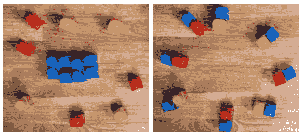
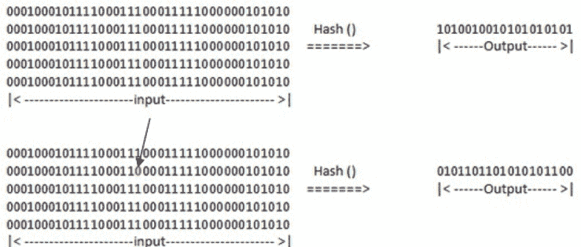
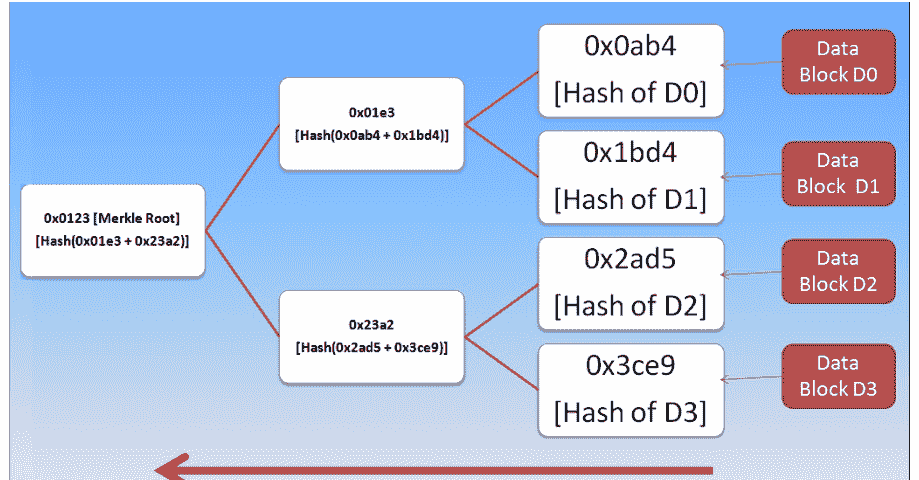
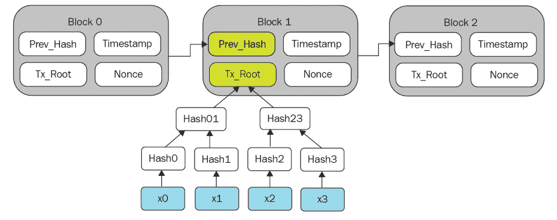
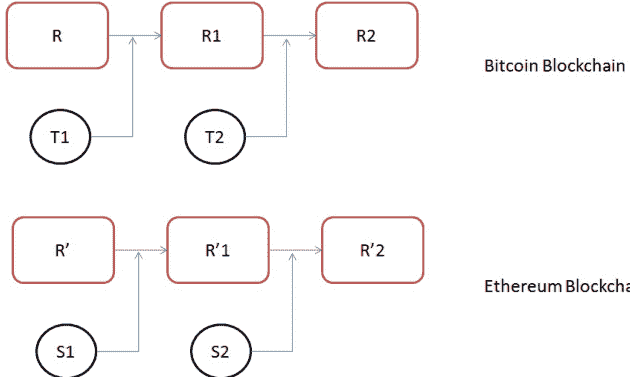
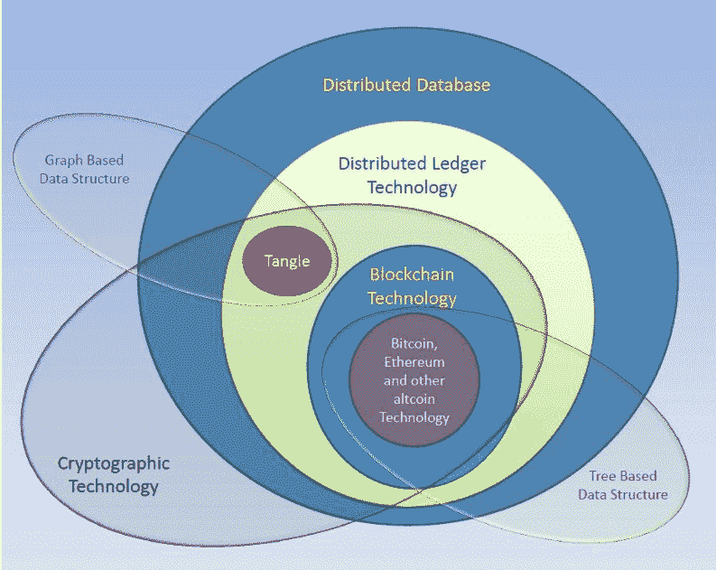
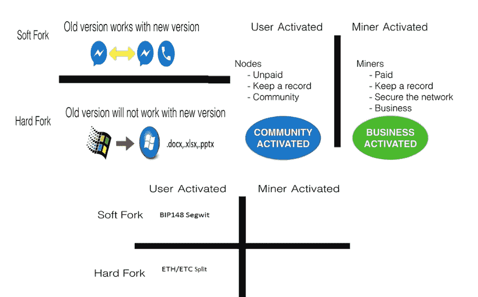
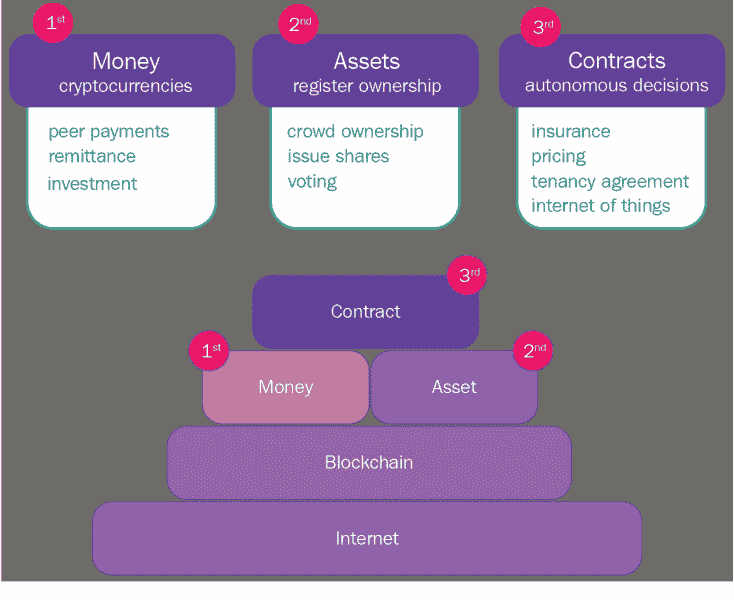
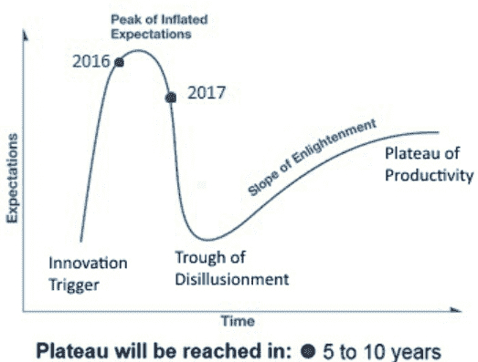

## 区块链基础

本章将作为区块链的热身环节，之后我们再深入以太坊和智能合约开发。要真正理解区块链，我们必须理解区块链作为一项技术所牢固立足的两大支柱：分布式系统和密码学。一旦我们解决了这两个核心概念，我们将尝试从两个不同的角度来理解区块链：一个是作为软件开发人员，另一个是作为金融工具的交易者。然后，我们将探究区块链中区块的内部逻辑架构，重点关注比特币区块结构，并简单介绍挖矿和分叉过程。

本章最后讨论了近年来区块链作为技术的发展演变、区块链技术的三代发展，以及区块链目前在Gartner炒作周期上的位置。

学习本章后，你将能够：

- 理解区块链技术的基础
- 作为开发者和交易者理解区块链的价值
- 讨论比特币区块的基本结构
- 了解区块链挖矿和分叉，并理解区块链的演变、代际和炒作

面临了拜占庭将军问题和 CAP 定理等挑战，我们将在后续章节中讨论这些问题。

图 1.1：集中式系统（左）和分布式系统（右）的乐高积木表示

## 拜占庭将军问题

想象一下在黑暗时代，有一艘海盗船正在遭受攻击。海盗船上有 200 名海盗，被六艘各有 50 名战士的军舰包围，每艘军舰都已抛锚，将海盗船团团围住。每艘军舰都由一名船长指挥。300 名战士可以轻易压制海盗船上的 200 名海盗。然而，如果他们不能同时攻击，就有很大风险战士会被海盗以多打少并输掉战斗。

图 1.2：海盗船（200）被军舰（50）包围

那么，船长们如何能在同一时间就攻击海盗船达成一致？在今天，我们只需要一个快速的群视频会议，船长们就会同意在 22:00 小时（晚上 10 点）发动攻击。

然而，在黑暗时代，事情要复杂得多：

- 22:00 攻击的消息只能由小船上的水手传递。他必须绕着每艘军舰航行，依次拜访每位船长以确认。
- 任何船长都可能是叛徒，与海盗船上的海盗勾结。

## 失败的策略

船长 1 决定在 22:00 发起攻击。他派他的水手带着消息（22:00 攻击）去交给船长 2。到达后，船长 2 阅读了消息，记下了攻击时间，并发送了一条同样写着 22:00 攻击的消息。他让水手继续将消息传给船长 3。然而，我们遇到了问题。船长 3 是叛徒。他希望攻击失败。所以，当他收到消息时，他把消息撕掉并换成一条新消息，写着 21:00 攻击（晚上 9 点）。水手浑然不觉地继续前进。船长 4 现在收到一条写着 21:00 攻击的消息。他记下时间，在消息上签名写着 21:00 攻击并将其传给船长 5，船长 5 然后将同一消息传给船长 6。现在，消息已经传遍所有人，但我们有问题了。那个不诚实的船长破坏了结果。我们现在有三名船长（4、5 和 6）带着 150 名战士在 21:00 攻击海盗船。期望其他人加入他们，他们反而被 200 名海盗以多打少并被压制。获胜的海盗现在从海盗船中涌出并与背叛的船长 3 汇合。突然间，剩下的两名船长（1 和 2）只有 100 名战士，发现自己在与 200 名海盗加上 50 名叛徒作战。不幸的是，海盗和叛徒获胜了。

## 获胜的策略

船长 1 想发送同样的消息（在 22:00 攻击）。然而，这次他必须遵守两条新规则：

- 他必须花费 10 分钟准备任何新消息才有效
- 他必须在每条新消息中包含所有先前消息的历史记录

那么，这次会发生什么呢？和之前一样，船长 1 派水手乘船发送消息（22:00 攻击）。这次不同的是，船长 2 知道两件确定的事：

- 消息必须花费 10 分钟准备
- 没有先前的消息，所以它必须是真的（即使船长 1 是叛徒并写了错误的时间也没关系；如果大多数船长遵循这一建议并选择 22:00 的攻击时间，他们仍然会超过海盗船上的人数并赢得战斗）

所以，现在轮到船长 2 发送消息了。按要求，他花费 10 分钟准备新消息并将船长 1 的消息嵌入到自己的消息中。水手随后带着这条消息出发（现在实际上是两条消息链接在一起，因为第二条消息中嵌入了第一条）。现在消息传到了船长 3。

记住，他是叛徒。那他会怎么做呢？上次，他把消息改成 21:00 攻击，让船长 4、5 和 6 提前攻击并被压制。现在，他却不能这么做，因为根据新规则，他只有 10 分钟时间准备给船长 4 的消息。他有两个选择：

1. 通过将消息改为 21:00 攻击来作弊。为此，他需要（a）花费 10 分钟创建他的消息，然后（b）再花费额外的 2 x 10 分钟来制作要嵌入到他消息中的来自船长 1 和 2 的 21:00 攻击替换消息，并在接下来的 10 分钟内完成这 30 分钟的工作，以避免其他船长知道他是叛徒。
2. 承认失败并在那 10 分钟内准备 22:00 攻击消息。

换句话说，每位船长最多只有 10 分钟时间，为下一位船长提供一份如果他们想不诚实的话需要花费超过 10 分钟才能伪造的东西。如果他们不能在 10 分钟内交付，每个人都知道他们是不诚实的并会忽略他们，使他们试图误导他人的企图变得毫无用处。

## CAP 定理

在陈述 CAP 定理之前，让我们先通过一个现实世界的问题来理解一致性、可用性和分区容错性。

作为一个已婚人士，我知道一个人的生活如果忘记了配偶生日和结婚纪念日等重要日期会变得多么可怜（在大多数情况下，丈夫是罪魁祸首，但那是另一个讨论）。我的一个朋友，让我们叫他考希克，看到其中的机会并开设了一家初创公司 HappySpouse.com 来解决这个问题。在一个典型的营业日，考希克（K）和他的客户（C）会有以下对话：

K：您好，欢迎致电 HappySpouse.com。我能为您做什么？

C：嗨，我希望你记住我妻子的生日。

K：当然！是哪一天？

C：9 月 3 日。

K：（在专属于 C 的一页上写下。）已存储。随时打电话让我提醒你配偶的生日！

C：谢谢！

K：不客气！您的信用卡已被收取 0.05 美元。

考希克的想法如此简单，只需要一个笔记本和电话，却如此有效，以至于像雪崩一样迅速传播。风投公司开始大量注资。他每天还接到数百个电话。那时问题开始了。现在，越来越多的客户必须排队等候与他通话。很多人甚至不耐烦地挂断了电话。况且，当他生病一天不能来上班时，他就损失了一整天的业务。更不用说那些在那天想要信息的 dissatisfied 客户了。所以，考希克决定扩大规模并请他的妻子来帮忙。

他开始实施一个简单的计划来解决他对客户的可用性问题：

1. 他和他的妻子都接了一部分机电话
2. 客户仍拨打同一个号码
3. PBX 将客户电话路由给当时空闲的人

一切顺利地过了几周。一个好早晨，他接到一位老客户乔伊（J）的电话：

J：你好，我是在和 HappySpouse.com 的考希克通话吗？

K：嗨，乔伊，很高兴你还记得我们。我能为你做什么？

J：你能告诉我我们的结婚纪念日是哪一天吗？

K：当然。等我一秒，乔伊（在他的笔记本中查找，乔伊的页面上没有记录）。乔伊，我这里只有你配偶的生日。

J：天哪！我昨天刚给你们打过电话！（挂断电话！）

这是怎么发生的？乔伊在撒谎吗？考希克想了一秒钟，原因就浮现出来了！昨天，乔伊的电话是否接到了他的妻子？他去妻子办公桌检查她的笔记本。果然，记录在那里。他把这件事告诉妻子，她也意识到了问题。分布式设置中多么可怕的缺陷！这个设置不一致！

现在，他们决定无论谁接到记事的电话，都会更新对方的笔记本。这样，他们两人都会拥有相同的最新信息。即使其中一人请假，另一人

他会把更新内容通过电子邮件发出去，让对方第二天过来补记。这样一来，既能保持一致，也能保证可用。

然而，命运自有安排。由于日程过于繁忙，考希克自己忘了妻子的生日。妻子对此非常生气，不再与他分享任何更新，这就形成了一个分区。为了补救，考希克不得不让自己对客户不可用，去哄妻子开心。

现在我们来看 CAP 定理。它指出，在设计分布式系统时，我们无法同时满足一致性、可用性和分区容错性这三个特性。我们只能在 CAP 中选两个，牺牲第三个，也就是 CA、AP 或 CP，其中：

- **一致性**：客户在 `HappySpouse.com` 更新信息后，无论多快再次来电，之后每次查询都能获得最新信息。
- **可用性**：只要考希克或妻子任意一人上班，`HappySpouse.com` 就始终可以接听电话。
- **分区容错性**：即使考希克和妻子之间出现沟通中断/夫妻吵架，`HappySpouse.com` 依然能正常工作。

## 分布式系统中的共识

共识问题出现在复制共同状态（如数据库中的数据）的分布式系统中。它的任务是让一组中的所有进程根据每个进程的投票，就某个特定值达成一致。共识算法不能凭空捏造一个值。所有进程必须就同一个值达成一致，而且该值必须至少由其中一个进程提交。

在前面的 `HappySpouse.com` 例子中，为了防止一致性问题，我们可以安排一个来回跑腿的职员，当一个笔记本被更新时，他就去更新另一个笔记本。这样做最大的好处是，他可以在后台工作，一次更新不必等待另一个人去更新。严格来说，在这样的分布式系统中，一个节点在本地更新自己，然后由后台进程随之同步所有其他节点。唯一的问题是我们会在某段时间内失去一致性。

例如，客户打来的电话先由考希克的妻子接听，而在职员来得及更新笔记本之前，客户又打来电话，转到了考希克那里。这样一来，客户就不会得到一致的答复。因此，为了这种最终一致的解决方案能够奏效，我们只能稳妥地假设，客户不会那么快就忘事，以至于几分钟内再次打来电话。

此外，回顾拜占庭将军问题的制胜策略，我们会发现，为了区分真实消息与谎言，需要在各位将领之间达成共识。

在本章后面，我们将结合比特币在区块链上采用的工作量证明算法，再回到这个话题。目前，我们只需要了解关于共识的两个事实：

- Raft 和 Paxos 算法是解决共识问题的一些早期尝试。Paxos 和 Raft 都通过集群中的多数投票解决了共识问题。它们的主要区别在于侧重点不同：Raft 旨在提供一个完整实用的算法，而 Paxos 提供了共识算法的构建模块。
- 在分布式账本系统中，达成共识主要有两种方式：**实用拜占庭容错**算法（**PBFT**）和区块链算法。区块链算法又可以进一步分为**权益证明**算法（**PoS**）和**工作量证明**算法（**PoW**）。PoS 还有一种特殊形式，称为**委托权益证明**算法（**DPoS**）。

## 理解哈希函数与 Merkle 树

密码学是隐藏信息的艺术与科学。它更像是一门艺术，而非科学。在这里，科学仅仅是将艺术想象转化为数学算法的工具。

在本节中，我们只专注于这一极其庞大领域中的两个特定概念，它们将帮助我们理解区块链的真正本质，即哈希函数和 Merkle 树。请注意，它们用于验证完整性，而不是隐藏任何内容。

现在，我们来看什么是哈希函数，以及它如何工作。*图 1.3* 展示了一个哈希函数。从图中可以看到，哈希函数是一种单向映射：

这意味着，它可以接受一个输入（输入通常是一个大的比特序列；可以是一部电影、一首歌、一本电子书、一张图片或任何数字数据），并产生一个固定大小的值作为输出，该值通常远小于输入大小。然而，如果我只改变输入中的一个比特，输出就会完全不同。这是哈希函数的第一个性质，也使哈希函数具有很强的抗碰撞性。第二个性质是，如果只有输出，就无法反推出输入。因此，只要我有哈希函数的输入，无论输入有多大，我总能得到输出。然而，如果只有哈希函数的输出，就无法从中重建输入，因为哈希函数是单向的。另请注意，输出的哈希是一个定长的随机比特序列，但在终端显示时，会被转换为十六进制格式，看起来像是字母数字混合的。

你可能会想，如果我把哈希函数的输出再作为输入喂回去，会发生什么。想法不错！我们仍然会得到一个完全不同的定长比特序列。而且，现在我们甚至无法重建原来的输出。这个新输出不只是哈希，而是哈希的哈希。它被称为哈希链，记作 h(h(x)) 或 h2(x)，其中 x 是原始比特串。

接下来，我们需要理解什么是 Merkle 树。Merkle 树是一种数据结构，其中每一层都是其子层哈希的组合。通常，Merkle 树用二叉哈希树表示，其中每个节点最多有两个子节点。分支是对两个子节点的哈希进行组合后再取哈希的结果。这种将子节点拼接后重新哈希以生成父节点的过程会一直进行到树的顶部，顶部称为根哈希或 Merkle 根。下面用图 1.4 来说明它的工作原理：

图 1.4：使用四个数据块 D0、D1、D2、D3 的 Merkle 树

假设我们有两个哈希值（2ad5 和 3ce9）。请注意，0x 表示十六进制记法，但为简洁起见，我会省略前缀。为了得到树中的下一个值，我把它们组合成一个哈希，得到值 23a2。正如我之前所说，这个哈希是单向函数。因此，通过组合 2ad5 和 3ce9，我们总能得到哈希值 23a2，但如果只有 23a2，就无法反推出原始值。现在我对 0ab4 和 1bd4 做同样的哈希，组合后得到值 01e3，然后再对 01e3 和 23a2 取哈希，得到根值 0123。因此，这个根值将代表这个数据结构，但我无法倒推回去找出树中所有单个值，更不用说原始数据块 D0、D1、D2 和 D3 了。那将非常困难。

假设我是上图中数据块 D2 的所有者。我还从分布式共识中获取了根哈希，在我们的场景中即 0123。我请求分布式系统向我证明我的记录 D2 在树中。服务器返回给我的哈希是 3ce9、01e3 和 0123。利用这些信息，证明大致如下（请注意，这里的 + 号表示组合器，而不是加法，而且该证明基本上是一个验证过程）：

- 1. 对 **D2** 取哈希，我们计算出 **2ad5**
- 2. 对 [**2ad5** + **3ce9**] 取哈希，我们计算出 **23a2**
- 3. 对 [**01e3** + **23a2**] 取哈希，我们计算出 **0123**

由于我们从分布式共识中知道根哈希，该证明验证了 **2ad5** 存在于树中，我们的记录 **D2** 也因此得到验证。此外，你从中获得证明的系统也在向你证明它拥有权威性，因为它能提供有效的哈希，使你能够从 D2 一路得到你所知的根哈希 **0123**。任何假装验证你请求的系统都无法向你提供中间哈希。由于你并没有把根哈希交给系统，只是要求它给出证明，分布式共识系统无法凭空编造证明，因为它不知道你的根哈希；只有你知道这个根哈希。此外，为了验证该证明，只会向你透露极少关于树的信息。而且，该证明所需的数据包非常小，使得在网络上的传输和证明计算都非常高效。现在，如果我声称我拥有的是 **D4** 而不是 **D2**，那么我无法用数据 **3ce9**、**01e3** 和 **0123** 来证明，因为 **D4** 的哈希与 **3ce9** 组合后再取哈希，会得到一个完全不同的数字，也就是说，不会是我们在*第 2 步*中得到的 **23a2**。我们最终会得到不同的根哈希，这将与共识根哈希值 **0123** 相矛盾。

现在，我们已经理解了哈希、哈希链和 Merkle 树是什么以及它们的工作原理，接下来可以继续理解区块链，这将在下一节中讨论。

# 从开发者和交易者的视角理解区块链

从软件开发者的视角来看，区块链就是一个巨大的默克尔树。现在暂停阅读，稍作思考，让这个信息沉淀一下。我再以更清晰的方式重复一遍。

区块链是一棵巨大的默克尔树，其中每个新区块都嵌入了前一个区块的哈希以及当前区块操作的根哈希，最终形成一条哈希区块链。这一点可能不太明显，但这种默克尔树结构并不需要中心服务器；每个区块都可以来自物理上独立的客户端。因此，区块链也是一个分布式系统。我能感觉到你现在开始有些困惑。先看图 1.5，以减轻一些困惑。我们稍后深入区块内部时会讨论时间戳和随机数（nonce）。

图 1.5：作为巨大默克尔树的区块链

你可能会争辩说，区块链看起来更像一个链表，每个区块上挂着一棵默克尔树，但这从根本上是一种错误的认知，因为在这里我们无法反向传播到原始数据值。更恰当的说法是，利用区块的根哈希很难反向推导出实际值 **x0, x1, x2** 和 **x3**。不过，优势在于这些哈希是不可变的。原则上，一旦区块链形成，你就无法撤销它。

在讨论交易者视角的区块链之前，是时候了解一下什么是比特币区块链、什么是以太坊区块链，以及它们在原理和实践上有何不同。对于正在阅读前文的初学者，我想说明一点：在区块链社区中，约定俗成的标准是，用小写字母表示加密货币，用大写字母表示该币种的技术、协议和生态系统。因此，bitcoin 或 Ethereum 代表虚拟加密货币，而 Bitcoin 或 Ethereum 代表围绕相应虚拟加密货币的技术栈、协议和生态系统。

让我们看看 *图 1.6* 中过度简化的区块链示意图。所有区块链都有某种根值 **R**。因此，当我向朋友发送 2 个比特币（BTC）时，我实际上是在做一笔交易。我们称之为 **T1**。

图 1.6：比特币和以太坊区块链

这笔交易 **T1** 是一种价值转移，它将与之前的根 **R** 一起哈希，并产生一个新的根 **R1**。所以，这几乎就像一棵默克尔树（事实上，它就是一棵默克尔树），其中数据块，也就是默克尔树的叶子，存储着代表交易的数据位，这些数据位随后会被哈希成一个新的根哈希。然后，另一笔交易 T2 到来，它与根 R1 哈希后又形成另一个新根 R2。这就是比特币区块链的工作方式，它永久保存着自原始哈希根（也称为创世区块）以来发生的所有交易。现在，如果我们试图通过声称我的交易 T1 是 100 BTC（实际上我们只发送了 2 BTC）来欺骗系统，区块链社区会通过将假交易与 R 进行哈希来检查，这将生成一个与 R1 完全不同的全新根哈希值 R'1。这种矛盾的出现将证明我们关于 100 BTC 的声明是虚假的。这正是比特币作为一种加密货币在防止双重支付问题上如此优雅的原因。

现在出现的一个有趣方面是以太坊区块链如何工作。我们看到，比特币区块链是一种用于价值转移和验证交易的去中心化应用。而以太坊区块链甚至可以执行代码。作为软件开发人员，你们大多数可能对代码在运行时的状态很熟悉。

简单来说，状态就是一段代码在任一给定时刻的配置。以太坊区块链充当一个去中心化应用平台，它在代码执行（即运行时）期间存储代码的每个状态，并据此创建一条哈希链。再次稍作停顿，让这个概念沉淀一下。因此，当我们在以太坊区块链上执行一段代码时，执行代码的每一个状态（S1, S2）都会分别与根 R' 和 R'1 合并，并且公开可见。任何类型的代码故障都会被捕获并存储在公共区块链上，并永远保留在那里。将来，我们或许能看到曾在以太坊区块链上执行过的所有代码的所有先前状态。一个显而易见的问题出现了：当世界上许多此类代码在以太坊平台上运行时，运行时日志呈指数级增长，这类区块链究竟如何才能扩展？值得思考。

与此同时，我们继续从交易者的角度来理解区块链。金融工具交易者或银行家将货币视为具有三大关键功能的东西：

- 交换媒介
- 价值储存
- 记账单位

对交易者来说，加密货币与实物货币并无不同，尽管它只以虚拟形式存在，且没有中心化的控制权威。从交易者的角度来看，区块链被视为一种分布式账本，其中分布式共识充当这种虚拟货币表面上的中心权威。

区块链不可篡改，因此成为过去任何价值转移的永久记录，同时以密码学方式保护任何交易双方客户的身份隐私。

需要强调的是，这两种区块链视角并不相互排斥。这些看似不同的视角并不是“苹果与橘子”的比较。它们协同共存，共同催生出一种去中心化经济，我们将在后面的章节中探讨。现在，你可以参考图 1.7 来理解区块链在金融科技生态系统中的定位：

图 1.7：金融科技生态系统中的区块链

## 区块内部

现在让我们讨论比特币区块链区块的内容。这将有助于我们理解和比较以太坊，我们将在第 2 章“深入理解以太坊”中讨论以太坊。区块是一个非常有趣的概念，因为区块赋予了区块链其特性。它是区块链的基本元素。

因此，了解区块由什么组成非常重要。图 1.8 列出了比特币区块的基本组成部分。首先，我们有一个魔法数字，也称为比特币网络 ID。

| 字段 | 描述 | 大小 |
|---|---|---|
| 魔法数字 | 值始终为 0xD9B4BEF9 | 4 字节 |
| 区块大小 | 从该字段之后到区块末尾的字节数 | 4 字节 |
| 区块头 | 包含 6 个项目 | 80 字节 |
| 交易计数器 | 正整数 VI = Varint | 1 - 9 字节 |
| 交易 | （非空）交易列表 | <交易计数器>-多笔交易 |

图 1.8：比特币区块的组成部分（比特币 Wiki）

它长度为四个字节，是一个任意数字，用于标识这是一个比特币区块。魔法数字并非比特币特有。所有节点都使用传输控制协议（TCP）进行通信。

在 TCP 中，不同类型的数据包使用不同的魔法数字来标识自身。这就像在填写护照时声明我们的性别，以表明自己是男性、女性或跨性别者。在我们的上下文中，区块实际上是一个 0 和 1 的序列。当任何机器读取这样的数据序列并遇到 0xD9B4BEF9 的二进制版本时，它就会将该数据识别为比特币区块。因此，这个数字对所有比特币区块都是相同的。那么，为什么比特币区块会选择 0xD9B4BEF9 呢？

根据比特币 main.cpp 文件（比特币实现是用 C++ 语言编写的）中的注释，选择这个魔法数字的原因是：这些字符在上部 ASCII 中很少使用，不是有效的 UTF-8，并且在任何对齐方式下都能产生一个大的四字节整数。

接下来是区块大小，它也是四个字节，告诉我们这个区块连同其所有交易有多长。截至 2017 年 7 月，整个比特币区块的大小最大为 1 MB。然后是区块头，它有 80 字节，是最有趣的部分；稍后我们将讨论其内容。下一个是交易计数器，它是一个整数，告诉我们这个区块有多少笔交易，接下来是交易列表，其中包含该区块中的所有交易。

例如，如果交易计数器为 20，那么区块中就有 20 笔交易。交易计数器的长度是 1 到 9 字节。以上就是区块的基本组成部分。

那么，让我们继续查看比特币区块头由什么组成。在图 1.9 中，我们列出了区块头的各个部分。区块头有一个版本号，它只是告诉我们当前使用的格式版本。

例如，当前比特币版本是 2。

| 字段 | 用途 | 何时更新... | 大小（字节） |
|---|---|---|---|
| 版本 | 区块版本号 | 你升级软件并指定新版本时 | 4 |
| hashPrevBlock | 前一个区块头的 256 位哈希 | 新区块到来时 | 32 |
| hashMerkleRoot | 基于区块中所有交易的 256 位哈希 | 交易被接受时 | 32 |
| 时间 | 自 1970-01-01T00:00 UTC 以来的秒数（当前时间戳） | 每隔几秒 | 4 |
| Bits | 紧凑格式的当前目标 | 难度调整时 | 4 |
| Nonce | 32 位数字（从 0 开始） | 尝试一个哈希时（递增） | 4 |

图 1.9：比特币区块头（比特币 Wiki）

现在，如果出于某种原因，来自版本 1 客户端的比特币区块到来，它将被区块链忽略。未来，比特币区块的大小和格式可能会发生变化。届时，我们将不得不更改每个区块中的这个版本号，以使其在区块链中仍然有效。版本

数字字段为四个字节。接下来，我们有32字节的上一区块哈希。这代表前一区块头的哈希值。这个字段非常强大，因为一旦发生任何无法预见的灾难性黑客攻击导致区块链断裂，只要还有哪怕一个区块被保留下来，我们就能重建整条区块链。接下来是默克尔根（Merkle root）的哈希。这32字节存储与当前区块关联的所有交易的默克尔根哈希，如前文*图1.5*中的Tx_Root所示。我们看到，区块的主体包含交易。这些交易通过默克尔根被间接哈希。因此，对包含1笔交易的区块进行哈希，与对包含10,000笔交易的区块进行哈希，所需的工作量完全相同。接下来是一个四字节的时间戳字段，每隔几秒更新一次以保持当前时间戳。下一个四字节字段称为目标值（target），这是另一个有趣的字段。该字段告诉我们当前区块的难度等级。要理解目标值字段的工作原理，我们需要理解四字节的nonce字段的工作原理，其中**nonce**一词代表无意义的增量器（nonsensical incrementer），这将把我们带入下一节关于挖矿和分叉的内容。

## 区块链挖矿与分叉

当矿工挖矿产生一个区块时，矿工到底在做什么？矿工所做的是：取当前区块默克尔根的哈希值，然后附加一个nonce——这个nonce从零开始递增来猜测。他们对这组拼接后的数据进行哈希运算，得到一个新的哈希值，并将结果与目标值比较。如果这个新的哈希值小于目标值（目标值本质上是由比特币协议指定的一个256位数字），那么他们就算解出了谜题并获得挖矿奖励。但是，如果新的哈希值高于目标值，他们就必须增加nonce；也就是说，把nonce从零增加到一，然后将这个“1”与默克尔根的哈希拼接，再次哈希，得到另一个完全不同的新哈希值，并与目标值比较，检查这个新哈希值是否低于目标值。如果新的哈希值现在更低了，那么同样地，他们解出了这个谜题；否则，他们会不断递增nonce值并重复整个过程。因此，重要的是要认识到：目标值越低，找到低于目标值的哈希值就越困难。

比特币网络会自动调整这个目标值，以确保每10分钟产生一个新块（回想一下海盗船长的“10分钟谜题”，这里所说的谜题就是这个意思）。因此，如果比特币网络发现区块链只用了5分钟就挖出一个新区块，它就会降低目标值，直到难度大到需要10分钟才能解出。反之，如果出于某种原因，挖出一个新区块需要1小时，目标值就会被提高，使挖矿难度降低到10分钟即可解出。这就是PoW（工作量证明）算法的作用。所以，我们可以这样理解：挖矿不过是一个傻瓜式谜题，nonce是该谜题的一个可能解，而目标值字段则是一个基准值，用来检验我是否以最优的PoW解出了这个傻瓜式谜题；否则，我的目标基准就会改变。此外，必须指出的是，随着nonce逐渐递增，这个过程完全是一个“要么命中，要么错过”的过程。用计算机科学的术语来说，我们称之为暴力破解（brute force attack），即尝试每一种可能的组合，以期在最短时间内破解代码。这正是我们需要**专用集成电路**（ASIC）芯片这样的高性能设备来挖掘比特币，而不是使用普通**中央处理器**（CPU）、**图形处理器**（GPU），甚至**现场可编程门阵列**（FPGA）的原因。目前，解出一个这样的挖矿谜题（即产出一个区块）的奖励为12.5 BTC。此前为50 BTC，后来降至25 BTC，再降至目前的水平。比特币挖矿将以递减的挖矿奖励继续，直到2100万枚比特币全部被挖完。

另一方面，分叉则是一种完全不同的现象，它会因协议变更或重组需求而导致区块链分裂。区块链分叉将单一区块链分裂为两条。新的分叉在分叉点之前是相同的，而在分叉事件之后，它们在原则和技术细节上表现不同。

区块链社区中会发生两种类型的分叉（硬分叉和软分叉）。每一种都可以由用户或矿工激活，如*图1.10*所示：

图1.10：分叉的类型

例如，在比特币区块链社区中，2017年8月1日发生的来自SegWit的BIP148实际上是一次用户激活的软分叉（UASF）；而在以太坊区块链社区中，DAO事件后的ETH/ETC分裂则是一次用户激活的硬分叉（UAHF）。总而言之，软分叉是向后兼容的，而硬分叉则不是。在硬分叉中，社区只能选择两条分叉路径中的一条，而且以后不能带着变更后的规范再回到另一条。硬分叉就像电影《黑客帝国》中墨菲斯的红/蓝药丸。

## 区块链——演进、世代与炒作

我们生活在指数变化的时代。作为凡人，我们通常以线性的方式感知时间。

例如，人类最伟大的发明之一——固定电话，从一种奢侈品象征发展为主流消费设备，花了大约半个世纪；而智能手机在十年之内就跨越了这一障碍。

区块链是一种颠覆性的计算范式。它被定位为继大型机、个人计算机、万维网和社交网络之后的第五大范式。区块链教育家和远见者梅拉妮·斯旺（Melanie Swan）将区块链演进中已有和潜在的活动划分为三个阶段：区块链1.0、2.0和3.0：

- **区块链1.0：** 包括货币，即在现金相关应用（如货币转账、汇款和数字支付系统）中部署加密货币。
- **区块链2.0：** 包括合约（使用区块链的全部经济、市场和金融应用），其范围比简单的现金交易更广泛：股票、抵押贷款、产权、债券、期货、贷款、智能财产和物联网。
- **区块链3.0：** 包括货币、金融和市场之外的区块链应用，涵盖政府、健康、科学、教育、文化和艺术等领域。

图1.11：区块链的三代演进——货币、资产、合约；来源：biccur.com

有趣的是，行业从业者和基层区块链实施者罗伯特-赖恩德·内德霍德（Robert-Reinder Nederhoed）将区块链技术划分为三个不同的世代。*图1.11*总结了自2009年中本聪（Satoshi Nakamoto）创立以来区块链所经历的三个世代（中本聪是一个未知实体；Satoshi一词意为智慧，Naka意为中心，Moto意为起源，所以大致可译为“中心智慧”）。这三个世代是货币、资产和合约。

作为线性思考者，我们必须接受一个残酷的事实：技术生命周期正变得越来越短。市场研究机构高德纳（Gartner）用一张名为“炒作周期”（hype cycle）的著名图表来追踪这一趋势。

*图1.12*给出了这类图表的一种通用表示：

图1.12：区块链在Gartner炒作周期上的位置

截至2017年7月，区块链已经进入幻灭低谷期。对任何创新技术来说，这是一个现实检验阶段：随着实验和实施方案无法交付成果，大众兴趣逐渐消退。技术的生产者会遭到淘汰或失败。只有当幸存的提供商改进其产品并让早期采用者满意时，投资才会继续。智能合约技术就是这样一种希望，它有可能让区块链走出这个低谷，进入启蒙期。

## Summary

本章向我们介绍了分布式系统的诸多重要挑战和局限性，例如拜占庭将军问题和 CAP 定理。随后，我们转向理解单向哈希函数以及如何生成哈希链和 Merkle 树。我们认识到区块链本质上是一个巨大的 Merkle 树，并且比特币和以太坊区块链之间微妙的差异在于将此类树的叶节点分别表示为交易或执行状态。我们深入剖析了比特币区块结构，以揭开挖矿作为一种激励的暴力攻击的本质。另一方面，分叉则标志着区块链协议的变更。最后，我们辨识出区块链的三种生成类型：货币、资产和合约，并思考根据 Gartner 的炒作周期，区块链正处于其现实检验阶段。

在第 2 章《Grokking Ethereum》中，我们将对以太坊作为一个平台进行温和的介绍，它拥有自己的图灵完备编程语言，并且能够以去中心化的方式部署智能合约。
