## Grokking Ethereum

在本章中，我们将尝试理解以太坊。我们将研究去中心化意味着什么，以及以太坊是否真正去中心化。我们还将涵盖其核心技术栈，并熟悉各种术语，如 mist、以太坊虚拟机（EVM）、swarm、whisper、ether 和 gas。我们将简要讨论 solidity 以及图灵完备语言的概念。然后，我们将从以太坊的角度重新审视分叉、挖矿和区块架构。本章最后，我们将了解以太坊钱包和客户端接口，这将为智能合约开发奠定坚实的基础。

学习本章后，你将能够：

- 理解以太坊的概念
- 欣赏去中心化的概念
- 熟悉与以太坊相关的术语
- 了解 solidity 和图灵完备语言
- 理解以太坊的挖矿、分叉和区块架构
- 识别各种以太坊钱包和客户端接口

## Understanding Ethereum

以太坊对我们到底意味着什么？它只是另一种模仿比特币的加密货币，还是一个可以运行各种应用程序在公共区块链上的分布式软件平台？作为一名软件开发者，我可以向你保证，以太坊远比它在标准维基百科文章中目前的定义要大得多。

花点时间阅读以下定义。暂停，闭上眼睛，思考一下。下面的定义传达了一个微妙但非常有力的信息。它告诉我们：

这是一个 24/7 的计算系统，你可以零前期成本拥有它。你可以复制它，使用它，模仿它，摆弄它，玩弄它，并根据你的需求调整它。不仅如此，你还可以用它发明自己的个性化货币，并提供给愿意拥有它的人。作为回报，你将通过公共账本上的合约永久定义地为他们提供某种服务，因此你和你的客户都无法作弊。取决于你的服务，你的价值会增长，你的货币的价值也会增长。你将与你的客户群体一起创建一个微型生态系统，其拥有独立于任何中央控制当局的个性化经济。效率将被奖励，而自满将被惩罚。那么，你准备好了吗？

前述的解读听起来可能非常大胆和雄心勃勃，但实际上，这比在 1990 年代坐着思考互联网将如何颠覆出租车行业要现实得多，而 Uber 和 Ola 等应用在二十年后就把这一幕展示在我们面前，如 *Figure 2.1* 所幽默展示的那样：

### 1998:

- 不要坐陌生人的车
- 不要与互联网上的人见面

### 2017:

字面意思是从互联网上召唤陌生人，让他们载你一程

Figure 2.1: Meme, Source: StareCat.com

因此，与其反对这种颠覆性范式，我们需要拥抱这些变化。迈向这一目标的积极一步就是理解去中心化的概念以及它如何适用于以太坊，我们将在下一节中探讨这个问题。

## The notion of decentralization

为什么我们需要构建一个本质上是去中心化的东西呢？

为了理解这一点，让我带你走过一个基于中央控制的集中式经济的现实用例。

索菲亚是英国卡迪夫一家酒吧的老板。为了渗透酒类市场，她决定允许她的忠实消费者——其中大多数是重度饮酒者——**先喝后付（DNPL）**。她在一本账本上记录所消费的品脱。索菲亚的 DNPL 商业模式获得了客户的热烈好评，新消费者纷纷涌入索菲亚的酒吧，很快她就拥有了卡迪夫任何一家酒吧中最大的销售额。

通过让客户免于立即付款，索菲亚在威士忌和朗姆酒——最畅销的饮料——的价格上大幅上涨时几乎没有遇到阻力。她的销售额、销量大幅增长。

当地银行的一位年轻而充满活力的副总裁将这些客户债务视为有价值的未来资产，并提高了索菲亚的借款额度。他看不出有过度担忧的理由，因为他拥有顾客的债务作为抵押。在银行总部，量化交易员将这些酒类贷款转化为 **neatbonds**、**pintbonds** 和 **hangoverbonds**。这些证券随后在全球证券市场上交易。菜鸟投资者并没有真正理解，他们被当作 AAA 级债券出售的证券实际上是无收入的重度饮酒者的债务贷款。尽管如此，债券价格持续上涨，这些证券成为一些国家领先的经纪公司最畅销的商品。

有一天，尽管债券价格仍在上涨，当地银行的一位风险经理决定是时候要求索菲亚酒吧顾客所欠债务的付款了。索菲亚向她的顾客要求付款，但由于他们失业，无法偿还饮酒债务。因此，索菲亚无法履行她的贷款义务并申请破产。Neatbonds 和 pintbonds 的价格下跌了 95%。Hangoverbonds 表现更好，价格在下跌 75% 后稳定下来。债券资产价值的下降破坏了当地银行的流动性，并阻止其发放新贷款。索菲亚酒吧的供应商，由于给予她慷慨的付款延期并投资于这些证券，面临着注销她的债务并在她的债券上损失超过 80% 的情况。她的威士忌供应商申请破产，她的朗姆酒供应商被竞争对手收购，后者立即关闭了当地工厂并裁员 40 人。银行和经纪公司在两大主要政党领导人进行全天候的戏剧性谈判后被政府拯救。为此次救助所需的资金是通过对受雇的中产阶级非饮酒者征收新的社会福利税获得的，或者是通过通过修正案或新法案向经济注入新资金，从而增加由货币供应造成的通胀，导致货币贬值。

请注意，如果索菲亚最初没有被当地银行的副总裁接触到，她的商业模式会因资金不足而更早失败，影响要小得多，而不是由于无价值的资金注入而导致灾难性程度。我们还观察到，在这种集中式经济中，由于其自由裁量权，中介机构和中央当局没有什么可失去的，而真正的负担则转嫁给了普通工薪阶层。这是去中心化概念诞生的主要原因之一。

理想情况下，我们可以拥有一个完全集中的系统，通常由星型拓扑表示，也称为客户端服务器架构，或者我们可以拥有一个完全分布式的系统，由网状或网格拓扑表示。然而，在现实世界中，由于物流和财务障碍等各种实际限制，我们最终处于两者之间，拥有一个部分集中、部分分布的网络。它就像一个由多个星型组成的网格拓扑，我们称之为去中心化系统。Paul Baran 在其关于分布式通信网络的经典著作（1964 年 8 月）中区分了这三种架构，即

适用于如图 *图2.2* 所描绘的通信网络：

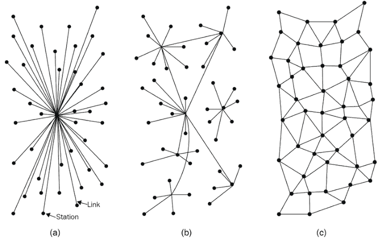

(a) 中心化。

(b) 去中心化。

(c) 分布式网络。

**图 2.2：** 中心化、去中心化和分布式架构

现在，我们需要讨论以太坊是否去中心化。你可能听一些人说过，以太坊并不是去中心化的。他们可能只说对了一部分。甚至以太坊的创始人之一维塔利克·布特林（Vitalik Buterin）也这样认为。你可能会觉得这完全是天方夜谭。以太坊当然应该是去中心化的。它是一项区块链技术，而区块链技术的核心理念就是去中心化。

然而，对于这个问题的回答并不是简单的“是”或“否”，而是比这更复杂一些。维塔利克·布特林分析了去中心化的这个概念，我们现在就来讨论一下。

去中心化至少包含三个重要维度：架构维度、政治维度和逻辑维度。像以太坊这样的系统，在这三个正交维度上，可以表现为中心化，也可以表现为去中心化。有时，我们也很难划清界限，断言某个系统总体上就是中心化或者去中心化的。在实践中，这确实很难判定。

我们先从架构维度说起。如果一个系统在架构维度上是中心化的，那么当我从这个系统中移除几个节点/计算终端时，它就会崩溃。相反，在一个架构维度上去中心化的系统中，即使我移除大多数节点/计算终端，系统仍然可以按照预期运行。从这个意义上说，以太坊在架构维度上是去中心化的，因为我们可以从系统中移除许多计算节点，但整个网络仍然可以正常工作。然而，如果你将一个网站托管在一个服务器或一个服务器网络上，其中每个服务器都依赖其他所有服务器，那么当你移除一个服务器时，这些服务器和网站显然将无法再正常工作，因为这在架构维度上是一个中心化系统。

我们继续。第二个维度是政治维度。

例如，在政治维度上中心化的系统可能是一个公司或企业，我们有一个首席执行官，也许还有一个董事会，他们决定公司的发展方向。然而，以太坊在政治维度上是去中心化的，因为即使是以太坊基金会也无法强制每个人都使用他们的客户端，或者强制每个人都遵循某个协议。

现在，要讨论的最后一个维度是逻辑维度。一个在逻辑维度上中心化的系统就像一个单一实体，像一个单体对象一样运作；而一个在逻辑维度上去中心化的系统则可以被分割成多个部分，并且每个部分都可以按照预期的方式表现和运行。

例如，BitTorrent 协议和 BitTorrent 系统在逻辑维度上是去中心化的，因为我们可以将系统分成几个部分，这些被分离部分中的计算机仍然可以按照预期使用 BitTorrent 协议。然而，这正是以太坊不去中心化的地方。实际上，在逻辑维度上，以太坊是中心化的，因为以太坊充当一台单一计算机。你在以太坊上执行合约，就像在这台运行在区块链上的巨大计算机上执行一样。所以，从这个意义上说，以太坊是中心化的。如果我们把以太坊分成两个不同的部分，那么它们将无法按照预期运行，因为以太坊的核心思想就是它应该是一台单一的计算机——它应该像一台单一的计算机那样运行。在这方面，以太坊在逻辑维度上是中心化的。

*图 2.3* 展示了以太坊在去中心化所有三个维度上的情况：

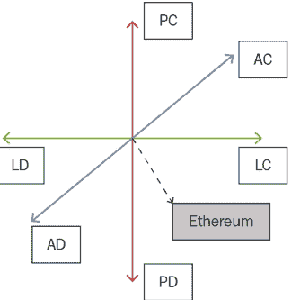

| 维度 | 去中心化 | 中心化 |
| --- | --- | --- |
| 架构 | 是 | 否 |
| 政治 | 是 | 否 |
| 逻辑 | 否 | 是 |

图 2.3：以太坊的去中心化概念

问题依然存在：作为分布式计算平台，以太坊是如何在拥有完全去中心化架构的同时，实现如此水平的中心化逻辑抽象的呢？为了回答这个问题，我们需要熟悉以太坊生态系统的各个组成部分，并尝试构建其技术栈。下一节就会介绍这个。那么，让我们开始吧。

## 以太坊生态系统

在第1章《区块链基础》中，我们学习了以太坊区块链如何表示为一棵巨大的默克尔树，树的叶子是代码执行的状态。我们还了解到，区块链是带有 web 3.0 框架的分布式账本。

*图 2.4* 描绘了以太坊技术栈的这种框架。接下来的内容会比较复杂，请密切注意：

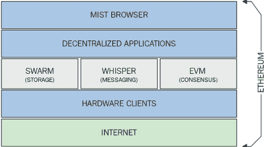

图 2.4：以太坊的 Web 3.0 技术栈，来源：以太坊 Stack Exchange

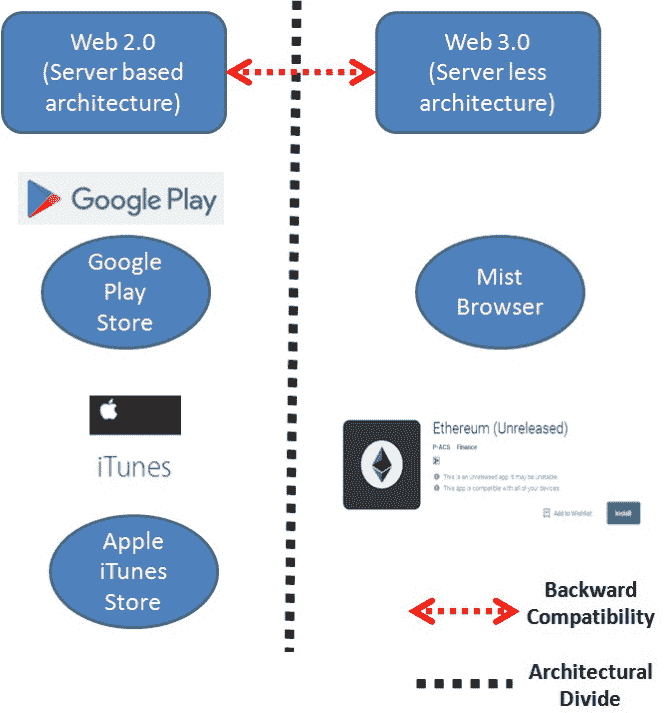

图 2.5：Mist 浏览器类比

## 去中心化应用程序

现在，让我们讨论一下下一层：**去中心化应用程序（DApps）**。
这些基本上是在去中心化的点对点网络上运行，并拥有开源代码的应用程序。它可以是一个简单的、基于逻辑的、实现两数相加的程序，也可以是一些相当复杂的东西，比如微博客服务。

作为一个美食爱好者，我经常把 Mist 浏览器想象成一家五星级酒店周末早午餐的自助餐桌（连同燃气灶），上面摆满了各式各样的 DApp，等待着饥饿的软件开发者和客户来大快朵颐。唯一的不同是，这些 DApp 并非来自一个雇用了许多厨师的单一中心化厨房，而是由不同的软件开发者在“百家宴”的形式下共同提供的。他们甚至还要为燃气灶付费，以保持他们的 DApp 的美味可口。最棒的是，开发人员必须免费分享食谱和配料。*图 2.6* 展示了 Mist 浏览器上的这些 DApp。

## 中间件

Mist 和 DApp 主要是以太坊前端堆栈的一部分。现在，让我们进入后端机制。首先，我们从**中间件**开始。以太坊的中间件具有扁平化的层次结构，因为没有中央权威机构，比如服务器。它由三个同等重要的主要组件组成：

- **Swarm（蜂群）**：以太坊的去中心化存储，主要用于静态文件
- **Whisper（低语）**：DApp 的对讲机，是一种基于身份的消息系统
- **EVM**：一种隔离的、即时的、人机代码转换器，运行在沙盒运行时环境中

如果没有服务器，应用程序如何运行呢？我们可以这样理解：在 web 2.0 框架中，服务器为了保持客户端设备的轻量化，做了比其本意更多的活儿。它们不仅提供静态网页，还存储私人信息、管理用户认证，并计算所有复杂的分析。客户端所做的只是加载并向用户显示消息。另一方面，web 3.0 中的无服务器架构允许一种更加模块化的方式，不同的计算设备和不同的协议来处理特定的任务；有些在客户端，有些在部署于点对点网络的专业节点上。因此，所有包含日志的数据逻辑，比如什么被保存了、谁在保存以及如何解决冲突，都由区块链上的智能合约处理；静态文件通过 Swarm 提供，实时通信由 Whisper 负责，如*图 2.7* 所示。客户端设备保留用户认证并运行应用程序界面，也就是 Mist 钱包加浏览器：

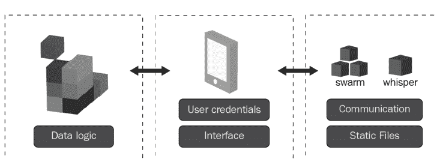

图 2.7：无服务器架构，来源：blog.ethereum.org

图 2.8 说明了在无服务器架构下，这些模块如何与 DApps 和底层区块链协同工作。这样的设置也鼓励创新。由于接口与数据分离，任何人都可以为同一个应用程序开发新的接口，从而创建更活跃、更具竞争力的生态系统：

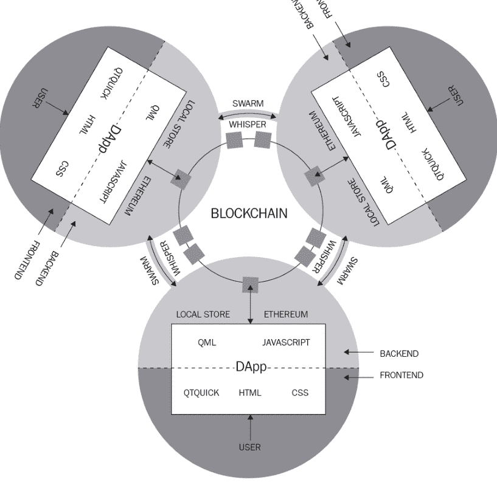

图2.8：去中心化架构，来源：Ethereum Stack Exchange

## Swarm

到目前为止，我们一直将 Swarm、Whisper 和 EVM 这三个模块视为黑盒，只关心它们之间如何交互，而不关心其内部的真实工作方式。然而，为了给智能合约开发打下坚实的基础——我们最终将在*第3章，以太坊智能合约的Hello World*中对其进行定义并展开讨论——我们需要了解这些模块最基本的内部运作机制。这将帮助我们调整智能合约代码，使其在以太坊区块链上运行时获得更好的性能。

那么，我们如何衡量代码的性能呢？遗憾的是，答案并不简单，而是要沿着多个维度进行评估。性能是围绕资源消耗来衡量的，而代码会消耗多种资源。超过某个程度后，就需要在各种资源之间进行权衡取舍。为了在现实世界中让代码真正高性能，我们会多消耗一种资源，少消耗另一种资源。

现在让我们来看衡量代码性能的三个重要资源，它们是：时间、空间和网络。时间资源是指代码在给定输入上完整处理一组操作并生成输出所需的运行时间。

> > 请注意，这不是以秒或分钟来衡量的，而是以输入的数量来衡量，也就是所谓的 **大O记号 O( )**。例如，如果一段代码对1个输入运行1秒，对2个输入运行2秒，对100个输入运行100秒，那么这段代码在时间上就是线性性能的，即时间复杂度为 O(n)。空间资源，也叫**存储**，是指代码在执行期间占用多少内存或磁盘空间。换句话说，就是代码为执行计算需要多少额外空间。网络资源，也叫**带宽**，是指代码

*在执行过程中通过网络传输的数据量。*

Swarm 的主要目标是让 DApp 能够高效地共享数据的存储和带宽资源，从而为终端用户提供必要的服务。这是通过 Swarm 中实现的三个关键思想来完成的：

+   - **数据块：** 这是 Swarm 中存储和检索的基本单元，最大大小为 4 KB
+   - **哈希：** 这是数据块的加密哈希，具有唯一的标识符和地址
+   - **清单：** 这是用于检索哈希内容的路径指定器

当任何数据块（称为内容）上传到 Swarm 时，它会被切分成若干称为**数据块**的数据片段。每个数据块都会生成一个单向的 Swarm 哈希，并带有用于访问的标识符和地址。这些哈希地址本质上是不可变的。简单来说，修改内容会改变每个数据块的哈希地址。这些数据块的哈希本身又被捆绑到另一个数据块中，而该数据块又有自己的哈希。通过这种方式，内容被映射到一个数据块树，这基本上就是一个 Merkle 树。即使是大型内容文件（如流媒体视频），分层的 Swarm 哈希也能防止任何数据完整性损失，并允许受保护的随机访问。

要访问 Swarm 内容，我们需要清单。该文件描述了文档集合。文档可以是文件系统目录、虚拟服务器或数据库索引。清单就像一本书的目录，给出了内容是什么以及在哪里找到内容的要点。它是一种元数据，通过指定路径和对应的内容哈希，允许基于**统一资源定位符（URL）**的内容检索。

Swarm 节点地址定义了与数据相同的地址空间中的位置。参与网络的 Swarm 节点有自己的基础地址，称为 **bzzkey**。这个 bzzkey 基本上是以太坊地址的哈希，即所谓的节点 Swarm 基础账户。Swarm 中没有删除或移除的概念。一旦内容被上传，我们就无法让 Swarm 撤销它。在 Swarm 发布之前，以太坊使用的是**星际文件系统（IPFS）**。

## Whisper

现代黑客和监控技术已经发展到如此程度，以至于黑客甚至不需要在消息通过安全通道时截获实际消息。他们只需研究消息的影子就能猜出消息携带的信息。所谓消息的影子，指的是消息在通过通道传输时留下的元数据日志和审计跟踪。

为了更好地理解这类攻击，想象一下你住在一个租金很高的大城市。于是你在市中心找到一位老房东，他愿意以你预算内的价格租给你一间房间。唯一的问题是铁轨离你的墙太近了。每天晚上，任何火车经过时，你都能感觉到摇摇晃晃的床在震动。如果你是一个敏锐的观察者，并且像黑客一样思考，那么你只需要知道特定的火车经过时你那吱嘎作响的床震颤了多长时间，就能轻松熟悉每晚经过的每种火车。床震颤的时间段就成了特定火车的签名。你甚至可能以一定的准确度预测出，某个时间点经过的火车与昨晚经过的是同一列还是不同的，只需观察这个签名特征。如果铁路公司意识到了这一点，用厚重的混凝土隧道封闭轨道周围，吸收火车带来的所有冲击和震动呢？到那时你还能识别出签名吗？想想看，因为光在受阻时会被揭示出影子，而黑暗不会。

当 Gavin Wood 在他的 GitHub 白皮书（[https://goo.gl/bR5bZ](https://goo.gl/bR5bZ)）中为 Whisper 制定作为点对点通信协议的规范时，他设计了密码学领域最有趣的技术之一。以相当大的带宽和延迟成本为代价，Whisper 能够提供 100% 的黑暗操作。所谓完全黑暗操作，是指点对点通信期间元数据零泄漏。

从技术定义上讲，Whisper 是一个具有多**分布式哈希表（DHT）**的消息系统，路由隐私作为以太坊区块链的伴随协议。任何正常的通信协议都有一个基本目标：最大化带宽并最小化延迟。然而，Whisper 作为通信协议只有一个目标：消除元数据泄漏，实现真正的黑暗，使两个对等方通信时没有任何第三方能够窃听。为此，Whisper 愿意放弃带宽和延迟方面的约束。Whisper 以用户可配置的方式运行，涉及通信节点愿意泄漏多少关于去中心化应用内容的信息，而这些内容最终会追踪用户活动。

Whisper 基于两个关键概念：消息和信封。如果将 Whisper 视为数据报消息服务，那么信封代表一种未加密的数据格式，节点可以理解，其内部携带加密的消息数据报。信封包含原始的**生存时间（TTL**，以秒为单位）、绝对到期时间（UNIX 系统时间）、加密的消息数据字段（即实际有效载荷）、主题（加密安全、概率性的消息部分分类）以及随机数 nonce。这个 nonce 用于工作量证明（PoW），以判断对等方的努力程度。消息具有一个用于签名的二进制标志，并带有不固定的有效载荷。

*图2.9 进一步说明了这两个概念：*

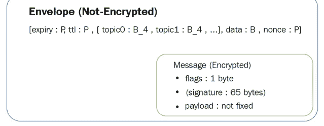

图2.9：信封内的 Whisper 消息

## EVM

EVM 是一个基于栈的解释器，拥有内存字节数组和键值存储。为了形象地理解栈，让我们回到早午餐自助餐的类比，想想干净的盘子是如何一个叠一个放置的。

图2.10 展示了这样一个栈，作为后进先出（LIFO）过程，并带有 pop 和 push 等关键操作：

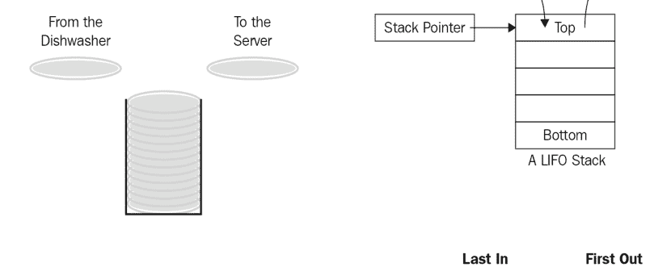

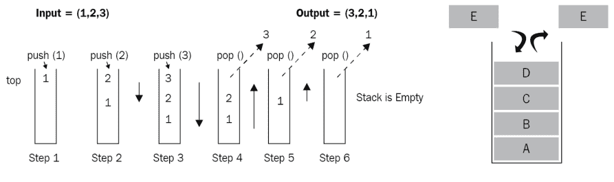

图2.10：简而言之的栈操作

EVM 栈上的元素长度为 32 字节，所有键值存储也都是 32 字节。以高级语言编写的智能合约通过 EVM 在区块链上运行，EVM 在运行时生成机器级操作码（opcodes）。这些操作码具有

EVM 设计为允许不受信任的代码在基于全球公共区块链的操作系统上运行。

为了实现这一点，施加了以下安全限制：

-   程序执行的每一步计算都必须预先付费，这反过来可以防止拒绝服务攻击。
-   程序只能通过传输单个任意长度的字节数组相互交互。程序无法访问彼此的执行状态。
-   程序执行是隔离的。虚拟机程序只能访问和修改其自身内部状态，并且可以在 EVM 上触发其他程序的执行。
-   代码执行本质上是完全确定性的，并且对于任何符合规范的实现，只要初始状态相同，就会产生相同的状态转换。

EVM 代码的形式化执行模型出奇地简单。在 EVM 运行期间，其完整的计算状态可以由元组 (block_state, message, code, memory, transaction, stack, gas, and pc) 定义，其中 block_state 是全局状态，包含所有具有余额和存储的账户。

在每次执行轮次开始时，当前指令是通过获取程序计数器 (pc) 处的代码字节找到的，并且每个指令都有自己的定义，说明它如何影响该元组。

例如，ADD 操作会从栈顶弹出两项并将它们的和压入栈，减少 1 的 gas，并将 pc 增加 1；而 SSTORE 则从栈中弹出前两项，并将第二项插入到合约的存储中，索引为第一项。即使有许多方法可以通过即时编译来优化 EVM 执行，一个基本的以太坊实现也可以用几百行代码完成。

## 硬件客户端和互联网

在我们结束对 Swarm、Whisper 和 EVM 的底层介绍之后，让我们继续介绍以太坊技术栈的剩余要素，即硬件客户端和互联网。硬件客户端将在以太坊挖矿部分中更详细地介绍。目前，知道像 CPU 和 GPU 这样的普通商品硬件被用作以太坊的硬件客户端就足够了。

现在让我们讨论以太坊技术栈的互联网层，这基本上就是以太坊区块链。正如我们在第 1 章《区块链基础》中已经讨论过以太坊的区块链结构一样，这里我们只介绍以太坊区块链在表层网络上的逻辑位置。

我们将在本章后面讨论以太坊区块架构时重新审视区块链结构。

我们所知的互联网主要是表层网络。还有深网和暗网，我们将在后面的章节中讨论。表层网络由许多逻辑层组成，消息或数据必须通过这些层才能从 A 点到达 B 点，而 A 点和 B 点在地理和物理上可能是分离的。每个逻辑层都有某种标准协议，正在传输的消息必须遵循，否则将被禁止在网络上传输。这些协议就像个人从一个国家旅行到另一个国家时需要遵守的护照和签证规则。互联网工程任务组 (IETF) 是一个开放社区，以完全自愿的方式推荐表层网络上的共同通信基础，通过提出传输控制协议/互联网协议套件。

图 2.12 表示 TCP/IP 以及区块链作为一种技术在其上的位置。有向线表示消息如何从

## 图灵完备性和魔力酱

正如我们在上一节讨论的那样，以太坊是一个去中心化应用平台。这意味着我们可以编写以去中心化方式执行的程序，其中没有中央服务器或中央实体来执行我们的程序。这些程序将在许多不同的计算机上执行，这意味着没有办法关闭这样一个去中心化应用。为了编写此类应用，我们需要开发智能合约，而智能合约是用一种名为 Solidity 的编程语言编写的。因此，在以太坊区块链上，如果你想编写智能合约，你需要学习 Solidity。Solidity 是图灵完备的。那么，这意味着什么？要理解这一点，我们需要回到 60 或 70 年前。

在那个时候，人们有不同的计算机器。问题是，如果你有一台机器可以用一种算法计算某些东西，那么这台机器只能解决那个问题，而要解决另一个算法结构略有不同的问题，你必须从头开始构建一台单独的机器。

因此，20 世纪最伟大的数学家和计算机科学家之一阿兰·图灵开发了一种机器的逻辑设计，一种理论机器。他解释了如何构建这样一台机器，以便这台机器可以运行任何程序。

在他对这台机器的理论解释中，你可以用一条简单的磁带来构建它，磁带由均匀的单元组成，每个单元存储 0 或 1，以及一个可以左右移动的磁带头，能够读取磁带单元并存储数据。基本上他解释了如何构建一台可以运行任何程序并解决任何计算问题的计算机。话虽如此，并没有保证这需要多长时间。某些程序计算机执行它一百次。

例如，一个简单的计算设备具有循环和加法操作，也可以被修改为通过循环特定的加法操作来执行乘法；也就是说，5 x 3 等价于 5 + 5 + 5，这等价于在 3 次循环中将 5 与自身相加。然而，必须注意的是，循环并不总是对代码性能有利，因为循环内的循环会使任何代码的时间复杂度呈指数级增长。因此，循环对于识别图灵完备性是有用的，但在完全必要的情况下才应避免，因为它们会降低代码性能。我们还有另一个可扩展性问题，这将在后面的章节中解决，我们将在其中讨论分片的概念。

这也是比特币避免使用图灵完备语言的主要原因之一。这是出于选择而非错误做出的决定。你看，整个图灵完备语言在区块链上运行循环的想法可能是危险的；因为如果你有一个循环执行某种代码数百万次，并且这种代码必须在区块链上执行，它将真正使网络过载。这就是比特币开发者决定不使用图灵完备语言的原因。他们只想要一种简单的机制来完成基本工作，即在节点之间进行价值转移。而在以太坊中，设计理念完全不同，随着复杂 DApp 的引入，这些 DApp 必须使用智能合约在以太坊区块链上执行。这里，我们绝对需要一种图灵完备的语言，它必须具有循环结构。同样，我们不能通过运行数百万次循环来使以太坊区块链过载。因此，我们似乎陷入了一个两难的境地，循环是必要的恶，恶在于区块链过载和垃圾邮件其他用户。

这正是我们需要魔力酱的时候；我们在以太坊区块链中称之为 gas。Solidity 在以太坊区块链上执行的每个操作都与之关联有固定的 gas 费用。让我们回到我们谈到的自助餐自助餐类比，我们谈到了需要开发者/聚餐厨师支付一定费用以保持他们的 DApp/食谱温暖可口的燃气灶。你看，如果我必须为燃气灶燃料付费，我会自动烹饪即使在低 gas 使用下也很好的食谱，而不是需要大量火焰和持续高 gas 使用的食谱。因此，与其带来需要持续火焰的热烤肉，我会带来像面包或烘焙食品这样的东西，它们需要轻微或不需要燃气灶使用，以确保我在等待有人来食用我烹饪的东西时不会损失金钱。

因此，回到以太坊区块链，如果某个新手开发者提出了一个超级疯狂的程序，其中包含数百万个循环，可能导致垃圾邮件和网络过载，那么该程序员的 gas 成本将显著增加，并且一旦开发者购买的 gas 用完，其整个代码最终将停止执行。

例如，如果我们运行一个包含五个操作的循环 100 次的代码，gas 费用将为每个 500 次循环消耗。因此，gas 就是那种魔力酱，需要使用 **ether (ETH)** 代币购买以在以太坊区块链上运行 Solidity 智能合约。是的，这是一个预付费模式。你首先使用法币购买一些 ether 代币；然后，使用这些 ether 代币为你的 gas 限额充值。然后，你运行你的智能合约程序，它将继续从你的账户中消耗 gas。你的代码越高效，你的代码消耗的 gas 越少，它在区块链上运行的时间就越长，你的 DApp 对客户就越好。

在以太坊区块链中，区分 gas 和 ether 至关重要。如前所述，gas 是一种在以太坊区块链上运行智能合约操作的费用，而 ether 是以太坊区块链上的加密货币代币。一个很好的现实生活类比是为汽车驾驶提供汽油或柴油。要在高速公路上驾驶汽车，我们需要为其加满汽油或柴油。我们需要现金、信用卡/借记卡或电子钱包里的钱来购买汽油或柴油。现在，汽车内部机械、天气条件、道路和交通状况、驾驶方式以及许多此类参数都会影响每英里行驶的燃料消耗。我们称之为 **mileage**，该参数决定了汽车的性能。同样，燃料价格可能会因国际市场条件的变化及其对法币价值的影响而波动。同样，如果汽车是 Solidity 智能合约代码，

gas 是用于为区块链的高速公路加油的燃料。我们使用以太币购买这种 gas，其中以太币相当于我们现实世界的法币。

*图 2.13* 说明了以太坊区块链上的单位规模以及在当前货币中以太币等值的法币金额：

图 2.13：以太坊区块链中的以太币在货币市场上的表现以及单位

现在出现了一个真正的问题，那就是我们永远无法知道我的智能合约代码在区块链上会如何表现，除非我们运行它。为此，以太坊平台引入了测试网和主网的概念。一旦我们编写了 solidity 智能合约，我们就可以在测试网上运行它们，并检查操作在 gas 费用方面的花费，但这是在虚拟环境中；也就是说，我们可以免费运行代码来模拟 gas 费用金额。一旦我们对智能合约代码的 gas 消耗率和效率感到满意，我们就会将其作为最终代码部署到主网上，在那里代码会永久地刻录到以太坊区块链中。早期的测试网被称为 **morden**，由于安全问题已被废弃。当前的测试网被称为 **Ropsten**。

因此，我们看到智能合约不仅仅是代表价值转移的简单交易。由此自然会产生一个问题：比特币的区块架构对于以太坊是否足够？此外，我们如何在以太坊区块链中进行挖矿？为什么我们会有两种独立的加密货币代币 ETH 和 ETC？让我们在下一节中找出答案。

## 以太坊区块、挖矿和分叉

在深入以太坊区块架构的细节之前，我们需要重新审视以太坊的区块链结构。在 *第 1 章，区块链基础* 中，我们了解到以太坊区块链是一个 Merkle 树，其中叶子代表代码的执行状态。出于简化的考虑，更精细的细节被省略了。以太坊的 Merkle 树不是我们对比特币区块链所看到的二叉 Merkle 树。你看，二叉 Merkle 树在验证以列表格式存在的信息时是很好的数据结构，也就是一系列数据块依次排列。对于这样的交易树，编辑树创建后需要多长时间并不重要。这是因为交易保持在一个只能不断增长的冻结树的形式中。

以太坊另一方面是一个状态树。这里的情况更复杂。以太坊中的状态表示为键值映射，其中键表示地址，值表示声明的金额、余额列表、nonce、代码和账户存储。甚至存储本身也是一个树。

这里，与交易历史不同，状态会频繁更新。这是因为账户的余额和 nonce 发生变化，频繁创建新账户的插入，以及存储中键的频繁插入和删除。

在这种情况下，一个理想的数据结构应该能够在插入、更新、编辑或删除操作后快速计算新的树根，而无需重新计算整个树。此外，这种树的深度应该是有限的。这可以防止任何黑客无限加深树并对其合法用户发起 DoS 攻击。此外，以不同顺序进行更新甚至从头重新计算树也不应改变根；也就是说，根应仅取决于数据。

Donald R. Morrison 在大约 1968 年描述了这样一种树数据结构。它被称为 **Practical Algorithm to Retrieve Information Coded in Alphanumeric (PATRICIA)** 树。基本上，它是一个 Radix 树，其中 Radix 等于 2，这意味着每个键的每一位都被单独比较，每个节点都是双向分支。在这样的树中，搜索、插入和删除以线性时间复杂度进行，即使在最坏的情况下也是如此。

*图 2.14 说明了 Patricia 树中典型的插入是如何发生的：*

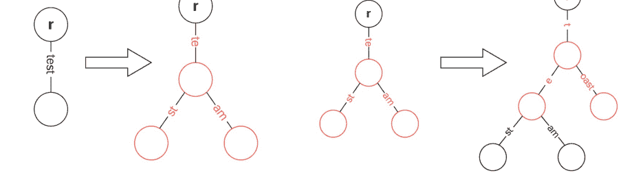

插入 'team' 同时拆分 'test' 并创建新的边标签 'st'

插入 'toast' 同时拆分 'te' 并将之前的字符串移动到更低一层

图 2.14：Patricia 树插入演示，来源：Wikipedia

因此，以太坊区块链在技术上是一个 Merkle-Patricia 树，其中以太坊区块链中的每个区块头包含三个这样的树来表示三种类型的对象：

- 交易（代表价值转移）
- 收据（显示每笔交易效果的数据块）
- 状态（代表账户的所有信息）

这三种类型的对象被矿工用来回答以下五个查询，这本质上是以太坊区块链上的挖矿活动：

1. 一笔交易是否已包含在特定区块中？
2. 过去 30 天中该地址发出的事件的所有实例是什么？
3. 我的账户当前余额是多少？
4. 这个账户甚至存在吗？
5. 如果我在此合约上模拟执行此交易，输出会是什么？

第一个查询由交易树处理，第二个由收据树处理，第三个和第四个由状态树处理。前四个查询计算起来相当直接。矿工只需找到对象，获取从对象到树根的 Merkle 分支，其中哈希列表向上延伸，并将分支回复给轻客户端。第五个查询也由状态树处理，但计算方式更复杂。这里，我们需要构建 Merkle 状态转换证明。基本上，该证明做出以下声明：如果我们在根为 R 的状态上运行交易 T，结果将是根为 R' 的状态，日志为 L，输出为 O。尽管在理论上并非必要，以太坊中存在输出的概念，因为每笔交易都是一个函数调用。为了计算证明，矿工本地创建一个假区块，将状态设置为 S，并假装自己是轻客户端，同时应用交易。也就是说，如果应用交易的过程要求客户端确定一个账户的余额，轻客户端就会发出余额查询。如果轻客户端需要检查特定合约存储中的特定项目，轻客户端就会为此发出查询，依此类推。矿工对其自己的所有查询都正确响应，但会跟踪其发送回的所有数据。矿工随后将所有这些请求中的组合数据作为证明发送给客户端。客户端随后采用完全相同的程序，但使用提供的证明作为其数据库；如果其结果与矿工声称的一样，则客户端接受该证明。

那么，证明是如何被接受的呢？这是通过共识算法完成的，该算法比较来自不同矿工的 PoW。该算法称为 ETH hash。即使以太坊框架的未来版本可能会切换到 PoS，PoW 目前仍在使用。我们将在后面的章节中详细介绍该算法。目前，请记住该算法将 nonce 与 DAG 结合以生成新哈希并检查它是否小于目标阈值，以解决第 1 章《区块链基础》中讨论的挖矿的愚蠢难题。问题是 DAG，本质上是一个庞大数据集（超过 2 GB）的有向无环图，处理起来需要大量的随机访问内存（RAM）。这种内存硬度是为什么我们不能使用 ASIC 矿机来挖以太坊区块的主要原因，因为 ASIC 的内存缓存非常低。挖以太坊的最佳硬件客户端是 GPU 矿机。

以下是使用 GPU 设备配置以太坊矿工时显示的列出规格：

例如：RX 470 规格

- **成本：** ~ $175（2017 年 3 月）
- **内存：** 8 千兆字节
- **内存带宽：** 211 千兆字节/秒

除了这三个树对象之外，区块架构还有几个其他模块，这些模块在图 2.15 中说明，并在 Gavin Wood 的黄皮书中定义：

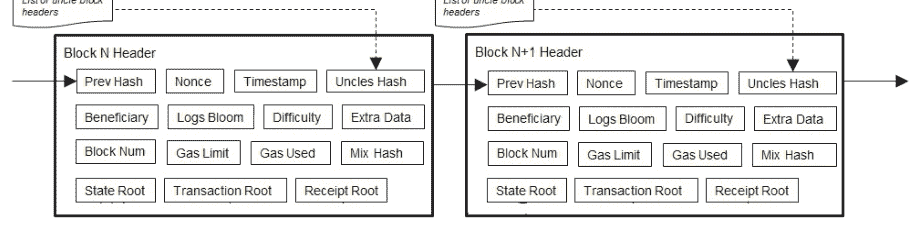

图2.15：以太坊区块内的模块

如果我们仔细研究这个表示，我们会发现，除了**父哈希（prev hash）**之外，还有一个叔块哈希或ommers哈希。那么，叔块在以太坊区块链中扮演什么角色？如果我是一个区块，而区块链是我的家谱，我的叔父会非常接近我的父亲。然而，如果我由叔父的基因所生，情况就会大不相同。那样的话，我的父亲就会变成我的叔父。所以，父哈希就是我的父亲，也是我来自的正确前一个哈希。叔块哈希代表那些非常接近成为我正确前一个区块的区块，但它们未能成功，因为受到了我父亲的打击。所谓打击，是指我父亲做了比叔父更多的PoW；因此，挖矿共识选择了他而不是我的叔父。那么，我的叔父会发生什么？他现在已经成为相对于我的区块链的**矿工激活硬分叉（MAHF）**，因此，由于我位于父区块链上紧随我父亲之后（即prev hash），我无法访问他。

类似地，我们可以讨论以太坊和以太坊经典之间的区别。如果你刚接触加密货币和以太坊，你可能已经注意到你可以购买两种不同类型的以太坊。所以，你可以购买称为ETH的以太坊，也可以购买称为ETC的以太坊经典。那么，这两者之间在技术和意识形态上有何区别？在以太坊区块链的创世区块开始时，只有ETH，没有以太坊经典。那么，ETC是如何产生的？一切始于以太坊上的DAO项目。**去中心化自治组织（DAO）**是构建在以太坊之上的一个项目。这个项目基本上是一个可以充当自我引导组织的应用程序，并且它举办了加密货币历史上最大规模的众筹销售。人们将自己的法币投入该项目，并获得了ETH代币作为投资回报。

然而，这个去中心化组织所构成的智能合约存在一个缺陷。这个缺陷或漏洞使得一群黑客能够从众筹中窃取价值5000万美元的以太币。注意，这些黑客在技术上是利用者，因为这并非真正意义上的黑客攻击（由于bug），而是利用了DAO智能合约设计逻辑中的缺陷。因此，利用者通过这个缺陷窃取了价值5000万美元的以太币。这引发了大量讨论，以太坊社区的大多数人希望进行硬分叉并撤销这次盗窃，以便投资者能拿回资金，而黑客则会损失钱财。然而，要做到这一点，他们需要对区块链进行修改，而这正是以太坊社区内部意识形态争论开始的地方。虽然社区大多数人同意修改和硬分叉，但一个较小但直言不讳的少数派反对这种改变区块链的想法，因为区块链的核心思想是它应该是不可变的。一旦代码铭刻在区块链上，就应该被视为法律，所以如果发生了漏洞利用，我们可以修正以防止再次发生，但不能回头逆转已经发生的事情，无论多么不幸。因此，在争论的这一点上，社区处于一个分岔路口，一部分人希望区块链发生改变，而另一部分人希望继续前进，好像什么都没发生过。于是，这个直言不讳的少数派继续留在旧的区块链上，最终由于用户/社区激活的硬分叉而成为以太坊经典。与此同时，ETH最终被修改以将资金返还给投资者，因为风险很高。这就是为什么我们同时拥有ETH和ETC作为加密货币的原因。

现在，如果你购买了一些ETH或ETC，你会将其存储在哪里？对于法币，我们通常将它们存储在银行账户或钱包中。在去中心化设置中，我们没有银行。然而，我们确实有钱包和客户端，我们将在下一节讨论。

## 以太坊钱包和客户端接口

以太坊客户端指任何能够解析和验证以太坊区块链并执行其上智能合约的节点。正如我们在本章前几节所见，面向用户的客户端的主要目的是授权用户凭证并提供接口以执行各种操作。它们还提供了创建交易和挖掘区块的接口，这对于区块链交互至关重要。图2.16展示了以太坊客户端接口的分类：

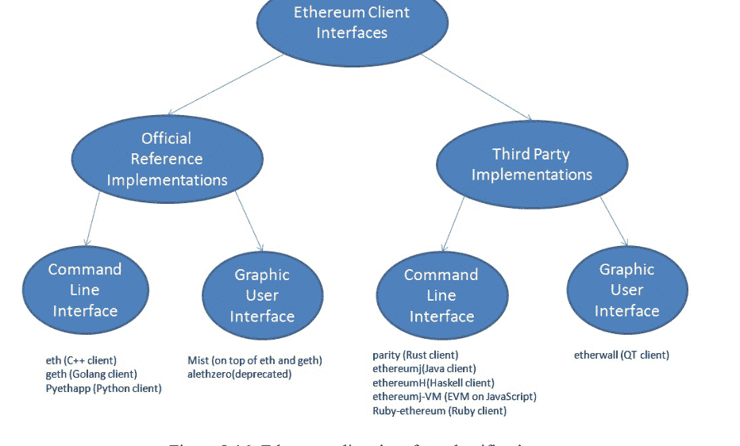

图2.16：以太坊客户端接口分类

钱包提供发送、存储和接收资金的服务。一个好的钱包服务的主要参数是安全性和信任。用户必须感到他们的资金是安全的，并且钱包管理员不会窃取资金。这类钱包被称为热钱包，因为它们始终连接到网络，且经常容易受到黑客攻击和漏洞利用。更安全的钱包包括纸钱包和硬件钱包，它们通常被称为冷钱包。这些钱包基本上以离线模式存储代币。纸钱包以扫描的QR码形式存储，代表接收地址以及必须记住的密码。简单来说，你将密钥打印在纸上，这样它们就不会被黑客入侵。硬件钱包在USB设备上具有硬接线的加密，只有通过密码才能打开。

图2.17展示了一个钱包分类以便更清晰：

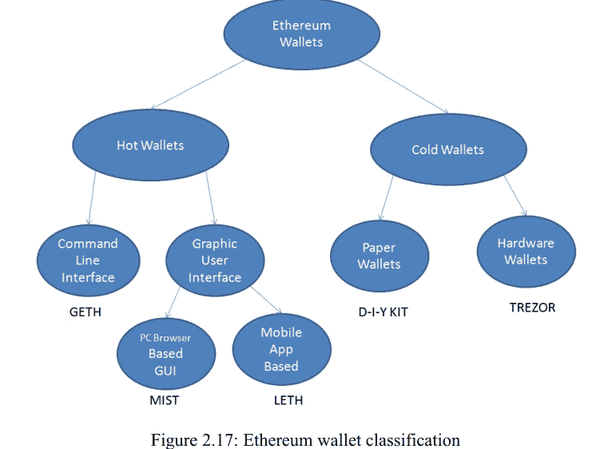

图2.17：以太坊钱包分类

在所有这些以太坊客户端中，Inzhoop的轻量级以太坊移动钱包（LETH）值得特别提及，因为它不仅提供钱包服务，还拥有一个DApps浏览器商店，托管了不少可用的DApps。基于Android的alpha版本还提供群聊和个人聊天标签，完全基于whisper。聊天记录会保持24小时。目前，可以发送带有生成的bzzkey的图片文件。它目前托管在测试网Ropsten上，而钱包在主网上。因此，安装后聊天、玩游戏甚至开户，你都不需要花费任何宝贵的以太币。操作这个应用不需要任何编程知识，它可以在Google Play商店中找到。强烈建议初学者尝试这款基于移动端的应用，以体验DApps、whisper和swarm如何协同工作，创建一个良好的浏览器加钱包平台。他们也有一个适用于桌面的完整应用。

图2.18展示了LETH（alpha版本）的一些截图：

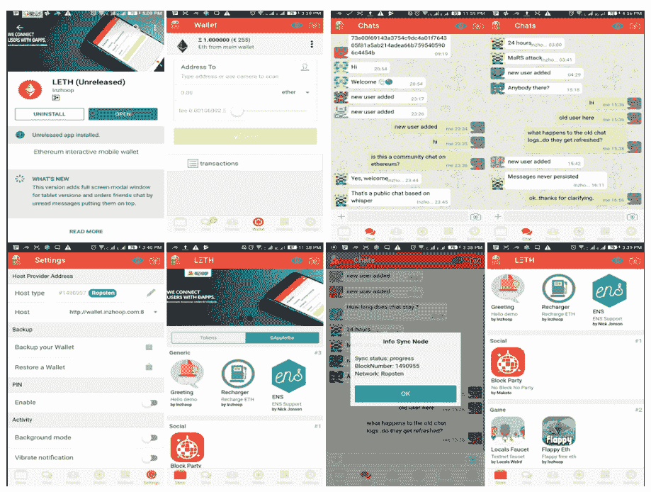

图2.18：轻量级以太坊移动钱包（Android版）

这使我们来到了本章的结尾。我希望本章能帮助你获得必要的理论基础，以便在后续章节中踏上以太坊区块链和智能合约开发的旅程。

卷起袖子，喝杯热咖啡，给设备充上电。我们很快就要动手编写一些Solidity智能合约了。我们第三章见，以太坊智能合约的Hello World。
