## 智能合约的Hello World

本章是开发我们第一个智能合约的动手指南。作为自C语言创造者Dennis Ritchie时代以来软件开发者的不成文传统，我们将从一个Hello World程序开始。然后，我们将使用智能合约介绍一些基本的递增、递减和循环操作。我们将逐步创建自己的私有区块链（从创世区块开始）并挖掘自己的以太币。学习本章后，你将能够：

- 编写你的第一个Hello World智能合约
- 编写具有基本递增和递减操作的合约
- 编写循环
- 在GitHub上提出问题
- 创建私有区块链并挖掘以太币来运行智能合约


Figure 3.3: Remix IDE 中未命名的 Solidity 文件

将其重命名为 HelloWorld.sol 并确认重命名，如 Figure 3.4 所示：

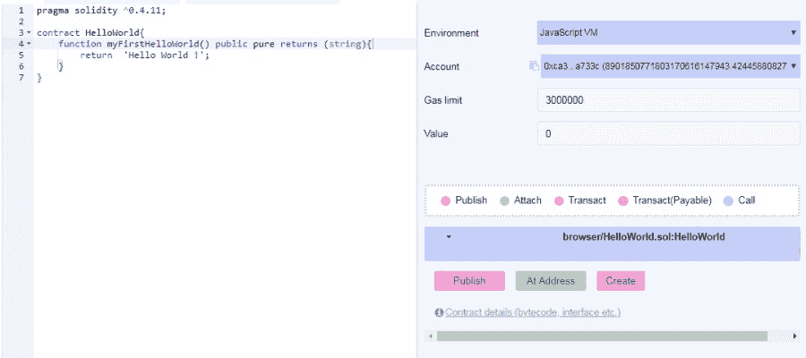

Figure 3.6: 作为区块链模拟器的 JavaScript VM

- 5. 点击 Create 按钮，如 *Figure 3.7* 所突出显示。好了！你刚刚创建了你的智能合约。唯一的 caveat 是我们将使用内存中的方式在本地机器上模拟它，这模仿了以太坊区块链：

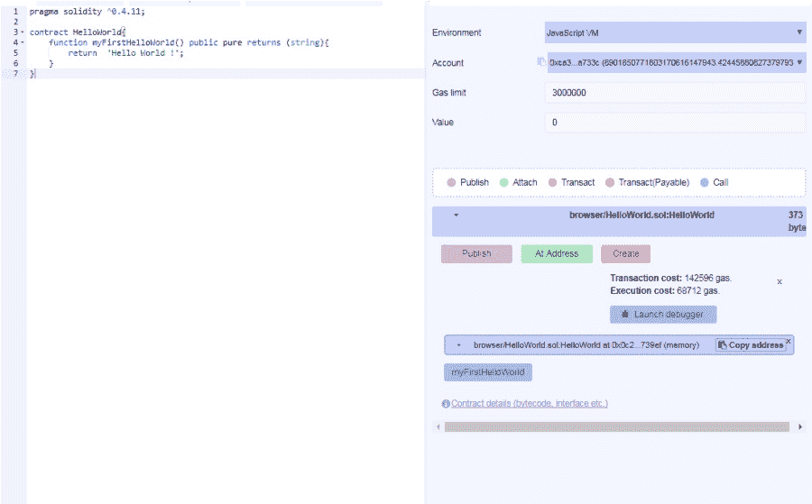

Figure 3.7: 我们第一个 368 字节的智能合约

- 6. 要执行此合约，我们按下 myFirstHelloWorld 按钮，如 Figure 3.8 所示。我们得到期望的输出：Hello World ！

```
pragma solidity ^0.4.11;

contract HelloWorld{
    function myFirstHelloWorld() public pure returns (string){
        return 'Hello World !';
    }
}
```

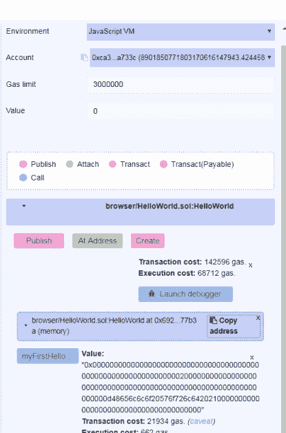

Figure 3.8: 使用智能合约执行 myFirstHelloWorld 函数

- 7. 我们还可以通过按下 Launch debugger | Instructions 或仅点击 Contract details (bytecode, interface etc) 链接来探索由此智能合约执行生成的字节码。Figure 3.9 描述了 hello world 智能合约执行生成的 368 字节虚拟机代码：

```
000 PUSH1 60
002 PUSH1 45
004 MSTORE
006 CALLVALUE
008 ISZERO
010 JUMPI
011 PUSH1 00
012 DUP1
014 INVALID
015 JUMPDEST
016 PUSH1 0151
017 PUSH2 0151
019 DUP2
021 PUSH2 0011
024 PUSH1 00
026 CODECOPY
027 RETURN
029 PUSH1 00
031 PUSH1 42
033 MSTORE
035 PUSH1 03
036 CALLDATALOAD
037 CALLDATACOPY
... 038 ... 367 ...
```

Figure 3.9: Hello World 智能合约的 368 字节 [000 to 367] 机器代码

## Remix in a nutshell

那么，这个 remix 是什么？简单来说，它是一个基于浏览器的 **Integrated Development Environment (IDE)**，用于编写 Solidity 智能合约。它具有集成编译器、无服务器端组件的运行时虚拟环境、集成调试器、集成测试环境和静态代码分析工具。以前，它被称为 **Browser-Solidity**。它不仅可以模拟区块链，还可以突出显示语法和错误，托管多个 Solidity 文件，并部署合约以及可见的字节码和 **application binary interface (ABI)**，其详细信息可在后面的章节中找到。

然而，我在本章承诺理论少而动手多。所以，让我们现在进入一个增量和减量合约。请注意，使用 geth 和 Mist 部署合约有更专业的方法，我们将在最后一节详细讨论。现在，我们将更多地集中在 Remix 上使用 Solidity 进行一些快速而粗糙的基础智能合约。

### Increment and decrement operations using Solidity

*Figure 3.10* 显示了 Solidity 中增量和减量操作的代码。它还具有一个接收输入的函数，以及一个在合约执行后获取此数字的函数：

```
pragma solidity ^0.4.11;
// define new contract
contract ArithValue{
    uint number;
    function ArithValue() public {  //constructor function with default value
        number = 100;
    }
    // constructor function to set new value
    function setNumber(uint theValue) public {
        number = theValue;
    }
    // constructor function to fetch the new value
    function fetchNumber() public constant returns (uint) {
        return number;
    }
    // constructor function to increment by one
    function incrementNumber() public {
        number=number + 1;
    }
    // constructor function to decrement by one
    function decrementNumber() public {
        number=number - 1;
    }
}
```

Figure 3.10: 使用 Solidity 进行增量和减量操作 (ArithValue.sol)

这段代码比 hello world 合约不是复杂一点吗？让我带你走一遍这段代码。第一行以 `pragma` 开始。正如你已经意识到的那样，它只是说明我们将使用哪个版本的 Solidity。在我们的例子中，我们使用的是版本 `0.4.11`。当我输入时，Remix IDE 支持最高到 0.4.16 的版本。

为了理解 pragma，让我们回到第 2 章 *Grokking Ethereum* 中自助餐的类比。如果我在自助餐预订时指定我是一个严格的素食主义者，我就是在提前给自助餐组织者某种指示，即我不吃肉、鱼、家禽或鸡蛋等非素食菜肴。因此，在盛大的自助餐开始时，我只会被介绍到提供素食菜肴的柜台。最明显的是，如果我被错误地端上羊肉烤肉串代替西兰花咖喱，我会感到恼火并向组织者指出。然后，我会在触碰或吃食物之前就把盘子换掉，不问任何问题。

以类似的方式，pragma 是一种语言构造，它向编译器提供某种指令，说明如何处理其输入。通常，预处理器处理此类语言构造并指定编译器行为。在我们的例子中，我们的指令是让编译器表现得好像它正在 Solidity 版本 0.4.11 或更低版本上运行智能合约一样。

如果我们不写这一行会怎样？好吧，没有坏事发生。会抛出一个警告，如 Figure 3.11 所示，代码编译得很好。然而，它现在使用默认的 Solidity 版本，我们的情况是 0.4.16。按类比，如果我忘记告诉他们我是素食主义者，就不能怪自助餐组织者给我羊肉烤肉串。然后，我设法吃掉给我端上的食物，通过避免非素食部分来避免进一步的尴尬。

那么，我想表达的重点是什么呢？我想要表达的重点是坚持良好的编程实践，以便其他可能在遥远的将来调试或增强它的程序员可以阅读你的代码。由于所有源代码都是开源的并托管在 GitHub 类似的平台上，而开发人员天生讨厌编写明确的文档，因此编写带有逻辑内联注释的干净代码是一种推荐的专业礼仪：

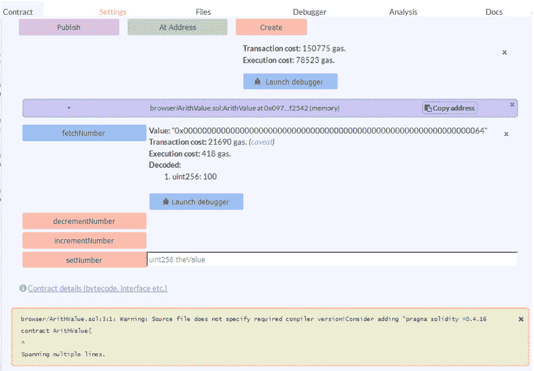

Figure 3.11: 由于未提及 pragma 指令，ArithValue.sol 编译时出现警告

## 让我们回到我们的代码：

- 1. 首先，我们通过定义合约开始。我们将其命名为 `ArithValue`，因为我们将使用算术运算存储和操作一个值。这里没有硬性命名规则。尝试坚持使用一些合乎逻辑的名称。

- 2. 然后，我们声明一个无符号整数值来存储我们的默认数字，它必须是正整数。

- 3. 现在我们需要为合约提供一个构造函数函数。那么构造函数函数是什么？基本上，这是一个函数，它将在我们的合约首次部署和初始化时被调用。这个构造函数函数的特别之处在于它与合约的名称相同，即 `ArithValue`。在构造函数函数内部，我们将 `100` 分配给 number 变量。因此，现在，每当合约首次初始化时，它将为我们的无符号整数变量 number 设置默认值 100。

- 4. 现在我们在合约内部创建另外四个函数，它们基本上设置、获取、增加和减少我们分配给变量 number 的值。这些步骤将在我们创建合约后在 Figure 3.12、Figure 3.13、Figure 3.14 和 Figure 3.15 中显示。理想情况下，我们必须先发布合约然后创建它以实例化，这将在区块链上花费我们真正的以太币，但此时发布意义不大，因为我们正在模拟的区块链环境中工作，并且不会永久发布任何东西。

- 5. 正如 Figure 3.12 所示，一旦合约部署并实例化，四个函数，即 fetchNumber、decrementNumber、incrementNumber 和 setNumber，就会被创建。由于构造函数函数，我们的默认值在合约中设置为 100。

- 6. 如 Figure 3.13 所描绘，如果我们按下 incrementNumber 按钮并按下 fetchNumber 按钮，值会增加到 101。

- 7. 在 Figure 3.14 中，我们输入一个随机正整数 143 并按下 setNumber。

- 8. 然后我们按下 fetchNumber，我们的值已更改为 143。

- 9. 然后，如 Figure 3.15 所示，我们按下 decrementNumber 按钮，然后按下 fetchNumber；值 143 被递减到 142。

当你在笔记本电脑上尝试此示例时，请注意 Account 下拉选项卡，它就在 Environment 下拉选项卡下方。你注意到以太币的值在减少吗？请检查一下：


```solidity
pragma solidity ^0.4.11;
// define new contract
contract ArithValue{
    uint number;
    function ArithValue() public { //constructor function with default value
        number = 100;
    }
    // constructor function to set new value
    function setNumber(uint theValue) public {
        number = theValue;
    }
    // constructor function to fetch the new value
    function fetchNumber() public constant returns (uint) {
        return number;
    }
    // constructor function to increment by one
    function incrementNumber() public {
        number=number + 1;
    }
    // constructor function to decrement by one
    function decrementNumber() public {
        number=number - 1;
    }
}
```

图 3.12：部署并创建 ArithValue 合约

## 图 3.13：incrementNumber 函数的工作过程

## 图 3.14：setNumber 函数的工作过程

## 图 3.15：decrementNumber 函数的工作过程

## 编写循环

当我们需要重复执行某段代码一定次数时，循环非常有用。与其复制粘贴相同的代码行、让代码块变得更长，不如使用这种编程结构来让代码更简洁。循环可以是有限次的，也可以是无限次的。对于无限循环，我们通常会提供一条 break 语句来跳出循环。

*图 3.16* 中的智能合约使用有限循环来计算有限个整数的总和：

```solidity
pragma solidity ^0.4.11;

contract numberLoop {
    uint number; // unsigned integer is positive integer
    //constructor function with default value
    function numberLoop() public {
        number = 100;
    }
    function myFirstLoop() public returns (uint) {
        for (uint i = 1; i < 10; i++) {
            number = number + i;
        }
        return number;
    }
}
```

图 3.16：Solidity 智能合约中的循环

remix IDE 中的输出如*图 3.17* 所示。如前所述，请注意每次调用 `myFirstLoop` 函数时，Account（账户）标签页中以太币数量的减少：

```
pragma solidity ^0.4.11;

contract numberLoop {
    uint number; // unsigned integer is positive integer
    //constructor function with default value
    function numberLoop() public {
        number = 100;
    }
    function myFirstLoop() public returns (uint) {
        for (uint i = 1; i < 10; i++) {
            number = number + i;
        }
        return number;
    }
}
```

图 3.18：调试模式以识别执行状态

至此，我希望你已经非常习惯于在浏览器中使用 remix IDE 来操作智能合约。然而，我所展示的只是一个顺利路径的场景。以太坊的开发社区非常敏捷，正在非常迅速地推出新的变更。当你开始阅读本书时，IDE 可能已经有了细微或重大的修改。一旦你开始编写代码，你就会体会到其中的细微差别，甚至会在后续过程中捕获许多奇怪的 bug。下一节讲的是当你遇到问题或代码 bug 时可以做些什么。

## 在 GitHub 上提交 issue

当你遇到代码 bug 时，在 GitHub 上提交任何 issue 之前，请先查阅以太坊的文档，这些文档可以通过任何搜索引擎免费获取。然后，在以太坊的 Stack Exchange 上提出相同的问题。在大多数情况下，你不会是唯一遇到该 bug 的人。因此，你的问题的解决方案可能已经在网上存在了。最后的手段才是去 GitHub 上提交 issue。GitHub 是一个免费向所有人提供、带有版本控制的代码仓库。大多数与区块链相关的源代码都可以在 GitHub 上找到。我将向你展示我是如何为 LETH 安卓钱包应用提交一个 issue 的，这个应用在第 2 章“Grokking Ethereum”中讨论过：

- **识别问题**：在向聊天窗口上传图片文件时（该聊天窗口使用 whisper 通信协议），没有选项可以提供消息或说明文字，就像我们在 WhatsApp 这类聊天服务中可以做的那样。
- **记录问题**：创建一个免费的 GitHub 账户，并登录 LETH 的 GitHub 仓库页面，如图 3.19 所示。点击“New issue”按钮来记录问题。在描述完问题并附上必要的图片和说明后，点击“Submit new issue”按钮，如图 3.20 所示，就可以生成新 issue，就像我在图 3.19 中生成的那样。你可以在链接 https://github.com/inzhoop-co/LETH/issues/31 中查看该 issue 的详情：

图 3.19：在 GitHub 上创建新 issue

图 3.20：在 GitHub 上描述并提交新 issue

## 在私有区块链上部署智能合约

现在让我们做一些更专业的事情吧。是的，我们仍然不打算花法定货币购买以太币来在区块链上编写代码。相反，我们将做以下事情：

- 1. 为私有区块链编写一个创世区块文件。
- 2. 使用 geth 命令创建私有区块链。
- 3. 将私有区块链与 MIST 浏览器连接。
- 4. 挖矿生成我们自己的以太币作为奖励。
- 5. 使用这些以太币在我们自己的私有区块链上部署智能合约。

需要预先安装的工具如下：

- Windows 7（64 位）（说明针对 Windows 用户，Ubuntu/Mac 用户请参考附录）
- Cygwin setup-x86_64（用于 Windows 7 上的 Bash-Shell）（https://cygwin.com/install.html）
- geth-windows-amd64-1.6.7-ab5646c5（https://geth.ethereum.org/downloads/）
- Mist-win64-0-9-0（https://github.com/ethereum/mist/releases）
- Node.js（node-v6.11.2-x64）（https://nodejs.org/en/download/）
- .NET framework 4.5（https://www.microsoft.com/en-in/download/details.）

我不打算详细介绍安装过程。安装过程非常直接，包括条款和条件页面（我们从不阅读），然后盲目地点击“Next”和“I Agree”按钮，在安装进行的同时，看一些随机的 YouTube 视频或单口相声来娱乐自己。

至于故障排除，Google 和 Stack Exchange 永远是你最好的朋友。*图 3.21*、*图 3.22*、*图 3.23*、*图 3.24*、*图 3.25* 和 *图 3.26* 供你参考，用来检查安装过程中（尤其是 MIST、geth、Cygwin 和 Node.js）你是否在正确的轨道上。唯一的建议是，尽量将所有安装（.NET framework 除外）放在另一个驱动器的一个单独文件夹中，这样它们就不会弄乱你的主程序文件。我的下载和安装都在 `F:Ethereum_Environment path` 中：

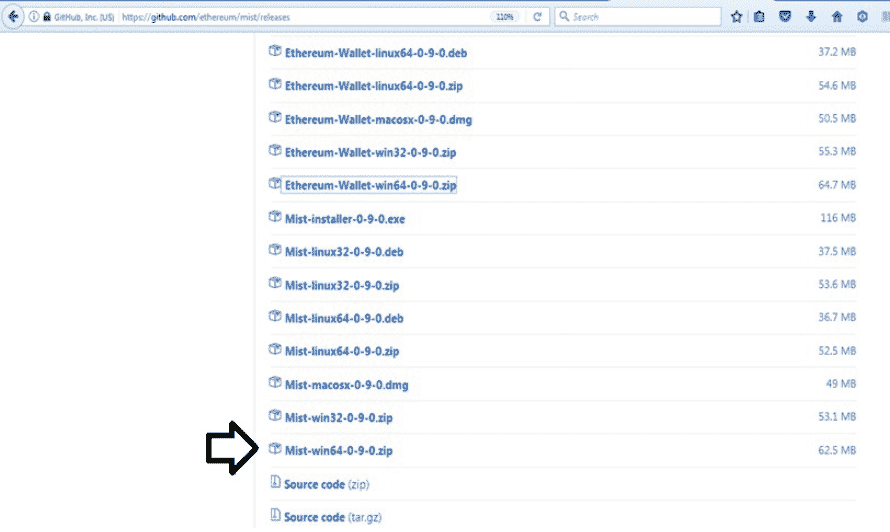

图 3.21：Mist 安装程序包

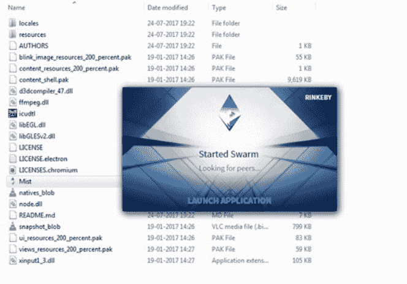

图 3.22：MIST 在 RINKEBY 公共区块链上的默认启动（避免这一步）

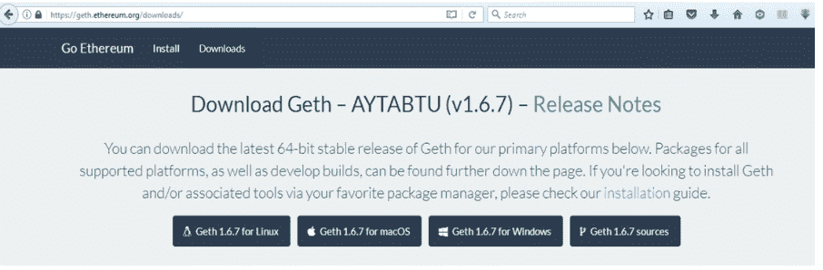

## 具体版本

如果你在寻找特定的版本、操作系统或架构，下面你会找到：

- Geth 和工具的所有稳定版和开发版构建
- 非主要处理器架构的归档
- Android 库归档和 iOS XCode 框架

请从下面的列表中选择你想要的平台，并下载你选择的软件包。请注意，MD5 校验和是由我们的二进制托管平台（Azure Blobstore）提供的，以帮助检查下载错误。有关安全保证，请通过附带的 PGP 签名文件验证任何下载（参见 OpenPGP）。

图 3.23：Geth 下载页面

图 3.24：Geth 成功安装页面

图 3.25：Cygwin 安装程序

图 3.26：Node.js 安装向导

## 编写创世区块

创建私有区块链的第一步是创建一个创世区块。这基本上就是提交一个包含以下详细信息的 JavaScript Object Notation（JSON）文件。在本章中，我们只是展示结构，而不是深入探讨区块内容的含义。需要记住的一点是，对于 chainId 参数，要使用一个不是 1 的随机整数，如图 3.27 所示：

```
{
  "coinbase" : "0x0000000000000000000000000000000000000001",
  "difficulty" : "0x20000",
  "extraData" : "",
  "gasLimit" : "0x2fef d8",
  "nonce" : "0x0000000000000042",
  "mixhash" : "0x0000000000000000000000000000000000000000000000000000000000000000",
  "parentHash" : "0x0000000000000000000000000000000000000000000000000000000000000000",
  "timestamp" : "0x00",
  "alloc": {},
  "config": {
    "chainId": 15,
    "homesteadBlock": 0,
    "eip155Block": 0,
    "eip158Block": 0
  }
}
```

图 3.27：genesis.json


... geth.ipc 表示我们走在正确的轨道上。此步骤是可选的，用于检查 geth 是否能够打开端口 30303 的

## Inter-Process Communication (IPC):

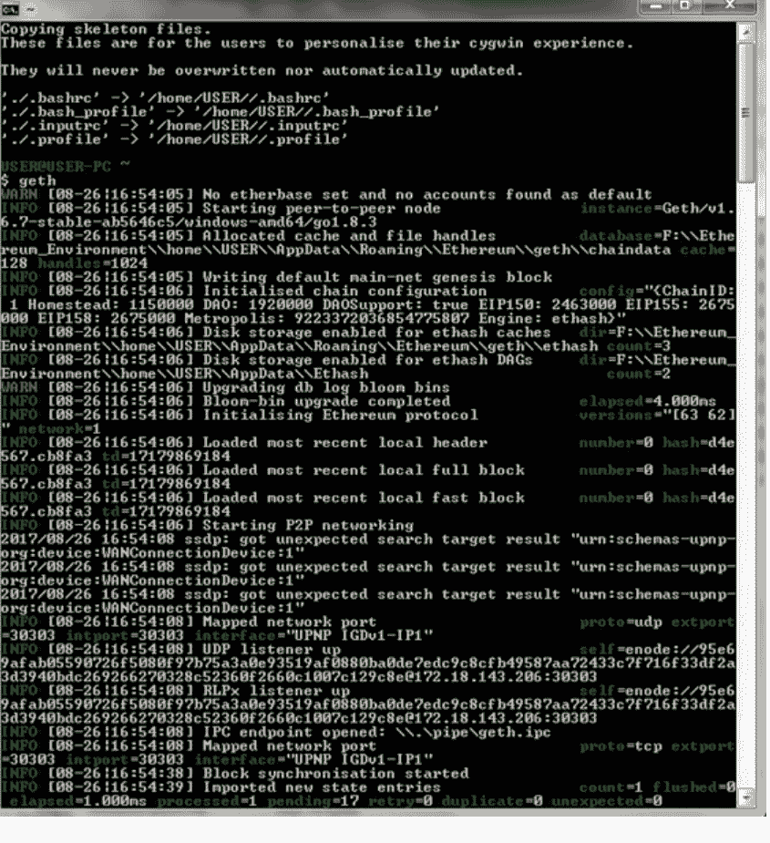

Figure 3.29: Starting geth for the first time

+   3. 现在，在旧的 Cygwin 窗口中，我们输入以下命令，如 *Figure 3.30* 所示：

```
```bash
$ geth --datadir=./chaindata/ init genesis.json
```
```

+   4. 这会启动 geth 的数据目录，使其由 `chaindata` 目录使用创世状态进行分配。简单来说，我们已在命令行中启动了我们的私有区块链：

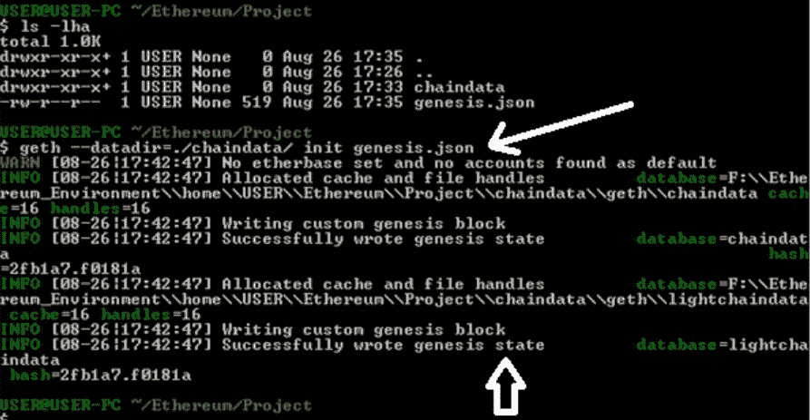

Figure 3.30: Initiating geth with a private blockchain

+   5. 我们现在可以编写命令 `$ geth --datadir=./chaindata/`，如 *Figure 3.31* 所示。这会将 geth 连接到我们的私有区块链，而无需显式启动到创世状态：

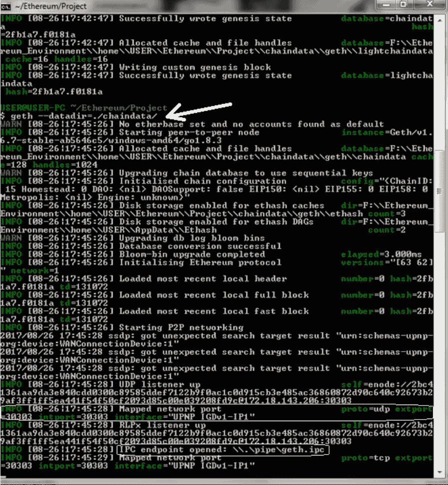

Figure 3.31: Starting a private blockchain using geth

## Connecting MIST browser using geth

在用 chaindata 目录启动 geth 后，如果我们打开 MIST 浏览器，它会连接到 PRIVATE-NET，如 Figure 3.33 所示，而不是公共区块链 RINKEBY（参见 Figure 3.22）：

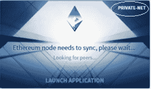

Figure 3.33: MIST launching in PRIVATE-NET

现在，我们在私有区块链之上在 MIST 中创建一个新的钱包账户，如 Figure 3.34 和 Figure 3.35 所示。在 Figure 3.36 中，我们将此新账户指定为我们的主要 etherbase 账户：

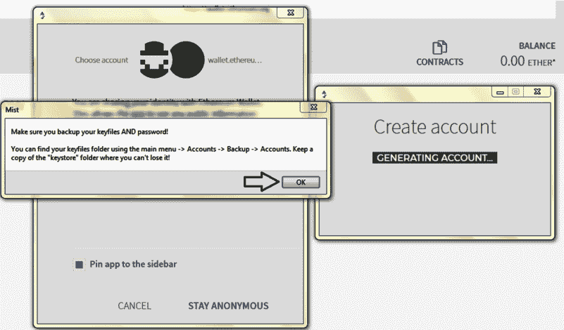

# Figure 3.34: Creating a new account on a private blockchain

# Figure 3.35: Generating the new MIST account

# Figure 3.36: Authorize new account as main etherbase account

## Mining ethers in a private blockchain

我们返回到一个新的 Cygwin 命令窗口并输入 $ geth attach 以将 geth 附加到 IPC，如 Figure 3.37 所示。然后我们输入 $ miner.start(1);。请注意，以 datadir 启动的后台 geth 窗口应仍在运行。挖矿区块需要一段时间，然后我们可以使用命令 $ miner.stop(); 停止矿工。为了检查中间步骤，我们可以在 geth 中启动矿工之前增加一个额外步骤。命令是 $ debug.verbosity(4);。

Figure 3.37 还描绘了我们已挖矿的区块数量（100）和作为奖励赚取的以太币（500.00）。请注意，这些以太币没有市场价值，因为它们是在我们的私有区块链上挖矿的，而不是在主公共以太坊区块链上。然而，我们可以使用这些以太币部署智能合约，我们将在下一节中说明：

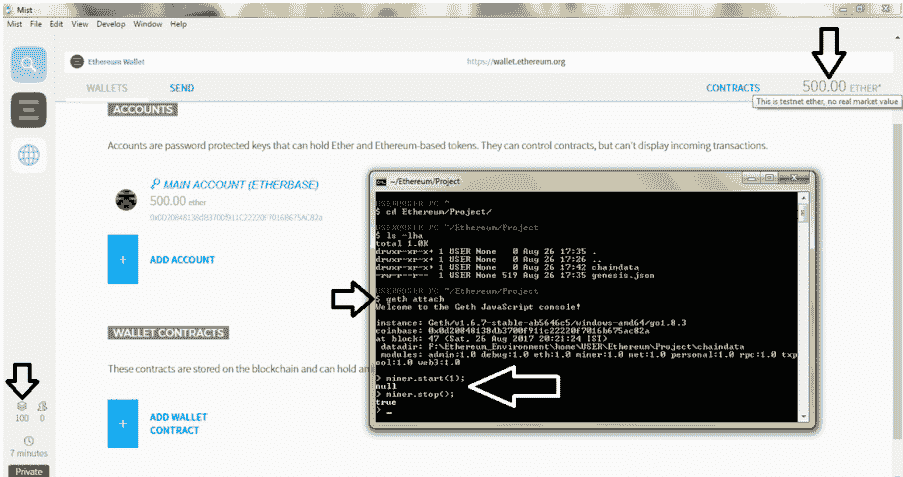

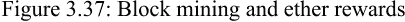

## Deploying smart contracts on our private chain

现在我们已经挖矿了相当多的以太币，我们可以开始部署我们的智能合约。Figure 3.38、Figure 3.39、Figure 3.40、Figure 3.41、Figure 3.42、Figure 3.43、Figure 3.44 和 Figure 3.45 描述了如何创建一个智能合约，然后在私有区块链上部署它，花费一些以太币，然后执行合约，其中每个步骤都需要我们花费一些以太币。我们已在后台保持矿工启动，以便我们的账户不断获得以太币奖励，我们不会在智能合约执行过程中耗尽以太币。我们也需要挖矿来部署智能合约。使用的智能合约是我们在本章前面讨论的增量和减量操作，使用 remix 浏览器 IDE：

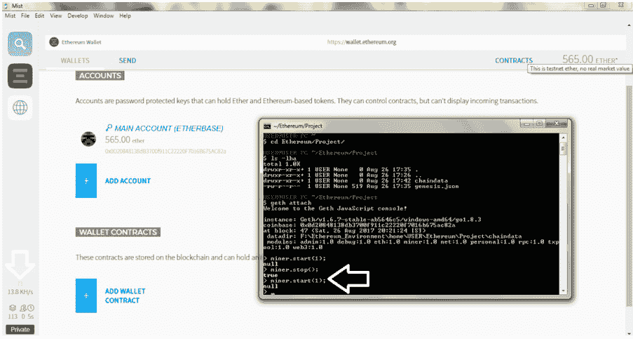

Figure 3.38: Restarting the miner in the background to keep the ether rewards coming

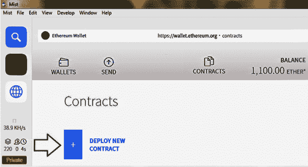

Figure 3.39: Creating a new contract (Click + sign)

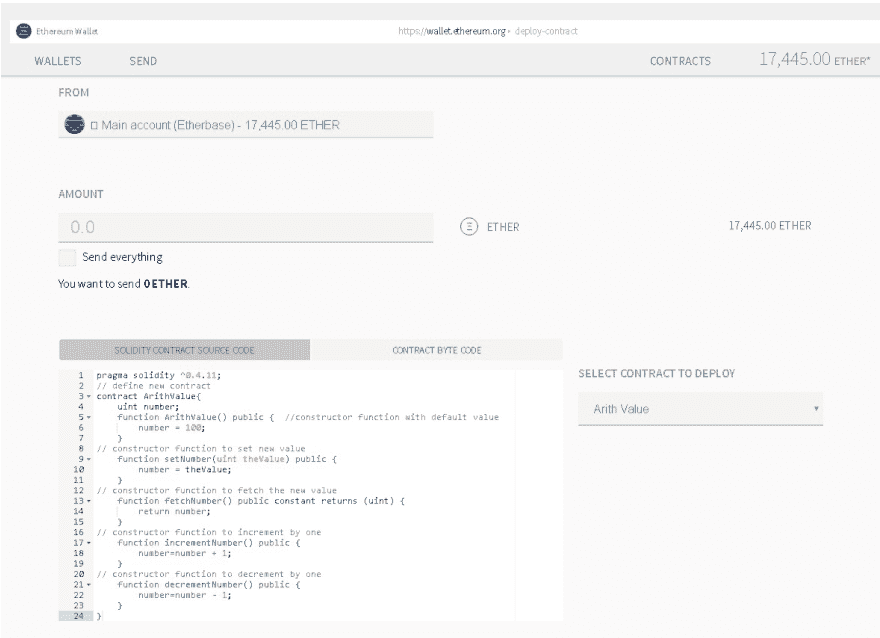

Figure 3.40: Coding the ArithValue.sol

# Figure 3.41: Deploy the smart contract after fee selection

Ethereum Wallet

WALLETS SEND

CONTRACTS 17,445.00 ETHER*

SELECT CONTRACT TO DEPLOY

Arith Value

```
pragma solidity ^0.4.11;
// define new contract
contract ArithValue{
uint number;
function ArithValue() public { //constructor function with default value
number = 100;
}
// constructor function to set new value
function setNumber(uint theValue) public {
number = theValue;
}
// constructor function to fetch the new value
function fetchNumber() public constant returns (uint) {
return number;
}
// constructor function to increment by one
function incrementNumber() public {
number=number + 1;
}
// constructor function to decrement by one
function decrementNumber() public {
number=number - 1;
}
}
```

SELECT FEE

0 ETHER

CHEAPER FASTER

This is the most amount of money that might be used to process this transaction. Your transaction will be mined probably within 30 seconds

TOTAL

0.00 ETHER

DEPLOY

# Create contract

0.00 ETHER

0x0d20...c82a

Create contract

You are about to create a contract from the provided data.

Estimated fee consumption
0.00517385 ether (143,718 gas)

Provide maximum fee
0.00877385 ether (243,718 gas)

Gas price
0.036 ether per million gas

# RAW DATA

```
0x6060604052341561000f57600080fd5b5b6064600055b5b61010a80
6100266000396000f300606060405263ffffffff7c0100000000000000
000000000000000000000000000000000000000000000000000000000000
... 
```

CONFIRMING...

Figure 3.42: Confirming the contract after authorizing with passcode (new123456)

Mist File Edit View Develop Window Help

Ethereum Wallet
https://wallet.ethereum.org

WALLETS SEND CONTRACTS 1,300.00 ETHER*

# LATEST TRANSACTIONS

Filter transactions

Aug 26
Created contract
Main account (Etherbase) → Created contract at : Arith Value #446
5 of 12 Confirmations
-0.00 ETHER

Figure 3.43: Confirmation through miner in progress for the smart contract (12 of 12 means complete)

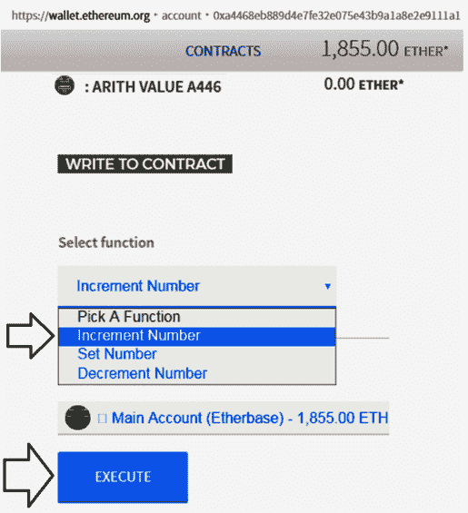

Figure 3.44: Executing the increment number operation in the CONTRACTS tab

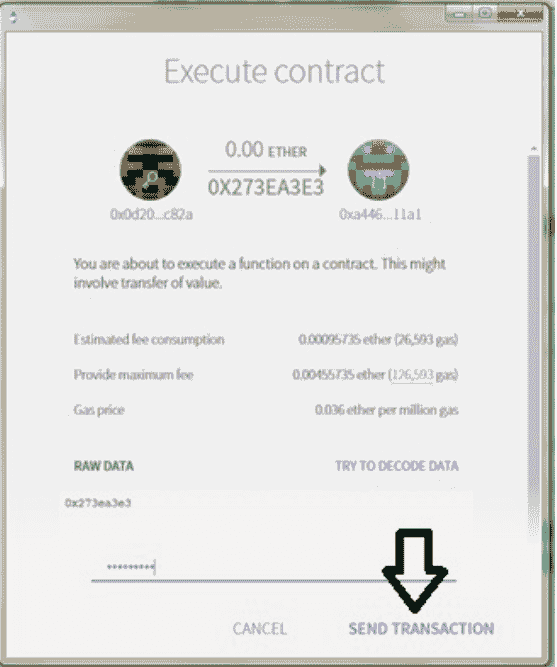

# Figure 3.45: Execute the contract operation

# Figure 3.46: The increment operator has increased 100 to 101 (similarly, we try the other operations)

# Figure 3.47: Log of all the operations executed after smart contract creation

## Summary

本章更像是一个以最小理论支持为主的实验练习。我们从 remix IDE 上使用网络浏览器上的一个简单的 hello world 智能合约开始。我们还探索了使用合约的增量和减量操作。然后我们进入 Solidity 编码一个快速的 for 循环，并继续学习如何在排查故障时咨询并在 GitHub 上提出问题。我们通过使用 geth 控制台创建私有区块链、挖矿区块、以太币奖励以及使用这些以太币在 MIST 浏览器中部署和执行智能合约结束了本章。

在第 4 章 *A Noob's Guide to DApps and DAO* 中，我们将讨论去中心化应用和 DAO 的主题。
